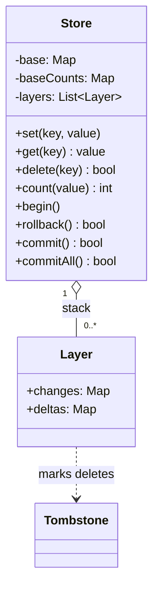
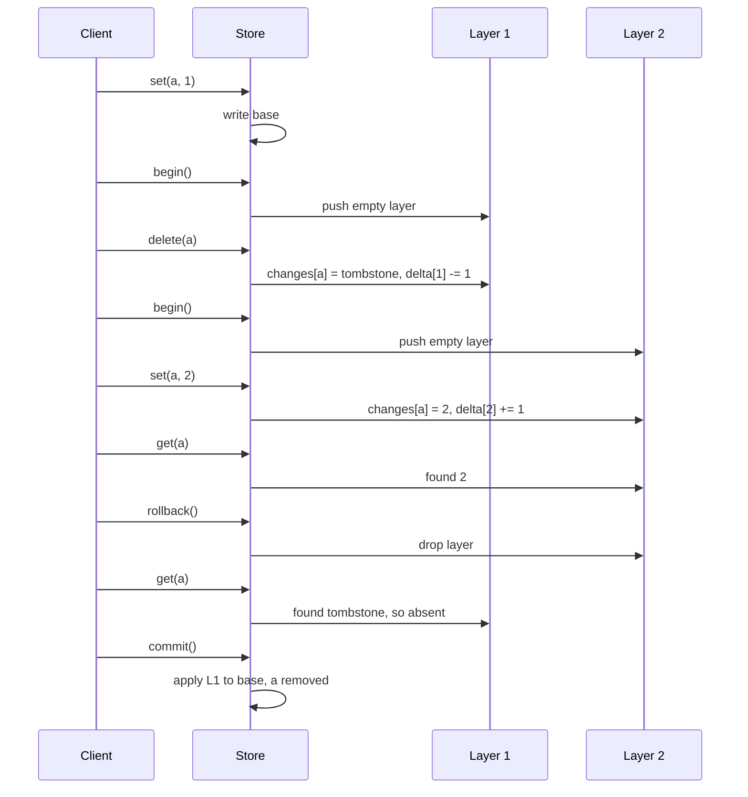

## In one minute
- The store is three ideas stacked: a hash map for committed data, a stack of change sets for open transactions, and a per-value counter so "how many keys hold this value" is not a scan.
- A transaction does not copy the data and does not write into the base. It writes into a small overlay that records only what changed, and a delete is a *tombstone* entry in that overlay. Rollback then costs nothing: throw the overlay away.
- Reads walk the stack from the newest layer down, so `get` is O(depth). Commit of an inner layer merges it into its parent in O(size of the layer). Keep these costs explicit; they are the heart of the interview answer.
- The counter must follow the same layering as the data. Store a signed *delta* per value in each layer, and `count` is the base count plus the deltas. Otherwise rollback silently corrupts counts.
- The shape is **multi-step consistency**: several changes must become visible together or not at all. The same stack-of-savepoints idea runs inside SQL databases, ORMs and editor undo.

## Requirements

Functional:
- `set(key, value)`, `get(key)` (absent returns nothing) and `delete(key)` (reports whether the key existed).
- `count(value)`: how many keys currently hold this value, as seen by the caller inside the current transaction.
- `begin()` opens a transaction and may be nested to any depth. `rollback()` discards the innermost open transaction. `commit()` makes the innermost transaction part of its parent. `commit_all()` commits every open level at once, which is what a bare `COMMIT` does in many simple shells.
- `rollback()` or `commit()` with no open transaction is an error the caller can see, never a silent no-op.

Non-functional:
- `get`, `set`, `delete` and `count` cost O(depth) at worst, and O(1) when no transaction is open.
- `begin` and `rollback` are O(1). `commit` is O(changes in the committed layer), never O(store size).
- A transaction sees its own writes and its ancestors' writes, and nobody else's.
- Fully deterministic: no clock is involved, so tests need none.

Out of scope: durability (a write-ahead log), isolation between concurrent clients, TTLs and range scans. Mention them under Extensibility and move on.

## Entities and relationships
- **Store**: the public object. Owns the base map and the stack of layers.
- **Base**: a map of committed key to value, plus a map of committed value to count.
- **Layer**: one open transaction. It holds `changes` (key to new value or a tombstone) and `deltas` (value to a signed integer).
- **Tombstone**: a unique marker meaning "deleted in this layer". It is needed because absence from the overlay means "ask the parent", which is a different statement from "deleted".

The stack is the only relationship that matters: layer *n* can see layers 0 to *n*-1 and the base, and nothing sees upward. Commit collapses the top of the stack one step; rollback pops it.

## Class diagram



## Key flows



Walk the flow in words. A `set` first looks up the current visible value of the key, because the delta needs the *old* value to decrement. It then records the new value in the top layer, subtracts one from the old value's delta and adds one to the new value's delta. A `delete` is the same with a tombstone as the new value. A `get` scans layers newest first and returns the first entry it meets, treating a tombstone as "absent" and stopping there. A `count` sums the base count and every layer's delta for that value.

## Design patterns used and why
- **Memento-style snapshots, avoided.** The obvious way to support rollback is to copy the whole map on `begin` ([Memento](https://refactoring.guru/design-patterns/memento) stores a snapshot of state). That makes `begin` O(n) and every nested level another full copy. An overlay stores only the difference, so cost follows the size of the change, not the size of the store.
- **Unit of Work.** A layer is a small unit of work: it accumulates changes and either flushes them to its parent or is dropped ([Fowler](https://martinfowler.com/eaaCatalog/unitOfWork.html)).
- **Command and undo log, the alternative.** Instead of overlays you can write through to the base and push an inverse record per write onto an undo stack ([Command](https://refactoring.guru/design-patterns/command) objects with an `undo`). Reads and counts become O(1), but rollback costs O(changes) and the data in the base is uncommitted, which hurts as soon as another reader exists. See the trade-offs table.
- **Null Object / sentinel.** The tombstone is a sentinel that lets one dictionary say three things: present with a value, deleted, or no opinion.

## Concurrency and edge cases
- **Delete then set in one layer.** `delete(a)` leaves a tombstone, then `set(a, 5)` overwrites it. The delta for the old value was already decremented by the delete, so the set must read the visible value as absent and add only the new one. Computing the old value from the stack, not from the layer alone, makes this fall out correctly.
- **Setting the same value.** `set(a, 1)` when `a` is already `1` subtracts one and adds one to the same slot. The net delta is zero, which is right. Do not special-case it away, because special cases are where counts drift.
- **Delete of a missing key.** It must report `false` and must not create a tombstone or touch any delta. A phantom tombstone would later decrement a count that was never incremented.
- **Commit onto a parent that already has the key.** The child's entry replaces the parent's, and the child's deltas are *added* to the parent's. Replacing the deltas would lose the parent's own changes.
- **Tombstones that reach the base.** When the outermost layer commits, a tombstone removes the key from the base and is then forgotten. Zero-valued count entries should be dropped so the count map does not grow with every value ever seen.
- **Rollback or commit with no transaction.** Return an error or `false`. Silent success hides bugs, and the Rails documentation shows what silence costs (see In the wild).
- **Threads.** The simplest correct answer is one mutex around every method, which gives one global serial order. A transaction that spans several calls needs its own session object per client, otherwise two clients share one stack. Say that out loud, then keep the single-client design.

## In the wild
- **GitLab, 2021: SAVEPOINT stalls on replicas.** Intermittent minutes-long stalls on GitLab.com produced 500 errors for users. After weeks of investigation GitLab traced them to subtransactions: a `SAVEPOINT` inside a long-running transaction can degrade PostgreSQL replicas, and the Rails application was using them, for example through `requires_new: true`. The team instrumented the application to log any transaction issuing more than 32 `SAVEPOINT` calls and then removed `SAVEPOINT` queries from the codebase ([GitLab blog](https://about.gitlab.com/blog/2021/09/29/why-we-spent-the-last-month-eliminating-postgresql-subtransactions/)). Lesson: a nested-transaction stack is cheap in your toy store and not free in a real database.
- **Rails, long-standing behaviour: nested `transaction` blocks that do not roll back.** By default a nested `transaction` block joins the outer one. An `ActiveRecord::Rollback` raised in the inner block is captured there, the parent does not see it, and the real transaction commits. Asking for a real sub-transaction needs `requires_new: true`, which creates a savepoint ([Rails API docs](https://api.rubyonrails.org/classes/ActiveRecord/Transactions/ClassMethods.html)). The same page notes that on MySQL a DDL statement inside the block releases the savepoint implicitly, so the later release fails.
- **Redis, by design: no rollback.** A transaction queued with `MULTI` and run with `EXEC` executes all queued commands in order, but if one fails the others still run. The docs state that Redis does not support rollback because it would hurt simplicity and performance, and that `DISCARD` only drops a queue that has not run yet ([Redis docs](https://redis.io/docs/latest/develop/using-commands/transactions/)). This is the opposite design choice to the one in this lesson, and a good answer can say when it is reasonable.

## Down the stack

### Layer 1: The contract
Isolation inside one client, atomicity at each level. After `rollback()`, every `get` and `count` must return exactly what it returned before the matching `begin()`. After `commit()` of the innermost level, the parent sees every change as if it had made it itself, and a later rollback of the parent erases them. After the outermost `commit()`, the base holds the result. SQLite states the same semantics for savepoints: `ROLLBACK TO` reverts to the state just after the `SAVEPOINT` and does not cancel the transaction, and `RELEASE` of an inner savepoint merges it into its parent and writes nothing to the database file ([SQLite savepoints](https://www.sqlite.org/lang_savepoint.html)). Our `rollback` is "rollback to and remove", and our `commit` is `RELEASE`.

### Layer 2: The mechanism
Every operation is defined over a visible-value lookup. `visible(key)` scans layers from the top and returns the first entry found, then falls back to the base. All writes call `visible` once to learn the old value, then write one entry and two delta adjustments to the top layer. Costs, with *d* the depth, *k* the number of keys in the layer and *m* the number of distinct values:

| Operation | Cost |
|---|---|
| `get`, `set`, `delete`, `count` | O(d) |
| `begin`, `rollback` | O(1) |
| `commit` (inner) | O(k + distinct values in the layer) |
| `commit` (outermost) | the same, applied to the base |
| `commit_all` | sum over layers; fold from the top down |

A real engine has the same split. SQLite keeps a stack of savepoints in a transaction, and releasing one only removes markers from that stack ([SQLite savepoints](https://www.sqlite.org/lang_savepoint.html)); the page changes themselves reach disk through a rollback journal (or a write-ahead log in WAL mode) when the outermost transaction commits ([SQLite atomic commit](https://www.sqlite.org/atomiccommit.html)). PostgreSQL assigns a transaction ID to a subtransaction when it needs one ([GitLab blog](https://about.gitlab.com/blog/2021/09/29/why-we-spent-the-last-month-eliminating-postgresql-subtransactions/)), and `ROLLBACK TO SAVEPOINT` undoes work since the savepoint while the outer transaction continues ([PostgreSQL SAVEPOINT](https://www.postgresql.org/docs/current/sql-savepoint.html)).

### Layer 3: The machine
Each layer lookup is a hash and a probe into an open-addressed table. In CPython a dict lookup on a short string key is a few tens of nanoseconds when the table is in cache, and a few hundred if each probe misses to DRAM (rough figures; measure on your hardware). A depth-10 stack therefore turns one logical read into ten probes, which is why deep nesting is unusual and why `begin` should stay cheap rather than speculatively copy. Each layer is also an allocation of two small hash tables, so a loop that opens and closes a transaction per item pays allocator and garbage-collector cost; reuse or flatten if profiling shows it. Go's maps are not safe for concurrent use and its runtime aborts a program that detects concurrent map writes, which is why the mutex matters there.

### Why it's built this way
1. Data lives in RAM and is addressed by key, so a hash table gives O(1) reads. That is the base.
2. Copying the table to allow rollback costs O(n) per `begin`, which is far too slow for a store with millions of keys. So record only differences.
3. Differences must distinguish "deleted" from "unchanged", so deletes become tombstones.
4. A scan to answer `count` would be O(n), so maintain counts incrementally. The counts are state too, so they must be layered in the same way, as deltas.
5. Nesting makes layers a stack, and the stack's cost model (reads O(depth), merge on commit) follows directly.

## Extensibility
- **Durability.** Append each committed layer as one record to a write-ahead log, then fsync. Recovery replays whole records, so a crash applies a transaction fully or not at all.
- **Concurrent clients.** Give each client a session with its own layer stack over a shared base. Add a version number to the base and, at commit, abort if a key the transaction read has changed (optimistic concurrency). Redis offers this as `WATCH`.
- **Undo-log variant.** Switch to write-through plus an inverse log if reads dominate. Counts stay O(1); rollback costs O(changes).
- **Savepoint names.** `ROLLBACK TO name` can unwind several layers at once: pop until the named one. This needs only a name stored on each layer.
- **Snapshots without depth cost.** Persistent maps (hash array mapped tries) share structure, so `begin` is O(1) and reads are O(log n) at any depth.

## Leadership lens
- Ask in review: what does rollback mean for the *counters, caches and indexes* derived from the data? Derived state is where most transaction bugs hide.
- Decide whether nested transactions are a feature or an accident. Rails shows the default can be "joins the parent", and a team that assumes savepoint behaviour will lose rollbacks silently.
- Put a cap or a metric on nesting depth. GitLab only found its problem after instrumenting the application to count savepoints per transaction.
- Build first: flat `begin`/`commit`/`rollback`, then nesting, then the counter. Ship the invariant test (rollback restores everything) before any optimisation.
- Cost drivers are memory for open layers and the length of long-lived transactions, not CPU.

## Check yourself
1. Why does the layer store a tombstone for a delete instead of removing the key from its own map?
   **Answer:** Absence from a layer means "ask the parent". Removing the entry would make the parent's value visible again, so the delete would be undone.
2. A transaction sets `a=1` where `a` was absent, then deletes `a`, then rolls back. What is `count(1)` and why?
   **Answer:** Unchanged from before `begin`. The set added +1 and the delete added -1 to that layer's delta, and rollback drops the layer anyway.
3. What goes wrong if `commit` copies the child's deltas over the parent's instead of adding them?
   **Answer:** The parent's own count changes for the same value are lost, so `count` is wrong after the commit and stays wrong after the base absorbs it.
4. When would you choose an undo log over overlays, and what do you give up?
   **Answer:** Choose it when reads and counts dominate and transactions are short, since reads are O(1). You give up cheap rollback and clean isolation, because uncommitted data sits in the base.

## Practice
**Task:** Implement a key-value store with nested transactions and value counting. `set(key, value)`, `get(key)` (absent gives none/undefined/false), `delete(key)` (returns whether the key existed) and `count(value)` (number of keys currently holding that value) all see the caller's open transactions. `begin()` opens a layer. `rollback()` discards the innermost layer and `commit()` merges it into its parent (the base when it is the outermost); both return false when no transaction is open. `commit_all()` commits every open layer and returns false when none is open. Use an overlay per layer holding changes (with a tombstone for deletes) and a signed delta per value, so `begin` and `rollback` are O(1). Values are strings. No clock or randomness is involved.

```python starter
class Store:
    def __init__(self):
        # TODO: base map, base counts, stack of layers
        pass

    def set(self, key, value):
        raise NotImplementedError

    def get(self, key):
        raise NotImplementedError

    def delete(self, key):
        raise NotImplementedError

    def count(self, value):
        raise NotImplementedError

    def begin(self):
        raise NotImplementedError

    def rollback(self):
        raise NotImplementedError

    def commit(self):
        raise NotImplementedError

    def commit_all(self):
        raise NotImplementedError
```

```python tests
def test_basic_set_get_delete():
    s = Store()
    assert s.get("a") is None
    s.set("a", "x")
    assert s.get("a") == "x"
    assert s.delete("a") is True
    assert s.delete("a") is False, "second delete reports missing"
    assert s.get("a") is None

def test_count_follows_overwrites_and_deletes():
    s = Store()
    s.set("a", "x")
    s.set("b", "x")
    assert s.count("x") == 2
    s.set("a", "y")
    assert s.count("x") == 1 and s.count("y") == 1
    s.set("a", "y")
    assert s.count("y") == 1, "same value twice is not counted twice"
    s.delete("b")
    assert s.count("x") == 0

def test_rollback_restores_data_and_counts():
    s = Store()
    s.set("a", "x")
    s.begin()
    s.set("a", "y")
    s.set("b", "x")
    s.delete("a")
    assert s.get("a") is None and s.count("x") == 1 and s.count("y") == 0
    assert s.rollback() is True
    assert s.get("a") == "x" and s.get("b") is None
    assert s.count("x") == 1 and s.count("y") == 0

def test_nested_rollback_only_discards_inner():
    s = Store()
    s.begin()
    s.set("a", "1")
    s.begin()
    s.set("a", "2")
    s.delete("a")
    s.set("a", "3")
    assert s.get("a") == "3"
    s.rollback()
    assert s.get("a") == "1"
    s.commit()
    assert s.get("a") == "1" and s.count("1") == 1

def test_inner_commit_is_undone_by_outer_rollback():
    s = Store()
    s.set("a", "x")
    s.begin()
    s.begin()
    s.delete("a")
    s.set("b", "x")
    assert s.commit() is True
    assert s.get("a") is None and s.count("x") == 1
    assert s.rollback() is True
    assert s.get("a") == "x" and s.get("b") is None and s.count("x") == 1

def test_delete_of_missing_key_leaves_no_trace():
    s = Store()
    s.set("a", "x")
    s.begin()
    assert s.delete("zzz") is False
    s.set("zzz", "x")
    s.delete("zzz")
    assert s.count("x") == 1
    s.commit()
    assert s.get("zzz") is None and s.count("x") == 1

def test_commit_all_and_no_transaction():
    s = Store()
    assert s.rollback() is False
    assert s.commit() is False
    assert s.commit_all() is False
    s.begin()
    s.set("a", "x")
    s.begin()
    s.set("b", "x")
    assert s.commit_all() is True
    assert s.count("x") == 2
    assert s.rollback() is False, "nothing left open"
```

```python solution
_TOMB = object()


class Store:
    def __init__(self):
        self._base = {}
        self._counts = {}
        self._layers = []  # each layer: (changes, deltas)

    def _visible(self, key):
        for changes, _ in reversed(self._layers):
            if key in changes:
                v = changes[key]
                return None if v is _TOMB else v
        return self._base.get(key)

    def _write(self, key, new):
        old = self._visible(key)
        if not self._layers:
            if old is not None:
                self._bump(self._counts, old, -1)
            if new is _TOMB:
                self._base.pop(key, None)
            else:
                self._base[key] = new
                self._bump(self._counts, new, 1)
            return
        changes, deltas = self._layers[-1]
        changes[key] = new
        if old is not None:
            self._bump(deltas, old, -1)
        if new is not _TOMB:
            self._bump(deltas, new, 1)

    @staticmethod
    def _bump(table, value, by):
        n = table.get(value, 0) + by
        if n == 0:
            table.pop(value, None)
        else:
            table[value] = n

    def set(self, key, value):
        self._write(key, value)

    def get(self, key):
        return self._visible(key)

    def delete(self, key):
        if self._visible(key) is None:
            return False
        self._write(key, _TOMB)
        return True

    def count(self, value):
        total = self._counts.get(value, 0)
        for _, deltas in self._layers:
            total += deltas.get(value, 0)
        return total

    def begin(self):
        self._layers.append(({}, {}))

    def rollback(self):
        if not self._layers:
            return False
        self._layers.pop()
        return True

    def commit(self):
        if not self._layers:
            return False
        changes, deltas = self._layers.pop()
        if self._layers:
            pchanges, pdeltas = self._layers[-1]
            pchanges.update(changes)
            for v, d in deltas.items():
                self._bump(pdeltas, v, d)
        else:
            for k, v in changes.items():
                if v is _TOMB:
                    self._base.pop(k, None)
                else:
                    self._base[k] = v
            for v, d in deltas.items():
                self._bump(self._counts, v, d)
        return True

    def commit_all(self):
        if not self._layers:
            return False
        while self._layers:
            self.commit()
        return True
```

```typescript starter
export class Store {
  set(key: string, value: string): void {
    throw new Error("TODO");
  }
  get(key: string): string | undefined {
    throw new Error("TODO");
  }
  delete(key: string): boolean {
    throw new Error("TODO");
  }
  count(value: string): number {
    throw new Error("TODO");
  }
  begin(): void {
    throw new Error("TODO");
  }
  rollback(): boolean {
    throw new Error("TODO");
  }
  commit(): boolean {
    throw new Error("TODO");
  }
  commitAll(): boolean {
    throw new Error("TODO");
  }
}
```

```typescript tests
test("basic set get delete", () => {
  const s = new Store();
  assertEqual(s.get("a"), undefined);
  s.set("a", "x");
  assertEqual(s.get("a"), "x");
  assertEqual(s.delete("a"), true);
  assertEqual(s.delete("a"), false, "second delete reports missing");
  assertEqual(s.get("a"), undefined);
});

test("count follows overwrites and deletes", () => {
  const s = new Store();
  s.set("a", "x");
  s.set("b", "x");
  assertEqual(s.count("x"), 2);
  s.set("a", "y");
  assertEqual([s.count("x"), s.count("y")], [1, 1]);
  s.set("a", "y");
  assertEqual(s.count("y"), 1, "same value twice is not counted twice");
  s.delete("b");
  assertEqual(s.count("x"), 0);
});

test("rollback restores data and counts", () => {
  const s = new Store();
  s.set("a", "x");
  s.begin();
  s.set("a", "y");
  s.set("b", "x");
  s.delete("a");
  assertEqual([s.get("a"), s.count("x"), s.count("y")], [undefined, 1, 0]);
  assertEqual(s.rollback(), true);
  assertEqual([s.get("a"), s.get("b")], ["x", undefined]);
  assertEqual([s.count("x"), s.count("y")], [1, 0]);
});

test("nested rollback only discards inner", () => {
  const s = new Store();
  s.begin();
  s.set("a", "1");
  s.begin();
  s.set("a", "2");
  s.delete("a");
  s.set("a", "3");
  assertEqual(s.get("a"), "3");
  s.rollback();
  assertEqual(s.get("a"), "1");
  s.commit();
  assertEqual([s.get("a"), s.count("1")], ["1", 1]);
});

test("inner commit is undone by outer rollback", () => {
  const s = new Store();
  s.set("a", "x");
  s.begin();
  s.begin();
  s.delete("a");
  s.set("b", "x");
  assertEqual(s.commit(), true);
  assertEqual([s.get("a"), s.count("x")], [undefined, 1]);
  assertEqual(s.rollback(), true);
  assertEqual([s.get("a"), s.get("b"), s.count("x")], ["x", undefined, 1]);
});

test("delete of missing key leaves no trace", () => {
  const s = new Store();
  s.set("a", "x");
  s.begin();
  assertEqual(s.delete("zzz"), false);
  s.set("zzz", "x");
  s.delete("zzz");
  assertEqual(s.count("x"), 1);
  s.commit();
  assertEqual([s.get("zzz"), s.count("x")], [undefined, 1]);
});

test("commitAll and no transaction", () => {
  const s = new Store();
  assertEqual([s.rollback(), s.commit(), s.commitAll()], [false, false, false]);
  s.begin();
  s.set("a", "x");
  s.begin();
  s.set("b", "x");
  assertEqual(s.commitAll(), true);
  assertEqual(s.count("x"), 2);
  assertEqual(s.rollback(), false, "nothing left open");
});
```

```typescript solution
// A null entry in `changes` is the tombstone.
interface Layer {
  changes: Map<string, string | null>;
  deltas: Map<string, number>;
}

function bump(table: Map<string, number>, value: string, by: number): void {
  const n = (table.get(value) ?? 0) + by;
  if (n === 0) table.delete(value);
  else table.set(value, n);
}

export class Store {
  private base = new Map<string, string>();
  private counts = new Map<string, number>();
  private layers: Layer[] = [];

  private visible(key: string): string | undefined {
    for (let i = this.layers.length - 1; i >= 0; i--) {
      const ch = this.layers[i].changes;
      if (ch.has(key)) {
        const v = ch.get(key);
        return v === null || v === undefined ? undefined : v;
      }
    }
    return this.base.get(key);
  }

  private write(key: string, next: string | null): void {
    const old = this.visible(key);
    if (this.layers.length === 0) {
      if (old !== undefined) bump(this.counts, old, -1);
      if (next === null) this.base.delete(key);
      else {
        this.base.set(key, next);
        bump(this.counts, next, 1);
      }
      return;
    }
    const top = this.layers[this.layers.length - 1];
    top.changes.set(key, next);
    if (old !== undefined) bump(top.deltas, old, -1);
    if (next !== null) bump(top.deltas, next, 1);
  }

  set(key: string, value: string): void {
    this.write(key, value);
  }

  get(key: string): string | undefined {
    return this.visible(key);
  }

  delete(key: string): boolean {
    if (this.visible(key) === undefined) return false;
    this.write(key, null);
    return true;
  }

  count(value: string): number {
    let total = this.counts.get(value) ?? 0;
    for (const l of this.layers) total += l.deltas.get(value) ?? 0;
    return total;
  }

  begin(): void {
    this.layers.push({ changes: new Map(), deltas: new Map() });
  }

  rollback(): boolean {
    if (this.layers.length === 0) return false;
    this.layers.pop();
    return true;
  }

  commit(): boolean {
    const top = this.layers.pop();
    if (top === undefined) return false;
    const parent = this.layers[this.layers.length - 1];
    if (parent !== undefined) {
      top.changes.forEach((v, k) => parent.changes.set(k, v));
      top.deltas.forEach((d, v) => bump(parent.deltas, v, d));
    } else {
      top.changes.forEach((v, k) => {
        if (v === null) this.base.delete(k);
        else this.base.set(k, v);
      });
      top.deltas.forEach((d, v) => bump(this.counts, v, d));
    }
    return true;
  }

  commitAll(): boolean {
    if (this.layers.length === 0) return false;
    while (this.layers.length > 0) this.commit();
    return true;
  }
}
```

```go starter
package practice

// Store is an in-memory key-value store with nested transactions.
type Store struct{}

func NewStore() *Store { return &Store{} }

func (s *Store) Set(key, value string)           { panic("TODO") }
func (s *Store) Get(key string) (string, bool)   { panic("TODO") }
func (s *Store) Delete(key string) bool          { panic("TODO") }
func (s *Store) Count(value string) int          { panic("TODO") }
func (s *Store) Begin()                          { panic("TODO") }
func (s *Store) Rollback() bool                  { panic("TODO") }
func (s *Store) Commit() bool                    { panic("TODO") }
func (s *Store) CommitAll() bool                 { panic("TODO") }
```

```go tests
package practice

import "testing"

func mustGet(t *testing.T, s *Store, key, want string) {
	t.Helper()
	got, ok := s.Get(key)
	if !ok || got != want {
		t.Fatalf("Get(%q) = %q,%v want %q", key, got, ok, want)
	}
}

func mustMiss(t *testing.T, s *Store, key string) {
	t.Helper()
	if v, ok := s.Get(key); ok {
		t.Fatalf("Get(%q) = %q, want absent", key, v)
	}
}

func mustCount(t *testing.T, s *Store, value string, want int) {
	t.Helper()
	if got := s.Count(value); got != want {
		t.Fatalf("Count(%q) = %d want %d", value, got, want)
	}
}

func TestBasicSetGetDelete(t *testing.T) {
	s := NewStore()
	mustMiss(t, s, "a")
	s.Set("a", "x")
	mustGet(t, s, "a", "x")
	if !s.Delete("a") {
		t.Fatal("first delete should report true")
	}
	if s.Delete("a") {
		t.Fatal("second delete should report false")
	}
	mustMiss(t, s, "a")
}

func TestCountFollowsOverwritesAndDeletes(t *testing.T) {
	s := NewStore()
	s.Set("a", "x")
	s.Set("b", "x")
	mustCount(t, s, "x", 2)
	s.Set("a", "y")
	mustCount(t, s, "x", 1)
	mustCount(t, s, "y", 1)
	s.Set("a", "y")
	mustCount(t, s, "y", 1)
	s.Delete("b")
	mustCount(t, s, "x", 0)
}

func TestRollbackRestoresDataAndCounts(t *testing.T) {
	s := NewStore()
	s.Set("a", "x")
	s.Begin()
	s.Set("a", "y")
	s.Set("b", "x")
	s.Delete("a")
	mustMiss(t, s, "a")
	mustCount(t, s, "x", 1)
	mustCount(t, s, "y", 0)
	if !s.Rollback() {
		t.Fatal("rollback should succeed")
	}
	mustGet(t, s, "a", "x")
	mustMiss(t, s, "b")
	mustCount(t, s, "x", 1)
	mustCount(t, s, "y", 0)
}

func TestNestedRollbackOnlyDiscardsInner(t *testing.T) {
	s := NewStore()
	s.Begin()
	s.Set("a", "1")
	s.Begin()
	s.Set("a", "2")
	s.Delete("a")
	s.Set("a", "3")
	mustGet(t, s, "a", "3")
	s.Rollback()
	mustGet(t, s, "a", "1")
	s.Commit()
	mustGet(t, s, "a", "1")
	mustCount(t, s, "1", 1)
}

func TestInnerCommitUndoneByOuterRollback(t *testing.T) {
	s := NewStore()
	s.Set("a", "x")
	s.Begin()
	s.Begin()
	s.Delete("a")
	s.Set("b", "x")
	if !s.Commit() {
		t.Fatal("commit should succeed")
	}
	mustMiss(t, s, "a")
	mustCount(t, s, "x", 1)
	if !s.Rollback() {
		t.Fatal("rollback should succeed")
	}
	mustGet(t, s, "a", "x")
	mustMiss(t, s, "b")
	mustCount(t, s, "x", 1)
}

func TestDeleteOfMissingKeyLeavesNoTrace(t *testing.T) {
	s := NewStore()
	s.Set("a", "x")
	s.Begin()
	if s.Delete("zzz") {
		t.Fatal("delete of missing key should report false")
	}
	s.Set("zzz", "x")
	s.Delete("zzz")
	mustCount(t, s, "x", 1)
	s.Commit()
	mustMiss(t, s, "zzz")
	mustCount(t, s, "x", 1)
}

func TestCommitAllAndNoTransaction(t *testing.T) {
	s := NewStore()
	if s.Rollback() || s.Commit() || s.CommitAll() {
		t.Fatal("no transaction open: all must report false")
	}
	s.Begin()
	s.Set("a", "x")
	s.Begin()
	s.Set("b", "x")
	if !s.CommitAll() {
		t.Fatal("commit all should succeed")
	}
	mustCount(t, s, "x", 2)
	if s.Rollback() {
		t.Fatal("nothing left open")
	}
}
```

```go solution
package practice

// entry is a changed value; del marks a tombstone.
type entry struct {
	val string
	del bool
}

type layer struct {
	changes map[string]entry
	deltas  map[string]int
}

// Store is an in-memory key-value store with nested transactions.
// Not safe for concurrent use; wrap with a mutex or give each client a session.
type Store struct {
	base   map[string]string
	counts map[string]int
	layers []*layer
}

func NewStore() *Store {
	return &Store{base: map[string]string{}, counts: map[string]int{}}
}

func bump(table map[string]int, value string, by int) {
	n := table[value] + by
	if n == 0 {
		delete(table, value)
	} else {
		table[value] = n
	}
}

func (s *Store) visible(key string) (string, bool) {
	for i := len(s.layers) - 1; i >= 0; i-- {
		if e, ok := s.layers[i].changes[key]; ok {
			if e.del {
				return "", false
			}
			return e.val, true
		}
	}
	v, ok := s.base[key]
	return v, ok
}

func (s *Store) write(key string, next entry) {
	old, had := s.visible(key)
	if len(s.layers) == 0 {
		if had {
			bump(s.counts, old, -1)
		}
		if next.del {
			delete(s.base, key)
		} else {
			s.base[key] = next.val
			bump(s.counts, next.val, 1)
		}
		return
	}
	top := s.layers[len(s.layers)-1]
	top.changes[key] = next
	if had {
		bump(top.deltas, old, -1)
	}
	if !next.del {
		bump(top.deltas, next.val, 1)
	}
}

func (s *Store) Set(key, value string) { s.write(key, entry{val: value}) }

func (s *Store) Get(key string) (string, bool) { return s.visible(key) }

func (s *Store) Delete(key string) bool {
	if _, ok := s.visible(key); !ok {
		return false
	}
	s.write(key, entry{del: true})
	return true
}

func (s *Store) Count(value string) int {
	total := s.counts[value]
	for _, l := range s.layers {
		total += l.deltas[value]
	}
	return total
}

func (s *Store) Begin() {
	s.layers = append(s.layers, &layer{changes: map[string]entry{}, deltas: map[string]int{}})
}

func (s *Store) Rollback() bool {
	if len(s.layers) == 0 {
		return false
	}
	s.layers = s.layers[:len(s.layers)-1]
	return true
}

func (s *Store) Commit() bool {
	n := len(s.layers)
	if n == 0 {
		return false
	}
	top := s.layers[n-1]
	s.layers = s.layers[:n-1]
	if n > 1 {
		parent := s.layers[n-2]
		for k, e := range top.changes {
			parent.changes[k] = e
		}
		for v, d := range top.deltas {
			bump(parent.deltas, v, d)
		}
		return true
	}
	for k, e := range top.changes {
		if e.del {
			delete(s.base, k)
		} else {
			s.base[k] = e.val
		}
	}
	for v, d := range top.deltas {
		bump(s.counts, v, d)
	}
	return true
}

func (s *Store) CommitAll() bool {
	if len(s.layers) == 0 {
		return false
	}
	for len(s.layers) > 0 {
		s.Commit()
	}
	return true
}
```

## Mock interview
**Prompt:** Build an in-memory key-value store that supports `SET`, `GET`, `DELETE` and `COUNT value` (how many keys hold that value), plus `BEGIN`, `ROLLBACK` and `COMMIT` with arbitrary nesting. The store holds up to a few million keys, and a typical transaction touches fewer than a hundred. State the complexity of every command.

- Follow-up: A teammate proposes copying the dictionary on `BEGIN`. Walk me through what that costs for 5 million keys and ten nested levels, and what you do instead.
- Follow-up: Inside a transaction a client sets `a=1`, deletes `a`, sets `a=1` again and rolls back. Show me what `COUNT 1` returns at each step and how your structure guarantees it.
- Follow-up: Now two clients use the store at once, each with its own transactions. What breaks, and what would you change?

**A strong answer covers:**
- A base map plus a stack of overlay layers, with the reason overlays beat snapshot copies: `begin` and `rollback` become O(1) and commit is proportional to the change, not the store.
- Tombstones for deletes, and why absence in a layer must mean "ask the parent".
- Counting maintained incrementally as per-layer signed deltas, merged by addition on commit, with the old value read from the visible stack before every write.
- A complexity table: O(depth) reads and writes, O(1) begin and rollback, O(layer size) commit, and the honest note that deep nesting makes reads slower.
- The undo-log alternative (write-through plus inverse records) with its trade-off: O(1) reads and counts, O(changes) rollback, uncommitted data in the base.
- Concurrency: per-client sessions over a shared base, a mutex or optimistic version check at commit, and the mention that real systems (SQLite, PostgreSQL savepoints, Redis `WATCH`) make different choices.

## Sources and further study
**Primary**
- [SQLite: SAVEPOINT](https://www.sqlite.org/lang_savepoint.html): precise semantics of nested `ROLLBACK TO` and `RELEASE`, the model behind this lesson's `rollback` and `commit`.
- [SQLite: atomic commit](https://www.sqlite.org/atomiccommit.html): how a real engine makes a transaction all-or-nothing on disk.
- [PostgreSQL: SAVEPOINT](https://www.postgresql.org/docs/current/sql-savepoint.html): savepoint behaviour and the worked insert example.

**Systems docs**
- [Redis: transactions](https://redis.io/docs/latest/develop/using-commands/transactions/): `MULTI`, `EXEC`, `DISCARD`, `WATCH` and the stated reason Redis has no rollback.
- [Rails: ActiveRecord transactions](https://api.rubyonrails.org/classes/ActiveRecord/Transactions/ClassMethods.html): nested blocks, `requires_new` and the swallowed `Rollback`.
- [Django: database transactions](https://docs.djangoproject.com/en/stable/topics/db/transactions/): `atomic()` and savepoints as nested units.
- [GitLab: eliminating PostgreSQL subtransactions](https://about.gitlab.com/blog/2021/09/29/why-we-spent-the-last-month-eliminating-postgresql-subtransactions/): what savepoints cost at production scale.

**Books**
- *Designing Data-Intensive Applications*, Kleppmann (1st edition): chapter 7 "Transactions", for atomicity, isolation levels and snapshot isolation.
- *Database Internals*, Petrov: chapter 5 "Transaction Processing and Recovery", for buffer management, logs and recovery.

**Other curricula**
- [Wikipedia: Nested transaction](https://en.wikipedia.org/wiki/Nested_transaction): the textbook framing of child transactions committing into a parent.

## Free resources
- [Unit of Work (Martin Fowler)](https://martinfowler.com/eaaCatalog/unitOfWork.html): the pattern behind a layer that accumulates changes and flushes them once.
- [Memento (Refactoring.Guru)](https://refactoring.guru/design-patterns/memento): the snapshot approach this lesson argues against, and when it is fine.
- [Command (Refactoring.Guru)](https://refactoring.guru/design-patterns/command): commands with undo, the basis of the undo-log variant.
- [Multiversion concurrency control (Wikipedia)](https://en.wikipedia.org/wiki/Multiversion_concurrency_control): how real databases keep several versions visible to different readers.
- [PostgreSQL: MVCC introduction](https://www.postgresql.org/docs/current/mvcc-intro.html): the next step once several clients share the store.
