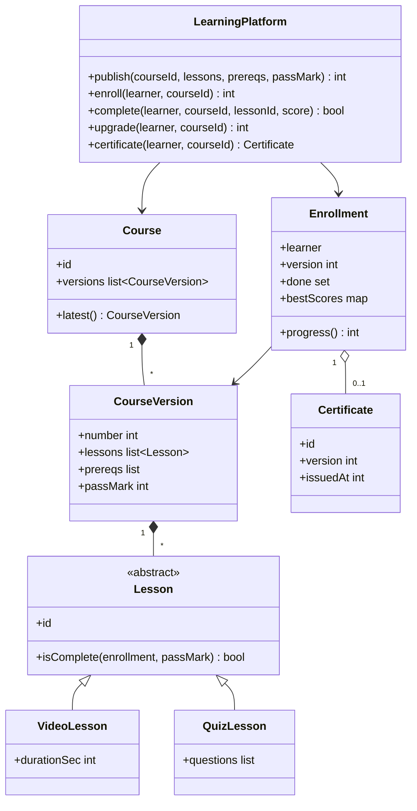
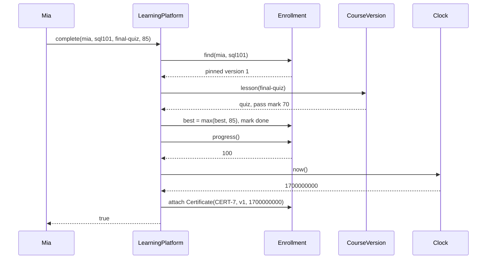

## In one minute
- A learning platform looks like a catalogue of videos, but its hard parts are a learner's progress and the course changing underneath it. Model a **Course** as a series of immutable **CourseVersions**, and pin each **Enrollment** to the version the learner started.
- Progress is a projection of completion events: the set of lessons done in the pinned version. Completion events arrive many times (players retry, phones reconnect), so recording one must be idempotent.
- A quiz lesson is complete when the best score reaches the pass mark. Keep the best score, not the last one, so a later bad attempt never takes credit away.
- Prerequisites form a directed graph between courses and must stay acyclic. Check for a cycle on every publish, because a new version can add an edge that closes a loop.
- The problem shape is **duplicates** (the same "completed" event many times) plus **multi-step consistency** (the last lesson, the 100% progress and the certificate must agree). Release pinning has the same shape: a running build is pinned to the dependency versions it resolved, and upgrading is a deliberate migration.

## Requirements

### Functional
- Instructors publish courses made of ordered lessons. Each lesson is a `video` or a `quiz`. A course has a quiz pass mark and may list prerequisite courses.
- Publishing again creates a new version. Learners already enrolled keep their version until they choose to upgrade; new learners get the latest.
- Learners enroll only after earning a certificate in every prerequisite of the latest version.
- Learners complete video lessons and submit quiz scores. Progress is the percentage of the pinned version's lessons that are complete.
- On reaching 100%, the learner gets a certificate once, stamped with the time and the version they completed.

### Non-functional
- Recording a completion twice has the same effect as recording it once.
- Progress is exact and explainable from the stored completions.
- Content changes never silently change a learner's progress or revoke a certificate.

### Out of scope
- Video delivery and transcoding (see [Design YouTube](../sdi/design-youtube.md)), payments, reviews, discussion forums, and grading code submissions (see [Design LeetCode](../sdi/design-leetcode.md)).

## Entities and relationships

**Course** is an identity: an id, an owner and a list of versions. It has no lessons of its own. **CourseVersion** is an immutable snapshot: a version number, an ordered list of **Lesson** objects, the prerequisite course ids, and the quiz pass mark. Lessons are identified by stable ids that survive across versions, so "lesson `intro`" in version 1 and version 2 is the same lesson for progress purposes.

**Lesson** has an id, a title and a kind. **VideoLesson** knows its duration; **QuizLesson** knows its questions. They differ in what "complete" means: a video is complete when watched, a quiz when the best score reaches the pass mark. That difference is behaviour, so it lives in the lesson type, not in `if kind == "quiz"` checks across the codebase.

**Enrollment** joins a learner to a course and pins a version. It holds the completed lesson ids, each quiz's best score, and an optional **Certificate**. **Certificate** is a value object: an id, the learner, the course, the version completed and the issue time. Once issued it never changes.

**LearningPlatform** is the facade: publish, enroll, record a completion, upgrade, and query progress and certificates. It takes an injected **Clock** for certificate timestamps.

## Class diagram



## Key flows

The flow that ties the design together is the last lesson. Mia has finished two of three lessons and submits the final quiz. The facade records the best score, checks the pass mark, recomputes progress, and issues the certificate in the same step, so no reader can see 100% without a certificate.



If the same request is retried after a timeout, the best score stays 85, the lesson is already done, and a certificate already exists, so nothing changes. Idempotency comes from the shape of the state (a set and a max), not from a deduplication table.

## Design patterns used and why

**Immutable snapshot (versioning).** Each publish produces a new `CourseVersion` and never edits an old one. Enrollments point at a version, so an instructor deleting a lesson cannot move a learner from 100% to 90% or invalidate the version their certificate names. This is the same move as pinning a dependency lock file.

**Polymorphism for lesson kinds.** `Lesson.isComplete(enrollment, passMark)` is overridden by `VideoLesson` and `QuizLesson`. Adding a `CodingExercise` that is complete when hidden tests pass is a new subclass; progress code does not change.

**Composite for structure.** Real courses nest: sections contain lessons, and a "specialisation" contains courses. A Composite lets progress be computed the same way at every level (fraction of leaves complete), and lets a weighted rule replace the plain count later.

**Observer for side effects.** `LessonCompleted` and `CertificateIssued` events drive emails, streaks, analytics and recommendations. These subscribers should never be able to make recording a completion fail.

**Facade with an injected clock.** One method per learner action, and time read through `clock()`, so tests can assert exact certificate timestamps.

## Concurrency and edge cases

### Duplicate and out-of-order completion events
A video player posts "completed" at the end, again on replay, and again when a phone that was offline reconnects. Store completions as a set keyed by (learner, course, lesson), or in a database as a unique key with `INSERT ... ON CONFLICT DO NOTHING`. Quiz scores fold with `max`. Both operations are commutative and idempotent, so arrival order and repeats do not matter. The xAPI standard bakes the same idea into its protocol: each statement carries a client-chosen UUID, and a learning record store that receives an id it already has should check the content matches and answer `409 Conflict` if it does not.

### Two final lessons finishing at once
On two devices, Mia completes the last video and the last quiz within a millisecond. Each request sees progress at 100% and tries to issue a certificate. Under a per-enrollment lock (or a row lock on the enrollment), the second request sees the certificate already attached and does nothing. Without it, she gets two certificates with different ids, which is exactly what a verification page cannot tolerate.

### Prerequisite cycles
Course A requires B. Later, B version 2 adds A as a prerequisite. Nobody can now enroll in either. On publish, run a depth-first search from each new prerequisite along the latest versions' edges. If it reaches the course being published, reject the publish. The graph has one node per course, so this is cheap.

### Upgrading a learner
Upgrading maps completions by stable lesson id. A lesson that disappeared is dropped, and a new lesson starts incomplete. A quiz carried over is re-checked against the new pass mark, because a version can raise it. The certificate, if any, is untouched: it names the version it was earned on.

### Which version's prerequisites?
Enrollment checks the latest version's prerequisites, because that is what the learner is enrolling in. Changing prerequisites never removes existing enrollments.

## Down the stack

### Layer 1: The contract
For each enrollment, `progress = floor(100 * |done ∩ lessons(v)| / |lessons(v)|)` where `v` is the pinned version. Recording the same completion again changes nothing. A quiz is done exactly when its best score is at least the version's pass mark. A certificate is issued at most once per enrollment, at the first moment progress reaches 100, and is never modified. The prerequisite graph over latest versions is acyclic. A rejected call changes nothing.

### Layer 2: The mechanism
A course stores versions in a list indexed by number, so pinning is just an integer. An enrollment keeps a set of done lesson ids and a map of best scores. The `complete` method is a set insert and a `max`, and progress is a count over the pinned version's lesson list. Publishing validates the lessons (non-empty, unique ids, known kinds), then runs a DFS over prerequisite edges, which costs O(courses + edges) in the worst case. At scale, completions are an append-only event table (learner, course, lesson, score, ts, event_id), and the enrollment row holds the denormalised done set and percentage, rebuilt from events if ever in doubt. That is event sourcing in its most ordinary form.

### Layer 3: The machine
A 200-lesson course fits its done set into a 200-bit bitmap: 25 bytes, four 64-bit words. With lesson positions assigned per version, progress is four `POPCNT` instructions, which modern x86 cores retire at about one per cycle, compared with hashing 200 strings. A million active enrollments then cost 25 MB of bitmaps, which fits in one cache server's memory. The catch is that positions are per version, so upgrade must remap bits through the lesson ids, which is one more reason upgrades are explicit. The event table grows by roughly 100 bytes per row. Ten million completions a day is about 1 GB a day, cheap to keep forever and enough to rebuild any learner's state.

### Why it's built this way
Instructors fix and reorder content constantly, but learners and employers need progress and certificates that do not shift, so content is versioned and enrollments pin a version. Networks and players retry, so completion is recorded as set membership and best score, both naturally idempotent. A certificate is a promise to third parties, so it is immutable and issued exactly once under a lock. Prerequisite edges come from many instructors who cannot see each other's courses, so the platform, not the authors, guarantees there is no cycle.

## Extensibility
- **Weighted progress.** Videos counted by minutes or graded quizzes worth more: progress becomes a Strategy on the version, and the Composite structure computes it per section.
- **Deadlines and cohorts.** A cohort enrollment adds due dates per lesson, evaluated with the injected clock. Late completions still count but are flagged.
- **Attempt limits.** `QuizLesson` gains `maxAttempts`; the enrollment counts attempts per quiz and rejects extra ones before recording a score.
- **Certificate verification.** Publish a public page per certificate id, and sign the (id, learner, course, version, time) tuple so employers can check it offline.

## Leadership lens
- Decide the versioning policy with product before launch: do learners auto-upgrade, get prompted, or stay pinned? Changing it later means migrating every enrollment and explaining moved progress bars to support.
- Treat the certificate as a legal and reputational artifact. Require exactly-once issuance tests under concurrency and an audit trail from certificate back to the completion events.
- Instrument duplicate completion rates per client version. A spike usually means a player bug, and idempotent storage hides it from users, but not from your network bill.
- Build the event log first and the projections second. A wrong percentage can be recomputed, but lost events cannot be.

## Check yourself
1. An instructor removes a lesson from a course that Mia is halfway through. What happens to her progress?
   **Answer:** Nothing. The edit is a new version and Mia stays pinned to hers. If she upgrades, her completions are mapped by lesson id, the removed lesson drops out, and her percentage is recomputed over the new version.
2. Why keep the best quiz score rather than the latest?
   **Answer:** So that completion is monotonic and idempotent: a later poor attempt or a replayed older event can never undo a pass, and repeated submissions in any order produce the same state.
3. Two devices finish Mia's last two lessons simultaneously. What guarantees one certificate?
   **Answer:** Issuance happens in the same critical section as the completion, under a per-enrollment lock or row lock. The second request sees the attached certificate and does nothing.
4. Course A already requires B. Why is it not enough to check only that B exists when A is published?
   **Answer:** Existence does not prevent B from later adding A as its own prerequisite. Each publish must check that none of its new prerequisites can reach the course itself.

## Practice
**Task:** Implement the core of a learning platform with an injected clock. `LearningPlatform(clock)` supports `publish(course_id, lessons, prereqs, pass_mark)`, where `lessons` is a list of `(lesson_id, kind)` pairs with kind `"video"` or `"quiz"`. It returns the new version number (1, 2, ...) and fails with `empty_course`, `duplicate_lesson`, `invalid_kind`, `invalid_pass_mark` (outside 0 to 100), `unknown_course` (a prerequisite that was never published) or `prerequisite_cycle` (a prerequisite that is the course itself or reaches it through latest versions). `enroll(user, course_id)` pins the latest version and returns it, and fails with `already_enrolled` or `missing_prerequisite` (no certificate for a prerequisite of the latest version). `complete(user, course_id, lesson_id, score=None)` marks a video done, or records a quiz score (required: `score_required`; 0 to 100: `invalid_score`), keeping the best and marking the quiz done when best is at least the pass mark. It returns whether the lesson is now done. `progress(user, course_id)` is the floor percentage over the pinned version. When progress first reaches 100, a certificate `("CERT-n", version, clock())` is issued with `n` counting across the platform, and `certificate(user, course_id)` returns it or None. `upgrade(user, course_id)` moves to the latest version, keeps completions of lessons whose id still exists (quizzes re-checked against the new pass mark), issues a certificate if now complete and none exists, and returns the new progress. Other failures: `unknown_course`, `not_enrolled`, `unknown_lesson`. Every failure changes nothing.

```python starter
KINDS = ("video", "quiz")


class LearningError(Exception):
    def __init__(self, code):
        super().__init__(code)
        self.code = code


class LearningPlatform:
    def __init__(self, clock):
        self.clock = clock

    def publish(self, course_id, lessons, prereqs, pass_mark):
        raise NotImplementedError

    def enroll(self, user, course_id):
        raise NotImplementedError

    def complete(self, user, course_id, lesson_id, score=None):
        raise NotImplementedError

    def progress(self, user, course_id):
        raise NotImplementedError

    def certificate(self, user, course_id):
        raise NotImplementedError

    def upgrade(self, user, course_id):
        raise NotImplementedError
```

```python tests
def _platform(start=1000):
    now = [start]
    return LearningPlatform(lambda: now[0]), now


def _expect(code, fn):
    try:
        fn()
    except LearningError as e:
        assert e.code == code, "expected %s, got %s" % (code, e.code)
        return
    assert False, "expected " + code


SQL = [("intro", "video"), ("joins", "video"), ("final", "quiz")]


def test_publish_versions_and_validation():
    lp, _ = _platform()
    assert lp.publish("sql", SQL, [], 70) == 1
    assert lp.publish("sql", SQL[:2], [], 70) == 2
    _expect("empty_course", lambda: lp.publish("x", [], [], 70))
    _expect("duplicate_lesson", lambda: lp.publish("x", [("a", "video"), ("a", "quiz")], [], 70))
    _expect("invalid_kind", lambda: lp.publish("x", [("a", "podcast")], [], 70))
    _expect("invalid_pass_mark", lambda: lp.publish("x", [("a", "quiz")], [], 101))
    _expect("unknown_course", lambda: lp.publish("x", [("a", "video")], ["nope"], 70))
    _expect("unknown_course", lambda: lp.enroll("mia", "x"))


def test_progress_is_idempotent_and_certificate_issued_once():
    lp, now = _platform()
    lp.publish("sql", SQL, [], 70)
    assert lp.enroll("mia", "sql") == 1
    assert lp.complete("mia", "sql", "intro") is True
    assert lp.complete("mia", "sql", "intro") is True
    assert lp.progress("mia", "sql") == 33
    lp.complete("mia", "sql", "joins")
    assert lp.certificate("mia", "sql") is None
    now[0] = 2000
    assert lp.complete("mia", "sql", "final", 85) is True
    assert lp.progress("mia", "sql") == 100
    now[0] = 3000
    lp.complete("mia", "sql", "final", 90)
    assert lp.certificate("mia", "sql") == ("CERT-1", 1, 2000)


def test_quiz_keeps_best_score():
    lp, _ = _platform()
    lp.publish("sql", SQL, [], 70)
    lp.enroll("mia", "sql")
    assert lp.complete("mia", "sql", "final", 50) is False
    assert lp.progress("mia", "sql") == 0
    assert lp.complete("mia", "sql", "final", 70) is True
    assert lp.complete("mia", "sql", "final", 10) is True, "a bad retry keeps the pass"
    assert lp.progress("mia", "sql") == 33


def test_prerequisites_gate_enrollment():
    lp, now = _platform()
    lp.publish("sql", [("q", "quiz")], [], 60)
    lp.publish("dbt", [("v", "video")], ["sql"], 60)
    _expect("missing_prerequisite", lambda: lp.enroll("mia", "dbt"))
    lp.enroll("mia", "sql")
    lp.complete("mia", "sql", "q", 60)
    assert lp.enroll("mia", "dbt") == 1
    _expect("already_enrolled", lambda: lp.enroll("mia", "dbt"))
    lp.complete("mia", "dbt", "v")
    assert lp.certificate("mia", "dbt") == ("CERT-2", 1, 1000)


def test_cycles_are_rejected():
    lp, _ = _platform()
    lp.publish("a", [("x", "video")], [], 50)
    lp.publish("b", [("x", "video")], ["a"], 50)
    lp.publish("c", [("x", "video")], ["b"], 50)
    _expect("prerequisite_cycle", lambda: lp.publish("a", [("x", "video")], ["c"], 50))
    _expect("prerequisite_cycle", lambda: lp.publish("a", [("x", "video")], ["a"], 50))
    assert lp.publish("a", [("x", "video")], [], 50) == 2, "failed publishes made no version"


def test_version_pinning_and_upgrade():
    lp, now = _platform()
    lp.publish("sql", SQL, [], 70)
    lp.enroll("mia", "sql")
    lp.complete("mia", "sql", "intro")
    lp.complete("mia", "sql", "final", 75)
    lp.publish("sql", [("intro", "video"), ("final", "quiz"), ("cte", "video")], [], 80)
    assert lp.progress("mia", "sql") == 66, "still pinned to version 1"
    _expect("unknown_lesson", lambda: lp.complete("mia", "sql", "cte"))
    assert lp.enroll("leo", "sql") == 2
    assert lp.upgrade("mia", "sql") == 33, "quiz 75 fails the new pass mark of 80"
    now[0] = 5000
    lp.complete("mia", "sql", "cte")
    lp.complete("mia", "sql", "final", 80)
    assert lp.certificate("mia", "sql") == ("CERT-1", 2, 5000)


def test_errors_change_nothing():
    lp, _ = _platform()
    lp.publish("sql", SQL, [], 70)
    _expect("not_enrolled", lambda: lp.complete("mia", "sql", "intro"))
    _expect("not_enrolled", lambda: lp.upgrade("mia", "sql"))
    lp.enroll("mia", "sql")
    _expect("unknown_lesson", lambda: lp.complete("mia", "sql", "nope"))
    _expect("score_required", lambda: lp.complete("mia", "sql", "final"))
    _expect("invalid_score", lambda: lp.complete("mia", "sql", "final", 101))
    _expect("unknown_course", lambda: lp.progress("mia", "nope"))
    assert lp.progress("mia", "sql") == 0
    assert lp.certificate("leo", "sql") is None
```

```python solution
KINDS = ("video", "quiz")


class LearningError(Exception):
    def __init__(self, code):
        super().__init__(code)
        self.code = code


class CourseVersion:
    def __init__(self, number, lessons, prereqs, pass_mark):
        self.number = number
        self.order = [lid for lid, _ in lessons]
        self.kinds = dict(lessons)
        self.prereqs = list(prereqs)
        self.pass_mark = pass_mark


class Enrollment:
    def __init__(self, version):
        self.version = version
        self.done = set()
        self.best = {}
        self.certificate = None


class LearningPlatform:
    def __init__(self, clock):
        self.clock = clock
        self._courses = {}       # course_id -> list of CourseVersion
        self._enrollments = {}   # (user, course_id) -> Enrollment
        self._next_cert = 1

    def _latest(self, course_id):
        if course_id not in self._courses:
            raise LearningError("unknown_course")
        return self._courses[course_id][-1]

    def _reaches(self, start, target):
        stack, seen = [start], set()
        while stack:
            c = stack.pop()
            if c == target:
                return True
            if c in seen or c not in self._courses:
                continue
            seen.add(c)
            stack.extend(self._courses[c][-1].prereqs)
        return False

    def publish(self, course_id, lessons, prereqs, pass_mark):
        if not lessons:
            raise LearningError("empty_course")
        ids = [lid for lid, _ in lessons]
        if len(set(ids)) != len(ids):
            raise LearningError("duplicate_lesson")
        if any(kind not in KINDS for _, kind in lessons):
            raise LearningError("invalid_kind")
        if not 0 <= pass_mark <= 100:
            raise LearningError("invalid_pass_mark")
        for p in prereqs:
            if p == course_id:
                raise LearningError("prerequisite_cycle")
            if p not in self._courses:
                raise LearningError("unknown_course")
        for p in prereqs:
            if self._reaches(p, course_id):
                raise LearningError("prerequisite_cycle")
        versions = self._courses.setdefault(course_id, [])
        versions.append(CourseVersion(len(versions) + 1, lessons, prereqs, pass_mark))
        return len(versions)

    def _version(self, course_id, number):
        return self._courses[course_id][number - 1]

    def _enrollment(self, user, course_id):
        self._latest(course_id)
        e = self._enrollments.get((user, course_id))
        if e is None:
            raise LearningError("not_enrolled")
        return e

    def enroll(self, user, course_id):
        latest = self._latest(course_id)
        if (user, course_id) in self._enrollments:
            raise LearningError("already_enrolled")
        for p in latest.prereqs:
            e = self._enrollments.get((user, p))
            if e is None or e.certificate is None:
                raise LearningError("missing_prerequisite")
        self._enrollments[(user, course_id)] = Enrollment(latest.number)
        return latest.number

    def _percent(self, course_id, e):
        v = self._version(course_id, e.version)
        return len(e.done & set(v.order)) * 100 // len(v.order)

    def _maybe_certify(self, course_id, e):
        if e.certificate is None and self._percent(course_id, e) == 100:
            e.certificate = ("CERT-%d" % self._next_cert, e.version, self.clock())
            self._next_cert += 1

    def complete(self, user, course_id, lesson_id, score=None):
        e = self._enrollment(user, course_id)
        v = self._version(course_id, e.version)
        if lesson_id not in v.kinds:
            raise LearningError("unknown_lesson")
        if v.kinds[lesson_id] == "quiz":
            if score is None:
                raise LearningError("score_required")
            if not 0 <= score <= 100:
                raise LearningError("invalid_score")
            e.best[lesson_id] = max(e.best.get(lesson_id, 0), score)
            if e.best[lesson_id] >= v.pass_mark:
                e.done.add(lesson_id)
        else:
            e.done.add(lesson_id)
        self._maybe_certify(course_id, e)
        return lesson_id in e.done

    def progress(self, user, course_id):
        return self._percent(course_id, self._enrollment(user, course_id))

    def certificate(self, user, course_id):
        self._latest(course_id)
        e = self._enrollments.get((user, course_id))
        return None if e is None else e.certificate

    def upgrade(self, user, course_id):
        e = self._enrollment(user, course_id)
        latest = self._latest(course_id)
        done = set()
        for lid in e.done | set(e.best):
            kind = latest.kinds.get(lid)
            if kind == "video" and lid in e.done:
                done.add(lid)
            elif kind == "quiz" and e.best.get(lid, -1) >= latest.pass_mark:
                done.add(lid)
        e.version = latest.number
        e.done = done
        self._maybe_certify(course_id, e)
        return self._percent(course_id, e)
```

```typescript starter
export const KINDS = ["video", "quiz"];

export type Certificate = [string, number, number];

export class LearningError extends Error {
  constructor(public code: string) {
    super(code);
  }
}

export class LearningPlatform {
  constructor(private clock: () => number) {}
  publish(courseId: string, lessons: [string, string][], prereqs: string[], passMark: number): number { throw new Error("TODO"); }
  enroll(user: string, courseId: string): number { throw new Error("TODO"); }
  complete(user: string, courseId: string, lessonId: string, score?: number): boolean { throw new Error("TODO"); }
  progress(user: string, courseId: string): number { throw new Error("TODO"); }
  certificate(user: string, courseId: string): Certificate | null { throw new Error("TODO"); }
  upgrade(user: string, courseId: string): number { throw new Error("TODO"); }
}
```

```typescript tests
function makePlatform(start: number): [LearningPlatform, { t: number }] {
  const now = { t: start };
  return [new LearningPlatform(() => now.t), now];
}

function codeOf(fn: () => unknown): string {
  try {
    fn();
  } catch (e) {
    return e instanceof LearningError ? e.code : "other";
  }
  return "none";
}

const SQL: [string, string][] = [["intro", "video"], ["joins", "video"], ["final", "quiz"]];

test("publish versions and validation", () => {
  const [lp] = makePlatform(1000);
  assertEqual(lp.publish("sql", SQL, [], 70), 1);
  assertEqual(lp.publish("sql", SQL.slice(0, 2), [], 70), 2);
  assertEqual(codeOf(() => lp.publish("x", [], [], 70)), "empty_course");
  assertEqual(codeOf(() => lp.publish("x", [["a", "video"], ["a", "quiz"]], [], 70)), "duplicate_lesson");
  assertEqual(codeOf(() => lp.publish("x", [["a", "podcast"]], [], 70)), "invalid_kind");
  assertEqual(codeOf(() => lp.publish("x", [["a", "quiz"]], [], 101)), "invalid_pass_mark");
  assertEqual(codeOf(() => lp.publish("x", [["a", "video"]], ["nope"], 70)), "unknown_course");
  assertEqual(codeOf(() => lp.enroll("mia", "x")), "unknown_course");
});

test("progress is idempotent and certificate issued once", () => {
  const [lp, now] = makePlatform(1000);
  lp.publish("sql", SQL, [], 70);
  assertEqual(lp.enroll("mia", "sql"), 1);
  assertEqual(lp.complete("mia", "sql", "intro"), true);
  assertEqual(lp.complete("mia", "sql", "intro"), true);
  assertEqual(lp.progress("mia", "sql"), 33);
  lp.complete("mia", "sql", "joins");
  assertEqual(lp.certificate("mia", "sql"), null);
  now.t = 2000;
  assertEqual(lp.complete("mia", "sql", "final", 85), true);
  assertEqual(lp.progress("mia", "sql"), 100);
  now.t = 3000;
  lp.complete("mia", "sql", "final", 90);
  assertEqual(lp.certificate("mia", "sql"), ["CERT-1", 1, 2000]);
});

test("quiz keeps best score", () => {
  const [lp] = makePlatform(1000);
  lp.publish("sql", SQL, [], 70);
  lp.enroll("mia", "sql");
  assertEqual(lp.complete("mia", "sql", "final", 50), false);
  assertEqual(lp.progress("mia", "sql"), 0);
  assertEqual(lp.complete("mia", "sql", "final", 70), true);
  assertEqual(lp.complete("mia", "sql", "final", 10), true, "a bad retry keeps the pass");
  assertEqual(lp.progress("mia", "sql"), 33);
});

test("prerequisites gate enrollment", () => {
  const [lp] = makePlatform(1000);
  lp.publish("sql", [["q", "quiz"]], [], 60);
  lp.publish("dbt", [["v", "video"]], ["sql"], 60);
  assertEqual(codeOf(() => lp.enroll("mia", "dbt")), "missing_prerequisite");
  lp.enroll("mia", "sql");
  lp.complete("mia", "sql", "q", 60);
  assertEqual(lp.enroll("mia", "dbt"), 1);
  assertEqual(codeOf(() => lp.enroll("mia", "dbt")), "already_enrolled");
  lp.complete("mia", "dbt", "v");
  assertEqual(lp.certificate("mia", "dbt"), ["CERT-2", 1, 1000]);
});

test("cycles are rejected", () => {
  const [lp] = makePlatform(1000);
  lp.publish("a", [["x", "video"]], [], 50);
  lp.publish("b", [["x", "video"]], ["a"], 50);
  lp.publish("c", [["x", "video"]], ["b"], 50);
  assertEqual(codeOf(() => lp.publish("a", [["x", "video"]], ["c"], 50)), "prerequisite_cycle");
  assertEqual(codeOf(() => lp.publish("a", [["x", "video"]], ["a"], 50)), "prerequisite_cycle");
  assertEqual(lp.publish("a", [["x", "video"]], [], 50), 2, "failed publishes made no version");
});

test("version pinning and upgrade", () => {
  const [lp, now] = makePlatform(1000);
  lp.publish("sql", SQL, [], 70);
  lp.enroll("mia", "sql");
  lp.complete("mia", "sql", "intro");
  lp.complete("mia", "sql", "final", 75);
  lp.publish("sql", [["intro", "video"], ["final", "quiz"], ["cte", "video"]], [], 80);
  assertEqual(lp.progress("mia", "sql"), 66, "still pinned to version 1");
  assertEqual(codeOf(() => lp.complete("mia", "sql", "cte")), "unknown_lesson");
  assertEqual(lp.enroll("leo", "sql"), 2);
  assertEqual(lp.upgrade("mia", "sql"), 33, "quiz 75 fails the new pass mark of 80");
  now.t = 5000;
  lp.complete("mia", "sql", "cte");
  lp.complete("mia", "sql", "final", 80);
  assertEqual(lp.certificate("mia", "sql"), ["CERT-1", 2, 5000]);
});

test("errors change nothing", () => {
  const [lp] = makePlatform(1000);
  lp.publish("sql", SQL, [], 70);
  assertEqual(codeOf(() => lp.complete("mia", "sql", "intro")), "not_enrolled");
  assertEqual(codeOf(() => lp.upgrade("mia", "sql")), "not_enrolled");
  lp.enroll("mia", "sql");
  assertEqual(codeOf(() => lp.complete("mia", "sql", "nope")), "unknown_lesson");
  assertEqual(codeOf(() => lp.complete("mia", "sql", "final")), "score_required");
  assertEqual(codeOf(() => lp.complete("mia", "sql", "final", 101)), "invalid_score");
  assertEqual(codeOf(() => lp.progress("mia", "nope")), "unknown_course");
  assertEqual(lp.progress("mia", "sql"), 0);
  assertEqual(lp.certificate("leo", "sql"), null);
});
```

```typescript solution
export const KINDS = ["video", "quiz"];

export type Certificate = [string, number, number];

export class LearningError extends Error {
  constructor(public code: string) {
    super(code);
  }
}

interface CourseVersion {
  number: number;
  order: string[];
  kinds: Map<string, string>;
  prereqs: string[];
  passMark: number;
}

interface Enrollment {
  version: number;
  done: Set<string>;
  best: Map<string, number>;
  cert: Certificate | null;
}

export class LearningPlatform {
  private courses = new Map<string, CourseVersion[]>();
  private enrollments = new Map<string, Enrollment>();
  private nextCert = 1;

  constructor(private clock: () => number) {}

  private latest(courseId: string): CourseVersion {
    const vs = this.courses.get(courseId);
    if (!vs) throw new LearningError("unknown_course");
    return vs[vs.length - 1];
  }

  private reaches(start: string, target: string): boolean {
    const stack = [start];
    const seen = new Set<string>();
    while (stack.length > 0) {
      const c = stack.pop()!;
      if (c === target) return true;
      const vs = this.courses.get(c);
      if (seen.has(c) || !vs) continue;
      seen.add(c);
      stack.push(...vs[vs.length - 1].prereqs);
    }
    return false;
  }

  publish(courseId: string, lessons: [string, string][], prereqs: string[], passMark: number): number {
    if (lessons.length === 0) throw new LearningError("empty_course");
    const kinds = new Map<string, string>();
    for (const [id, kind] of lessons) {
      if (kinds.has(id)) throw new LearningError("duplicate_lesson");
      kinds.set(id, kind);
    }
    for (const [, kind] of lessons) if (KINDS.indexOf(kind) < 0) throw new LearningError("invalid_kind");
    if (passMark < 0 || passMark > 100) throw new LearningError("invalid_pass_mark");
    for (const p of prereqs) {
      if (p === courseId) throw new LearningError("prerequisite_cycle");
      if (!this.courses.has(p)) throw new LearningError("unknown_course");
    }
    for (const p of prereqs) if (this.reaches(p, courseId)) throw new LearningError("prerequisite_cycle");
    const vs = this.courses.get(courseId) || [];
    this.courses.set(courseId, vs);
    vs.push({ number: vs.length + 1, order: lessons.map((l) => l[0]), kinds, prereqs: [...prereqs], passMark });
    return vs.length;
  }

  private key(user: string, courseId: string): string {
    return user + "\u0000" + courseId;
  }

  private version(courseId: string, n: number): CourseVersion {
    return this.courses.get(courseId)![n - 1];
  }

  private enrollment(user: string, courseId: string): Enrollment {
    this.latest(courseId);
    const e = this.enrollments.get(this.key(user, courseId));
    if (!e) throw new LearningError("not_enrolled");
    return e;
  }

  enroll(user: string, courseId: string): number {
    const latest = this.latest(courseId);
    if (this.enrollments.has(this.key(user, courseId))) throw new LearningError("already_enrolled");
    for (const p of latest.prereqs) {
      const e = this.enrollments.get(this.key(user, p));
      if (!e || !e.cert) throw new LearningError("missing_prerequisite");
    }
    this.enrollments.set(this.key(user, courseId), {
      version: latest.number, done: new Set(), best: new Map(), cert: null,
    });
    return latest.number;
  }

  private percent(courseId: string, e: Enrollment): number {
    const v = this.version(courseId, e.version);
    const done = v.order.filter((id) => e.done.has(id)).length;
    return Math.floor((done * 100) / v.order.length);
  }

  private maybeCertify(courseId: string, e: Enrollment): void {
    if (!e.cert && this.percent(courseId, e) === 100) {
      e.cert = ["CERT-" + this.nextCert, e.version, this.clock()];
      this.nextCert++;
    }
  }

  complete(user: string, courseId: string, lessonId: string, score?: number): boolean {
    const e = this.enrollment(user, courseId);
    const v = this.version(courseId, e.version);
    const kind = v.kinds.get(lessonId);
    if (!kind) throw new LearningError("unknown_lesson");
    if (kind === "quiz") {
      if (score === undefined) throw new LearningError("score_required");
      if (score < 0 || score > 100) throw new LearningError("invalid_score");
      const best = Math.max(e.best.get(lessonId) ?? 0, score);
      e.best.set(lessonId, best);
      if (best >= v.passMark) e.done.add(lessonId);
    } else {
      e.done.add(lessonId);
    }
    this.maybeCertify(courseId, e);
    return e.done.has(lessonId);
  }

  progress(user: string, courseId: string): number {
    return this.percent(courseId, this.enrollment(user, courseId));
  }

  certificate(user: string, courseId: string): Certificate | null {
    this.latest(courseId);
    const e = this.enrollments.get(this.key(user, courseId));
    return e ? e.cert : null;
  }

  upgrade(user: string, courseId: string): number {
    const e = this.enrollment(user, courseId);
    const latest = this.latest(courseId);
    const done = new Set<string>();
    for (const [id, kind] of latest.kinds) {
      if (kind === "video" && e.done.has(id)) done.add(id);
      if (kind === "quiz" && (e.best.get(id) ?? -1) >= latest.passMark) done.add(id);
    }
    e.version = latest.number;
    e.done = done;
    this.maybeCertify(courseId, e);
    return this.percent(courseId, e);
  }
}
```

```go starter
package practice

import "errors"

var (
	ErrEmptyCourse         = errors.New("empty_course")
	ErrDuplicateLesson     = errors.New("duplicate_lesson")
	ErrInvalidKind         = errors.New("invalid_kind")
	ErrInvalidPassMark     = errors.New("invalid_pass_mark")
	ErrUnknownCourse       = errors.New("unknown_course")
	ErrPrerequisiteCycle   = errors.New("prerequisite_cycle")
	ErrAlreadyEnrolled     = errors.New("already_enrolled")
	ErrMissingPrerequisite = errors.New("missing_prerequisite")
	ErrNotEnrolled         = errors.New("not_enrolled")
	ErrUnknownLesson       = errors.New("unknown_lesson")
	ErrScoreRequired       = errors.New("score_required")
	ErrInvalidScore        = errors.New("invalid_score")
)

// Lesson is one (id, kind) pair; Kind is "video" or "quiz".
type Lesson struct {
	ID, Kind string
}

// Certificate is issued once per enrollment.
type Certificate struct {
	ID       string
	Version  int
	IssuedAt int64
}

type LearningPlatform struct{}

func New(clock func() int64) *LearningPlatform { return &LearningPlatform{} }

func (p *LearningPlatform) Publish(courseID string, lessons []Lesson, prereqs []string, passMark int) (int, error) {
	panic("TODO")
}
func (p *LearningPlatform) Enroll(user, courseID string) (int, error) { panic("TODO") }

// Complete records a lesson; score is nil for videos.
func (p *LearningPlatform) Complete(user, courseID, lessonID string, score *int) (bool, error) {
	panic("TODO")
}
func (p *LearningPlatform) Progress(user, courseID string) (int, error) { panic("TODO") }
func (p *LearningPlatform) Certificate(user, courseID string) (*Certificate, error) {
	panic("TODO")
}
func (p *LearningPlatform) Upgrade(user, courseID string) (int, error) { panic("TODO") }
```

```go tests
package practice

import (
	"errors"
	"testing"
)

func makePlatform(start int64) (*LearningPlatform, *int64) {
	now := start
	return New(func() int64 { return now }), &now
}

func sc(v int) *int { return &v }

func expectErr(t *testing.T, err, want error) {
	t.Helper()
	if !errors.Is(err, want) {
		t.Fatalf("got %v, want %v", err, want)
	}
}

func check(t *testing.T, cond bool, msg string) {
	t.Helper()
	if !cond {
		t.Fatal(msg)
	}
}

var sqlLessons = []Lesson{{"intro", "video"}, {"joins", "video"}, {"final", "quiz"}}

func vid(id string) []Lesson { return []Lesson{{id, "video"}} }

func TestPublishVersionsAndValidation(t *testing.T) {
	lp, _ := makePlatform(1000)
	v, _ := lp.Publish("sql", sqlLessons, nil, 70)
	check(t, v == 1, "first version")
	v, _ = lp.Publish("sql", sqlLessons[:2], nil, 70)
	check(t, v == 2, "second version")
	_, err := lp.Publish("x", nil, nil, 70)
	expectErr(t, err, ErrEmptyCourse)
	_, err = lp.Publish("x", []Lesson{{"a", "video"}, {"a", "quiz"}}, nil, 70)
	expectErr(t, err, ErrDuplicateLesson)
	_, err = lp.Publish("x", []Lesson{{"a", "podcast"}}, nil, 70)
	expectErr(t, err, ErrInvalidKind)
	_, err = lp.Publish("x", []Lesson{{"a", "quiz"}}, nil, 101)
	expectErr(t, err, ErrInvalidPassMark)
	_, err = lp.Publish("x", vid("a"), []string{"nope"}, 70)
	expectErr(t, err, ErrUnknownCourse)
	_, err = lp.Enroll("mia", "x")
	expectErr(t, err, ErrUnknownCourse)
}

func TestProgressIdempotentAndCertificateOnce(t *testing.T) {
	lp, now := makePlatform(1000)
	lp.Publish("sql", sqlLessons, nil, 70)
	v, _ := lp.Enroll("mia", "sql")
	check(t, v == 1, "pinned to v1")
	ok, _ := lp.Complete("mia", "sql", "intro", nil)
	check(t, ok, "video done")
	lp.Complete("mia", "sql", "intro", nil)
	pr, _ := lp.Progress("mia", "sql")
	check(t, pr == 33, "33 percent")
	lp.Complete("mia", "sql", "joins", nil)
	c, _ := lp.Certificate("mia", "sql")
	check(t, c == nil, "no certificate yet")
	*now = 2000
	ok, _ = lp.Complete("mia", "sql", "final", sc(85))
	check(t, ok, "quiz passed")
	pr, _ = lp.Progress("mia", "sql")
	check(t, pr == 100, "complete")
	*now = 3000
	lp.Complete("mia", "sql", "final", sc(90))
	c, _ = lp.Certificate("mia", "sql")
	check(t, c != nil && *c == Certificate{"CERT-1", 1, 2000}, "certificate issued once")
}

func TestQuizKeepsBestScore(t *testing.T) {
	lp, _ := makePlatform(1000)
	lp.Publish("sql", sqlLessons, nil, 70)
	lp.Enroll("mia", "sql")
	ok, _ := lp.Complete("mia", "sql", "final", sc(50))
	check(t, !ok, "below pass mark")
	ok, _ = lp.Complete("mia", "sql", "final", sc(70))
	check(t, ok, "at pass mark")
	ok, _ = lp.Complete("mia", "sql", "final", sc(10))
	check(t, ok, "a bad retry keeps the pass")
	pr, _ := lp.Progress("mia", "sql")
	check(t, pr == 33, "one of three")
}

func TestPrerequisitesGateEnrollment(t *testing.T) {
	lp, _ := makePlatform(1000)
	lp.Publish("sql", []Lesson{{"q", "quiz"}}, nil, 60)
	lp.Publish("dbt", vid("v"), []string{"sql"}, 60)
	_, err := lp.Enroll("mia", "dbt")
	expectErr(t, err, ErrMissingPrerequisite)
	lp.Enroll("mia", "sql")
	lp.Complete("mia", "sql", "q", sc(60))
	v, err := lp.Enroll("mia", "dbt")
	check(t, err == nil && v == 1, "enrolled after prerequisite")
	_, err = lp.Enroll("mia", "dbt")
	expectErr(t, err, ErrAlreadyEnrolled)
	lp.Complete("mia", "dbt", "v", nil)
	c, _ := lp.Certificate("mia", "dbt")
	check(t, c != nil && *c == Certificate{"CERT-2", 1, 1000}, "second certificate")
}

func TestCyclesAreRejected(t *testing.T) {
	lp, _ := makePlatform(1000)
	lp.Publish("a", vid("x"), nil, 50)
	lp.Publish("b", vid("x"), []string{"a"}, 50)
	lp.Publish("c", vid("x"), []string{"b"}, 50)
	_, err := lp.Publish("a", vid("x"), []string{"c"}, 50)
	expectErr(t, err, ErrPrerequisiteCycle)
	_, err = lp.Publish("a", vid("x"), []string{"a"}, 50)
	expectErr(t, err, ErrPrerequisiteCycle)
	v, _ := lp.Publish("a", vid("x"), nil, 50)
	check(t, v == 2, "failed publishes made no version")
}

func TestVersionPinningAndUpgrade(t *testing.T) {
	lp, now := makePlatform(1000)
	lp.Publish("sql", sqlLessons, nil, 70)
	lp.Enroll("mia", "sql")
	lp.Complete("mia", "sql", "intro", nil)
	lp.Complete("mia", "sql", "final", sc(75))
	lp.Publish("sql", []Lesson{{"intro", "video"}, {"final", "quiz"}, {"cte", "video"}}, nil, 80)
	pr, _ := lp.Progress("mia", "sql")
	check(t, pr == 66, "still pinned to version 1")
	_, err := lp.Complete("mia", "sql", "cte", nil)
	expectErr(t, err, ErrUnknownLesson)
	v, _ := lp.Enroll("leo", "sql")
	check(t, v == 2, "new learner gets latest")
	pr, _ = lp.Upgrade("mia", "sql")
	check(t, pr == 33, "quiz 75 fails the new pass mark of 80")
	*now = 5000
	lp.Complete("mia", "sql", "cte", nil)
	lp.Complete("mia", "sql", "final", sc(80))
	c, _ := lp.Certificate("mia", "sql")
	check(t, c != nil && *c == Certificate{"CERT-1", 2, 5000}, "certificate on version 2")
}

func TestErrorsChangeNothing(t *testing.T) {
	lp, _ := makePlatform(1000)
	lp.Publish("sql", sqlLessons, nil, 70)
	_, err := lp.Complete("mia", "sql", "intro", nil)
	expectErr(t, err, ErrNotEnrolled)
	_, err = lp.Upgrade("mia", "sql")
	expectErr(t, err, ErrNotEnrolled)
	lp.Enroll("mia", "sql")
	_, err = lp.Complete("mia", "sql", "nope", nil)
	expectErr(t, err, ErrUnknownLesson)
	_, err = lp.Complete("mia", "sql", "final", nil)
	expectErr(t, err, ErrScoreRequired)
	_, err = lp.Complete("mia", "sql", "final", sc(101))
	expectErr(t, err, ErrInvalidScore)
	_, err = lp.Progress("mia", "nope")
	expectErr(t, err, ErrUnknownCourse)
	pr, _ := lp.Progress("mia", "sql")
	check(t, pr == 0, "nothing recorded")
	c, _ := lp.Certificate("leo", "sql")
	check(t, c == nil, "no certificate")
}
```

```go solution
package practice

import (
	"errors"
	"fmt"
	"sync"
)

var (
	ErrEmptyCourse         = errors.New("empty_course")
	ErrDuplicateLesson     = errors.New("duplicate_lesson")
	ErrInvalidKind         = errors.New("invalid_kind")
	ErrInvalidPassMark     = errors.New("invalid_pass_mark")
	ErrUnknownCourse       = errors.New("unknown_course")
	ErrPrerequisiteCycle   = errors.New("prerequisite_cycle")
	ErrAlreadyEnrolled     = errors.New("already_enrolled")
	ErrMissingPrerequisite = errors.New("missing_prerequisite")
	ErrNotEnrolled         = errors.New("not_enrolled")
	ErrUnknownLesson       = errors.New("unknown_lesson")
	ErrScoreRequired       = errors.New("score_required")
	ErrInvalidScore        = errors.New("invalid_score")
)

// Lesson is one (id, kind) pair; Kind is "video" or "quiz".
type Lesson struct {
	ID, Kind string
}

// Certificate is issued once per enrollment.
type Certificate struct {
	ID       string
	Version  int
	IssuedAt int64
}

type courseVersion struct {
	number   int
	order    []string
	kinds    map[string]string
	prereqs  []string
	passMark int
}

type enrollment struct {
	version int
	done    map[string]bool
	best    map[string]int
	cert    *Certificate
}

type key struct{ user, course string }

type LearningPlatform struct {
	mu          sync.Mutex
	clock       func() int64
	courses     map[string][]*courseVersion
	enrollments map[key]*enrollment
	nextCert    int
}

func New(clock func() int64) *LearningPlatform {
	return &LearningPlatform{
		clock:       clock,
		courses:     map[string][]*courseVersion{},
		enrollments: map[key]*enrollment{},
		nextCert:    1,
	}
}

func (p *LearningPlatform) latest(courseID string) (*courseVersion, error) {
	vs, ok := p.courses[courseID]
	if !ok {
		return nil, ErrUnknownCourse
	}
	return vs[len(vs)-1], nil
}

func (p *LearningPlatform) reaches(start, target string) bool {
	stack := []string{start}
	seen := map[string]bool{}
	for len(stack) > 0 {
		c := stack[len(stack)-1]
		stack = stack[:len(stack)-1]
		if c == target {
			return true
		}
		vs, ok := p.courses[c]
		if seen[c] || !ok {
			continue
		}
		seen[c] = true
		stack = append(stack, vs[len(vs)-1].prereqs...)
	}
	return false
}

func (p *LearningPlatform) Publish(courseID string, lessons []Lesson, prereqs []string, passMark int) (int, error) {
	p.mu.Lock()
	defer p.mu.Unlock()
	if len(lessons) == 0 {
		return 0, ErrEmptyCourse
	}
	kinds := map[string]string{}
	order := []string{}
	for _, l := range lessons {
		if _, dup := kinds[l.ID]; dup {
			return 0, ErrDuplicateLesson
		}
		kinds[l.ID] = l.Kind
		order = append(order, l.ID)
	}
	for _, l := range lessons {
		if l.Kind != "video" && l.Kind != "quiz" {
			return 0, ErrInvalidKind
		}
	}
	if passMark < 0 || passMark > 100 {
		return 0, ErrInvalidPassMark
	}
	for _, pr := range prereqs {
		if pr == courseID {
			return 0, ErrPrerequisiteCycle
		}
		if _, ok := p.courses[pr]; !ok {
			return 0, ErrUnknownCourse
		}
	}
	for _, pr := range prereqs {
		if p.reaches(pr, courseID) {
			return 0, ErrPrerequisiteCycle
		}
	}
	vs := p.courses[courseID]
	cv := &courseVersion{len(vs) + 1, order, kinds, append([]string(nil), prereqs...), passMark}
	p.courses[courseID] = append(vs, cv)
	return cv.number, nil
}

func (p *LearningPlatform) enrollment(user, courseID string) (*enrollment, error) {
	if _, err := p.latest(courseID); err != nil {
		return nil, err
	}
	e, ok := p.enrollments[key{user, courseID}]
	if !ok {
		return nil, ErrNotEnrolled
	}
	return e, nil
}

func (p *LearningPlatform) Enroll(user, courseID string) (int, error) {
	p.mu.Lock()
	defer p.mu.Unlock()
	latest, err := p.latest(courseID)
	if err != nil {
		return 0, err
	}
	if _, ok := p.enrollments[key{user, courseID}]; ok {
		return 0, ErrAlreadyEnrolled
	}
	for _, pr := range latest.prereqs {
		e, ok := p.enrollments[key{user, pr}]
		if !ok || e.cert == nil {
			return 0, ErrMissingPrerequisite
		}
	}
	p.enrollments[key{user, courseID}] = &enrollment{latest.number, map[string]bool{}, map[string]int{}, nil}
	return latest.number, nil
}

func (p *LearningPlatform) percent(courseID string, e *enrollment) int {
	v := p.courses[courseID][e.version-1]
	done := 0
	for _, id := range v.order {
		if e.done[id] {
			done++
		}
	}
	return done * 100 / len(v.order)
}

func (p *LearningPlatform) maybeCertify(courseID string, e *enrollment) {
	if e.cert == nil && p.percent(courseID, e) == 100 {
		e.cert = &Certificate{fmt.Sprintf("CERT-%d", p.nextCert), e.version, p.clock()}
		p.nextCert++
	}
}

func (p *LearningPlatform) Complete(user, courseID, lessonID string, score *int) (bool, error) {
	p.mu.Lock()
	defer p.mu.Unlock()
	e, err := p.enrollment(user, courseID)
	if err != nil {
		return false, err
	}
	v := p.courses[courseID][e.version-1]
	kind, ok := v.kinds[lessonID]
	if !ok {
		return false, ErrUnknownLesson
	}
	if kind == "quiz" {
		if score == nil {
			return false, ErrScoreRequired
		}
		if *score < 0 || *score > 100 {
			return false, ErrInvalidScore
		}
		if *score > e.best[lessonID] {
			e.best[lessonID] = *score
		}
		if e.best[lessonID] >= v.passMark {
			e.done[lessonID] = true
		}
	} else {
		e.done[lessonID] = true
	}
	p.maybeCertify(courseID, e)
	return e.done[lessonID], nil
}

func (p *LearningPlatform) Progress(user, courseID string) (int, error) {
	p.mu.Lock()
	defer p.mu.Unlock()
	e, err := p.enrollment(user, courseID)
	if err != nil {
		return 0, err
	}
	return p.percent(courseID, e), nil
}

func (p *LearningPlatform) Certificate(user, courseID string) (*Certificate, error) {
	p.mu.Lock()
	defer p.mu.Unlock()
	if _, err := p.latest(courseID); err != nil {
		return nil, err
	}
	e, ok := p.enrollments[key{user, courseID}]
	if !ok || e.cert == nil {
		return nil, nil
	}
	c := *e.cert
	return &c, nil
}

func (p *LearningPlatform) Upgrade(user, courseID string) (int, error) {
	p.mu.Lock()
	defer p.mu.Unlock()
	e, err := p.enrollment(user, courseID)
	if err != nil {
		return 0, err
	}
	latest, _ := p.latest(courseID)
	done := map[string]bool{}
	for id, kind := range latest.kinds {
		if kind == "video" && e.done[id] {
			done[id] = true
		}
		if best, ok := e.best[id]; kind == "quiz" && ok && best >= latest.passMark {
			done[id] = true
		}
	}
	e.version = latest.number
	e.done = done
	p.maybeCertify(courseID, e)
	return p.percent(courseID, e), nil
}
```

## Mock interview
**Prompt:** Design the object model for an online learning platform like Coursera or Udemy: courses made of video and quiz lessons, enrollment with prerequisites, progress tracking and certificates. Instructors update courses while thousands of learners are halfway through them. Assume 10 million learners and 50,000 courses. End with working code for enrollment, progress and certificate issuance.

- Follow-up: an instructor deletes two lessons and raises the pass mark from 70 to 80. Walk through what happens to a learner at 90% and to one who already holds a certificate.
- Follow-up: the mobile app retries "lesson completed" up to five times and sometimes sends events out of order. How does your design stay correct, and how would you notice the retries?
- Follow-up: product wants weighted progress, where a 40-minute video counts more than a 2-minute one. What changes?

**A strong answer covers:**
- Immutable course versions with enrollments pinned to one, and an explicit upgrade that remaps progress by stable lesson id.
- Completion as idempotent, order-insensitive state: a set of done lessons and a best score per quiz.
- Certificate issuance in the same critical section as the completing event, exactly once, and immutable afterwards.
- Cycle detection on the prerequisite graph at publish time.
- Progress as a projection of an append-only completion log, with a Strategy or Composite for weighting.

## Watch
- [System Design 19: Design of Online Learning Platform (InterviewWithBunny)](https://www.youtube.com/watch?v=PUf-Q7lNtv8): walks through a Udemy or Coursera style platform at both the high and low level.

## Free resources
- [xAPI specification (ADL)](https://github.com/adlnet/xAPI-Spec): the standard for recording learning events as statements, including statement ids and how a learning record store treats duplicates.
- [SCORM explained (Rustici Software)](https://scorm.com/scorm-explained/): the older standard for packaging courses and tracking completion, still used by most corporate learning systems.
- [Event Sourcing (Martin Fowler)](https://martinfowler.com/eaaDev/EventSourcing.html): the idea behind progress as a projection of completion events.
- [Topological sorting (Wikipedia)](https://en.wikipedia.org/wiki/Topological_sorting): prerequisite graphs, ordering and cycle detection.
- [Composite pattern (Refactoring.Guru)](https://refactoring.guru/design-patterns/composite): the structure for sections, lessons and multi-course programmes.
- [Hamming weight (Wikipedia)](https://en.wikipedia.org/wiki/Hamming_weight): population count, the instruction behind counting completed lessons in a bitmap.
