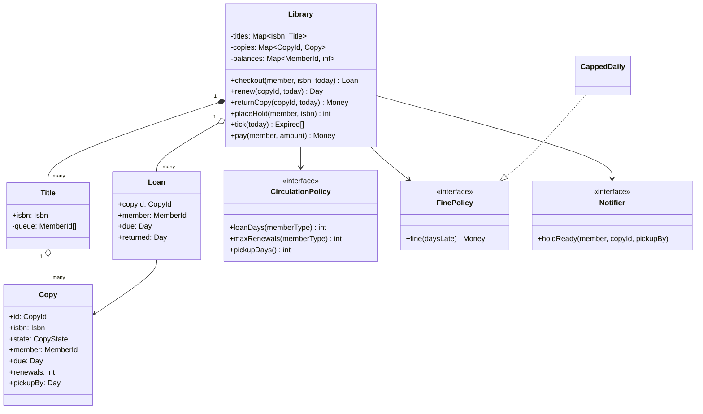
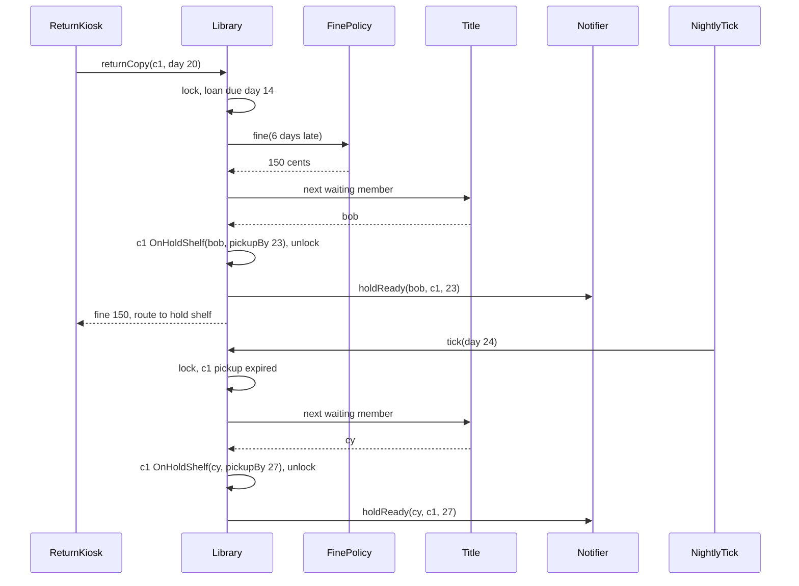

## In one minute
- A library is a lending business with a queue in front of every popular title. The class list is easy; the design is judged on the **circulation rules**: who gets the next copy, how long they have to collect it, when a loan may be renewed, and what lateness costs.
- Separate the **title** (an ISBN, what people ask for) from the **copy** (a barcode on a shelf, what moves). Loans and hold pickups attach to copies; hold queues attach to titles.
- A copy is a small state machine: on the shelf, on loan, waiting on the hold shelf for one member, and later lost or in repair. Every operation is a guarded transition, and illegal ones fail without side effects.
- Circulation rules vary by member type and change every budget year, so loan length, renewal limits and fines are **policies** injected into the core, together with the clock.
- The problem shapes are **contention** (one copy, many borrowers) and **ordering** (holds served first come, first served, with a time limit that cascades to the next person). The same shape appears in rental cars, shared GPUs and hospital beds.

## Requirements

Functional:
- Catalogue titles and add physical copies of a title.
- Members borrow a copy of a title for a fixed loan period and return it.
- Members place a hold on a title when no copy is on the shelf. A returned copy goes to the oldest waiting hold and sits on the hold shelf for a pickup window; if not collected in time, it passes to the next member in the queue.
- Members renew a loan a limited number of times, but not when it is overdue or when someone is waiting for the title.
- Late returns accrue a daily fine, capped per loan. Members whose unpaid balance reaches a threshold cannot borrow until they pay.
- Notify members when a hold is ready or a loan is nearly due.

Non-functional:
- A copy is never lent to two members, and a held copy is never lent to anyone but its holder.
- Fines are reproducible from the loan record and the return date.
- Rules are configurable per branch and per member type without code changes in the core.

Real systems split these concerns into modules, with circulation at the centre ([integrated library system](https://en.wikipedia.org/wiki/Integrated_library_system); [Koha's circulation manual](https://koha-community.org/manual/latest/en/html/circulation.html) shows the rules in practice). Out of scope: search and recommendations, acquisitions, inter-library loans, e-books with licence counts. The [What is LLD](what-is-lld.md) lesson already builds the basic loan and hold core; this lesson goes one level deeper into the circulation policies built on top of it.

## Entities and relationships

- **Title**: ISBN, metadata and the hold queue for that title. People wait for a title, not a specific copy, so the queue lives here.
- **Copy**: barcode, title reference, and a state with its data: `Shelf`, `OnLoan(member, due, renewals)`, `OnHoldShelf(member, pickupBy)`, `Lost`, `InRepair`. It is the unit of contention.
- **Member**: id, member type (adult, child, staff) and an outstanding fine balance. A member type selects the circulation policy.
- **Loan**: the record of one borrowing: copy, member, checkout day, due day, renewals used and return day. It outlives the copy's state change, because fines and history need it.
- **Hold**: member, title, placed-at time and status (waiting, ready, collected, expired, cancelled).
- **CirculationPolicy**: loan days, maximum renewals and pickup days for a member type. **FinePolicy**: turns days late into money. **Clock** supplies today. **Notifier** sends "ready" and "due soon" messages.
- **Library**: the façade that front-desk terminals and self-service kiosks call.

Relationships: a title aggregates its copies and owns its hold queue. A copy's state refers to a member by id. A loan references a copy and a member; neither owns it, and loans are kept after return. The library holds policies by reference so a branch can swap them.

The key modelling choice is putting the **hold queue on the title** and the **pickup deadline on the copy**. When a copy comes back, the title's queue decides who gets it; once assigned, the copy carries its own deadline, so expiry can be checked copy by copy without scanning queues.

## Class diagram



## Key flows

The interesting flow is a return that lands on a busy title, followed by a hold that is never collected.



## Design patterns used and why

- **State** for the copy lifecycle ([Refactoring.Guru](https://refactoring.guru/design-patterns/state)). The set of legal operations depends on state: you can renew only `OnLoan`, collect only `OnHoldShelf` and only as the holder, and nothing at all on `Lost`. In Python or Go, a tagged state plus guarded transitions is enough; reach for a class per state (see [State](state.md)) when states gain real behaviour, such as `InRepair` tracking a bindery job.
- **Strategy** for circulation and fine policies. A children's card may have no fines, staff may get 60-day loans, and a branch may run a fine-free amnesty month. Each is a new policy object; `checkout` and `returnCopy` do not change.
- **Observer** for notifications. The core emits "hold ready" and "due soon" events; email, SMS and the mobile app subscribe. Send after the lock is released so a slow SMS gateway cannot stall the return desk.
- **Façade**: front-desk terminals, self-checkout kiosks and the website all call the same `Library` operations, which is where every invariant is enforced.
- **Repository** behind the façade (see [Repository](repository.md)), so tests run in memory and production on Postgres.

What not to model: a `Book`, `DVD`, `Magazine` hierarchy. Media types differ in loan length and fine rates, which are policy data keyed by a media type field, not behaviour that needs dispatch.

## Concurrency and edge cases

- **Last copy, two desks.** Two members ask for the same title at two terminals. Choosing a shelf copy and marking it on loan must be one atomic step, under a lock or as a conditional update (row locks are covered in the [PostgreSQL docs](https://www.postgresql.org/docs/current/explicit-locking.html); `UPDATE copy SET state = 'loan', member = $1 WHERE id = $2 AND state = 'shelf'`, then check the row count).
- **Return races with hold placement.** A member places a hold just as the last loan comes back. If the return reads the queue before the hold is appended, the copy goes to the shelf and the new holder finds it there, which is fine. If the hold check sees "no copy on shelf" and the return then shelves it, the member waits for nothing. Serialize both on the title, or make `placeHold` and `returnCopy` take the same per-title lock.
- **Renewal while someone waits.** Renewal must check the queue in the same critical section, or a member can renew a copy the moment after someone places a hold, starving the queue.
- **Pickup expiry cascades.** An uncollected hold passes the copy to the next member with a fresh window. Run expiry as a periodic tick over copies whose deadline has passed, and treat it as idempotent: running the nightly job twice must not skip a member.
- **Fines are computed, not accumulated.** Do not run a job that adds 25 cents to every overdue loan each night; it double charges when it reruns and undercharges when it fails. Compute the fine once at return from `due` and `returned` with the policy, and show a live estimate for loans still out.
- **Closed days.** Open-source systems expose this as a calendar that the due-date and fine rules consult ([Koha circulation](https://koha-community.org/manual/latest/en/html/circulation.html)). Not charging for closed days belongs in the fine and due-date policies, driven by a branch calendar, not in the core.
- **Lost copies.** A long-overdue copy becomes `Lost` with a replacement fee; if it comes back, reverse the fee and charge the capped late fine.

## In the wild
- **Microsoft Azure, 2012: the leap-day certificate.** An agent inside each VM computed a certificate's expiry by adding one year to the current date. On 29 February that gave 29 February 2013, which does not exist, so certificate creation failed, and healthy hosts were marked faulty. The disruption lasted about 34 hours. A due date computed as "today plus N" needs the same care, and belongs in a tested policy ([Azure blog](https://azure.microsoft.com/en-us/blog/summary-of-windows-azure-service-disruption-on-feb-29th-2012/)).
- **Cloudflare, 2017: time went backwards.** At the leap second, Go's wall clock stepped back, so a duration computed as end minus start went negative and reached a function that panics on negative input. About 0.2% of DNS queries were affected at peak. A fine computed from `returned - due` should clamp negatives and use injected, testable dates ([Cloudflare](https://blog.cloudflare.com/how-and-why-the-leap-second-affected-cloudflare-dns/)).

## Down the stack

### Layer 1: The contract
`checkout(member, isbn, today)` lends the copy waiting on the hold shelf for that member if there is one, otherwise the lowest-id shelf copy, and fails without changes if the member is blocked or no copy is available. `renew` succeeds only for an on-time loan with renewals left and an empty queue, and sets `due = today + loanDays`. `returnCopy` returns `min(daysLate * rate, cap)` and routes the copy to exactly one place: the oldest waiting member's hold shelf or the open shelf. `tick(today)` moves every hold whose `pickupBy < today` to the next waiting member or to the shelf, and is idempotent for a given day.

### Layer 2: The mechanism
In memory, each title owns a FIFO queue (a deque or slice) of member ids, and each copy stores its state and the fields that state needs. Checkout scans the title's copies, which is cheap because a title rarely has more than a few dozen. The tick walks only copies on the hold shelf; keep them in a min-heap by `pickupBy` if the hold shelf is large. In Postgres, `hold` rows carry `(isbn, placed_at, id)` with an index in that order, and "next waiting member" is `SELECT ... WHERE isbn = $1 AND status = 'waiting' ORDER BY placed_at, id LIMIT 1 FOR UPDATE`. The tie-breaker on id matters: two holds placed in the same millisecond must still have a defined order. Self-service kiosks commonly speak SIP2, a line-based protocol originally from 3M with fixed-format checkout and checkin messages, so the façade must answer within the kiosk's timeout.

### Layer 3: The machine
Circulation traffic is tiny by web standards: a busy city branch handles a few thousand transactions a day, peaking at a few per second when a school class visits. An uncontended mutex costs about 20 ns and a Postgres commit waits for a WAL `fsync` of 0.1 to 1 ms on NVMe, so a single lock per branch is never the bottleneck. The nightly tick touches a few thousand rows, well inside a second. The real cost is notifications: each SMS is a network call of hundreds of milliseconds to an external provider that can fail, which is why notifications go through a queue and never run inside the lock.

### Why it's built this way
1. Popular titles have more readers than copies, so access needs a queue, and fairness means first come, first served.
2. People do not always collect, so a held copy needs a deadline, otherwise one absent member blocks the whole queue.
3. Deadlines expire with nobody at the desk, so expiry runs as a periodic, idempotent job that hands the copy on.
4. Late fees are disputed and jobs fail, so fines are a pure function of recorded dates, computed once at return.
5. Rules change by member type and budget year while copies and queues do not, so rules are policies behind interfaces.

## Extensibility

- **Pickup at another branch:** add a destination branch to the hold and an `InTransit` copy state between return and hold shelf; the pickup window starts on arrival, not on return.
- **E-books:** a title with a licence count instead of physical copies. The queue logic is unchanged; checkout decrements a counter rather than changing a copy's state.
- **Fine-free policy:** many libraries have dropped overdue fines. That is a `FinePolicy` returning zero and a blocking rule based on overdue count instead of balance, with no change to the core.
- **Suspended holds:** a member on holiday freezes their place. Give holds a `suspendedUntil` and make "next waiting member" skip suspended holds without losing their position.

### Variant: car rental booking

A rental counter looks like a library with a price tag, but one decision changes the model: the customer reserves a **category** ("compact SUV, Friday to Monday"), not a specific car. A library hold queues for a title and is served in order. A car reservation is a promise against *future capacity*: the system counts, for every day of the stay, whether active reservations stay within the category's usable fleet. Availability becomes a counting problem per category per day rather than a per-copy state machine, and the stay is a half-open range `[start, end)` so that a car returned on day 3 and a pickup on day 3 do not collide.

Two objects with two lifecycles replace the single copy state machine. A **reservation** (reserved, picked up, returned, cancelled, no-show) is paper capacity. A **rental agreement** is created at pickup and ties the reservation to one physical car, its odometer and fuel level. Paper and metal drift apart: a late return or a car in maintenance means a valid reservation meets an empty bay. So pickup checks physical status, not the calendar, and an `UpgradePolicy` offers the next category up or a car from another branch, keeping the booked rate.

The contention is also different. Two sites selling the last SUV for overlapping dates need the count-then-insert to be atomic: lock a `capacity(category, day)` row for each day of the stay, in day order to avoid deadlocks, or serialise on one row per category and branch. A plain overlap query followed by an insert races under read committed isolation. Selling slightly more than the fleet is a deliberate, per-category overbooking factor, never an accident of a race.

Pricing is richer than library fines but follows the same rule: a pure function of recorded facts. Booked days at the daily rate, a late fee for extra days, and a per-kilometre charge above an allowance, all in integer minor units, using a rate card snapshotted on the reservation so later price changes cannot alter the bill. Reject an odometer reading below the pickup reading instead of charging a negative distance. A scheduled no-show job frees capacity after a grace period, using the same injected clock. Add-ons such as child seats are inventory with their own per-day capacity, reserved with the same range-count logic. The problem shape is the same contention and ordering, now counted by time slot; hotels sell room types, and airlines sell fare buckets, the same way ([PostgreSQL explicit locking](https://www.postgresql.org/docs/current/explicit-locking.html)).

## Leadership lens

- Build first: atomic checkout and return with hold routing, then the tick. Fines can be corrected by staff; a held copy lent to the wrong person is a public complaint.
- Ask in review: where is the per-title serialization point; is the tick idempotent; are fines computed or accumulated; what happens when a kiosk times out mid-checkout and the member walks away with the book.
- Librarians, not engineers, own the rules. Give them a configuration screen with an audit log of rule changes, and version the policy on each loan so a mid-loan change does not rewrite old fines.

## Check yourself
1. Why does the hold queue belong to the title rather than to a copy?
   **Answer:** Members want any copy of the title, and whichever copy comes back first should serve the oldest waiting member. A per-copy queue would make members wait behind one specific copy while others sit idle.
2. Why compute fines at return instead of adding a daily amount with a nightly job?
   **Answer:** A job that adds money is not idempotent: reruns double charge and failures undercharge. A fine computed from due and return dates is reproducible and easy to audit.
3. A copy waits on the hold shelf for Bob until day 23. On day 24 the tick runs twice. What must happen?
   **Answer:** The first run passes the copy to the next waiting member with a new deadline; the second finds no expired hold and does nothing. Expiry is a function of `pickupBy < today`, not of how many times the job runs.
4. Why may a member not renew a loan when someone is waiting for the title?
   **Answer:** Renewal would extend one member's access indefinitely while the queue starves. The check must happen in the same critical section as hold placement, or a race lets a renewal slip in after a hold.

## Practice
**Task:** Implement the circulation rules. `Library(loan_days, max_renewals, pickup_days, daily_fine, fine_cap, block_at)` takes integer days and cents. `add_copy(copy_id, isbn, today)` rejects duplicate ids and routes the copy (see below). `checkout(member, isbn, today)` fails for an unknown title, a member whose balance is at least `block_at`, or no available copy; it lends the copy held for this member if any, else the lowest-id shelf copy, and returns `(copy_id, due)` with `due = today + loan_days`. `renew(copy_id, today)` fails if the copy is not on loan, the loan is overdue (`today > due`), `max_renewals` are used, or anyone is waiting for the title; otherwise it sets and returns `due = today + loan_days`. `return_copy(copy_id, today)` fails if the copy is not on loan, charges `min(days_late * daily_fine, fine_cap)` to the member and returns it, then routes the copy. Routing gives the copy to the first waiting member as a hold with pickup deadline `today + pickup_days`, or puts it on the shelf. `place_hold(member, isbn)` fails for an unknown title, when a copy is on the shelf, or when the member is already waiting or has a copy held; it returns the queue position starting at 1. `tick(today)` takes every held copy with deadline before `today`, in copy-id order, returns them as `(copy_id, member)` and routes each again. `pay(member, cents)` fails unless `1 <= cents <= balance` and returns the new balance. `balance(member)` and `status(copy_id)` (`("shelf", None)`, `("loan", member)` or `("hold", member)`) report state.

```python starter
class Library:
    def __init__(self, loan_days, max_renewals, pickup_days, daily_fine, fine_cap, block_at):
        self._loan_days = loan_days

    def add_copy(self, copy_id, isbn, today):
        raise NotImplementedError

    def checkout(self, member, isbn, today):
        # TODO: held copy first, else lowest-id shelf copy; ValueError when blocked or none
        raise NotImplementedError

    def renew(self, copy_id, today):
        raise NotImplementedError

    def return_copy(self, copy_id, today):
        # TODO: capped fine, then route to the first waiting member or the shelf
        raise NotImplementedError

    def place_hold(self, member, isbn):
        raise NotImplementedError

    def tick(self, today):
        raise NotImplementedError

    def pay(self, member, cents):
        raise NotImplementedError

    def balance(self, member):
        raise NotImplementedError

    def status(self, copy_id):
        raise NotImplementedError
```

```python tests
def raises(fn):
    try:
        fn()
    except ValueError:
        return True
    return False


def make():
    return Library(14, 2, 3, 25, 300, 300)


def test_checkout_and_on_time_return():
    lib = make()
    lib.add_copy("c2", "dune", 0)
    lib.add_copy("c1", "dune", 0)
    assert lib.checkout("alice", "dune", 0) == ("c1", 14)
    assert lib.status("c1") == ("loan", "alice")
    assert lib.return_copy("c1", 14) == 0
    assert lib.status("c1") == ("shelf", None)
    assert raises(lambda: lib.checkout("alice", "emma", 0)), "unknown title"


def test_fines_cap_block_and_pay():
    lib = make()
    lib.add_copy("c1", "dune", 0)
    lib.add_copy("c2", "dune", 0)
    lib.checkout("alice", "dune", 0)
    assert lib.return_copy("c1", 20) == 150
    assert lib.checkout("alice", "dune", 20) == ("c1", 34)
    assert lib.return_copy("c1", 74) == 300, "capped per loan"
    assert lib.balance("alice") == 450
    assert raises(lambda: lib.checkout("alice", "dune", 74)), "blocked"
    assert lib.pay("alice", 200) == 250
    assert lib.checkout("alice", "dune", 74) == ("c1", 88)
    assert raises(lambda: lib.pay("alice", 0))
    assert raises(lambda: lib.pay("alice", 251))
    assert lib.pay("alice", 250) == 0


def test_renewal_rules():
    lib = make()
    lib.add_copy("c1", "dune", 0)
    lib.add_copy("k1", "emma", 0)
    lib.checkout("alice", "dune", 0)
    assert lib.renew("c1", 10) == 24
    assert lib.renew("c1", 20) == 34
    assert raises(lambda: lib.renew("c1", 30)), "renewal limit"
    lib.checkout("alice", "emma", 0)
    assert raises(lambda: lib.renew("k1", 15)), "overdue"
    assert raises(lambda: lib.renew("zz", 1)), "not on loan"


def test_waiting_hold_blocks_renewal():
    lib = make()
    lib.add_copy("c1", "dune", 0)
    lib.checkout("alice", "dune", 0)
    assert lib.place_hold("bob", "dune") == 1
    assert raises(lambda: lib.renew("c1", 5))


def test_hold_pickup_cascades():
    lib = make()
    lib.add_copy("c1", "dune", 0)
    lib.checkout("alice", "dune", 0)
    lib.place_hold("bob", "dune")
    assert lib.place_hold("cy", "dune") == 2
    assert lib.return_copy("c1", 5) == 0
    assert lib.status("c1") == ("hold", "bob")
    assert raises(lambda: lib.checkout("alice", "dune", 6)), "held for bob"
    assert lib.tick(8) == []
    assert lib.tick(9) == [("c1", "bob")]
    assert lib.tick(9) == [], "idempotent"
    assert lib.status("c1") == ("hold", "cy")
    assert lib.checkout("cy", "dune", 10) == ("c1", 24)
    assert lib.tick(30) == []


def test_expired_hold_returns_to_shelf():
    lib = make()
    lib.add_copy("c1", "dune", 0)
    lib.checkout("alice", "dune", 0)
    lib.place_hold("bob", "dune")
    lib.return_copy("c1", 1)
    assert lib.tick(5) == [("c1", "bob")]
    assert lib.status("c1") == ("shelf", None)


def test_hold_rules_and_new_copy_serves_queue():
    lib = make()
    lib.add_copy("c1", "dune", 0)
    assert raises(lambda: lib.place_hold("bob", "dune")), "copy on shelf"
    assert raises(lambda: lib.place_hold("bob", "emma")), "unknown title"
    lib.checkout("alice", "dune", 0)
    lib.place_hold("bob", "dune")
    assert raises(lambda: lib.place_hold("bob", "dune")), "already waiting"
    lib.add_copy("c2", "dune", 3)
    assert lib.status("c2") == ("hold", "bob")
    assert raises(lambda: lib.place_hold("bob", "dune")), "copy already held"
    assert raises(lambda: lib.add_copy("c2", "dune", 3)), "duplicate copy"
    assert lib.checkout("bob", "dune", 4) == ("c2", 18)
```

```python solution
class Library:
    def __init__(self, loan_days, max_renewals, pickup_days, daily_fine, fine_cap, block_at):
        self._loan_days = loan_days
        self._max_renewals = max_renewals
        self._pickup_days = pickup_days
        self._daily_fine = daily_fine
        self._fine_cap = fine_cap
        self._block_at = block_at
        self._copies = {}
        self._queues = {}
        self._balances = {}

    def add_copy(self, copy_id, isbn, today):
        if copy_id in self._copies:
            raise ValueError("duplicate copy: " + copy_id)
        self._copies[copy_id] = {"isbn": isbn, "state": "shelf", "member": None,
                                 "due": 0, "renewals": 0, "pickup_by": 0}
        self._queues.setdefault(isbn, [])
        self._route(copy_id, today)

    def _route(self, copy_id, today):
        c = self._copies[copy_id]
        queue = self._queues[c["isbn"]]
        if queue:
            c["state"], c["member"] = "hold", queue.pop(0)
            c["pickup_by"] = today + self._pickup_days
        else:
            c["state"], c["member"] = "shelf", None

    def _ids(self, isbn, state, member=None):
        return sorted(cid for cid, c in self._copies.items()
                      if c["isbn"] == isbn and c["state"] == state
                      and (member is None or c["member"] == member))

    def checkout(self, member, isbn, today):
        if isbn not in self._queues:
            raise ValueError("unknown title: " + isbn)
        if self.balance(member) >= self._block_at:
            raise ValueError("member blocked by fines: " + member)
        ids = self._ids(isbn, "hold", member) or self._ids(isbn, "shelf")
        if not ids:
            raise ValueError("no copy available: " + isbn)
        c = self._copies[ids[0]]
        c["state"], c["member"] = "loan", member
        c["due"], c["renewals"] = today + self._loan_days, 0
        return (ids[0], c["due"])

    def _loaned(self, copy_id):
        c = self._copies.get(copy_id)
        if c is None or c["state"] != "loan":
            raise ValueError("copy not on loan: " + copy_id)
        return c

    def renew(self, copy_id, today):
        c = self._loaned(copy_id)
        if today > c["due"]:
            raise ValueError("loan is overdue")
        if c["renewals"] >= self._max_renewals:
            raise ValueError("renewal limit reached")
        if self._queues[c["isbn"]]:
            raise ValueError("members are waiting for this title")
        c["due"] = today + self._loan_days
        c["renewals"] += 1
        return c["due"]

    def return_copy(self, copy_id, today):
        c = self._loaned(copy_id)
        fine = min(max(0, today - c["due"]) * self._daily_fine, self._fine_cap)
        self._balances[c["member"]] = self.balance(c["member"]) + fine
        self._route(copy_id, today)
        return fine

    def place_hold(self, member, isbn):
        queue = self._queues.get(isbn)
        if queue is None:
            raise ValueError("unknown title: " + isbn)
        if self._ids(isbn, "shelf"):
            raise ValueError("a copy is on the shelf")
        if member in queue or self._ids(isbn, "hold", member):
            raise ValueError("member already waiting or holding")
        queue.append(member)
        return len(queue)

    def tick(self, today):
        expired = sorted(cid for cid, c in self._copies.items()
                         if c["state"] == "hold" and c["pickup_by"] < today)
        out = []
        for cid in expired:
            out.append((cid, self._copies[cid]["member"]))
            self._route(cid, today)
        return out

    def pay(self, member, cents):
        if cents < 1 or cents > self.balance(member):
            raise ValueError("invalid payment")
        self._balances[member] -= cents
        return self._balances[member]

    def balance(self, member):
        return self._balances.get(member, 0)

    def status(self, copy_id):
        c = self._copies.get(copy_id)
        if c is None:
            raise ValueError("unknown copy: " + copy_id)
        return (c["state"], c["member"])
```

```typescript starter
export type CopyStatus = [string, string | null];

export class Library {
  constructor(private loanDays: number, private maxRenewals: number, private pickupDays: number,
    private dailyFine: number, private fineCap: number, private blockAt: number) {}

  addCopy(copyId: string, isbn: string, today: number): void { throw new Error("TODO"); }

  checkout(member: string, isbn: string, today: number): [string, number] { throw new Error("TODO"); }

  renew(copyId: string, today: number): number { throw new Error("TODO"); }

  returnCopy(copyId: string, today: number): number { throw new Error("TODO"); }

  placeHold(member: string, isbn: string): number { throw new Error("TODO"); }

  tick(today: number): Array<[string, string]> { throw new Error("TODO"); }

  pay(member: string, cents: number): number { throw new Error("TODO"); }

  balance(member: string): number { throw new Error("TODO"); }

  status(copyId: string): CopyStatus { throw new Error("TODO"); }
}
```

```typescript tests
function throwsErr(fn: () => void): boolean {
  try { fn(); return false; } catch (e) { return true; }
}

function make(): Library {
  return new Library(14, 2, 3, 25, 300, 300);
}

test("checkout and on-time return", () => {
  const lib = make();
  lib.addCopy("c2", "dune", 0);
  lib.addCopy("c1", "dune", 0);
  assertEqual(lib.checkout("alice", "dune", 0), ["c1", 14]);
  assertEqual(lib.status("c1"), ["loan", "alice"]);
  assertEqual(lib.returnCopy("c1", 14), 0);
  assertEqual(lib.status("c1"), ["shelf", null]);
  assert(throwsErr(() => lib.checkout("alice", "emma", 0)), "unknown title");
});

test("fines cap, block and pay", () => {
  const lib = make();
  lib.addCopy("c1", "dune", 0);
  lib.addCopy("c2", "dune", 0);
  lib.checkout("alice", "dune", 0);
  assertEqual(lib.returnCopy("c1", 20), 150);
  assertEqual(lib.checkout("alice", "dune", 20), ["c1", 34]);
  assertEqual(lib.returnCopy("c1", 74), 300, "capped per loan");
  assertEqual(lib.balance("alice"), 450);
  assert(throwsErr(() => lib.checkout("alice", "dune", 74)), "blocked");
  assertEqual(lib.pay("alice", 200), 250);
  assertEqual(lib.checkout("alice", "dune", 74), ["c1", 88]);
  assert(throwsErr(() => lib.pay("alice", 0)));
  assert(throwsErr(() => lib.pay("alice", 251)));
  assertEqual(lib.pay("alice", 250), 0);
});

test("renewal rules", () => {
  const lib = make();
  lib.addCopy("c1", "dune", 0);
  lib.addCopy("k1", "emma", 0);
  lib.checkout("alice", "dune", 0);
  assertEqual(lib.renew("c1", 10), 24);
  assertEqual(lib.renew("c1", 20), 34);
  assert(throwsErr(() => lib.renew("c1", 30)), "renewal limit");
  lib.checkout("alice", "emma", 0);
  assert(throwsErr(() => lib.renew("k1", 15)), "overdue");
  assert(throwsErr(() => lib.renew("zz", 1)), "not on loan");
});

test("waiting hold blocks renewal", () => {
  const lib = make();
  lib.addCopy("c1", "dune", 0);
  lib.checkout("alice", "dune", 0);
  assertEqual(lib.placeHold("bob", "dune"), 1);
  assert(throwsErr(() => lib.renew("c1", 5)));
});

test("hold pickup cascades", () => {
  const lib = make();
  lib.addCopy("c1", "dune", 0);
  lib.checkout("alice", "dune", 0);
  lib.placeHold("bob", "dune");
  assertEqual(lib.placeHold("cy", "dune"), 2);
  assertEqual(lib.returnCopy("c1", 5), 0);
  assertEqual(lib.status("c1"), ["hold", "bob"]);
  assert(throwsErr(() => lib.checkout("alice", "dune", 6)), "held for bob");
  assertEqual(lib.tick(8), []);
  assertEqual(lib.tick(9), [["c1", "bob"]]);
  assertEqual(lib.tick(9), [], "idempotent");
  assertEqual(lib.status("c1"), ["hold", "cy"]);
  assertEqual(lib.checkout("cy", "dune", 10), ["c1", 24]);
  assertEqual(lib.tick(30), []);
});

test("expired hold returns to shelf", () => {
  const lib = make();
  lib.addCopy("c1", "dune", 0);
  lib.checkout("alice", "dune", 0);
  lib.placeHold("bob", "dune");
  lib.returnCopy("c1", 1);
  assertEqual(lib.tick(5), [["c1", "bob"]]);
  assertEqual(lib.status("c1"), ["shelf", null]);
});

test("hold rules and new copy serves queue", () => {
  const lib = make();
  lib.addCopy("c1", "dune", 0);
  assert(throwsErr(() => lib.placeHold("bob", "dune")), "copy on shelf");
  assert(throwsErr(() => lib.placeHold("bob", "emma")), "unknown title");
  lib.checkout("alice", "dune", 0);
  lib.placeHold("bob", "dune");
  assert(throwsErr(() => lib.placeHold("bob", "dune")), "already waiting");
  lib.addCopy("c2", "dune", 3);
  assertEqual(lib.status("c2"), ["hold", "bob"]);
  assert(throwsErr(() => lib.placeHold("bob", "dune")), "copy already held");
  assert(throwsErr(() => lib.addCopy("c2", "dune", 3)), "duplicate copy");
  assertEqual(lib.checkout("bob", "dune", 4), ["c2", 18]);
});
```

```typescript solution
export type CopyStatus = [string, string | null];

interface CopyState {
  isbn: string;
  state: "shelf" | "loan" | "hold";
  member: string | null;
  due: number;
  renewals: number;
  pickupBy: number;
}

export class Library {
  private copies = new Map<string, CopyState>();
  private queues = new Map<string, string[]>();
  private balances = new Map<string, number>();

  constructor(private loanDays: number, private maxRenewals: number, private pickupDays: number,
    private dailyFine: number, private fineCap: number, private blockAt: number) {}

  addCopy(copyId: string, isbn: string, today: number): void {
    if (this.copies.has(copyId)) throw new Error("duplicate copy: " + copyId);
    this.copies.set(copyId, { isbn, state: "shelf", member: null, due: 0, renewals: 0, pickupBy: 0 });
    if (!this.queues.has(isbn)) this.queues.set(isbn, []);
    this.route(copyId, today);
  }

  private route(copyId: string, today: number): void {
    const c = this.copies.get(copyId)!;
    const queue = this.queues.get(c.isbn)!;
    if (queue.length > 0) {
      c.state = "hold";
      c.member = queue.shift()!;
      c.pickupBy = today + this.pickupDays;
    } else {
      c.state = "shelf";
      c.member = null;
    }
  }

  private ids(isbn: string, state: string, member?: string): string[] {
    const out: string[] = [];
    for (const [id, c] of this.copies) {
      if (c.isbn === isbn && c.state === state && (member === undefined || c.member === member)) out.push(id);
    }
    return out.sort();
  }

  checkout(member: string, isbn: string, today: number): [string, number] {
    if (!this.queues.has(isbn)) throw new Error("unknown title: " + isbn);
    if (this.balance(member) >= this.blockAt) throw new Error("member blocked by fines: " + member);
    let ids = this.ids(isbn, "hold", member);
    if (ids.length === 0) ids = this.ids(isbn, "shelf");
    if (ids.length === 0) throw new Error("no copy available: " + isbn);
    const c = this.copies.get(ids[0])!;
    c.state = "loan";
    c.member = member;
    c.due = today + this.loanDays;
    c.renewals = 0;
    return [ids[0], c.due];
  }

  private loaned(copyId: string): CopyState {
    const c = this.copies.get(copyId);
    if (!c || c.state !== "loan") throw new Error("copy not on loan: " + copyId);
    return c;
  }

  renew(copyId: string, today: number): number {
    const c = this.loaned(copyId);
    if (today > c.due) throw new Error("loan is overdue");
    if (c.renewals >= this.maxRenewals) throw new Error("renewal limit reached");
    if (this.queues.get(c.isbn)!.length > 0) throw new Error("members are waiting for this title");
    c.due = today + this.loanDays;
    c.renewals++;
    return c.due;
  }

  returnCopy(copyId: string, today: number): number {
    const c = this.loaned(copyId);
    const fine = Math.min(Math.max(0, today - c.due) * this.dailyFine, this.fineCap);
    this.balances.set(c.member!, this.balance(c.member!) + fine);
    this.route(copyId, today);
    return fine;
  }

  placeHold(member: string, isbn: string): number {
    const queue = this.queues.get(isbn);
    if (!queue) throw new Error("unknown title: " + isbn);
    if (this.ids(isbn, "shelf").length > 0) throw new Error("a copy is on the shelf");
    if (queue.includes(member) || this.ids(isbn, "hold", member).length > 0) {
      throw new Error("member already waiting or holding");
    }
    queue.push(member);
    return queue.length;
  }

  tick(today: number): Array<[string, string]> {
    const expired: string[] = [];
    for (const [id, c] of this.copies) {
      if (c.state === "hold" && c.pickupBy < today) expired.push(id);
    }
    expired.sort();
    const out: Array<[string, string]> = [];
    for (const id of expired) {
      out.push([id, this.copies.get(id)!.member!]);
      this.route(id, today);
    }
    return out;
  }

  pay(member: string, cents: number): number {
    const bal = this.balance(member);
    if (cents < 1 || cents > bal) throw new Error("invalid payment");
    this.balances.set(member, bal - cents);
    return bal - cents;
  }

  balance(member: string): number {
    return this.balances.get(member) ?? 0;
  }

  status(copyId: string): CopyStatus {
    const c = this.copies.get(copyId);
    if (!c) throw new Error("unknown copy: " + copyId);
    return [c.state, c.member];
  }
}
```

```go starter
package practice

import "errors"

var (
	ErrDuplicateCopy = errors.New("duplicate copy")
	ErrUnknownTitle  = errors.New("unknown title")
	ErrUnknownCopy   = errors.New("unknown copy")
	ErrBlocked       = errors.New("member blocked by fines")
	ErrUnavailable   = errors.New("no copy available")
	ErrNotOnLoan     = errors.New("copy not on loan")
	ErrOverdue       = errors.New("loan is overdue")
	ErrRenewLimit    = errors.New("renewal limit reached")
	ErrHoldsWaiting  = errors.New("members are waiting for this title")
	ErrHoldRejected  = errors.New("hold rejected")
	ErrBadPayment    = errors.New("invalid payment")
)

type Status struct {
	State  string
	Member string
}

type Expired struct {
	CopyID string
	Member string
}

type Library struct{}

func NewLibrary(loanDays, maxRenewals, pickupDays, dailyFine, fineCap, blockAt int) *Library {
	return &Library{}
}

func (l *Library) AddCopy(copyID, isbn string, today int) error { panic("TODO") }

func (l *Library) Checkout(member, isbn string, today int) (string, int, error) { panic("TODO") }

func (l *Library) Renew(copyID string, today int) (int, error) { panic("TODO") }

func (l *Library) ReturnCopy(copyID string, today int) (int, error) { panic("TODO") }

func (l *Library) PlaceHold(member, isbn string) (int, error) { panic("TODO") }

func (l *Library) Tick(today int) []Expired { panic("TODO") }

func (l *Library) Pay(member string, cents int) (int, error) { panic("TODO") }

func (l *Library) Balance(member string) int { panic("TODO") }

func (l *Library) Status(copyID string) (Status, error) { panic("TODO") }
```

```go tests
package practice

import (
	"errors"
	"reflect"
	"testing"
)

func newLib() *Library { return NewLibrary(14, 2, 3, 25, 300, 300) }

func mustAdd(t *testing.T, l *Library, id, isbn string, today int) {
	t.Helper()
	if err := l.AddCopy(id, isbn, today); err != nil {
		t.Fatalf("add %s: %v", id, err)
	}
}

func mustCheckout(t *testing.T, l *Library, member, isbn string, today int, wantCopy string, wantDue int) {
	t.Helper()
	c, due, err := l.Checkout(member, isbn, today)
	if err != nil || c != wantCopy || due != wantDue {
		t.Fatalf("checkout %s: got %s %d %v, want %s %d", member, c, due, err, wantCopy, wantDue)
	}
}

func wantStatus(t *testing.T, l *Library, id string, want Status) {
	t.Helper()
	got, err := l.Status(id)
	if err != nil || got != want {
		t.Fatalf("status %s: got %+v %v want %+v", id, got, err, want)
	}
}

func TestCheckoutAndOnTimeReturn(t *testing.T) {
	l := newLib()
	mustAdd(t, l, "c2", "dune", 0)
	mustAdd(t, l, "c1", "dune", 0)
	mustCheckout(t, l, "alice", "dune", 0, "c1", 14)
	wantStatus(t, l, "c1", Status{"loan", "alice"})
	if fine, err := l.ReturnCopy("c1", 14); err != nil || fine != 0 {
		t.Fatalf("fine=%d err=%v", fine, err)
	}
	wantStatus(t, l, "c1", Status{"shelf", ""})
	if _, _, err := l.Checkout("alice", "emma", 0); !errors.Is(err, ErrUnknownTitle) {
		t.Fatalf("want ErrUnknownTitle, got %v", err)
	}
}

func TestFinesCapBlockAndPay(t *testing.T) {
	l := newLib()
	mustAdd(t, l, "c1", "dune", 0)
	mustAdd(t, l, "c2", "dune", 0)
	mustCheckout(t, l, "alice", "dune", 0, "c1", 14)
	if fine, _ := l.ReturnCopy("c1", 20); fine != 150 {
		t.Fatalf("fine=%d", fine)
	}
	mustCheckout(t, l, "alice", "dune", 20, "c1", 34)
	if fine, _ := l.ReturnCopy("c1", 74); fine != 300 {
		t.Fatalf("fine=%d want capped 300", fine)
	}
	if l.Balance("alice") != 450 {
		t.Fatalf("balance=%d", l.Balance("alice"))
	}
	if _, _, err := l.Checkout("alice", "dune", 74); !errors.Is(err, ErrBlocked) {
		t.Fatalf("want ErrBlocked, got %v", err)
	}
	if bal, err := l.Pay("alice", 200); err != nil || bal != 250 {
		t.Fatalf("bal=%d err=%v", bal, err)
	}
	mustCheckout(t, l, "alice", "dune", 74, "c1", 88)
	for _, amt := range []int{0, 251} {
		if _, err := l.Pay("alice", amt); !errors.Is(err, ErrBadPayment) {
			t.Fatalf("pay %d: want ErrBadPayment, got %v", amt, err)
		}
	}
	if bal, _ := l.Pay("alice", 250); bal != 0 {
		t.Fatalf("bal=%d", bal)
	}
}

func TestRenewalRules(t *testing.T) {
	l := newLib()
	mustAdd(t, l, "c1", "dune", 0)
	mustAdd(t, l, "k1", "emma", 0)
	mustCheckout(t, l, "alice", "dune", 0, "c1", 14)
	for _, tc := range []struct{ day, want int }{{10, 24}, {20, 34}} {
		if due, err := l.Renew("c1", tc.day); err != nil || due != tc.want {
			t.Fatalf("renew day %d: due=%d err=%v", tc.day, due, err)
		}
	}
	if _, err := l.Renew("c1", 30); !errors.Is(err, ErrRenewLimit) {
		t.Fatalf("want ErrRenewLimit, got %v", err)
	}
	mustCheckout(t, l, "alice", "emma", 0, "k1", 14)
	if _, err := l.Renew("k1", 15); !errors.Is(err, ErrOverdue) {
		t.Fatalf("want ErrOverdue, got %v", err)
	}
	if _, err := l.Renew("zz", 1); !errors.Is(err, ErrNotOnLoan) {
		t.Fatalf("want ErrNotOnLoan, got %v", err)
	}
}

func TestWaitingHoldBlocksRenewal(t *testing.T) {
	l := newLib()
	mustAdd(t, l, "c1", "dune", 0)
	mustCheckout(t, l, "alice", "dune", 0, "c1", 14)
	if pos, err := l.PlaceHold("bob", "dune"); err != nil || pos != 1 {
		t.Fatalf("pos=%d err=%v", pos, err)
	}
	if _, err := l.Renew("c1", 5); !errors.Is(err, ErrHoldsWaiting) {
		t.Fatalf("want ErrHoldsWaiting, got %v", err)
	}
}

func TestHoldPickupCascades(t *testing.T) {
	l := newLib()
	mustAdd(t, l, "c1", "dune", 0)
	mustCheckout(t, l, "alice", "dune", 0, "c1", 14)
	l.PlaceHold("bob", "dune")
	if pos, _ := l.PlaceHold("cy", "dune"); pos != 2 {
		t.Fatalf("pos=%d", pos)
	}
	l.ReturnCopy("c1", 5)
	wantStatus(t, l, "c1", Status{"hold", "bob"})
	if _, _, err := l.Checkout("alice", "dune", 6); !errors.Is(err, ErrUnavailable) {
		t.Fatalf("want ErrUnavailable, got %v", err)
	}
	if got := l.Tick(8); len(got) != 0 {
		t.Fatalf("tick 8: %v", got)
	}
	if got := l.Tick(9); !reflect.DeepEqual(got, []Expired{{"c1", "bob"}}) {
		t.Fatalf("tick 9: %v", got)
	}
	if got := l.Tick(9); len(got) != 0 {
		t.Fatalf("second tick 9 should be a no-op: %v", got)
	}
	wantStatus(t, l, "c1", Status{"hold", "cy"})
	mustCheckout(t, l, "cy", "dune", 10, "c1", 24)
	if got := l.Tick(30); len(got) != 0 {
		t.Fatalf("tick 30: %v", got)
	}
}

func TestExpiredHoldReturnsToShelf(t *testing.T) {
	l := newLib()
	mustAdd(t, l, "c1", "dune", 0)
	mustCheckout(t, l, "alice", "dune", 0, "c1", 14)
	l.PlaceHold("bob", "dune")
	l.ReturnCopy("c1", 1)
	if got := l.Tick(5); !reflect.DeepEqual(got, []Expired{{"c1", "bob"}}) {
		t.Fatalf("tick: %v", got)
	}
	wantStatus(t, l, "c1", Status{"shelf", ""})
}

func TestHoldRulesAndNewCopyServesQueue(t *testing.T) {
	l := newLib()
	mustAdd(t, l, "c1", "dune", 0)
	if _, err := l.PlaceHold("bob", "dune"); !errors.Is(err, ErrHoldRejected) {
		t.Fatalf("copy on shelf: got %v", err)
	}
	if _, err := l.PlaceHold("bob", "emma"); !errors.Is(err, ErrUnknownTitle) {
		t.Fatalf("unknown title: got %v", err)
	}
	mustCheckout(t, l, "alice", "dune", 0, "c1", 14)
	l.PlaceHold("bob", "dune")
	if _, err := l.PlaceHold("bob", "dune"); !errors.Is(err, ErrHoldRejected) {
		t.Fatalf("already waiting: got %v", err)
	}
	mustAdd(t, l, "c2", "dune", 3)
	wantStatus(t, l, "c2", Status{"hold", "bob"})
	if _, err := l.PlaceHold("bob", "dune"); !errors.Is(err, ErrHoldRejected) {
		t.Fatalf("copy already held: got %v", err)
	}
	if err := l.AddCopy("c2", "dune", 3); !errors.Is(err, ErrDuplicateCopy) {
		t.Fatalf("want ErrDuplicateCopy, got %v", err)
	}
	mustCheckout(t, l, "bob", "dune", 4, "c2", 18)
}
```

```go solution
package practice

import (
	"errors"
	"fmt"
	"sort"
	"sync"
)

var (
	ErrDuplicateCopy = errors.New("duplicate copy")
	ErrUnknownTitle  = errors.New("unknown title")
	ErrUnknownCopy   = errors.New("unknown copy")
	ErrBlocked       = errors.New("member blocked by fines")
	ErrUnavailable   = errors.New("no copy available")
	ErrNotOnLoan     = errors.New("copy not on loan")
	ErrOverdue       = errors.New("loan is overdue")
	ErrRenewLimit    = errors.New("renewal limit reached")
	ErrHoldsWaiting  = errors.New("members are waiting for this title")
	ErrHoldRejected  = errors.New("hold rejected")
	ErrBadPayment    = errors.New("invalid payment")
)

type Status struct {
	State  string
	Member string
}

type Expired struct {
	CopyID string
	Member string
}

type copyState struct {
	isbn     string
	state    string
	member   string
	due      int
	renewals int
	pickupBy int
}

type Library struct {
	mu                                sync.Mutex
	loanDays, maxRenewals, pickupDays int
	dailyFine, fineCap, blockAt       int
	copies                            map[string]*copyState
	queues                            map[string][]string
	balances                          map[string]int
}

func NewLibrary(loanDays, maxRenewals, pickupDays, dailyFine, fineCap, blockAt int) *Library {
	return &Library{
		loanDays: loanDays, maxRenewals: maxRenewals, pickupDays: pickupDays,
		dailyFine: dailyFine, fineCap: fineCap, blockAt: blockAt,
		copies: map[string]*copyState{}, queues: map[string][]string{}, balances: map[string]int{},
	}
}

func (l *Library) AddCopy(copyID, isbn string, today int) error {
	l.mu.Lock()
	defer l.mu.Unlock()
	if _, ok := l.copies[copyID]; ok {
		return fmt.Errorf("%w: %s", ErrDuplicateCopy, copyID)
	}
	l.copies[copyID] = &copyState{isbn: isbn, state: "shelf"}
	if _, ok := l.queues[isbn]; !ok {
		l.queues[isbn] = []string{}
	}
	l.route(copyID, today)
	return nil
}

// route hands a copy to the first waiting member or puts it on the shelf; callers hold the lock.
func (l *Library) route(copyID string, today int) {
	c := l.copies[copyID]
	q := l.queues[c.isbn]
	if len(q) > 0 {
		c.state, c.member, c.pickupBy = "hold", q[0], today+l.pickupDays
		l.queues[c.isbn] = q[1:]
		return
	}
	c.state, c.member = "shelf", ""
}

func (l *Library) ids(isbn, state, member string) []string {
	var out []string
	for id, c := range l.copies {
		if c.isbn == isbn && c.state == state && (member == "" || c.member == member) {
			out = append(out, id)
		}
	}
	sort.Strings(out)
	return out
}

func (l *Library) Checkout(member, isbn string, today int) (string, int, error) {
	l.mu.Lock()
	defer l.mu.Unlock()
	if _, ok := l.queues[isbn]; !ok {
		return "", 0, fmt.Errorf("%w: %s", ErrUnknownTitle, isbn)
	}
	if l.balances[member] >= l.blockAt {
		return "", 0, fmt.Errorf("%w: %s", ErrBlocked, member)
	}
	ids := l.ids(isbn, "hold", member)
	if len(ids) == 0 {
		ids = l.ids(isbn, "shelf", "")
	}
	if len(ids) == 0 {
		return "", 0, fmt.Errorf("%w: %s", ErrUnavailable, isbn)
	}
	c := l.copies[ids[0]]
	c.state, c.member, c.due, c.renewals = "loan", member, today+l.loanDays, 0
	return ids[0], c.due, nil
}

func (l *Library) loaned(copyID string) (*copyState, error) {
	c, ok := l.copies[copyID]
	if !ok || c.state != "loan" {
		return nil, fmt.Errorf("%w: %s", ErrNotOnLoan, copyID)
	}
	return c, nil
}

func (l *Library) Renew(copyID string, today int) (int, error) {
	l.mu.Lock()
	defer l.mu.Unlock()
	c, err := l.loaned(copyID)
	if err != nil {
		return 0, err
	}
	switch {
	case today > c.due:
		return 0, ErrOverdue
	case c.renewals >= l.maxRenewals:
		return 0, ErrRenewLimit
	case len(l.queues[c.isbn]) > 0:
		return 0, ErrHoldsWaiting
	}
	c.due = today + l.loanDays
	c.renewals++
	return c.due, nil
}

func (l *Library) ReturnCopy(copyID string, today int) (int, error) {
	l.mu.Lock()
	defer l.mu.Unlock()
	c, err := l.loaned(copyID)
	if err != nil {
		return 0, err
	}
	late := today - c.due
	if late < 0 {
		late = 0
	}
	fine := late * l.dailyFine
	if fine > l.fineCap {
		fine = l.fineCap
	}
	l.balances[c.member] += fine
	l.route(copyID, today)
	return fine, nil
}

func (l *Library) PlaceHold(member, isbn string) (int, error) {
	l.mu.Lock()
	defer l.mu.Unlock()
	q, ok := l.queues[isbn]
	if !ok {
		return 0, fmt.Errorf("%w: %s", ErrUnknownTitle, isbn)
	}
	if len(l.ids(isbn, "shelf", "")) > 0 {
		return 0, fmt.Errorf("%w: a copy is on the shelf", ErrHoldRejected)
	}
	for _, m := range q {
		if m == member {
			return 0, fmt.Errorf("%w: already waiting", ErrHoldRejected)
		}
	}
	if len(l.ids(isbn, "hold", member)) > 0 {
		return 0, fmt.Errorf("%w: copy already held", ErrHoldRejected)
	}
	l.queues[isbn] = append(q, member)
	return len(l.queues[isbn]), nil
}

func (l *Library) Tick(today int) []Expired {
	l.mu.Lock()
	defer l.mu.Unlock()
	var expired []string
	for id, c := range l.copies {
		if c.state == "hold" && c.pickupBy < today {
			expired = append(expired, id)
		}
	}
	sort.Strings(expired)
	out := []Expired{}
	for _, id := range expired {
		out = append(out, Expired{id, l.copies[id].member})
		l.route(id, today)
	}
	return out
}

func (l *Library) Pay(member string, cents int) (int, error) {
	l.mu.Lock()
	defer l.mu.Unlock()
	if cents < 1 || cents > l.balances[member] {
		return 0, ErrBadPayment
	}
	l.balances[member] -= cents
	return l.balances[member], nil
}

func (l *Library) Balance(member string) int {
	l.mu.Lock()
	defer l.mu.Unlock()
	return l.balances[member]
}

func (l *Library) Status(copyID string) (Status, error) {
	l.mu.Lock()
	defer l.mu.Unlock()
	c, ok := l.copies[copyID]
	if !ok {
		return Status{}, fmt.Errorf("%w: %s", ErrUnknownCopy, copyID)
	}
	return Status{c.state, c.member}, nil
}
```

## Mock interview
**Prompt:** Design the circulation module for a city library with 12 branches, 2 million copies and 300,000 members. Code checkout, return, renew and holds, including what happens when a member does not collect a reserved book, and explain how fines are calculated.

- Follow-up: The nightly job that expires uncollected holds crashed halfway and was rerun. What must be true of your design so nobody is skipped or charged twice?
- Follow-up: The council abolishes fines for children but keeps them for adults. Show what changes.
- Follow-up: Two kiosks check out the last copy of a bestseller at the same moment. Walk through how exactly one succeeds.

**A strong answer covers:**
- Title versus copy, with the hold queue on the title and the pickup deadline on the copy.
- A copy state machine with guarded transitions and failures that leave state unchanged.
- Circulation and fine policies as strategies keyed by member type, with an injected clock and fines computed at return.
- An idempotent expiry tick that cascades a copy to the next waiting member or the shelf.
- Atomic checkout and per-title serialization of return, hold placement and renewal.
- Notifications sent outside the lock through a queue, and an audit trail of rule changes.

## Sources and further study
**Primary**
- [Go 1.9 release notes: transparent monotonic time](https://go.dev/doc/go1.9): the language-level fix for durations that go negative when the wall clock steps.

**Systems docs**
- [Koha manual: Circulation](https://koha-community.org/manual/latest/en/html/circulation.html): how a widely used open-source library system handles checkouts, holds, calendars and fines.
- [PostgreSQL: Explicit locking](https://www.postgresql.org/docs/current/explicit-locking.html): row locks for atomic checkout, hold assignment and per-day capacity rows.
- [PostgreSQL: SELECT locking clause](https://www.postgresql.org/docs/current/sql-select.html): `FOR UPDATE`, `NOWAIT` and `SKIP LOCKED` for taking the next waiting hold.
- [Stripe: currencies and minor units](https://docs.stripe.com/currencies): why money is integer minor units plus a currency code, for fines and rental charges.

**Books**
- *Design Patterns: Elements of Reusable Object-Oriented Software*, Gamma, Helm, Johnson and Vlissides: chapter 5 (Behavioral, including State, Strategy and Observer).
- *Head First Design Patterns*, Freeman and Robson: chapter 1 (Strategy) and chapter 2 (Observer).

**Other curricula**
- [Integrated library system (Wikipedia)](https://en.wikipedia.org/wiki/Integrated_library_system): the modules real library software is split into, with circulation at the centre.
- [Refactoring.Guru: State](https://refactoring.guru/design-patterns/state): the pattern used for copy lifecycles, with examples in many languages.

## Watch
- [Google Interview Question Solved, Low Level Design of Library Management System, Part 1 (Soumyajit Bhattacharyay)](https://www.youtube.com/watch?v=71W8QTdFWw8): an interview-style walkthrough of the entities and use cases.
- [State Pattern, Design Patterns ep 17 (Christopher Okhravi)](https://www.youtube.com/watch?v=N12L5D78MAA): the pattern behind the copy lifecycle.
- [Strategy Pattern, Design Patterns ep 1 (Christopher Okhravi)](https://www.youtube.com/watch?v=v9ejT8FO-7I): how loan and fine rules become swappable policies.

## Free resources
- [Integrated library system (Wikipedia)](https://en.wikipedia.org/wiki/Integrated_library_system): the modules real library software is split into, with circulation at the centre.
- [Koha manual: Circulation](https://koha-community.org/manual/latest/en/html/circulation.html): how a widely used open-source library system handles checkouts, holds and fines.
- [State pattern (Refactoring.Guru)](https://refactoring.guru/design-patterns/state): the pattern used for copy lifecycles, with examples in many languages.
- [Explicit locking (PostgreSQL docs)](https://www.postgresql.org/docs/current/explicit-locking.html): row locks for atomic checkout and hold assignment.
