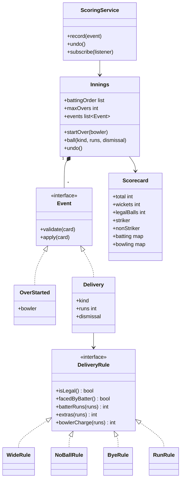
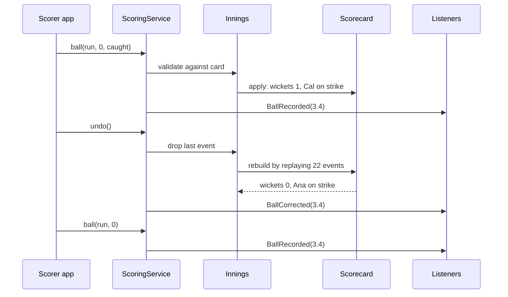

## In one minute
- A cricket scores site is a projection engine. The source of truth is an append-only log of deliveries, and the scorecard (team total, overs, each batter's runs and balls, each bowler's figures) is derived from it.
- Cricket's scoring rules are the hard part, not the storage. A wide is not a legal ball and is not faced by the batter. A no-ball is not legal but is faced. Byes count for the team but not the batter or the bowler. Encode each delivery kind as a rule object, not as a growing `if` chain.
- Corrections are normal. A scorer mis-keys a run, or a review overturns a dismissal. Undo removes the last event and rebuilds the projection by replaying the log, so every derived number is exact.
- Strike rotation is a small state machine: odd runs swap the batters, the end of an over swaps them, and a dismissal brings a new batter in at the dismissed batter's end.
- The problem shape is **ordering** (deliveries must be applied in sequence, and a correction rewrites history) plus **fan-out** (one ball updates millions of open pages). Order books and bank ledgers have the same shape: an ordered event log, with balances or books as projections.

## Requirements

### Functional
- Set up an innings with a batting order and an over limit.
- A scorer starts each over with a bowler and records each delivery: its kind (`run`, `wide`, `no_ball`, `bye`, `leg_bye`), the runs taken, and an optional dismissal (`bowled`, `caught`, `lbw`, `run_out`).
- Show the team score as `runs/wickets`, overs as `O.B`, each batter's runs and balls faced, each bowler's overs, runs conceded and wickets, extras, and who is on strike.
- Enforce the basic laws: six legal balls per over, and no bowler bowls two overs in a row.
- End the innings when the batting side is all out or the overs run out.
- Undo the last recorded event.

### Non-functional
- The scorecard is always exactly the result of replaying the stored deliveries.
- Readers see each ball within a second or two of the scorer entering it.
- A correction never leaves the scorecard in a state that no sequence of deliveries could produce.

### Out of scope
- Pushing updates to millions of clients, which [Design Live Comments](../sdi/design-live-comments.md) and [Real-time Updates](../sdi/realtime-updates.md) cover. Also out of scope: match and series management, multi-innings Test matches, DLS targets, penalty runs, and a run out of the non-striker. We note where each plugs in.

## Entities and relationships

**Match** has two **Teams**, a format (T20, ODI, Test) and a list of **Innings**. **Innings** is the aggregate this design is about. It owns the batting order, the over limit, and an append-only list of **Event** objects: `OverStarted(bowler)` or a **Delivery** (kind, runs, optional **Dismissal**, plus commentary text and a timestamp in production).

**Scorecard** is the projection, a plain data object rebuilt from the events. It holds the total, wickets, extras, legal balls bowled, the striker and non-striker, the next batter in, a **BattingEntry** per batter (runs, balls, how out), and a **BowlingFigures** per bowler (legal balls, runs conceded, wickets).

**DeliveryRule** is one strategy per delivery kind. It knows whether the ball is legal, whether the batter faced it, who gets the runs, and what is charged to the bowler. **Dismissal** knows whether the bowler is credited: bowled, caught and lbw are, run out is not.

**ScoringService** is the facade the scorer's app calls. It validates an event against the current scorecard, appends it, applies it, and publishes a `BallRecorded` event.

## Class diagram



## Key flows

The interesting flow is a correction. The umpire gives Ana out caught, the scorer records it, and a review then overturns it. The scorer presses undo. The service drops the last event and replays the rest into a fresh scorecard, so Ana's balls faced, the wicket count, the bowler's wickets and the strike all return to exactly where they were.



Listeners receive a correction as its own event. A commentary feed that already printed "OUT! Ana c Ben b Xi" appends a correction line instead of silently changing history, which is how live commentary is written by hand anyway.

## Design patterns used and why

**Event sourcing.** The innings stores what happened, not the totals. Totals are a fold over events. This makes undo trivial and exact, gives a free audit trail for disputes, and lets you rebuild the scorecard after a rules bug is fixed. Replaying a full T20 innings is about 150 events, which takes microseconds.

**Strategy for delivery kinds.** `WideRule`, `NoBallRule`, `ByeRule` (with a leg-bye twin) and `RunRule` each answer the same five questions: legal? faced? runs to the batter? extras? charge to the bowler? Adding a free hit after a no-ball, or a penalty-run event, is a new rule rather than another branch in a 60-line `apply` method.

**Command.** Each scorer action is an object with `validate` and `apply`. Undo uses replay rather than an inverse per command, because inverses are easy to get wrong when a wicket also changed who is on strike.

**State for the over.** An over is `not_started` or `in_progress`; `ball` is valid only in progress, `start_over` only when not started, and six legal balls move it back.

**Observer.** Commentary, push alerts ("WICKET!"), the win predictor and the statistics database subscribe to `BallRecorded` and `BallCorrected`. The scoring core never waits on them.

## Concurrency and edge cases

### One writer per innings
Scoring is a single-writer problem: one official scorer per match, sometimes with a backup. Give each innings a sequence number and make the client send `expected_seq` with every event, like a compare-and-set. A second device, or a retry of a request that actually succeeded, gets a conflict instead of recording the same ball twice. In memory, a mutex around validate, append and apply is enough.

### Retries and duplicates
A scorer on stadium Wi-Fi taps "4" and the request times out. (Event streams normally deliver at least once, so consumers must tolerate repeats too ([Azure Architecture Center](https://learn.microsoft.com/en-us/azure/architecture/patterns/event-sourcing)).) The retry carries the same `(innings, seq)`; the server sees an identical event already stored there and returns success without appending, the same idempotency-key idea used for payments.

### The rules that trip people up
A wide adds one run plus anything the batters run, all as extras. It is not a legal ball and the batter has not faced it. A no-ball adds one extra, and any runs off the bat go to the batter. It is not legal, but it counts as a ball faced. Byes and leg byes are legal and faced, but go to extras and are not charged to the bowler. Wides are charged to the bowler, and no-balls have been since the 1980s ([Wikipedia: Extra](https://en.wikipedia.org/wiki/Extra_(cricket))). A run out is not credited to the bowler. Under the 2022 laws (the 2022 edition of the Code, in force from 1 October 2022), a batter out caught is replaced at the end the striker was at, so the new batter faces the next ball unless the over has ended, whether or not the batters crossed ([MCC: changes in 2022](https://www.lords.org/getmedia/a2609406-e148-4c9b-9573-cb22d61febd9/Full-Explanation_Changes-to-the-Laws-of-Cricket-in-2022_v2_2.pdf)). That matches "replace the dismissed striker".

### Ends of innings and older corrections
The innings ends when the side is all out (wickets equal batters minus one) or the final over's last legal ball is bowled; both checks run after every delivery. To fix a ball three overs ago, apply "replace event at sequence n" and replay from there with the same projection code. This rewrite is fine for the scorer's own working log. Once readers, commentary or push alerts have seen a ball, append a correction event instead and leave the original in place, because a strict event store never edits history and fixes mistakes with compensating events ([Azure Architecture Center](https://learn.microsoft.com/en-us/azure/architecture/patterns/event-sourcing)).

## In the wild
- **Shopify, 2022: BFCM live map moves from polling to server-sent events.** The 2021 map pushed data over a WebSocket into a mailbox that clients polled at least every 10 seconds. The 2022 rebuild used a Go service that subscribes to Kafka and pushes to every registered SSE connection, behind NGINX. Data reached clients within milliseconds of reaching that server and within 21 seconds of creation end to end ([Shopify Engineering](https://shopify.engineering/server-sent-events-data-streaming)). A scoreboard has the same write-once, read-by-millions shape.
- **Delhi High Court, January 2014: scores delayed by about five overs.** Multi Screen Media, which held the rights to the India v New Zealand series, won an interim injunction against ESPNcricinfo, Cricbuzz and Radio One. The sites' updates then lagged the TV broadcast by about five overs, with no ball-by-ball text ([MediaNama](https://www.medianama.com/2014/01/223-espncricinfo-cricbuzz-delay-live-updates-from-india-nz-cricket-series-by-5-overs-following-interim-court-order)). A publication delay is a business rule, so build it into the read side (publish the projection as of event n minus k) rather than the scoring core.

## Down the stack

### Layer 1: The contract
The scorecard equals `fold(apply, empty_scorecard, events)` for the stored events, in order. Each event was valid against the scorecard produced by the events before it. `undo` yields exactly the scorecard of the shorter log. Overs shown as `O.B` count only legal balls. A batter's balls include no-balls but not wides. Bowler runs include wides and no-balls but not byes or leg byes. A rejected event changes nothing and is not stored.

### Layer 2: The mechanism
Each delivery is applied in O(1): look up the rule, update a handful of integers in two maps, maybe swap the strike, maybe advance the next-batter index. Undo is O(n) in the innings' events: about 150 for a T20, a few hundred for an ODI, and over 1,000 for a long Test innings. If that matters, snapshot every over and replay from the latest snapshot, which is how event-sourced systems bound rebuild time ([Azure Architecture Center](https://learn.microsoft.com/en-us/azure/architecture/patterns/event-sourcing)). Fowler describes the same replay-and-snapshot idea ([martinfowler.com](https://martinfowler.com/eaaDev/EventSourcing.html)). In a database the log is a table with primary key `(innings_id, seq)`, enforcing one event per position, and the scorecard is a cached row.

### Layer 3: The machine
A delivery event is tiny: kind, runs and dismissal fit in a byte or two, and with ids and a timestamp it is about 32 bytes. A whole ODI innings is around 20 KB, which fits in the L1 data cache of any modern CPU, so a full replay is a few microseconds of integer arithmetic. The expensive part is everything after the write. An update packet with the new score and a commentary line is roughly 200 to 500 bytes. At 10 million connected readers during a big match, one ball means 2 to 5 GB of outbound data, delivered within seconds and repeated about every 30 to 40 seconds. That is why such sites push deltas through CDNs and fan-out tiers rather than serving each reader from the scoring database. Shopify's 2022 live map shows the shape: a Go server reads Kafka topics and pushes each update down server-sent-event connections, replacing a design where browsers polled a mailbox no more often than every 10 seconds ([Shopify Engineering](https://shopify.engineering/server-sent-events-data-streaming)).

### Why it's built this way
Scorers make mistakes and reviews overturn decisions, so the system must undo exactly, so it stores events and derives totals. Cricket's rules give each delivery kind different effects on five counters, so each kind is a strategy and the projection code stays readable. An innings has a single official scorer, so a sequence number and a mutex give total order without distributed consensus. Reads outnumber writes by millions to one, so the write path is a small in-memory projection and the read path is a fan-out of small deltas.

## Extensibility
- **Free hits.** A `NoBallRule` sets a `free_hit_next` flag on the scorecard. The next delivery's dismissal validation rejects everything except run out.
- **Penalty runs.** A `PenaltyAwarded(team, 5)` event with its own rule. It touches extras and the total, and nothing else.
- **Partnerships, fall of wickets and wagon wheels.** More projections over the same log, with no new write path.
- **Multiple innings and targets.** A `Match` aggregate owns innings and computes targets; DLS is a strategy reading overs and wickets from each scorecard.

## Leadership lens
- Insist that every number on the page is reproducible from the event log, with a nightly job that replays all of today's innings and compares them with the cached scorecards. Drift means a bug in the incremental path.
- Put the cricket rules in one module owned by someone who knows the laws, with a test table of ball sequences and expected scorecards taken from real matches. That table is worth more than any class diagram.
- Budget for the read side, not the write side. Writes are one per 30 seconds per match; reads during a World Cup final are in the millions per second. Most of the cost and on-call load is in fan-out.
- Plan the scorer's offline mode early. Stadium connectivity fails, and a client queue with sequence numbers and idempotent retries is far cheaper than reconciling two divergent scorecards afterwards.

## Check yourself
1. Over 7 starts. Xi bowls a wide that the batters run for one, then a no-ball hit for four. What are the overs, the extras added, the batter's balls faced, and the runs charged to Xi?
   **Answer:** Overs stay at 6.0, because neither ball is legal. Extras rise by 3: 2 from the wide and 1 from the no-ball. The batter who hit the four gets 4 runs and 1 ball faced, from the no-ball only. Xi is charged 7 runs.
2. Why rebuild the scorecard by replay on undo instead of applying an inverse of the last delivery?
   **Answer:** A delivery can change many things at once: a wicket, who is on strike, the end of an over, the end of the innings. Writing a correct inverse for every combination is error prone. Replaying a short log is cheap and correct by construction.
3. The batters take three byes off the fifth ball of an over. Who faces the sixth ball, and who faces the first ball of the next over?
   **Answer:** Three is odd, so the non-striker is now on strike for ball six. If ball six is a dot, the end-of-over swap puts the batter who faced ball five back on strike for the first ball of the next over, bowled from the other end.
4. Two scorer devices both submit ball 4.3, one of them a retry. How does the system make sure the ball is recorded once?
   **Answer:** Each event carries the expected sequence number. The first one to arrive is appended. An identical retry is acknowledged without appending, and a different event at the same position is rejected as a conflict.

## Practice
**Task:** Implement an innings scorer with undo. `Innings(batters, max_overs)` takes a batting order of at least two distinct names (`invalid_lineup` otherwise). The first two open, with the first on strike. `start_over(bowler)` fails with `innings_over`, `over_in_progress`, or `consecutive_overs` if the bowler bowled the previous over. `ball(kind, runs=0, wicket=None)` records a delivery of kind `run`, `wide`, `no_ball`, `bye` or `leg_bye`, with `runs` from 0 to 6. A `run` gives the runs to the batter and the bowler. A `wide` adds `1 + runs` as extras, charged to the bowler, and is not faced. A `no_ball` adds 1 extra plus `runs` to the batter, charges `1 + runs` to the bowler, and counts as faced. Byes and leg byes add `runs` as extras and are not charged to the bowler. Only `run`, `bye` and `leg_bye` are legal balls. `wicket` may be `bowled`, `caught` or `lbw` (runs must be 0, credited to the bowler) or `run_out` (not credited), only on legal balls. The striker is always the one dismissed, and the next batter takes their place. After that, odd runs swap the strike, and six legal balls end the over and swap the strike. The innings ends when all out or after `max_overs` overs. Fail with `no_over`, `innings_over` or `invalid_ball`. `undo()` removes the last event (`nothing_to_undo`). Queries: `score()` as `"runs/wickets"`, `overs()` as `"O.B"`, `batter(name)` as `(runs, balls)` (`unknown_batter`), `bowler(name)` as `(overs, runs, wickets)` (`unknown_bowler`), `striker()`, `extras()` and `finished()`. Every failure changes nothing.

```python starter
KINDS = ("run", "wide", "no_ball", "bye", "leg_bye")
WICKETS = ("bowled", "caught", "lbw", "run_out")


class ScoringError(Exception):
    def __init__(self, code):
        super().__init__(code)
        self.code = code


class Innings:
    def __init__(self, batters, max_overs):
        pass

    def start_over(self, bowler):
        raise NotImplementedError

    def ball(self, kind, runs=0, wicket=None):
        raise NotImplementedError

    def undo(self):
        raise NotImplementedError

    def score(self):
        raise NotImplementedError

    def overs(self):
        raise NotImplementedError

    def batter(self, name):
        raise NotImplementedError

    def bowler(self, name):
        raise NotImplementedError

    def striker(self):
        raise NotImplementedError

    def extras(self):
        raise NotImplementedError

    def finished(self):
        raise NotImplementedError
```

```python tests
def _expect(code, fn):
    try:
        fn()
    except ScoringError as e:
        assert e.code == code, "expected %s, got %s" % (code, e.code)
        return
    assert False, "expected " + code


def test_runs_and_strike_rotation():
    inn = Innings(["ana", "ben", "cal", "dev"], 2)
    inn.start_over("xi")
    inn.ball("run", 1)
    inn.ball("run", 4)
    inn.ball("run", 0)
    assert (inn.score(), inn.overs(), inn.striker()) == ("5/0", "0.3", "ben")
    inn.ball("run", 2)
    inn.ball("run", 3)
    inn.ball("run", 0)
    assert (inn.score(), inn.overs()) == ("10/0", "1.0")
    assert inn.striker() == "ben", "strike swaps at the end of the over"
    assert inn.batter("ana") == (1, 2) and inn.batter("ben") == (9, 4)
    assert inn.bowler("xi") == ("1.0", 10, 0)


def test_extras_follow_the_laws():
    inn = Innings(["ana", "ben", "cal"], 5)
    inn.start_over("xi")
    inn.ball("wide")
    assert (inn.score(), inn.extras(), inn.overs(), inn.batter("ana")) == ("1/0", 1, "0.0", (0, 0))
    inn.ball("wide", 1)
    assert (inn.score(), inn.extras(), inn.striker()) == ("3/0", 3, "ben")
    inn.ball("no_ball", 4)
    assert (inn.score(), inn.extras(), inn.overs(), inn.batter("ben")) == ("8/0", 4, "0.0", (4, 1))
    inn.ball("leg_bye", 1)
    assert (inn.score(), inn.extras(), inn.overs(), inn.striker()) == ("9/0", 5, "0.1", "ana")
    assert inn.batter("ben") == (4, 2)
    assert inn.bowler("xi") == ("0.1", 8, 0), "leg byes are not charged to the bowler"


def test_overs_and_bowler_rules():
    inn = Innings(["ana", "ben", "cal"], 3)
    _expect("no_over", lambda: inn.ball("run", 1))
    inn.start_over("xi")
    _expect("over_in_progress", lambda: inn.start_over("yo"))
    for _ in range(6):
        inn.ball("run", 0)
    assert inn.striker() == "ben"
    _expect("no_over", lambda: inn.ball("run", 1))
    _expect("consecutive_overs", lambda: inn.start_over("xi"))
    inn.start_over("yo")
    assert inn.bowler("xi") == ("1.0", 0, 0)
    assert inn.bowler("yo") == ("0.0", 0, 0)
    _expect("unknown_bowler", lambda: inn.bowler("zed"))


def test_wickets_and_new_batters():
    inn = Innings(["ana", "ben", "cal", "dev"], 5)
    inn.start_over("xi")
    inn.ball("run", 0, "bowled")
    assert (inn.score(), inn.striker(), inn.batter("ana")) == ("0/1", "cal", (0, 1))
    inn.ball("run", 1, "run_out")
    assert inn.batter("cal") == (1, 1)
    assert (inn.score(), inn.striker()) == ("1/2", "ben"), "dev in, then odd run swaps"
    assert inn.bowler("xi") == ("0.2", 1, 1), "run out is not the bowler's wicket"
    _expect("invalid_ball", lambda: inn.ball("run", 2, "caught"))
    _expect("invalid_ball", lambda: inn.ball("wide", 0, "bowled"))
    assert inn.score() == "1/2"


def test_innings_ends_all_out_or_overs_done():
    inn = Innings(["ana", "ben", "cal"], 5)
    inn.start_over("xi")
    inn.ball("run", 0, "bowled")
    inn.ball("run", 0, "caught")
    assert inn.finished() and inn.score() == "0/2"
    _expect("innings_over", lambda: inn.ball("run", 1))
    _expect("innings_over", lambda: inn.start_over("yo"))
    short = Innings(["ana", "ben"], 1)
    short.start_over("xi")
    for _ in range(6):
        short.ball("run", 1)
    assert short.finished() and (short.score(), short.overs()) == ("6/0", "1.0")
    _expect("innings_over", lambda: short.start_over("yo"))


def test_undo_replays_exactly():
    inn = Innings(["ana", "ben", "cal"], 2)
    inn.start_over("xi")
    inn.ball("run", 4)
    inn.ball("run", 0, "caught")
    inn.undo()
    assert (inn.score(), inn.striker(), inn.batter("ana")) == ("4/0", "ana", (4, 1))
    assert inn.bowler("xi") == ("0.1", 4, 0)
    for _ in range(5):
        inn.ball("run", 0)
    assert (inn.striker(), inn.overs()) == ("ben", "1.0")
    inn.undo()
    assert (inn.striker(), inn.overs(), inn.batter("ana")) == ("ana", "0.5", (4, 5))
    for _ in range(6):
        inn.undo()
    _expect("nothing_to_undo", lambda: inn.undo())
    assert (inn.score(), inn.overs()) == ("0/0", "0.0")
    _expect("no_over", lambda: inn.ball("run", 1))


def test_invalid_input_changes_nothing():
    _expect("invalid_lineup", lambda: Innings(["ana"], 5))
    _expect("invalid_lineup", lambda: Innings(["ana", "ana"], 5))
    inn = Innings(["ana", "ben"], 5)
    inn.start_over("xi")
    _expect("invalid_ball", lambda: inn.ball("boundary", 4))
    _expect("invalid_ball", lambda: inn.ball("run", 7))
    _expect("invalid_ball", lambda: inn.ball("run", -1))
    _expect("invalid_ball", lambda: inn.ball("run", 0, "stumped"))
    _expect("unknown_batter", lambda: inn.batter("zed"))
    assert (inn.score(), inn.overs(), inn.extras()) == ("0/0", "0.0", 0)
```

```python solution
KINDS = ("run", "wide", "no_ball", "bye", "leg_bye")
WICKETS = ("bowled", "caught", "lbw", "run_out")
BOWLER_WICKETS = ("bowled", "caught", "lbw")


class ScoringError(Exception):
    def __init__(self, code):
        super().__init__(code)
        self.code = code


def _overs(balls):
    return "%d.%d" % (balls // 6, balls % 6)


class Scorecard:
    def __init__(self, lineup, max_overs):
        self.lineup = lineup
        self.max_overs = max_overs
        self.total = self.wickets = self.extras = self.legal = self.in_over = 0
        self.over_open = False
        self.bowler = None
        self.last_bowler = None
        self.striker, self.non_striker = lineup[0], lineup[1]
        self.next_in = 2
        self.bat = dict((n, [0, 0]) for n in lineup)
        self.bowl = {}   # bowler -> [legal balls, runs, wickets]
        self.finished = False

    def check_over(self, bowler):
        if self.finished:
            raise ScoringError("innings_over")
        if self.over_open:
            raise ScoringError("over_in_progress")
        if bowler == self.last_bowler:
            raise ScoringError("consecutive_overs")

    def start_over(self, bowler):
        self.over_open = True
        self.bowler = bowler
        self.in_over = 0
        self.bowl.setdefault(bowler, [0, 0, 0])

    def check_ball(self, kind, runs, wicket):
        if self.finished:
            raise ScoringError("innings_over")
        if not self.over_open:
            raise ScoringError("no_over")
        if kind not in KINDS or not 0 <= runs <= 6:
            raise ScoringError("invalid_ball")
        if wicket is not None:
            if wicket not in WICKETS or kind in ("wide", "no_ball"):
                raise ScoringError("invalid_ball")
            if wicket != "run_out" and runs != 0:
                raise ScoringError("invalid_ball")

    def _swap(self):
        self.striker, self.non_striker = self.non_striker, self.striker

    def ball(self, kind, runs, wicket):
        fig = self.bowl[self.bowler]
        if kind == "run":
            self.bat[self.striker][0] += runs
            fig[1] += runs
        elif kind == "wide":
            self.extras += 1 + runs
            fig[1] += 1 + runs
        elif kind == "no_ball":
            self.extras += 1
            self.bat[self.striker][0] += runs
            fig[1] += 1 + runs
        else:
            self.extras += runs
        self.total += runs + (1 if kind in ("wide", "no_ball") else 0)
        if kind != "wide":
            self.bat[self.striker][1] += 1
        if wicket is not None:
            self.wickets += 1
            if wicket in BOWLER_WICKETS:
                fig[2] += 1
            if self.next_in == len(self.lineup):
                self.finished = True
                return
            self.striker = self.lineup[self.next_in]
            self.next_in += 1
        if runs % 2 == 1:
            self._swap()
        if kind in ("wide", "no_ball"):
            return
        self.legal += 1
        self.in_over += 1
        fig[0] += 1
        if self.in_over == 6:
            self.over_open = False
            self.last_bowler = self.bowler
            self._swap()
            if self.legal == self.max_overs * 6:
                self.finished = True


class Innings:
    def __init__(self, batters, max_overs):
        if len(batters) < 2 or len(set(batters)) != len(batters):
            raise ScoringError("invalid_lineup")
        self._lineup = list(batters)
        self._max_overs = max_overs
        self._events = []
        self._card = Scorecard(self._lineup, max_overs)

    def start_over(self, bowler):
        self._card.check_over(bowler)
        self._events.append(("over", bowler))
        self._card.start_over(bowler)

    def ball(self, kind, runs=0, wicket=None):
        self._card.check_ball(kind, runs, wicket)
        self._events.append(("ball", kind, runs, wicket))
        self._card.ball(kind, runs, wicket)

    def undo(self):
        if not self._events:
            raise ScoringError("nothing_to_undo")
        self._events.pop()
        card = Scorecard(self._lineup, self._max_overs)
        for e in self._events:
            if e[0] == "over":
                card.start_over(e[1])
            else:
                card.ball(e[1], e[2], e[3])
        self._card = card

    def score(self):
        return "%d/%d" % (self._card.total, self._card.wickets)

    def overs(self):
        return _overs(self._card.legal)

    def batter(self, name):
        if name not in self._card.bat:
            raise ScoringError("unknown_batter")
        return tuple(self._card.bat[name])

    def bowler(self, name):
        if name not in self._card.bowl:
            raise ScoringError("unknown_bowler")
        legal, runs, wkts = self._card.bowl[name]
        return (_overs(legal), runs, wkts)

    def striker(self):
        return self._card.striker

    def extras(self):
        return self._card.extras

    def finished(self):
        return self._card.finished
```

```typescript starter
export const KINDS = ["run", "wide", "no_ball", "bye", "leg_bye"];
export const WICKETS = ["bowled", "caught", "lbw", "run_out"];

export class ScoringError extends Error {
  constructor(public code: string) {
    super(code);
  }
}

export class Innings {
  constructor(batters: string[], maxOvers: number) {}
  startOver(bowler: string): void { throw new Error("TODO"); }
  ball(kind: string, runs: number = 0, wicket: string | null = null): void { throw new Error("TODO"); }
  undo(): void { throw new Error("TODO"); }
  score(): string { throw new Error("TODO"); }
  overs(): string { throw new Error("TODO"); }
  batter(name: string): [number, number] { throw new Error("TODO"); }
  bowler(name: string): [string, number, number] { throw new Error("TODO"); }
  striker(): string { throw new Error("TODO"); }
  extras(): number { throw new Error("TODO"); }
  finished(): boolean { throw new Error("TODO"); }
}
```

```typescript tests
function codeOf(fn: () => unknown): string {
  try {
    fn();
  } catch (e) {
    return e instanceof ScoringError ? e.code : "other";
  }
  return "none";
}

test("runs and strike rotation", () => {
  const inn = new Innings(["ana", "ben", "cal", "dev"], 2);
  inn.startOver("xi");
  inn.ball("run", 1);
  inn.ball("run", 4);
  inn.ball("run", 0);
  assertEqual([inn.score(), inn.overs(), inn.striker()], ["5/0", "0.3", "ben"]);
  inn.ball("run", 2);
  inn.ball("run", 3);
  inn.ball("run", 0);
  assertEqual([inn.score(), inn.overs()], ["10/0", "1.0"]);
  assertEqual(inn.striker(), "ben", "strike swaps at the end of the over");
  assertEqual([inn.batter("ana"), inn.batter("ben")], [[1, 2], [9, 4]]);
  assertEqual(inn.bowler("xi"), ["1.0", 10, 0]);
});

test("extras follow the laws", () => {
  const inn = new Innings(["ana", "ben", "cal"], 5);
  inn.startOver("xi");
  inn.ball("wide");
  assertEqual([inn.score(), inn.extras(), inn.overs(), inn.batter("ana")], ["1/0", 1, "0.0", [0, 0]]);
  inn.ball("wide", 1);
  assertEqual([inn.score(), inn.extras(), inn.striker()], ["3/0", 3, "ben"]);
  inn.ball("no_ball", 4);
  assertEqual([inn.score(), inn.extras(), inn.overs(), inn.batter("ben")], ["8/0", 4, "0.0", [4, 1]]);
  inn.ball("leg_bye", 1);
  assertEqual([inn.score(), inn.extras(), inn.overs(), inn.striker()], ["9/0", 5, "0.1", "ana"]);
  assertEqual(inn.batter("ben"), [4, 2]);
  assertEqual(inn.bowler("xi"), ["0.1", 8, 0], "leg byes are not charged to the bowler");
});

test("overs and bowler rules", () => {
  const inn = new Innings(["ana", "ben", "cal"], 3);
  assertEqual(codeOf(() => inn.ball("run", 1)), "no_over");
  inn.startOver("xi");
  assertEqual(codeOf(() => inn.startOver("yo")), "over_in_progress");
  for (let i = 0; i < 6; i++) inn.ball("run", 0);
  assertEqual(inn.striker(), "ben");
  assertEqual(codeOf(() => inn.ball("run", 1)), "no_over");
  assertEqual(codeOf(() => inn.startOver("xi")), "consecutive_overs");
  inn.startOver("yo");
  assertEqual([inn.bowler("xi"), inn.bowler("yo")], [["1.0", 0, 0], ["0.0", 0, 0]]);
  assertEqual(codeOf(() => inn.bowler("zed")), "unknown_bowler");
});

test("wickets and new batters", () => {
  const inn = new Innings(["ana", "ben", "cal", "dev"], 5);
  inn.startOver("xi");
  inn.ball("run", 0, "bowled");
  assertEqual([inn.score(), inn.striker(), inn.batter("ana")], ["0/1", "cal", [0, 1]]);
  inn.ball("run", 1, "run_out");
  assertEqual(inn.batter("cal"), [1, 1]);
  assertEqual([inn.score(), inn.striker()], ["1/2", "ben"], "dev in, then odd run swaps");
  assertEqual(inn.bowler("xi"), ["0.2", 1, 1], "run out is not the bowler's wicket");
  assertEqual(codeOf(() => inn.ball("run", 2, "caught")), "invalid_ball");
  assertEqual(codeOf(() => inn.ball("wide", 0, "bowled")), "invalid_ball");
  assertEqual(inn.score(), "1/2");
});

test("innings ends all out or overs done", () => {
  const inn = new Innings(["ana", "ben", "cal"], 5);
  inn.startOver("xi");
  inn.ball("run", 0, "bowled");
  inn.ball("run", 0, "caught");
  assertEqual([inn.finished(), inn.score()], [true, "0/2"]);
  assertEqual(codeOf(() => inn.ball("run", 1)), "innings_over");
  assertEqual(codeOf(() => inn.startOver("yo")), "innings_over");
  const short = new Innings(["ana", "ben"], 1);
  short.startOver("xi");
  for (let i = 0; i < 6; i++) short.ball("run", 1);
  assertEqual([short.finished(), short.score(), short.overs()], [true, "6/0", "1.0"]);
  assertEqual(codeOf(() => short.startOver("yo")), "innings_over");
});

test("undo replays exactly", () => {
  const inn = new Innings(["ana", "ben", "cal"], 2);
  inn.startOver("xi");
  inn.ball("run", 4);
  inn.ball("run", 0, "caught");
  inn.undo();
  assertEqual([inn.score(), inn.striker(), inn.batter("ana")], ["4/0", "ana", [4, 1]]);
  assertEqual(inn.bowler("xi"), ["0.1", 4, 0]);
  for (let i = 0; i < 5; i++) inn.ball("run", 0);
  assertEqual([inn.striker(), inn.overs()], ["ben", "1.0"]);
  inn.undo();
  assertEqual([inn.striker(), inn.overs(), inn.batter("ana")], ["ana", "0.5", [4, 5]]);
  for (let i = 0; i < 6; i++) inn.undo();
  assertEqual(codeOf(() => inn.undo()), "nothing_to_undo");
  assertEqual([inn.score(), inn.overs()], ["0/0", "0.0"]);
  assertEqual(codeOf(() => inn.ball("run", 1)), "no_over");
});

test("invalid input changes nothing", () => {
  assertEqual(codeOf(() => new Innings(["ana"], 5)), "invalid_lineup");
  assertEqual(codeOf(() => new Innings(["ana", "ana"], 5)), "invalid_lineup");
  const inn = new Innings(["ana", "ben"], 5);
  inn.startOver("xi");
  assertEqual(codeOf(() => inn.ball("boundary", 4)), "invalid_ball");
  assertEqual(codeOf(() => inn.ball("run", 7)), "invalid_ball");
  assertEqual(codeOf(() => inn.ball("run", -1)), "invalid_ball");
  assertEqual(codeOf(() => inn.ball("run", 0, "stumped")), "invalid_ball");
  assertEqual(codeOf(() => inn.batter("zed")), "unknown_batter");
  assertEqual([inn.score(), inn.overs(), inn.extras()], ["0/0", "0.0", 0]);
});
```

```typescript solution
export const KINDS = ["run", "wide", "no_ball", "bye", "leg_bye"];
export const WICKETS = ["bowled", "caught", "lbw", "run_out"];
const BOWLER_WICKETS = ["bowled", "caught", "lbw"];

export class ScoringError extends Error {
  constructor(public code: string) {
    super(code);
  }
}

type Event =
  | { type: "over"; bowler: string }
  | { type: "ball"; kind: string; runs: number; wicket: string | null };

const fmtOvers = (balls: number) => Math.floor(balls / 6) + "." + (balls % 6);

class Scorecard {
  total = 0;
  wickets = 0;
  extras = 0;
  legal = 0;
  inOver = 0;
  overOpen = false;
  bowler = "";
  lastBowler: string | null = null;
  striker: string;
  nonStriker: string;
  nextIn = 2;
  bat = new Map<string, [number, number]>();
  bowl = new Map<string, [number, number, number]>();
  finished = false;

  constructor(private lineup: string[], private maxOvers: number) {
    this.striker = lineup[0];
    this.nonStriker = lineup[1];
    for (const n of lineup) this.bat.set(n, [0, 0]);
  }

  checkOver(bowler: string): void {
    if (this.finished) throw new ScoringError("innings_over");
    if (this.overOpen) throw new ScoringError("over_in_progress");
    if (bowler === this.lastBowler) throw new ScoringError("consecutive_overs");
  }

  startOver(bowler: string): void {
    this.overOpen = true;
    this.bowler = bowler;
    this.inOver = 0;
    if (!this.bowl.has(bowler)) this.bowl.set(bowler, [0, 0, 0]);
  }

  checkBall(kind: string, runs: number, wicket: string | null): void {
    if (this.finished) throw new ScoringError("innings_over");
    if (!this.overOpen) throw new ScoringError("no_over");
    if (KINDS.indexOf(kind) < 0 || !Number.isInteger(runs) || runs < 0 || runs > 6) {
      throw new ScoringError("invalid_ball");
    }
    if (wicket !== null) {
      if (WICKETS.indexOf(wicket) < 0 || kind === "wide" || kind === "no_ball") {
        throw new ScoringError("invalid_ball");
      }
      if (wicket !== "run_out" && runs !== 0) throw new ScoringError("invalid_ball");
    }
  }

  private swap(): void {
    [this.striker, this.nonStriker] = [this.nonStriker, this.striker];
  }

  ball(kind: string, runs: number, wicket: string | null): void {
    const fig = this.bowl.get(this.bowler)!;
    const bat = this.bat.get(this.striker)!;
    const illegal = kind === "wide" || kind === "no_ball";
    if (kind === "run") {
      bat[0] += runs;
      fig[1] += runs;
    } else if (kind === "wide") {
      this.extras += 1 + runs;
      fig[1] += 1 + runs;
    } else if (kind === "no_ball") {
      this.extras += 1;
      bat[0] += runs;
      fig[1] += 1 + runs;
    } else {
      this.extras += runs;
    }
    this.total += runs + (illegal ? 1 : 0);
    if (kind !== "wide") bat[1] += 1;
    if (wicket !== null) {
      this.wickets++;
      if (BOWLER_WICKETS.indexOf(wicket) >= 0) fig[2]++;
      if (this.nextIn === this.lineup.length) {
        this.finished = true;
        return;
      }
      this.striker = this.lineup[this.nextIn++];
    }
    if (runs % 2 === 1) this.swap();
    if (illegal) return;
    this.legal++;
    this.inOver++;
    fig[0]++;
    if (this.inOver === 6) {
      this.overOpen = false;
      this.lastBowler = this.bowler;
      this.swap();
      if (this.legal === this.maxOvers * 6) this.finished = true;
    }
  }
}

export class Innings {
  private lineup: string[];
  private events: Event[] = [];
  private card: Scorecard;

  constructor(batters: string[], private maxOvers: number) {
    if (batters.length < 2 || new Set(batters).size !== batters.length) {
      throw new ScoringError("invalid_lineup");
    }
    this.lineup = [...batters];
    this.card = new Scorecard(this.lineup, maxOvers);
  }

  startOver(bowler: string): void {
    this.card.checkOver(bowler);
    this.events.push({ type: "over", bowler });
    this.card.startOver(bowler);
  }

  ball(kind: string, runs: number = 0, wicket: string | null = null): void {
    this.card.checkBall(kind, runs, wicket);
    this.events.push({ type: "ball", kind, runs, wicket });
    this.card.ball(kind, runs, wicket);
  }

  undo(): void {
    if (this.events.length === 0) throw new ScoringError("nothing_to_undo");
    this.events.pop();
    const card = new Scorecard(this.lineup, this.maxOvers);
    for (const e of this.events) {
      if (e.type === "over") card.startOver(e.bowler);
      else card.ball(e.kind, e.runs, e.wicket);
    }
    this.card = card;
  }

  score(): string {
    return this.card.total + "/" + this.card.wickets;
  }

  overs(): string {
    return fmtOvers(this.card.legal);
  }

  batter(name: string): [number, number] {
    const b = this.card.bat.get(name);
    if (!b) throw new ScoringError("unknown_batter");
    return [b[0], b[1]];
  }

  bowler(name: string): [string, number, number] {
    const f = this.card.bowl.get(name);
    if (!f) throw new ScoringError("unknown_bowler");
    return [fmtOvers(f[0]), f[1], f[2]];
  }

  striker(): string {
    return this.card.striker;
  }

  extras(): number {
    return this.card.extras;
  }

  finished(): boolean {
    return this.card.finished;
  }
}
```

```go starter
package practice

import "errors"

var (
	ErrInvalidLineup    = errors.New("invalid_lineup")
	ErrInningsOver      = errors.New("innings_over")
	ErrOverInProgress   = errors.New("over_in_progress")
	ErrConsecutiveOvers = errors.New("consecutive_overs")
	ErrNoOver           = errors.New("no_over")
	ErrInvalidBall      = errors.New("invalid_ball")
	ErrNothingToUndo    = errors.New("nothing_to_undo")
	ErrUnknownBatter    = errors.New("unknown_batter")
	ErrUnknownBowler    = errors.New("unknown_bowler")
)

type Innings struct{}

func NewInnings(batters []string, maxOvers int) (*Innings, error) { return &Innings{}, nil }

func (in *Innings) StartOver(bowler string) error { panic("TODO") }

// Ball records a delivery; wicket is "" when nobody is out.
func (in *Innings) Ball(kind string, runs int, wicket string) error { panic("TODO") }
func (in *Innings) Undo() error                                     { panic("TODO") }
func (in *Innings) Score() string                                   { panic("TODO") }
func (in *Innings) Overs() string                                   { panic("TODO") }
func (in *Innings) Batter(name string) (int, int, error)            { panic("TODO") }
func (in *Innings) Bowler(name string) (string, int, int, error)    { panic("TODO") }
func (in *Innings) Striker() string                                 { panic("TODO") }
func (in *Innings) Extras() int                                     { panic("TODO") }
func (in *Innings) Finished() bool                                  { panic("TODO") }
```

```go tests
package practice

import (
	"errors"
	"fmt"
	"strings"
	"testing"
)

func line(a ...interface{}) string { return strings.TrimSuffix(fmt.Sprintln(a...), "\n") }

func mustInnings(t *testing.T, batters []string, overs int) *Innings {
	t.Helper()
	in, err := NewInnings(batters, overs)
	if err != nil {
		t.Fatal(err)
	}
	return in
}

func eq(t *testing.T, got, want interface{}, msg string) {
	t.Helper()
	if fmt.Sprint(got) != fmt.Sprint(want) {
		t.Fatalf("%s: got %v, want %v", msg, got, want)
	}
}

func isErr(t *testing.T, err, want error) {
	t.Helper()
	if !errors.Is(err, want) {
		t.Fatalf("got %v, want %v", err, want)
	}
}

func bat(in *Innings, name string) string {
	r, b, _ := in.Batter(name)
	return line(r, b)
}

func bowl(in *Innings, name string) string {
	o, r, w, _ := in.Bowler(name)
	return line(o, r, w)
}

func TestRunsAndStrikeRotation(t *testing.T) {
	in := mustInnings(t, []string{"ana", "ben", "cal", "dev"}, 2)
	in.StartOver("xi")
	in.Ball("run", 1, "")
	in.Ball("run", 4, "")
	in.Ball("run", 0, "")
	eq(t, []string{in.Score(), in.Overs(), in.Striker()}, []string{"5/0", "0.3", "ben"}, "after 3 balls")
	in.Ball("run", 2, "")
	in.Ball("run", 3, "")
	in.Ball("run", 0, "")
	eq(t, []string{in.Score(), in.Overs(), in.Striker()}, []string{"10/0", "1.0", "ben"}, "end of over")
	eq(t, bat(in, "ana")+" "+bat(in, "ben"), "1 2 9 4", "batters")
	eq(t, bowl(in, "xi"), "1.0 10 0", "bowler")
}

func TestExtrasFollowTheLaws(t *testing.T) {
	in := mustInnings(t, []string{"ana", "ben", "cal"}, 5)
	in.StartOver("xi")
	in.Ball("wide", 0, "")
	eq(t, line(in.Score(), in.Extras(), in.Overs(), bat(in, "ana")), "1/0 1 0.0 0 0", "wide")
	in.Ball("wide", 1, "")
	eq(t, line(in.Score(), in.Extras(), in.Striker()), "3/0 3 ben", "wide run")
	in.Ball("no_ball", 4, "")
	eq(t, line(in.Score(), in.Extras(), in.Overs(), bat(in, "ben")), "8/0 4 0.0 4 1", "no ball")
	in.Ball("leg_bye", 1, "")
	eq(t, line(in.Score(), in.Extras(), in.Overs(), in.Striker()), "9/0 5 0.1 ana", "leg bye")
	eq(t, bat(in, "ben"), "4 2", "ben faced leg bye")
	eq(t, bowl(in, "xi"), "0.1 8 0", "leg byes are not charged to the bowler")
}

func TestOversAndBowlerRules(t *testing.T) {
	in := mustInnings(t, []string{"ana", "ben", "cal"}, 3)
	isErr(t, in.Ball("run", 1, ""), ErrNoOver)
	in.StartOver("xi")
	isErr(t, in.StartOver("yo"), ErrOverInProgress)
	for i := 0; i < 6; i++ {
		in.Ball("run", 0, "")
	}
	eq(t, in.Striker(), "ben", "swap at over end")
	isErr(t, in.Ball("run", 1, ""), ErrNoOver)
	isErr(t, in.StartOver("xi"), ErrConsecutiveOvers)
	if err := in.StartOver("yo"); err != nil {
		t.Fatal(err)
	}
	eq(t, bowl(in, "xi")+" "+bowl(in, "yo"), "1.0 0 0 0.0 0 0", "figures")
	_, _, _, err := in.Bowler("zed")
	isErr(t, err, ErrUnknownBowler)
}

func TestWicketsAndNewBatters(t *testing.T) {
	in := mustInnings(t, []string{"ana", "ben", "cal", "dev"}, 5)
	in.StartOver("xi")
	in.Ball("run", 0, "bowled")
	eq(t, line(in.Score(), in.Striker(), bat(in, "ana")), "0/1 cal 0 1", "bowled")
	in.Ball("run", 1, "run_out")
	eq(t, bat(in, "cal"), "1 1", "runs before run out count")
	eq(t, line(in.Score(), in.Striker()), "1/2 ben", "dev in, then odd run swaps")
	eq(t, bowl(in, "xi"), "0.2 1 1", "run out is not the bowler's wicket")
	isErr(t, in.Ball("run", 2, "caught"), ErrInvalidBall)
	isErr(t, in.Ball("wide", 0, "bowled"), ErrInvalidBall)
	eq(t, in.Score(), "1/2", "unchanged")
}

func TestInningsEnds(t *testing.T) {
	in := mustInnings(t, []string{"ana", "ben", "cal"}, 5)
	in.StartOver("xi")
	in.Ball("run", 0, "bowled")
	in.Ball("run", 0, "caught")
	eq(t, line(in.Finished(), in.Score()), "true 0/2", "all out")
	isErr(t, in.Ball("run", 1, ""), ErrInningsOver)
	isErr(t, in.StartOver("yo"), ErrInningsOver)
	short := mustInnings(t, []string{"ana", "ben"}, 1)
	short.StartOver("xi")
	for i := 0; i < 6; i++ {
		short.Ball("run", 1, "")
	}
	eq(t, line(short.Finished(), short.Score(), short.Overs()), "true 6/0 1.0", "overs done")
	isErr(t, short.StartOver("yo"), ErrInningsOver)
}

func TestUndoReplaysExactly(t *testing.T) {
	in := mustInnings(t, []string{"ana", "ben", "cal"}, 2)
	in.StartOver("xi")
	in.Ball("run", 4, "")
	in.Ball("run", 0, "caught")
	in.Undo()
	eq(t, line(in.Score(), in.Striker(), bat(in, "ana")), "4/0 ana 4 1", "wicket undone")
	eq(t, bowl(in, "xi"), "0.1 4 0", "bowler restored")
	for i := 0; i < 5; i++ {
		in.Ball("run", 0, "")
	}
	eq(t, line(in.Striker(), in.Overs()), "ben 1.0", "over complete")
	in.Undo()
	eq(t, line(in.Striker(), in.Overs(), bat(in, "ana")), "ana 0.5 4 5", "over end undone")
	for i := 0; i < 6; i++ {
		in.Undo()
	}
	isErr(t, in.Undo(), ErrNothingToUndo)
	eq(t, line(in.Score(), in.Overs()), "0/0 0.0", "empty")
	isErr(t, in.Ball("run", 1, ""), ErrNoOver)
}

func TestInvalidInputChangesNothing(t *testing.T) {
	_, err := NewInnings([]string{"ana"}, 5)
	isErr(t, err, ErrInvalidLineup)
	_, err = NewInnings([]string{"ana", "ana"}, 5)
	isErr(t, err, ErrInvalidLineup)
	in := mustInnings(t, []string{"ana", "ben"}, 5)
	in.StartOver("xi")
	isErr(t, in.Ball("boundary", 4, ""), ErrInvalidBall)
	isErr(t, in.Ball("run", 7, ""), ErrInvalidBall)
	isErr(t, in.Ball("run", -1, ""), ErrInvalidBall)
	isErr(t, in.Ball("run", 0, "stumped"), ErrInvalidBall)
	_, _, err = in.Batter("zed")
	isErr(t, err, ErrUnknownBatter)
	eq(t, line(in.Score(), in.Overs(), in.Extras()), "0/0 0.0 0", "unchanged")
}
```

```go solution
package practice

import (
	"errors"
	"fmt"
	"sync"
)

var (
	ErrInvalidLineup    = errors.New("invalid_lineup")
	ErrInningsOver      = errors.New("innings_over")
	ErrOverInProgress   = errors.New("over_in_progress")
	ErrConsecutiveOvers = errors.New("consecutive_overs")
	ErrNoOver           = errors.New("no_over")
	ErrInvalidBall      = errors.New("invalid_ball")
	ErrNothingToUndo    = errors.New("nothing_to_undo")
	ErrUnknownBatter    = errors.New("unknown_batter")
	ErrUnknownBowler    = errors.New("unknown_bowler")
)

type event struct {
	over   bool
	bowler string
	kind   string
	runs   int
	wicket string
}

type figures struct{ legal, runs, wickets int }

type scorecard struct {
	lineup                 []string
	maxOvers               int
	total, wickets, extras int
	legal, inOver          int
	overOpen               bool
	bowler, lastBowler     string
	striker, nonStriker    string
	nextIn                 int
	bat                    map[string]*[2]int
	bowl                   map[string]*figures
	finished               bool
}

func newScorecard(lineup []string, maxOvers int) *scorecard {
	c := &scorecard{lineup: lineup, maxOvers: maxOvers, striker: lineup[0], nonStriker: lineup[1],
		nextIn: 2, bat: map[string]*[2]int{}, bowl: map[string]*figures{}}
	for _, n := range lineup {
		c.bat[n] = &[2]int{}
	}
	return c
}

func (c *scorecard) checkOver(bowler string) error {
	switch {
	case c.finished:
		return ErrInningsOver
	case c.overOpen:
		return ErrOverInProgress
	case bowler == c.lastBowler:
		return ErrConsecutiveOvers
	}
	return nil
}

func (c *scorecard) startOver(bowler string) {
	c.overOpen = true
	c.bowler = bowler
	c.inOver = 0
	if _, ok := c.bowl[bowler]; !ok {
		c.bowl[bowler] = &figures{}
	}
}

func (c *scorecard) checkBall(kind string, runs int, wicket string) error {
	if c.finished {
		return ErrInningsOver
	}
	if !c.overOpen {
		return ErrNoOver
	}
	switch kind {
	case "run", "wide", "no_ball", "bye", "leg_bye":
	default:
		return ErrInvalidBall
	}
	if runs < 0 || runs > 6 {
		return ErrInvalidBall
	}
	if wicket != "" {
		switch wicket {
		case "bowled", "caught", "lbw":
			if runs != 0 {
				return ErrInvalidBall
			}
		case "run_out":
		default:
			return ErrInvalidBall
		}
		if kind == "wide" || kind == "no_ball" {
			return ErrInvalidBall
		}
	}
	return nil
}

func (c *scorecard) swap() { c.striker, c.nonStriker = c.nonStriker, c.striker }

func (c *scorecard) ball(kind string, runs int, wicket string) {
	fig := c.bowl[c.bowler]
	b := c.bat[c.striker]
	illegal := kind == "wide" || kind == "no_ball"
	switch kind {
	case "run":
		b[0] += runs
		fig.runs += runs
	case "wide":
		c.extras += 1 + runs
		fig.runs += 1 + runs
	case "no_ball":
		c.extras++
		b[0] += runs
		fig.runs += 1 + runs
	default:
		c.extras += runs
	}
	c.total += runs
	if illegal {
		c.total++
	}
	if kind != "wide" {
		b[1]++
	}
	if wicket != "" {
		c.wickets++
		if wicket != "run_out" {
			fig.wickets++
		}
		if c.nextIn == len(c.lineup) {
			c.finished = true
			return
		}
		c.striker = c.lineup[c.nextIn]
		c.nextIn++
	}
	if runs%2 == 1 {
		c.swap()
	}
	if illegal {
		return
	}
	c.legal++
	c.inOver++
	fig.legal++
	if c.inOver == 6 {
		c.overOpen = false
		c.lastBowler = c.bowler
		c.swap()
		if c.legal == c.maxOvers*6 {
			c.finished = true
		}
	}
}

type Innings struct {
	mu       sync.Mutex
	lineup   []string
	maxOvers int
	events   []event
	card     *scorecard
}

func NewInnings(batters []string, maxOvers int) (*Innings, error) {
	seen := map[string]bool{}
	for _, b := range batters {
		if seen[b] {
			return nil, ErrInvalidLineup
		}
		seen[b] = true
	}
	if len(batters) < 2 {
		return nil, ErrInvalidLineup
	}
	lineup := append([]string(nil), batters...)
	return &Innings{lineup: lineup, maxOvers: maxOvers, card: newScorecard(lineup, maxOvers)}, nil
}

func (in *Innings) StartOver(bowler string) error {
	in.mu.Lock()
	defer in.mu.Unlock()
	if err := in.card.checkOver(bowler); err != nil {
		return err
	}
	in.events = append(in.events, event{over: true, bowler: bowler})
	in.card.startOver(bowler)
	return nil
}

// Ball records a delivery; wicket is "" when nobody is out.
func (in *Innings) Ball(kind string, runs int, wicket string) error {
	in.mu.Lock()
	defer in.mu.Unlock()
	if err := in.card.checkBall(kind, runs, wicket); err != nil {
		return err
	}
	in.events = append(in.events, event{kind: kind, runs: runs, wicket: wicket})
	in.card.ball(kind, runs, wicket)
	return nil
}

func (in *Innings) Undo() error {
	in.mu.Lock()
	defer in.mu.Unlock()
	if len(in.events) == 0 {
		return ErrNothingToUndo
	}
	in.events = in.events[:len(in.events)-1]
	card := newScorecard(in.lineup, in.maxOvers)
	for _, e := range in.events {
		if e.over {
			card.startOver(e.bowler)
		} else {
			card.ball(e.kind, e.runs, e.wicket)
		}
	}
	in.card = card
	return nil
}

func fmtOvers(balls int) string { return fmt.Sprintf("%d.%d", balls/6, balls%6) }

func (in *Innings) Score() string {
	in.mu.Lock()
	defer in.mu.Unlock()
	return fmt.Sprintf("%d/%d", in.card.total, in.card.wickets)
}

func (in *Innings) Overs() string {
	in.mu.Lock()
	defer in.mu.Unlock()
	return fmtOvers(in.card.legal)
}

func (in *Innings) Batter(name string) (int, int, error) {
	in.mu.Lock()
	defer in.mu.Unlock()
	b, ok := in.card.bat[name]
	if !ok {
		return 0, 0, ErrUnknownBatter
	}
	return b[0], b[1], nil
}

func (in *Innings) Bowler(name string) (string, int, int, error) {
	in.mu.Lock()
	defer in.mu.Unlock()
	f, ok := in.card.bowl[name]
	if !ok {
		return "", 0, 0, ErrUnknownBowler
	}
	return fmtOvers(f.legal), f.runs, f.wickets, nil
}

func (in *Innings) Striker() string {
	in.mu.Lock()
	defer in.mu.Unlock()
	return in.card.striker
}

func (in *Innings) Extras() int {
	in.mu.Lock()
	defer in.mu.Unlock()
	return in.card.extras
}

func (in *Innings) Finished() bool {
	in.mu.Lock()
	defer in.mu.Unlock()
	return in.card.finished
}
```

## Mock interview
**Prompt:** Design the scoring core of a live cricket site like Cricinfo. A scorer enters every delivery, and the site shows the scorecard, bowling figures and ball-by-ball commentary. Big matches draw 10 million concurrent readers. End with working code that records deliveries, keeps the scorecard correct under cricket's extras rules, and supports undo.

- Follow-up: a dismissal is overturned on review two balls later, after the new batter has already faced. How do you correct the scorecard and what do readers see?
- Follow-up: the scorer's tablet loses connection and retries the last three balls when it reconnects. How do you avoid double counting?
- Follow-up: add free hits after no-balls and five-run penalties. Which classes change?

**A strong answer covers:**
- An append-only delivery log as the source of truth, with the scorecard as a projection rebuilt by replay for corrections.
- A rule object per delivery kind, capturing legality, balls faced, the batter's runs, extras and the bowler's charge.
- Strike rotation and over boundaries as explicit state, with the consecutive-overs and six-legal-balls laws enforced in validation.
- Sequence numbers for single-writer ordering and idempotent retries.
- Corrections published as events, so commentary and push notifications can amend rather than silently rewrite.
- A clear split from the read-side fan-out, which dominates cost at scale.

## Sources and further study

**Primary**
- [MCC: Changes to the Laws of Cricket in 2022](https://www.lords.org/getmedia/a2609406-e148-4c9b-9573-cb22d61febd9/Full-Explanation_Changes-to-the-Laws-of-Cricket-in-2022_v2_2.pdf): the official explanation of Law 18.11 and the other 2022 changes.
- [Laws of Cricket online (MCC)](https://lawsofcricket.lords.org/home): the current text of the laws behind each delivery rule.

**Systems docs**
- [Azure: Event Sourcing pattern](https://learn.microsoft.com/en-us/azure/architecture/patterns/event-sourcing): snapshots, ordering by sequence id, optimistic concurrency and compensating events.
- [Azure: Idempotent Consumer pattern](https://learn.microsoft.com/en-us/azure/architecture/patterns/idempotent-consumer): making duplicate delivery harmless.
- [Shopify Engineering: server-sent events for the BFCM map](https://shopify.engineering/server-sent-events-data-streaming): a production push pipeline from Kafka to browsers.

**Books**
- *Design Patterns*, Gamma, Helm, Johnson and Vlissides: Ch 5 (Command, Memento, Observer, State, Strategy).
- *Head First Design Patterns* (2nd ed.), Freeman and Robson: Ch 6 (Command) and Ch 10 (State).
- *Designing Data-Intensive Applications* (1st ed.), Kleppmann: Ch 11 "Stream Processing", on logs as the source of truth with derived views.

**Other curricula**
- [Refactoring.Guru: State](https://refactoring.guru/design-patterns/state): the state machine framing used for overs and strike rotation.

## Watch
- [CricInfo/Cricbuzz Low Level Design (The Code Mate)](https://www.youtube.com/watch?v=VDqwCo6lhkY): an object model for matches, innings, overs and balls.
- [Design Cricket Info Backend, Machine Coding (Balasubramanian Bangalore)](https://www.youtube.com/watch?v=ZTZaUYFqLNw): the problem as a machine-coding round, implemented in Java.
- [CricBuzz and ESPNcricinfo System Design (designKarle)](https://www.youtube.com/watch?v=AolTm81N1M8): the distributed side, from data providers to millions of live readers.

## Free resources
- [The Laws of Cricket (MCC)](https://www.lords.org/mcc/the-laws-of-cricket): the official laws for overs, no-balls, wides, byes and dismissals that the rules engine encodes.
- [Extra (cricket) (Wikipedia)](https://en.wikipedia.org/wiki/Extra_(cricket)): a compact summary of each kind of extra and whom it is charged to.
- [Scoring (cricket) (Wikipedia)](https://en.wikipedia.org/wiki/Scoring_(cricket)): how scorers record balls, extras and dismissals, which is the event log this design stores.
- [Cricinfo (Wikipedia)](https://en.wikipedia.org/wiki/Cricinfo): the site's history, from a 1993 project by Simon King to ESPN's acquisition in 2007.
- [Event Sourcing (Martin Fowler)](https://martinfowler.com/eaaDev/EventSourcing.html): the pattern behind deriving the scorecard from the delivery log and rebuilding it on correction.
- [Command pattern (Refactoring.Guru)](https://refactoring.guru/design-patterns/command): scorer actions as objects that can be validated, logged and replayed.
