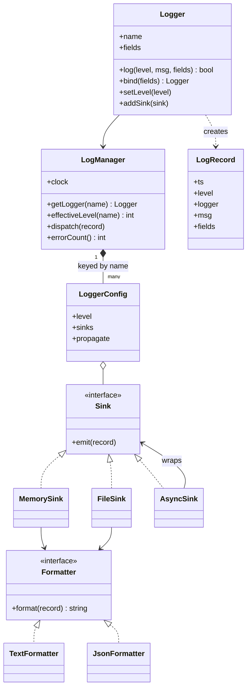
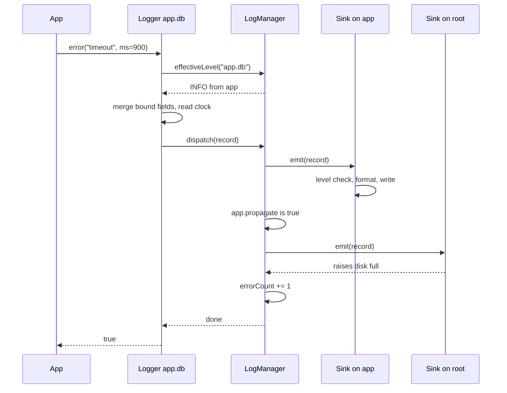

## In one minute
- Split the framework into four roles with one job each: a **Logger** that application code calls, a **LogRecord** that carries one event, a **Formatter** that turns a record into text, and a **Sink** (appender, handler) that sends text somewhere.
- Configuration attaches to **dotted names**, not to logger objects. `app.db.pool` inherits its level from `app.db`, then `app`, then the root, so one line of config can silence or open up a whole subsystem.
- Records travel **up the name hierarchy** to every sink on the way, like a chain of responsibility that does not stop at the first handler. A `propagate` flag cuts the chain.
- The disabled path must be almost free. Check the level before you allocate, format or read the clock, because most log calls in production are debug lines that nobody will read.
- Logging must never take the application down. A failing sink is counted and skipped, and fields are data that is never interpreted (Log4Shell is what happens when a formatter interprets them).

## Requirements
Functional:
- Log a message at a level (DEBUG, INFO, WARN, ERROR) with optional key-value fields.
- Get a logger by name. Set a level on any name; names without a level inherit from the nearest ancestor that has one, ending at the root.
- Attach any number of sinks to any name, each with its own minimum level and its own formatter (plain text, JSON).
- Bind context fields once (`request_id`, `tenant`) and have them appear on every line from that logger.
- Stop propagation at a chosen name, so a noisy subsystem can write to its own sink only.

Non-functional:
- A disabled log call costs a few nanoseconds and allocates nothing.
- Thread-safe: many threads log at once, and configuration can change at runtime.
- A broken sink (full disk, closed socket) does not throw into application code and does not stop other sinks.
- Output is deterministic and machine-parseable, with stable key order, so tests and log pipelines can rely on it.

Out of scope: log shipping, indexing and search (that is a distributed logging system), configuration file parsing, and log rotation policies, which are a sink's internal concern.

## Entities and relationships
**LogManager** owns the registry: a map from logger name to its configuration (level, sinks, propagate flag) and the injected clock. There is one manager per process in practice, but making it an ordinary object, not a global, keeps tests isolated.

**Logger** is a lightweight handle: a name, a reference to the manager and a set of bound fields. Two handles with the same name share configuration because the configuration lives in the manager, keyed by name. That is why `bind()` can return a new Logger cheaply: it copies the field map, not the configuration.

**LogRecord** is an immutable value: timestamp, level, logger name, message and fields. It is created once per enabled call and handed to every sink, so sinks must not mutate it.

**Formatter** is a strategy with one method, `format(record) -> string`. **Sink** is the output port with one method, `emit(record)`. A sink owns a formatter and a minimum level. Concrete sinks include an in-memory sink for tests, a file sink, a stdout sink and an async sink that wraps another sink with a queue.

Relationships: the manager has many configurations; a configuration has many sinks; a sink has one formatter; loggers create records; records flow from a logger's name up through its ancestors.

## Class diagram


## Key flows
The main flow is one `error()` call on `app.db`, where `app` has a sink and the root has a sink that is currently failing.



The level lookup walks `app.db`, `app`, root and stops at the first name that has a level set. Note that `application` is not a child of `app`: the hierarchy is split on dots, never on string prefixes. If the call is disabled, the flow ends after the first arrow pair and nothing else happens. That early exit is the most important line in the framework.

## Design patterns used and why
- **Strategy (Formatter).** Text for humans, JSON for machines and logfmt for the team that likes it are three algorithms behind one interface. A sink holds one, so the same record can be text on the console and JSON in the file.
- **Chain of responsibility (hierarchy walk).** Each name in the chain gets a chance to handle the record, then passes it to its parent. Unlike the textbook version, handling does not stop the chain; only `propagate = false` does. Log4j and Logback call this flag *additivity*; Python's `logging` calls it `propagate`.
- **Observer (sinks).** Many sinks subscribe to one logger name and are notified of each record. Adding a sink is registering an observer; nobody else changes.
- **Decorator (AsyncSink, FilteringSink).** An async sink implements `Sink` and wraps another sink, adding a queue and a background writer without the inner sink knowing.
- **Flyweight-like handles.** Loggers are cheap views over shared configuration. You can create one per request with bound fields without copying sinks or levels.
- **Avoid Singleton as the only access path.** A process-wide default manager is convenient, but code that can only reach a global is hard to test. Pass a manager in, and keep the global as a thin convenience.

## Concurrency and edge cases
- **Concurrent logging and reconfiguration.** Writes to the configuration (set level, add sink) are rare; reads happen on every call. Use a read-write lock or copy-on-write: build a new sink list and swap the reference atomically, so the hot path reads without contention.
- **Do not call sinks under the manager lock.** Snapshot the list of sinks along the chain under the lock, release it, then emit. A sink that blocks on a slow disk would otherwise block every thread that wants to log, and a sink that logs from inside `emit` would deadlock.
- **Each sink protects itself.** Two threads writing to one file must not interleave half lines. The sink holds its own mutex around format-and-write, or hands the record to a single writer through a queue.
- **Recursion.** A sink that fails and logs the failure through the same framework can loop forever. Count sink errors in a counter or write them to stderr directly.
- **Async sinks drop or block.** A bounded queue in front of a slow sink must choose: block the caller (backpressure, latency spikes) or drop records (count drops and log the count later). Make the choice explicit per sink; audit logs block, debug logs drop.
- **Field collisions.** A user field named `msg` or `level` must not overwrite the record's own values. Reserved keys win.
- **Never interpret data.** Messages and fields are printed, never evaluated. Log4Shell (CVE-2021-44228) came from Log4j expanding `${jndi:...}` lookups inside logged strings, so an attacker-controlled user agent became remote code execution.
- **Shutdown.** Buffered and async sinks must flush on exit, or the last lines before a crash, the ones you need, are lost.

## Down the stack

### Layer 1: The contract
A call at level L on name N is enabled if L is at least the level of the nearest ancestor of N (including N) that has a level set. An enabled call produces exactly one record with a timestamp from the injected clock and the bound fields merged with call-site fields, call-site winning. The record is offered to every sink on N and its ancestors, in order from N up, stopping after the first name whose `propagate` is false. Each sink writes it if the level passes that sink's own threshold. The call never throws because of a sink. A disabled call has no observable effect and does not read the clock.

### Layer 2: The mechanism
The level lookup is a walk over dot-separated prefixes against a hash map, which costs one string slice and one map lookup per level of depth. Real frameworks cache the answer. Python's `logging.Logger` keeps a `_cache` dictionary from level to enabled flag and clears every logger's cache when any level changes. Log4j 2 precomputes each `LoggerConfig` and swaps in a new configuration object on reload. Go's `log/slog` puts the check behind `Handler.Enabled(ctx, level)` so a handler can decide before a `slog.Record` is built. Bound fields map to `slog.Logger.With`, which calls `Handler.WithAttrs` and lets a JSON handler pre-render the bound part once instead of on every line. Sorting keys at format time gives stable output; Go's `encoding/json` already sorts map keys when it marshals a map.

### Layer 3: The machine
A disabled call that hits a cached level check costs a few nanoseconds: a pointer load, an integer compare and a branch the CPU predicts correctly. An enabled call is far more expensive. Building the record allocates a field map and strings (a few hundred bytes), formatting a JSON line takes on the order of 1 to 5 microseconds, and the line, typically 150 to 300 bytes, is copied into a buffer. A `write()` system call into the page cache costs 1 to 5 microseconds, and `fsync` to make it durable costs from about 100 microseconds on a good NVMe drive to 10 milliseconds on a spinning disk. At 20,000 lines per second of 250 bytes, that is 5 MB/s, which is fine for the disk but costs a whole core if every line is formatted and written synchronously. In a container, stdout goes through a pipe to the runtime's log driver, and a full pipe buffer (64 KB on Linux by default) blocks the writer. That is how a slow log collector stalls an application.

### Why it's built this way
1. Most log calls are below the active level, so the framework is designed around a cheap early exit before any allocation.
2. Operators reason about subsystems, not objects, so configuration is keyed by hierarchical names and inherits down the tree.
3. One event has several audiences (a human at a terminal, a JSON pipeline, an alerting sink), so output is split into sinks, each with its own format and threshold.
4. I/O is slow and fails, so sinks are isolated: errors are counted, slow sinks get queues, and the caller never pays for a broken disk with an exception.

## Extensibility
- **New output, such as Kafka or a syslog socket.** Add a Sink. Nothing else changes, which is the test of the design.
- **New format, such as logfmt or OpenTelemetry log records.** Add a Formatter.
- **Sampling.** Wrap a sink in a SamplingSink that passes 1 in N debug records, or the first K per message per second. Sampling by message keeps rare messages visible.
- **Context propagation.** Read bound fields from a request context (Go's `context.Context`, Python's `contextvars`) so trace and span IDs appear without passing a logger through every function.
- **Dynamic levels.** Expose an admin endpoint that calls `setLevel` on a name for ten minutes, then reverts. Because levels are keyed by name, this works without restarting.
- **Redaction.** A RedactingFormatter decorator masks fields named `password` or `card_number`. Put it in the framework so every team gets it for free.

## Leadership lens
- Standardise the record shape (field names for request ID, tenant, error, duration) across services before choosing a vendor. Inconsistent field names cost more in incident time than any logging library choice.
- Ask in design review: what happens to the application when the log destination is down or slow? The answer should be "we drop and count", or "we block, and here is why that is acceptable".
- Logging volume is a real cost line. Ingest pricing is per GB, so debug logs left on in a busy service can cost more than the service. Budget by service and alert on volume jumps.
- Treat logs as untrusted data and as personal data. Redaction rules and retention periods are compliance decisions, not developer preferences.
- Build first: levels with name inheritance, a JSON formatter, a stdout sink and bound fields. Async sinks and sampling come when measurement shows a need.

## Check yourself
1. Why is the level stored per name in the manager instead of on each Logger object?
   **Answer:** So every handle for a name, including bound copies and handles created before the change, sees the same level, and so a parent's change is inherited by children that never set their own.
2. A child logger `app.db` has an ERROR sink and propagates to a root sink at INFO. `app.db` has level WARN. Which sinks get a WARN record?
   **Answer:** Only the root sink. The call is enabled by the logger level, the `app.db` sink filters it out at its own ERROR threshold, and the root sink accepts it.
3. Why must the level check happen before reading the clock and merging fields?
   **Answer:** Because those steps allocate and cost time on every call, and most calls are disabled. Doing them first makes the disabled path as expensive as the enabled one.
4. What is the risk of holding the manager's lock while calling `emit`?
   **Answer:** A slow sink blocks every logging thread, and a sink that logs from inside `emit` deadlocks. Snapshot the sinks under the lock, then emit without it.

## Practice
**Task:** Build the core of a logging framework. `LogManager(clock, root_level=INFO)` keeps per-name configuration; `get_logger(name)` returns a handle (the root is `""` and prints as `root`). A logger's effective level is its own level or the nearest dotted ancestor's. An enabled call creates a record with `ts = clock()` and dispatches it to the sinks on its name and each ancestor, stopping after a name with `propagate` false. `MemorySink(formatter, level=DEBUG)` appends formatted lines for records at or above its level. `TextFormatter` prints `ts LEVEL logger msg` then `key=value` pairs sorted by key; `JsonFormatter` prints compact JSON with sorted keys, where `ts`, `level`, `logger` and `msg` override fields of the same name. `bind(fields)` returns a logger with merged fields (call-site wins). A sink that throws is skipped and counted in `error_count()`; `log` returns whether the call was enabled.

```python starter
DEBUG, INFO, WARN, ERROR = 10, 20, 30, 40


class TextFormatter:
    def format(self, record):
        raise NotImplementedError


class JsonFormatter:
    def format(self, record):
        raise NotImplementedError


class MemorySink:
    def __init__(self, formatter, level=DEBUG):
        self.lines = []

    def emit(self, record):
        raise NotImplementedError


class LogManager:
    def __init__(self, clock, root_level=INFO):
        pass

    def get_logger(self, name=""):
        raise NotImplementedError

    def error_count(self):
        raise NotImplementedError


class Logger:
    def set_level(self, level):
        raise NotImplementedError

    def effective_level(self):
        raise NotImplementedError

    def add_sink(self, sink):
        raise NotImplementedError

    def set_propagate(self, flag):
        raise NotImplementedError

    def bind(self, **fields):
        raise NotImplementedError

    def log(self, level, message, **fields):
        raise NotImplementedError

    def debug(self, message, **fields):
        return self.log(DEBUG, message, **fields)

    def info(self, message, **fields):
        return self.log(INFO, message, **fields)

    def warn(self, message, **fields):
        return self.log(WARN, message, **fields)

    def error(self, message, **fields):
        return self.log(ERROR, message, **fields)
```

```python tests
class Clock:
    def __init__(self, t=0):
        self.t = t

    def __call__(self):
        return self.t


def test_level_inheritance_by_name():
    m = LogManager(Clock())
    assert m.get_logger("app.db").effective_level() == INFO
    m.get_logger("app").set_level(DEBUG)
    assert m.get_logger("app.db.pool").effective_level() == DEBUG
    assert m.get_logger("application").effective_level() == INFO, "prefix is not a parent"
    m.get_logger("app.db").set_level(ERROR)
    assert m.get_logger("app.db.pool").effective_level() == ERROR
    assert m.get_logger("app.http").effective_level() == DEBUG


def test_text_format_and_filtering():
    c = Clock(100)
    m = LogManager(c)
    sink = MemorySink(TextFormatter())
    m.get_logger().add_sink(sink)
    log = m.get_logger("app.http")
    assert log.info("started", port=8080, host="h1")
    assert not log.debug("noisy")
    c.t = 101
    m.get_logger().warn("disk low")
    assert sink.lines == ["100 INFO app.http started host=h1 port=8080", "101 WARN root disk low"]


def test_propagation_and_sink_levels():
    m = LogManager(Clock())
    app_sink = MemorySink(TextFormatter())
    root_errors = MemorySink(TextFormatter(), ERROR)
    m.get_logger("app").add_sink(app_sink)
    m.get_logger().add_sink(root_errors)
    db = m.get_logger("app.db")
    db.info("connected")
    db.error("timeout")
    assert app_sink.lines == ["0 INFO app.db connected", "0 ERROR app.db timeout"]
    assert root_errors.lines == ["0 ERROR app.db timeout"]
    m.get_logger("app").set_propagate(False)
    db.error("again")
    assert len(app_sink.lines) == 3
    assert root_errors.lines == ["0 ERROR app.db timeout"], "propagation stops at app"


def test_json_sorted_keys_and_reserved_fields():
    m = LogManager(Clock(5))
    sink = MemorySink(JsonFormatter())
    m.get_logger().add_sink(sink)
    m.get_logger("svc").warn("slow", ms=250, msg="spoof")
    assert sink.lines == ['{"level":"WARN","logger":"svc","ms":250,"msg":"slow","ts":5}']


def test_bind_merges_fields_and_shares_level():
    m = LogManager(Clock())
    sink = MemorySink(TextFormatter())
    m.get_logger().add_sink(sink)
    req = m.get_logger("api").bind(request_id="r1", user="anon")
    req.info("login", user="ann")
    m.get_logger("api").info("plain")
    m.get_logger("api").set_level(WARN)
    assert not req.info("hidden"), "bound logger shares the level of its name"
    assert sink.lines == ["0 INFO api login request_id=r1 user=ann", "0 INFO api plain"]


def test_failing_sink_does_not_block_others():
    class Broken:
        def emit(self, record):
            raise ValueError("disk full")

    m = LogManager(Clock())
    good = MemorySink(TextFormatter())
    m.get_logger("a").add_sink(Broken())
    m.get_logger("a").add_sink(good)
    assert m.get_logger("a.b").error("boom")
    assert good.lines == ["0 ERROR a.b boom"]
    assert m.error_count() == 1
```

```python solution
import json

DEBUG, INFO, WARN, ERROR = 10, 20, 30, 40
LEVEL_NAMES = {DEBUG: "DEBUG", INFO: "INFO", WARN: "WARN", ERROR: "ERROR"}


class Record:
    def __init__(self, ts, level, logger, msg, fields):
        self.ts = ts
        self.level = level
        self.logger = logger
        self.msg = msg
        self.fields = fields


def _display(name):
    return name if name else "root"


class TextFormatter:
    def format(self, record):
        parts = [str(record.ts), LEVEL_NAMES[record.level], _display(record.logger), record.msg]
        for k in sorted(record.fields):
            parts.append(k + "=" + str(record.fields[k]))
        return " ".join(parts)


class JsonFormatter:
    def format(self, record):
        out = dict(record.fields)
        out["ts"] = record.ts
        out["level"] = LEVEL_NAMES[record.level]
        out["logger"] = _display(record.logger)
        out["msg"] = record.msg
        return json.dumps(out, sort_keys=True, separators=(",", ":"))


class MemorySink:
    def __init__(self, formatter, level=DEBUG):
        self.formatter = formatter
        self.level = level
        self.lines = []

    def emit(self, record):
        if record.level >= self.level:
            self.lines.append(self.formatter.format(record))


def _ancestors(name):
    out = []
    while name:
        out.append(name)
        i = name.rfind(".")
        name = name[:i] if i >= 0 else ""
    out.append("")
    return out


class _Config:
    def __init__(self):
        self.level = None
        self.sinks = []
        self.propagate = True


class LogManager:
    def __init__(self, clock, root_level=INFO):
        self.clock = clock
        self._configs = {}
        self._errors = 0
        self.config("").level = root_level

    def config(self, name):
        c = self._configs.get(name)
        if c is None:
            c = _Config()
            self._configs[name] = c
        return c

    def get_logger(self, name=""):
        return Logger(self, name, {})

    def error_count(self):
        return self._errors

    def effective_level(self, name):
        for n in _ancestors(name):
            c = self._configs.get(n)
            if c is not None and c.level is not None:
                return c.level
        return INFO

    def dispatch(self, record):
        sinks = []
        for n in _ancestors(record.logger):
            c = self._configs.get(n)
            if c is None:
                continue
            sinks.extend(c.sinks)
            if not c.propagate:
                break
        for sink in sinks:
            try:
                sink.emit(record)
            except Exception:
                self._errors += 1


class Logger:
    def __init__(self, manager, name, fields):
        self.manager = manager
        self.name = name
        self.fields = fields

    def set_level(self, level):
        self.manager.config(self.name).level = level

    def effective_level(self):
        return self.manager.effective_level(self.name)

    def add_sink(self, sink):
        self.manager.config(self.name).sinks.append(sink)

    def set_propagate(self, flag):
        self.manager.config(self.name).propagate = flag

    def bind(self, **fields):
        merged = dict(self.fields)
        merged.update(fields)
        return Logger(self.manager, self.name, merged)

    def log(self, level, message, **fields):
        if level < self.effective_level():
            return False
        merged = dict(self.fields)
        merged.update(fields)
        self.manager.dispatch(Record(self.manager.clock(), level, self.name, message, merged))
        return True

    def debug(self, message, **fields):
        return self.log(DEBUG, message, **fields)

    def info(self, message, **fields):
        return self.log(INFO, message, **fields)

    def warn(self, message, **fields):
        return self.log(WARN, message, **fields)

    def error(self, message, **fields):
        return self.log(ERROR, message, **fields)
```

```typescript starter
export const DEBUG = 10;
export const INFO = 20;
export const WARN = 30;
export const ERROR = 40;

export type Fields = { [key: string]: string | number };

export interface LogRecord {
  ts: number;
  level: number;
  logger: string;
  msg: string;
  fields: Fields;
}

export interface Formatter {
  format(r: LogRecord): string;
}

export interface Sink {
  emit(r: LogRecord): void;
}

export class TextFormatter implements Formatter {
  format(r: LogRecord): string {
    throw new Error("TODO");
  }
}

export class JsonFormatter implements Formatter {
  format(r: LogRecord): string {
    throw new Error("TODO");
  }
}

export class MemorySink implements Sink {
  lines: string[] = [];
  constructor(formatter: Formatter, level: number = DEBUG) {}
  emit(r: LogRecord): void {
    throw new Error("TODO");
  }
}

export class Logger {
  setLevel(level: number): void {
    throw new Error("TODO");
  }
  effectiveLevel(): number {
    throw new Error("TODO");
  }
  addSink(sink: Sink): void {
    throw new Error("TODO");
  }
  setPropagate(on: boolean): void {
    throw new Error("TODO");
  }
  bind(fields: Fields): Logger {
    throw new Error("TODO");
  }
  log(level: number, msg: string, fields: Fields = {}): boolean {
    throw new Error("TODO");
  }
  debug(msg: string, fields: Fields = {}): boolean {
    return this.log(DEBUG, msg, fields);
  }
  info(msg: string, fields: Fields = {}): boolean {
    return this.log(INFO, msg, fields);
  }
  warn(msg: string, fields: Fields = {}): boolean {
    return this.log(WARN, msg, fields);
  }
  error(msg: string, fields: Fields = {}): boolean {
    return this.log(ERROR, msg, fields);
  }
}

export class LogManager {
  constructor(clock: () => number, rootLevel: number = INFO) {}
  getLogger(name: string = ""): Logger {
    throw new Error("TODO");
  }
  errorCount(): number {
    throw new Error("TODO");
  }
}
```

```typescript tests
test("level inheritance by name", () => {
  const m = new LogManager(() => 0);
  assertEqual(m.getLogger("app.db").effectiveLevel(), INFO);
  m.getLogger("app").setLevel(DEBUG);
  assertEqual(m.getLogger("app.db.pool").effectiveLevel(), DEBUG);
  assertEqual(m.getLogger("application").effectiveLevel(), INFO, "prefix is not a parent");
  m.getLogger("app.db").setLevel(ERROR);
  assertEqual(m.getLogger("app.db.pool").effectiveLevel(), ERROR);
  assertEqual(m.getLogger("app.http").effectiveLevel(), DEBUG);
});

test("text format and filtering", () => {
  let now = 100;
  const m = new LogManager(() => now);
  const sink = new MemorySink(new TextFormatter());
  m.getLogger().addSink(sink);
  const log = m.getLogger("app.http");
  assert(log.info("started", { port: 8080, host: "h1" }), "info enabled");
  assert(!log.debug("noisy"), "debug disabled");
  now = 101;
  m.getLogger().warn("disk low");
  assertEqual(sink.lines, ["100 INFO app.http started host=h1 port=8080", "101 WARN root disk low"]);
});

test("propagation and sink levels", () => {
  const m = new LogManager(() => 0);
  const appSink = new MemorySink(new TextFormatter());
  const rootErrors = new MemorySink(new TextFormatter(), ERROR);
  m.getLogger("app").addSink(appSink);
  m.getLogger().addSink(rootErrors);
  const db = m.getLogger("app.db");
  db.info("connected");
  db.error("timeout");
  assertEqual(appSink.lines, ["0 INFO app.db connected", "0 ERROR app.db timeout"]);
  assertEqual(rootErrors.lines, ["0 ERROR app.db timeout"]);
  m.getLogger("app").setPropagate(false);
  db.error("again");
  assertEqual(appSink.lines.length, 3);
  assertEqual(rootErrors.lines, ["0 ERROR app.db timeout"], "propagation stops at app");
});

test("json sorted keys and reserved fields", () => {
  const m = new LogManager(() => 5);
  const sink = new MemorySink(new JsonFormatter());
  m.getLogger().addSink(sink);
  m.getLogger("svc").warn("slow", { ms: 250, msg: "spoof" });
  assertEqual(sink.lines, ['{"level":"WARN","logger":"svc","ms":250,"msg":"slow","ts":5}']);
});

test("bind merges fields and shares level", () => {
  const m = new LogManager(() => 0);
  const sink = new MemorySink(new TextFormatter());
  m.getLogger().addSink(sink);
  const req = m.getLogger("api").bind({ request_id: "r1", user: "anon" });
  req.info("login", { user: "ann" });
  m.getLogger("api").info("plain");
  m.getLogger("api").setLevel(WARN);
  assert(!req.info("hidden"), "bound logger shares the level of its name");
  assertEqual(sink.lines, ["0 INFO api login request_id=r1 user=ann", "0 INFO api plain"]);
});

test("failing sink does not block others", () => {
  class Broken implements Sink {
    emit(r: LogRecord): void {
      throw new Error("disk full");
    }
  }
  const m = new LogManager(() => 0);
  const good = new MemorySink(new TextFormatter());
  m.getLogger("a").addSink(new Broken());
  m.getLogger("a").addSink(good);
  assert(m.getLogger("a.b").error("boom"), "enabled");
  assertEqual(good.lines, ["0 ERROR a.b boom"]);
  assertEqual(m.errorCount(), 1);
});
```

```typescript solution
export const DEBUG = 10;
export const INFO = 20;
export const WARN = 30;
export const ERROR = 40;
const NAMES: { [level: number]: string } = { 10: "DEBUG", 20: "INFO", 30: "WARN", 40: "ERROR" };

export type Fields = { [key: string]: string | number };

export interface LogRecord {
  ts: number;
  level: number;
  logger: string;
  msg: string;
  fields: Fields;
}

export interface Formatter {
  format(r: LogRecord): string;
}

export interface Sink {
  emit(r: LogRecord): void;
}

const display = (name: string): string => (name === "" ? "root" : name);

export class TextFormatter implements Formatter {
  format(r: LogRecord): string {
    const parts = [String(r.ts), NAMES[r.level], display(r.logger), r.msg];
    for (const k of Object.keys(r.fields).sort()) parts.push(`${k}=${r.fields[k]}`);
    return parts.join(" ");
  }
}

export class JsonFormatter implements Formatter {
  format(r: LogRecord): string {
    const all: Fields = { ...r.fields, ts: r.ts, level: NAMES[r.level], logger: display(r.logger), msg: r.msg };
    const sorted: Fields = {};
    for (const k of Object.keys(all).sort()) sorted[k] = all[k];
    return JSON.stringify(sorted);
  }
}

export class MemorySink implements Sink {
  lines: string[] = [];
  constructor(private formatter: Formatter, private level: number = DEBUG) {}
  emit(r: LogRecord): void {
    if (r.level >= this.level) this.lines.push(this.formatter.format(r));
  }
}

class Config {
  level: number | null = null;
  sinks: Sink[] = [];
  propagate = true;
}

function ancestors(name: string): string[] {
  const out: string[] = [];
  while (name !== "") {
    out.push(name);
    const i = name.lastIndexOf(".");
    name = i >= 0 ? name.slice(0, i) : "";
  }
  out.push("");
  return out;
}

export class Logger {
  constructor(private manager: LogManager, readonly name: string, private fields: Fields) {}
  setLevel(level: number): void {
    this.manager.config(this.name).level = level;
  }
  effectiveLevel(): number {
    return this.manager.effectiveLevel(this.name);
  }
  addSink(sink: Sink): void {
    this.manager.config(this.name).sinks.push(sink);
  }
  setPropagate(on: boolean): void {
    this.manager.config(this.name).propagate = on;
  }
  bind(fields: Fields): Logger {
    return new Logger(this.manager, this.name, { ...this.fields, ...fields });
  }
  log(level: number, msg: string, fields: Fields = {}): boolean {
    if (level < this.effectiveLevel()) return false;
    const record: LogRecord = {
      ts: this.manager.clock(),
      level,
      logger: this.name,
      msg,
      fields: { ...this.fields, ...fields },
    };
    this.manager.dispatch(record);
    return true;
  }
  debug(msg: string, fields: Fields = {}): boolean {
    return this.log(DEBUG, msg, fields);
  }
  info(msg: string, fields: Fields = {}): boolean {
    return this.log(INFO, msg, fields);
  }
  warn(msg: string, fields: Fields = {}): boolean {
    return this.log(WARN, msg, fields);
  }
  error(msg: string, fields: Fields = {}): boolean {
    return this.log(ERROR, msg, fields);
  }
}

export class LogManager {
  private configs = new Map<string, Config>();
  private errors = 0;

  constructor(readonly clock: () => number, rootLevel: number = INFO) {
    this.config("").level = rootLevel;
  }

  config(name: string): Config {
    let c = this.configs.get(name);
    if (!c) {
      c = new Config();
      this.configs.set(name, c);
    }
    return c;
  }

  getLogger(name: string = ""): Logger {
    return new Logger(this, name, {});
  }

  errorCount(): number {
    return this.errors;
  }

  effectiveLevel(name: string): number {
    for (const n of ancestors(name)) {
      const c = this.configs.get(n);
      if (c && c.level !== null) return c.level;
    }
    return INFO;
  }

  dispatch(record: LogRecord): void {
    const sinks: Sink[] = [];
    for (const n of ancestors(record.logger)) {
      const c = this.configs.get(n);
      if (!c) continue;
      sinks.push(...c.sinks);
      if (!c.propagate) break;
    }
    for (const s of sinks) {
      try {
        s.emit(record);
      } catch (e) {
        this.errors++;
      }
    }
  }
}
```

```go starter
package practice

type Level int

const (
	LevelDebug Level = 10
	LevelInfo  Level = 20
	LevelWarn  Level = 30
	LevelError Level = 40
)

type Fields map[string]any

type Record struct {
	TS     int64
	Level  Level
	Logger string
	Msg    string
	Fields Fields
}

type Formatter interface {
	Format(r Record) string
}

type Sink interface {
	Emit(r Record) error
}

type TextFormatter struct{}

func (TextFormatter) Format(r Record) string { panic("TODO") }

type JSONFormatter struct{}

func (JSONFormatter) Format(r Record) string { panic("TODO") }

type MemorySink struct{}

func NewMemorySink(f Formatter, level Level) *MemorySink { return &MemorySink{} }
func (s *MemorySink) Emit(r Record) error                { panic("TODO") }
func (s *MemorySink) Lines() []string                    { panic("TODO") }

type Manager struct{}

func NewManager(clock func() int64, rootLevel Level) *Manager { return &Manager{} }
func (m *Manager) Logger(name string) *Logger                 { panic("TODO") }
func (m *Manager) ErrorCount() int                            { panic("TODO") }

type Logger struct{}

func (l *Logger) SetLevel(level Level)                       { panic("TODO") }
func (l *Logger) EffectiveLevel() Level                      { panic("TODO") }
func (l *Logger) AddSink(s Sink)                             { panic("TODO") }
func (l *Logger) SetPropagate(on bool)                       { panic("TODO") }
func (l *Logger) With(f Fields) *Logger                      { panic("TODO") }
func (l *Logger) Log(level Level, msg string, f Fields) bool { panic("TODO") }
```

```go tests
package practice

import "testing"

func sameLines(a, b []string) bool {
	if len(a) != len(b) {
		return false
	}
	for i := range a {
		if a[i] != b[i] {
			return false
		}
	}
	return true
}

func TestLevelInheritanceByName(t *testing.T) {
	m := NewManager(func() int64 { return 0 }, LevelInfo)
	if m.Logger("app.db").EffectiveLevel() != LevelInfo {
		t.Fatal("default from root")
	}
	m.Logger("app").SetLevel(LevelDebug)
	if m.Logger("app.db.pool").EffectiveLevel() != LevelDebug {
		t.Fatal("inherit from app")
	}
	if m.Logger("application").EffectiveLevel() != LevelInfo {
		t.Fatal("prefix is not a parent")
	}
	m.Logger("app.db").SetLevel(LevelError)
	if m.Logger("app.db.pool").EffectiveLevel() != LevelError || m.Logger("app.http").EffectiveLevel() != LevelDebug {
		t.Fatal("nearest ancestor wins")
	}
}

func TestTextFormatAndFiltering(t *testing.T) {
	now := int64(100)
	m := NewManager(func() int64 { return now }, LevelInfo)
	sink := NewMemorySink(TextFormatter{}, LevelDebug)
	m.Logger("").AddSink(sink)
	log := m.Logger("app.http")
	if !log.Log(LevelInfo, "started", Fields{"port": 8080, "host": "h1"}) {
		t.Fatal("info enabled")
	}
	if log.Log(LevelDebug, "noisy", nil) {
		t.Fatal("debug disabled")
	}
	now = 101
	m.Logger("").Log(LevelWarn, "disk low", nil)
	want := []string{"100 INFO app.http started host=h1 port=8080", "101 WARN root disk low"}
	if !sameLines(sink.Lines(), want) {
		t.Fatalf("got %q", sink.Lines())
	}
}

func TestPropagationAndSinkLevels(t *testing.T) {
	m := NewManager(func() int64 { return 0 }, LevelInfo)
	appSink := NewMemorySink(TextFormatter{}, LevelDebug)
	rootErrors := NewMemorySink(TextFormatter{}, LevelError)
	m.Logger("app").AddSink(appSink)
	m.Logger("").AddSink(rootErrors)
	db := m.Logger("app.db")
	db.Log(LevelInfo, "connected", nil)
	db.Log(LevelError, "timeout", nil)
	if !sameLines(appSink.Lines(), []string{"0 INFO app.db connected", "0 ERROR app.db timeout"}) {
		t.Fatalf("app sink got %q", appSink.Lines())
	}
	if !sameLines(rootErrors.Lines(), []string{"0 ERROR app.db timeout"}) {
		t.Fatalf("root sink got %q", rootErrors.Lines())
	}
	m.Logger("app").SetPropagate(false)
	db.Log(LevelError, "again", nil)
	if len(appSink.Lines()) != 3 || len(rootErrors.Lines()) != 1 {
		t.Fatal("propagation stops at app")
	}
}

func TestJSONSortedKeysAndReservedFields(t *testing.T) {
	m := NewManager(func() int64 { return 5 }, LevelInfo)
	sink := NewMemorySink(JSONFormatter{}, LevelDebug)
	m.Logger("").AddSink(sink)
	m.Logger("svc").Log(LevelWarn, "slow", Fields{"ms": 250, "msg": "spoof"})
	want := []string{`{"level":"WARN","logger":"svc","ms":250,"msg":"slow","ts":5}`}
	if !sameLines(sink.Lines(), want) {
		t.Fatalf("got %q", sink.Lines())
	}
}

func TestWithMergesFieldsAndSharesLevel(t *testing.T) {
	m := NewManager(func() int64 { return 0 }, LevelInfo)
	sink := NewMemorySink(TextFormatter{}, LevelDebug)
	m.Logger("").AddSink(sink)
	req := m.Logger("api").With(Fields{"request_id": "r1", "user": "anon"})
	req.Log(LevelInfo, "login", Fields{"user": "ann"})
	m.Logger("api").Log(LevelInfo, "plain", nil)
	m.Logger("api").SetLevel(LevelWarn)
	if req.Log(LevelInfo, "hidden", nil) {
		t.Fatal("bound logger shares the level of its name")
	}
	want := []string{"0 INFO api login request_id=r1 user=ann", "0 INFO api plain"}
	if !sameLines(sink.Lines(), want) {
		t.Fatalf("got %q", sink.Lines())
	}
}

type diskFull struct{}

func (diskFull) Error() string { return "disk full" }

type brokenSink struct{}

func (brokenSink) Emit(r Record) error { return diskFull{} }

func TestFailingSinkDoesNotBlockOthers(t *testing.T) {
	m := NewManager(func() int64 { return 0 }, LevelInfo)
	good := NewMemorySink(TextFormatter{}, LevelDebug)
	m.Logger("a").AddSink(brokenSink{})
	m.Logger("a").AddSink(good)
	if !m.Logger("a.b").Log(LevelError, "boom", nil) {
		t.Fatal("enabled")
	}
	if !sameLines(good.Lines(), []string{"0 ERROR a.b boom"}) || m.ErrorCount() != 1 {
		t.Fatalf("got %q errors=%d", good.Lines(), m.ErrorCount())
	}
}
```

```go solution
package practice

import (
	"encoding/json"
	"fmt"
	"sort"
	"strings"
	"sync"
	"sync/atomic"
)

type Level int

const (
	LevelDebug Level = 10
	LevelInfo  Level = 20
	LevelWarn  Level = 30
	LevelError Level = 40
)

func (l Level) String() string {
	switch l {
	case LevelDebug:
		return "DEBUG"
	case LevelInfo:
		return "INFO"
	case LevelWarn:
		return "WARN"
	case LevelError:
		return "ERROR"
	}
	return fmt.Sprintf("LEVEL(%d)", int(l))
}

type Fields map[string]any

type Record struct {
	TS     int64
	Level  Level
	Logger string
	Msg    string
	Fields Fields
}

type Formatter interface {
	Format(r Record) string
}

type Sink interface {
	Emit(r Record) error
}

func display(name string) string {
	if name == "" {
		return "root"
	}
	return name
}

type TextFormatter struct{}

func (TextFormatter) Format(r Record) string {
	parts := []string{fmt.Sprint(r.TS), r.Level.String(), display(r.Logger), r.Msg}
	keys := make([]string, 0, len(r.Fields))
	for k := range r.Fields {
		keys = append(keys, k)
	}
	sort.Strings(keys)
	for _, k := range keys {
		parts = append(parts, fmt.Sprintf("%s=%v", k, r.Fields[k]))
	}
	return strings.Join(parts, " ")
}

type JSONFormatter struct{}

func (JSONFormatter) Format(r Record) string {
	out := make(map[string]any, len(r.Fields)+4)
	for k, v := range r.Fields {
		out[k] = v
	}
	out["ts"] = r.TS
	out["level"] = r.Level.String()
	out["logger"] = display(r.Logger)
	out["msg"] = r.Msg
	b, err := json.Marshal(out) // map keys are marshalled in sorted order
	if err != nil {
		return fmt.Sprintf(`{"format_error":%q}`, err.Error())
	}
	return string(b)
}

type MemorySink struct {
	mu        sync.Mutex
	formatter Formatter
	level     Level
	lines     []string
}

func NewMemorySink(f Formatter, level Level) *MemorySink {
	return &MemorySink{formatter: f, level: level}
}

func (s *MemorySink) Emit(r Record) error {
	if r.Level < s.level {
		return nil
	}
	line := s.formatter.Format(r)
	s.mu.Lock()
	s.lines = append(s.lines, line)
	s.mu.Unlock()
	return nil
}

func (s *MemorySink) Lines() []string {
	s.mu.Lock()
	defer s.mu.Unlock()
	return append([]string(nil), s.lines...)
}

type config struct {
	level     Level
	hasLevel  bool
	sinks     []Sink
	propagate bool
}

type Manager struct {
	mu      sync.RWMutex
	clock   func() int64
	configs map[string]*config
	errors  int64
}

func NewManager(clock func() int64, rootLevel Level) *Manager {
	m := &Manager{clock: clock, configs: map[string]*config{}}
	c := m.configLocked("")
	c.level, c.hasLevel = rootLevel, true
	return m
}

// configLocked returns the config for name, creating it. Caller holds m.mu for writing.
func (m *Manager) configLocked(name string) *config {
	c, ok := m.configs[name]
	if !ok {
		c = &config{propagate: true}
		m.configs[name] = c
	}
	return c
}

func (m *Manager) Logger(name string) *Logger { return &Logger{m: m, name: name} }

func (m *Manager) ErrorCount() int { return int(atomic.LoadInt64(&m.errors)) }

func ancestors(name string) []string {
	var out []string
	for name != "" {
		out = append(out, name)
		if i := strings.LastIndexByte(name, '.'); i >= 0 {
			name = name[:i]
		} else {
			name = ""
		}
	}
	return append(out, "")
}

func (m *Manager) effectiveLevel(name string) Level {
	m.mu.RLock()
	defer m.mu.RUnlock()
	for _, n := range ancestors(name) {
		if c, ok := m.configs[n]; ok && c.hasLevel {
			return c.level
		}
	}
	return LevelInfo
}

func (m *Manager) dispatch(r Record) {
	// Snapshot the sinks under the lock, emit without it.
	m.mu.RLock()
	var sinks []Sink
	for _, n := range ancestors(r.Logger) {
		c, ok := m.configs[n]
		if !ok {
			continue
		}
		sinks = append(sinks, c.sinks...)
		if !c.propagate {
			break
		}
	}
	m.mu.RUnlock()
	for _, s := range sinks {
		if err := s.Emit(r); err != nil {
			atomic.AddInt64(&m.errors, 1)
		}
	}
}

type Logger struct {
	m      *Manager
	name   string
	fields Fields
}

func (l *Logger) update(fn func(c *config)) {
	l.m.mu.Lock()
	defer l.m.mu.Unlock()
	fn(l.m.configLocked(l.name))
}

func (l *Logger) SetLevel(level Level) {
	l.update(func(c *config) { c.level, c.hasLevel = level, true })
}

func (l *Logger) EffectiveLevel() Level { return l.m.effectiveLevel(l.name) }

func (l *Logger) AddSink(s Sink) {
	l.update(func(c *config) { c.sinks = append(c.sinks, s) })
}

func (l *Logger) SetPropagate(on bool) {
	l.update(func(c *config) { c.propagate = on })
}

func (l *Logger) With(f Fields) *Logger {
	merged := make(Fields, len(l.fields)+len(f))
	for k, v := range l.fields {
		merged[k] = v
	}
	for k, v := range f {
		merged[k] = v
	}
	return &Logger{m: l.m, name: l.name, fields: merged}
}

func (l *Logger) Log(level Level, msg string, f Fields) bool {
	if level < l.EffectiveLevel() {
		return false
	}
	merged := make(Fields, len(l.fields)+len(f))
	for k, v := range l.fields {
		merged[k] = v
	}
	for k, v := range f {
		merged[k] = v
	}
	l.m.dispatch(Record{TS: l.m.clock(), Level: level, Logger: l.name, Msg: msg, Fields: merged})
	return true
}
```

## Mock interview
**Prompt:** Design an in-process logging library for a company with 300 services in three languages. It must support levels, per-subsystem configuration, structured fields and multiple outputs, and a busy service logs 50,000 lines per second at INFO.

- Follow-up: how do you make a disabled `debug()` call cost almost nothing, including when the caller builds an expensive message string?
- Follow-up: the log collector is down and the stdout pipe is full. What happens to request latency, and what should happen?
- Follow-up: why not let each logger object hold its own level and sinks instead of a name-keyed registry?

**A strong answer covers:**
- Clean roles: Logger handle, immutable record, Formatter strategy, Sink interface, and a manager that owns configuration by name.
- Hierarchical level inheritance by dotted name and propagation up the chain, with a flag to stop it.
- A cheap, cached level check before any allocation, plus lazy message construction (format arguments, not pre-built strings).
- Concurrency: copy-on-write or read-write locks for configuration, sinks emitted outside the registry lock, per-sink locking or a single writer.
- Failure isolation: counted sink errors, bounded async queues with an explicit drop or block policy, flush on shutdown.
- Safety: reserved keys, redaction, and never interpreting logged data.

## Watch
- [Modern Python logging (mCoding)](https://www.youtube.com/watch?v=9L77QExPmI0): how Python's logger hierarchy, handlers, formatters and queue handlers fit together, and how to configure them well.
- [Software Architecture in Golang: Structured Logging using slog (Mario Carrion)](https://www.youtube.com/watch?v=htbGdhW3JdQ): Go's `slog` handlers, attributes and levels in practice.

## Free resources
- [Logging HOWTO (Python docs)](https://docs.python.org/3/howto/logging.html): the logger hierarchy, propagation and the flow of a record through handlers, with a diagram.
- [Architecture (Apache Log4j 2 manual)](https://logging.apache.org/log4j/2.x/manual/architecture.html): LoggerConfig, additivity, appenders and layouts in a mature Java framework.
- [Logback architecture (Logback manual)](https://logback.qos.ch/manual/architecture.html): level inheritance tables and appender additivity, explained with worked examples.
- [Structured Logging with slog (Go blog)](https://go.dev/blog/slog): why Go added structured logging and how the Handler interface separates front end from back end.
- [Logs (The Twelve-Factor App)](https://12factor.net/logs): the case for treating logs as an event stream written to stdout.
