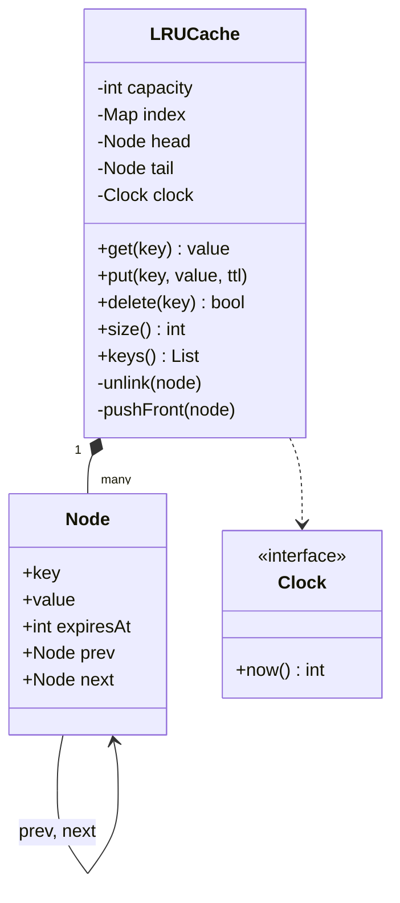
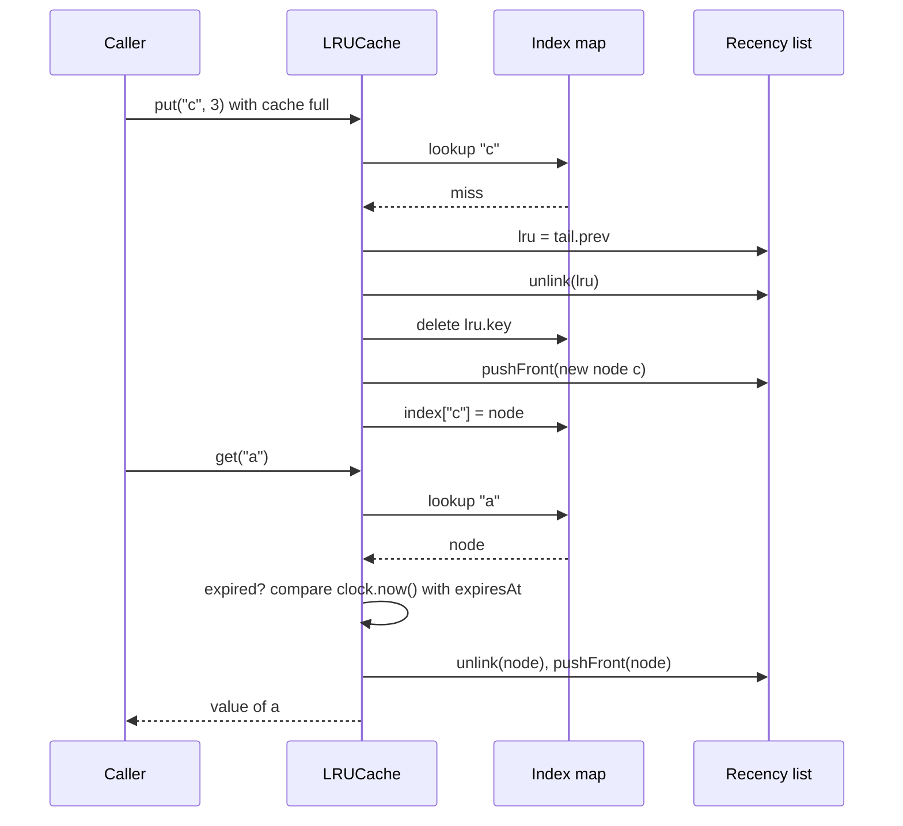

## In one minute
- An LRU cache holds at most N entries and, when full, evicts the one that was used least recently. The interview goal is `get` and `put` in O(1) time, and code that stays correct at the edges.
- The standard design pairs a hash map (key to node, for O(1) lookup) with a doubly linked list (nodes in recency order, for O(1) move and remove). Each structure alone is too slow at one of the two jobs.
- Sentinel head and tail nodes remove every "is this the first or last node" branch, which is where most hand-written versions break.
- TTL is a second, independent reason to drop an entry. Inject the clock so expiry is testable, and check expiry lazily on read.
- A read on an LRU is also a write (it moves a node), so concurrent LRUs need a lock on every `get`. That one fact explains why Redis samples, why Caffeine buffers reads and why big caches shard.

## Requirements

### Functional
- `get(key)` returns the value and marks the key most recently used, or reports a miss.
- `put(key, value, ttl)` inserts or updates. Updating an existing key marks it most recently used and does not grow the cache.
- When a `put` adds a new key to a full cache, the least recently used entry is evicted first.
- Optional per-entry TTL: an entry older than its TTL is never returned. A TTL of zero (or none) means no expiry.
- `delete(key)`, a size, and the keys in recency order for debugging and tests.

### Non-functional
- `get`, `put` and `delete` in O(1) average time; memory O(capacity).
- Deterministic and testable: no direct reads of the wall clock.
- Safe for concurrent use in the Go version.

### Out of scope
- Distribution across machines (see the distributed cache lesson), persistence, size-in-bytes weighting and loaders. Extensibility covers how they would fit.

## Entities and relationships
- **LRUCache:** the public type. It owns the map, the list, the capacity and the clock.
- **Node:** key, value, expiry time, `prev` and `next`. The node stores its key so that evicting the tail can also delete the map entry in O(1).
- **Recency list:** a doubly linked list with two sentinels. The node after `head` is the most recently used; the node before `tail` is the least.
- **Index:** a hash map from key to node. It answers "is it here" and "where is it in the list".
- **Clock:** a function returning the current time in milliseconds. Production passes a monotonic clock; tests pass a fake one they can advance.

The cache composes one index and one list, and they always hold the same set of nodes. That invariant is what every operation must preserve: if the map and list disagree, the cache leaks memory or returns a node that is no longer linked.

## Class diagram



## Key flows



`get` on a hit does three things: look up, check expiry, move to front. If the entry has expired, `get` unlinks it, deletes it from the map and reports a miss. `put` on an existing key updates the value and expiry in place and moves the node to the front. `put` on a new key evicts first if full, then links the new node at the front. Eviction before insertion matters: inserting first briefly holds capacity + 1 entries, which breaks the invariant a test can observe.

## Design patterns used and why
- **Composition over inheritance.** Subclassing a built-in ordered map (Python's `OrderedDict`, Java's `LinkedHashMap` with `removeEldestEntry`) works and is fine in production. In an interview, composing your own map and list shows you know where the O(1) comes from.
- **Sentinel nodes (null object).** Dummy head and tail mean every real node always has a non-null `prev` and `next`. `unlink` and `pushFront` become four pointer writes with no branches.
- **Dependency injection for the clock.** The cache never calls the system time. Tests advance a fake clock across an expiry boundary in microseconds, with no sleeps and no flakiness.
- **Strategy for eviction (extension point).** LRU is one policy. Hiding "which node to evict next" behind an interface lets you swap in LFU or a segmented LRU without touching the API.
- **Decorator.** Memoisation (`functools.lru_cache`) wraps a function with this exact structure. The cache is the mechanism; the decorator is the delivery.

## Concurrency and edge cases
- **Reads mutate.** `get` relinks a node. Two goroutines calling `get` without a lock can corrupt the list (a node whose `prev.next` no longer points to it). A read-write lock does not help, because a hit needs the write side. Use a plain `sync.Mutex`, as the Go solution does.
- **Lock scope.** Hold the lock for the map and list work only. Never call user code (a loader, an eviction callback) while holding it, or a slow callback stalls every reader.
- **Capacity of zero or less.** Reject it at construction. A cache of capacity zero would evict the item it just inserted, which is almost always a configuration bug.
- **Updating a key.** Must not count as a new entry, and must reset the TTL. Forgetting either is the most common test failure.
- **Expiry boundary.** Decide whether an entry is dead at exactly `expiresAt`. This design treats `now >= expiresAt` as expired, so a TTL of 100 ms gives exactly 100 ms of life.
- **Expired but not evicted.** Lazy expiry means dead entries can occupy slots until touched or until they reach the tail. That is a deliberate trade: O(1) operations instead of a background sweep. Redis and Memcached combine lazy checks with a periodic sampler for the same reason.
- **Clock going backwards.** Use a monotonic clock in production. A wall clock adjusted by NTP can make entries live longer or die early.

## Down the stack

### Layer 1: The contract
- After any operation, `size() <= capacity`, and the map and list contain the same keys.
- `get` never returns an entry for which `now >= expiresAt`.
- If `k` was accessed (by `get` or `put`) more recently than `j`, `j` is evicted before `k`.
- `get`, `put` and `delete` take O(1) average time, independent of capacity.

### Layer 2: The mechanism
`unlink(n)` sets `n.prev.next = n.next` and `n.next.prev = n.prev`. `pushFront(n)` sets `n.next = head.next`, `n.prev = head`, `head.next.prev = n`, `head.next = n`. A hit is one hash lookup plus these eight pointer writes.

Real implementations follow the same shape or deliberately depart from it. CPython's C `functools.lru_cache` keeps a dict plus a circular doubly linked list with one root link acting as both sentinels. Go's `groupcache/lru` composes a map with `container/list`. Redis does not keep a list at all: each object header has a 24-bit LRU clock field, and on eviction Redis samples `maxmemory-samples` keys (default 5) into a 16-entry candidate pool and evicts the oldest. Memcached splits its LRU into hot, warm and cold segments and bumps an item at most once per interval. The Linux kernel keeps active and inactive page lists, and newer kernels use multi-generational LRU.

### Layer 3: The machine
A node with a string key, a value, an expiry and two pointers is about 56 to 64 bytes in Go, plus the map's bucket entry, so a million entries costs roughly 100 MB before counting the values. Nodes are scattered across the heap, so walking or relinking them is pointer chasing: each node not in CPU cache costs a main-memory access of about 100 ns. Worse, every hit writes to the neighbours' cache lines. On a multi-core server, when two cores touch the same nodes or the same mutex, the 64-byte lines bounce between cores at tens of nanoseconds per transfer. A mutex acquire that is uncontended costs about 20 ns; under heavy contention, threads park in the kernel (`futex` on Linux) and the cost jumps to microseconds. For a garbage-collected runtime, a million pointer-rich nodes also add to every GC mark phase.

### Why it's built this way
1. Lookups must be O(1), so the index is a hash map.
2. Eviction needs the least recently used item in O(1), and hits must reorder in O(1), so recency is a doubly linked list keyed by node pointers.
3. Moving nodes on every read turns reads into writes, so a concurrent cache needs a lock on reads.
4. Locks and cache-line bouncing limit throughput on many cores, so large caches shard, sample (Redis), segment (Memcached) or buffer reads and replay them in batches (Caffeine).
5. Exact LRU is just an approximation of "keep what will be used next", so production caches accept approximate recency when it buys throughput.

## Extensibility
- **Weighted capacity.** Replace the entry count with a byte budget. `put` evicts from the tail until the new entry fits, and refuses entries larger than the whole budget.
- **Eviction listener.** Call a callback with the evicted key and value, after releasing the lock, so callers can close file handles or write back dirty data.
- **Loader with single-flight.** `get_or_load(key, fn)` runs `fn` once per missing key even if 100 callers ask at the same moment. This prevents a stampede on the backing store after a mass expiry.
- **Better policies.** LRU loses to a single large scan: one pass over cold keys flushes the hot set. Segmented LRU or W-TinyLFU (Caffeine) keeps a frequency sketch and admits new keys only if they are likely to be hit again.
- **Sharding.** Hash keys into 16 or 64 independent caches, each with its own mutex. Recency becomes per-shard, which is a fine approximation in practice.

## Leadership lens
- **Measure before tuning.** Ask for hit ratio, eviction rate and p99 latency per cache before anyone debates policies. Most "cache problems" are a capacity or TTL setting.
- **Prefer the library.** Production code should usually use `functools.lru_cache`, Caffeine, Ristretto or a well-tested package. Hand-rolled caches are where subtle concurrency bugs live; reserve them for when a measured need exists.
- **TTL is a correctness setting.** A TTL decides how stale data can be. The owning product team should set it with the data's owner, not leave a default someone copied.
- **Stampedes are an availability risk.** In design review, ask what happens to the database when the cache restarts empty or a popular key expires. Require single-flight or staggered expiry for anything hot.

## Check yourself
1. Why does the node store its key when the map already maps key to node?
   **Answer:** Eviction starts from the list tail, not from a key. To delete the evicted node from the map in O(1), you need its key on the node.
2. Why does a read-write lock not speed up a concurrent LRU?
   **Answer:** A `get` hit moves the node to the front, which mutates shared pointers. Every hit therefore needs the exclusive lock, so readers never run in parallel.
3. A TTL of 100 ms is set at time 0. Is the entry returned at time 100 in this design?
   **Answer:** No. Entries are expired when `now >= expiresAt`, so the entry lives during `[0, 100)` and is gone at 100.
4. What workload makes LRU perform badly, and what fixes it?
   **Answer:** A one-off scan over many cold keys pushes out the hot working set. Segmented LRU or frequency-aware admission such as W-TinyLFU protects frequently used keys.

## Practice
**Task:** Implement an LRU cache with O(1) `get`, `put` and `delete` using a hash map and a doubly linked list with sentinel nodes (no ordered-map shortcuts). The constructor takes a capacity (reject values below 1) and an injected clock returning milliseconds. `put(key, value, ttl)` takes an optional TTL in milliseconds; zero means no expiry, and an entry is expired when `now >= insert_time + ttl`. `get` returns the value and refreshes recency, or a miss (and removes the entry) if it is absent or expired; updating a key refreshes its value, TTL and recency without growing the cache. Expose `size` and `keys` (most recent first). The Go version is generic and guarded by a `sync.Mutex`.

```python starter
class LRUCache:
    def __init__(self, capacity, clock=None):
        # TODO: validate capacity, create sentinels and the index
        pass

    def get(self, key, default=None):
        raise NotImplementedError

    def put(self, key, value, ttl=0):
        raise NotImplementedError

    def delete(self, key):
        raise NotImplementedError

    def size(self):
        raise NotImplementedError

    def keys(self):
        """Keys from most to least recently used."""
        raise NotImplementedError
```

```python tests
class FakeClock:
    def __init__(self):
        self.now = 0

    def __call__(self):
        return self.now


def test_get_and_put_basic():
    c = LRUCache(2, FakeClock())
    assert c.get("a") is None
    c.put("a", 1)
    assert c.get("a") == 1
    assert c.get("missing", "dflt") == "dflt"
    assert c.size() == 1


def test_evicts_least_recently_used():
    c = LRUCache(2, FakeClock())
    c.put("a", 1)
    c.put("b", 2)
    c.put("c", 3)
    assert c.get("a") is None
    assert c.keys() == ["c", "b"]
    assert c.size() == 2


def test_get_refreshes_recency():
    c = LRUCache(2, FakeClock())
    c.put("a", 1)
    c.put("b", 2)
    assert c.get("a") == 1
    c.put("c", 3)
    assert c.get("b") is None, "b was least recently used"
    assert c.keys() == ["c", "a"]


def test_update_moves_to_front_without_growing():
    c = LRUCache(3, FakeClock())
    c.put("a", 1)
    c.put("b", 2)
    c.put("c", 3)
    c.put("a", 10)
    assert c.size() == 3
    assert c.keys() == ["a", "c", "b"]
    c.put("d", 4)
    assert c.keys() == ["d", "a", "c"]
    assert c.get("a") == 10


def test_ttl_expires_at_boundary():
    clock = FakeClock()
    c = LRUCache(2, clock)
    c.put("a", 1, ttl=100)
    c.put("b", 2)
    clock.now = 99
    assert c.get("a") == 1
    clock.now = 100
    assert c.get("a") is None
    assert c.size() == 1
    clock.now = 10 ** 9
    assert c.get("b") == 2, "ttl 0 never expires"


def test_put_resets_ttl():
    clock = FakeClock()
    c = LRUCache(2, clock)
    c.put("a", 1, ttl=100)
    clock.now = 50
    c.put("a", 2, ttl=100)
    clock.now = 120
    assert c.get("a") == 2
    clock.now = 150
    assert c.get("a") is None


def test_delete():
    c = LRUCache(2, FakeClock())
    c.put("a", 1)
    c.put("b", 2)
    assert c.delete("a") is True
    assert c.delete("a") is False
    c.put("c", 3)
    assert c.keys() == ["c", "b"], "delete freed a slot, so nothing was evicted"


def test_rejects_bad_capacity():
    try:
        LRUCache(0, FakeClock())
    except ValueError:
        return
    assert False, "capacity 0 should raise ValueError"
```

```python solution
class _Node:
    __slots__ = ("key", "value", "expires_at", "prev", "next")

    def __init__(self, key=None, value=None, expires_at=None):
        self.key = key
        self.value = value
        self.expires_at = expires_at
        self.prev = None
        self.next = None


class LRUCache:
    def __init__(self, capacity, clock=None):
        if capacity < 1:
            raise ValueError("capacity must be at least 1")
        self._capacity = capacity
        self._clock = clock if clock is not None else (lambda: 0)
        self._index = {}
        self._head = _Node()
        self._tail = _Node()
        self._head.next = self._tail
        self._tail.prev = self._head

    def _unlink(self, node):
        node.prev.next = node.next
        node.next.prev = node.prev

    def _push_front(self, node):
        node.prev = self._head
        node.next = self._head.next
        self._head.next.prev = node
        self._head.next = node

    def _expired(self, node):
        return node.expires_at is not None and self._clock() >= node.expires_at

    def _remove(self, node):
        self._unlink(node)
        del self._index[node.key]

    def get(self, key, default=None):
        node = self._index.get(key)
        if node is None:
            return default
        if self._expired(node):
            self._remove(node)
            return default
        self._unlink(node)
        self._push_front(node)
        return node.value

    def put(self, key, value, ttl=0):
        expires_at = self._clock() + ttl if ttl else None
        node = self._index.get(key)
        if node is not None:
            node.value = value
            node.expires_at = expires_at
            self._unlink(node)
            self._push_front(node)
            return
        if len(self._index) >= self._capacity:
            self._remove(self._tail.prev)
        node = _Node(key, value, expires_at)
        self._index[key] = node
        self._push_front(node)

    def delete(self, key):
        node = self._index.get(key)
        if node is None:
            return False
        self._remove(node)
        return True

    def size(self):
        return len(self._index)

    def keys(self):
        out = []
        node = self._head.next
        while node is not self._tail:
            out.append(node.key)
            node = node.next
        return out
```

```typescript starter
export class LRUCache<K, V> {
  constructor(capacity: number, clock: () => number = () => 0) {}

  get(key: K): V | undefined {
    throw new Error("TODO");
  }

  put(key: K, value: V, ttl: number = 0): void {
    throw new Error("TODO");
  }

  delete(key: K): boolean {
    throw new Error("TODO");
  }

  size(): number {
    throw new Error("TODO");
  }

  keys(): K[] {
    throw new Error("TODO");
  }
}
```

```typescript tests
function fakeClock(): { now: number; fn: () => number } {
  const c = { now: 0, fn: () => c.now };
  return c;
}

test("get and put basic", () => {
  const c = new LRUCache<string, number>(2, fakeClock().fn);
  assertEqual(c.get("a"), undefined);
  c.put("a", 1);
  assertEqual(c.get("a"), 1);
  assertEqual(c.size(), 1);
});

test("evicts least recently used", () => {
  const c = new LRUCache<string, number>(2, fakeClock().fn);
  c.put("a", 1);
  c.put("b", 2);
  c.put("c", 3);
  assertEqual(c.get("a"), undefined);
  assertEqual(c.keys(), ["c", "b"]);
  assertEqual(c.size(), 2);
});

test("get refreshes recency", () => {
  const c = new LRUCache<string, number>(2, fakeClock().fn);
  c.put("a", 1);
  c.put("b", 2);
  assertEqual(c.get("a"), 1);
  c.put("c", 3);
  assertEqual(c.get("b"), undefined, "b was least recently used");
  assertEqual(c.keys(), ["c", "a"]);
});

test("update moves to front without growing", () => {
  const c = new LRUCache<string, number>(3, fakeClock().fn);
  c.put("a", 1);
  c.put("b", 2);
  c.put("c", 3);
  c.put("a", 10);
  assertEqual(c.size(), 3);
  assertEqual(c.keys(), ["a", "c", "b"]);
  c.put("d", 4);
  assertEqual(c.keys(), ["d", "a", "c"]);
  assertEqual(c.get("a"), 10);
});

test("ttl expires at boundary", () => {
  const clock = fakeClock();
  const c = new LRUCache<string, number>(2, clock.fn);
  c.put("a", 1, 100);
  c.put("b", 2);
  clock.now = 99;
  assertEqual(c.get("a"), 1);
  clock.now = 100;
  assertEqual(c.get("a"), undefined);
  assertEqual(c.size(), 1);
  clock.now = 1e9;
  assertEqual(c.get("b"), 2, "ttl 0 never expires");
});

test("put resets ttl", () => {
  const clock = fakeClock();
  const c = new LRUCache<string, number>(2, clock.fn);
  c.put("a", 1, 100);
  clock.now = 50;
  c.put("a", 2, 100);
  clock.now = 120;
  assertEqual(c.get("a"), 2);
  clock.now = 150;
  assertEqual(c.get("a"), undefined);
});

test("delete", () => {
  const c = new LRUCache<string, number>(2, fakeClock().fn);
  c.put("a", 1);
  c.put("b", 2);
  assertEqual(c.delete("a"), true);
  assertEqual(c.delete("a"), false);
  c.put("c", 3);
  assertEqual(c.keys(), ["c", "b"], "delete freed a slot");
});

test("rejects bad capacity", () => {
  let threw = false;
  try {
    new LRUCache<string, number>(0);
  } catch (e) {
    threw = e instanceof RangeError;
  }
  assert(threw, "capacity 0 should throw RangeError");
});
```

```typescript solution
class Node<K, V> {
  prev: Node<K, V> | null = null;
  next: Node<K, V> | null = null;
  constructor(public key: K, public value: V, public expiresAt: number) {}
}

export class LRUCache<K, V> {
  private readonly index = new Map<K, Node<K, V>>();
  private readonly head: Node<K, V>;
  private readonly tail: Node<K, V>;

  constructor(private readonly capacity: number, private readonly clock: () => number = () => 0) {
    if (capacity < 1) throw new RangeError("capacity must be at least 1");
    // Sentinels never hold real data, so their key and value are never read.
    this.head = new Node<K, V>(undefined as unknown as K, undefined as unknown as V, 0);
    this.tail = new Node<K, V>(undefined as unknown as K, undefined as unknown as V, 0);
    this.head.next = this.tail;
    this.tail.prev = this.head;
  }

  private unlink(n: Node<K, V>): void {
    n.prev!.next = n.next;
    n.next!.prev = n.prev;
  }

  private pushFront(n: Node<K, V>): void {
    n.prev = this.head;
    n.next = this.head.next;
    this.head.next!.prev = n;
    this.head.next = n;
  }

  private expired(n: Node<K, V>): boolean {
    return n.expiresAt > 0 && this.clock() >= n.expiresAt;
  }

  private remove(n: Node<K, V>): void {
    this.unlink(n);
    this.index.delete(n.key);
  }

  get(key: K): V | undefined {
    const n = this.index.get(key);
    if (n === undefined) return undefined;
    if (this.expired(n)) {
      this.remove(n);
      return undefined;
    }
    this.unlink(n);
    this.pushFront(n);
    return n.value;
  }

  put(key: K, value: V, ttl: number = 0): void {
    const expiresAt = ttl > 0 ? this.clock() + ttl : 0;
    const existing = this.index.get(key);
    if (existing !== undefined) {
      existing.value = value;
      existing.expiresAt = expiresAt;
      this.unlink(existing);
      this.pushFront(existing);
      return;
    }
    if (this.index.size >= this.capacity) this.remove(this.tail.prev!);
    const n = new Node(key, value, expiresAt);
    this.index.set(key, n);
    this.pushFront(n);
  }

  delete(key: K): boolean {
    const n = this.index.get(key);
    if (n === undefined) return false;
    this.remove(n);
    return true;
  }

  size(): number {
    return this.index.size;
  }

  keys(): K[] {
    const out: K[] = [];
    for (let n = this.head.next; n !== null && n !== this.tail; n = n.next) out.push(n.key);
    return out;
  }
}
```

```go starter
package practice

import "errors"

var ErrBadCapacity = errors.New("capacity must be at least 1")

// Cache is an LRU cache with optional per-entry TTL, safe for concurrent use.
type Cache[K comparable, V any] struct{}

// New creates a cache. clock returns milliseconds; nil means a clock stuck at zero.
func New[K comparable, V any](capacity int, clock func() int64) (*Cache[K, V], error) {
	return &Cache[K, V]{}, nil
}

func (c *Cache[K, V]) Get(key K) (V, bool)            { panic("TODO") }
func (c *Cache[K, V]) Put(key K, value V, ttl int64)  { panic("TODO") }
func (c *Cache[K, V]) Delete(key K) bool               { panic("TODO") }
func (c *Cache[K, V]) Len() int                        { panic("TODO") }
func (c *Cache[K, V]) Keys() []K                       { panic("TODO") }
```

```go tests
package practice

import (
	"errors"
	"sync"
	"testing"
)

type fakeClock struct{ now int64 }

func (f *fakeClock) Now() int64 { return f.now }

func newCache(t *testing.T, capacity int, clock *fakeClock) *Cache[string, int] {
	t.Helper()
	c, err := New[string, int](capacity, clock.Now)
	if err != nil {
		t.Fatal(err)
	}
	return c
}

func equalKeys(a, b []string) bool {
	if len(a) != len(b) {
		return false
	}
	for i := range a {
		if a[i] != b[i] {
			return false
		}
	}
	return true
}

func expectGet(t *testing.T, c *Cache[string, int], key string, want int, wantOK bool) {
	t.Helper()
	got, ok := c.Get(key)
	if ok != wantOK || (ok && got != want) {
		t.Fatalf("Get(%q) = %d, %v; want %d, %v", key, got, ok, want, wantOK)
	}
}

func TestEvictsLeastRecentlyUsed(t *testing.T) {
	c := newCache(t, 2, &fakeClock{})
	expectGet(t, c, "a", 0, false)
	c.Put("a", 1, 0)
	c.Put("b", 2, 0)
	c.Put("c", 3, 0)
	expectGet(t, c, "a", 0, false)
	if !equalKeys(c.Keys(), []string{"c", "b"}) || c.Len() != 2 {
		t.Fatalf("keys %v len %d", c.Keys(), c.Len())
	}
}

func TestGetRefreshesRecency(t *testing.T) {
	c := newCache(t, 2, &fakeClock{})
	c.Put("a", 1, 0)
	c.Put("b", 2, 0)
	expectGet(t, c, "a", 1, true)
	c.Put("c", 3, 0)
	expectGet(t, c, "b", 0, false)
	if !equalKeys(c.Keys(), []string{"c", "a"}) {
		t.Fatalf("keys %v", c.Keys())
	}
}

func TestUpdateMovesToFrontWithoutGrowing(t *testing.T) {
	c := newCache(t, 3, &fakeClock{})
	c.Put("a", 1, 0)
	c.Put("b", 2, 0)
	c.Put("c", 3, 0)
	c.Put("a", 10, 0)
	if c.Len() != 3 || !equalKeys(c.Keys(), []string{"a", "c", "b"}) {
		t.Fatalf("keys %v len %d", c.Keys(), c.Len())
	}
	c.Put("d", 4, 0)
	if !equalKeys(c.Keys(), []string{"d", "a", "c"}) {
		t.Fatalf("keys %v", c.Keys())
	}
	expectGet(t, c, "a", 10, true)
}

func TestTTLExpiresAtBoundary(t *testing.T) {
	clock := &fakeClock{}
	c := newCache(t, 2, clock)
	c.Put("a", 1, 100)
	c.Put("b", 2, 0)
	clock.now = 99
	expectGet(t, c, "a", 1, true)
	clock.now = 100
	expectGet(t, c, "a", 0, false)
	if c.Len() != 1 {
		t.Fatalf("expired entry should be removed, len %d", c.Len())
	}
	clock.now = 1_000_000_000
	expectGet(t, c, "b", 2, true)
}

func TestPutResetsTTL(t *testing.T) {
	clock := &fakeClock{}
	c := newCache(t, 2, clock)
	c.Put("a", 1, 100)
	clock.now = 50
	c.Put("a", 2, 100)
	clock.now = 120
	expectGet(t, c, "a", 2, true)
	clock.now = 150
	expectGet(t, c, "a", 0, false)
}

func TestDelete(t *testing.T) {
	c := newCache(t, 2, &fakeClock{})
	c.Put("a", 1, 0)
	c.Put("b", 2, 0)
	if !c.Delete("a") || c.Delete("a") {
		t.Fatal("delete should succeed once")
	}
	c.Put("c", 3, 0)
	if !equalKeys(c.Keys(), []string{"c", "b"}) {
		t.Fatalf("keys %v", c.Keys())
	}
}

func TestRejectsBadCapacity(t *testing.T) {
	_, err := New[string, int](0, nil)
	if !errors.Is(err, ErrBadCapacity) {
		t.Fatalf("expected ErrBadCapacity, got %v", err)
	}
}

func TestConcurrentAccessKeepsInvariants(t *testing.T) {
	c := newCache(t, 8, &fakeClock{})
	keys := []string{"a", "b", "c", "d", "e", "f", "g", "h", "i", "j", "k", "l"}
	var wg sync.WaitGroup
	for w := 0; w < 8; w++ {
		wg.Add(1)
		go func(w int) {
			defer wg.Done()
			for i := 0; i < 500; i++ {
				k := keys[(i+w)%len(keys)]
				c.Put(k, i, 0)
				c.Get(keys[(i*7+w)%len(keys)])
			}
		}(w)
	}
	wg.Wait()
	if c.Len() != 8 || len(c.Keys()) != 8 {
		t.Fatalf("len %d keys %v", c.Len(), c.Keys())
	}
}
```

```go solution
package practice

import (
	"errors"
	"sync"
)

var ErrBadCapacity = errors.New("capacity must be at least 1")

type node[K comparable, V any] struct {
	key        K
	value      V
	expiresAt  int64 // 0 means no expiry
	prev, next *node[K, V]
}

// Cache is an LRU cache with optional per-entry TTL, safe for concurrent use.
type Cache[K comparable, V any] struct {
	mu       sync.Mutex
	capacity int
	clock    func() int64
	index    map[K]*node[K, V]
	head     *node[K, V] // sentinel: head.next is most recently used
	tail     *node[K, V] // sentinel: tail.prev is least recently used
}

// New creates a cache. clock returns milliseconds; nil means a clock stuck at zero.
func New[K comparable, V any](capacity int, clock func() int64) (*Cache[K, V], error) {
	if capacity < 1 {
		return nil, ErrBadCapacity
	}
	if clock == nil {
		clock = func() int64 { return 0 }
	}
	c := &Cache[K, V]{
		capacity: capacity,
		clock:    clock,
		index:    make(map[K]*node[K, V], capacity),
		head:     &node[K, V]{},
		tail:     &node[K, V]{},
	}
	c.head.next = c.tail
	c.tail.prev = c.head
	return c, nil
}

func (c *Cache[K, V]) unlink(n *node[K, V]) {
	n.prev.next = n.next
	n.next.prev = n.prev
}

func (c *Cache[K, V]) pushFront(n *node[K, V]) {
	n.prev = c.head
	n.next = c.head.next
	c.head.next.prev = n
	c.head.next = n
}

func (c *Cache[K, V]) remove(n *node[K, V]) {
	c.unlink(n)
	delete(c.index, n.key)
}

// Get returns the value and marks it most recently used, or false on a miss or expiry.
func (c *Cache[K, V]) Get(key K) (V, bool) {
	c.mu.Lock()
	defer c.mu.Unlock()
	var zero V
	n, ok := c.index[key]
	if !ok {
		return zero, false
	}
	if n.expiresAt != 0 && c.clock() >= n.expiresAt {
		c.remove(n)
		return zero, false
	}
	c.unlink(n)
	c.pushFront(n)
	return n.value, true
}

// Put inserts or updates key. ttl is in milliseconds; 0 means no expiry.
func (c *Cache[K, V]) Put(key K, value V, ttl int64) {
	c.mu.Lock()
	defer c.mu.Unlock()
	var expiresAt int64
	if ttl > 0 {
		expiresAt = c.clock() + ttl
	}
	if n, ok := c.index[key]; ok {
		n.value = value
		n.expiresAt = expiresAt
		c.unlink(n)
		c.pushFront(n)
		return
	}
	if len(c.index) >= c.capacity {
		c.remove(c.tail.prev)
	}
	n := &node[K, V]{key: key, value: value, expiresAt: expiresAt}
	c.index[key] = n
	c.pushFront(n)
}

// Delete removes key and reports whether it was present.
func (c *Cache[K, V]) Delete(key K) bool {
	c.mu.Lock()
	defer c.mu.Unlock()
	n, ok := c.index[key]
	if !ok {
		return false
	}
	c.remove(n)
	return true
}

// Len returns the number of stored entries.
func (c *Cache[K, V]) Len() int {
	c.mu.Lock()
	defer c.mu.Unlock()
	return len(c.index)
}

// Keys returns keys from most to least recently used.
func (c *Cache[K, V]) Keys() []K {
	c.mu.Lock()
	defer c.mu.Unlock()
	out := make([]K, 0, len(c.index))
	for n := c.head.next; n != c.tail; n = n.next {
		out = append(out, n.key)
	}
	return out
}
```

## Mock interview
**Prompt:** Implement an in-process cache for a service that looks up user profiles from a database. It must hold at most 100,000 entries, return results in O(1), evict the least recently used profile when full, and let callers set a TTL so profiles are at most five minutes stale. You have 45 minutes; we will run tests against your class.

- Follow-up: Your service runs 64 goroutines that all hit the cache. Profiling shows 40% of CPU time waiting on your mutex. What do you change?
- Follow-up: A popular profile expires and 500 requests miss at the same moment. What happens to the database, and how do you prevent it?
- Follow-up: A nightly batch job reads every profile once. Hit rate for daytime traffic drops for an hour afterwards. Why, and what policy would you use instead?

**A strong answer covers:**
- Hash map plus doubly linked list with sentinels, with the reason each structure is needed and the key stored on the node.
- Correct update semantics (no growth, TTL and recency refreshed) and eviction before insertion.
- An injected monotonic clock, lazy expiry on read, and an explicit boundary rule.
- Recognition that `get` mutates, so a read-write lock does not help, and remedies: sharding, sampled or approximate LRU, or buffered reads.
- Single-flight loading or jittered TTLs to stop stampedes.
- Scan resistance with segmented LRU or W-TinyLFU, and measuring hit ratio before and after.

## Watch
- [LRU Cache, Leetcode 146 (NeetCode)](https://www.youtube.com/watch?v=7ABFKPK2hD4): a clear walk through the hash map plus doubly linked list solution with sentinel nodes.

## Free resources
- [Cache replacement policies (Wikipedia)](https://en.wikipedia.org/wiki/Cache_replacement_policies): LRU alongside CLOCK, LFU, ARC, SLRU and others, with the trade-offs of each.
- [Key eviction (Redis docs)](https://redis.io/docs/latest/develop/reference/eviction/): how Redis approximates LRU and LFU with sampling and what the policies mean.
- [Caffeine design (Ben Manes)](https://github.com/ben-manes/caffeine/wiki/Design): read buffers, W-TinyLFU admission and how a high-throughput concurrent cache avoids the LRU lock.
- [groupcache lru.go (Go)](https://github.com/golang/groupcache/blob/master/lru/lru.go): a compact production LRU built on a map and `container/list`.
- [functools.lru_cache (Python docs)](https://docs.python.org/3/library/functools.html): the standard library memoising LRU and its options.
- [Multi-Gen LRU (Linux kernel docs)](https://www.kernel.org/doc/html/latest/admin-guide/mm/multigen_lru.html): how the kernel approximates LRU for page reclaim at scale.
