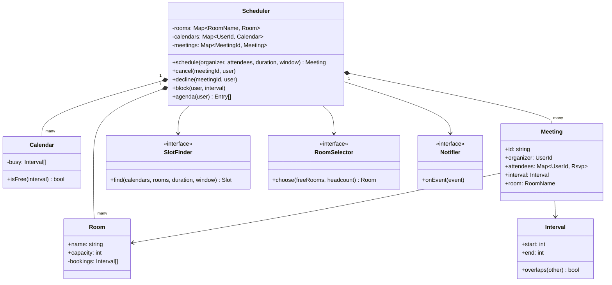
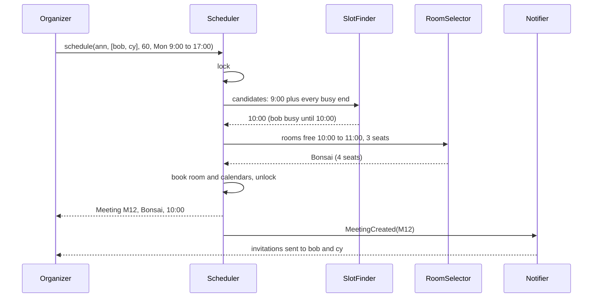

## In one minute
- A meeting scheduler answers one question: "when is the earliest time that all these people and a big enough room are free?", and then books that answer before anyone else takes it. Search and claim must be one atomic step, or two organizers both get the 10:00 slot in the same room.
- Everything is an interval. Model time as half-open ranges `[start, end)` on one UTC timeline, so a meeting ending at 10:00 and one starting at 10:00 do not collide, and convert to local time only at the edges.
- Rooms are hard constraints; people are soft ones. A room cannot hold two meetings, but a person can be double-booked if they choose. The scheduler searches with both, and enforces only the room.
- The earliest feasible start is either the earliest allowed time or the end of some existing busy interval. That observation turns an open-ended search into a scan over a small candidate set.
- The shape is **contention** plus **finding things fast**: the same interval logic schedules surgeons and operating theatres, CI jobs on build agents, and maintenance windows across services that must all be quiet.

## Requirements

Functional:
- Rooms have a name and a capacity. Users have calendars made of meetings and personal blocks (focus time, out of office).
- An organizer asks for a meeting with a list of attendees, a duration and a search window. The system finds the earliest start where everyone is free and a room with enough seats is free, picks the smallest such room (ties by name), and books it.
- The organizer can cancel. An attendee can decline, which frees their time but keeps the meeting.
- Each user can view their agenda in time order, with rooms.
- Attendees are notified of invitations, changes and cancellations.

Non-functional:
- A room is never booked twice for overlapping times, even with concurrent organizers.
- Back-to-back meetings are allowed: `[9:00, 10:00)` and `[10:00, 11:00)` do not overlap.
- Scheduling a meeting for 10 people over a week of calendars should answer in well under 100 ms.

Out of scope: recurring meetings (RRULE expansion), time-zone preferences per attendee, video conferencing links and external invitations over iCalendar. The [Design Calendar System](../sdi/design-calendar-system.md) lesson covers recurrence and free/busy at scale; the [Machine Coding Approach](machine-coding-approach.md) lesson builds a command-driven room booking interpreter, so this lesson focuses on the object model and the joint search across people and rooms.

## Entities and relationships

- **Interval** is a value `(start, end)` in UTC minutes or seconds with `start < end` and one method that matters: `overlaps(other)`, which is `a.start < b.end && b.start < a.end`.
- **Room** has a name, a capacity and equipment flags. Its schedule is a sorted list of bookings.
- **User** has an id and a time zone, and owns a **Calendar**: a sorted collection of busy intervals, each pointing at a meeting or a personal block.
- **Meeting** has an id, an organizer, attendees with an RSVP status (invited, accepted, declined), an interval and a room. The organizer is a special attendee who cannot decline.
- **Scheduler** is the façade: it owns rooms, calendars and meetings, and runs search plus booking under one lock.
- **SlotFinder** and **RoomSelector** are strategies: how to search for time (earliest, least disruption, preferred hours) and how to choose among free rooms (smallest fit, nearest floor, has video).
- **Notifier** sends invitations and updates, subscribed to meeting events.

Relationships: the scheduler is composed of rooms and meetings. A meeting references one room and several users. Calendars index meetings by participant, and room schedules index them by room; both are derived views of the same meeting records and must be updated together.

## Class diagram



## Key flows

The search reads many calendars, but the commit only needs the room to be exclusive. Holding one lock across both keeps the answer valid at the moment it is booked.



## Design patterns used and why

- **Strategy** for slot finding and room selection. "Earliest slot" is the interview default, but real products also offer "fewest conflicts", "within everyone's working hours" and "prefer rooms on my floor". Each is a class; the scheduler does not change.
- **Observer** for notifications and integrations. Invitation emails, room display panels and chat reminders subscribe to `MeetingCreated`, `MeetingCancelled` and `AttendeeDeclined` events. Fire them after the lock is released, so a slow mail server cannot stall booking.
- **Value object** for `Interval`. All overlap logic lives in one tested method, which kills an entire class of off-by-one bugs at the boundaries.
- **Façade**: the scheduler is the only way to mutate rooms and calendars, which is what keeps the two indexes consistent.
- **Command** (optional) for changes such as reschedule and cancel, if you need an audit trail or undo in the UI. Each command records who did what, which helps when someone asks "who moved my meeting?".

## Concurrency and edge cases

- **Two organizers, one room.** Both search, both see Bonsai free at 10:00, both book. The search and the booking must happen under one lock in memory, or the booking must be a conditional insert that the database rejects on overlap. Postgres can enforce this with an exclusion constraint: `EXCLUDE USING gist (room WITH =, during WITH &&)` on a `tstzrange` column, which turns a race into a clean constraint violation that the losing request retries.
- **People are not locked.** Locking every attendee's calendar while searching would serialise half the company behind one all-hands. Treat people's free/busy as advisory: search with it, but allow a person to end up double-booked if two meetings land at once, and let them decline one.
- **Boundaries.** Use half-open intervals everywhere. With closed intervals, a meeting ending at 10:00 blocks one starting at 10:00, and the bug appears only for back-to-back bookings.
- **Time zones and daylight saving.** Store UTC. Search windows given in local time ("9 to 5 for everyone") must be converted per attendee with a real tz database, because 9:00 in London and 9:00 in New York are different instants, and the offset changes on different dates in the two cities.
- **Organizer leaves.** If the organizer's account is deactivated, either transfer ownership or cancel and notify. Do not leave orphaned room bookings that nobody can cancel.
- **Ghost meetings.** Rooms booked and never used waste space. A check-in requirement (release the room if nobody checks in within 10 minutes) is a scheduled job with an injected clock, built on the same interval model.

## Down the stack

### Layer 1: The contract
`schedule` returns a meeting whose interval lies inside the search window, during which every participant had no busy interval and the chosen room had no booking, and no earlier start satisfies the same conditions; otherwise it returns nothing and changes nothing. After it returns, no other meeting overlaps it in the same room. `cancel` by the organizer removes the meeting from the room and every calendar; `decline` removes only that attendee's busy interval.

### Layer 2: The mechanism
The search uses an event-point argument: if a start `s` is feasible and `s` is not the window start, sliding it earlier eventually hits either the window start or the end of some busy interval, so the earliest feasible start is in the set made of the window start plus every busy end inside the window. With `k` busy intervals across participants and rooms, that is at most `k + 1` candidates. Each candidate is checked against each calendar with a binary search in a sorted list (find the last interval starting before the candidate's end, check whether it ends after the candidate's start), so the cost is O(k × p × log n) for `p` participants. An alternative is to merge all participants' busy lists into one sorted union (a k-way merge with a heap) and walk the gaps, which is what free/busy APIs such as Google Calendar's `freebusy.query` and Microsoft Graph's `findMeetingTimes` expose to clients. For a room's own schedule, an interval tree or a balanced tree keyed by start gives O(log n) overlap checks and inserts.

### Layer 3: The machine
A week of a busy person's calendar is about 40 intervals; at 16 bytes per interval (two 64-bit integers) that is 640 bytes, ten cache lines. Checking 10 people and 20 rooms against 200 candidate starts is about 6,000 binary searches of six or seven comparisons each, a few tens of microseconds on one core. The slow parts are elsewhere: loading calendars from a database (one indexed range query per participant, each around 1 ms), and in a distributed product, fetching free/busy from another organization's server over HTTPS (50 to 300 ms). That is why real schedulers batch free/busy reads, cache them for a short time and re-check only the room at commit.

### Why it's built this way
1. Time slots are continuous but bookings are few, so candidate starts come from busy-interval ends, not from scanning every minute.
2. Rooms are physical and exclusive, so the room booking needs a serialization point: a lock or an exclusion constraint.
3. People are many and their calendars are read far more than written, so their free/busy is read without locks and treated as advice.
4. Boundaries and time zones are where calendar bugs live, so time is one UTC timeline of half-open intervals and conversion happens once, at the edges.

## Extensibility

- **Recurring meetings.** Store a rule (RRULE) on a series and expand occurrences within a horizon when searching. Room booking becomes "every occurrence must be free", with per-occurrence exceptions.
- **Working hours and preferences.** A new `SlotFinder` intersects the search window with each attendee's working hours in their own time zone before scanning candidates.
- **Optional attendees.** Search first with required attendees only, then rank candidates by how many optional attendees are free. That is a scoring strategy, not a change to the scheduler.
- **Room equipment.** Add a specification filter (video, whiteboard, wheelchair access) to `RoomSelector`. Capacity is just one predicate among several.
- **Multiple buildings.** Partition rooms by building; a meeting books one room per building for hybrid teams, all or nothing, using the same atomic multi-room claim as a multi-line checkout.

## Leadership lens

- Build first: the `Interval` type with exhaustive boundary tests and the atomic room claim. Those two prevent the bugs that make people distrust the tool, and distrust is what kills internal scheduling products.
- Decide explicitly what is hard and what is soft. If product insists that people can never be double-booked, the locking scope grows to every attendee, and you should show the cost before agreeing.
- Ask in review: which time zone defines "9 to 5"; what happens when two people book the last room at the same instant; how does a cancellation reach attendees' phones; what releases unused rooms.
- Integration with an external calendar (Google Workspace, Microsoft 365) usually decides the architecture. Find out early whether you are the system of record or a layer on top of theirs.

## Check yourself
1. Why are half-open intervals the default for meetings?
   **Answer:** They make back-to-back meetings not overlap, and the overlap test `a.start < b.end && b.start < a.end` is correct without special cases. Closed intervals make a 10:00 end collide with a 10:00 start.
2. Why is the earliest feasible start always the window start or the end of some busy interval?
   **Answer:** If a feasible start is neither, you can slide it earlier without creating a conflict until it hits the window start or a busy end. So checking those candidates is enough to find the earliest.
3. Why lock the room but not the attendees' calendars?
   **Answer:** A room cannot hold two meetings, so it needs exclusivity. People can resolve their own conflicts by declining, and locking every attendee would serialise large meetings and hurt throughput for little gain.
4. Two organizers race for the same room at 10:00. How does a database-backed design guarantee only one wins?
   **Answer:** An exclusion constraint on room and time range, or a conditional insert inside a transaction, rejects the second overlapping row. The losing request sees the error and searches again.

## Practice
**Task:** Implement `MeetingScheduler(rooms)`, where `rooms` is a list of `(name, capacity)`. Times are integer minutes and every interval is half-open. `block(user, start, end)` marks personal busy time. `schedule(organizer, attendees, duration, earliest, latest)` considers the participants (the organizer plus attendees, without duplicates) and finds the earliest start `s` with `earliest <= s` and `s + duration <= latest` such that no participant is busy and some room with capacity at least the number of participants is free on `[s, s + duration)`. It books the smallest such room (ties by name) and returns ids `M1`, `M2`, and so on, or nothing if no slot exists; a duration below 1 fails. `cancel(meeting_id, user)` deletes the meeting and fails unless `user` is the organizer. `decline(meeting_id, user)` removes an attendee's busy time and fails for the organizer or a non-attendee. `agenda(user)` returns the user's meetings as `(start, end, meeting_id, room)` sorted by start.

```python starter
class MeetingScheduler:
    def __init__(self, rooms):
        pass

    def block(self, user, start, end):
        raise NotImplementedError

    def schedule(self, organizer, attendees, duration, earliest, latest):
        raise NotImplementedError

    def cancel(self, meeting_id, user):
        raise NotImplementedError

    def decline(self, meeting_id, user):
        raise NotImplementedError

    def agenda(self, user):
        raise NotImplementedError
```

```python tests
ROOMS = [("Atlas", 8), ("Cedar", 4), ("Bonsai", 4)]


def raises(fn):
    try:
        fn()
    except ValueError:
        return True
    return False


def test_smallest_room_ties_by_name():
    s = MeetingScheduler(ROOMS)
    assert s.schedule("ann", ["bob"], 30, 540, 1020) == "M1"
    assert s.agenda("ann") == [(540, 570, "M1", "Bonsai")]
    assert s.agenda("bob") == [(540, 570, "M1", "Bonsai")]


def test_earliest_common_slot():
    s = MeetingScheduler(ROOMS)
    s.block("bob", 540, 600)
    s.block("cy", 590, 650)
    m = s.schedule("ann", ["bob", "cy"], 60, 540, 1020)
    assert s.agenda("ann") == [(650, 710, m, "Bonsai")], "first gap after both blocks"


def test_room_contention_and_back_to_back():
    s = MeetingScheduler(ROOMS)
    big = ["b1", "b2", "b3", "b4"]
    m1 = s.schedule("ann", big, 60, 540, 1020)
    assert s.agenda("ann") == [(540, 600, m1, "Atlas")]
    m2 = s.schedule("zed", ["z1", "z2", "z3", "z4"], 60, 540, 1020)
    assert s.agenda("zed") == [(600, 660, m2, "Atlas")], "only Atlas fits five, free at 600"
    m3 = s.schedule("cat", ["dan"], 30, 540, 1020)
    assert s.agenda("cat") == [(540, 570, m3, "Bonsai")], "small rooms were free all along"


def test_no_slot():
    s = MeetingScheduler([("Pod", 2)])
    assert s.schedule("ann", ["bob", "cy"], 30, 540, 1020) is None, "room too small"
    s.block("bob", 540, 600)
    assert s.schedule("ann", ["bob"], 61, 540, 660) is None, "window too short"
    assert s.schedule("ann", ["bob", "bob"], 60, 540, 660) == "M1", "duplicates ignored"


def test_cancel_only_by_organizer():
    s = MeetingScheduler([("Pod", 2)])
    m = s.schedule("ann", ["bob"], 60, 540, 600)
    assert s.schedule("cy", ["dan"], 60, 540, 600) is None
    assert raises(lambda: s.cancel(m, "bob"))
    s.cancel(m, "ann")
    assert s.agenda("bob") == []
    assert s.schedule("cy", ["dan"], 60, 540, 600) == "M2"
    assert raises(lambda: s.cancel(m, "ann")), "already cancelled"


def test_decline_frees_only_that_attendee():
    s = MeetingScheduler(ROOMS)
    m = s.schedule("ann", ["bob", "cy"], 60, 540, 1020)
    s.decline(m, "bob")
    assert s.agenda("bob") == []
    assert s.agenda("cy") == [(540, 600, m, "Bonsai")]
    m2 = s.schedule("bob", ["dan"], 60, 540, 1020)
    assert s.agenda("bob") == [(540, 600, m2, "Cedar")], "Bonsai still holds the first meeting"
    assert raises(lambda: s.decline(m, "ann")), "organizer cannot decline"
    assert raises(lambda: s.decline(m, "eve")), "not invited"


def test_errors():
    s = MeetingScheduler(ROOMS)
    assert raises(lambda: s.schedule("ann", ["bob"], 0, 540, 600))
    assert raises(lambda: s.cancel("M9", "ann"))
```

```python solution
class Meeting:
    def __init__(self, meeting_id, organizer, attendees, start, end, room):
        self.meeting_id = meeting_id
        self.organizer = organizer
        self.attendees = set(attendees)
        self.start = start
        self.end = end
        self.room = room


def overlaps(a_start, a_end, b_start, b_end):
    return a_start < b_end and b_start < a_end


class MeetingScheduler:
    def __init__(self, rooms):
        self._rooms = sorted(rooms, key=lambda r: (r[1], r[0]))
        self._blocks = {}
        self._meetings = {}
        self._next_id = 1

    def block(self, user, start, end):
        if start >= end:
            raise ValueError("start must be before end")
        self._blocks.setdefault(user, []).append((start, end))

    def _user_busy(self, user):
        out = list(self._blocks.get(user, []))
        for m in self._meetings.values():
            if user == m.organizer or user in m.attendees:
                out.append((m.start, m.end))
        return out

    def _room_busy(self, room):
        return [(m.start, m.end) for m in self._meetings.values() if m.room == room]

    def _free(self, busy, start, end):
        for b_start, b_end in busy:
            if overlaps(start, end, b_start, b_end):
                return False
        return True

    def schedule(self, organizer, attendees, duration, earliest, latest):
        if duration < 1:
            raise ValueError("duration must be at least 1")
        people = [organizer] + sorted(set(attendees) - {organizer})
        busy = {p: self._user_busy(p) for p in people}
        rooms = [(name, cap) for name, cap in self._rooms if cap >= len(people)]
        room_busy = {name: self._room_busy(name) for name, _ in rooms}
        candidates = {earliest}
        for intervals in list(busy.values()) + list(room_busy.values()):
            for _, b_end in intervals:
                if b_end > earliest:
                    candidates.add(b_end)
        for start in sorted(candidates):
            end = start + duration
            if end > latest:
                break
            if not all(self._free(busy[p], start, end) for p in people):
                continue
            for name, _ in rooms:
                if self._free(room_busy[name], start, end):
                    meeting_id = "M" + str(self._next_id)
                    self._next_id += 1
                    self._meetings[meeting_id] = Meeting(
                        meeting_id, organizer, people[1:], start, end, name)
                    return meeting_id
        return None

    def _get(self, meeting_id):
        m = self._meetings.get(meeting_id)
        if m is None:
            raise ValueError("unknown meeting: " + meeting_id)
        return m

    def cancel(self, meeting_id, user):
        m = self._get(meeting_id)
        if user != m.organizer:
            raise ValueError("only the organizer can cancel")
        del self._meetings[meeting_id]

    def decline(self, meeting_id, user):
        m = self._get(meeting_id)
        if user not in m.attendees:
            raise ValueError(user + " is not an attendee who can decline")
        m.attendees.discard(user)

    def agenda(self, user):
        out = []
        for m in self._meetings.values():
            if user == m.organizer or user in m.attendees:
                out.append((m.start, m.end, m.meeting_id, m.room))
        return sorted(out)
```

```typescript starter
export type Entry = [number, number, string, string];

export class MeetingScheduler {
  constructor(rooms: Array<[string, number]>) {}
  block(user: string, start: number, end: number): void { throw new Error("TODO"); }
  schedule(organizer: string, attendees: string[], duration: number, earliest: number, latest: number): string | null {
    throw new Error("TODO");
  }
  cancel(meetingId: string, user: string): void { throw new Error("TODO"); }
  decline(meetingId: string, user: string): void { throw new Error("TODO"); }
  agenda(user: string): Entry[] { throw new Error("TODO"); }
}
```

```typescript tests
const ROOMS: Array<[string, number]> = [["Atlas", 8], ["Cedar", 4], ["Bonsai", 4]];

function raises(fn: () => unknown): boolean {
  try { fn(); return false; } catch (e) { return true; }
}

test("smallest room ties by name", () => {
  const s = new MeetingScheduler(ROOMS);
  assertEqual(s.schedule("ann", ["bob"], 30, 540, 1020), "M1");
  assertEqual(s.agenda("ann"), [[540, 570, "M1", "Bonsai"]]);
  assertEqual(s.agenda("bob"), [[540, 570, "M1", "Bonsai"]]);
});

test("earliest common slot", () => {
  const s = new MeetingScheduler(ROOMS);
  s.block("bob", 540, 600);
  s.block("cy", 590, 650);
  const m = s.schedule("ann", ["bob", "cy"], 60, 540, 1020)!;
  assertEqual(s.agenda("ann"), [[650, 710, m, "Bonsai"]], "first gap after both blocks");
});

test("room contention and back to back", () => {
  const s = new MeetingScheduler(ROOMS);
  const m1 = s.schedule("ann", ["b1", "b2", "b3", "b4"], 60, 540, 1020)!;
  assertEqual(s.agenda("ann"), [[540, 600, m1, "Atlas"]]);
  const m2 = s.schedule("zed", ["z1", "z2", "z3", "z4"], 60, 540, 1020)!;
  assertEqual(s.agenda("zed"), [[600, 660, m2, "Atlas"]], "only Atlas fits five");
  const m3 = s.schedule("cat", ["dan"], 30, 540, 1020)!;
  assertEqual(s.agenda("cat"), [[540, 570, m3, "Bonsai"]], "small rooms were free");
});

test("no slot", () => {
  const s = new MeetingScheduler([["Pod", 2]]);
  assertEqual(s.schedule("ann", ["bob", "cy"], 30, 540, 1020), null, "room too small");
  s.block("bob", 540, 600);
  assertEqual(s.schedule("ann", ["bob"], 61, 540, 660), null, "window too short");
  assertEqual(s.schedule("ann", ["bob", "bob"], 60, 540, 660), "M1", "duplicates ignored");
});

test("cancel only by organizer", () => {
  const s = new MeetingScheduler([["Pod", 2]]);
  const m = s.schedule("ann", ["bob"], 60, 540, 600)!;
  assertEqual(s.schedule("cy", ["dan"], 60, 540, 600), null);
  assert(raises(() => s.cancel(m, "bob")), "attendee cannot cancel");
  s.cancel(m, "ann");
  assertEqual(s.agenda("bob"), []);
  assertEqual(s.schedule("cy", ["dan"], 60, 540, 600), "M2");
  assert(raises(() => s.cancel(m, "ann")), "already cancelled");
});

test("decline frees only that attendee", () => {
  const s = new MeetingScheduler(ROOMS);
  const m = s.schedule("ann", ["bob", "cy"], 60, 540, 1020)!;
  s.decline(m, "bob");
  assertEqual(s.agenda("bob"), []);
  assertEqual(s.agenda("cy"), [[540, 600, m, "Bonsai"]]);
  const m2 = s.schedule("bob", ["dan"], 60, 540, 1020)!;
  assertEqual(s.agenda("bob"), [[540, 600, m2, "Cedar"]], "Bonsai still taken");
  assert(raises(() => s.decline(m, "ann")), "organizer cannot decline");
  assert(raises(() => s.decline(m, "eve")), "not invited");
});

test("errors", () => {
  const s = new MeetingScheduler(ROOMS);
  assert(raises(() => s.schedule("ann", ["bob"], 0, 540, 600)), "zero duration");
  assert(raises(() => s.cancel("M9", "ann")), "unknown meeting");
});
```

```typescript solution
export type Entry = [number, number, string, string];

interface Meeting {
  id: string;
  organizer: string;
  attendees: Set<string>;
  start: number;
  end: number;
  room: string;
}

type Span = [number, number];

function overlaps(aStart: number, aEnd: number, bStart: number, bEnd: number): boolean {
  return aStart < bEnd && bStart < aEnd;
}

function isFree(busy: Span[], start: number, end: number): boolean {
  return busy.every(([s, e]) => !overlaps(start, end, s, e));
}

export class MeetingScheduler {
  private rooms: Array<[string, number]>;
  private blocks = new Map<string, Span[]>();
  private meetings = new Map<string, Meeting>();
  private nextId = 1;

  constructor(rooms: Array<[string, number]>) {
    this.rooms = [...rooms].sort((a, b) => a[1] - b[1] || (a[0] < b[0] ? -1 : a[0] > b[0] ? 1 : 0));
  }

  block(user: string, start: number, end: number): void {
    if (start >= end) throw new Error("start must be before end");
    if (!this.blocks.has(user)) this.blocks.set(user, []);
    this.blocks.get(user)!.push([start, end]);
  }

  private attends(m: Meeting, user: string): boolean {
    return m.organizer === user || m.attendees.has(user);
  }

  private userBusy(user: string): Span[] {
    const out: Span[] = [...(this.blocks.get(user) ?? [])];
    for (const m of this.meetings.values()) if (this.attends(m, user)) out.push([m.start, m.end]);
    return out;
  }

  private roomBusy(room: string): Span[] {
    return [...this.meetings.values()].filter(m => m.room === room).map(m => [m.start, m.end] as Span);
  }

  schedule(organizer: string, attendees: string[], duration: number, earliest: number, latest: number): string | null {
    if (duration < 1) throw new Error("duration must be at least 1");
    const others = [...new Set(attendees)].filter(a => a !== organizer).sort();
    const people = [organizer, ...others];
    const busy = new Map(people.map(p => [p, this.userBusy(p)] as [string, Span[]]));
    const rooms = this.rooms.filter(([, cap]) => cap >= people.length);
    const roomBusy = new Map(rooms.map(([name]) => [name, this.roomBusy(name)] as [string, Span[]]));
    const candidates = new Set<number>([earliest]);
    for (const spans of [...busy.values(), ...roomBusy.values()]) {
      for (const [, e] of spans) if (e > earliest) candidates.add(e);
    }
    for (const start of [...candidates].sort((a, b) => a - b)) {
      const end = start + duration;
      if (end > latest) break;
      if (!people.every(p => isFree(busy.get(p)!, start, end))) continue;
      for (const [name] of rooms) {
        if (isFree(roomBusy.get(name)!, start, end)) {
          const id = "M" + this.nextId++;
          this.meetings.set(id, { id, organizer, attendees: new Set(others), start, end, room: name });
          return id;
        }
      }
    }
    return null;
  }

  private get(meetingId: string): Meeting {
    const m = this.meetings.get(meetingId);
    if (!m) throw new Error("unknown meeting: " + meetingId);
    return m;
  }

  cancel(meetingId: string, user: string): void {
    const m = this.get(meetingId);
    if (user !== m.organizer) throw new Error("only the organizer can cancel");
    this.meetings.delete(meetingId);
  }

  decline(meetingId: string, user: string): void {
    const m = this.get(meetingId);
    if (!m.attendees.has(user)) throw new Error(user + " is not an attendee who can decline");
    m.attendees.delete(user);
  }

  agenda(user: string): Entry[] {
    const out: Entry[] = [];
    for (const m of this.meetings.values()) if (this.attends(m, user)) out.push([m.start, m.end, m.id, m.room]);
    return out.sort((a, b) => a[0] - b[0] || a[1] - b[1] || (a[2] < b[2] ? -1 : 1));
  }
}
```

```go starter
package practice

import "errors"

var (
	ErrBadDuration    = errors.New("duration must be at least 1")
	ErrBadInterval    = errors.New("start must be before end")
	ErrUnknownMeeting = errors.New("unknown meeting")
	ErrNotOrganizer   = errors.New("only the organizer can cancel")
	ErrNotAttendee    = errors.New("not an attendee who can decline")
	ErrNoSlot         = errors.New("no slot found")
)

type Room struct {
	Name     string
	Capacity int
}

type Entry struct {
	Start, End int
	ID, Room   string
}

type MeetingScheduler struct{}

func NewMeetingScheduler(rooms []Room) *MeetingScheduler { return &MeetingScheduler{} }

func (s *MeetingScheduler) Block(user string, start, end int) error { panic("TODO") }

func (s *MeetingScheduler) Schedule(organizer string, attendees []string, duration, earliest, latest int) (string, error) {
	panic("TODO")
}

func (s *MeetingScheduler) Cancel(meetingID, user string) error  { panic("TODO") }
func (s *MeetingScheduler) Decline(meetingID, user string) error { panic("TODO") }
func (s *MeetingScheduler) Agenda(user string) []Entry           { panic("TODO") }
```

```go tests
package practice

import (
	"errors"
	"reflect"
	"testing"
)

var rooms = []Room{{"Atlas", 8}, {"Cedar", 4}, {"Bonsai", 4}}

func mustSchedule(t *testing.T, s *MeetingScheduler, org string, att []string, d, e, l int) string {
	t.Helper()
	id, err := s.Schedule(org, att, d, e, l)
	if err != nil {
		t.Fatalf("schedule %s: %v", org, err)
	}
	return id
}

func wantAgenda(t *testing.T, s *MeetingScheduler, user string, want []Entry) {
	t.Helper()
	got := s.Agenda(user)
	if len(got) == 0 && len(want) == 0 {
		return
	}
	if !reflect.DeepEqual(got, want) {
		t.Fatalf("agenda %s: got %+v want %+v", user, got, want)
	}
}

func TestSmallestRoomTiesByName(t *testing.T) {
	s := NewMeetingScheduler(rooms)
	if id := mustSchedule(t, s, "ann", []string{"bob"}, 30, 540, 1020); id != "M1" {
		t.Fatalf("got %s", id)
	}
	wantAgenda(t, s, "ann", []Entry{{540, 570, "M1", "Bonsai"}})
	wantAgenda(t, s, "bob", []Entry{{540, 570, "M1", "Bonsai"}})
}

func TestEarliestCommonSlot(t *testing.T) {
	s := NewMeetingScheduler(rooms)
	s.Block("bob", 540, 600)
	s.Block("cy", 590, 650)
	m := mustSchedule(t, s, "ann", []string{"bob", "cy"}, 60, 540, 1020)
	wantAgenda(t, s, "ann", []Entry{{650, 710, m, "Bonsai"}})
}

func TestRoomContentionAndBackToBack(t *testing.T) {
	s := NewMeetingScheduler(rooms)
	m1 := mustSchedule(t, s, "ann", []string{"b1", "b2", "b3", "b4"}, 60, 540, 1020)
	wantAgenda(t, s, "ann", []Entry{{540, 600, m1, "Atlas"}})
	m2 := mustSchedule(t, s, "zed", []string{"z1", "z2", "z3", "z4"}, 60, 540, 1020)
	wantAgenda(t, s, "zed", []Entry{{600, 660, m2, "Atlas"}})
	m3 := mustSchedule(t, s, "cat", []string{"dan"}, 30, 540, 1020)
	wantAgenda(t, s, "cat", []Entry{{540, 570, m3, "Bonsai"}})
}

func TestNoSlot(t *testing.T) {
	s := NewMeetingScheduler([]Room{{"Pod", 2}})
	if _, err := s.Schedule("ann", []string{"bob", "cy"}, 30, 540, 1020); !errors.Is(err, ErrNoSlot) {
		t.Fatalf("room too small: %v", err)
	}
	s.Block("bob", 540, 600)
	if _, err := s.Schedule("ann", []string{"bob"}, 61, 540, 660); !errors.Is(err, ErrNoSlot) {
		t.Fatalf("window too short: %v", err)
	}
	if id := mustSchedule(t, s, "ann", []string{"bob", "bob"}, 60, 540, 660); id != "M1" {
		t.Fatalf("got %s", id)
	}
}

func TestCancelOnlyByOrganizer(t *testing.T) {
	s := NewMeetingScheduler([]Room{{"Pod", 2}})
	m := mustSchedule(t, s, "ann", []string{"bob"}, 60, 540, 600)
	if _, err := s.Schedule("cy", []string{"dan"}, 60, 540, 600); !errors.Is(err, ErrNoSlot) {
		t.Fatalf("room should be taken: %v", err)
	}
	if err := s.Cancel(m, "bob"); !errors.Is(err, ErrNotOrganizer) {
		t.Fatalf("got %v", err)
	}
	if err := s.Cancel(m, "ann"); err != nil {
		t.Fatal(err)
	}
	wantAgenda(t, s, "bob", nil)
	if id := mustSchedule(t, s, "cy", []string{"dan"}, 60, 540, 600); id != "M2" {
		t.Fatalf("got %s", id)
	}
	if err := s.Cancel(m, "ann"); !errors.Is(err, ErrUnknownMeeting) {
		t.Fatalf("got %v", err)
	}
}

func TestDeclineFreesOnlyThatAttendee(t *testing.T) {
	s := NewMeetingScheduler(rooms)
	m := mustSchedule(t, s, "ann", []string{"bob", "cy"}, 60, 540, 1020)
	if err := s.Decline(m, "bob"); err != nil {
		t.Fatal(err)
	}
	wantAgenda(t, s, "bob", nil)
	wantAgenda(t, s, "cy", []Entry{{540, 600, m, "Bonsai"}})
	m2 := mustSchedule(t, s, "bob", []string{"dan"}, 60, 540, 1020)
	wantAgenda(t, s, "bob", []Entry{{540, 600, m2, "Cedar"}})
	if err := s.Decline(m, "ann"); !errors.Is(err, ErrNotAttendee) {
		t.Fatalf("organizer: %v", err)
	}
	if err := s.Decline(m, "eve"); !errors.Is(err, ErrNotAttendee) {
		t.Fatalf("stranger: %v", err)
	}
}

func TestErrors(t *testing.T) {
	s := NewMeetingScheduler(rooms)
	if _, err := s.Schedule("ann", []string{"bob"}, 0, 540, 600); !errors.Is(err, ErrBadDuration) {
		t.Fatalf("got %v", err)
	}
	if err := s.Cancel("M9", "ann"); !errors.Is(err, ErrUnknownMeeting) {
		t.Fatalf("got %v", err)
	}
}
```

```go solution
package practice

import (
	"errors"
	"fmt"
	"sort"
	"sync"
)

var (
	ErrBadDuration    = errors.New("duration must be at least 1")
	ErrBadInterval    = errors.New("start must be before end")
	ErrUnknownMeeting = errors.New("unknown meeting")
	ErrNotOrganizer   = errors.New("only the organizer can cancel")
	ErrNotAttendee    = errors.New("not an attendee who can decline")
	ErrNoSlot         = errors.New("no slot found")
)

type Room struct {
	Name     string
	Capacity int
}

type Entry struct {
	Start, End int
	ID, Room   string
}

type span struct{ start, end int }

type meeting struct {
	id         string
	organizer  string
	attendees  map[string]bool
	start, end int
	room       string
}

func (m *meeting) attends(user string) bool { return m.organizer == user || m.attendees[user] }

type MeetingScheduler struct {
	mu       sync.Mutex
	rooms    []Room
	blocks   map[string][]span
	meetings map[string]*meeting
	nextID   int
}

func NewMeetingScheduler(rooms []Room) *MeetingScheduler {
	sorted := append([]Room(nil), rooms...)
	sort.Slice(sorted, func(i, j int) bool {
		if sorted[i].Capacity != sorted[j].Capacity {
			return sorted[i].Capacity < sorted[j].Capacity
		}
		return sorted[i].Name < sorted[j].Name
	})
	return &MeetingScheduler{rooms: sorted, blocks: map[string][]span{},
		meetings: map[string]*meeting{}, nextID: 1}
}

func (s *MeetingScheduler) Block(user string, start, end int) error {
	if start >= end {
		return ErrBadInterval
	}
	s.mu.Lock()
	defer s.mu.Unlock()
	s.blocks[user] = append(s.blocks[user], span{start, end})
	return nil
}

func (s *MeetingScheduler) userBusy(user string) []span {
	out := append([]span(nil), s.blocks[user]...)
	for _, m := range s.meetings {
		if m.attends(user) {
			out = append(out, span{m.start, m.end})
		}
	}
	return out
}

func (s *MeetingScheduler) roomBusy(room string) []span {
	var out []span
	for _, m := range s.meetings {
		if m.room == room {
			out = append(out, span{m.start, m.end})
		}
	}
	return out
}

func free(busy []span, start, end int) bool {
	for _, b := range busy {
		if start < b.end && b.start < end {
			return false
		}
	}
	return true
}

// Schedule searches and books under one lock, so the slot it finds is still free when booked.
func (s *MeetingScheduler) Schedule(organizer string, attendees []string, duration, earliest, latest int) (string, error) {
	if duration < 1 {
		return "", ErrBadDuration
	}
	s.mu.Lock()
	defer s.mu.Unlock()
	seen := map[string]bool{organizer: true}
	var others []string
	for _, a := range attendees {
		if !seen[a] {
			seen[a] = true
			others = append(others, a)
		}
	}
	sort.Strings(others)
	people := append([]string{organizer}, others...)
	busy := map[string][]span{}
	candidates := map[int]bool{earliest: true}
	addEnds := func(spans []span) {
		for _, b := range spans {
			if b.end > earliest {
				candidates[b.end] = true
			}
		}
	}
	for _, p := range people {
		busy[p] = s.userBusy(p)
		addEnds(busy[p])
	}
	var fit []Room
	roomBusy := map[string][]span{}
	for _, r := range s.rooms {
		if r.Capacity >= len(people) {
			fit = append(fit, r)
			roomBusy[r.Name] = s.roomBusy(r.Name)
			addEnds(roomBusy[r.Name])
		}
	}
	starts := make([]int, 0, len(candidates))
	for c := range candidates {
		starts = append(starts, c)
	}
	sort.Ints(starts)
	for _, start := range starts {
		end := start + duration
		if end > latest {
			break
		}
		allFree := true
		for _, p := range people {
			if !free(busy[p], start, end) {
				allFree = false
				break
			}
		}
		if !allFree {
			continue
		}
		for _, r := range fit {
			if free(roomBusy[r.Name], start, end) {
				id := fmt.Sprintf("M%d", s.nextID)
				s.nextID++
				att := map[string]bool{}
				for _, o := range others {
					att[o] = true
				}
				s.meetings[id] = &meeting{id: id, organizer: organizer, attendees: att,
					start: start, end: end, room: r.Name}
				return id, nil
			}
		}
	}
	return "", ErrNoSlot
}

func (s *MeetingScheduler) Cancel(meetingID, user string) error {
	s.mu.Lock()
	defer s.mu.Unlock()
	m, ok := s.meetings[meetingID]
	if !ok {
		return fmt.Errorf("%w: %s", ErrUnknownMeeting, meetingID)
	}
	if m.organizer != user {
		return ErrNotOrganizer
	}
	delete(s.meetings, meetingID)
	return nil
}

func (s *MeetingScheduler) Decline(meetingID, user string) error {
	s.mu.Lock()
	defer s.mu.Unlock()
	m, ok := s.meetings[meetingID]
	if !ok {
		return fmt.Errorf("%w: %s", ErrUnknownMeeting, meetingID)
	}
	if !m.attendees[user] {
		return fmt.Errorf("%w: %s", ErrNotAttendee, user)
	}
	delete(m.attendees, user)
	return nil
}

func (s *MeetingScheduler) Agenda(user string) []Entry {
	s.mu.Lock()
	defer s.mu.Unlock()
	var out []Entry
	for _, m := range s.meetings {
		if m.attends(user) {
			out = append(out, Entry{m.start, m.end, m.id, m.room})
		}
	}
	sort.Slice(out, func(i, j int) bool {
		if out[i].Start != out[j].Start {
			return out[i].Start < out[j].Start
		}
		return out[i].ID < out[j].ID
	})
	return out
}
```

## Mock interview
**Prompt:** Design a meeting scheduler for an office with 40 rooms of different sizes and 1,500 employees. Given an organizer, attendees, a duration and a search window, find and book the earliest slot where everyone and a suitable room are free. Code the core classes and the scheduling algorithm.

- Follow-up: Prove that you only need to check the window start and the ends of existing busy intervals as candidate starts.
- Follow-up: Two organizers click "Book" for the last free large room at the same moment. Walk through what each sees, in memory and with a database.
- Follow-up: Product wants attendees to be strictly un-double-bookable. What does that do to your locking and to a 300-person all-hands?

**A strong answer covers:**
- Half-open intervals on a UTC timeline with a single, tested overlap method, and local time only at the edges.
- The event-point candidate set and a check per candidate using sorted busy lists or a merged free/busy union, with its complexity.
- An atomic search-and-book for the room under one lock, or an exclusion constraint on room and time range with retry on conflict.
- Rooms as hard constraints and people as soft ones, with a clear explanation of what changes if that is reversed.
- Strategies for slot finding and room selection, and observers for notifications fired outside the lock.
- Time-zone and working-hours handling, and a mention of recurrence as the main extension.

## Watch
- [Design a Meeting Scheduler: Class Diagram, Design Patterns, Concurrency and Code (Devaraj Umapathi)](https://www.youtube.com/watch?v=e3MaS40kv8I): an end-to-end low-level design with a concurrency section.
- [Salesforce machine coding round: Meeting Room Reservation System (Code design by Naman)](https://www.youtube.com/watch?v=0_GxR3yQZLg): a coded solution focused on preventing overlap and double booking.
- [Mock Low Level System Design Interview: Design Meeting Scheduler (Concept && Coding)](https://www.youtube.com/watch?v=MRx40JVmmF4): a mock interview with interviewer probes on the same problem.

## Free resources
- [Range types and exclusion constraints (PostgreSQL docs)](https://www.postgresql.org/docs/current/rangetypes.html): `tstzrange`, the `&&` overlap operator and `EXCLUDE USING gist` for rooms that cannot double-book.
- [Freebusy: query (Google Calendar API)](https://developers.google.com/calendar/api/v3/reference/freebusy/query): how a production calendar exposes busy intervals for a set of people.
- [findMeetingTimes (Microsoft Graph)](https://learn.microsoft.com/en-us/graph/api/user-findmeetingtimes): a real API that suggests slots from attendee and room availability.
- [RFC 5545: iCalendar](https://datatracker.ietf.org/doc/html/rfc5545): the standard for events, free/busy and recurrence rules.
- [Interval tree (Wikipedia)](https://en.wikipedia.org/wiki/Interval_tree): the data structure for fast overlap queries on a room's bookings.
