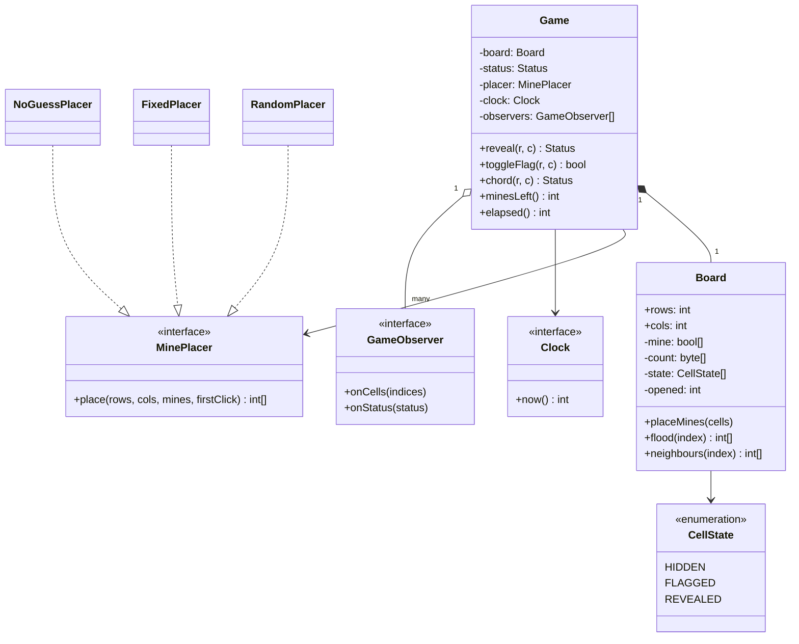
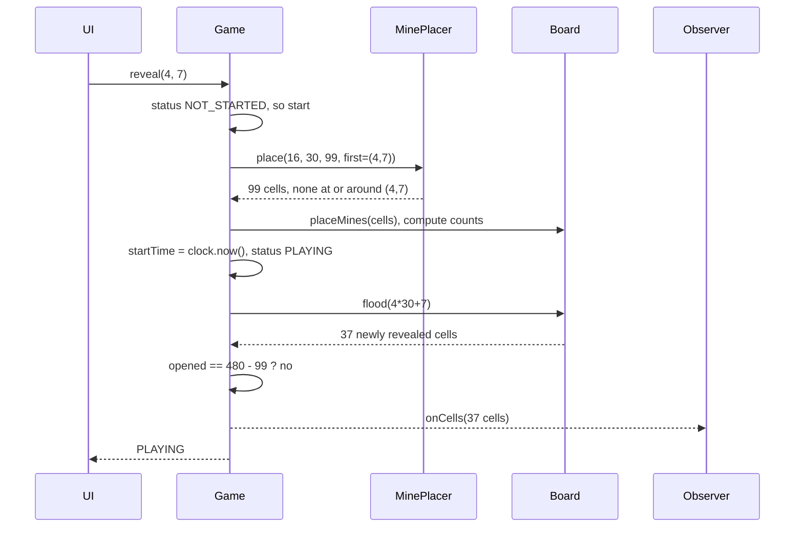

## In one minute
- Minesweeper looks like a grid problem, but the interview is about three things: a clean split between the rules (`Game`) and the data (`Board`), a reveal that floods empty regions without blowing the stack, and a game state machine that refuses every move after a win or a loss.
- Precompute each cell's adjacent-mine count once, when mines are placed. Every later reveal is then a lookup, and the win check is one counter compared with `cells - mines`, not a scan.
- Make mine placement an injected strategy. Random placement with a seed, "first click is always safe" and "no guessing needed" generators are all placers; tests use a fixed list. Code that calls `random()` inside the board cannot be tested or replayed.
- Flood fill is a breadth-first search with an explicit queue. Recursive flood fill works on a 9 by 9 board and crashes on a large custom board, because recursion depth grows with the size of the empty region.
- The shape is **finding things fast** over a grid (neighbour lookups, connected regions). The same reveal-a-region code is the paint bucket in an image editor, fog-of-war in a strategy game and connected-component labelling in vision.

## Requirements

Functional:
- A board of `rows x cols` cells with `m` mines. Presets: Beginner 9 by 9 with 10 mines, Intermediate 16 by 16 with 40, Expert 30 by 16 with 99, plus custom sizes.
- The player can reveal a cell, toggle a flag on a hidden cell, and chord: on a revealed number whose flagged neighbours equal the number, reveal all other hidden neighbours at once.
- Revealing a mine loses. Revealing a cell with zero adjacent mines also reveals its neighbours, recursively, through the connected empty region and its numbered border.
- The first reveal is never a mine.
- The game is won when every safe cell is revealed. Flags are not required to win.
- Show a mine counter (mines minus flags) and a timer that starts at the first reveal.

Non-functional:
- Every move responds in well under a frame (16 ms), even on a 1,000 by 1,000 custom board.
- A game is reproducible from its seed and its move list, for bug reports and replays.
- Moves after the game ends are rejected and change nothing.

Out of scope: graphics, high-score servers, hexagonal grids, multiplayer. Mention them in Extensibility.

## Entities and relationships

- **Game** is the façade the UI talks to. It owns the board, the status (`NOT_STARTED`, `PLAYING`, `WON`, `LOST`), the timer and the observers. It enforces rules: no moves after the end, the first click is safe, chording needs the right flag count.
- **Board** owns the cells and the geometry. It knows neighbours, adjacent counts, and how to flood a region. It has no idea about turns, timers or winning.
- **Cell** state is small: is it a mine, its adjacent count, and one of `HIDDEN`, `FLAGGED`, `REVEALED`. In memory this is better as parallel arrays or one byte per cell than as a million `Cell` objects (see Down the stack), but the concept stays the same.
- **MinePlacer** is a strategy that returns mine positions given the board size, the mine count and the first click. Implementations: `FixedPlacer` (tests, puzzles), `RandomPlacer(seed)` and `NoGuessPlacer` (generate, run a solver, retry).
- **Difficulty** is a value: rows, cols and mines, with validation (`mines < rows * cols`, or fewer if the first click must open a 3 by 3 area).
- **Clock** supplies time for the timer; **GameObserver** receives events (cells revealed, status changed, counter changed) so the UI can repaint only what changed.

Relationships: a game composes one board; a board composes its cells. The game uses a placer and a clock, both injected. Observers are aggregated and outlive nothing.

## Class diagram



## Key flows

The interesting flow is the first reveal, because it places the mines lazily and starts the clock.



## Design patterns used and why

- **Façade** for `Game`. The UI, a test or a bot solver all call five methods. The board's array layout can change without touching them.
- **Strategy** for mine placement. The rules about where mines may go (first click safe, first click opens a region, board must be solvable without guessing) change between versions and between difficulty settings. Simon Tatham's Mines, for example, generates boards that never require a guess by default. Each rule is a new placer; `Game` does not change.
- **State machine**, kept as an enum with guarded transitions. `NOT_STARTED` to `PLAYING` on the first reveal, `PLAYING` to `WON` or `LOST`, and nothing out of the terminal states. A State-pattern class per status is overkill here, because only two methods behave differently per state and the rule is mostly "reject".
- **Observer** for the UI and for sound or statistics. The flood returns the list of changed cells, and the UI repaints exactly those. That matters on big boards, where repainting everything after each click wastes most of a frame.
- **Command**, optional, for replay. Each move is a small record (`reveal 4 7`, `flag 2 3`) appended to a log. Seed plus log reproduces any game, which turns "I lost on a cell that should have been safe" bug reports into a failing test.

Avoid the tempting `Cell` class hierarchy (`MineCell`, `NumberCell`, `EmptyCell`). A cell's kind is fixed by data, and the only behaviour that differs is what reveal does, which the board handles with one branch.

## Concurrency and edge cases

- **First click on a mine.** Either place mines lazily after the first click, excluding that cell (or its 3 by 3 neighbourhood), or place them up front and move the clicked mine to another free cell. Lazy placement is cleaner; the practice uses the move rule because it keeps placement deterministic with a fixed list.
- **Flags and floods.** A flood must not reveal a flagged cell, even an empty one. The player put the flag there, and silently removing it is a bug report.
- **Wrong flags and chording.** Chording trusts the player's flags. If a flag is wrong, chording reveals a mine and the game is lost, exactly as the classic games behave. Chording on a number with the wrong flag count does nothing.
- **Revealing a revealed or flagged cell** is a no-op, not an error. Double clicks and stray taps are common, and the UI should not need to filter them.
- **Moves after the end** are rejected and leave everything unchanged, including the timer.
- **Win and loss in one move.** A chord can reveal a safe cell that would complete the board and a mine in the same call. Process neighbours in a fixed order and stop at the first mine, so the outcome is deterministic.
- **Threads.** The game is single-player, so the only concurrency is the UI thread and a timer tick. Keep all state changes on the UI thread (or one game actor), and have the timer only post "repaint the clock" events. A co-op multiplayer version puts one owner per game behind a queue, the single-owner approach from [How to handle Concurrency Scenarios](handling-concurrency.md), and makes reveal idempotent so that two players clicking the same cell is harmless.

## Down the stack

### Layer 1: The contract
`reveal` on a hidden, unflagged cell during play either loses (the cell is a mine) or reveals exactly the cell, plus, if its count is zero, the connected region of zero cells and their non-mine neighbours, never crossing a flag. It returns the new status. It is idempotent: a second call on the same cell changes nothing. The number of revealed safe cells equals `rows * cols - mines` if and only if the status is `WON`. The first reveal never loses.

### Layer 2: The mechanism
Store the board in row-major order: cell `(r, c)` is index `r * cols + c`. Neighbours are the eight offsets `-cols-1, -cols, -cols+1, -1, +1, cols-1, cols, cols+1`, with bounds checks at the edges. A common trick removes the checks: pad the board with a one-cell border of sentinel cells that are "already revealed, count non-zero", so the flood stops there naturally. Chess programs use the same idea in mailbox boards.

Counts are computed once after placement: for each mine, increment its eight neighbours. That is `8m` increments, under 1,000 for Expert. The flood is a BFS: push the start cell, pop a cell, and if its count is zero, push each hidden, unflagged neighbour after marking it revealed. Marking on push rather than on pop guarantees each cell enters the queue once, so the flood is O(cells revealed). The win check is a counter of opened safe cells, incremented by the flood.

A no-guess generator places mines, then runs a solver from the first click that uses only deductions (single-cell rules, then subset rules between pairs of numbers). If the solver gets stuck, it rerolls or locally moves mines. Deciding in general whether a partly revealed board is consistent is NP-complete, which Kaye proved in 2000, so practical generators use bounded deduction plus retries rather than exact reasoning.

### Layer 3: The machine
Pack each cell into one byte: four bits of count (0 to 8), one bit for mine, two bits for hidden, flagged or revealed. Expert is 480 bytes, which fits in eight 64-byte cache lines; a 1,000 by 1,000 board is 1 MB and fits in a modern L2 or L3 cache. A Python object per cell costs 100 bytes or more once its attribute storage is counted, plus an 8-byte pointer in a list, so a million `Cell` objects is over 100 MB before you have done anything. Row-major order also makes horizontal neighbours adjacent in memory and vertical ones `cols` bytes away, so a BFS that spreads row by row mostly hits warm lines.

Recursion is the classic failure. A recursive flood on a 1,000 by 1,000 empty board recurses up to a million frames deep. CPython stops at a default recursion limit of 1,000 frames. A browser's JavaScript stack typically allows on the order of ten thousand frames before "Maximum call stack size exceeded". Go grows goroutine stacks on demand up to a 1 GB maximum on 64-bit systems, so it survives longer but copies the stack each time it doubles. An explicit queue lives on the heap, costs 8 bytes or less per entry, and never crashes.

### Why it's built this way
1. Players click fast and boards can be large, so each move must cost in proportion to what it reveals, not to the board size.
2. That rules out scanning, so counts are precomputed and the win check is a counter.
3. The flood can reveal most of the board in one click, so it must not use the call stack; it uses a heap-allocated queue.
4. Mine placement rules vary across versions and difficulty, and tests need fixed boards, so placement is a strategy and randomness is injected through a seed.
5. Bug reports are about specific games, so a seed plus a move log must replay the game exactly, which forbids hidden sources of randomness or time.

## Extensibility

- **Hexagonal or triangular grids:** move neighbour calculation into a `Topology` interface (square with 8 neighbours, hex with 6). Board, flood and counts stay the same, because they only ask for neighbours.
- **Guaranteed opening:** a placer that excludes the first click's 3 by 3 neighbourhood, so the first click always reveals a region. Validate that `mines <= cells - 9`.
- **No-guess mode:** a `NoGuessPlacer` wrapping a solver, with a retry budget and a fallback to random placement if generation is slow.
- **Undo for practice mode:** because moves are commands and the game is deterministic from the seed, undo is "replay all but the last move", or a Memento of the byte array (480 bytes is cheap to snapshot).
- **Hints and bots:** a solver that reads only the public view and calls the same façade, so it cannot cheat by reading the mine array.
- **Online leaderboards:** submit seed, moves and the client's elapsed time; the server replays the game to verify the result before accepting the score.

## Leadership lens

- Build first: the board with counts and the BFS flood, with tests on fixed boards. The UI can be a text grid for a week; a wrong flood or a first-click loss is what players notice.
- Ask in review: is there any `random()` or `now()` call outside the injected placer and clock; is the flood iterative; what does a move after game over do; what does a flood do at a flag.
- Determinism pays for itself. A seed plus move log turns every crash report into a reproducible test and enables server-side score verification without trusting the client.
- Ownership: rules and board are one small module with exhaustive tests; rendering and input are another. Generators (no-guess mode) are a separate, slower-moving component that can be swapped without touching either.
- In the interview, get to the flood and the state machine within 15 minutes. Spending the first half on a `Cell` inheritance tree is the common way to run out of time.

## Check yourself
1. Why is the win check "opened safe cells equals cells minus mines" rather than "every mine is flagged"?
   **Answer:** Flags are the player's guesses and can be wrong or absent; only revealed safe cells prove the board is cleared. The counter also makes the check O(1).
2. A recursive flood fill passes every test on a 9 by 9 board. What will break first in production, and how do you fix it?
   **Answer:** A large custom board with a big empty region overflows the call stack. Use an explicit queue (BFS) or stack on the heap.
3. Why mark a cell as revealed when you push it onto the BFS queue, not when you pop it?
   **Answer:** Otherwise a cell reachable from several zero neighbours is enqueued several times, which wastes work and can double-count the opened counter.
4. Where should the "first click is safe" rule live?
   **Answer:** In the mine placer (lazy placement that excludes the first click) or a game-level relocation on the first reveal. The board itself should not know about turns.

## Practice
**Task:** Implement `Game(rows, cols, mines)`, where `mines` is a list of `(row, col)` positions. Reject boards smaller than 1 by 1, mines out of bounds or duplicated, and boards with no safe cell. `reveal(r, c)` returns the status (`"PLAYING"`, `"WON"`, `"LOST"`): a mine loses, a number reveals one cell, and a zero floods through connected zeros and their borders without revealing flagged cells. If the very first reveal is on a mine, move that mine to the first non-mine cell in row-major order and recompute counts. Revealing a flagged or revealed cell does nothing. `toggle_flag(r, c)` flips a flag on a hidden cell and returns whether it is now flagged (revealed cells return false). `chord(r, c)` on a revealed number whose flagged neighbours equal its count reveals the other hidden neighbours in row-major order, stopping at a mine; otherwise it does nothing. `view()` returns one string per row: `#` hidden, `F` flagged, `.` revealed zero, a digit for a revealed number, and after a loss `*` for every unflagged mine. Any move out of bounds or after the game ends fails.

```python starter
PLAYING, WON, LOST = "PLAYING", "WON", "LOST"


class Game:
    def __init__(self, rows, cols, mines):
        self.rows, self.cols = rows, cols

    def status(self):
        raise NotImplementedError

    def reveal(self, r, c):
        # TODO: first-click relocation, mine loses, BFS flood through zeros
        raise NotImplementedError

    def toggle_flag(self, r, c):
        raise NotImplementedError

    def chord(self, r, c):
        raise NotImplementedError

    def view(self):
        raise NotImplementedError
```

```python tests
MINES = [(0, 4), (2, 0), (3, 3)]


def raises(fn):
    try:
        fn()
    except ValueError:
        return True
    return False


def test_flood_reveals_region_and_border():
    g = Game(4, 5, MINES)
    assert g.reveal(0, 0) == PLAYING
    assert g.view() == ["...1#", "11.1#", "#111#", "#####"]


def test_number_reveals_one_cell():
    g = Game(4, 5, MINES)
    assert g.reveal(3, 4) == PLAYING
    assert g.view() == ["#####", "#####", "#####", "####1"]


def test_mine_loses_and_game_is_frozen():
    g = Game(4, 5, MINES)
    g.reveal(0, 0)
    assert g.reveal(2, 0) == LOST
    assert g.view() == ["...1*", "11.1#", "*111#", "###*#"]
    assert raises(lambda: g.reveal(3, 4)), "no moves after the end"
    assert g.status() == LOST


def test_first_click_is_safe_and_win():
    g = Game(2, 2, [(0, 0)])
    assert g.reveal(0, 0) == PLAYING, "mine moves to (0, 1)"
    assert g.view() == ["1#", "##"]
    assert g.reveal(1, 0) == PLAYING
    assert g.reveal(1, 1) == WON
    assert g.view() == ["1#", "11"]


def test_flags_block_flood_and_toggle():
    g = Game(4, 5, MINES)
    assert g.toggle_flag(0, 1) is True
    assert g.toggle_flag(1, 1) is True
    g.reveal(0, 0)
    assert g.view() == [".F###", "1F###", "#####", "#####"]
    g.reveal(0, 1)
    assert g.view()[0] == ".F###", "revealing a flag does nothing"
    assert g.toggle_flag(0, 1) is False
    assert g.toggle_flag(0, 0) is False, "cannot flag a revealed cell"
    assert g.view()[0] == ".####"


def test_chord():
    g = Game(4, 5, MINES)
    g.reveal(0, 0)
    assert g.chord(1, 3) == PLAYING
    assert g.view()[1] == "11.1#", "no flags yet, nothing happens"
    g.toggle_flag(0, 4)
    assert g.chord(1, 3) == PLAYING
    assert g.view() == ["...1F", "11.11", "#1111", "#####"]


def test_chord_with_wrong_flag_loses():
    g = Game(4, 5, MINES)
    g.reveal(0, 0)
    g.toggle_flag(1, 4)
    assert g.chord(1, 3) == LOST
    assert g.view() == ["...1*", "11.1F", "*111#", "###*#"]


def test_full_win_and_errors():
    g = Game(4, 5, MINES)
    g.reveal(0, 0)
    moves = [(1, 4), (2, 4), (3, 0), (3, 1), (3, 2)]
    assert [g.reveal(r, c) for r, c in moves] == [PLAYING] * 5
    assert g.reveal(3, 4) == WON
    assert raises(lambda: Game(2, 2, [(0, 0), (0, 0)]))
    assert raises(lambda: Game(1, 1, [(0, 0)]))
    assert raises(lambda: Game(2, 2, [(5, 5)]))
    assert raises(lambda: Game(2, 2, []).reveal(2, 0))
```

```python solution
from collections import deque

PLAYING, WON, LOST = "PLAYING", "WON", "LOST"


class Game:
    def __init__(self, rows, cols, mines):
        if rows < 1 or cols < 1:
            raise ValueError("board must be at least 1x1")
        self.rows, self.cols = rows, cols
        size = rows * cols
        self._mine = [False] * size
        for r, c in mines:
            if not self._inside(r, c) or self._mine[r * cols + c]:
                raise ValueError("bad mine position")
            self._mine[r * cols + c] = True
        self._mine_count = len(mines)
        if self._mine_count >= size:
            raise ValueError("no safe cell left")
        self._revealed = [False] * size
        self._flag = [False] * size
        self._count = [0] * size
        self._opened = 0
        self._started = False
        self._status = PLAYING
        self._recount()

    def _inside(self, r, c):
        return 0 <= r < self.rows and 0 <= c < self.cols

    def _neighbours(self, i):
        r, c = divmod(i, self.cols)
        out = []
        for dr in (-1, 0, 1):
            for dc in (-1, 0, 1):
                if (dr or dc) and self._inside(r + dr, c + dc):
                    out.append((r + dr) * self.cols + c + dc)
        return out

    def _recount(self):
        for i in range(len(self._count)):
            self._count[i] = sum(1 for n in self._neighbours(i) if self._mine[n])

    def _index(self, r, c):
        if not self._inside(r, c):
            raise ValueError("cell out of bounds")
        if self._status != PLAYING:
            raise ValueError("game is over")
        return r * self.cols + c

    def status(self):
        return self._status

    def reveal(self, r, c):
        i = self._index(r, c)
        if self._flag[i] or self._revealed[i]:
            return self._status
        if not self._started:
            self._started = True
            if self._mine[i]:
                self._relocate(i)
        self._open(i)
        return self._status

    def _relocate(self, i):
        for j in range(len(self._mine)):
            if j != i and not self._mine[j]:
                self._mine[i], self._mine[j] = False, True
                self._recount()
                return

    def _open(self, i):
        if self._mine[i]:
            self._status = LOST
            return
        self._revealed[i] = True
        self._opened += 1
        queue = deque([i])
        while queue:
            cell = queue.popleft()
            if self._count[cell] != 0:
                continue
            for n in self._neighbours(cell):
                if not self._revealed[n] and not self._flag[n]:
                    self._revealed[n] = True
                    self._opened += 1
                    queue.append(n)
        if self._opened == len(self._mine) - self._mine_count:
            self._status = WON

    def toggle_flag(self, r, c):
        i = self._index(r, c)
        if self._revealed[i]:
            return False
        self._flag[i] = not self._flag[i]
        return self._flag[i]

    def chord(self, r, c):
        i = self._index(r, c)
        if not self._revealed[i] or self._count[i] == 0:
            return self._status
        around = self._neighbours(i)
        if sum(1 for n in around if self._flag[n]) != self._count[i]:
            return self._status
        for n in around:
            if self._status != PLAYING:
                break
            if not self._flag[n] and not self._revealed[n]:
                self._open(n)
        return self._status

    def view(self):
        out = []
        for r in range(self.rows):
            line = ""
            for c in range(self.cols):
                i = r * self.cols + c
                if self._flag[i]:
                    line += "F"
                elif self._revealed[i]:
                    line += "." if self._count[i] == 0 else str(self._count[i])
                elif self._status == LOST and self._mine[i]:
                    line += "*"
                else:
                    line += "#"
            out.append(line)
        return out
```

```typescript starter
export type Status = "PLAYING" | "WON" | "LOST";

export class Game {
  constructor(public rows: number, public cols: number, mines: Array<[number, number]>) {}

  status(): Status { throw new Error("TODO"); }

  reveal(r: number, c: number): Status {
    throw new Error("TODO");
  }

  toggleFlag(r: number, c: number): boolean {
    throw new Error("TODO");
  }

  chord(r: number, c: number): Status {
    throw new Error("TODO");
  }

  view(): string[] { throw new Error("TODO"); }
}
```

```typescript tests
const MINES: Array<[number, number]> = [[0, 4], [2, 0], [3, 3]];

function throwsErr(fn: () => void): boolean {
  try { fn(); return false; } catch (e) { return true; }
}

test("flood reveals region and border", () => {
  const g = new Game(4, 5, MINES);
  assertEqual(g.reveal(0, 0), "PLAYING");
  assertEqual(g.view(), ["...1#", "11.1#", "#111#", "#####"]);
});

test("number reveals one cell", () => {
  const g = new Game(4, 5, MINES);
  assertEqual(g.reveal(3, 4), "PLAYING");
  assertEqual(g.view(), ["#####", "#####", "#####", "####1"]);
});

test("mine loses and game is frozen", () => {
  const g = new Game(4, 5, MINES);
  g.reveal(0, 0);
  assertEqual(g.reveal(2, 0), "LOST");
  assertEqual(g.view(), ["...1*", "11.1#", "*111#", "###*#"]);
  assert(throwsErr(() => g.reveal(3, 4)), "no moves after the end");
  assertEqual(g.status(), "LOST");
});

test("first click is safe and win", () => {
  const g = new Game(2, 2, [[0, 0]]);
  assertEqual(g.reveal(0, 0), "PLAYING", "mine moves to (0, 1)");
  assertEqual(g.view(), ["1#", "##"]);
  assertEqual(g.reveal(1, 0), "PLAYING");
  assertEqual(g.reveal(1, 1), "WON");
  assertEqual(g.view(), ["1#", "11"]);
});

test("flags block flood and toggle", () => {
  const g = new Game(4, 5, MINES);
  assertEqual(g.toggleFlag(0, 1), true);
  assertEqual(g.toggleFlag(1, 1), true);
  g.reveal(0, 0);
  assertEqual(g.view(), [".F###", "1F###", "#####", "#####"]);
  g.reveal(0, 1);
  assertEqual(g.view()[0], ".F###", "revealing a flag does nothing");
  assertEqual(g.toggleFlag(0, 1), false);
  assertEqual(g.toggleFlag(0, 0), false, "cannot flag a revealed cell");
  assertEqual(g.view()[0], ".####");
});

test("chord", () => {
  const g = new Game(4, 5, MINES);
  g.reveal(0, 0);
  assertEqual(g.chord(1, 3), "PLAYING");
  assertEqual(g.view()[1], "11.1#", "no flags yet, nothing happens");
  g.toggleFlag(0, 4);
  assertEqual(g.chord(1, 3), "PLAYING");
  assertEqual(g.view(), ["...1F", "11.11", "#1111", "#####"]);
});

test("chord with wrong flag loses", () => {
  const g = new Game(4, 5, MINES);
  g.reveal(0, 0);
  g.toggleFlag(1, 4);
  assertEqual(g.chord(1, 3), "LOST");
  assertEqual(g.view(), ["...1*", "11.1F", "*111#", "###*#"]);
});

test("full win and errors", () => {
  const g = new Game(4, 5, MINES);
  g.reveal(0, 0);
  const moves: Array<[number, number]> = [[1, 4], [2, 4], [3, 0], [3, 1], [3, 2]];
  assertEqual(moves.map(([r, c]) => g.reveal(r, c)), ["PLAYING", "PLAYING", "PLAYING", "PLAYING", "PLAYING"]);
  assertEqual(g.reveal(3, 4), "WON");
  assert(throwsErr(() => new Game(2, 2, [[0, 0], [0, 0]])), "duplicate mine");
  assert(throwsErr(() => new Game(1, 1, [[0, 0]])), "no safe cell");
  assert(throwsErr(() => new Game(2, 2, [[5, 5]])), "mine out of bounds");
  assert(throwsErr(() => new Game(2, 2, []).reveal(2, 0)), "move out of bounds");
});
```

```typescript solution
export type Status = "PLAYING" | "WON" | "LOST";

export class Game {
  private mine: boolean[];
  private revealed: boolean[];
  private flag: boolean[];
  private count: number[];
  private mineCount: number;
  private opened = 0;
  private started = false;
  private current: Status = "PLAYING";

  constructor(public rows: number, public cols: number, mines: Array<[number, number]>) {
    if (rows < 1 || cols < 1) throw new Error("board must be at least 1x1");
    const size = rows * cols;
    this.mine = new Array(size).fill(false);
    for (const [r, c] of mines) {
      if (!this.inside(r, c) || this.mine[r * cols + c]) throw new Error("bad mine position");
      this.mine[r * cols + c] = true;
    }
    this.mineCount = mines.length;
    if (this.mineCount >= size) throw new Error("no safe cell left");
    this.revealed = new Array(size).fill(false);
    this.flag = new Array(size).fill(false);
    this.count = new Array(size).fill(0);
    this.recount();
  }

  private inside(r: number, c: number): boolean {
    return r >= 0 && r < this.rows && c >= 0 && c < this.cols;
  }

  private neighbours(i: number): number[] {
    const r = Math.floor(i / this.cols), c = i % this.cols;
    const out: number[] = [];
    for (const dr of [-1, 0, 1]) {
      for (const dc of [-1, 0, 1]) {
        if ((dr !== 0 || dc !== 0) && this.inside(r + dr, c + dc)) out.push((r + dr) * this.cols + c + dc);
      }
    }
    return out;
  }

  private recount(): void {
    for (let i = 0; i < this.count.length; i++) {
      this.count[i] = this.neighbours(i).filter((n) => this.mine[n]).length;
    }
  }

  private index(r: number, c: number): number {
    if (!this.inside(r, c)) throw new Error("cell out of bounds");
    if (this.current !== "PLAYING") throw new Error("game is over");
    return r * this.cols + c;
  }

  status(): Status { return this.current; }

  reveal(r: number, c: number): Status {
    const i = this.index(r, c);
    if (this.flag[i] || this.revealed[i]) return this.current;
    if (!this.started) {
      this.started = true;
      if (this.mine[i]) this.relocate(i);
    }
    this.open(i);
    return this.current;
  }

  private relocate(i: number): void {
    for (let j = 0; j < this.mine.length; j++) {
      if (j !== i && !this.mine[j]) {
        this.mine[i] = false;
        this.mine[j] = true;
        this.recount();
        return;
      }
    }
  }

  private open(i: number): void {
    if (this.mine[i]) { this.current = "LOST"; return; }
    this.revealed[i] = true;
    this.opened++;
    const queue = [i];
    for (let head = 0; head < queue.length; head++) {
      const cell = queue[head];
      if (this.count[cell] !== 0) continue;
      for (const n of this.neighbours(cell)) {
        if (!this.revealed[n] && !this.flag[n]) {
          this.revealed[n] = true;
          this.opened++;
          queue.push(n);
        }
      }
    }
    if (this.opened === this.mine.length - this.mineCount) this.current = "WON";
  }

  toggleFlag(r: number, c: number): boolean {
    const i = this.index(r, c);
    if (this.revealed[i]) return false;
    this.flag[i] = !this.flag[i];
    return this.flag[i];
  }

  chord(r: number, c: number): Status {
    const i = this.index(r, c);
    if (!this.revealed[i] || this.count[i] === 0) return this.current;
    const around = this.neighbours(i);
    if (around.filter((n) => this.flag[n]).length !== this.count[i]) return this.current;
    for (const n of around) {
      if (this.current !== "PLAYING") break;
      if (!this.flag[n] && !this.revealed[n]) this.open(n);
    }
    return this.current;
  }

  view(): string[] {
    const out: string[] = [];
    for (let r = 0; r < this.rows; r++) {
      let line = "";
      for (let c = 0; c < this.cols; c++) {
        const i = r * this.cols + c;
        if (this.flag[i]) line += "F";
        else if (this.revealed[i]) line += this.count[i] === 0 ? "." : String(this.count[i]);
        else if (this.current === "LOST" && this.mine[i]) line += "*";
        else line += "#";
      }
      out.push(line);
    }
    return out;
  }
}
```

```go starter
package practice

import "errors"

type Status string

const (
	Playing Status = "PLAYING"
	Won     Status = "WON"
	Lost    Status = "LOST"
)

var (
	ErrBadBoard   = errors.New("invalid board")
	ErrOutOfRange = errors.New("cell out of bounds")
	ErrGameOver   = errors.New("game is over")
)

type Game struct{}

func NewGame(rows, cols int, mines [][2]int) (*Game, error) {
	return &Game{}, nil
}

func (g *Game) Status() Status { panic("TODO") }

func (g *Game) Reveal(r, c int) (Status, error) { panic("TODO") }

func (g *Game) ToggleFlag(r, c int) (bool, error) { panic("TODO") }

func (g *Game) Chord(r, c int) (Status, error) { panic("TODO") }

func (g *Game) View() []string { panic("TODO") }
```

```go tests
package practice

import (
	"errors"
	"reflect"
	"testing"
)

var mines = [][2]int{{0, 4}, {2, 0}, {3, 3}}

func newGame(t *testing.T) *Game {
	t.Helper()
	g, err := NewGame(4, 5, mines)
	if err != nil {
		t.Fatal(err)
	}
	return g
}

func step(t *testing.T, s Status, err error, want Status) {
	t.Helper()
	if err != nil || s != want {
		t.Fatalf("got %s, %v; want %s", s, err, want)
	}
}

func wantView(t *testing.T, g *Game, want ...string) {
	t.Helper()
	if got := g.View(); !reflect.DeepEqual(got, want) {
		t.Fatalf("view %q, want %q", got, want)
	}
}

func TestFloodRevealsRegionAndBorder(t *testing.T) {
	g := newGame(t)
	s, err := g.Reveal(0, 0)
	step(t, s, err, Playing)
	wantView(t, g, "...1#", "11.1#", "#111#", "#####")
}

func TestNumberRevealsOneCell(t *testing.T) {
	g := newGame(t)
	s, err := g.Reveal(3, 4)
	step(t, s, err, Playing)
	wantView(t, g, "#####", "#####", "#####", "####1")
}

func TestMineLosesAndGameIsFrozen(t *testing.T) {
	g := newGame(t)
	g.Reveal(0, 0)
	s, err := g.Reveal(2, 0)
	step(t, s, err, Lost)
	wantView(t, g, "...1*", "11.1#", "*111#", "###*#")
	if _, err := g.Reveal(3, 4); !errors.Is(err, ErrGameOver) {
		t.Fatalf("want ErrGameOver, got %v", err)
	}
}

func TestFirstClickIsSafeAndWin(t *testing.T) {
	g, err := NewGame(2, 2, [][2]int{{0, 0}})
	if err != nil {
		t.Fatal(err)
	}
	s, err := g.Reveal(0, 0)
	step(t, s, err, Playing)
	wantView(t, g, "1#", "##")
	s, err = g.Reveal(1, 0)
	step(t, s, err, Playing)
	s, err = g.Reveal(1, 1)
	step(t, s, err, Won)
	wantView(t, g, "1#", "11")
}

func TestFlagsBlockFloodAndToggle(t *testing.T) {
	g := newGame(t)
	if on, _ := g.ToggleFlag(0, 1); !on {
		t.Fatal("flag (0,1)")
	}
	if on, _ := g.ToggleFlag(1, 1); !on {
		t.Fatal("flag (1,1)")
	}
	g.Reveal(0, 0)
	wantView(t, g, ".F###", "1F###", "#####", "#####")
	g.Reveal(0, 1)
	wantView(t, g, ".F###", "1F###", "#####", "#####")
	if on, _ := g.ToggleFlag(0, 1); on {
		t.Fatal("unflag (0,1)")
	}
	if on, _ := g.ToggleFlag(0, 0); on {
		t.Fatal("cannot flag a revealed cell")
	}
	wantView(t, g, ".####", "1F###", "#####", "#####")
}

func TestChord(t *testing.T) {
	g := newGame(t)
	g.Reveal(0, 0)
	s, err := g.Chord(1, 3)
	step(t, s, err, Playing)
	wantView(t, g, "...1#", "11.1#", "#111#", "#####")
	g.ToggleFlag(0, 4)
	s, err = g.Chord(1, 3)
	step(t, s, err, Playing)
	wantView(t, g, "...1F", "11.11", "#1111", "#####")
}

func TestChordWithWrongFlagLoses(t *testing.T) {
	g := newGame(t)
	g.Reveal(0, 0)
	g.ToggleFlag(1, 4)
	s, err := g.Chord(1, 3)
	step(t, s, err, Lost)
	wantView(t, g, "...1*", "11.1F", "*111#", "###*#")
}

func TestFullWinAndErrors(t *testing.T) {
	g := newGame(t)
	g.Reveal(0, 0)
	for _, m := range [][2]int{{1, 4}, {2, 4}, {3, 0}, {3, 1}, {3, 2}} {
		s, err := g.Reveal(m[0], m[1])
		step(t, s, err, Playing)
	}
	s, err := g.Reveal(3, 4)
	step(t, s, err, Won)
	for _, ms := range [][][2]int{{{0, 0}, {0, 0}}, {{5, 5}}} {
		if _, err := NewGame(2, 2, ms); !errors.Is(err, ErrBadBoard) {
			t.Fatalf("mines %v: want ErrBadBoard, got %v", ms, err)
		}
	}
	if _, err := NewGame(1, 1, [][2]int{{0, 0}}); !errors.Is(err, ErrBadBoard) {
		t.Fatalf("no safe cell: got %v", err)
	}
	empty, _ := NewGame(2, 2, nil)
	if _, err := empty.Reveal(2, 0); !errors.Is(err, ErrOutOfRange) {
		t.Fatalf("want ErrOutOfRange, got %v", err)
	}
}
```

```go solution
package practice

import (
	"errors"
	"strconv"
	"strings"
)

type Status string

const (
	Playing Status = "PLAYING"
	Won     Status = "WON"
	Lost    Status = "LOST"
)

var (
	ErrBadBoard   = errors.New("invalid board")
	ErrOutOfRange = errors.New("cell out of bounds")
	ErrGameOver   = errors.New("game is over")
)

// Game keeps the board in row-major order: cell (r, c) is index r*cols + c.
type Game struct {
	rows, cols int
	mine       []bool
	revealed   []bool
	flag       []bool
	count      []int
	mineCount  int
	opened     int
	started    bool
	state      Status
}

func NewGame(rows, cols int, mines [][2]int) (*Game, error) {
	if rows < 1 || cols < 1 {
		return nil, ErrBadBoard
	}
	size := rows * cols
	g := &Game{rows: rows, cols: cols, mine: make([]bool, size), revealed: make([]bool, size),
		flag: make([]bool, size), count: make([]int, size), state: Playing}
	for _, m := range mines {
		if !g.inside(m[0], m[1]) || g.mine[m[0]*cols+m[1]] {
			return nil, ErrBadBoard
		}
		g.mine[m[0]*cols+m[1]] = true
	}
	g.mineCount = len(mines)
	if g.mineCount >= size {
		return nil, ErrBadBoard
	}
	g.recount()
	return g, nil
}

func (g *Game) inside(r, c int) bool { return r >= 0 && r < g.rows && c >= 0 && c < g.cols }

func (g *Game) neighbours(i int) []int {
	r, c := i/g.cols, i%g.cols
	out := make([]int, 0, 8)
	for dr := -1; dr <= 1; dr++ {
		for dc := -1; dc <= 1; dc++ {
			if (dr != 0 || dc != 0) && g.inside(r+dr, c+dc) {
				out = append(out, (r+dr)*g.cols+c+dc)
			}
		}
	}
	return out
}

func (g *Game) recount() {
	for i := range g.count {
		g.count[i] = 0
		for _, n := range g.neighbours(i) {
			if g.mine[n] {
				g.count[i]++
			}
		}
	}
}

func (g *Game) index(r, c int) (int, error) {
	if !g.inside(r, c) {
		return 0, ErrOutOfRange
	}
	if g.state != Playing {
		return 0, ErrGameOver
	}
	return r*g.cols + c, nil
}

func (g *Game) Status() Status { return g.state }

func (g *Game) Reveal(r, c int) (Status, error) {
	i, err := g.index(r, c)
	if err != nil {
		return g.state, err
	}
	if g.flag[i] || g.revealed[i] {
		return g.state, nil
	}
	if !g.started {
		g.started = true
		if g.mine[i] {
			g.relocate(i)
		}
	}
	g.open(i)
	return g.state, nil
}

func (g *Game) relocate(i int) {
	for j := range g.mine {
		if j != i && !g.mine[j] {
			g.mine[i], g.mine[j] = false, true
			g.recount()
			return
		}
	}
}

// open reveals one cell and, through a BFS queue, every cell reachable through zeros.
func (g *Game) open(i int) {
	if g.mine[i] {
		g.state = Lost
		return
	}
	g.revealed[i] = true
	g.opened++
	queue := []int{i}
	for head := 0; head < len(queue); head++ {
		cell := queue[head]
		if g.count[cell] != 0 {
			continue
		}
		for _, n := range g.neighbours(cell) {
			if !g.revealed[n] && !g.flag[n] {
				g.revealed[n] = true
				g.opened++
				queue = append(queue, n)
			}
		}
	}
	if g.opened == len(g.mine)-g.mineCount {
		g.state = Won
	}
}

func (g *Game) ToggleFlag(r, c int) (bool, error) {
	i, err := g.index(r, c)
	if err != nil {
		return false, err
	}
	if g.revealed[i] {
		return false, nil
	}
	g.flag[i] = !g.flag[i]
	return g.flag[i], nil
}

func (g *Game) Chord(r, c int) (Status, error) {
	i, err := g.index(r, c)
	if err != nil {
		return g.state, err
	}
	if !g.revealed[i] || g.count[i] == 0 {
		return g.state, nil
	}
	around := g.neighbours(i)
	flags := 0
	for _, n := range around {
		if g.flag[n] {
			flags++
		}
	}
	if flags != g.count[i] {
		return g.state, nil
	}
	for _, n := range around {
		if g.state != Playing {
			break
		}
		if !g.flag[n] && !g.revealed[n] {
			g.open(n)
		}
	}
	return g.state, nil
}

func (g *Game) View() []string {
	out := make([]string, g.rows)
	for r := 0; r < g.rows; r++ {
		var b strings.Builder
		for c := 0; c < g.cols; c++ {
			i := r*g.cols + c
			switch {
			case g.flag[i]:
				b.WriteByte('F')
			case g.revealed[i] && g.count[i] == 0:
				b.WriteByte('.')
			case g.revealed[i]:
				b.WriteString(strconv.Itoa(g.count[i]))
			case g.state == Lost && g.mine[i]:
				b.WriteByte('*')
			default:
				b.WriteByte('#')
			}
		}
		out[r] = b.String()
	}
	return out
}
```

## Mock interview
**Prompt:** Design and code the core of a Minesweeper game that supports the three classic difficulties and custom boards up to 1,000 by 1,000. The first click must never lose, and a game must be replayable from a seed for bug reports.

- Follow-up: A player on a 1,000 by 1,000 board with 5 percent mines clicks an empty cell and the game crashes. What happened, and what is your fix?
- Follow-up: Product wants a "no guessing" mode where every board is solvable by logic alone. Where does that code live, and what does it cost at generation time?
- Follow-up: You add an online leaderboard. How do you stop a modified client from submitting a 1-second Expert win?

**A strong answer covers:**
- `Game` (rules, status, timer) separated from `Board` (cells, counts, flood), with an enum state machine that rejects moves after the end.
- Precomputed counts, a row-major array or byte-per-cell layout, and an O(1) win check from an opened-cells counter.
- An iterative BFS flood that marks on push and never crosses flags, and the explanation that recursion depth grows with the empty region.
- Mine placement as an injected strategy with a seed: lazy placement after the first click, a guaranteed-opening placer, and a no-guess placer that runs a deduction solver with a retry budget.
- Server-side verification by replaying seed plus move log, with the server deciding the seed so a client cannot pick an easy board.
- A clear stance on what not to model: no `Cell` subclass per kind, no singleton game.

## Watch
- [Coding Challenge #71: Minesweeper (The Coding Train)](https://www.youtube.com/watch?v=LFU5ZlrR21E): builds the game from scratch, including neighbour counts and the flood reveal.
- [State Pattern, Design Patterns ep 17 (Christopher Okhravi)](https://www.youtube.com/watch?v=N12L5D78MAA): when a status enum is enough and when per-state classes earn their place.

## Free resources
- [Minesweeper (Wikipedia)](https://en.wikipedia.org/wiki/Minesweeper_(video_game)): rules, chording, the classic difficulty presets and the NP-completeness result.
- [Mines (Simon Tatham's Portable Puzzle Collection)](https://www.chiark.greenend.org.uk/~sgtatham/puzzles/doc/mines.html): a widely used implementation whose default generator never requires a guess.
- [Flood fill (Wikipedia)](https://en.wikipedia.org/wiki/Flood_fill): recursive, queue-based and scanline variants, with their memory trade-offs.
- [Grid parts and relationships (Red Blob Games)](https://www.redblobgames.com/grids/parts/): how to reason about cells, edges, corners and neighbours on square and hex grids.
- [Observer pattern (Refactoring.Guru)](https://refactoring.guru/design-patterns/observer): how the UI subscribes to revealed cells and status changes.
