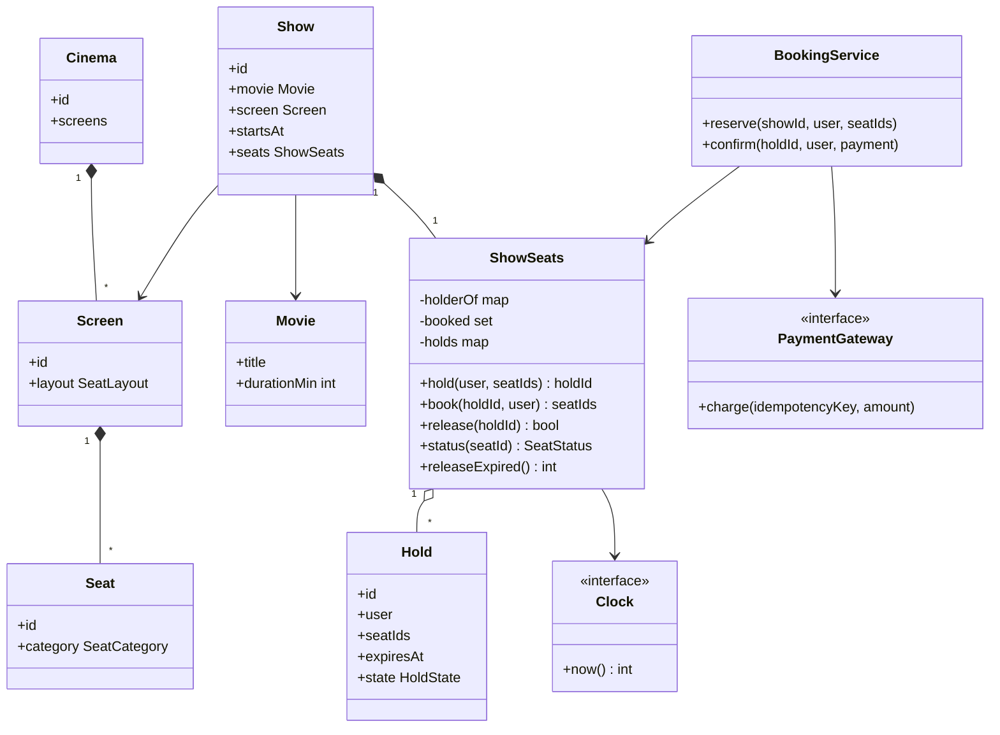
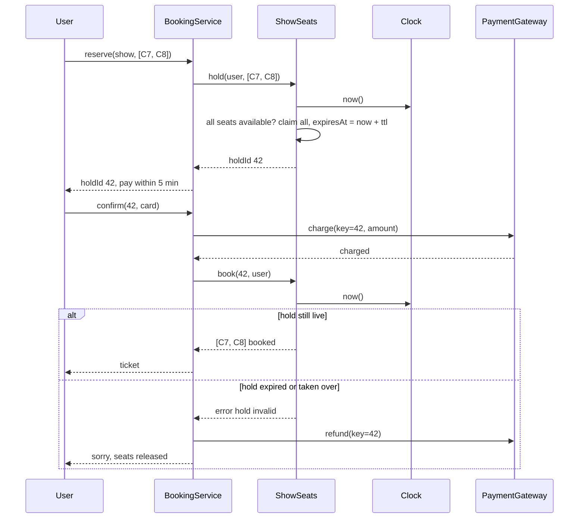

## In one minute
- The heart of the system is a per-seat state machine for one show: available, held (with an expiry time), booked. Every other class exists to drive that machine safely.
- A hold is all-or-nothing across the seats a user picked, and the check and the claim happen in one critical section. Check-then-act across two steps is how double bookings happen.
- Expiry is computed from an injected clock, not a background timer. A held seat whose expiry has passed already reads as available, so correctness never depends on a sweeper running on time; the sweeper only tidies up.
- Booking requires the same user, the same hold, and a hold that is still live at the moment of booking. A late payment against an expired hold must fail and be refunded, never squeeze into a seat someone else now holds.
- The shape is contention: many buyers, one seat. The same machine guards hotel rooms, clinic appointment slots, cloud GPU reservations and the last unit of stock in a flash sale.

## Requirements

### Functional
- Browse cinemas, screens, movies and shows (a show is one movie on one screen at one start time).
- See the seat map for a show with each seat's state.
- Select one or more seats and place a temporary hold on them for a fixed time (for example 5 minutes) while paying.
- Confirm the booking after payment; the held seats become booked and a ticket is issued.
- Release a hold explicitly (user backs out) or implicitly (it expires).
- Seat categories with different prices (standard, premium, recliner).

### Non-functional
- Never book the same seat twice for the same show, under any interleaving of requests.
- A hold is all-or-nothing: either every requested seat is held or none is.
- Holds expire on time as observed by the next request, independent of background jobs.
- Seat map reads are fast and may be slightly stale; writes (hold, book) are strongly consistent.

### Out of scope
- Payment provider internals, refunds workflow, food and beverage add-ons, dynamic pricing and the distributed waiting room. The system design version of this chapter covers the multi-node story.

## Entities and relationships

**Cinema** has many **Screens**. A Screen has a fixed **SeatLayout**: rows of **Seat** definitions, each with an id like `C7` and a **SeatCategory**. **Movie** holds title, duration and rating. **Show** links one Movie to one Screen at a start time and owns a **ShowSeats** object: the live state of every seat for that showing. Splitting the static Seat (part of the room) from the per-show seat state is the most important modelling decision; the same physical seat is booked for the 7 pm show and free for the 10 pm one.

A **Hold** has an id, the user, a list of seat ids, an expiry time and a state (active, booked, released, expired). A **Booking** is created from a booked hold and references the Show, the seats, the price breakdown and a **Payment**. **BookingService** coordinates: it asks ShowSeats for a hold, asks the PaymentGateway to charge, then asks ShowSeats to book. A **Clock** interface supplies the current time, so tests can move time forward without sleeping.

## Class diagram



## Key flows

The critical flow is hold, pay, book. The hold id doubles as the payment idempotency key, so a retried confirm cannot charge twice.



## Design patterns used and why

**State** for seats and holds. A seat moves available to held to booked, and back from held to available on release or expiry. Booked is terminal for the show (cancellation is a separate, audited flow). Writing the legal transitions down as a small table, and rejecting everything else, is what makes the double-booking guarantee reviewable. In the practice code the state is derived rather than stored on the seat: a seat is booked if it is in the booked set, held if it points to a live hold, otherwise available. That removes a whole class of bugs where a seat's stored state and its hold disagree.

**Facade** in `BookingService`. The API layer calls `reserve` and `confirm`; the service hides the order of operations across seats, payments and tickets.

**Strategy** for pricing. A `PricingStrategy` maps (seat category, show time, day) to a price. Weekday matinee discounts or a premium surcharge are new strategies, not edits to booking code.

**Dependency injection** of `Clock` and `PaymentGateway`. Expiry is the most bug-prone part of the system, and an injected clock lets a test say "now it is 299 seconds later" and "now it is 300" without sleeping. A fake gateway lets tests force a payment that succeeds after the hold expired.

**Observer** for side effects. When a hold becomes a booking, publish an event; ticket emails, loyalty points and analytics subscribe. The booking path stays short and does not fail because the email service is slow.

## Concurrency and edge cases

### Check and claim must be one step
The classic bug: request A checks C7 is available, request B checks C7 is available, both write "held". In one process, guard each show's seat state with a mutex and do the check and the claim inside it. Lock per show, not globally, so a blockbuster's opening does not slow every other screen. In a database, the equivalent is a conditional update (`UPDATE show_seat SET hold_id = $1, expires_at = $2 WHERE show_id = $3 AND seat_id = ANY($4) AND booked = false AND (hold_id IS NULL OR expires_at <= now())`) and checking that the affected row count equals the number of seats requested, otherwise roll back. This works because, under Postgres's Read Committed level, a competing `UPDATE` waits for the first to commit and then re-checks the `WHERE` clause against the new row version, so the loser matches no rows ([Postgres docs](https://www.postgresql.org/docs/current/transaction-iso.html)).

### All-or-nothing holds
A user who asks for C7 and C8 together does not want only C7. Validate every seat before claiming any. If you claim seat by seat in a database, sort the seat ids first so two overlapping requests lock rows in the same order and cannot deadlock. That is the manual's own advice: acquire locks on multiple objects in a consistent order, and retry transactions that Postgres aborts as deadlock victims ([Postgres docs](https://www.postgresql.org/docs/current/explicit-locking.html)).

### Lazy expiry
A hold expires when `now >= expiresAt`. Every read and write evaluates that, so a seat whose hold expired one millisecond ago is available to the next caller even if the cleanup job has not run. When a new hold takes over a seat from an expired hold, mark the old hold expired and free all of its seats, so the old holder cannot later book a partial set. `releaseExpired` is housekeeping that frees memory and reports metrics; it is not on the correctness path.

### The late payment
The user pays at 4:59, the card network answers at 5:03. The hold has expired and maybe someone else holds the seat. `book` must refuse, and the service must refund (or void the authorisation). Two common mitigations reduce how often this happens: extend the hold once when payment starts, and authorise first and capture only after `book` succeeds. An authorisation is a hold on the customer's funds that lasts days, not minutes (Stripe documents about 7 days for an online card payment), and cancelling the uncaptured payment releases it ([Stripe docs](https://docs.stripe.com/payments/place-a-hold-on-a-payment-method)). If `book` fails, cancel the authorisation instead of refunding a capture. The hold id in the booking call plays the role of a fencing token: Kleppmann's point is that a client whose lease expired while it was paused must not be able to act on the old lease, so the store itself has to check ([Kleppmann](https://martin.kleppmann.com/2016/02/08/how-to-do-distributed-locking.html)).

### Other edge cases
Duplicate seat ids in one request, unknown seats, an empty selection, a different user trying to book someone else's hold, a double click on "confirm" (book is idempotent for the same user and hold, and the payment call carries the hold id as its idempotency key, so a retry gets the first result back instead of a second charge ([Stripe docs](https://docs.stripe.com/api/idempotent_requests))), and the boundary instant where `now == expiresAt` (treat as expired, and test it).

## In the wild
- **Ticketmaster, 2022: Eras Tour presale.** Over 3.5 million people pre-registered for Verified Fan and about 1.5 million were sent codes. Bot attacks and fans without codes drove 3.5 billion system requests, four times the previous peak. Ticketmaster slowed some sales and pushed others back to stabilise the system, and estimated that about 15% of interactions had problems, including passcode validation errors that dropped tickets from carts, while still selling over 2 million tickets in a day ([Ticketmaster, archived copy](https://web.archive.org/web/20230101022610/https://business.ticketmaster.com/business-solutions/taylor-swift-the-eras-tour-onsale-explained/)). A cart is a hold, and a dropped cart is a hold that expired or was lost mid-flow.
- **Cloudflare, 2021: Waiting Room for vaccination bookings.** Cloudflare built Waiting Room on Workers and Durable Objects, first used for COVID-19 vaccination sites. It admits users by arrival minute, oldest first, using per-data-centre Durable Objects that report to one global object; eventually consistent Workers KV was rejected as the counter. One county site handled surges of up to 23,000 users ([Cloudflare](https://blog.cloudflare.com/building-waiting-room-on-workers-and-durable-objects/)). It protects the seat-hold machine behind it from the arrival spike.

## Down the stack

### Layer 1: The contract
For each show, at most one booking per seat, ever. `hold` either claims every requested seat or changes nothing. A hold created at time t is live while `now < t + ttl` and dead after, as seen by every subsequent operation. `book` succeeds only for the hold's own user while it is live, and repeating a successful book returns the same seats.

### Layer 2: The mechanism
`ShowSeats` keeps three maps: seat to current hold, the set of booked seats, and hold id to Hold. `status` is O(1). `hold` is O(k) for k seats under one lock. `releaseExpired` in the practice scans holds; a production version keeps a min-heap ordered by `expiresAt` and pops until the top is in the future, so cleanup costs O(log n) per expired hold. In Postgres, the same contract comes from row locks taken by `UPDATE` or `SELECT ... FOR UPDATE`, plus a unique index on `(show_id, seat_id)` in the bookings table as the last line of defence. A Redis-only design uses `SET seat:show:C7 holdId NX PX 300000` (`NX` sets the key only if it does not exist, `PX` gives it a millisecond expiry, [Redis docs](https://redis.io/docs/latest/commands/set/)). That gives the expiry for free, but Redis replication is asynchronous, so a hold can be lost if the primary fails before replicating it. Redis's own page calls the `SET ... NX` lock recipe discouraged in favour of Redlock, and Kleppmann argues that even Redlock cannot hand out fencing tokens, which is why the database's unique index stays as the last line of defence.

### Layer 3: The machine
An uncontended `sync.Mutex` lock and unlock in Go is a single atomic compare-and-swap, roughly 10 to 20 ns. Under contention, goroutines spin briefly then park on a semaphore, and the runtime switches to starvation mode after a waiter has waited 1 ms (`starvationThresholdNs = 1e6` in the [Go source](https://github.com/golang/go/blob/master/src/sync/mutex.go)) so no waiter is stuck forever. The mutex also carries the memory-model guarantee that makes the lock useful: each `Unlock` synchronizes before the next `Lock` ([Go docs](https://pkg.go.dev/sync#Mutex)). A hold touches a few map entries, so the critical section is well under a microsecond and one show can serve hundreds of thousands of hold attempts per second on one core. In a database, the same hold costs a network round trip (about 0.5 ms in one data centre) plus a WAL write and `fsync` at commit (tens of microseconds on NVMe, milliseconds on networked disks), which is why the hot show, not the database in general, is what you size for.

### Why it's built this way
Two buyers can click within the same millisecond, so the check and the claim must be atomic. Atomicity is cheapest at the smallest scope that owns the data, so lock per show. Payment takes seconds to minutes, far too long to hold a lock, so the lock protects a short state transition and the long wait is represented as data (a hold with an expiry). Background timers can be late, paused or dead, so expiry is a comparison against the clock at use time. Tests must cover the exact boundary, so the clock is injected.

## Extensibility
- **Seat categories and pricing**: add a `PricingStrategy`; `ShowSeats` does not change because it never knows prices.
- **Partial cancellation** of a confirmed booking: add a booked-to-available transition guarded by a refund policy, logged as its own event so auditors can see that a seat was sold twice legitimately.
- **Group seating** ("4 adjacent seats in row F"): a seat-finder that proposes seat ids and then calls the same all-or-nothing `hold`. Selection logic stays outside the state machine.
- **Multiple servers**: keep `ShowSeats` semantics but move the state into a database row per show seat with conditional updates, or route all requests for a show to one owner process. The interface does not change, which is why it is worth designing around one show.
- **Waitlists**: when a hold expires or is released, notify the first waiting user; this is an observer on the release transition.
- **Other domains**: the same `ShowSeats` with "seat" renamed to "slot" is a doctor's appointment book, a meeting-room scheduler, or a GPU reservation system.

## Leadership lens
- Insist on the state transition table in the design doc before any code. Most double-booking incidents trace back to a transition nobody wrote down, such as "expired hold gets booked".
- The contract between booking and payments (hold id as idempotency key, authorise then capture, refund on failed book) crosses teams. Name an owner for it, and test the late-payment path end to end.
- Ask how expiry is tested. If the answer involves `sleep`, the tests will be slow and flaky; push for an injected clock.
- Watch the operational signals that predict trouble: hold-to-book conversion, holds expiring during payment, and book failures after a successful charge. The last one is a direct refund cost and a support ticket.
- Keep the in-process lock scoped to one show. A global lock is simpler on day one and becomes the outage on the first opening night.

## Check yourself
1. Why does the design treat a hold whose expiry has passed as available immediately, instead of waiting for a cleanup job?
   **Answer:** Correctness then depends only on comparing the clock with `expiresAt` at the moment of each request. A cleanup job can be late or down; if correctness depended on it, seats would stay blocked or, worse, two views of state would disagree.
2. User A's hold on C7 and C8 expired, and user B has just held C7. What should happen to A's hold, and why?
   **Answer:** A's hold should be marked expired and all its seats freed, including C8. Otherwise A could later book C8 alone, a partial set A never asked for, or the stale hold could block C8 for others.
3. Why is the hold id a good payment idempotency key?
   **Answer:** It is unique per attempt to buy a specific set of seats, and a retried confirm carries the same id, so the gateway charges once. A new attempt after expiry gets a new hold and therefore a new key.
4. Where does a per-show mutex stop being enough, and what replaces it?
   **Answer:** As soon as two processes can serve the same show, an in-memory lock protects nothing. Replace it with a conditional update in the database (row count check, unique index on booked seats) or route each show to a single owner process.

## Practice
**Task:** Implement `ShowSeats`, the seat state machine for one show. The constructor takes the list of seat ids, a clock (a function returning the current time as an integer) and a hold TTL. `hold(user, seatIds)` claims every listed seat for the user and returns a new hold id (1, 2, 3, ...); it fails with a seat-unavailable error, changing nothing, if any seat is held by a live hold or booked, and with a bad-request error for an empty list, duplicates or unknown seats. A hold made at time t is live while `clock() < t + ttl`. `book(holdId, user)` turns a live hold's seats into booked and returns them in hold order; repeating it for an already booked hold returns the same seats; it fails with a hold-invalid error for an unknown hold, another user's hold, or a hold that is released or expired. `release(holdId)` frees a live hold and returns true, otherwise false. `status(seat)` returns `"available"`, `"held"` or `"booked"`. `releaseExpired()` marks every expired active hold as expired, frees its seats and returns how many seats it freed. In Go, guard the state with a `sync.Mutex`.

```python starter
class BookingError(Exception):
    pass


class SeatUnavailable(BookingError):
    pass


class HoldInvalid(BookingError):
    pass


class ShowSeats:
    def __init__(self, seat_ids, clock, hold_ttl):
        # TODO: seat -> hold, booked set, hold table, next id
        pass

    def status(self, seat):
        raise NotImplementedError

    def hold(self, user, seat_ids):
        raise NotImplementedError

    def book(self, hold_id, user):
        raise NotImplementedError

    def release(self, hold_id):
        raise NotImplementedError

    def release_expired(self):
        raise NotImplementedError
```

```python tests
class FakeClock:
    def __init__(self):
        self.now = 0

    def __call__(self):
        return self.now


def _show():
    clock = FakeClock()
    return ShowSeats(["A1", "A2", "A3", "A4"], clock, 300), clock


def _raises(exc, fn):
    try:
        fn()
    except exc:
        return True
    return False


def test_hold_then_book():
    seats, _ = _show()
    hid = seats.hold("u1", ["A1", "A2"])
    assert hid == 1
    assert seats.status("A1") == "held"
    assert seats.book(hid, "u1") == ["A1", "A2"]
    assert seats.status("A2") == "booked"
    assert seats.status("A3") == "available"


def test_no_double_hold_and_all_or_nothing():
    seats, _ = _show()
    seats.hold("u1", ["A2"])
    assert _raises(SeatUnavailable, lambda: seats.hold("u2", ["A1", "A2"]))
    assert seats.status("A1") == "available", "failed hold must change nothing"
    hid = seats.hold("u2", ["A3"])
    seats.book(hid, "u2")
    assert _raises(SeatUnavailable, lambda: seats.hold("u3", ["A3"]))


def test_expired_hold_frees_seats_and_cannot_book():
    seats, clock = _show()
    old = seats.hold("u1", ["A1", "A2"])
    clock.now = 300
    assert seats.status("A1") == "available"
    seats.hold("u2", ["A1"])
    assert _raises(HoldInvalid, lambda: seats.book(old, "u1"))
    assert seats.status("A2") == "available", "taken-over hold frees all its seats"


def test_book_just_before_expiry_and_idempotent():
    seats, clock = _show()
    hid = seats.hold("u1", ["A4"])
    clock.now = 299
    assert seats.book(hid, "u1") == ["A4"]
    clock.now = 1000
    assert seats.book(hid, "u1") == ["A4"], "repeat book returns the same seats"


def test_only_the_holder_can_book():
    seats, _ = _show()
    hid = seats.hold("u1", ["A1"])
    assert _raises(HoldInvalid, lambda: seats.book(hid, "u2"))
    assert _raises(HoldInvalid, lambda: seats.book(99, "u1"))
    assert seats.status("A1") == "held"


def test_release():
    seats, _ = _show()
    hid = seats.hold("u1", ["A1", "A2"])
    assert seats.release(hid) is True
    assert seats.release(hid) is False
    assert seats.release(42) is False
    assert seats.status("A1") == "available"
    assert seats.hold("u2", ["A1"]) == 2


def test_release_expired_counts_freed_seats():
    seats, clock = _show()
    seats.hold("u1", ["A1", "A2"])
    clock.now = 100
    keep = seats.hold("u2", ["A3"])
    booked = seats.hold("u3", ["A4"])
    seats.book(booked, "u3")
    clock.now = 350
    assert seats.release_expired() == 2
    assert seats.release_expired() == 0
    assert seats.status("A3") == "held"
    assert seats.status("A4") == "booked"
    assert seats.book(keep, "u2") == ["A3"]


def test_bad_requests():
    seats, _ = _show()
    assert _raises(BookingError, lambda: seats.hold("u1", []))
    assert _raises(BookingError, lambda: seats.hold("u1", ["A1", "A1"]))
    assert _raises(BookingError, lambda: seats.hold("u1", ["Z9"]))
    assert seats.status("A1") == "available"
```

```python solution
class BookingError(Exception):
    pass


class SeatUnavailable(BookingError):
    pass


class HoldInvalid(BookingError):
    pass


class Hold:
    def __init__(self, hold_id, user, seats, expires_at):
        self.id = hold_id
        self.user = user
        self.seats = seats
        self.expires_at = expires_at
        self.state = "active"  # active | booked | released | expired


class ShowSeats:
    def __init__(self, seat_ids, clock, hold_ttl):
        self._clock = clock
        self._ttl = hold_ttl
        self._holder = {s: None for s in seat_ids}  # seat -> Hold or None
        self._booked = set()
        self._holds = {}
        self._next_id = 1

    def _live(self, hold, now):
        return hold is not None and hold.state == "active" and now < hold.expires_at

    def _free(self, hold, state):
        hold.state = state
        freed = 0
        for s in hold.seats:
            if self._holder[s] is hold:
                self._holder[s] = None
                freed += 1
        return freed

    def _status(self, seat, now):
        if seat in self._booked:
            return "booked"
        return "held" if self._live(self._holder[seat], now) else "available"

    def status(self, seat):
        if seat not in self._holder:
            raise BookingError("unknown seat " + str(seat))
        return self._status(seat, self._clock())

    def hold(self, user, seat_ids):
        seat_ids = list(seat_ids)
        if not seat_ids or len(set(seat_ids)) != len(seat_ids):
            raise BookingError("empty or duplicate seat list")
        for s in seat_ids:
            if s not in self._holder:
                raise BookingError("unknown seat " + str(s))
        now = self._clock()
        for s in seat_ids:
            if self._status(s, now) != "available":
                raise SeatUnavailable(s)
        hold = Hold(self._next_id, user, seat_ids, now + self._ttl)
        self._next_id += 1
        for s in seat_ids:
            old = self._holder[s]
            if old is not None and old.state == "active":
                self._free(old, "expired")
            self._holder[s] = hold
        self._holds[hold.id] = hold
        return hold.id

    def book(self, hold_id, user):
        hold = self._holds.get(hold_id)
        if hold is None or hold.user != user:
            raise HoldInvalid("no such hold for this user")
        if hold.state == "booked":
            return list(hold.seats)
        if not self._live(hold, self._clock()):
            if hold.state == "active":
                self._free(hold, "expired")
            raise HoldInvalid("hold expired or released")
        for s in hold.seats:
            self._holder[s] = None
            self._booked.add(s)
        hold.state = "booked"
        return list(hold.seats)

    def release(self, hold_id):
        hold = self._holds.get(hold_id)
        if hold is None or not self._live(hold, self._clock()):
            return False
        self._free(hold, "released")
        return True

    def release_expired(self):
        now = self._clock()
        freed = 0
        for hold in self._holds.values():
            if hold.state == "active" and now >= hold.expires_at:
                freed += self._free(hold, "expired")
        return freed
```

```typescript starter
export class BookingError extends Error {}
export class SeatUnavailable extends BookingError {}
export class HoldInvalid extends BookingError {}

export type SeatStatus = "available" | "held" | "booked";

export class ShowSeats {
  constructor(seatIds: string[], clock: () => number, holdTtl: number) {}
  status(seat: string): SeatStatus {
    throw new Error("TODO");
  }
  hold(user: string, seatIds: string[]): number {
    throw new Error("TODO");
  }
  book(holdId: number, user: string): string[] {
    throw new Error("TODO");
  }
  release(holdId: number): boolean {
    throw new Error("TODO");
  }
  releaseExpired(): number {
    throw new Error("TODO");
  }
}
```

```typescript tests
function show(): { seats: ShowSeats; clock: { now: number } } {
  const clock = { now: 0 };
  return { seats: new ShowSeats(["A1", "A2", "A3", "A4"], () => clock.now, 300), clock };
}

function throwsKind(kind: Function, fn: () => unknown): boolean {
  try {
    fn();
  } catch (e) {
    return e instanceof kind;
  }
  return false;
}

test("hold then book", () => {
  const { seats } = show();
  const hid = seats.hold("u1", ["A1", "A2"]);
  assertEqual(hid, 1);
  assertEqual(seats.status("A1"), "held");
  assertEqual(seats.book(hid, "u1"), ["A1", "A2"]);
  assertEqual(seats.status("A2"), "booked");
  assertEqual(seats.status("A3"), "available");
});

test("no double hold and all or nothing", () => {
  const { seats } = show();
  seats.hold("u1", ["A2"]);
  assert(throwsKind(SeatUnavailable, () => seats.hold("u2", ["A1", "A2"])), "A2 is held");
  assertEqual(seats.status("A1"), "available", "failed hold must change nothing");
  const hid = seats.hold("u2", ["A3"]);
  seats.book(hid, "u2");
  assert(throwsKind(SeatUnavailable, () => seats.hold("u3", ["A3"])), "A3 is booked");
});

test("expired hold frees seats and cannot book", () => {
  const { seats, clock } = show();
  const old = seats.hold("u1", ["A1", "A2"]);
  clock.now = 300;
  assertEqual(seats.status("A1"), "available");
  seats.hold("u2", ["A1"]);
  assert(throwsKind(HoldInvalid, () => seats.book(old, "u1")), "expired hold");
  assertEqual(seats.status("A2"), "available", "taken-over hold frees all its seats");
});

test("book just before expiry and idempotent", () => {
  const { seats, clock } = show();
  const hid = seats.hold("u1", ["A4"]);
  clock.now = 299;
  assertEqual(seats.book(hid, "u1"), ["A4"]);
  clock.now = 1000;
  assertEqual(seats.book(hid, "u1"), ["A4"], "repeat book returns the same seats");
});

test("only the holder can book", () => {
  const { seats } = show();
  const hid = seats.hold("u1", ["A1"]);
  assert(throwsKind(HoldInvalid, () => seats.book(hid, "u2")), "other user");
  assert(throwsKind(HoldInvalid, () => seats.book(99, "u1")), "unknown hold");
  assertEqual(seats.status("A1"), "held");
});

test("release", () => {
  const { seats } = show();
  const hid = seats.hold("u1", ["A1", "A2"]);
  assertEqual(seats.release(hid), true);
  assertEqual(seats.release(hid), false);
  assertEqual(seats.release(42), false);
  assertEqual(seats.status("A1"), "available");
  assertEqual(seats.hold("u2", ["A1"]), 2);
});

test("release expired counts freed seats", () => {
  const { seats, clock } = show();
  seats.hold("u1", ["A1", "A2"]);
  clock.now = 100;
  const keep = seats.hold("u2", ["A3"]);
  const booked = seats.hold("u3", ["A4"]);
  seats.book(booked, "u3");
  clock.now = 350;
  assertEqual(seats.releaseExpired(), 2);
  assertEqual(seats.releaseExpired(), 0);
  assertEqual(seats.status("A3"), "held");
  assertEqual(seats.status("A4"), "booked");
  assertEqual(seats.book(keep, "u2"), ["A3"]);
});

test("bad requests", () => {
  const { seats } = show();
  assert(throwsKind(BookingError, () => seats.hold("u1", [])), "empty");
  assert(throwsKind(BookingError, () => seats.hold("u1", ["A1", "A1"])), "duplicate");
  assert(throwsKind(BookingError, () => seats.hold("u1", ["Z9"])), "unknown");
  assertEqual(seats.status("A1"), "available");
});
```

```typescript solution
export class BookingError extends Error {}
export class SeatUnavailable extends BookingError {}
export class HoldInvalid extends BookingError {}

export type SeatStatus = "available" | "held" | "booked";
type HoldState = "active" | "booked" | "released" | "expired";

interface Hold {
  id: number;
  user: string;
  seats: string[];
  expiresAt: number;
  state: HoldState;
}

export class ShowSeats {
  private holder = new Map<string, Hold | null>();
  private booked = new Set<string>();
  private holds = new Map<number, Hold>();
  private nextId = 1;

  constructor(seatIds: string[], private clock: () => number, private holdTtl: number) {
    for (const s of seatIds) this.holder.set(s, null);
  }

  private live(h: Hold | null | undefined, now: number): boolean {
    return !!h && h.state === "active" && now < h.expiresAt;
  }

  private free(h: Hold, state: HoldState): number {
    h.state = state;
    let freed = 0;
    for (const s of h.seats) {
      if (this.holder.get(s) === h) {
        this.holder.set(s, null);
        freed++;
      }
    }
    return freed;
  }

  private statusAt(seat: string, now: number): SeatStatus {
    if (this.booked.has(seat)) return "booked";
    return this.live(this.holder.get(seat), now) ? "held" : "available";
  }

  status(seat: string): SeatStatus {
    if (!this.holder.has(seat)) throw new BookingError(`unknown seat ${seat}`);
    return this.statusAt(seat, this.clock());
  }

  hold(user: string, seatIds: string[]): number {
    if (seatIds.length === 0 || new Set(seatIds).size !== seatIds.length) {
      throw new BookingError("empty or duplicate seat list");
    }
    for (const s of seatIds) if (!this.holder.has(s)) throw new BookingError(`unknown seat ${s}`);
    const now = this.clock();
    for (const s of seatIds) {
      if (this.statusAt(s, now) !== "available") throw new SeatUnavailable(s);
    }
    const h: Hold = { id: this.nextId++, user, seats: [...seatIds], expiresAt: now + this.holdTtl, state: "active" };
    for (const s of seatIds) {
      const old = this.holder.get(s);
      if (old && old.state === "active") this.free(old, "expired");
      this.holder.set(s, h);
    }
    this.holds.set(h.id, h);
    return h.id;
  }

  book(holdId: number, user: string): string[] {
    const h = this.holds.get(holdId);
    if (!h || h.user !== user) throw new HoldInvalid("no such hold for this user");
    if (h.state === "booked") return [...h.seats];
    if (!this.live(h, this.clock())) {
      if (h.state === "active") this.free(h, "expired");
      throw new HoldInvalid("hold expired or released");
    }
    for (const s of h.seats) {
      this.holder.set(s, null);
      this.booked.add(s);
    }
    h.state = "booked";
    return [...h.seats];
  }

  release(holdId: number): boolean {
    const h = this.holds.get(holdId);
    if (!h || !this.live(h, this.clock())) return false;
    this.free(h, "released");
    return true;
  }

  releaseExpired(): number {
    const now = this.clock();
    let freed = 0;
    for (const h of this.holds.values()) {
      if (h.state === "active" && now >= h.expiresAt) freed += this.free(h, "expired");
    }
    return freed;
  }
}
```

```go starter
package practice

import (
	"errors"
	"sync"
)

var (
	ErrBadRequest      = errors.New("bad request")
	ErrSeatUnavailable = errors.New("seat unavailable")
	ErrHoldInvalid     = errors.New("hold invalid")
)

type Clock func() int64

type ShowSeats struct {
	mu sync.Mutex
}

func NewShowSeats(seatIDs []string, clock Clock, holdTTL int64) *ShowSeats {
	return &ShowSeats{}
}

func (s *ShowSeats) Status(seat string) (string, error) { panic("TODO") }

func (s *ShowSeats) Hold(user string, seatIDs []string) (int, error) { panic("TODO") }

func (s *ShowSeats) Book(holdID int, user string) ([]string, error) { panic("TODO") }

func (s *ShowSeats) Release(holdID int) bool { panic("TODO") }

func (s *ShowSeats) ReleaseExpired() int { panic("TODO") }
```

```go tests
package practice

import (
	"errors"
	"reflect"
	"sync"
	"testing"
)

type fakeClock struct{ now int64 }

func newShow() (*ShowSeats, *fakeClock) {
	c := &fakeClock{}
	return NewShowSeats([]string{"A1", "A2", "A3", "A4"}, func() int64 { return c.now }, 300), c
}

func status(t *testing.T, s *ShowSeats, seat, want string) {
	t.Helper()
	got, err := s.Status(seat)
	if err != nil || got != want {
		t.Fatalf("Status(%s) = %q, %v; want %q", seat, got, err, want)
	}
}

func mustHold(t *testing.T, s *ShowSeats, user string, seats ...string) int {
	t.Helper()
	id, err := s.Hold(user, seats)
	if err != nil {
		t.Fatalf("Hold(%s, %v): %v", user, seats, err)
	}
	return id
}

func TestHoldThenBook(t *testing.T) {
	s, _ := newShow()
	id := mustHold(t, s, "u1", "A1", "A2")
	if id != 1 {
		t.Fatalf("first hold id = %d", id)
	}
	status(t, s, "A1", "held")
	got, err := s.Book(id, "u1")
	if err != nil || !reflect.DeepEqual(got, []string{"A1", "A2"}) {
		t.Fatalf("Book = %v, %v", got, err)
	}
	status(t, s, "A2", "booked")
	status(t, s, "A3", "available")
}

func TestNoDoubleHoldAndAllOrNothing(t *testing.T) {
	s, _ := newShow()
	mustHold(t, s, "u1", "A2")
	if _, err := s.Hold("u2", []string{"A1", "A2"}); !errors.Is(err, ErrSeatUnavailable) {
		t.Fatalf("want ErrSeatUnavailable, got %v", err)
	}
	status(t, s, "A1", "available")
	id := mustHold(t, s, "u2", "A3")
	if _, err := s.Book(id, "u2"); err != nil {
		t.Fatal(err)
	}
	if _, err := s.Hold("u3", []string{"A3"}); !errors.Is(err, ErrSeatUnavailable) {
		t.Fatalf("booked seat must not be held, got %v", err)
	}
}

func TestExpiredHoldFreesSeatsAndCannotBook(t *testing.T) {
	s, c := newShow()
	old := mustHold(t, s, "u1", "A1", "A2")
	c.now = 300
	status(t, s, "A1", "available")
	mustHold(t, s, "u2", "A1")
	if _, err := s.Book(old, "u1"); !errors.Is(err, ErrHoldInvalid) {
		t.Fatalf("want ErrHoldInvalid, got %v", err)
	}
	status(t, s, "A2", "available")
}

func TestBookJustBeforeExpiryAndIdempotent(t *testing.T) {
	s, c := newShow()
	id := mustHold(t, s, "u1", "A4")
	c.now = 299
	if got, err := s.Book(id, "u1"); err != nil || !reflect.DeepEqual(got, []string{"A4"}) {
		t.Fatalf("Book = %v, %v", got, err)
	}
	c.now = 1000
	if got, err := s.Book(id, "u1"); err != nil || !reflect.DeepEqual(got, []string{"A4"}) {
		t.Fatalf("repeat Book = %v, %v", got, err)
	}
}

func TestOnlyTheHolderCanBook(t *testing.T) {
	s, _ := newShow()
	id := mustHold(t, s, "u1", "A1")
	if _, err := s.Book(id, "u2"); !errors.Is(err, ErrHoldInvalid) {
		t.Fatalf("other user: got %v", err)
	}
	if _, err := s.Book(99, "u1"); !errors.Is(err, ErrHoldInvalid) {
		t.Fatalf("unknown hold: got %v", err)
	}
	status(t, s, "A1", "held")
}

func TestRelease(t *testing.T) {
	s, _ := newShow()
	id := mustHold(t, s, "u1", "A1", "A2")
	if !s.Release(id) || s.Release(id) || s.Release(42) {
		t.Fatal("release should succeed once, then fail")
	}
	status(t, s, "A1", "available")
	if id2 := mustHold(t, s, "u2", "A1"); id2 != 2 {
		t.Fatalf("second hold id = %d", id2)
	}
}

func TestReleaseExpiredCountsFreedSeats(t *testing.T) {
	s, c := newShow()
	mustHold(t, s, "u1", "A1", "A2")
	c.now = 100
	keep := mustHold(t, s, "u2", "A3")
	booked := mustHold(t, s, "u3", "A4")
	if _, err := s.Book(booked, "u3"); err != nil {
		t.Fatal(err)
	}
	c.now = 350
	if n := s.ReleaseExpired(); n != 2 {
		t.Fatalf("ReleaseExpired = %d, want 2", n)
	}
	if n := s.ReleaseExpired(); n != 0 {
		t.Fatalf("second ReleaseExpired = %d, want 0", n)
	}
	status(t, s, "A3", "held")
	status(t, s, "A4", "booked")
	if _, err := s.Book(keep, "u2"); err != nil {
		t.Fatal(err)
	}
}

func TestBadRequests(t *testing.T) {
	s, _ := newShow()
	for _, seats := range [][]string{{}, {"A1", "A1"}, {"Z9"}} {
		if _, err := s.Hold("u1", seats); !errors.Is(err, ErrBadRequest) {
			t.Fatalf("Hold(%v): want ErrBadRequest, got %v", seats, err)
		}
	}
	status(t, s, "A1", "available")
}

func TestConcurrentHoldsOnlyOneWins(t *testing.T) {
	s, _ := newShow()
	var wg sync.WaitGroup
	var mu sync.Mutex
	wins := 0
	for i := 0; i < 50; i++ {
		wg.Add(1)
		go func() {
			defer wg.Done()
			if _, err := s.Hold("racer", []string{"A1", "A2"}); err == nil {
				mu.Lock()
				wins++
				mu.Unlock()
			}
		}()
	}
	wg.Wait()
	if wins != 1 {
		t.Fatalf("%d holds succeeded on the same seats, want 1", wins)
	}
}
```

```go solution
package practice

import (
	"errors"
	"fmt"
	"sync"
)

var (
	ErrBadRequest      = errors.New("bad request")
	ErrSeatUnavailable = errors.New("seat unavailable")
	ErrHoldInvalid     = errors.New("hold invalid")
)

type Clock func() int64

type holdState int

const (
	active holdState = iota
	booked
	released
	expired
)

type hold struct {
	id        int
	user      string
	seats     []string
	expiresAt int64
	state     holdState
}

// ShowSeats is the seat state machine for one show. All methods are safe for
// concurrent use; check-and-claim happens under one lock.
type ShowSeats struct {
	mu      sync.Mutex
	clock   Clock
	ttl     int64
	holder  map[string]*hold // seat -> current hold, nil if none
	booked  map[string]bool
	holds   map[int]*hold
	order   []*hold
	nextID  int
}

func NewShowSeats(seatIDs []string, clock Clock, holdTTL int64) *ShowSeats {
	s := &ShowSeats{
		clock:  clock,
		ttl:    holdTTL,
		holder: make(map[string]*hold, len(seatIDs)),
		booked: make(map[string]bool),
		holds:  make(map[int]*hold),
		nextID: 1,
	}
	for _, id := range seatIDs {
		s.holder[id] = nil
	}
	return s
}

func live(h *hold, now int64) bool {
	return h != nil && h.state == active && now < h.expiresAt
}

func (s *ShowSeats) free(h *hold, st holdState) int {
	h.state = st
	freed := 0
	for _, seat := range h.seats {
		if s.holder[seat] == h {
			s.holder[seat] = nil
			freed++
		}
	}
	return freed
}

func (s *ShowSeats) statusAt(seat string, now int64) string {
	if s.booked[seat] {
		return "booked"
	}
	if live(s.holder[seat], now) {
		return "held"
	}
	return "available"
}

func (s *ShowSeats) Status(seat string) (string, error) {
	s.mu.Lock()
	defer s.mu.Unlock()
	if _, ok := s.holder[seat]; !ok {
		return "", fmt.Errorf("%w: unknown seat %q", ErrBadRequest, seat)
	}
	return s.statusAt(seat, s.clock()), nil
}

func (s *ShowSeats) Hold(user string, seatIDs []string) (int, error) {
	s.mu.Lock()
	defer s.mu.Unlock()
	if len(seatIDs) == 0 {
		return 0, fmt.Errorf("%w: no seats", ErrBadRequest)
	}
	seen := make(map[string]bool, len(seatIDs))
	for _, seat := range seatIDs {
		if _, ok := s.holder[seat]; !ok || seen[seat] {
			return 0, fmt.Errorf("%w: unknown or duplicate seat %q", ErrBadRequest, seat)
		}
		seen[seat] = true
	}
	now := s.clock()
	for _, seat := range seatIDs {
		if s.statusAt(seat, now) != "available" {
			return 0, fmt.Errorf("%w: %s", ErrSeatUnavailable, seat)
		}
	}
	h := &hold{id: s.nextID, user: user, seats: append([]string(nil), seatIDs...), expiresAt: now + s.ttl}
	s.nextID++
	for _, seat := range seatIDs {
		if old := s.holder[seat]; old != nil && old.state == active {
			s.free(old, expired)
		}
		s.holder[seat] = h
	}
	s.holds[h.id] = h
	s.order = append(s.order, h)
	return h.id, nil
}

func (s *ShowSeats) Book(holdID int, user string) ([]string, error) {
	s.mu.Lock()
	defer s.mu.Unlock()
	h, ok := s.holds[holdID]
	if !ok || h.user != user {
		return nil, fmt.Errorf("%w: no hold %d for %s", ErrHoldInvalid, holdID, user)
	}
	if h.state == booked {
		return append([]string(nil), h.seats...), nil
	}
	if !live(h, s.clock()) {
		if h.state == active {
			s.free(h, expired)
		}
		return nil, fmt.Errorf("%w: hold %d expired or released", ErrHoldInvalid, holdID)
	}
	for _, seat := range h.seats {
		s.holder[seat] = nil
		s.booked[seat] = true
	}
	h.state = booked
	return append([]string(nil), h.seats...), nil
}

func (s *ShowSeats) Release(holdID int) bool {
	s.mu.Lock()
	defer s.mu.Unlock()
	h, ok := s.holds[holdID]
	if !ok || !live(h, s.clock()) {
		return false
	}
	s.free(h, released)
	return true
}

func (s *ShowSeats) ReleaseExpired() int {
	s.mu.Lock()
	defer s.mu.Unlock()
	now := s.clock()
	freed := 0
	for _, h := range s.order {
		if h.state == active && now >= h.expiresAt {
			freed += s.free(h, expired)
		}
	}
	return freed
}
```

## Mock interview
**Prompt:** Design the classes for a movie ticket booking system for a cinema chain with 40 cinemas and about 300 screens. Users pick a show, choose seats on a map, hold them for 5 minutes while paying, and must never be double booked. Write the code for the part that decides whether a seat can be held or booked.

- Follow-up: two users tap the same two seats within the same millisecond. Walk me through exactly what your code does for each request.
- Follow-up: the payment provider confirms 40 seconds after the hold expired, and another user already holds one of the seats. What does your code return, and what does the user experience?
- Follow-up: your design keeps seat state in memory behind a mutex. What changes when you run three instances behind a load balancer?

**A strong answer covers:**
- A clean split between static seats (part of a screen) and per-show seat state, with the hold modelled as data that has an owner, a seat list and an expiry.
- An explicit transition table (available, held, booked; held back to available on release or expiry) and all-or-nothing holds with check and claim in one critical section scoped to one show.
- Expiry evaluated against an injected clock on every operation, a sweeper only for cleanup, and tests at `now == expiresAt`.
- The payment contract: hold id as idempotency key, book refused after expiry, refund or void on failure, optional one-time extension when payment starts.
- The multi-instance answer: conditional updates with row-count checks or a single owner per show, plus a unique constraint on booked seats as a final guard.

## Sources and further study
**Primary**
- [PostgreSQL: transaction isolation](https://www.postgresql.org/docs/current/transaction-iso.html): the Read Committed rule that makes a conditional `UPDATE` safe for claiming seats.
- [PostgreSQL: explicit locking and deadlocks](https://www.postgresql.org/docs/current/explicit-locking.html): consistent lock order when claiming several seats.
- [Go sync.Mutex documentation](https://pkg.go.dev/sync#Mutex): the happens-before guarantee between `Unlock` and the next `Lock`.
- [Kleppmann: How to do distributed locking](https://martin.kleppmann.com/2016/02/08/how-to-do-distributed-locking.html): why expiring leases need fencing tokens, the argument behind checking the hold at booking time.

**Systems docs**
- [Redis: SET](https://redis.io/docs/latest/commands/set/): `NX`, `PX` and the locking recipe's own caveat.
- [Stripe: place a hold on a payment method](https://docs.stripe.com/payments/place-a-hold-on-a-payment-method): authorise now, capture later, and authorisation validity windows.
- [Stripe: idempotent requests](https://docs.stripe.com/api/idempotent_requests): how a retried confirm returns the first result rather than charging twice.
- [Cloudflare: building Waiting Room](https://blog.cloudflare.com/building-waiting-room-on-workers-and-durable-objects/): admission control in front of a scarce-inventory system.

**Books**
- *Designing Data-Intensive Applications* (1st edition), Martin Kleppmann: chapter 7 "Transactions" for isolation levels and write skew, and chapter 8 for process pauses and why timeouts and leases are unreliable.
- *Design Patterns*, Gamma, Helm, Johnson and Vlissides: chapter 5 (Behavioral) for State, Strategy and Observer.
- *Head First Design Patterns*, Freeman and Robson: chapter 10 "The State of Things" on the State pattern, the model for the seat lifecycle.

**Other curricula**
- [Azure Architecture Center: Compensating Transaction](https://learn.microsoft.com/en-us/azure/architecture/patterns/compensating-transaction): the refund-or-void step when a payment succeeds but the booking cannot.

## Watch
- [LLD of BookMyShow: Design Movie Ticket Booking, Low Level Design and Concurrency (Concept && Coding, in Hindi)](https://www.youtube.com/watch?v=wCyzvDn3Pp8): a class-by-class design with code and a section on handling concurrent seat selection.
- [System Design Interview: Design Ticketmaster w/ a Ex-Meta Staff Engineer (Hello Interview)](https://www.youtube.com/watch?v=fhdPyoO6aXI): the distributed version of the same problem, including reservation expiry and surges.
- ["Transactions: myths, surprises and opportunities" by Martin Kleppmann (Strange Loop Conference)](https://www.youtube.com/watch?v=5ZjhNTM8XU8): what isolation levels actually guarantee when the seat state moves into a database.

## Free resources
- [State pattern (Refactoring.Guru)](https://refactoring.guru/design-patterns/state): structure and trade-offs of modelling behaviour as explicit states and transitions.
- [Explicit locking (PostgreSQL docs)](https://www.postgresql.org/docs/current/explicit-locking.html): row-level locks and deadlock detection, the database counterpart of the per-show mutex.
- [SET command (Redis docs)](https://redis.io/docs/latest/commands/set/): the `NX` and `PX` options used for expiring holds, and their limits.
- [How to do distributed locking (Martin Kleppmann)](https://martin.kleppmann.com/2016/02/08/how-to-do-distributed-locking.html): why leases with expiry need fencing tokens to be safe, directly relevant to holds.
- [The Go Memory Model (go.dev)](https://go.dev/ref/mem): what a mutex guarantees about visibility between goroutines.
- [Test Double (Martin Fowler)](https://martinfowler.com/bliki/TestDouble.html): the vocabulary for fakes such as the injected clock and payment gateway.
