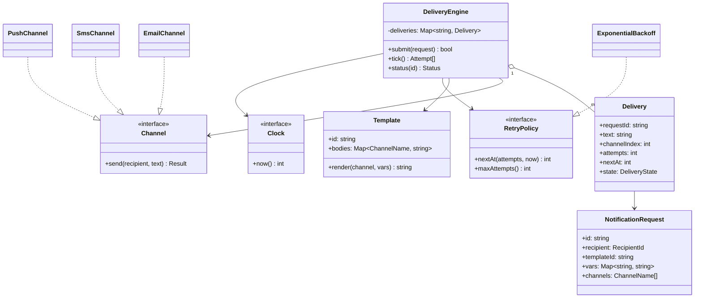
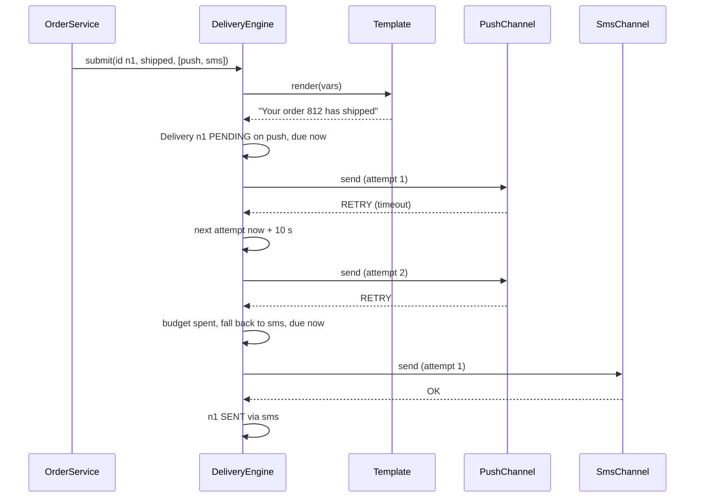

## In one minute
- As an object-design question, a notification system is the code inside one delivery worker: turn "order 812 shipped" into a rendered message, pick a channel, call a provider, and decide what to do when the provider says "try later" or "never". The distributed pipeline (queues, preference service, campaign fan-out) is covered in [Design Notification Service](../sdi/design-notification-service.md).
- Separate the three things that change at different speeds: templates (edited weekly by product), channels (added yearly: email, SMS, push, chat apps) and delivery policy (retries, fallbacks, tuned after incidents). Each gets its own abstraction.
- A delivery is a small state machine: pending, sent, failed, with attempts and a next-attempt time. Retries back off exponentially per channel; a permanent error or exhausted retries moves to the next channel in a fallback chain.
- Every send carries an idempotency key. Provider calls are slow, remote and sometimes ambiguous, so "send exactly once" is really "send at least once, suppress what you can recognise".
- The problem shapes are **partial failure** (the provider times out after maybe sending) and **duplicates** (the producer retries the request). The same shape shows up in webhook delivery and in payment capture calls.

## Requirements

Functional:
- Producers (order service, auth service) request a notification with a template id, variables, a recipient and an ordered list of channels, for example push then SMS for a delivery alert.
- Templates contain placeholders such as `{{first_name}}`; rendering fails loudly if a variable is missing rather than sending "Hi ,".
- Each channel has its own sender (email via an SMTP or HTTP provider, SMS via a gateway, push via APNs or FCM).
- Transient provider errors are retried with exponential backoff; permanent errors (invalid number, uninstalled app) and exhausted retries fall back to the next channel; the last failure marks the notification failed.
- A request repeated with the same notification id does not send twice.
- Status is queryable: pending on which channel, sent on which channel, or failed.

Non-functional:
- A slow or broken provider must not block the other channels.
- Retry timing is deterministic under test: time comes from an injected clock.
- Templates and channels are added without editing the delivery engine.

Out of scope: user preferences and quiet hours, rate limits, campaign fan-out and analytics. The system design lesson owns those; here they would be one more filter before the engine.

## Entities and relationships

- **NotificationRequest** is what a producer submits: id (the idempotency key), recipient, template id, variables, channel list, priority. It is an immutable value.
- **Template** has an id and a body per channel (a 160-character SMS body and an HTML email body are different texts). It knows how to render itself against variables.
- **Recipient** carries the addresses the channels need: email, phone number, device tokens. Addresses come from a user directory, not from the producer, so a stale phone number is fixed in one place.
- **Channel** is an interface with `send(recipient, message) -> Result`. **EmailChannel**, **SmsChannel** and **PushChannel** adapt specific providers.
- **Result** is one of `OK`, `RETRY` (timeout, 429, 5xx) or `FAIL` (permanent: invalid address, unregistered token). Classifying provider errors into these three is the most important code in each channel.
- **Delivery** is the mutable record: request id, rendered text, current channel index, attempts on that channel, next attempt time and state.
- **RetryPolicy** decides the next attempt time; **DeliveryEngine** owns deliveries and runs due ones on each tick; **Clock** supplies time.

Relationships: the engine aggregates deliveries and holds a registry of channels and templates. A delivery references its request and template by id. Channels own nothing but their provider client.

## Class diagram



## Key flows

A delivery alert asks for push first and SMS as the fallback. Push times out twice, then the retry budget is spent, and SMS succeeds on the next tick.



## Design patterns used and why

- **Strategy (with Adapter inside).** Each channel is a strategy behind `Channel.send`, and each implementation adapts one provider's API and error codes to the three-valued `Result`. Adding WhatsApp is one new class plus a registry entry.
- **Chain of Responsibility, as data.** The fallback chain is an ordered list of channel names on the request, walked by the engine. A list beats linked handler objects here because the order is per request, not per deployment. See [Chain of Responsibility](chain-of-responsibility.md).
- **State.** A delivery moves pending, then sent or failed, with retries as self-transitions that bump `attempts` and `nextAt`. Keep it an enum plus guarded transitions in one method; the bugs come from transitions spread across callers.
- **Template Method, avoided on purpose.** A tempting design is an abstract `Notifier` whose `notify()` calls `format()`, `send()` and `log()` hooks per channel subclass. It couples formatting to transport and grows a subclass per combination. Composition (template object plus channel object) does the same job with fewer classes.
- **Decorator** for cross-cutting channel behaviour: a `TimedChannel` that enforces a deadline, a `MetricsChannel` that counts outcomes, a `SandboxChannel` that redirects every message to a test inbox in staging. Each wraps a `Channel` and is itself a `Channel`.
- **Observer** at the edge: producers emit domain events, and a subscriber maps "OrderShipped" to a notification request. The engine never imports the order service.
- **Builder** for requests with many optional fields (priority, collapse key, deep link, locale), so producers cannot create half-formed requests.

## Concurrency and edge cases

- **Ambiguous sends.** The provider times out after it may already have accepted the message. Retrying risks a duplicate, not retrying risks silence. Pass the notification id to providers that accept an idempotency key, collapse duplicates on the device with a collapse id for push, and accept that SMS may occasionally duplicate. Write the choice down per channel.
- **Duplicate submits.** A producer retries `submit` after its own timeout. The engine keys deliveries by request id; a second submit is acknowledged and ignored. In a database this is a primary key on the id and an insert that tolerates conflict.
- **Two workers, one delivery.** With several worker processes polling for due deliveries, two can pick the same row and both send. Claim rows with `SELECT ... FOR UPDATE SKIP LOCKED` or a conditional update that sets a lease, and only the claimant sends.
- **Render before queueing.** Render at submit time and store the text, so a template edit between submit and retry does not change a message mid-flight, and a missing variable fails the producer's call instead of a background job at 3 a.m.
- **Slow channels.** One provider at 30 seconds per call must not starve the others. Give each channel its own worker pool or concurrency limit (bulkhead) and a per-call timeout shorter than the retry interval.
- **Retry storms.** If a provider is down for ten minutes, every delivery backs off on the same schedule and they all return together. Add jitter in production; the practice code omits it so tests stay exact.

## Down the stack

### Layer 1: The contract
`submit` either rejects a bad request synchronously (unknown template, missing variable, unknown channel, empty channel list) or durably records exactly one delivery for that id; a repeat submit returns "duplicate" and changes nothing. Each `tick` attempts every delivery whose next-attempt time is at or before now, at most once per tick. After an attempt, a delivery is `SENT` on the channel that returned OK, still `PENDING` with a later time or the next channel, or `FAILED` when the last channel gives up. Delivery is at-least-once per channel attempt; the engine never sends on a later channel after an earlier one succeeded.

### Layer 2: The mechanism
In memory, deliveries live in a map by id plus a list or min-heap ordered by `(nextAt, sequence)` so a tick takes due items in a stable order. Backoff for attempt `k` on a channel is `base * 2^(k-1)`, so with a 10-second base the waits are 10, 20, 40 seconds. In production the same state is a table with `next_attempt_at` indexed; workers run a claim query that skips locked rows, call the provider outside the transaction, then record the outcome with a conditional update on the lease they hold. Provider protocols matter for classification: APNs is HTTP/2 and answers each request with a status and a reason (a 410 means the token is no longer valid, which is permanent); SMTP uses 4xx reply codes for "try again" and 5xx for permanent rejection; SMS gateways return their own codes that the adapter must map.

### Layer 3: The machine
A provider call is a network round trip plus TLS, typically 50 to 500 ms, while the engine's bookkeeping is microseconds. A worker that sends synchronously therefore spends over 99% of its time waiting on sockets, which is why delivery workers are I/O-concurrent (an event loop, goroutines, or a thread pool far larger than the core count) and reuse connections: a new TLS 1.3 handshake costs at least one extra round trip, and APNs over HTTP/2 can multiplex many requests on one connection. Payload limits shape templates: Apple documents a 4 KB limit for a regular push payload, and an SMS segment holds 160 characters in the GSM 7-bit alphabet but only 70 once a single emoji forces UCS-2 encoding, so one emoji can double the cost of a message. Durable delivery state costs a database write per attempt, around a millisecond for a commit on SSD.

### Why it's built this way
1. Providers fail independently and often transiently, so each attempt's outcome is classified and retried per channel rather than failing the whole notification.
2. Retrying a struggling provider immediately makes it worse, so retries back off exponentially (and, in production, with jitter).
3. Some failures are permanent and some users are reachable elsewhere, so a fallback chain moves on instead of retrying forever.
4. Producers and workers both retry, so ids make submits idempotent and leases make claims exclusive.
5. Templates, channels and policies change on different schedules and are owned by different people, so each sits behind its own interface.

## Extensibility

- **New channel (WhatsApp, Slack).** One `Channel` implementation with its error classification; producers opt in by naming it in their chain.
- **Preferences and quiet hours.** A filter that edits the channel list before `submit` (drop SMS for users who opted out, defer non-urgent sends). The engine stays unchanged; [Design Notification Service](../sdi/design-notification-service.md) implements that filter.
- **Digests.** Low-priority notifications go to a `DigestBuffer` keyed by user that flushes one combined message on a schedule; the flush is just another `submit`.
- **Localisation.** Templates gain a body per locale per channel, chosen from the recipient's locale with a default fallback.
- **Read receipts and analytics.** Channels that report opens or delivery receipts publish events to a status subscriber; the delivery record gains a `delivered` state set asynchronously.

## Leadership lens

- Build first: the delivery state machine and the error classification for your highest-volume channel, with tests for retry, fallback and duplicate submit. A wrong template is embarrassing; a retry loop that sends 40 SMS to one customer is a cost and trust incident.
- Ask in review: which provider errors are retryable and who decided; what the idempotency key is; what happens if the worker crashes after the provider accepted the message; what the per-channel budget is per user per day.
- SMS is the cost driver, often orders of magnitude more per message than push or email. Put fallback-to-SMS behind an explicit allowlist of notification types (security codes, delivery alerts), not a default.
- Give template editing to product with a preview and a required-variables check, and keep channels and the engine with the platform team. That boundary is where most organisational friction appears.

## Check yourself
1. Why render the template at submit time instead of at send time?
   **Answer:** Missing variables fail the producer's call where someone can fix them, and every retry and fallback sends the same text even if the template is edited meanwhile.
2. A push provider returns "token unregistered". Should the engine retry it?
   **Answer:** No. That is a permanent failure: retrying wastes the budget and delays the user. Move to the next channel and remove the stale token from the recipient's addresses.
3. Why does an idempotent `submit` not guarantee the user receives at most one message?
   **Answer:** The ambiguity is downstream: a provider can accept a message and then time out before replying, and the retry sends a second copy. Only provider-side keys or device-side collapse can remove that duplicate.
4. Why give each channel its own concurrency limit?
   **Answer:** So a slow provider exhausts only its own workers. With a shared pool, a stalled SMS gateway would hold every worker and delay push and email too.

## Practice
**Task:** Implement `DeliveryEngine(clock, max_attempts, base_backoff)`. `add_template(id, text)` stores a template whose placeholders are `{{name}}`, with spaces inside the braces ignored; an unclosed `{{` is copied literally. `add_channel(name, sender)` registers a function `sender(user, text)` that returns `"ok"`, `"retry"` or `"fail"`. `submit(nid, user, template_id, vars, channels)` renders the text immediately, failing on an unknown template, a missing variable, an empty channel list or an unknown channel; it returns `False` and changes nothing if `nid` was already submitted, otherwise `True` with the delivery due now on the first channel. `tick()` attempts, in submit order, every pending delivery due at or before `now`, and returns a list of `(nid, channel, result)`. On `"ok"` the delivery is sent. On `"retry"` with fewer than `max_attempts` attempts on this channel, the next attempt is due at `now + base_backoff * 2^(attempts - 1)`. On `"fail"`, or `"retry"` with the budget spent, it moves to the next channel due now (attempted on a later tick), or fails if there is none. `status(nid)` returns `(state, channel)`: `("PENDING", current)`, `("SENT", channel)` or `("FAILED", "")`.

```python starter
class DeliveryEngine:
    def __init__(self, clock, max_attempts, base_backoff):
        self._clock = clock

    def add_template(self, template_id, text):
        raise NotImplementedError

    def add_channel(self, name, sender):
        raise NotImplementedError

    def submit(self, nid, user, template_id, variables, channels):
        # TODO: render now; reject bad input; ignore duplicate ids
        raise NotImplementedError

    def tick(self):
        # TODO: attempt due deliveries in submit order; backoff and fallback
        raise NotImplementedError

    def status(self, nid):
        raise NotImplementedError
```

```python tests
class FakeClock:
    def __init__(self):
        self.t = 0

    def now(self):
        return self.t


class Script:
    def __init__(self, results):
        self.results = list(results)
        self.calls = []

    def __call__(self, user, text):
        self.calls.append((user, text))
        if len(self.results) > 1:
            return self.results.pop(0)
        return self.results[0]


def make(max_attempts=3, base=10, push=("ok",), sms=("ok",)):
    clock = FakeClock()
    eng = DeliveryEngine(clock, max_attempts, base)
    p, s = Script(push), Script(sms)
    eng.add_channel("push", p)
    eng.add_channel("sms", s)
    eng.add_template("shipped", "Hi {{ name }}, order {{order}} shipped.")
    return eng, clock, p, s


def fails(fn):
    try:
        fn()
    except ValueError:
        return True
    return False


def test_render_and_send_first_channel():
    eng, _, p, s = make()
    assert eng.submit("n1", "u1", "shipped", {"name": "Ana", "order": "812"}, ["push", "sms"])
    assert eng.status("n1") == ("PENDING", "push")
    assert eng.tick() == [("n1", "push", "ok")]
    assert p.calls == [("u1", "Hi Ana, order 812 shipped.")]
    assert s.calls == []
    assert eng.status("n1") == ("SENT", "push")
    assert eng.tick() == [], "sent deliveries are not retried"


def test_template_edge_cases():
    eng, _, p, _ = make()
    assert fails(lambda: eng.submit("n1", "u1", "shipped", {"name": "Ana"}, ["push"])), "missing var"
    assert fails(lambda: eng.status("n1")), "nothing was recorded"
    eng.add_template("odd", "{{a}}{{b}} and {{ unclosed")
    eng.submit("n2", "u1", "odd", {"a": "x", "b": "y"}, ["push"])
    eng.tick()
    assert p.calls[-1][1] == "xy and {{ unclosed"


def test_exponential_backoff_then_success():
    eng, clock, p, _ = make(push=("retry", "retry", "ok"))
    eng.submit("n1", "u1", "shipped", {"name": "A", "order": "1"}, ["push"])
    assert eng.tick() == [("n1", "push", "retry")]
    clock.t = 9
    assert eng.tick() == [], "not due before 10"
    clock.t = 10
    assert eng.tick() == [("n1", "push", "retry")]
    clock.t = 29
    assert eng.tick() == [], "second wait is 20"
    clock.t = 30
    assert eng.tick() == [("n1", "push", "ok")]
    assert eng.status("n1") == ("SENT", "push")


def test_exhausted_retries_fall_back():
    eng, clock, p, s = make(max_attempts=2, push=("retry",))
    eng.submit("n1", "u1", "shipped", {"name": "A", "order": "1"}, ["push", "sms"])
    eng.tick()
    clock.t = 10
    assert eng.tick() == [("n1", "push", "retry")]
    assert eng.status("n1") == ("PENDING", "sms")
    assert eng.tick() == [("n1", "sms", "ok")], "fallback is due now, on the next tick"
    assert eng.status("n1") == ("SENT", "sms")
    assert len(p.calls) == 2


def test_permanent_failure_and_final_failure():
    eng, _, p, s = make(push=("fail",), sms=("fail",))
    eng.submit("n1", "u1", "shipped", {"name": "A", "order": "1"}, ["push", "sms"])
    assert eng.tick() == [("n1", "push", "fail")]
    assert eng.status("n1") == ("PENDING", "sms")
    assert eng.tick() == [("n1", "sms", "fail")]
    assert eng.status("n1") == ("FAILED", "")
    assert eng.tick() == []


def test_duplicate_submit_is_ignored():
    eng, _, p, _ = make()
    v = {"name": "A", "order": "1"}
    assert eng.submit("n1", "u1", "shipped", v, ["push"]) is True
    assert eng.submit("n1", "u1", "shipped", v, ["push"]) is False
    eng.tick()
    assert len(p.calls) == 1


def test_order_and_validation():
    eng, _, _, _ = make()
    v = {"name": "A", "order": "1"}
    eng.submit("b", "u1", "shipped", v, ["sms"])
    eng.submit("a", "u2", "shipped", v, ["push"])
    assert eng.tick() == [("b", "sms", "ok"), ("a", "push", "ok")], "submit order, not id order"
    assert fails(lambda: eng.submit("c", "u1", "nope", v, ["push"])), "unknown template"
    assert fails(lambda: eng.submit("c", "u1", "shipped", v, [])), "no channels"
    assert fails(lambda: eng.submit("c", "u1", "shipped", v, ["fax"])), "unknown channel"
```

```python solution
from dataclasses import dataclass


def render(text, variables):
    out = []
    i = 0
    while True:
        start = text.find("{{", i)
        end = text.find("}}", start + 2) if start >= 0 else -1
        if start < 0 or end < 0:
            out.append(text[i:])
            return "".join(out)
        out.append(text[i:start])
        name = text[start + 2:end].strip()
        if name not in variables:
            raise ValueError("missing variable: " + name)
        out.append(str(variables[name]))
        i = end + 2


@dataclass
class Delivery:
    nid: str
    user: str
    text: str
    channels: list
    seq: int
    index: int = 0
    attempts: int = 0
    next_at: int = 0
    state: str = "PENDING"


class DeliveryEngine:
    def __init__(self, clock, max_attempts, base_backoff):
        self._clock = clock
        self._max = max_attempts
        self._base = base_backoff
        self._templates = {}
        self._channels = {}
        self._deliveries = {}
        self._seq = 0

    def add_template(self, template_id, text):
        self._templates[template_id] = text

    def add_channel(self, name, sender):
        self._channels[name] = sender

    def submit(self, nid, user, template_id, variables, channels):
        if template_id not in self._templates:
            raise ValueError("unknown template: " + template_id)
        if not channels:
            raise ValueError("no channels")
        for c in channels:
            if c not in self._channels:
                raise ValueError("unknown channel: " + c)
        text = render(self._templates[template_id], variables)
        if nid in self._deliveries:
            return False
        self._seq += 1
        self._deliveries[nid] = Delivery(nid, user, text, list(channels), self._seq,
                                         next_at=self._clock.now())
        return True

    def tick(self):
        now = self._clock.now()
        due = [d for d in self._deliveries.values()
               if d.state == "PENDING" and d.next_at <= now]
        due.sort(key=lambda d: (d.next_at, d.seq))
        log = []
        for d in due:
            channel = d.channels[d.index]
            result = self._channels[channel](d.user, d.text)
            d.attempts += 1
            log.append((d.nid, channel, result))
            if result == "ok":
                d.state = "SENT"
            elif result == "retry" and d.attempts < self._max:
                d.next_at = now + self._base * (2 ** (d.attempts - 1))
            elif d.index + 1 < len(d.channels):
                d.index += 1
                d.attempts = 0
                d.next_at = now
            else:
                d.state = "FAILED"
        return log

    def status(self, nid):
        d = self._deliveries.get(nid)
        if d is None:
            raise ValueError("unknown notification: " + nid)
        if d.state == "FAILED":
            return ("FAILED", "")
        return (d.state, d.channels[d.index])
```

```typescript starter
export interface Clock { now(): number }
export type Result = "ok" | "retry" | "fail";
export type Sender = (user: string, text: string) => Result;

export class DeliveryEngine {
  constructor(private clock: Clock, private maxAttempts: number, private baseBackoff: number) {}

  addTemplate(id: string, text: string): void { throw new Error("TODO"); }
  addChannel(name: string, sender: Sender): void { throw new Error("TODO"); }
  submit(nid: string, user: string, templateId: string, vars: Record<string, string>, channels: string[]): boolean {
    throw new Error("TODO");
  }
  tick(): Array<[string, string, Result]> { throw new Error("TODO"); }
  status(nid: string): [string, string] { throw new Error("TODO"); }
}
```

```typescript tests
class FakeClock implements Clock {
  t = 0;
  now(): number { return this.t; }
}

class Script {
  calls: Array<[string, string]> = [];
  constructor(private results: Result[]) {}
  sender(): Sender {
    return (user: string, text: string) => {
      this.calls.push([user, text]);
      return this.results.length > 1 ? this.results.shift()! : this.results[0];
    };
  }
}

function make(maxAttempts = 3, base = 10, push: Result[] = ["ok"], sms: Result[] = ["ok"]) {
  const clock = new FakeClock();
  const eng = new DeliveryEngine(clock, maxAttempts, base);
  const p = new Script(push);
  const s = new Script(sms);
  eng.addChannel("push", p.sender());
  eng.addChannel("sms", s.sender());
  eng.addTemplate("shipped", "Hi {{ name }}, order {{order}} shipped.");
  return { eng, clock, p, s };
}

function fails(fn: () => unknown): boolean {
  try { fn(); return false; } catch (e) { return true; }
}

const V = { name: "A", order: "1" };

test("render and send first channel", () => {
  const { eng, p, s } = make();
  assert(eng.submit("n1", "u1", "shipped", { name: "Ana", order: "812" }, ["push", "sms"]));
  assertEqual(eng.status("n1"), ["PENDING", "push"]);
  assertEqual(eng.tick(), [["n1", "push", "ok"]]);
  assertEqual(p.calls, [["u1", "Hi Ana, order 812 shipped."]]);
  assertEqual(s.calls, []);
  assertEqual(eng.status("n1"), ["SENT", "push"]);
  assertEqual(eng.tick(), [], "sent deliveries are not retried");
});

test("template edge cases", () => {
  const { eng, p } = make();
  assert(fails(() => eng.submit("n1", "u1", "shipped", { name: "Ana" }, ["push"])), "missing var");
  assert(fails(() => eng.status("n1")), "nothing was recorded");
  eng.addTemplate("odd", "{{a}}{{b}} and {{ unclosed");
  eng.submit("n2", "u1", "odd", { a: "x", b: "y" }, ["push"]);
  eng.tick();
  assertEqual(p.calls[p.calls.length - 1][1], "xy and {{ unclosed");
});

test("exponential backoff then success", () => {
  const { eng, clock } = make(3, 10, ["retry", "retry", "ok"]);
  eng.submit("n1", "u1", "shipped", V, ["push"]);
  assertEqual(eng.tick(), [["n1", "push", "retry"]]);
  clock.t = 9;
  assertEqual(eng.tick(), [], "not due before 10");
  clock.t = 10;
  assertEqual(eng.tick(), [["n1", "push", "retry"]]);
  clock.t = 29;
  assertEqual(eng.tick(), [], "second wait is 20");
  clock.t = 30;
  assertEqual(eng.tick(), [["n1", "push", "ok"]]);
  assertEqual(eng.status("n1"), ["SENT", "push"]);
});

test("exhausted retries fall back", () => {
  const { eng, clock, p } = make(2, 10, ["retry"]);
  eng.submit("n1", "u1", "shipped", V, ["push", "sms"]);
  eng.tick();
  clock.t = 10;
  assertEqual(eng.tick(), [["n1", "push", "retry"]]);
  assertEqual(eng.status("n1"), ["PENDING", "sms"]);
  assertEqual(eng.tick(), [["n1", "sms", "ok"]], "fallback is due now, on the next tick");
  assertEqual(eng.status("n1"), ["SENT", "sms"]);
  assertEqual(p.calls.length, 2);
});

test("permanent failure and final failure", () => {
  const { eng } = make(3, 10, ["fail"], ["fail"]);
  eng.submit("n1", "u1", "shipped", V, ["push", "sms"]);
  assertEqual(eng.tick(), [["n1", "push", "fail"]]);
  assertEqual(eng.status("n1"), ["PENDING", "sms"]);
  assertEqual(eng.tick(), [["n1", "sms", "fail"]]);
  assertEqual(eng.status("n1"), ["FAILED", ""]);
  assertEqual(eng.tick(), []);
});

test("duplicate submit is ignored", () => {
  const { eng, p } = make();
  assertEqual(eng.submit("n1", "u1", "shipped", V, ["push"]), true);
  assertEqual(eng.submit("n1", "u1", "shipped", V, ["push"]), false);
  eng.tick();
  assertEqual(p.calls.length, 1);
});

test("order and validation", () => {
  const { eng } = make();
  eng.submit("b", "u1", "shipped", V, ["sms"]);
  eng.submit("a", "u2", "shipped", V, ["push"]);
  assertEqual(eng.tick(), [["b", "sms", "ok"], ["a", "push", "ok"]], "submit order, not id order");
  assert(fails(() => eng.submit("c", "u1", "nope", V, ["push"])), "unknown template");
  assert(fails(() => eng.submit("c", "u1", "shipped", V, [])), "no channels");
  assert(fails(() => eng.submit("c", "u1", "shipped", V, ["fax"])), "unknown channel");
});
```

```typescript solution
export interface Clock { now(): number }
export type Result = "ok" | "retry" | "fail";
export type Sender = (user: string, text: string) => Result;

export function render(text: string, vars: Record<string, string>): string {
  let out = "";
  let i = 0;
  for (;;) {
    const start = text.indexOf("{{", i);
    const end = start >= 0 ? text.indexOf("}}", start + 2) : -1;
    if (start < 0 || end < 0) return out + text.slice(i);
    out += text.slice(i, start);
    const name = text.slice(start + 2, end).trim();
    if (!(name in vars)) throw new Error("missing variable: " + name);
    out += vars[name];
    i = end + 2;
  }
}

interface Delivery {
  nid: string;
  user: string;
  text: string;
  channels: string[];
  seq: number;
  index: number;
  attempts: number;
  nextAt: number;
  state: "PENDING" | "SENT" | "FAILED";
}

export class DeliveryEngine {
  private templates = new Map<string, string>();
  private senders = new Map<string, Sender>();
  private deliveries = new Map<string, Delivery>();
  private seq = 0;

  constructor(private clock: Clock, private maxAttempts: number, private baseBackoff: number) {}

  addTemplate(id: string, text: string): void { this.templates.set(id, text); }

  addChannel(name: string, sender: Sender): void { this.senders.set(name, sender); }

  submit(nid: string, user: string, templateId: string, vars: Record<string, string>, channels: string[]): boolean {
    const tpl = this.templates.get(templateId);
    if (tpl === undefined) throw new Error("unknown template: " + templateId);
    if (channels.length === 0) throw new Error("no channels");
    for (const c of channels) if (!this.senders.has(c)) throw new Error("unknown channel: " + c);
    const text = render(tpl, vars);
    if (this.deliveries.has(nid)) return false;
    this.deliveries.set(nid, {
      nid, user, text, channels: [...channels], seq: ++this.seq,
      index: 0, attempts: 0, nextAt: this.clock.now(), state: "PENDING",
    });
    return true;
  }

  tick(): Array<[string, string, Result]> {
    const now = this.clock.now();
    const due = [...this.deliveries.values()]
      .filter((d) => d.state === "PENDING" && d.nextAt <= now)
      .sort((a, b) => a.nextAt - b.nextAt || a.seq - b.seq);
    const log: Array<[string, string, Result]> = [];
    for (const d of due) {
      const channel = d.channels[d.index];
      const result = this.senders.get(channel)!(d.user, d.text);
      d.attempts++;
      log.push([d.nid, channel, result]);
      if (result === "ok") {
        d.state = "SENT";
      } else if (result === "retry" && d.attempts < this.maxAttempts) {
        d.nextAt = now + this.baseBackoff * 2 ** (d.attempts - 1);
      } else if (d.index + 1 < d.channels.length) {
        d.index++;
        d.attempts = 0;
        d.nextAt = now;
      } else {
        d.state = "FAILED";
      }
    }
    return log;
  }

  status(nid: string): [string, string] {
    const d = this.deliveries.get(nid);
    if (!d) throw new Error("unknown notification: " + nid);
    return d.state === "FAILED" ? ["FAILED", ""] : [d.state, d.channels[d.index]];
  }
}
```

```go starter
package practice

import "errors"

var (
	ErrUnknownTemplate = errors.New("unknown template")
	ErrUnknownChannel  = errors.New("unknown channel")
	ErrNoChannels      = errors.New("no channels")
	ErrMissingVar      = errors.New("missing variable")
	ErrUnknownID       = errors.New("unknown notification")
)

type Clock interface{ Now() int64 }

type Sender func(user, text string) string

type Attempt struct {
	ID, Channel, Result string
}

type DeliveryEngine struct{}

func NewDeliveryEngine(clock Clock, maxAttempts int, baseBackoff int64) *DeliveryEngine {
	return &DeliveryEngine{}
}

func (e *DeliveryEngine) AddTemplate(id, text string)        { panic("TODO") }
func (e *DeliveryEngine) AddChannel(name string, s Sender)    { panic("TODO") }
func (e *DeliveryEngine) Submit(id, user, templateID string, vars map[string]string, channels []string) (bool, error) {
	panic("TODO")
}
func (e *DeliveryEngine) Tick() []Attempt                       { panic("TODO") }
func (e *DeliveryEngine) Status(id string) (string, string, error) { panic("TODO") }
```

```go tests
package practice

import (
	"errors"
	"reflect"
	"testing"
)

type fakeClock struct{ t int64 }

func (c *fakeClock) Now() int64 { return c.t }

type script struct {
	results []string
	calls   [][2]string
}

func (s *script) send(user, text string) string {
	s.calls = append(s.calls, [2]string{user, text})
	if len(s.results) > 1 {
		r := s.results[0]
		s.results = s.results[1:]
		return r
	}
	return s.results[0]
}

func setup(maxAttempts int, push, sms []string) (*DeliveryEngine, *fakeClock, *script, *script) {
	c := &fakeClock{}
	e := NewDeliveryEngine(c, maxAttempts, 10)
	p, s := &script{results: push}, &script{results: sms}
	e.AddChannel("push", p.send)
	e.AddChannel("sms", s.send)
	e.AddTemplate("shipped", "Hi {{ name }}, order {{order}} shipped.")
	return e, c, p, s
}

var vars = map[string]string{"name": "A", "order": "1"}

func wantTick(t *testing.T, e *DeliveryEngine, want []Attempt, msg string) {
	t.Helper()
	got := e.Tick()
	if len(got) == 0 && len(want) == 0 {
		return
	}
	if !reflect.DeepEqual(got, want) {
		t.Fatalf("%s: got %v want %v", msg, got, want)
	}
}

func wantStatus(t *testing.T, e *DeliveryEngine, id, state, channel string) {
	t.Helper()
	s, c, err := e.Status(id)
	if err != nil || s != state || c != channel {
		t.Fatalf("status %s: got (%s,%s,%v) want (%s,%s)", id, s, c, err, state, channel)
	}
}

func submit(t *testing.T, e *DeliveryEngine, id string, v map[string]string, ch ...string) bool {
	t.Helper()
	ok, err := e.Submit(id, "u1", "shipped", v, ch)
	if err != nil {
		t.Fatal(err)
	}
	return ok
}

func TestRenderAndSendFirstChannel(t *testing.T) {
	e, _, p, s := setup(3, []string{"ok"}, []string{"ok"})
	submit(t, e, "n1", map[string]string{"name": "Ana", "order": "812"}, "push", "sms")
	wantStatus(t, e, "n1", "PENDING", "push")
	wantTick(t, e, []Attempt{{"n1", "push", "ok"}}, "first tick")
	if len(p.calls) != 1 || p.calls[0][1] != "Hi Ana, order 812 shipped." || len(s.calls) != 0 {
		t.Fatalf("calls %v %v", p.calls, s.calls)
	}
	wantStatus(t, e, "n1", "SENT", "push")
	wantTick(t, e, nil, "sent deliveries are not retried")
}

func TestTemplateEdgeCases(t *testing.T) {
	e, _, p, _ := setup(3, []string{"ok"}, []string{"ok"})
	if _, err := e.Submit("n1", "u1", "shipped", map[string]string{"name": "Ana"}, []string{"push"}); !errors.Is(err, ErrMissingVar) {
		t.Fatalf("missing var: %v", err)
	}
	if _, _, err := e.Status("n1"); !errors.Is(err, ErrUnknownID) {
		t.Fatalf("nothing was recorded: %v", err)
	}
	e.AddTemplate("odd", "{{a}}{{b}} and {{ unclosed")
	e.Submit("n2", "u1", "odd", map[string]string{"a": "x", "b": "y"}, []string{"push"})
	e.Tick()
	if got := p.calls[len(p.calls)-1][1]; got != "xy and {{ unclosed" {
		t.Fatalf("got %q", got)
	}
}

func TestExponentialBackoffThenSuccess(t *testing.T) {
	e, c, _, _ := setup(3, []string{"retry", "retry", "ok"}, []string{"ok"})
	submit(t, e, "n1", vars, "push")
	wantTick(t, e, []Attempt{{"n1", "push", "retry"}}, "t=0")
	c.t = 9
	wantTick(t, e, nil, "not due before 10")
	c.t = 10
	wantTick(t, e, []Attempt{{"n1", "push", "retry"}}, "t=10")
	c.t = 29
	wantTick(t, e, nil, "second wait is 20")
	c.t = 30
	wantTick(t, e, []Attempt{{"n1", "push", "ok"}}, "t=30")
	wantStatus(t, e, "n1", "SENT", "push")
}

func TestExhaustedRetriesFallBack(t *testing.T) {
	e, c, p, _ := setup(2, []string{"retry"}, []string{"ok"})
	submit(t, e, "n1", vars, "push", "sms")
	e.Tick()
	c.t = 10
	wantTick(t, e, []Attempt{{"n1", "push", "retry"}}, "second push")
	wantStatus(t, e, "n1", "PENDING", "sms")
	wantTick(t, e, []Attempt{{"n1", "sms", "ok"}}, "fallback is due now, on the next tick")
	wantStatus(t, e, "n1", "SENT", "sms")
	if len(p.calls) != 2 {
		t.Fatalf("push calls %d", len(p.calls))
	}
}

func TestPermanentFailureAndFinalFailure(t *testing.T) {
	e, _, _, _ := setup(3, []string{"fail"}, []string{"fail"})
	submit(t, e, "n1", vars, "push", "sms")
	wantTick(t, e, []Attempt{{"n1", "push", "fail"}}, "push fails")
	wantStatus(t, e, "n1", "PENDING", "sms")
	wantTick(t, e, []Attempt{{"n1", "sms", "fail"}}, "sms fails")
	wantStatus(t, e, "n1", "FAILED", "")
	wantTick(t, e, nil, "nothing left")
}

func TestDuplicateSubmitIsIgnored(t *testing.T) {
	e, _, p, _ := setup(3, []string{"ok"}, []string{"ok"})
	if !submit(t, e, "n1", vars, "push") || submit(t, e, "n1", vars, "push") {
		t.Fatal("first true, second false")
	}
	e.Tick()
	if len(p.calls) != 1 {
		t.Fatalf("calls %d", len(p.calls))
	}
}

func TestOrderAndValidation(t *testing.T) {
	e, _, _, _ := setup(3, []string{"ok"}, []string{"ok"})
	submit(t, e, "b", vars, "sms")
	submit(t, e, "a", vars, "push")
	wantTick(t, e, []Attempt{{"b", "sms", "ok"}, {"a", "push", "ok"}}, "submit order, not id order")
	if _, err := e.Submit("c", "u1", "nope", vars, []string{"push"}); !errors.Is(err, ErrUnknownTemplate) {
		t.Fatalf("unknown template: %v", err)
	}
	if _, err := e.Submit("c", "u1", "shipped", vars, nil); !errors.Is(err, ErrNoChannels) {
		t.Fatalf("no channels: %v", err)
	}
	if _, err := e.Submit("c", "u1", "shipped", vars, []string{"fax"}); !errors.Is(err, ErrUnknownChannel) {
		t.Fatalf("unknown channel: %v", err)
	}
}
```

```go solution
package practice

import (
	"errors"
	"fmt"
	"sort"
	"strings"
	"sync"
)

var (
	ErrUnknownTemplate = errors.New("unknown template")
	ErrUnknownChannel  = errors.New("unknown channel")
	ErrNoChannels      = errors.New("no channels")
	ErrMissingVar      = errors.New("missing variable")
	ErrUnknownID       = errors.New("unknown notification")
)

type Clock interface{ Now() int64 }

type Sender func(user, text string) string

type Attempt struct {
	ID, Channel, Result string
}

type delivery struct {
	id, user, text string
	channels       []string
	seq            int
	index          int
	attempts       int
	nextAt         int64
	state          string
}

type DeliveryEngine struct {
	mu          sync.Mutex
	clock       Clock
	maxAttempts int
	base        int64
	templates   map[string]string
	senders     map[string]Sender
	deliveries  map[string]*delivery
	seq         int
}

func NewDeliveryEngine(clock Clock, maxAttempts int, baseBackoff int64) *DeliveryEngine {
	return &DeliveryEngine{
		clock: clock, maxAttempts: maxAttempts, base: baseBackoff,
		templates:  map[string]string{},
		senders:    map[string]Sender{},
		deliveries: map[string]*delivery{},
	}
}

func render(text string, vars map[string]string) (string, error) {
	var b strings.Builder
	i := 0
	for {
		start := strings.Index(text[i:], "{{")
		if start < 0 {
			b.WriteString(text[i:])
			return b.String(), nil
		}
		start += i
		end := strings.Index(text[start+2:], "}}")
		if end < 0 {
			b.WriteString(text[i:])
			return b.String(), nil
		}
		end += start + 2
		b.WriteString(text[i:start])
		name := strings.TrimSpace(text[start+2 : end])
		v, ok := vars[name]
		if !ok {
			return "", fmt.Errorf("%w: %s", ErrMissingVar, name)
		}
		b.WriteString(v)
		i = end + 2
	}
}

func (e *DeliveryEngine) AddTemplate(id, text string) {
	e.mu.Lock()
	defer e.mu.Unlock()
	e.templates[id] = text
}

func (e *DeliveryEngine) AddChannel(name string, s Sender) {
	e.mu.Lock()
	defer e.mu.Unlock()
	e.senders[name] = s
}

func (e *DeliveryEngine) Submit(id, user, templateID string, vars map[string]string, channels []string) (bool, error) {
	e.mu.Lock()
	defer e.mu.Unlock()
	tpl, ok := e.templates[templateID]
	if !ok {
		return false, fmt.Errorf("%w: %s", ErrUnknownTemplate, templateID)
	}
	if len(channels) == 0 {
		return false, ErrNoChannels
	}
	for _, c := range channels {
		if _, ok := e.senders[c]; !ok {
			return false, fmt.Errorf("%w: %s", ErrUnknownChannel, c)
		}
	}
	text, err := render(tpl, vars)
	if err != nil {
		return false, err
	}
	if _, dup := e.deliveries[id]; dup {
		return false, nil
	}
	e.seq++
	e.deliveries[id] = &delivery{id: id, user: user, text: text,
		channels: append([]string(nil), channels...), seq: e.seq,
		nextAt: e.clock.Now(), state: "PENDING"}
	return true, nil
}

// Tick holds the lock across sender calls to keep the example simple; a real
// worker claims due deliveries, releases the lock, then calls providers.
func (e *DeliveryEngine) Tick() []Attempt {
	e.mu.Lock()
	defer e.mu.Unlock()
	now := e.clock.Now()
	var due []*delivery
	for _, d := range e.deliveries {
		if d.state == "PENDING" && d.nextAt <= now {
			due = append(due, d)
		}
	}
	sort.Slice(due, func(i, j int) bool {
		if due[i].nextAt != due[j].nextAt {
			return due[i].nextAt < due[j].nextAt
		}
		return due[i].seq < due[j].seq
	})
	log := []Attempt{}
	for _, d := range due {
		channel := d.channels[d.index]
		result := e.senders[channel](d.user, d.text)
		d.attempts++
		log = append(log, Attempt{d.id, channel, result})
		switch {
		case result == "ok":
			d.state = "SENT"
		case result == "retry" && d.attempts < e.maxAttempts:
			d.nextAt = now + e.base<<(d.attempts-1)
		case d.index+1 < len(d.channels):
			d.index++
			d.attempts = 0
			d.nextAt = now
		default:
			d.state = "FAILED"
		}
	}
	return log
}

func (e *DeliveryEngine) Status(id string) (string, string, error) {
	e.mu.Lock()
	defer e.mu.Unlock()
	d, ok := e.deliveries[id]
	if !ok {
		return "", "", fmt.Errorf("%w: %s", ErrUnknownID, id)
	}
	if d.state == "FAILED" {
		return "FAILED", "", nil
	}
	return d.state, d.channels[d.index], nil
}
```

## Mock interview
**Prompt:** Design the classes for a notification module that a dozen internal services call to reach users by email, SMS and push. Code the delivery engine with templates, retries and channel fallback. Expect 5 million notifications a day, a push provider that occasionally stalls for minutes, and SMS that costs far more than the other channels.

- Follow-up: The SMS gateway times out after 10 seconds, and you later learn it had delivered the message. What did your engine do, and what would you change?
- Follow-up: Marketing wants weekly digests that merge low-priority notifications into one email. Where does that live?
- Follow-up: Someone proposes an abstract `Notifier` base class with `EmailNotifier`, `SmsNotifier` and `PushNotifier` subclasses that each format and send. What do you think?

**A strong answer covers:**
- Separate abstractions for template rendering, channel transport and delivery policy, with channels classifying provider errors into retry and permanent failure.
- A delivery state machine with per-channel attempt counts, exponential backoff with jitter in production, and a per-request fallback chain.
- Idempotent submit keyed by notification id, rendering at submit time, and an honest account of ambiguous provider timeouts.
- Bulkheads per channel, claim-with-lease for multiple workers, and an injected clock for tests.
- Cost awareness: SMS fallback restricted to notification types that justify it, and per-user daily caps.

## Watch
- [Design A Scalable Notification System (Irtiza Hafiz)](https://www.youtube.com/watch?v=OP-qawt-A3Y): the distributed picture around the engine built here: queues, workers and storage.
- [The Chain of Responsibility Pattern Explained and Implemented (Geekific)](https://www.youtube.com/watch?v=FafNcoBvVQo): the classic handler chain, to compare with fallback as an ordered list.
- [Strategy Pattern, Design Patterns ep 1 (Christopher Okhravi)](https://www.youtube.com/watch?v=v9ejT8FO-7I): the pattern behind pluggable channels.

## Free resources
- [Timeouts, retries, and backoff with jitter (AWS Builders' Library)](https://aws.amazon.com/builders-library/timeouts-retries-and-backoff-with-jitter/): why retries need budgets and jitter, from a team that learned it in production.
- [Sending notification requests to APNs (Apple)](https://developer.apple.com/documentation/usernotifications/sending-notification-requests-to-apns): the HTTP/2 protocol, headers such as collapse ids, and the error responses a push channel must classify.
- [GSM 03.38 (Wikipedia)](https://en.wikipedia.org/wiki/GSM_03.38): the SMS character set and why one emoji shortens a segment from 160 to 70 characters.
- [Chain of Responsibility (Refactoring.Guru)](https://refactoring.guru/design-patterns/chain-of-responsibility): structure and variants of the fallback idea.
- [SELECT, including FOR UPDATE SKIP LOCKED (PostgreSQL docs)](https://www.postgresql.org/docs/current/sql-select.html): the locking clause workers use to claim due deliveries without blocking each other.
