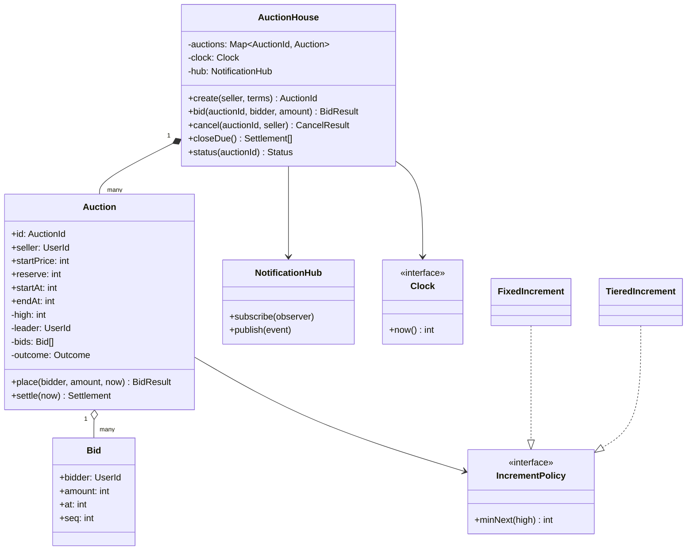
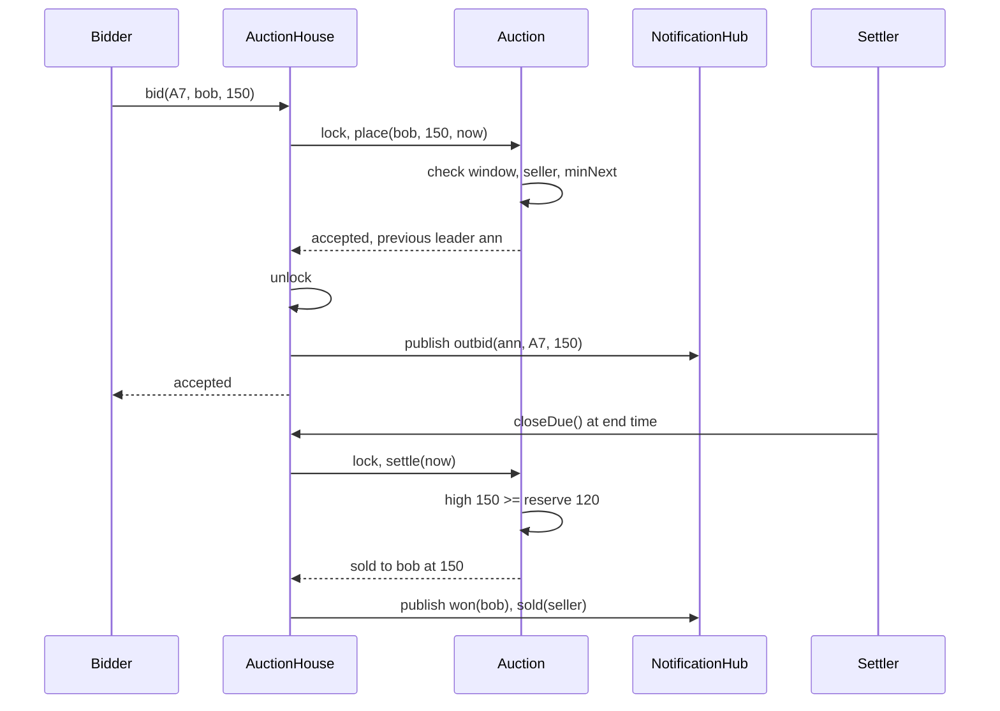

## In one minute
- An auction is a small state machine with a deadline: scheduled, open, ended, then exactly one of sold, unsold or cancelled. Most bugs come from code that reads the state from two places (a stored flag and the clock) and gets two different answers.
- A bid is a request, not a fact. The auction object decides whether it is accepted, and every rule (open window, own listing, minimum increment) runs inside one critical section on that one auction.
- Settlement is a separate, idempotent step driven by the clock. "The end time passed" and "the winner was recorded" are different moments, and the model should name the gap between them.
- People who need to know about changes (outbid bidders, the seller, the winner) subscribe to events. Notification delivery stays outside the lock, so a slow email gateway cannot stall bidding.
- The problem shape is **contention plus a deadline**: many writers race on one row until a time boundary, then a single writer finalises. The same shape appears in exam submission portals, sprint planning poker and limit-order expiry.

## Requirements

Functional:
- A seller creates a listing with a start price, a hidden reserve price, a minimum bid increment, a start time and an end time.
- Bidders place bids while the auction is open. The first bid must be at least the start price; each later bid must beat the current high bid by at least the increment. Sellers cannot bid on their own listings.
- A seller may cancel a listing until the first bid arrives. After that, the auction runs to its end.
- When the end time passes, the system settles the auction: sold to the high bidder if the reserve is met, otherwise unsold.
- The previous leader is told when they are outbid; the seller and winner are told the result.

Non-functional:
- Exactly one winner per auction, and the winning amount is one that was accepted while the auction was open.
- Deterministic and auditable: given the bid log and the clock readings, anyone can recompute the outcome.
- Bidding stays responsive on a hot listing in its last minute.

Out of scope for the interview: proxy (maximum) bidding, anti-sniping extensions, payments and shipping. The [Design Online Auction System](../sdi/design-online-auction-system.md) system design lesson covers proxy bids, soft close, partitioning and watcher fan-out. This lesson is about the object model and the in-process behaviour that sits inside one of those partitions.

## Entities and relationships

- **AuctionHouse** is the façade. It creates listings, routes bids and cancellations to the right auction, runs settlement and owns the notification hub. It is the only object callers touch.
- **Auction** holds the listing terms and the live bidding state: seller, start price, reserve, increment, start and end times, the high bid, the leader, the bid count and a terminal outcome. It is the unit of contention and the place where every bidding rule lives.
- **Bid** is an immutable value: auction id, bidder, amount, accepted time and a sequence number.
- **Outcome** is the terminal state: sold (winner, price), unsold, or cancelled. Once set it never changes.
- **User** appears only as an id. The same person sells one item and bids on another, so a role is a relationship to an auction, not a `Seller` or `Bidder` class.
- **Clock** supplies the time. **NotificationHub** is the subject that observers (email, push, in-app inbox) subscribe to.
- **IncrementPolicy** answers "what is the minimum next bid?". A fixed increment is the simplest policy; real sites use a table that grows with the price.

The house composes auctions (they do not exist outside it). An auction aggregates its accepted bids. Bids reference users by id only, so deleting a user's profile never rewrites auction history.

## Class diagram



## Key flows

A bid that takes the lead, followed later by settlement. Notice that the hub publishes after the auction releases its lock.



## Design patterns used and why

- **State, kept light.** The lifecycle has six states but only two pieces of behaviour change with state: whether a bid or a cancel is allowed. An enum for the stored terminal outcome plus a derived status function is enough. Full State-pattern classes (`OpenAuction`, `ScheduledAuction`) earn their place only if you add Dutch or sealed-bid formats whose bidding rules differ per phase.
- **Derived versus stored state.** Scheduled, open and ended are not stored. They are computed from `now` against `startAt` and `endAt`. Only transitions that a human or the settler makes (cancelled, sold, unsold) are stored. This removes the classic bug where a cron job is late flipping `status = OPEN` and a bidder is refused at 10:00:03 on an auction that should have opened at 10:00:00.
- **Observer** for outbid, won and sold events. The auction emits events; the hub fans them out to channels.
- **Strategy** for the increment policy and, later, the auction format. Tiered increments are a table lookup behind `minNext(high)`. The same pattern fits the closing rule: eBay uses a fixed end time and Amazon's auctions extend until ten minutes pass without a bid ([Roth and Ockenfels](https://www.cs.princeton.edu/courses/archive/spr08/cos444/papers/roth_ockenfels02.pdf)).
- **Façade**: callers see `AuctionHouse` only, so swapping the in-memory map for a database repository does not touch the API.
- **Command** for the bid log. Each accepted bid is an immutable record appended in sequence; replaying the log through `place` reproduces the auction.

## Concurrency and edge cases

- **Two bids at the same amount.** Ann and Bob both bid 150 when the high is 140 with increment 10. Whichever acquires the auction's lock first leads; the second now needs 160 and gets "too low". There is no tie-break rule to write because the lock creates a total order. Without the lock, both could read 140, both pass the check, and both write "leader = me".
- **Bid at the deadline.** Decide whether the end time is inclusive. The practice code treats `now >= endAt` as closed, so a bid stamped exactly at the end is rejected. Stamp the time inside the lock, from the server clock, never from the client.
- **Late settler.** The settler may run seconds after `endAt`. In that window the auction's status is "ended": bids are refused because the clock says so, even though no outcome is stored yet. Settlement is idempotent: it only touches auctions without an outcome, so running it twice produces no second winner. Operators do change deadlines: after a 2001 outage eBay extended auctions that were due to end during the downtime by 24 hours ([Computerworld](https://www.computerworld.com/article/1358743/hardware-problems-shut-down-ebay-for-11-hours.html)).
- **Cancel racing a bid.** The seller presses cancel as the first bid arrives. Both operations take the same lock; whichever wins decides. If the bid wins, cancel returns "has bids". If cancel wins, the bid returns "closed".
- **Reserve not met.** The high bid is 90 and the reserve is 120. The auction is unsold, the seller is told, and the high bidder learns the reserve was not met. Never leak the reserve amount.
- **Self-outbidding.** A leader may raise their own bid; it sends no outbid notice.
- **Money.** Integer minor units (cents). An increment of 0.10 in floating point eventually produces a bid of 150.00000000000003.

## In the wild
- **eBay, 2001: a 10-hour outage and a 24-hour extension.** On 3 January 2001 a hardware failure in a shared-disk backup system took eBay down from about 11:34 a.m. to 9:56 p.m. Pacific time. Auctions scheduled to end during the downtime were extended by 24 hours and refunds were promised on affected items. The deadline was a business decision made by the operator, which is why `endAt` is data that can be changed and why the settler must re-check it ([Computerworld](https://www.computerworld.com/article/1358743/hardware-problems-shut-down-ebay-for-11-hours.html)).
- **Amazon versus eBay auctions, 2002: the ending rule changes behaviour.** In the Roth and Ockenfels study, eBay closed at a fixed time and Amazon extended until ten minutes passed with no bid. Late bids made up a much larger share of eBay auctions, and the paper finds the strategic gain from sniping is removed or reduced by automatic extension. The rule is policy, so keep it a strategy ([paper](https://www.cs.princeton.edu/courses/archive/spr08/cos444/papers/roth_ockenfels02.pdf)).

## Down the stack

### Layer 1: The contract
`bid` returns one of accepted, too low, not open, closed or own listing, and only "accepted" changes state. An accepted bid is at least the start price (first bid) or at least the previous high plus the increment, and it was stamped strictly before `endAt`. `cancel` succeeds only for the seller, before any bid and before the end. `closeDue` assigns each ended auction exactly one terminal outcome, and a second call returns nothing for auctions already settled. Notifications are at-least-once and may lag; the auction state is the source of truth.

### Layer 2: The mechanism
In memory, a hash map from auction id to auction, and one mutex per auction rather than one for the whole house, so a rush on one listing does not slow the others. Settlement keeps a min-heap keyed by `(endAt, creation sequence)`; `closeDue` pops while the top is due and skips anything already cancelled. In a database, the auction row carries `high_amount`, `leader_id` and a `version`, and a bid is a conditional update: `UPDATE auction SET high_amount = $1, leader_id = $2, version = version + 1 WHERE id = $3 AND version = $4 AND end_at > now()`. Zero rows updated means someone else got there first or the auction ended; reload and re-evaluate. This relies on the isolation level: under Read Committed a waiting `UPDATE` re-checks its `WHERE` against the newly committed row version, while under Repeatable Read it fails with "could not serialize access due to concurrent update" (SQLSTATE 40001) and the whole transaction must be retried ([Postgres docs](https://www.postgresql.org/docs/current/transaction-iso.html)). The bid itself is inserted into a `bid` table in the same transaction, so the log and the high bid never disagree. Settlement uses `SELECT ... WHERE end_at <= now() AND outcome IS NULL FOR UPDATE SKIP LOCKED`, so several settler workers can share the queue without two of them settling the same auction. Postgres documents `SKIP LOCKED` as giving an inconsistent view, unsuitable for general queries but fine for queue-like tables ([Postgres docs](https://www.postgresql.org/docs/current/sql-select.html)).

### Layer 3: The machine
An uncontended mutex costs tens of nanoseconds. Contended, a waiting goroutine or thread sleeps on a futex and wakes in a few microseconds. A hot auction might see 50 bids per second in its last minute, which is one bid every 20 ms; the critical section (a few comparisons and an append) takes under a microsecond, so even the hottest listing keeps the lock idle more than 99.99% of the time. The database path is dominated by the commit: a write-ahead log flush is roughly 0.1 to 1 ms on NVMe. The clock matters more than the CPU: wall clocks drift and NTP can step them, so the deadline comparison should use one authoritative clock per auction (the owning server or the database's `now()`), not each app server's.

### Why it's built this way
1. Money and reputation ride on "who won", so the winner must be a function of one ordered log.
2. Ordering needs a single serialisation point per auction, so every rule runs under that auction's lock or row version.
3. Auctions are independent, so the lock is per auction and the system scales by count of auctions, not by speed of one.
4. Deadlines are judged by a clock, and background jobs are late, so open or closed is derived from the clock while only human or settler decisions are stored.
5. Notification channels are slow and flaky, so they sit behind an observer outside the lock and may retry without affecting bids.

## Extensibility

- **Proxy bidding:** the auction stores each bidder's maximum and computes the visible price. The `place` method changes; the façade, settlement and notifications do not. The sdi lesson walks through the arithmetic.
- **Anti-sniping (soft close):** a bid within the last few minutes extends `endAt`. Roth and Ockenfels compared eBay's hard close with Amazon's rule of extending until ten minutes pass without a bid, and found far more last-minute bidding on eBay ([paper](https://www.cs.princeton.edu/courses/archive/spr08/cos444/papers/roth_ockenfels02.pdf)). Because status is derived from `endAt`, extension is one assignment. The settler's heap now holds stale entries; on pop, re-check the auction's current `endAt` and push it back if it moved.
- **Sealed-bid or Dutch formats:** introduce an `AuctionFormat` strategy with `place` and `settle`. A Vickrey (second-price sealed) auction stores bids privately and settles at the second-highest amount.

## Leadership lens

- Build first: the single-auction core with the lock, the derived status and an idempotent settle, plus a test that fires two equal bids and asserts exactly one wins. Notifications can be wrong for a day; a second winner cannot be undone without a refund and an apology.
- Ask in review: what clock decides the deadline; what happens if the settler is down for ten minutes; can the bid log alone reproduce the winner; where does the reserve price appear in logs.
- Increment tables, cancellation windows and soft close change often; keep them as data or strategies so a policy change is a config review, not a release.
- Operationally, the support team's question is always "why did I lose". Give them a read-only view of the bid log with timestamps and rejected bids, so engineers are not pulled into every dispute.

## Check yourself
1. Why derive "open" from the clock instead of storing it and flipping it with a scheduled job?
   **Answer:** A scheduled job runs late, so a stored flag is wrong for a while after every boundary. Deriving it from `startAt` and `endAt` makes the answer correct at any instant, and only real decisions (cancel, settle) need stored state.
2. Two bidders send 150 at the same millisecond when the high bid is 140 and the increment is 10. What happens and why?
   **Answer:** Both bids are serialised by the auction's lock. The first is accepted and raises the minimum next bid to 160, so the second is rejected as too low.
3. The settler crashes after recording "sold" but before sending the winner's email. What happens on restart?
   **Answer:** The outcome is stored, so settlement skips the auction and never picks a second winner. The email must come from a durable outbox written in the same transaction as the outcome, which a relay retries.
4. Why should `Seller` and `Bidder` not be subclasses of `User`?
   **Answer:** The same person plays both roles on different auctions, and a role is a relationship to one auction. Subclasses would force one role per object or awkward multiple inheritance.

## Practice
**Task:** Implement `AuctionHouse(clock)`, where the clock has `now()` returning integer seconds. `create(seller, start_price, reserve, increment, start_at, end_at)` returns ids `A1`, `A2` and so on, and fails if `start_price < 1`, `increment < 1`, `reserve < 0` or `end_at <= start_at`. `bid(auction_id, bidder, amount)` returns `"closed"` (cancelled, settled or `now >= end_at`), `"not_open"` (`now < start_at`), `"own_listing"`, `"too_low"` (first bid under the start price, or a later bid under high plus increment) or `"accepted"`, checked in that order; when a different bidder takes the lead the old leader gets `outbid:<id>:<amount>`. `cancel(auction_id, seller)` returns `"not_owner"`, `"closed"`, `"has_bids"` or `"cancelled"`, in that order. `close_due()` settles every unsettled, uncancelled auction with `end_at <= now`, ordered by end time then creation order, returning `<id>:sold:<winner>:<price>` or `<id>:unsold`, and notifies `won:<id>:<price>` and `sold:<id>:<price>` (seller), or `unsold:<id>` (seller) plus `reserve_not_met:<id>` (leader, if any). `status(id)` is `scheduled`, `open`, `ended`, `sold`, `unsold` or `cancelled`; `notifications(user)` returns and clears that user's messages. Unknown auction ids fail.

```python starter
class AuctionHouse:
    def __init__(self, clock):
        self._clock = clock

    def create(self, seller, start_price, reserve, increment, start_at, end_at):
        # TODO: validate terms and return "A1", "A2", ...
        raise NotImplementedError

    def bid(self, auction_id, bidder, amount):
        # TODO: closed, not_open, own_listing, too_low, accepted (in that order)
        raise NotImplementedError

    def cancel(self, auction_id, seller):
        raise NotImplementedError

    def close_due(self):
        raise NotImplementedError

    def status(self, auction_id):
        raise NotImplementedError

    def notifications(self, user):
        raise NotImplementedError
```

```python tests
class FakeClock:
    def __init__(self):
        self.t = 0

    def now(self):
        return self.t


def raises(fn):
    try:
        fn()
    except ValueError:
        return True
    return False


def test_lifecycle_status_and_window():
    c = FakeClock()
    h = AuctionHouse(c)
    a = h.create("sam", 100, 0, 10, 10, 100)
    assert a == "A1"
    assert h.status(a) == "scheduled"
    assert h.bid(a, "ann", 100) == "not_open"
    c.t = 10
    assert h.status(a) == "open"
    assert h.bid(a, "ann", 100) == "accepted"
    c.t = 100
    assert h.status(a) == "ended"
    assert h.bid(a, "bob", 500) == "closed", "end time is exclusive"


def test_increment_and_own_listing():
    c = FakeClock()
    h = AuctionHouse(c)
    a = h.create("sam", 100, 0, 10, 0, 100)
    assert h.bid(a, "ann", 99) == "too_low"
    assert h.bid(a, "sam", 500) == "own_listing"
    assert h.bid(a, "ann", 100) == "accepted"
    assert h.bid(a, "bob", 109) == "too_low"
    assert h.bid(a, "bob", 110) == "accepted"
    assert h.bid(a, "ann", 110) == "too_low", "equal bid loses to the earlier one"


def test_outbid_notifications():
    c = FakeClock()
    h = AuctionHouse(c)
    a = h.create("sam", 100, 0, 10, 0, 100)
    h.bid(a, "ann", 100)
    h.bid(a, "ann", 120)
    assert h.notifications("ann") == [], "raising your own bid is silent"
    h.bid(a, "bob", 150)
    assert h.notifications("ann") == ["outbid:A1:150"]
    assert h.notifications("ann") == [], "drained"


def test_settlement_sold_unsold_and_order():
    c = FakeClock()
    h = AuctionHouse(c)
    a1 = h.create("sam", 100, 120, 10, 0, 50)
    a2 = h.create("sue", 100, 120, 10, 0, 40)
    a3 = h.create("sam", 100, 0, 10, 0, 40)
    a4 = h.create("sam", 100, 0, 10, 0, 500)
    h.bid(a1, "ann", 130)
    h.bid(a2, "bob", 110)
    c.t = 60
    assert h.close_due() == ["A2:unsold", "A3:unsold", "A1:sold:ann:130"]
    assert h.close_due() == [], "idempotent"
    assert h.status(a1) == "sold" and h.status(a2) == "unsold" and h.status(a4) == "open"
    assert h.notifications("ann") == ["won:A1:130"]
    assert h.notifications("bob") == ["reserve_not_met:A2"]
    assert h.notifications("sue") == ["unsold:A2"]
    assert h.notifications("sam") == ["unsold:A3", "sold:A1:130"]
    assert h.bid(a1, "bob", 999) == "closed"


def test_cancel_rules():
    c = FakeClock()
    h = AuctionHouse(c)
    a = h.create("sam", 100, 0, 10, 0, 100)
    b = h.create("sam", 100, 0, 10, 0, 100)
    assert h.cancel(a, "bob") == "not_owner"
    assert h.cancel(a, "sam") == "cancelled"
    assert h.status(a) == "cancelled"
    assert h.bid(a, "ann", 100) == "closed"
    assert h.cancel(a, "sam") == "closed"
    h.bid(b, "ann", 100)
    assert h.cancel(b, "sam") == "has_bids"
    c.t = 200
    assert h.close_due() == ["A2:sold:ann:100"], "cancelled auctions are not settled"


def test_validation_and_unknown():
    h = AuctionHouse(FakeClock())
    assert raises(lambda: h.create("s", 0, 0, 10, 0, 10))
    assert raises(lambda: h.create("s", 10, 0, 0, 0, 10))
    assert raises(lambda: h.create("s", 10, -1, 1, 0, 10))
    assert raises(lambda: h.create("s", 10, 0, 1, 10, 10))
    assert raises(lambda: h.bid("A9", "ann", 100))
    assert raises(lambda: h.status("A9"))
    assert h.create("s", 10, 0, 1, 0, 10) == "A1", "failed creates use no id"
```

```python solution
import heapq

TERMINAL = ("sold", "unsold", "cancelled")


class _Auction:
    def __init__(self, auction_id, seq, seller, start_price, reserve, increment, start_at, end_at):
        self.id = auction_id
        self.seq = seq
        self.seller = seller
        self.start_price = start_price
        self.reserve = reserve
        self.increment = increment
        self.start_at = start_at
        self.end_at = end_at
        self.high = 0
        self.leader = None
        self.bids = []
        self.outcome = None


class AuctionHouse:
    def __init__(self, clock):
        self._clock = clock
        self._auctions = {}
        self._due = []
        self._inbox = {}

    def _notify(self, user, msg):
        self._inbox.setdefault(user, []).append(msg)

    def _get(self, auction_id):
        a = self._auctions.get(auction_id)
        if a is None:
            raise ValueError("unknown auction: " + str(auction_id))
        return a

    def create(self, seller, start_price, reserve, increment, start_at, end_at):
        if start_price < 1 or increment < 1 or reserve < 0 or end_at <= start_at:
            raise ValueError("invalid listing")
        seq = len(self._auctions) + 1
        a = _Auction("A" + str(seq), seq, seller, start_price, reserve, increment,
                     start_at, end_at)
        self._auctions[a.id] = a
        heapq.heappush(self._due, (end_at, seq, a.id))
        return a.id

    def status(self, auction_id):
        a = self._get(auction_id)
        if a.outcome is not None:
            return a.outcome
        now = self._clock.now()
        if now < a.start_at:
            return "scheduled"
        if now < a.end_at:
            return "open"
        return "ended"

    def bid(self, auction_id, bidder, amount):
        a = self._get(auction_id)
        now = self._clock.now()
        if a.outcome is not None or now >= a.end_at:
            return "closed"
        if now < a.start_at:
            return "not_open"
        if bidder == a.seller:
            return "own_listing"
        minimum = a.start_price if a.leader is None else a.high + a.increment
        if amount < minimum:
            return "too_low"
        previous = a.leader
        a.high = amount
        a.leader = bidder
        a.bids.append((bidder, amount, now))
        if previous is not None and previous != bidder:
            self._notify(previous, "outbid:%s:%d" % (a.id, amount))
        return "accepted"

    def cancel(self, auction_id, seller):
        a = self._get(auction_id)
        if seller != a.seller:
            return "not_owner"
        if a.outcome is not None or self._clock.now() >= a.end_at:
            return "closed"
        if a.bids:
            return "has_bids"
        a.outcome = "cancelled"
        return "cancelled"

    def close_due(self):
        now = self._clock.now()
        results = []
        while self._due and self._due[0][0] <= now:
            _, _, auction_id = heapq.heappop(self._due)
            a = self._auctions[auction_id]
            if a.outcome is not None:
                continue
            if a.leader is not None and a.high >= a.reserve:
                a.outcome = "sold"
                results.append("%s:sold:%s:%d" % (a.id, a.leader, a.high))
                self._notify(a.leader, "won:%s:%d" % (a.id, a.high))
                self._notify(a.seller, "sold:%s:%d" % (a.id, a.high))
            else:
                a.outcome = "unsold"
                results.append(a.id + ":unsold")
                self._notify(a.seller, "unsold:" + a.id)
                if a.leader is not None:
                    self._notify(a.leader, "reserve_not_met:" + a.id)
        return results

    def notifications(self, user):
        return self._inbox.pop(user, [])
```

```typescript starter
export interface Clock { now(): number }

export class AuctionHouse {
  constructor(private clock: Clock) {}

  create(seller: string, startPrice: number, reserve: number, increment: number,
         startAt: number, endAt: number): string {
    throw new Error("TODO");
  }

  bid(auctionId: string, bidder: string, amount: number): string {
    throw new Error("TODO");
  }

  cancel(auctionId: string, seller: string): string {
    throw new Error("TODO");
  }

  closeDue(): string[] {
    throw new Error("TODO");
  }

  status(auctionId: string): string {
    throw new Error("TODO");
  }

  notifications(user: string): string[] {
    throw new Error("TODO");
  }
}
```

```typescript tests
class FakeClock implements Clock {
  t = 0;
  now(): number { return this.t; }
}

function throwsErr(fn: () => void): boolean {
  try { fn(); return false; } catch (e) { return true; }
}

test("lifecycle status and window", () => {
  const c = new FakeClock();
  const h = new AuctionHouse(c);
  const a = h.create("sam", 100, 0, 10, 10, 100);
  assertEqual(a, "A1");
  assertEqual(h.status(a), "scheduled");
  assertEqual(h.bid(a, "ann", 100), "not_open");
  c.t = 10;
  assertEqual(h.status(a), "open");
  assertEqual(h.bid(a, "ann", 100), "accepted");
  c.t = 100;
  assertEqual(h.status(a), "ended");
  assertEqual(h.bid(a, "bob", 500), "closed", "end time is exclusive");
});

test("increment and own listing", () => {
  const h = new AuctionHouse(new FakeClock());
  const a = h.create("sam", 100, 0, 10, 0, 100);
  assertEqual(h.bid(a, "ann", 99), "too_low");
  assertEqual(h.bid(a, "sam", 500), "own_listing");
  assertEqual(h.bid(a, "ann", 100), "accepted");
  assertEqual(h.bid(a, "bob", 109), "too_low");
  assertEqual(h.bid(a, "bob", 110), "accepted");
  assertEqual(h.bid(a, "ann", 110), "too_low", "equal bid loses to the earlier one");
});

test("outbid notifications", () => {
  const h = new AuctionHouse(new FakeClock());
  const a = h.create("sam", 100, 0, 10, 0, 100);
  h.bid(a, "ann", 100);
  h.bid(a, "ann", 120);
  assertEqual(h.notifications("ann"), [], "raising your own bid is silent");
  h.bid(a, "bob", 150);
  assertEqual(h.notifications("ann"), ["outbid:A1:150"]);
  assertEqual(h.notifications("ann"), [], "drained");
});

test("settlement sold unsold and order", () => {
  const c = new FakeClock();
  const h = new AuctionHouse(c);
  const a1 = h.create("sam", 100, 120, 10, 0, 50);
  const a2 = h.create("sue", 100, 120, 10, 0, 40);
  h.create("sam", 100, 0, 10, 0, 40);
  const a4 = h.create("sam", 100, 0, 10, 0, 500);
  h.bid(a1, "ann", 130);
  h.bid(a2, "bob", 110);
  c.t = 60;
  assertEqual(h.closeDue(), ["A2:unsold", "A3:unsold", "A1:sold:ann:130"]);
  assertEqual(h.closeDue(), [], "idempotent");
  assertEqual([h.status(a1), h.status(a2), h.status(a4)], ["sold", "unsold", "open"]);
  assertEqual(h.notifications("ann"), ["won:A1:130"]);
  assertEqual(h.notifications("bob"), ["reserve_not_met:A2"]);
  assertEqual(h.notifications("sue"), ["unsold:A2"]);
  assertEqual(h.notifications("sam"), ["unsold:A3", "sold:A1:130"]);
  assertEqual(h.bid(a1, "bob", 999), "closed");
});

test("cancel rules", () => {
  const c = new FakeClock();
  const h = new AuctionHouse(c);
  const a = h.create("sam", 100, 0, 10, 0, 100);
  const b = h.create("sam", 100, 0, 10, 0, 100);
  assertEqual(h.cancel(a, "bob"), "not_owner");
  assertEqual(h.cancel(a, "sam"), "cancelled");
  assertEqual(h.status(a), "cancelled");
  assertEqual(h.bid(a, "ann", 100), "closed");
  assertEqual(h.cancel(a, "sam"), "closed");
  h.bid(b, "ann", 100);
  assertEqual(h.cancel(b, "sam"), "has_bids");
  c.t = 200;
  assertEqual(h.closeDue(), ["A2:sold:ann:100"], "cancelled auctions are not settled");
});

test("validation and unknown", () => {
  const h = new AuctionHouse(new FakeClock());
  assert(throwsErr(() => h.create("s", 0, 0, 10, 0, 10)), "start price");
  assert(throwsErr(() => h.create("s", 10, 0, 0, 0, 10)), "increment");
  assert(throwsErr(() => h.create("s", 10, -1, 1, 0, 10)), "reserve");
  assert(throwsErr(() => h.create("s", 10, 0, 1, 10, 10)), "window");
  assert(throwsErr(() => h.bid("A9", "ann", 100)), "unknown bid");
  assert(throwsErr(() => h.status("A9")), "unknown status");
  assertEqual(h.create("s", 10, 0, 1, 0, 10), "A1", "failed creates use no id");
});
```

```typescript solution
export interface Clock { now(): number }

interface Auction {
  id: string;
  seq: number;
  seller: string;
  startPrice: number;
  reserve: number;
  increment: number;
  startAt: number;
  endAt: number;
  high: number;
  leader: string | null;
  bidCount: number;
  outcome: string | null;
}

export class AuctionHouse {
  private auctions = new Map<string, Auction>();
  private inbox = new Map<string, string[]>();

  constructor(private clock: Clock) {}

  private notify(user: string, msg: string): void {
    const list = this.inbox.get(user) ?? [];
    list.push(msg);
    this.inbox.set(user, list);
  }

  private get(auctionId: string): Auction {
    const a = this.auctions.get(auctionId);
    if (!a) throw new Error("unknown auction: " + auctionId);
    return a;
  }

  create(seller: string, startPrice: number, reserve: number, increment: number,
         startAt: number, endAt: number): string {
    if (startPrice < 1 || increment < 1 || reserve < 0 || endAt <= startAt) {
      throw new Error("invalid listing");
    }
    const seq = this.auctions.size + 1;
    const a: Auction = { id: "A" + seq, seq, seller, startPrice, reserve, increment, startAt,
      endAt, high: 0, leader: null, bidCount: 0, outcome: null };
    this.auctions.set(a.id, a);
    return a.id;
  }

  status(auctionId: string): string {
    const a = this.get(auctionId);
    if (a.outcome !== null) return a.outcome;
    const now = this.clock.now();
    if (now < a.startAt) return "scheduled";
    return now < a.endAt ? "open" : "ended";
  }

  bid(auctionId: string, bidder: string, amount: number): string {
    const a = this.get(auctionId);
    const now = this.clock.now();
    if (a.outcome !== null || now >= a.endAt) return "closed";
    if (now < a.startAt) return "not_open";
    if (bidder === a.seller) return "own_listing";
    const minimum = a.leader === null ? a.startPrice : a.high + a.increment;
    if (amount < minimum) return "too_low";
    const previous = a.leader;
    a.high = amount;
    a.leader = bidder;
    a.bidCount++;
    if (previous !== null && previous !== bidder) this.notify(previous, `outbid:${a.id}:${amount}`);
    return "accepted";
  }

  cancel(auctionId: string, seller: string): string {
    const a = this.get(auctionId);
    if (seller !== a.seller) return "not_owner";
    if (a.outcome !== null || this.clock.now() >= a.endAt) return "closed";
    if (a.bidCount > 0) return "has_bids";
    a.outcome = "cancelled";
    return "cancelled";
  }

  closeDue(): string[] {
    const now = this.clock.now();
    const due = [...this.auctions.values()]
      .filter((a) => a.outcome === null && a.endAt <= now)
      .sort((x, y) => x.endAt - y.endAt || x.seq - y.seq);
    const results: string[] = [];
    for (const a of due) {
      if (a.leader !== null && a.high >= a.reserve) {
        a.outcome = "sold";
        results.push(`${a.id}:sold:${a.leader}:${a.high}`);
        this.notify(a.leader, `won:${a.id}:${a.high}`);
        this.notify(a.seller, `sold:${a.id}:${a.high}`);
      } else {
        a.outcome = "unsold";
        results.push(`${a.id}:unsold`);
        this.notify(a.seller, `unsold:${a.id}`);
        if (a.leader !== null) this.notify(a.leader, `reserve_not_met:${a.id}`);
      }
    }
    return results;
  }

  notifications(user: string): string[] {
    const list = this.inbox.get(user) ?? [];
    this.inbox.delete(user);
    return list;
  }
}
```

```go starter
package practice

import "errors"

var (
	ErrInvalidListing = errors.New("invalid listing")
	ErrUnknownAuction = errors.New("unknown auction")
)

type Clock interface{ Now() int64 }

type AuctionHouse struct{}

func NewAuctionHouse(clock Clock) *AuctionHouse {
	return &AuctionHouse{}
}

func (h *AuctionHouse) Create(seller string, startPrice, reserve, increment, startAt, endAt int64) (string, error) {
	panic("TODO")
}

func (h *AuctionHouse) Bid(auctionID, bidder string, amount int64) (string, error) {
	panic("TODO")
}

func (h *AuctionHouse) Cancel(auctionID, seller string) (string, error) {
	panic("TODO")
}

func (h *AuctionHouse) CloseDue() []string {
	panic("TODO")
}

func (h *AuctionHouse) Status(auctionID string) (string, error) {
	panic("TODO")
}

func (h *AuctionHouse) Notifications(user string) []string {
	panic("TODO")
}
```

```go tests
package practice

import (
	"errors"
	"testing"
)

type fakeClock struct{ t int64 }

func (c *fakeClock) Now() int64 { return c.t }

func mustCreate(t *testing.T, h *AuctionHouse, seller string, start, reserve, inc, from, to int64) string {
	t.Helper()
	id, err := h.Create(seller, start, reserve, inc, from, to)
	if err != nil {
		t.Fatalf("create: %v", err)
	}
	return id
}

func bidIs(t *testing.T, h *AuctionHouse, id, bidder string, amount int64, want string) {
	t.Helper()
	got, err := h.Bid(id, bidder, amount)
	if err != nil || got != want {
		t.Fatalf("bid %s %s %d: got %q err=%v want %q", id, bidder, amount, got, err, want)
	}
}

func statusIs(t *testing.T, h *AuctionHouse, id, want string) {
	t.Helper()
	if got, err := h.Status(id); err != nil || got != want {
		t.Fatalf("status %s: got %q err=%v want %q", id, got, err, want)
	}
}

func sameList(a, b []string) bool {
	if len(a) != len(b) {
		return false
	}
	for i := range a {
		if a[i] != b[i] {
			return false
		}
	}
	return true
}

func TestLifecycleStatusAndWindow(t *testing.T) {
	c := &fakeClock{}
	h := NewAuctionHouse(c)
	a := mustCreate(t, h, "sam", 100, 0, 10, 10, 100)
	if a != "A1" {
		t.Fatalf("id %s", a)
	}
	statusIs(t, h, a, "scheduled")
	bidIs(t, h, a, "ann", 100, "not_open")
	c.t = 10
	statusIs(t, h, a, "open")
	bidIs(t, h, a, "ann", 100, "accepted")
	c.t = 100
	statusIs(t, h, a, "ended")
	bidIs(t, h, a, "bob", 500, "closed")
}

func TestIncrementAndOwnListing(t *testing.T) {
	h := NewAuctionHouse(&fakeClock{})
	a := mustCreate(t, h, "sam", 100, 0, 10, 0, 100)
	bidIs(t, h, a, "ann", 99, "too_low")
	bidIs(t, h, a, "sam", 500, "own_listing")
	bidIs(t, h, a, "ann", 100, "accepted")
	bidIs(t, h, a, "bob", 109, "too_low")
	bidIs(t, h, a, "bob", 110, "accepted")
	bidIs(t, h, a, "ann", 110, "too_low")
}

func TestOutbidNotifications(t *testing.T) {
	h := NewAuctionHouse(&fakeClock{})
	a := mustCreate(t, h, "sam", 100, 0, 10, 0, 100)
	bidIs(t, h, a, "ann", 100, "accepted")
	bidIs(t, h, a, "ann", 120, "accepted")
	if got := h.Notifications("ann"); len(got) != 0 {
		t.Fatalf("raising own bid notified: %v", got)
	}
	bidIs(t, h, a, "bob", 150, "accepted")
	if got := h.Notifications("ann"); !sameList(got, []string{"outbid:A1:150"}) {
		t.Fatalf("got %v", got)
	}
	if got := h.Notifications("ann"); len(got) != 0 {
		t.Fatalf("not drained: %v", got)
	}
}

func TestSettlementSoldUnsoldAndOrder(t *testing.T) {
	c := &fakeClock{}
	h := NewAuctionHouse(c)
	a1 := mustCreate(t, h, "sam", 100, 120, 10, 0, 50)
	a2 := mustCreate(t, h, "sue", 100, 120, 10, 0, 40)
	mustCreate(t, h, "sam", 100, 0, 10, 0, 40)
	a4 := mustCreate(t, h, "sam", 100, 0, 10, 0, 500)
	bidIs(t, h, a1, "ann", 130, "accepted")
	bidIs(t, h, a2, "bob", 110, "accepted")
	c.t = 60
	if got := h.CloseDue(); !sameList(got, []string{"A2:unsold", "A3:unsold", "A1:sold:ann:130"}) {
		t.Fatalf("got %v", got)
	}
	if got := h.CloseDue(); len(got) != 0 {
		t.Fatalf("not idempotent: %v", got)
	}
	statusIs(t, h, a1, "sold")
	statusIs(t, h, a2, "unsold")
	statusIs(t, h, a4, "open")
	checks := map[string][]string{
		"ann": {"won:A1:130"},
		"bob": {"reserve_not_met:A2"},
		"sue": {"unsold:A2"},
		"sam": {"unsold:A3", "sold:A1:130"},
	}
	for user, want := range checks {
		if got := h.Notifications(user); !sameList(got, want) {
			t.Fatalf("%s: got %v want %v", user, got, want)
		}
	}
	bidIs(t, h, a1, "bob", 999, "closed")
}

func TestCancelRules(t *testing.T) {
	c := &fakeClock{}
	h := NewAuctionHouse(c)
	a := mustCreate(t, h, "sam", 100, 0, 10, 0, 100)
	b := mustCreate(t, h, "sam", 100, 0, 10, 0, 100)
	steps := []struct{ who, want string }{{"bob", "not_owner"}, {"sam", "cancelled"}, {"sam", "closed"}}
	for _, s := range steps {
		if got, err := h.Cancel(a, s.who); err != nil || got != s.want {
			t.Fatalf("cancel by %s: got %q err=%v want %q", s.who, got, err, s.want)
		}
	}
	statusIs(t, h, a, "cancelled")
	bidIs(t, h, a, "ann", 100, "closed")
	bidIs(t, h, b, "ann", 100, "accepted")
	if got, _ := h.Cancel(b, "sam"); got != "has_bids" {
		t.Fatalf("got %q", got)
	}
	c.t = 200
	if got := h.CloseDue(); !sameList(got, []string{"A2:sold:ann:100"}) {
		t.Fatalf("got %v", got)
	}
}

func TestValidationAndUnknown(t *testing.T) {
	h := NewAuctionHouse(&fakeClock{})
	bad := [][5]int64{{0, 0, 10, 0, 10}, {10, 0, 0, 0, 10}, {10, -1, 1, 0, 10}, {10, 0, 1, 10, 10}}
	for _, b := range bad {
		if _, err := h.Create("s", b[0], b[1], b[2], b[3], b[4]); !errors.Is(err, ErrInvalidListing) {
			t.Fatalf("%v: want ErrInvalidListing, got %v", b, err)
		}
	}
	if _, err := h.Bid("A9", "ann", 100); !errors.Is(err, ErrUnknownAuction) {
		t.Fatalf("want ErrUnknownAuction, got %v", err)
	}
	if _, err := h.Status("A9"); !errors.Is(err, ErrUnknownAuction) {
		t.Fatalf("want ErrUnknownAuction, got %v", err)
	}
	if id := mustCreate(t, h, "s", 10, 0, 1, 0, 10); id != "A1" {
		t.Fatalf("failed creates used an id: %s", id)
	}
}
```

```go solution
package practice

import (
	"errors"
	"fmt"
	"sort"
	"sync"
)

var (
	ErrInvalidListing = errors.New("invalid listing")
	ErrUnknownAuction = errors.New("unknown auction")
)

type Clock interface{ Now() int64 }

type auction struct {
	mu                             sync.Mutex
	id                             string
	seq                            int
	seller                         string
	startPrice, reserve, increment int64
	startAt, endAt                 int64
	high                           int64
	leader                         string
	bids                           int
	outcome                        string
}

type AuctionHouse struct {
	mu       sync.Mutex // guards the map and the inbox; each auction has its own lock
	clock    Clock
	auctions map[string]*auction
	order    []*auction
	inbox    map[string][]string
}

func NewAuctionHouse(clock Clock) *AuctionHouse {
	return &AuctionHouse{clock: clock, auctions: map[string]*auction{}, inbox: map[string][]string{}}
}

func (h *AuctionHouse) notify(user, msg string) {
	h.mu.Lock()
	defer h.mu.Unlock()
	h.inbox[user] = append(h.inbox[user], msg)
}

func (h *AuctionHouse) get(id string) (*auction, error) {
	h.mu.Lock()
	defer h.mu.Unlock()
	a, ok := h.auctions[id]
	if !ok {
		return nil, fmt.Errorf("%w: %s", ErrUnknownAuction, id)
	}
	return a, nil
}

func (h *AuctionHouse) Create(seller string, startPrice, reserve, increment, startAt, endAt int64) (string, error) {
	if startPrice < 1 || increment < 1 || reserve < 0 || endAt <= startAt {
		return "", ErrInvalidListing
	}
	h.mu.Lock()
	defer h.mu.Unlock()
	seq := len(h.order) + 1
	a := &auction{id: fmt.Sprintf("A%d", seq), seq: seq, seller: seller, startPrice: startPrice,
		reserve: reserve, increment: increment, startAt: startAt, endAt: endAt}
	h.auctions[a.id] = a
	h.order = append(h.order, a)
	return a.id, nil
}

func (h *AuctionHouse) Status(id string) (string, error) {
	a, err := h.get(id)
	if err != nil {
		return "", err
	}
	a.mu.Lock()
	defer a.mu.Unlock()
	now := h.clock.Now()
	switch {
	case a.outcome != "":
		return a.outcome, nil
	case now < a.startAt:
		return "scheduled", nil
	case now < a.endAt:
		return "open", nil
	}
	return "ended", nil
}

// Bid runs every rule under the auction's own lock and notifies after releasing it.
func (h *AuctionHouse) Bid(id, bidder string, amount int64) (string, error) {
	a, err := h.get(id)
	if err != nil {
		return "", err
	}
	a.mu.Lock()
	now := h.clock.Now()
	var result, outbid string
	switch {
	case a.outcome != "" || now >= a.endAt:
		result = "closed"
	case now < a.startAt:
		result = "not_open"
	case bidder == a.seller:
		result = "own_listing"
	case (a.bids == 0 && amount < a.startPrice) || (a.bids > 0 && amount < a.high+a.increment):
		result = "too_low"
	default:
		if a.bids > 0 && a.leader != bidder {
			outbid = a.leader
		}
		a.high, a.leader, result = amount, bidder, "accepted"
		a.bids++
	}
	a.mu.Unlock()
	if outbid != "" {
		h.notify(outbid, fmt.Sprintf("outbid:%s:%d", id, amount))
	}
	return result, nil
}

func (h *AuctionHouse) Cancel(id, seller string) (string, error) {
	a, err := h.get(id)
	if err != nil {
		return "", err
	}
	a.mu.Lock()
	defer a.mu.Unlock()
	switch {
	case seller != a.seller:
		return "not_owner", nil
	case a.outcome != "" || h.clock.Now() >= a.endAt:
		return "closed", nil
	case a.bids > 0:
		return "has_bids", nil
	}
	a.outcome = "cancelled"
	return "cancelled", nil
}

func (h *AuctionHouse) CloseDue() []string {
	now := h.clock.Now()
	h.mu.Lock()
	all := append([]*auction(nil), h.order...)
	h.mu.Unlock()
	sort.SliceStable(all, func(i, j int) bool { return all[i].endAt < all[j].endAt })
	results := []string{}
	for _, a := range all {
		a.mu.Lock()
		if a.outcome != "" || a.endAt > now {
			a.mu.Unlock()
			continue
		}
		var msgs [][2]string
		if a.bids > 0 && a.high >= a.reserve {
			a.outcome = "sold"
			results = append(results, fmt.Sprintf("%s:sold:%s:%d", a.id, a.leader, a.high))
			msgs = [][2]string{{a.leader, fmt.Sprintf("won:%s:%d", a.id, a.high)},
				{a.seller, fmt.Sprintf("sold:%s:%d", a.id, a.high)}}
		} else {
			a.outcome = "unsold"
			results = append(results, a.id+":unsold")
			msgs = [][2]string{{a.seller, "unsold:" + a.id}}
			if a.bids > 0 {
				msgs = append(msgs, [2]string{a.leader, "reserve_not_met:" + a.id})
			}
		}
		a.mu.Unlock()
		for _, m := range msgs {
			h.notify(m[0], m[1])
		}
	}
	return results
}

func (h *AuctionHouse) Notifications(user string) []string {
	h.mu.Lock()
	defer h.mu.Unlock()
	msgs := h.inbox[user]
	delete(h.inbox, user)
	return msgs
}
```

## Mock interview
**Prompt:** Design the classes for an online auction site where sellers list items with a start price, a hidden reserve and an end time, and buyers bid in fixed increments. Code the bid, cancel and settlement operations, and explain how you guarantee exactly one winner when the last minute of a popular auction sees 50 bids per second.

- Follow-up: Your settlement job ran 40 seconds late and a bid arrived in that window. What does your code do, and what does the bidder see?
- Follow-up: Product wants soft close: any bid in the final two minutes extends the auction by two minutes. What changes in your classes and in the settlement queue?
- Follow-up: Would you model `Seller` and `Bidder` as subclasses of `User`, and why or why not?

**A strong answer covers:**
- A state model that stores only real decisions (cancelled, sold, unsold) and derives scheduled, open and ended from an injected clock.
- One serialisation point per auction (mutex, or a versioned conditional update), with the bid validation, the high-bid update and the bid log append inside it.
- Idempotent settlement driven by a due-time queue, safe to run twice or late, with the reserve check in one place.
- Notifications through an observer or outbox, published after the lock is released, never leaking the reserve price.
- Increment rules and auction formats as strategies, and a clear plan for soft close that only changes `endAt` and re-checks heap entries on pop.
- Integer money, server-side timestamps and a replayable bid log for disputes.

## Sources and further study
**Primary**
- [Roth and Ockenfels, last-minute bidding and ending rules](https://www.cs.princeton.edu/courses/archive/spr08/cos444/papers/roth_ockenfels02.pdf): the eBay hard close versus Amazon's automatic extension, with evidence.
- [PostgreSQL: transaction isolation](https://www.postgresql.org/docs/current/transaction-iso.html): what happens to a conditional update when another transaction commits first, at each isolation level.

**Systems docs**
- [PostgreSQL: SELECT locking clause](https://www.postgresql.org/docs/current/sql-select.html): `FOR UPDATE`, `NOWAIT` and `SKIP LOCKED` for parallel settlers.
- [Computerworld: eBay outage, January 2001](https://www.computerworld.com/article/1358743/hardware-problems-shut-down-ebay-for-11-hours.html): how an operator extended auctions after downtime.

**Books**
- *Design Patterns*, Gamma, Helm, Johnson and Vlissides: chapter 5 (Behavioral), covering State, Strategy, Observer and Command.
- *Head First Design Patterns*, Freeman and Robson (2nd ed.): chapter 2 (Observer) and chapter 1 (Strategy).
- *Designing Data-Intensive Applications*, Martin Kleppmann (1st ed.): chapter 7 (Transactions), on lost updates and write races.

**Other curricula**
- [Refactoring.Guru: Strategy](https://refactoring.guru/design-patterns/strategy): frames interchangeable algorithms, as for increment policies and auction formats.
- [Refactoring.Guru: State](https://refactoring.guru/design-patterns/state): frames state objects as an answer to growing conditionals, relevant to when the auction lifecycle deserves classes.

## Watch
- [Low Level Design Question: Design an Online Auction System (Mayur Vaid)](https://www.youtube.com/watch?v=5fdKUzfMk4E): an object-oriented walkthrough that applies Observer and Strategy to the auction model.
- [Design Online Auction System in 20 Minutes (Elegant Engineer)](https://www.youtube.com/watch?v=vkVVa-JkxvM): a compact interview-style answer, useful to compare with the class-level view here.
- [Design Online Auction, System Design Mock (James Peralta)](https://www.youtube.com/watch?v=EcDQB3XtIZM): requirements and entities for the same problem from the distributed-systems side.

## Free resources
- [English auction (Wikipedia)](https://en.wikipedia.org/wiki/English_auction): the ascending open-bid format this design implements, with its variants.
- [Vickrey auction (Wikipedia)](https://en.wikipedia.org/wiki/Vickrey_auction): the sealed second-price format, a good test of whether your format strategy is general enough.
- [Auction sniping (Wikipedia)](https://en.wikipedia.org/wiki/Auction_sniping): why last-second bids happen and how soft close counters them.
- [Observer pattern (Refactoring.Guru)](https://refactoring.guru/design-patterns/observer): the pattern behind outbid and settlement notifications.
- [Explicit locking (PostgreSQL docs)](https://www.postgresql.org/docs/current/explicit-locking.html): row locks and `SKIP LOCKED`, the database form of per-auction serialisation and parallel settlement.
- [Event Sourcing (Martin Fowler)](https://martinfowler.com/eaaDev/EventSourcing.html): rebuilding state from an ordered log, the idea behind a replayable bid history.
