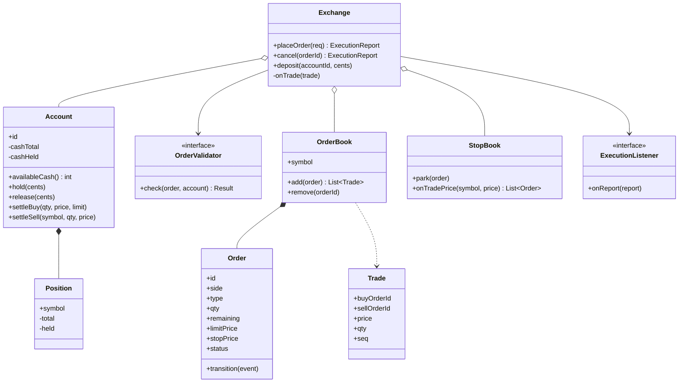
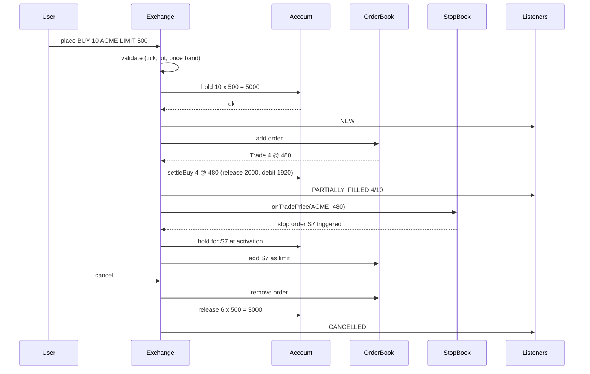

## In one minute
- Seen as an object model, an online exchange is an account ledger (cash and shares, each split into total and held), an order book, and an order lifecycle. Matching is the famous part; holds and the lifecycle are where most real bugs live.
- Reserve before you route. A buy order locks `quantity x limit price` of cash and a sell order locks the shares when it is accepted. Without holds, two orders spend the same dollar.
- Order types differ in when they become live and what price they accept. Model the differences as data plus a small set of behaviours (validation, trigger condition, price acceptance), not as a deep class hierarchy.
- Stop orders are dormant orders with a trigger. They wake on a trade, in a defined order, and must be re-checked against the account, because the money may be gone.
- This lesson is the in-process object model. For sequencers, replicated journals, multicast market data and microsecond latency, see [Design Stock Exchange](../sdi/design-stock-exchange.md).

## Requirements

Functional:
- Users have accounts with a cash balance and share positions per symbol. They can deposit cash and see what is available to trade.
- Users place market, limit, stop and stop-limit orders to buy or sell a symbol, and can cancel an order that is not yet complete.
- The exchange matches buy and sell orders per symbol, produces trades, and updates both accounts.
- Users receive execution reports (accepted, partially filled, filled, cancelled, rejected) with reasons.

Non-functional:
- No account can ever spend cash or shares it does not have, including when several orders race.
- Every state change is explainable: an order's current state is the result of an ordered list of events.
- Money and prices are integers (cents, or ticks), never floating point.
- Deterministic behaviour: the same sequence of inputs gives the same trades and the same balances.

Out of scope: margin and short selling, options, settlement with a clearing house, regulatory reporting, and the network and replication layer. Name them, then move on.

## Entities and relationships

Start by asking which nouns own state that changes under concurrent requests.

- **Account** owns cash in integer cents as two numbers: `total` and `held`. `available = total - held`. It also owns one **Position** per symbol with the same split for shares.
- **Order** is the unit of intent: id, account id, symbol, side, type, quantity, remaining, optional limit and stop prices, time in force and status. It changes only through lifecycle transitions.
- **OrderType** is an enum (MARKET, LIMIT, STOP, STOP_LIMIT). These map one-to-one onto FIX tag 40, which is how real brokers send them.
- **Hold** is the reservation an accepted order places on an account. In code it is often just the `held` counters plus the order's remaining quantity, but naming it keeps the invariant visible.
- **OrderBook** holds one symbol's resting limit orders. Its internals belong to the system design lesson; here it accepts an order and emits trades.
- **Trade** is an immutable record: buy order id, sell order id, symbol, price, quantity, sequence number.
- **StopBook** holds dormant stop orders per symbol, waiting for a trade price to cross their stop price.
- **Exchange** is the façade. It validates, places holds, routes to the book, applies trades to accounts and publishes execution reports.
- **ExecutionListener** receives reports: the user's websocket, the audit log, market data.

Relationships: an exchange aggregates accounts and books; a book is composed of resting orders. An order references its account by id, because accounts outlive orders and are locked independently. Holds belong to orders and are released when the order reaches a terminal state.

## Class diagram



## Key flows

The flow that interviewers probe is a buy limit order that partially fills, followed by a sell trade that triggers someone else's stop.



Two details in that diagram matter. The fill releases the hold at the limit price (4 x 500) but debits at the trade price (4 x 480), so the 80 cents of price improvement returns to the user immediately. And the stop order is processed after the trade that triggered it has been fully applied, never in the middle of it, so the account state it is checked against is consistent.

## Design patterns used and why

- **State** for the order lifecycle. The legal transitions are few and strict: PENDING (dormant stop) to NEW or REJECTED; NEW to PARTIALLY_FILLED, FILLED or CANCELLED; PARTIALLY_FILLED to FILLED or CANCELLED. Terminal states accept nothing. A transition table keyed by (status, event) is easier to audit than scattered `if` chains, and makes "fill on a cancelled order" an explicit error. The [State](state.md) lesson shows the class-per-state version; a table is enough here.
- **Chain of Responsibility** for pre-trade validation. Checks are independent and grow over time: positive quantity, tick grid, lot size, price band, symbol halted, account restricted, available funds. Each passes or returns a reason code; new regulation adds a link. See [Chain of Responsibility](chain-of-responsibility.md).
- **Strategy** for order-type behaviour. A market order accepts any price; a limit order accepts prices at or better than its limit; a stop order has a trigger predicate (buy stops fire when the trade price rises to the stop, sell stops when it falls to it). Encoding "accepts price" and "is triggered by" as small functions per type keeps the matching loop free of type checks.
- **Observer** for execution reports. The user channel, audit log and risk monitor all need every report; the exchange should not know they exist.
- **Command** for inbound requests. `PlaceOrder`, `CancelOrder` and `Deposit` are serialisable commands with a sequence number. Logging commands rather than state lets you rebuild the exchange by replay, the idea behind event sourcing and LMAX.
- **Façade**: `Exchange` is the single entry point that enforces the order validate, hold, route, apply, notify.

A pattern that does not belong: a `Singleton` exchange. Inject one instance per process from `main`, so tests can create twenty.

## Concurrency and edge cases

- **Two orders, one balance.** A user with 5,000 cents sends two 4,000 buys from two tabs. If the check and the hold are separate steps, both pass. Make them one step under the account's lock, or one conditional update (`UPDATE account SET held = held + $1 WHERE id = $2 AND total - held >= $1`, checking the row count).
- **Lock ordering.** A trade touches two accounts. Lock them in a fixed order (by account id), or better, apply account changes on an account-owning thread so no path holds two locks.
- **Stop cascades.** A trade at 95 triggers sell stops, which trade lower and trigger more. Queue triggered stops in placement order, each after the previous trade is fully applied. Recursing from the matching loop gives priority by stack depth.
- **Stop activation without funds.** A stop placed on Monday activates on Thursday, after the cash was spent. Either hold at placement (safe, ties up money) or check at activation and reject with a reason (flexible, but the rejection arrives at the worst moment). Pick one and show it on the confirmation screen.
- **Market orders and holds.** A market buy has no limit, so the hold is unknown. Convert it to a limit with a protection band (say 5 percent above the last trade) or hold the full balance; never accept an unbounded buy.
- **Cancel races fill.** Whichever the book processes first wins. The cancel releases the hold on the quantity remaining at that moment, not the original quantity.

## Down the stack

### Layer 1: The contract
For every account, always, `0 <= held <= total` for cash and each position. Accepting an order either places a hold covering its worst case, or changes nothing and returns REJECTED. A fill of `q` at price `p` on a buy order with limit `L` requires `p <= L` and `q <= remaining`, and moves exactly `q x L` out of held and `q x p` out of total. Cancelling releases the hold on the remaining quantity. Terminal orders never change again.

### Layer 2: The mechanism
The account is a pair of integers per asset, and each order can derive its outstanding hold (`remaining x limit` for buys, `remaining` shares for sells). Dormant stops sit in two heaps per symbol: buy stops in a min-heap by stop price, sell stops in a max-heap. On each trade the exchange pops every stop the price crosses, then activates them in placement sequence. In FIX, each transition produces an ExecutionReport (MsgType 8) whose OrdStatus (tag 39) is 0 New, 1 Partially filled, 2 Filled, 4 Canceled or 8 Rejected, so the state table and the wire protocol line up.

### Layer 3: The machine
An account update is two 64-bit integer writes, a few nanoseconds in L1 cache. What costs time is coordination: a contended mutex falls into a futex syscall and costs microseconds, a database row lock with a WAL `fsync` costs 0.1 to 1 ms on NVMe. So production exchanges keep books and balances in memory on single-threaded loops and journal input commands in batches, one `fsync` per thousands of orders. A heap of 10,000 stops is 14 levels deep, so finding triggered stops is cheap; a cascade costs its trades.

### Why it's built this way
1. A negative balance is a loss someone absorbs, so every order reserves its worst case before it trades.
2. The reservation must be atomic with the check, so the account is the unit of serialization.
3. Hot accounts (market makers) receive thousands of fills per second, so contention sets throughput, which pushes toward single-writer loops.
4. Customers and regulators ask why things happened, so every change is a logged event and state is a fold over the log.

## Extensibility

- **Trailing stop:** a new strategy whose stop price follows the trade price, using the trade hook the stop book already has.
- **Time in force (IOC, FOK, GTC, day):** a field plus a rule after matching: IOC cancels the remainder, FOK needs a full fill, day orders are cancelled by a command at the close, driven by an injected clock.
- **Fees:** a fee strategy at settlement; holds must include the maximum fee.
- **Margin accounts:** buying power becomes `cash + borrowing limit`; the `available` calculation moves behind an interface.
- **Many machines:** books partition by symbol, accounts by account id; cross-partition trades need the patterns in [Design Stock Exchange](../sdi/design-stock-exchange.md) and [Design Digital Wallet](../sdi/design-payment-system.md).

## Leadership lens

- Build first: the ledger with holds and a randomized test asserting `0 <= held <= total` after every place, fill and cancel. A ledger that leaks money cannot ship.
- Ask in review: where is each hold released, for every terminal state; what happens to a stop when funds are gone; how are simultaneous triggers ordered.
- Treat the order status table as a product document: support, compliance and mobile all read it.
- Split ownership along the class diagram's seams (accounts and risk, matching, reports), with command and event formats as the contract.
- In an interview, spend the time on holds, the lifecycle and stops, not an `Order` hierarchy.

## Check yourself
1. Why does a buy fill release `qty x limit` from held but debit only `qty x trade price` from total?
   **Answer:** The hold reserved the worst case at the limit price. When the trade happens at a better price, the difference is price improvement that belongs to the customer, so the full reserved amount for those shares is released and only the actual cost is spent.
2. Why should a cascade of triggered stop orders be processed through a queue rather than recursively from the matching loop?
   **Answer:** Recursion starts a new order while the previous trade is half applied and orders priority by call depth. A queue applies each trade fully, then activates stops in a defined order.
3. A user cancels an order that has filled 4 of 10 shares. How much of the hold is released?
   **Answer:** Only the hold for the remaining 6 shares. The 4 filled shares already released their hold at fill time, so releasing on the original quantity would double count and push held below zero.
4. Why prefer an enum plus small strategies over `MarketOrder`, `LimitOrder` and `StopOrder` subclasses?
   **Answer:** A stop order turns into a market or limit order when it triggers, which a fixed class cannot do without copying. Keeping type as data lets the order change behaviour in place while keeping one identity and one history.

## Practice
**Task:** Build the account and order-lifecycle core of a broker, without the matching engine (fills arrive from outside). `OrderManager(tick)` keeps cash and shares per account, each with a held amount. `deposit` and `credit_shares` add to totals; `available_cash` and `available_shares` return total minus held. `place_limit(order_id, account, side, symbol, qty, price)` raises (TypeScript throws, Go returns an error) on a duplicate id, a side other than `buy` or `sell`, non-positive quantity, or a price that is not a positive multiple of `tick`; otherwise it holds `qty x price` cash (buy) or `qty` shares (sell) and returns `"OPEN"`, or returns `"REJECTED"` if the account lacks the available amount. `place_stop(order_id, account, side, symbol, qty, stop_price, limit_price)` validates the same way and returns `"PENDING"` without holding anything; `on_trade(symbol, price)` activates every pending stop on that symbol whose trigger is crossed (buy when `price >= stop`, sell when `price <= stop`) in placement order, placing its hold or rejecting it, and returns the list of `(order_id, status)` pairs. `on_fill(order_id, qty, price)` settles a fill on an OPEN or PARTIAL order, requiring `0 < qty <= remaining` and a price no worse than the limit; it releases the hold at the limit, moves cash at the fill price, and sets the status to `"PARTIAL"` or `"FILLED"`. `cancel(order_id)` releases any remaining hold and sets `"CANCELLED"` for PENDING, OPEN or PARTIAL orders, and fails otherwise; `status(order_id)` returns the status.

```python starter
class OrderManager:
    def __init__(self, tick):
        self.tick = tick

    def deposit(self, account, cents):
        raise NotImplementedError

    def credit_shares(self, account, symbol, qty):
        raise NotImplementedError

    def available_cash(self, account):
        raise NotImplementedError

    def available_shares(self, account, symbol):
        raise NotImplementedError

    def place_limit(self, order_id, account, side, symbol, qty, price):
        raise NotImplementedError

    def place_stop(self, order_id, account, side, symbol, qty, stop_price, limit_price):
        raise NotImplementedError

    def on_trade(self, symbol, price):
        raise NotImplementedError

    def on_fill(self, order_id, qty, price):
        raise NotImplementedError

    def cancel(self, order_id):
        raise NotImplementedError

    def status(self, order_id):
        raise NotImplementedError
```

```python tests
def raises(fn):
    try:
        fn()
    except ValueError:
        return True
    return False

def test_buy_limit_holds_cash_and_rejects_overspend():
    m = OrderManager(5)
    m.deposit("alice", 10000)
    assert m.place_limit("B1", "alice", "buy", "ACME", 10, 500) == "OPEN"
    assert m.available_cash("alice") == 5000
    assert m.place_limit("B2", "alice", "buy", "ACME", 11, 500) == "REJECTED"
    assert m.status("B2") == "REJECTED"
    assert m.available_cash("alice") == 5000, "rejected order holds nothing"

def test_validation_errors():
    m = OrderManager(5)
    m.deposit("alice", 10000)
    assert raises(lambda: m.place_limit("X1", "alice", "buy", "ACME", 1, 502)), "off tick"
    assert raises(lambda: m.place_limit("X2", "alice", "buy", "ACME", 0, 500)), "zero qty"
    assert raises(lambda: m.place_limit("X3", "alice", "hold", "ACME", 1, 500)), "bad side"
    assert raises(lambda: m.place_stop("X4", "alice", "sell", "ACME", 1, 0, 500)), "bad stop"
    m.place_limit("B1", "alice", "buy", "ACME", 1, 500)
    assert raises(lambda: m.place_limit("B1", "alice", "buy", "ACME", 1, 500)), "duplicate id"

def test_partial_fill_price_improvement_then_cancel():
    m = OrderManager(5)
    m.deposit("alice", 10000)
    m.place_limit("B1", "alice", "buy", "ACME", 10, 500)
    m.on_fill("B1", 4, 480)
    assert m.status("B1") == "PARTIAL"
    assert m.available_cash("alice") == 5080
    assert m.available_shares("alice", "ACME") == 4
    m.cancel("B1")
    assert m.status("B1") == "CANCELLED"
    assert m.available_cash("alice") == 8080
    assert raises(lambda: m.cancel("B1")), "cannot cancel twice"

def test_sell_holds_shares_and_credits_cash():
    m = OrderManager(1)
    m.credit_shares("bob", "ACME", 10)
    assert m.place_limit("S1", "bob", "sell", "ACME", 6, 100) == "OPEN"
    assert m.available_shares("bob", "ACME") == 4
    assert m.place_limit("S2", "bob", "sell", "ACME", 5, 100) == "REJECTED"
    m.on_fill("S1", 6, 103)
    assert m.status("S1") == "FILLED"
    assert m.available_cash("bob") == 618
    assert m.available_shares("bob", "ACME") == 4

def test_fill_errors():
    m = OrderManager(1)
    m.deposit("alice", 1000)
    m.place_limit("B1", "alice", "buy", "ACME", 5, 100)
    assert raises(lambda: m.on_fill("B1", 1, 101)), "buy above limit"
    assert raises(lambda: m.on_fill("B1", 6, 100)), "overfill"
    assert raises(lambda: m.on_fill("NOPE", 1, 100)), "unknown order"
    m.cancel("B1")
    assert raises(lambda: m.on_fill("B1", 1, 100)), "fill after cancel"
    assert m.available_cash("alice") == 1000

def test_stops_trigger_by_direction_symbol_and_order():
    m = OrderManager(1)
    m.credit_shares("bob", "ACME", 10)
    m.deposit("carol", 10000)
    assert m.place_stop("S1", "bob", "sell", "ACME", 5, 95, 90) == "PENDING"
    assert m.place_stop("S2", "carol", "buy", "ACME", 10, 110, 120) == "PENDING"
    assert m.place_stop("S3", "bob", "sell", "ACME", 5, 97, 90) == "PENDING"
    assert m.available_shares("bob", "ACME") == 10, "pending stops hold nothing"
    assert m.on_trade("ACME", 100) == []
    assert m.on_trade("OTHER", 50) == []
    assert m.on_trade("ACME", 95) == [("S1", "OPEN"), ("S3", "OPEN")]
    assert m.available_shares("bob", "ACME") == 0
    assert m.on_trade("ACME", 95) == [], "fires once"
    assert m.on_trade("ACME", 111) == [("S2", "OPEN")]
    assert m.available_cash("carol") == 8800

def test_stop_rejected_without_funds_and_cancelled_stop_never_fires():
    m = OrderManager(1)
    m.deposit("carol", 1000)
    m.place_stop("S1", "carol", "buy", "ACME", 10, 100, 100)
    m.place_stop("S2", "carol", "buy", "ACME", 1, 100, 100)
    m.place_limit("B1", "carol", "buy", "ACME", 5, 100)
    m.cancel("S2")
    assert m.on_trade("ACME", 100) == [("S1", "REJECTED")]
    assert m.status("S1") == "REJECTED"
    assert m.status("S2") == "CANCELLED"
    assert m.available_cash("carol") == 500
```

```python solution
class _Order:
    def __init__(self, oid, account, side, symbol, qty, limit, stop, status):
        self.oid = oid
        self.account = account
        self.side = side
        self.symbol = symbol
        self.remaining = qty
        self.limit = limit
        self.stop = stop
        self.status = status


class OrderManager:
    def __init__(self, tick):
        self.tick = tick
        self.cash = {}
        self.cash_held = {}
        self.shares = {}
        self.shares_held = {}
        self.orders = {}
        self.pending = []

    def deposit(self, account, cents):
        self.cash[account] = self.cash.get(account, 0) + cents

    def credit_shares(self, account, symbol, qty):
        key = (account, symbol)
        self.shares[key] = self.shares.get(key, 0) + qty

    def available_cash(self, account):
        return self.cash.get(account, 0) - self.cash_held.get(account, 0)

    def available_shares(self, account, symbol):
        key = (account, symbol)
        return self.shares.get(key, 0) - self.shares_held.get(key, 0)

    def _check_price(self, price):
        if price <= 0 or price % self.tick != 0:
            raise ValueError("price must be a positive multiple of tick")

    def _validate(self, order_id, side, qty, price):
        if order_id in self.orders:
            raise ValueError("duplicate order id")
        if side not in ("buy", "sell"):
            raise ValueError("bad side")
        if qty <= 0:
            raise ValueError("quantity must be positive")
        self._check_price(price)

    def _activate(self, o):
        if o.side == "buy":
            need = o.remaining * o.limit
            if self.available_cash(o.account) < need:
                o.status = "REJECTED"
                return
            self.cash_held[o.account] = self.cash_held.get(o.account, 0) + need
        else:
            key = (o.account, o.symbol)
            if self.available_shares(o.account, o.symbol) < o.remaining:
                o.status = "REJECTED"
                return
            self.shares_held[key] = self.shares_held.get(key, 0) + o.remaining
        o.status = "OPEN"

    def place_limit(self, order_id, account, side, symbol, qty, price):
        self._validate(order_id, side, qty, price)
        o = _Order(order_id, account, side, symbol, qty, price, None, "NEW")
        self.orders[order_id] = o
        self._activate(o)
        return o.status

    def place_stop(self, order_id, account, side, symbol, qty, stop_price, limit_price):
        self._validate(order_id, side, qty, limit_price)
        self._check_price(stop_price)
        o = _Order(order_id, account, side, symbol, qty, limit_price, stop_price, "PENDING")
        self.orders[order_id] = o
        self.pending.append(order_id)
        return "PENDING"

    def on_trade(self, symbol, price):
        fired = []
        keep = []
        for oid in self.pending:
            o = self.orders[oid]
            if o.status != "PENDING":
                continue
            hit = (o.side == "buy" and price >= o.stop) or (o.side == "sell" and price <= o.stop)
            if o.symbol == symbol and hit:
                self._activate(o)
                fired.append((oid, o.status))
            else:
                keep.append(oid)
        self.pending = keep
        return fired

    def on_fill(self, order_id, qty, price):
        o = self.orders.get(order_id)
        if o is None or o.status not in ("OPEN", "PARTIAL"):
            raise ValueError("order not fillable")
        if qty <= 0 or qty > o.remaining or price <= 0:
            raise ValueError("bad fill quantity or price")
        if o.side == "buy":
            if price > o.limit:
                raise ValueError("buy filled above limit")
            self.cash_held[o.account] -= qty * o.limit
            self.cash[o.account] -= qty * price
            self.credit_shares(o.account, o.symbol, qty)
        else:
            if price < o.limit:
                raise ValueError("sell filled below limit")
            key = (o.account, o.symbol)
            self.shares_held[key] -= qty
            self.shares[key] -= qty
            self.deposit(o.account, qty * price)
        o.remaining -= qty
        o.status = "FILLED" if o.remaining == 0 else "PARTIAL"

    def cancel(self, order_id):
        o = self.orders.get(order_id)
        if o is None or o.status not in ("PENDING", "OPEN", "PARTIAL"):
            raise ValueError("order not cancellable")
        if o.status != "PENDING":
            if o.side == "buy":
                self.cash_held[o.account] -= o.remaining * o.limit
            else:
                self.shares_held[(o.account, o.symbol)] -= o.remaining
        o.status = "CANCELLED"

    def status(self, order_id):
        o = self.orders.get(order_id)
        return None if o is None else o.status
```

```typescript starter
export type Activation = [string, string];

export class OrderManager {
  constructor(public tick: number) {}
  deposit(account: string, cents: number): void { throw new Error("TODO"); }
  creditShares(account: string, symbol: string, qty: number): void { throw new Error("TODO"); }
  availableCash(account: string): number { throw new Error("TODO"); }
  availableShares(account: string, symbol: string): number { throw new Error("TODO"); }
  placeLimit(orderId: string, account: string, side: string, symbol: string, qty: number, price: number): string {
    throw new Error("TODO");
  }
  placeStop(orderId: string, account: string, side: string, symbol: string, qty: number,
    stopPrice: number, limitPrice: number): string {
    throw new Error("TODO");
  }
  onTrade(symbol: string, price: number): Activation[] { throw new Error("TODO"); }
  onFill(orderId: string, qty: number, price: number): void { throw new Error("TODO"); }
  cancel(orderId: string): void { throw new Error("TODO"); }
  status(orderId: string): string | null { throw new Error("TODO"); }
}
```

```typescript tests
function throwsErr(fn: () => void): boolean {
  try { fn(); return false; } catch (e) { return true; }
}

test("buy limit holds cash and rejects overspend", () => {
  const m = new OrderManager(5);
  m.deposit("alice", 10000);
  assertEqual(m.placeLimit("B1", "alice", "buy", "ACME", 10, 500), "OPEN");
  assertEqual(m.availableCash("alice"), 5000);
  assertEqual(m.placeLimit("B2", "alice", "buy", "ACME", 11, 500), "REJECTED");
  assertEqual(m.status("B2"), "REJECTED");
  assertEqual(m.availableCash("alice"), 5000, "rejected order holds nothing");
});

test("validation errors", () => {
  const m = new OrderManager(5);
  m.deposit("alice", 10000);
  assert(throwsErr(() => m.placeLimit("X1", "alice", "buy", "ACME", 1, 502)), "off tick");
  assert(throwsErr(() => m.placeLimit("X2", "alice", "buy", "ACME", 0, 500)), "zero qty");
  assert(throwsErr(() => m.placeLimit("X3", "alice", "hold", "ACME", 1, 500)), "bad side");
  assert(throwsErr(() => m.placeStop("X4", "alice", "sell", "ACME", 1, 0, 500)), "bad stop");
  m.placeLimit("B1", "alice", "buy", "ACME", 1, 500);
  assert(throwsErr(() => m.placeLimit("B1", "alice", "buy", "ACME", 1, 500)), "duplicate id");
});

test("partial fill with price improvement then cancel", () => {
  const m = new OrderManager(5);
  m.deposit("alice", 10000);
  m.placeLimit("B1", "alice", "buy", "ACME", 10, 500);
  m.onFill("B1", 4, 480);
  assertEqual(m.status("B1"), "PARTIAL");
  assertEqual(m.availableCash("alice"), 5080);
  assertEqual(m.availableShares("alice", "ACME"), 4);
  m.cancel("B1");
  assertEqual(m.status("B1"), "CANCELLED");
  assertEqual(m.availableCash("alice"), 8080);
  assert(throwsErr(() => m.cancel("B1")), "cannot cancel twice");
});

test("sell holds shares and credits cash", () => {
  const m = new OrderManager(1);
  m.creditShares("bob", "ACME", 10);
  assertEqual(m.placeLimit("S1", "bob", "sell", "ACME", 6, 100), "OPEN");
  assertEqual(m.availableShares("bob", "ACME"), 4);
  assertEqual(m.placeLimit("S2", "bob", "sell", "ACME", 5, 100), "REJECTED");
  m.onFill("S1", 6, 103);
  assertEqual(m.status("S1"), "FILLED");
  assertEqual(m.availableCash("bob"), 618);
  assertEqual(m.availableShares("bob", "ACME"), 4);
});

test("fill errors", () => {
  const m = new OrderManager(1);
  m.deposit("alice", 1000);
  m.placeLimit("B1", "alice", "buy", "ACME", 5, 100);
  assert(throwsErr(() => m.onFill("B1", 1, 101)), "buy above limit");
  assert(throwsErr(() => m.onFill("B1", 6, 100)), "overfill");
  assert(throwsErr(() => m.onFill("NOPE", 1, 100)), "unknown order");
  m.cancel("B1");
  assert(throwsErr(() => m.onFill("B1", 1, 100)), "fill after cancel");
  assertEqual(m.availableCash("alice"), 1000);
});

test("stops trigger by direction, symbol and order", () => {
  const m = new OrderManager(1);
  m.creditShares("bob", "ACME", 10);
  m.deposit("carol", 10000);
  assertEqual(m.placeStop("S1", "bob", "sell", "ACME", 5, 95, 90), "PENDING");
  assertEqual(m.placeStop("S2", "carol", "buy", "ACME", 10, 110, 120), "PENDING");
  assertEqual(m.placeStop("S3", "bob", "sell", "ACME", 5, 97, 90), "PENDING");
  assertEqual(m.availableShares("bob", "ACME"), 10, "pending stops hold nothing");
  assertEqual(m.onTrade("ACME", 100), []);
  assertEqual(m.onTrade("OTHER", 50), []);
  assertEqual(m.onTrade("ACME", 95), [["S1", "OPEN"], ["S3", "OPEN"]]);
  assertEqual(m.availableShares("bob", "ACME"), 0);
  assertEqual(m.onTrade("ACME", 95), [], "fires once");
  assertEqual(m.onTrade("ACME", 111), [["S2", "OPEN"]]);
  assertEqual(m.availableCash("carol"), 8800);
});

test("stop rejected without funds; cancelled stop never fires", () => {
  const m = new OrderManager(1);
  m.deposit("carol", 1000);
  m.placeStop("S1", "carol", "buy", "ACME", 10, 100, 100);
  m.placeStop("S2", "carol", "buy", "ACME", 1, 100, 100);
  m.placeLimit("B1", "carol", "buy", "ACME", 5, 100);
  m.cancel("S2");
  assertEqual(m.onTrade("ACME", 100), [["S1", "REJECTED"]]);
  assertEqual(m.status("S1"), "REJECTED");
  assertEqual(m.status("S2"), "CANCELLED");
  assertEqual(m.availableCash("carol"), 500);
});
```

```typescript solution
export type Activation = [string, string];

interface Order {
  id: string;
  account: string;
  side: string;
  symbol: string;
  remaining: number;
  limit: number;
  stop: number;
  status: string;
}

export class OrderManager {
  private cash = new Map<string, number>();
  private cashHeld = new Map<string, number>();
  private shares = new Map<string, number>();
  private sharesHeld = new Map<string, number>();
  private orders = new Map<string, Order>();
  private pending: string[] = [];

  constructor(public tick: number) {}

  private static add(m: Map<string, number>, k: string, d: number): void {
    m.set(k, (m.get(k) ?? 0) + d);
  }

  private static key(account: string, symbol: string): string {
    return account + "\u0000" + symbol;
  }

  deposit(account: string, cents: number): void {
    OrderManager.add(this.cash, account, cents);
  }

  creditShares(account: string, symbol: string, qty: number): void {
    OrderManager.add(this.shares, OrderManager.key(account, symbol), qty);
  }

  availableCash(account: string): number {
    return (this.cash.get(account) ?? 0) - (this.cashHeld.get(account) ?? 0);
  }

  availableShares(account: string, symbol: string): number {
    const k = OrderManager.key(account, symbol);
    return (this.shares.get(k) ?? 0) - (this.sharesHeld.get(k) ?? 0);
  }

  private checkPrice(price: number): void {
    if (price <= 0 || price % this.tick !== 0) throw new Error("price must be a positive multiple of tick");
  }

  private validate(orderId: string, side: string, qty: number, price: number): void {
    if (this.orders.has(orderId)) throw new Error("duplicate order id");
    if (side !== "buy" && side !== "sell") throw new Error("bad side");
    if (qty <= 0) throw new Error("quantity must be positive");
    this.checkPrice(price);
  }

  private activate(o: Order): void {
    if (o.side === "buy") {
      const need = o.remaining * o.limit;
      if (this.availableCash(o.account) < need) { o.status = "REJECTED"; return; }
      OrderManager.add(this.cashHeld, o.account, need);
    } else {
      if (this.availableShares(o.account, o.symbol) < o.remaining) { o.status = "REJECTED"; return; }
      OrderManager.add(this.sharesHeld, OrderManager.key(o.account, o.symbol), o.remaining);
    }
    o.status = "OPEN";
  }

  placeLimit(orderId: string, account: string, side: string, symbol: string, qty: number, price: number): string {
    this.validate(orderId, side, qty, price);
    const o: Order = { id: orderId, account, side, symbol, remaining: qty, limit: price, stop: 0, status: "NEW" };
    this.orders.set(orderId, o);
    this.activate(o);
    return o.status;
  }

  placeStop(orderId: string, account: string, side: string, symbol: string, qty: number,
    stopPrice: number, limitPrice: number): string {
    this.validate(orderId, side, qty, limitPrice);
    this.checkPrice(stopPrice);
    const o: Order = { id: orderId, account, side, symbol, remaining: qty, limit: limitPrice,
      stop: stopPrice, status: "PENDING" };
    this.orders.set(orderId, o);
    this.pending.push(orderId);
    return "PENDING";
  }

  onTrade(symbol: string, price: number): Activation[] {
    const fired: Activation[] = [];
    const keep: string[] = [];
    for (const id of this.pending) {
      const o = this.orders.get(id)!;
      if (o.status !== "PENDING") continue;
      const hit = (o.side === "buy" && price >= o.stop) || (o.side === "sell" && price <= o.stop);
      if (o.symbol === symbol && hit) {
        this.activate(o);
        fired.push([id, o.status]);
      } else {
        keep.push(id);
      }
    }
    this.pending = keep;
    return fired;
  }

  onFill(orderId: string, qty: number, price: number): void {
    const o = this.orders.get(orderId);
    if (!o || (o.status !== "OPEN" && o.status !== "PARTIAL")) throw new Error("order not fillable");
    if (qty <= 0 || qty > o.remaining || price <= 0) throw new Error("bad fill quantity or price");
    if (o.side === "buy") {
      if (price > o.limit) throw new Error("buy filled above limit");
      OrderManager.add(this.cashHeld, o.account, -qty * o.limit);
      OrderManager.add(this.cash, o.account, -qty * price);
      this.creditShares(o.account, o.symbol, qty);
    } else {
      if (price < o.limit) throw new Error("sell filled below limit");
      const k = OrderManager.key(o.account, o.symbol);
      OrderManager.add(this.sharesHeld, k, -qty);
      OrderManager.add(this.shares, k, -qty);
      this.deposit(o.account, qty * price);
    }
    o.remaining -= qty;
    o.status = o.remaining === 0 ? "FILLED" : "PARTIAL";
  }

  cancel(orderId: string): void {
    const o = this.orders.get(orderId);
    if (!o || (o.status !== "PENDING" && o.status !== "OPEN" && o.status !== "PARTIAL")) {
      throw new Error("order not cancellable");
    }
    if (o.status !== "PENDING") {
      if (o.side === "buy") OrderManager.add(this.cashHeld, o.account, -o.remaining * o.limit);
      else OrderManager.add(this.sharesHeld, OrderManager.key(o.account, o.symbol), -o.remaining);
    }
    o.status = "CANCELLED";
  }

  status(orderId: string): string | null {
    const o = this.orders.get(orderId);
    return o ? o.status : null;
  }
}
```

```go starter
package practice

type Activation struct {
	OrderID string
	Status  string
}

type OrderManager struct {
	Tick int64
}

func NewOrderManager(tick int64) *OrderManager { return &OrderManager{Tick: tick} }

func (m *OrderManager) Deposit(account string, cents int64)                   { panic("TODO") }
func (m *OrderManager) CreditShares(account, symbol string, qty int64)        { panic("TODO") }
func (m *OrderManager) AvailableCash(account string) int64                    { panic("TODO") }
func (m *OrderManager) AvailableShares(account, symbol string) int64          { panic("TODO") }
func (m *OrderManager) PlaceLimit(id, account, side, symbol string, qty, price int64) (string, error) {
	panic("TODO")
}
func (m *OrderManager) PlaceStop(id, account, side, symbol string, qty, stop, limit int64) (string, error) {
	panic("TODO")
}
func (m *OrderManager) OnTrade(symbol string, price int64) []Activation  { panic("TODO") }
func (m *OrderManager) OnFill(id string, qty, price int64) error         { panic("TODO") }
func (m *OrderManager) Cancel(id string) error                           { panic("TODO") }
func (m *OrderManager) Status(id string) string                          { panic("TODO") }
```

```go tests
package practice

import (
	"reflect"
	"testing"
)

func mustPlace(t *testing.T, got string, err error, want string) {
	t.Helper()
	if err != nil || got != want {
		t.Fatalf("got %q, %v; want %q", got, err, want)
	}
}

func eqInt(t *testing.T, got, want int64, msg string) {
	t.Helper()
	if got != want {
		t.Fatalf("%s: got %d want %d", msg, got, want)
	}
}

func TestBuyLimitHoldsCashAndRejectsOverspend(t *testing.T) {
	m := NewOrderManager(5)
	m.Deposit("alice", 10000)
	s, err := m.PlaceLimit("B1", "alice", "buy", "ACME", 10, 500)
	mustPlace(t, s, err, "OPEN")
	eqInt(t, m.AvailableCash("alice"), 5000, "after hold")
	s, err = m.PlaceLimit("B2", "alice", "buy", "ACME", 11, 500)
	mustPlace(t, s, err, "REJECTED")
	if m.Status("B2") != "REJECTED" {
		t.Fatal("B2 should be rejected")
	}
	eqInt(t, m.AvailableCash("alice"), 5000, "rejected order holds nothing")
}

func TestValidationErrors(t *testing.T) {
	m := NewOrderManager(5)
	m.Deposit("alice", 10000)
	if _, err := m.PlaceLimit("X1", "alice", "buy", "ACME", 1, 502); err == nil {
		t.Fatal("off tick")
	}
	if _, err := m.PlaceLimit("X2", "alice", "buy", "ACME", 0, 500); err == nil {
		t.Fatal("zero qty")
	}
	if _, err := m.PlaceLimit("X3", "alice", "hold", "ACME", 1, 500); err == nil {
		t.Fatal("bad side")
	}
	if _, err := m.PlaceStop("X4", "alice", "sell", "ACME", 1, 0, 500); err == nil {
		t.Fatal("bad stop")
	}
	m.PlaceLimit("B1", "alice", "buy", "ACME", 1, 500)
	if _, err := m.PlaceLimit("B1", "alice", "buy", "ACME", 1, 500); err == nil {
		t.Fatal("duplicate id")
	}
}

func TestPartialFillPriceImprovementThenCancel(t *testing.T) {
	m := NewOrderManager(5)
	m.Deposit("alice", 10000)
	m.PlaceLimit("B1", "alice", "buy", "ACME", 10, 500)
	if err := m.OnFill("B1", 4, 480); err != nil {
		t.Fatal(err)
	}
	if m.Status("B1") != "PARTIAL" {
		t.Fatal("want PARTIAL")
	}
	eqInt(t, m.AvailableCash("alice"), 5080, "cash after fill")
	eqInt(t, m.AvailableShares("alice", "ACME"), 4, "shares after fill")
	if err := m.Cancel("B1"); err != nil {
		t.Fatal(err)
	}
	if m.Status("B1") != "CANCELLED" {
		t.Fatal("want CANCELLED")
	}
	eqInt(t, m.AvailableCash("alice"), 8080, "cash after cancel")
	if m.Cancel("B1") == nil {
		t.Fatal("cannot cancel twice")
	}
}

func TestSellHoldsSharesAndCreditsCash(t *testing.T) {
	m := NewOrderManager(1)
	m.CreditShares("bob", "ACME", 10)
	s, err := m.PlaceLimit("S1", "bob", "sell", "ACME", 6, 100)
	mustPlace(t, s, err, "OPEN")
	eqInt(t, m.AvailableShares("bob", "ACME"), 4, "shares held")
	s, err = m.PlaceLimit("S2", "bob", "sell", "ACME", 5, 100)
	mustPlace(t, s, err, "REJECTED")
	if err := m.OnFill("S1", 6, 103); err != nil {
		t.Fatal(err)
	}
	if m.Status("S1") != "FILLED" {
		t.Fatal("want FILLED")
	}
	eqInt(t, m.AvailableCash("bob"), 618, "proceeds")
	eqInt(t, m.AvailableShares("bob", "ACME"), 4, "shares left")
}

func TestFillErrors(t *testing.T) {
	m := NewOrderManager(1)
	m.Deposit("alice", 1000)
	m.PlaceLimit("B1", "alice", "buy", "ACME", 5, 100)
	if m.OnFill("B1", 1, 101) == nil {
		t.Fatal("buy above limit")
	}
	if m.OnFill("B1", 6, 100) == nil {
		t.Fatal("overfill")
	}
	if m.OnFill("NOPE", 1, 100) == nil {
		t.Fatal("unknown order")
	}
	m.Cancel("B1")
	if m.OnFill("B1", 1, 100) == nil {
		t.Fatal("fill after cancel")
	}
	eqInt(t, m.AvailableCash("alice"), 1000, "all released")
}

func TestStopsTriggerByDirectionSymbolAndOrder(t *testing.T) {
	m := NewOrderManager(1)
	m.CreditShares("bob", "ACME", 10)
	m.Deposit("carol", 10000)
	s, err := m.PlaceStop("S1", "bob", "sell", "ACME", 5, 95, 90)
	mustPlace(t, s, err, "PENDING")
	s, err = m.PlaceStop("S2", "carol", "buy", "ACME", 10, 110, 120)
	mustPlace(t, s, err, "PENDING")
	s, err = m.PlaceStop("S3", "bob", "sell", "ACME", 5, 97, 90)
	mustPlace(t, s, err, "PENDING")
	eqInt(t, m.AvailableShares("bob", "ACME"), 10, "pending stops hold nothing")
	if got := m.OnTrade("ACME", 100); len(got) != 0 {
		t.Fatalf("no trigger at 100: %v", got)
	}
	if got := m.OnTrade("OTHER", 50); len(got) != 0 {
		t.Fatalf("other symbol: %v", got)
	}
	want := []Activation{{"S1", "OPEN"}, {"S3", "OPEN"}}
	if got := m.OnTrade("ACME", 95); !reflect.DeepEqual(got, want) {
		t.Fatalf("got %v want %v", got, want)
	}
	eqInt(t, m.AvailableShares("bob", "ACME"), 0, "both sells held")
	if got := m.OnTrade("ACME", 95); len(got) != 0 {
		t.Fatalf("fires once: %v", got)
	}
	want = []Activation{{"S2", "OPEN"}}
	if got := m.OnTrade("ACME", 111); !reflect.DeepEqual(got, want) {
		t.Fatalf("got %v want %v", got, want)
	}
	eqInt(t, m.AvailableCash("carol"), 8800, "buy stop hold at limit")
}

func TestStopRejectedWithoutFundsAndCancelledStopNeverFires(t *testing.T) {
	m := NewOrderManager(1)
	m.Deposit("carol", 1000)
	m.PlaceStop("S1", "carol", "buy", "ACME", 10, 100, 100)
	m.PlaceStop("S2", "carol", "buy", "ACME", 1, 100, 100)
	m.PlaceLimit("B1", "carol", "buy", "ACME", 5, 100)
	if err := m.Cancel("S2"); err != nil {
		t.Fatal(err)
	}
	want := []Activation{{"S1", "REJECTED"}}
	if got := m.OnTrade("ACME", 100); !reflect.DeepEqual(got, want) {
		t.Fatalf("got %v want %v", got, want)
	}
	if m.Status("S1") != "REJECTED" || m.Status("S2") != "CANCELLED" {
		t.Fatal("statuses")
	}
	eqInt(t, m.AvailableCash("carol"), 500, "only B1 held")
}
```

```go solution
package practice

import (
	"errors"
	"sync"
)

type Activation struct {
	OrderID string
	Status  string
}

type order struct {
	id, account, side, symbol string
	remaining, limit, stop    int64
	status                    string
}

type posKey struct{ account, symbol string }

type OrderManager struct {
	Tick       int64
	mu         sync.Mutex
	cash       map[string]int64
	cashHeld   map[string]int64
	shares     map[posKey]int64
	sharesHeld map[posKey]int64
	orders     map[string]*order
	pending    []string
}

func NewOrderManager(tick int64) *OrderManager {
	return &OrderManager{
		Tick: tick, cash: map[string]int64{}, cashHeld: map[string]int64{},
		shares: map[posKey]int64{}, sharesHeld: map[posKey]int64{}, orders: map[string]*order{},
	}
}

func (m *OrderManager) Deposit(account string, cents int64) {
	m.mu.Lock()
	defer m.mu.Unlock()
	m.cash[account] += cents
}

func (m *OrderManager) CreditShares(account, symbol string, qty int64) {
	m.mu.Lock()
	defer m.mu.Unlock()
	m.shares[posKey{account, symbol}] += qty
}

func (m *OrderManager) availCash(a string) int64 { return m.cash[a] - m.cashHeld[a] }

func (m *OrderManager) availShares(a, s string) int64 {
	k := posKey{a, s}
	return m.shares[k] - m.sharesHeld[k]
}

func (m *OrderManager) AvailableCash(account string) int64 {
	m.mu.Lock()
	defer m.mu.Unlock()
	return m.availCash(account)
}

func (m *OrderManager) AvailableShares(account, symbol string) int64 {
	m.mu.Lock()
	defer m.mu.Unlock()
	return m.availShares(account, symbol)
}

func (m *OrderManager) checkPrice(p int64) error {
	if p <= 0 || p%m.Tick != 0 {
		return errors.New("price must be a positive multiple of tick")
	}
	return nil
}

func (m *OrderManager) validate(id, side string, qty, price int64) error {
	if _, ok := m.orders[id]; ok {
		return errors.New("duplicate order id")
	}
	if side != "buy" && side != "sell" {
		return errors.New("bad side")
	}
	if qty <= 0 {
		return errors.New("quantity must be positive")
	}
	return m.checkPrice(price)
}

func (m *OrderManager) activate(o *order) {
	if o.side == "buy" {
		need := o.remaining * o.limit
		if m.availCash(o.account) < need {
			o.status = "REJECTED"
			return
		}
		m.cashHeld[o.account] += need
	} else {
		if m.availShares(o.account, o.symbol) < o.remaining {
			o.status = "REJECTED"
			return
		}
		m.sharesHeld[posKey{o.account, o.symbol}] += o.remaining
	}
	o.status = "OPEN"
}

func (m *OrderManager) PlaceLimit(id, account, side, symbol string, qty, price int64) (string, error) {
	m.mu.Lock()
	defer m.mu.Unlock()
	if err := m.validate(id, side, qty, price); err != nil {
		return "", err
	}
	o := &order{id: id, account: account, side: side, symbol: symbol, remaining: qty, limit: price, status: "NEW"}
	m.orders[id] = o
	m.activate(o)
	return o.status, nil
}

func (m *OrderManager) PlaceStop(id, account, side, symbol string, qty, stop, limit int64) (string, error) {
	m.mu.Lock()
	defer m.mu.Unlock()
	if err := m.validate(id, side, qty, limit); err != nil {
		return "", err
	}
	if err := m.checkPrice(stop); err != nil {
		return "", err
	}
	m.orders[id] = &order{id: id, account: account, side: side, symbol: symbol, remaining: qty,
		limit: limit, stop: stop, status: "PENDING"}
	m.pending = append(m.pending, id)
	return "PENDING", nil
}

func (m *OrderManager) OnTrade(symbol string, price int64) []Activation {
	m.mu.Lock()
	defer m.mu.Unlock()
	fired := []Activation{}
	keep := m.pending[:0:0]
	for _, id := range m.pending {
		o := m.orders[id]
		if o.status != "PENDING" {
			continue
		}
		hit := (o.side == "buy" && price >= o.stop) || (o.side == "sell" && price <= o.stop)
		if o.symbol == symbol && hit {
			m.activate(o)
			fired = append(fired, Activation{id, o.status})
		} else {
			keep = append(keep, id)
		}
	}
	m.pending = keep
	return fired
}

func (m *OrderManager) OnFill(id string, qty, price int64) error {
	m.mu.Lock()
	defer m.mu.Unlock()
	o, ok := m.orders[id]
	if !ok || (o.status != "OPEN" && o.status != "PARTIAL") {
		return errors.New("order not fillable")
	}
	if qty <= 0 || qty > o.remaining || price <= 0 {
		return errors.New("bad fill quantity or price")
	}
	k := posKey{o.account, o.symbol}
	if o.side == "buy" {
		if price > o.limit {
			return errors.New("buy filled above limit")
		}
		m.cashHeld[o.account] -= qty * o.limit
		m.cash[o.account] -= qty * price
		m.shares[k] += qty
	} else {
		if price < o.limit {
			return errors.New("sell filled below limit")
		}
		m.sharesHeld[k] -= qty
		m.shares[k] -= qty
		m.cash[o.account] += qty * price
	}
	o.remaining -= qty
	if o.remaining == 0 {
		o.status = "FILLED"
	} else {
		o.status = "PARTIAL"
	}
	return nil
}

func (m *OrderManager) Cancel(id string) error {
	m.mu.Lock()
	defer m.mu.Unlock()
	o, ok := m.orders[id]
	if !ok || (o.status != "PENDING" && o.status != "OPEN" && o.status != "PARTIAL") {
		return errors.New("order not cancellable")
	}
	if o.status != "PENDING" {
		if o.side == "buy" {
			m.cashHeld[o.account] -= o.remaining * o.limit
		} else {
			m.sharesHeld[posKey{o.account, o.symbol}] -= o.remaining
		}
	}
	o.status = "CANCELLED"
	return nil
}

func (m *OrderManager) Status(id string) string {
	m.mu.Lock()
	defer m.mu.Unlock()
	if o, ok := m.orders[id]; ok {
		return o.status
	}
	return ""
}
```

## Mock interview
**Prompt:** Design the classes for an online brokerage and exchange where retail users trade 2,000 symbols with market, limit, stop and stop-limit orders. Code the account and order lifecycle, and explain how a user can never spend the same cash twice even with orders arriving from a phone and a laptop at once.

- Follow-up: A sell trade at 95 triggers 300 stop orders, and those orders trade lower and trigger more. Walk me through exactly what your code does, in what order.
- Follow-up: A user places a buy stop on Monday, withdraws most of their cash on Tuesday, and the stop triggers on Wednesday. What happens, and what did you show the user on Monday?
- Follow-up: Product wants market orders with no price limit. How do you size the hold?

**A strong answer covers:**
- Accounts with total and held per asset, an atomic check-and-hold at acceptance, and the invariant `0 <= held <= total` stated and tested.
- An explicit order state table with terminal states, mapped to the execution reports the user sees.
- Fills that release at the limit and debit at the trade price, with price improvement returned immediately, and cancels that release only the remaining quantity.
- Stop orders kept dormant, triggered by trades, processed through a queue in placement order, and re-checked or pre-held with the trade-off stated.
- Pre-trade validation as a chain of independent checks, order types as data plus small strategies, and observers for reports and audit.
- A clear boundary with the distributed design: per-symbol single-threaded books and command logs for replay.

## Watch
- [How to Build an Exchange (Jane Street)](https://www.youtube.com/watch?v=b1e4t2k2KJY): how real exchanges structure order handling as deterministic state machines fed by a sequenced log.
- [State Pattern, Design Patterns ep 17 (Christopher Okhravi)](https://www.youtube.com/watch?v=N12L5D78MAA): the pattern behind the order lifecycle, explained slowly and carefully.
- [Observer Pattern, Design Patterns ep 2 (Christopher Okhravi)](https://www.youtube.com/watch?v=_BpmfnqjgzQ): how execution reports fan out to listeners without coupling.

## Free resources
- [Order (exchange) (Wikipedia)](https://en.wikipedia.org/wiki/Order_(exchange)): definitions of market, limit, stop and stop-limit orders and common time-in-force options.
- [FIX 4.4 OrdStatus, tag 39 (OnixS dictionary)](https://www.onixs.biz/fix-dictionary/4.4/tagNum_39.html): the industry's own list of order states, a good check on your state table.
- [FIX 4.4 OrdType, tag 40 (OnixS dictionary)](https://www.onixs.biz/fix-dictionary/4.4/tagNum_40.html): the order types brokers actually send.
- [The LMAX Architecture (Martin Fowler)](https://martinfowler.com/articles/lmax.html): an in-memory, single-threaded business logic processor for a retail exchange, with replay for recovery.
- [Chain of Responsibility (Refactoring.Guru)](https://refactoring.guru/design-patterns/chain-of-responsibility): the structure behind pluggable pre-trade checks.
