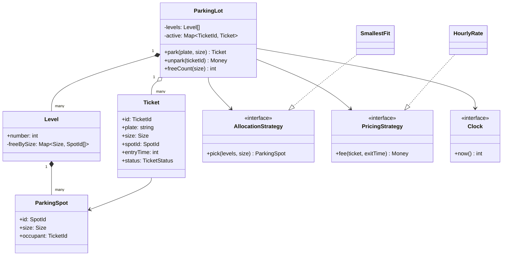
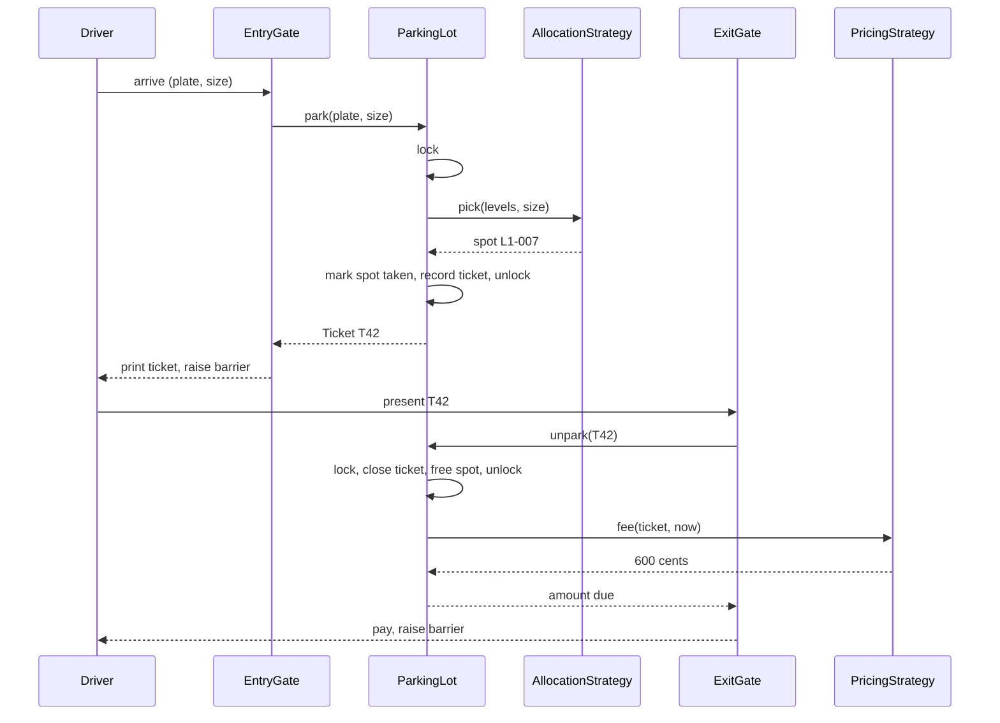

## In one minute
- A parking lot is a resource allocator with a cash register attached. The hard part is not the class list; it is guaranteeing that one spot never goes to two vehicles and that the fee is a pure function of facts you recorded at entry.
- Model the domain with a small set of nouns (lot, level, spot, vehicle, ticket) and push the parts that change (which spot to pick, how to price) behind interfaces. Those two strategies are where requirements churn.
- Make time an injected dependency. A fee computed from `datetime.now()` inside the pricing code cannot be tested, replayed or audited.
- Treat "park" as one atomic step: choose a spot, mark it taken and issue a ticket under the same lock or transaction. Two entry gates racing for the last spot is the canonical bug.
- The shape is **contention** over a pool of identical-ish resources. The same design reappears as seat holds in ticketing, IP address leases in DHCP, and GPU slots in a training scheduler.

## Requirements

Functional:
- The lot has several levels; each level has spots of three sizes: small (motorcycles), medium (cars) and large (vans, buses).
- A vehicle may use a spot of its size or larger. The system picks the spot, issues a ticket at the entry gate and refuses entry when nothing fits.
- At exit, the driver presents the ticket, pays a fee based on vehicle size and duration, and the spot becomes free.
- Display boards show free spots per size and level.

Non-functional:
- No double allocation, even with several entry gates working at once.
- Fees are reproducible: given the ticket and the exit time, anyone can recompute the same amount.
- Entry decision in well under a second; the barrier arm is the slow part, not the software.

Out of scope for the interview: online reservations, monthly passes, EV charging and licence-plate recognition. Mention them, park them in Extensibility, and move on.

## Entities and relationships

Start with nouns and ask which ones hold state that changes.

- **ParkingLot** is the façade the gates call. It owns levels, the active tickets and the two strategies.
- **Level** owns its spots and knows its free counts. Levels exist mainly for display boards and for allocation preference (fill the ground floor first).
- **ParkingSpot** has an id, a size and an occupant (a ticket id or nothing). It is the unit of contention.
- **Vehicle** is a value: plate and size. Resist a `Car`, `Bus`, `Motorcycle` hierarchy; the only behaviour that differs is size, and an enum carries that. Know the classic variant, though: in the version in *Cracking the Coding Interview* and the [system-design-primer solution](https://github.com/donnemartin/system-design-primer/blob/master/solutions/object_oriented_design/parking_lot/parking_lot.ipynb), a bus needs five consecutive large spots. That changes allocation from "pop one free id" to "find a free run of length k in a row", and a vehicle now holds a list of spots. If the interviewer adds that rule, it belongs in the allocation strategy and the ticket, still not in a subclass.
- **Ticket** links a vehicle to a spot with an entry time and a status (active, paid, closed). It is the record you will be asked to defend in a billing dispute, so make it immutable apart from status.
- **AllocationStrategy** picks a spot for a vehicle. **PricingStrategy** turns a ticket and an exit time into money. **Clock** supplies the time.

Relationships: a lot is composed of levels, a level of spots (they do not exist independently). A ticket references a spot and a vehicle but does not own them. The lot aggregates active tickets keyed by ticket id, plus a set of plates currently inside so the same car cannot be admitted twice.

## Class diagram



## Key flows

Entry and exit share the same lock on the lot. Pricing happens outside the critical section in a real system, because it is a pure function of the ticket and the exit time.



## Design patterns used and why

- **Strategy** for allocation and pricing. These are the two policies the business changes most often: "keep large spots free for buses on weekdays", "first 15 minutes free", "flat evening rate after 18:00". Each becomes a new class behind one interface, and the lot never changes. The default allocator is smallest-fit: a motorcycle takes a small spot before it eats a medium one.
- **Façade**: `ParkingLot` is the only thing gates talk to. It hides levels and spots, which lets you change the internal index (sorted lists today, a database tomorrow) without touching gate code.
- **Observer** for display boards. Boards subscribe to "free count changed" events instead of polling. Keep the notification outside the lock, or a slow LED controller will stall your entry gates.
- **State** for the ticket lifecycle, kept light: an enum plus guarded transitions (active, paid, closed). A State-pattern class per state is overkill here.
- **Dependency injection** for the clock, in place of a global. Many textbook answers make `ParkingLot` a **Singleton**. Say why you would not: a singleton is a global, it makes tests share state, and a company that runs two garages needs two instances. "One per process" is a wiring decision for `main`, not a property of the class.

## Concurrency and edge cases

- **Last spot, two gates.** Gate A and gate B both see one free medium spot. If "find" and "mark taken" are separate steps, both issue a ticket for it. The fix is to make selection and claim atomic: one mutex in memory, or one conditional update in the database (`UPDATE spot SET ticket = $1 WHERE id = $2 AND ticket IS NULL`, checking the row count).
- **Same plate twice.** A misread or a tailgater produces a second park for a plate already inside. Keep a set of active plates and reject the duplicate, then let an attendant resolve it.
- **Double exit.** A ticket scanned twice must not free the spot twice or charge twice. Remove the ticket from the active map under the lock; the second call finds nothing and fails cleanly.
- **Time.** Record entry time from the server's clock, never the kiosk's. Store UTC epoch seconds so daylight-saving changes cannot produce a negative or doubled hour. Compute durations from the same clock source. Do date arithmetic with a calendar library, never by bumping fields: "same date next year" does not exist after 29 February (see In the wild).
- **Rounding.** Decide and write down whether 61 minutes is one hour or two. The practice code uses ceiling hours after a 15-minute grace period, and does all arithmetic in integer cents. "Cents" really means the currency's minor unit: yen has no minor unit, so a payment API expects `500` for 500 JPY but `1000` for 10 USD ([Stripe docs](https://docs.stripe.com/currencies)). Store the amount with its currency code.
- **Lost ticket.** Look the vehicle up by plate and charge a published lost-ticket maximum. This is why the plate index exists beyond duplicate detection.
- **Payment fails after the barrier opens.** Free the spot only when the ticket closes, and close it only after payment succeeds or an attendant overrides.
- **Payment times out.** The terminal does not know whether the charge went through. Retry with an idempotency key derived from the ticket id, so the processor returns the first result instead of charging twice. Stripe, for example, stores the first response per key and returns it on retries, and prunes keys after 24 hours ([Stripe docs](https://docs.stripe.com/api/idempotent_requests)).

## In the wild
- **Microsoft Azure, 2012: the leap-day certificate.** An agent inside each VM computed a certificate's expiry by adding one to the current year. At 00:00 UTC on 29 February that produced 29 February 2013, a date that does not exist, so certificate creation failed. After three failed attempts with 25-minute timeouts, hosts marked healthy servers as faulty, and the disruption lasted about 34 hours. Microsoft added testing and code analysis for time-related bugs and gave affected customers a 33% credit ([Azure blog](https://azure.microsoft.com/en-us/blog/summary-of-windows-azure-service-disruption-on-feb-29th-2012/)).
- **Cloudflare, 2017: time went backwards.** During the leap second at midnight UTC on 1 January, Go's wall clock stepped back, so Cloudflare's DNS server computed a negative round-trip time and passed it to `rand.Int63n`, which panics on negative input. About 0.2% of DNS queries were affected at peak. The fix kept negative values out of server selection and reached every server by 06:45 UTC ([Cloudflare](https://blog.cloudflare.com/how-and-why-the-leap-second-affected-cloudflare-dns/)). Go 1.9 later made durations between `time.Now()` values use a monotonic reading ([Go 1.9 notes](https://go.dev/doc/go1.9)). A parking fee computed as `exit - entry` from the wall clock has the same bug.

## Down the stack

### Layer 1: The contract
`park` either returns a ticket bound to exactly one spot that no other active ticket holds, or returns "full" and changes nothing. `unpark` on an active ticket frees that spot and returns `fee(size, exit - entry)`; on an unknown or closed ticket it fails and changes nothing. `freeCount` is exact at the moment the lock is held and may be stale by the time a display shows it, which is acceptable because the gate re-checks.

### Layer 2: The mechanism
In memory, keep a free list per spot size, sorted by spot id so "lowest level first" falls out of the ordering, plus a hash map from ticket id to ticket and a set of plates. Park walks sizes from the vehicle's own upwards and pops the first free id, which is O(number of sizes) plus the cost of the list operation. A min-heap per size makes it O(log n). In a real garage this state lives in a database: one row per spot with a nullable `ticket_id` and an index on `(size, ticket_id, level)`. A Postgres claim looks like `SELECT id FROM spot WHERE size >= $1 AND ticket_id IS NULL ORDER BY size, id LIMIT 1 FOR UPDATE SKIP LOCKED`, followed by the update, in one transaction. `SKIP LOCKED` lets two gates claim two different spots in parallel instead of queueing on the same row. The cost is a deliberately inconsistent view: rows another transaction holds are simply left out, which Postgres says suits queue-like tables, not general queries ([Postgres docs](https://www.postgresql.org/docs/current/sql-select.html)). So a gate can see "full" while another gate's claim on the last spot is about to roll back, and the right reaction is a quick retry, not a "lot full" sign.

### Layer 3: The machine
An uncontended `sync.Mutex` in Go costs around 20 ns; a contended one parks the goroutine through a futex syscall, a few microseconds. A Postgres commit waits for the write-ahead log `fsync`, around 0.1 to 1 ms on an NVMe SSD. Compare the physical world: a loop detector needs tens of milliseconds to register a car, a barrier arm 2 to 6 seconds to rise, and 10 gates see at most a few arrivals per second. The software is three to four orders of magnitude faster than the hardware it serves, so a single global lock is not a bottleneck. On clocks: the wall clock can jump when NTP corrects it, so production code measures durations with a monotonic clock where it can and stores wall-clock timestamps only for receipts. Go builds this in: `time.Now()` carries both readings, and `Sub` uses the monotonic one when both values have it ([Go time docs](https://pkg.go.dev/time)). A monotonic reading does not survive a process restart, though, so a ticket stored in a database still needs a wall-clock entry time and a clamp at zero.

### Why it's built this way
1. Spots are physical and scarce, so double allocation is a customer-facing failure: two cars, one space, an angry attendant.
2. Preventing it needs one serialization point per spot, so selection and claim happen under one lock or one row lock.
3. Gates arrive a few times per second at most, so a coarse lock is cheap and you do not need lock-free cleverness.
4. Fees are disputed, so the fee must be recomputable from the ticket alone, which forces an injected clock and integer money.
5. Policies change monthly while spots change almost never, so policies sit behind interfaces and the spot index stays simple.

## Extensibility

- **New vehicle type (EV):** add a size or a capability flag on spots (`hasCharger`) and an allocation strategy that prefers charger spots for EVs and avoids them for everyone else. The lot does not change.
- **New pricing (weekend flat rate, dynamic surge):** a new `PricingStrategy`. If prices change while cars are inside, snapshot the rate card id on the ticket at entry so the fee does not change under the customer.
- **Reservations:** add a `HELD` spot state with an expiry, the same pattern as seat holds in ticketing. The allocator treats expired holds as free, so correctness does not depend on a cleanup job running on time.
- **Multiple garages:** the lot becomes one instance per site behind a service. State moves to a database partitioned by site id; each site's claims stay single-partition.
- **Licence-plate recognition:** a new entry gate implementation that calls `park` with the recognised plate; the duplicate-plate check becomes more important, not less.

### Variant: parcel locker station

A parcel locker is the same allocator with three changes: the occupant is a package instead of a driver, the exit is authorised by a secret instead of a ticket, and a deadline ends the stay. Compartments come in three sizes and the smallest-fit rule carries over unchanged, so `ParkingLot` becomes `LockerStation` with `deposit`, `pickup(code)` and `collectExpired`. The domain also gains a hardware boundary, so a `DoorController` interface (`open`, `isClosed`) sits beside the clock, with a fake for tests and one adapter per lock-board vendor.

**The ticket becomes a bearer credential.** A parking ticket is useless to a stranger because it is tied to a plate and a fee. A pickup code opens a door for whoever types it, so it needs properties the ticket never had. Draw it from a cryptographic source (Python's `secrets`, Go's `crypto/rand`, not `random`), redraw on collision with any active code, and store only a salted hash. Six digits give a million values, so a station holding 100 parcels has a 1 in 10,000 chance that a fresh code collides, and a stranger's random guess hits some live code about 100 times in a million. Count consecutive wrong attempts and lock the keypad for a few minutes after, say, five ([OWASP guidance](https://cheatsheetseries.owasp.org/cheatsheets/Authentication_Cheat_Sheet.html)). Because the attacker must stand at one visible screen, this is enough here, where an online login needs much more.

**The stay has a deadline.** Parking is open-ended and billed at exit. A locker stay is capped, three days for Amazon's lockers, and an uncollected parcel blocks a scarce door. Each assignment stores a deadline, an expired code stops opening the door even though the parcel is still inside, and a sweep returns each expired package exactly once to the courier. Keep a min-heap by deadline so the sweep touches only what is due.

**Compartment state needs more than free or taken.** Use AVAILABLE, RESERVED, OCCUPIED and OUT_OF_SERVICE. The code is issued only after the door reports closed; until then the box may be empty or the courier may cancel. A door that never confirms closing sends the compartment to inspection and the courier to another box.

**Offline is normal.** A station in a petrol station loses its network, so it validates pickups from locally stored hashes, writes state to flash with `fsync` on every change, and syncs events later. The station, not the cloud, is the source of truth for which door is occupied.

## Leadership lens

- Build first: the spot index with the atomic claim and a test that hammers the last spot from many threads. Pricing rules can be wrong for a week and refunded; double allocation cannot be undone.
- Ask in review: where is the single serialization point; what clock does the fee use; what happens if payment fails with the barrier already up; how is a rate change applied to cars already inside.
- Money is integer cents everywhere, and every fee is logged with its inputs (ticket id, entry, exit, rate card version) so support can answer disputes without engineers.
- Ownership: gate hardware integration and the allocation core are different skills. Give the gate team an interface (`park`, `unpark`) and a simulator, so they are not blocked on real barriers to test.
- In an interview, spend five minutes on requirements and fifteen on concurrency and change, not forty on a `Vehicle` hierarchy.

## Check yourself
1. Why is an enum for vehicle size better than `Car`, `Bus` and `Motorcycle` subclasses in this design?
   **Answer:** The only behaviour that varies is size, and an enum captures that with no dispatch or casting. Subclasses earn their place when types gain behaviour of their own, such as an EV needing a charger.
2. Two gates call `park` for the last free spot at the same time. What exactly must be atomic?
   **Answer:** Choosing the spot and marking it taken (plus recording the ticket). If those are separate steps, both callers can choose the same spot before either marks it.
3. Why should the pricing code not call the system clock itself?
   **Answer:** Then fees cannot be tested deterministically, replayed for a dispute, or computed consistently with the entry time. Injecting a clock makes the fee a pure function of recorded facts.
4. A car parks in a large spot because no medium spot is free. Which rate does it pay, and where does that rule live?
   **Answer:** That is a policy decision; the usual choice is the vehicle's rate, not the spot's. It lives in the pricing strategy, keyed by the size stored on the ticket.

## Practice
**Task:** Implement `ParkingLot`. The constructor takes a list of spots as `(spot_id, size)` pairs, hourly rates in cents keyed by vehicle size, and a clock object with a `now()` method returning integer seconds. `park(plate, size)` gives the vehicle the smallest free spot that fits (size equal or larger), choosing the lowest spot id among spots of that size, and returns a ticket with ids `T1`, `T2`, and so on; it returns nothing when no spot fits and fails if the plate is already parked. `unpark(ticket_id)` frees the spot and returns the fee: zero for stays of 15 minutes or less, otherwise ceiling hours times the rate for the vehicle's size; unknown or already closed tickets fail. `free_count(size)` returns the number of free spots of exactly that size.

```python starter
from dataclasses import dataclass
from enum import IntEnum

GRACE_SECONDS = 15 * 60


class Size(IntEnum):
    SMALL = 1
    MEDIUM = 2
    LARGE = 3


@dataclass(frozen=True)
class Ticket:
    ticket_id: str
    plate: str
    size: Size
    spot_id: str
    entry_time: int


class ParkingLot:
    def __init__(self, spots, hourly_rates, clock):
        self._clock = clock

    def park(self, plate, size):
        # TODO: smallest fitting spot, lowest id; None when full; ValueError on duplicate plate
        raise NotImplementedError

    def unpark(self, ticket_id):
        # TODO: free the spot and return the fee in cents; ValueError on unknown ticket
        raise NotImplementedError

    def free_count(self, size):
        raise NotImplementedError
```

```python tests
class FakeClock:
    def __init__(self):
        self.t = 0

    def now(self):
        return self.t


RATES = {Size.SMALL: 100, Size.MEDIUM: 300, Size.LARGE: 800}


def make_lot(clock):
    spots = [("L1-S2", Size.SMALL), ("L1-S1", Size.SMALL), ("L1-M1", Size.MEDIUM),
             ("L2-M1", Size.MEDIUM), ("L1-L1", Size.LARGE)]
    return ParkingLot(spots, RATES, clock)


def test_car_gets_medium_spot():
    lot = make_lot(FakeClock())
    t = lot.park("CAR-1", Size.MEDIUM)
    assert t.ticket_id == "T1"
    assert t.spot_id == "L1-M1"
    assert lot.free_count(Size.MEDIUM) == 1


def test_smallest_fit_then_upgrade():
    lot = make_lot(FakeClock())
    assert lot.park("M1", Size.SMALL).spot_id == "L1-S1"
    assert lot.park("M2", Size.SMALL).spot_id == "L1-S2"
    assert lot.park("M3", Size.SMALL).spot_id == "L1-M1", "small full, use medium"


def test_full_returns_none_and_large_needs_large():
    lot = make_lot(FakeClock())
    assert lot.park("BUS-1", Size.LARGE).spot_id == "L1-L1"
    assert lot.park("BUS-2", Size.LARGE) is None
    assert lot.park("CAR-1", Size.MEDIUM).spot_id == "L1-M1"


def test_fee_rules():
    clock = FakeClock()
    lot = make_lot(clock)
    a = lot.park("A", Size.MEDIUM)
    b = lot.park("B", Size.MEDIUM)
    c = lot.park("C", Size.LARGE)
    clock.t = 15 * 60
    assert lot.unpark(a.ticket_id) == 0, "within grace"
    clock.t = 3600
    assert lot.unpark(b.ticket_id) == 300
    clock.t = 3661
    assert lot.unpark(c.ticket_id) == 1600, "61 minutes rounds up to 2 hours"


def test_rate_follows_vehicle_not_spot():
    clock = FakeClock()
    lot = ParkingLot([("X", Size.LARGE)], RATES, clock)
    t = lot.park("BIKE", Size.SMALL)
    clock.t = 7200
    assert lot.unpark(t.ticket_id) == 200


def test_unpark_frees_spot_for_reuse():
    lot = make_lot(FakeClock())
    t = lot.park("CAR-1", Size.MEDIUM)
    lot.park("CAR-2", Size.MEDIUM)
    lot.unpark(t.ticket_id)
    assert lot.free_count(Size.MEDIUM) == 1
    assert lot.park("CAR-3", Size.MEDIUM).spot_id == "L1-M1"


def test_errors():
    lot = make_lot(FakeClock())
    t = lot.park("CAR-1", Size.MEDIUM)
    failed = False
    try:
        lot.park("CAR-1", Size.MEDIUM)
    except ValueError:
        failed = True
    assert failed, "same plate twice"
    lot.unpark(t.ticket_id)
    failed = False
    try:
        lot.unpark(t.ticket_id)
    except ValueError:
        failed = True
    assert failed, "double exit"
```

```python solution
import bisect
from dataclasses import dataclass
from enum import IntEnum

GRACE_SECONDS = 15 * 60


class Size(IntEnum):
    SMALL = 1
    MEDIUM = 2
    LARGE = 3


@dataclass(frozen=True)
class Ticket:
    ticket_id: str
    plate: str
    size: Size
    spot_id: str
    entry_time: int


class ParkingLot:
    def __init__(self, spots, hourly_rates, clock):
        self._free = {s: [] for s in Size}
        for spot_id, size in spots:
            bisect.insort(self._free[size], spot_id)
        self._spot_size = dict(spots)
        self._rates = dict(hourly_rates)
        self._clock = clock
        self._active = {}
        self._plates = set()
        self._next_id = 1

    def park(self, plate, size):
        if plate in self._plates:
            raise ValueError("vehicle already parked: " + plate)
        for spot_size in Size:
            if spot_size >= size and self._free[spot_size]:
                spot_id = self._free[spot_size].pop(0)
                ticket = Ticket("T" + str(self._next_id), plate, size, spot_id,
                                self._clock.now())
                self._next_id += 1
                self._active[ticket.ticket_id] = ticket
                self._plates.add(plate)
                return ticket
        return None

    def unpark(self, ticket_id):
        ticket = self._active.pop(ticket_id, None)
        if ticket is None:
            raise ValueError("unknown or closed ticket: " + ticket_id)
        self._plates.discard(ticket.plate)
        bisect.insort(self._free[self._spot_size[ticket.spot_id]], ticket.spot_id)
        return self._fee(ticket.size, self._clock.now() - ticket.entry_time)

    def _fee(self, size, seconds):
        if seconds <= GRACE_SECONDS:
            return 0
        hours = (seconds + 3599) // 3600
        return hours * self._rates[size]

    def free_count(self, size):
        return len(self._free[size])
```

```typescript starter
export enum Size { Small = 1, Medium = 2, Large = 3 }

export const GRACE_SECONDS = 15 * 60;

export interface Clock { now(): number }

export interface Ticket {
  ticketId: string;
  plate: string;
  size: Size;
  spotId: string;
  entryTime: number;
}

export class ParkingLot {
  constructor(spots: Array<[string, Size]>, private rates: Record<number, number>, private clock: Clock) {}

  park(plate: string, size: Size): Ticket | null {
    throw new Error("TODO");
  }

  unpark(ticketId: string): number {
    throw new Error("TODO");
  }

  freeCount(size: Size): number {
    throw new Error("TODO");
  }
}
```

```typescript tests
class FakeClock implements Clock {
  t = 0;
  now(): number { return this.t; }
}

const RATES: Record<number, number> = { [Size.Small]: 100, [Size.Medium]: 300, [Size.Large]: 800 };

function makeLot(clock: Clock): ParkingLot {
  return new ParkingLot([["L1-S2", Size.Small], ["L1-S1", Size.Small], ["L1-M1", Size.Medium],
    ["L2-M1", Size.Medium], ["L1-L1", Size.Large]], RATES, clock);
}

function throws(fn: () => void): boolean {
  try { fn(); return false; } catch (e) { return true; }
}

test("car gets medium spot", () => {
  const lot = makeLot(new FakeClock());
  const t = lot.park("CAR-1", Size.Medium)!;
  assertEqual(t.ticketId, "T1");
  assertEqual(t.spotId, "L1-M1");
  assertEqual(lot.freeCount(Size.Medium), 1);
});

test("smallest fit then upgrade", () => {
  const lot = makeLot(new FakeClock());
  assertEqual(lot.park("M1", Size.Small)!.spotId, "L1-S1");
  assertEqual(lot.park("M2", Size.Small)!.spotId, "L1-S2");
  assertEqual(lot.park("M3", Size.Small)!.spotId, "L1-M1", "small full, use medium");
});

test("full returns null and large needs large", () => {
  const lot = makeLot(new FakeClock());
  assertEqual(lot.park("BUS-1", Size.Large)!.spotId, "L1-L1");
  assertEqual(lot.park("BUS-2", Size.Large), null);
  assertEqual(lot.park("CAR-1", Size.Medium)!.spotId, "L1-M1");
});

test("fee rules", () => {
  const clock = new FakeClock();
  const lot = makeLot(clock);
  const a = lot.park("A", Size.Medium)!;
  const b = lot.park("B", Size.Medium)!;
  const c = lot.park("C", Size.Large)!;
  clock.t = 15 * 60;
  assertEqual(lot.unpark(a.ticketId), 0, "within grace");
  clock.t = 3600;
  assertEqual(lot.unpark(b.ticketId), 300);
  clock.t = 3661;
  assertEqual(lot.unpark(c.ticketId), 1600, "61 minutes rounds up to 2 hours");
});

test("rate follows vehicle not spot", () => {
  const clock = new FakeClock();
  const lot = new ParkingLot([["X", Size.Large]], RATES, clock);
  const t = lot.park("BIKE", Size.Small)!;
  clock.t = 7200;
  assertEqual(lot.unpark(t.ticketId), 200);
});

test("unpark frees spot for reuse", () => {
  const lot = makeLot(new FakeClock());
  const t = lot.park("CAR-1", Size.Medium)!;
  lot.park("CAR-2", Size.Medium);
  lot.unpark(t.ticketId);
  assertEqual(lot.freeCount(Size.Medium), 1);
  assertEqual(lot.park("CAR-3", Size.Medium)!.spotId, "L1-M1");
});

test("errors", () => {
  const lot = makeLot(new FakeClock());
  const t = lot.park("CAR-1", Size.Medium)!;
  assert(throws(() => lot.park("CAR-1", Size.Medium)), "same plate twice");
  lot.unpark(t.ticketId);
  assert(throws(() => lot.unpark(t.ticketId)), "double exit");
});
```

```typescript solution
export enum Size { Small = 1, Medium = 2, Large = 3 }

export const GRACE_SECONDS = 15 * 60;

export interface Clock { now(): number }

export interface Ticket {
  ticketId: string;
  plate: string;
  size: Size;
  spotId: string;
  entryTime: number;
}

const SIZES: Size[] = [Size.Small, Size.Medium, Size.Large];

function insertSorted(list: string[], id: string): void {
  let i = 0;
  while (i < list.length && list[i] < id) i++;
  list.splice(i, 0, id);
}

export class ParkingLot {
  private free = new Map<Size, string[]>();
  private spotSize = new Map<string, Size>();
  private active = new Map<string, Ticket>();
  private plates = new Set<string>();
  private nextId = 1;

  constructor(spots: Array<[string, Size]>, private rates: Record<number, number>, private clock: Clock) {
    for (const s of SIZES) this.free.set(s, []);
    for (const [id, size] of spots) {
      this.spotSize.set(id, size);
      insertSorted(this.free.get(size)!, id);
    }
  }

  park(plate: string, size: Size): Ticket | null {
    if (this.plates.has(plate)) throw new Error("vehicle already parked: " + plate);
    for (const s of SIZES) {
      const list = this.free.get(s)!;
      if (s >= size && list.length > 0) {
        const ticket: Ticket = {
          ticketId: "T" + this.nextId++, plate, size,
          spotId: list.shift()!, entryTime: this.clock.now(),
        };
        this.active.set(ticket.ticketId, ticket);
        this.plates.add(plate);
        return ticket;
      }
    }
    return null;
  }

  unpark(ticketId: string): number {
    const ticket = this.active.get(ticketId);
    if (!ticket) throw new Error("unknown or closed ticket: " + ticketId);
    this.active.delete(ticketId);
    this.plates.delete(ticket.plate);
    insertSorted(this.free.get(this.spotSize.get(ticket.spotId)!)!, ticket.spotId);
    const seconds = this.clock.now() - ticket.entryTime;
    if (seconds <= GRACE_SECONDS) return 0;
    return Math.ceil(seconds / 3600) * this.rates[ticket.size];
  }

  freeCount(size: Size): number {
    return this.free.get(size)!.length;
  }
}
```

```go starter
package practice

import "errors"

type Size int

const (
	Small Size = iota + 1
	Medium
	Large
)

const GraceSeconds = 15 * 60

var (
	ErrLotFull       = errors.New("no spot fits this vehicle")
	ErrAlreadyParked = errors.New("vehicle already parked")
	ErrUnknownTicket = errors.New("unknown or closed ticket")
)

type Clock interface{ Now() int64 }

type Spot struct {
	ID   string
	Size Size
}

type Ticket struct {
	ID        string
	Plate     string
	Size      Size
	SpotID    string
	EntryTime int64
}

type ParkingLot struct{}

func NewParkingLot(spots []Spot, rates map[Size]int64, clock Clock) *ParkingLot {
	return &ParkingLot{}
}

func (p *ParkingLot) Park(plate string, size Size) (Ticket, error) {
	panic("TODO")
}

func (p *ParkingLot) Unpark(ticketID string) (int64, error) {
	panic("TODO")
}

func (p *ParkingLot) FreeCount(size Size) int {
	panic("TODO")
}
```

```go tests
package practice

import (
	"errors"
	"testing"
)

type fakeClock struct{ t int64 }

func (c *fakeClock) Now() int64 { return c.t }

var rates = map[Size]int64{Small: 100, Medium: 300, Large: 800}

func makeLot(c Clock) *ParkingLot {
	return NewParkingLot([]Spot{{"L1-S2", Small}, {"L1-S1", Small}, {"L1-M1", Medium},
		{"L2-M1", Medium}, {"L1-L1", Large}}, rates, c)
}

func mustPark(t *testing.T, p *ParkingLot, plate string, size Size) Ticket {
	t.Helper()
	tk, err := p.Park(plate, size)
	if err != nil {
		t.Fatalf("park %s: %v", plate, err)
	}
	return tk
}

func TestCarGetsMediumSpot(t *testing.T) {
	p := makeLot(&fakeClock{})
	tk := mustPark(t, p, "CAR-1", Medium)
	if tk.ID != "T1" || tk.SpotID != "L1-M1" || p.FreeCount(Medium) != 1 {
		t.Fatalf("got %+v free=%d", tk, p.FreeCount(Medium))
	}
}

func TestSmallestFitThenUpgrade(t *testing.T) {
	p := makeLot(&fakeClock{})
	want := []string{"L1-S1", "L1-S2", "L1-M1"}
	for i, plate := range []string{"M1", "M2", "M3"} {
		if got := mustPark(t, p, plate, Small).SpotID; got != want[i] {
			t.Fatalf("%s: got %s want %s", plate, got, want[i])
		}
	}
}

func TestFullAndLargeNeedsLarge(t *testing.T) {
	p := makeLot(&fakeClock{})
	if got := mustPark(t, p, "BUS-1", Large).SpotID; got != "L1-L1" {
		t.Fatalf("got %s", got)
	}
	if _, err := p.Park("BUS-2", Large); !errors.Is(err, ErrLotFull) {
		t.Fatalf("want ErrLotFull, got %v", err)
	}
	if got := mustPark(t, p, "CAR-1", Medium).SpotID; got != "L1-M1" {
		t.Fatalf("got %s", got)
	}
}

func TestFeeRules(t *testing.T) {
	c := &fakeClock{}
	p := makeLot(c)
	a := mustPark(t, p, "A", Medium)
	b := mustPark(t, p, "B", Medium)
	d := mustPark(t, p, "C", Large)
	cases := []struct {
		at   int64
		id   string
		want int64
	}{{15 * 60, a.ID, 0}, {3600, b.ID, 300}, {3661, d.ID, 1600}}
	for _, tc := range cases {
		c.t = tc.at
		fee, err := p.Unpark(tc.id)
		if err != nil || fee != tc.want {
			t.Fatalf("at %d: fee=%d err=%v want %d", tc.at, fee, err, tc.want)
		}
	}
}

func TestRateFollowsVehicleNotSpot(t *testing.T) {
	c := &fakeClock{}
	p := NewParkingLot([]Spot{{"X", Large}}, rates, c)
	tk := mustPark(t, p, "BIKE", Small)
	c.t = 7200
	if fee, _ := p.Unpark(tk.ID); fee != 200 {
		t.Fatalf("fee=%d want 200", fee)
	}
}

func TestUnparkFreesSpotForReuse(t *testing.T) {
	p := makeLot(&fakeClock{})
	tk := mustPark(t, p, "CAR-1", Medium)
	mustPark(t, p, "CAR-2", Medium)
	if _, err := p.Unpark(tk.ID); err != nil {
		t.Fatal(err)
	}
	if p.FreeCount(Medium) != 1 {
		t.Fatalf("free=%d", p.FreeCount(Medium))
	}
	if got := mustPark(t, p, "CAR-3", Medium).SpotID; got != "L1-M1" {
		t.Fatalf("got %s", got)
	}
}

func TestErrors(t *testing.T) {
	p := makeLot(&fakeClock{})
	tk := mustPark(t, p, "CAR-1", Medium)
	if _, err := p.Park("CAR-1", Medium); !errors.Is(err, ErrAlreadyParked) {
		t.Fatalf("want ErrAlreadyParked, got %v", err)
	}
	if _, err := p.Unpark(tk.ID); err != nil {
		t.Fatal(err)
	}
	if _, err := p.Unpark(tk.ID); !errors.Is(err, ErrUnknownTicket) {
		t.Fatalf("want ErrUnknownTicket, got %v", err)
	}
}
```

```go solution
package practice

import (
	"errors"
	"fmt"
	"sort"
	"sync"
)

type Size int

const (
	Small Size = iota + 1
	Medium
	Large
)

const GraceSeconds = 15 * 60

var (
	ErrLotFull       = errors.New("no spot fits this vehicle")
	ErrAlreadyParked = errors.New("vehicle already parked")
	ErrUnknownTicket = errors.New("unknown or closed ticket")
)

type Clock interface{ Now() int64 }

type Spot struct {
	ID   string
	Size Size
}

type Ticket struct {
	ID        string
	Plate     string
	Size      Size
	SpotID    string
	EntryTime int64
}

type ParkingLot struct {
	mu       sync.Mutex
	free     map[Size][]string
	spotSize map[string]Size
	rates    map[Size]int64
	clock    Clock
	active   map[string]Ticket
	plates   map[string]bool
	nextID   int
}

func NewParkingLot(spots []Spot, rates map[Size]int64, clock Clock) *ParkingLot {
	p := &ParkingLot{
		free:     map[Size][]string{},
		spotSize: map[string]Size{},
		rates:    rates,
		clock:    clock,
		active:   map[string]Ticket{},
		plates:   map[string]bool{},
		nextID:   1,
	}
	for _, s := range spots {
		p.spotSize[s.ID] = s.Size
		p.free[s.Size] = insertSorted(p.free[s.Size], s.ID)
	}
	return p
}

func insertSorted(list []string, id string) []string {
	i := sort.SearchStrings(list, id)
	list = append(list, "")
	copy(list[i+1:], list[i:])
	list[i] = id
	return list
}

// Park selects and claims a spot under one lock, so two gates cannot get the same spot.
func (p *ParkingLot) Park(plate string, size Size) (Ticket, error) {
	p.mu.Lock()
	defer p.mu.Unlock()
	if p.plates[plate] {
		return Ticket{}, fmt.Errorf("%w: %s", ErrAlreadyParked, plate)
	}
	for s := Small; s <= Large; s++ {
		if s < size || len(p.free[s]) == 0 {
			continue
		}
		spot := p.free[s][0]
		p.free[s] = p.free[s][1:]
		tk := Ticket{ID: fmt.Sprintf("T%d", p.nextID), Plate: plate, Size: size,
			SpotID: spot, EntryTime: p.clock.Now()}
		p.nextID++
		p.active[tk.ID] = tk
		p.plates[plate] = true
		return tk, nil
	}
	return Ticket{}, ErrLotFull
}

func (p *ParkingLot) Unpark(ticketID string) (int64, error) {
	p.mu.Lock()
	defer p.mu.Unlock()
	tk, ok := p.active[ticketID]
	if !ok {
		return 0, fmt.Errorf("%w: %s", ErrUnknownTicket, ticketID)
	}
	delete(p.active, ticketID)
	delete(p.plates, tk.Plate)
	s := p.spotSize[tk.SpotID]
	p.free[s] = insertSorted(p.free[s], tk.SpotID)
	seconds := p.clock.Now() - tk.EntryTime
	if seconds <= GraceSeconds {
		return 0, nil
	}
	return (seconds + 3599) / 3600 * p.rates[tk.Size], nil
}

func (p *ParkingLot) FreeCount(size Size) int {
	p.mu.Lock()
	defer p.mu.Unlock()
	return len(p.free[size])
}
```

## Mock interview
**Prompt:** Design the software for a five-level parking garage with 600 spots of three sizes, four entry gates and four exit gates. Code the core classes and the park and unpark operations, and explain how you prevent two cars from getting the same spot.

- Follow-up: The business wants the first 15 minutes free on weekdays only and a flat 20 dollar overnight rate. Show what changes in your code.
- Follow-up: The exit gate's payment terminal times out after the driver taps their card. What state is the ticket in, and what does the driver see?
- Follow-up: Your manager suggests making `ParkingLot` a singleton. Do you agree?

**A strong answer covers:**
- A short requirement pass that names the out-of-scope items and the fee rounding rule before any classes appear.
- Lean entities: a size enum instead of a vehicle hierarchy, an immutable ticket with a status, and spots owned by levels.
- Allocation and pricing as strategies, with the new pricing rule landing as a new class and no change to the lot.
- An atomic select-and-claim under one lock or a conditional database update, with the argument that gate arrival rates make a coarse lock cheap.
- An injected clock, integer cents, UTC timestamps and a ticket that records the rate card version.
- A clear stance on singletons (inject one instance from `main`) and on payment failure (spot stays occupied until the ticket closes).

## Sources and further study
**Primary**
- [Go 1.9 release notes: transparent monotonic time](https://go.dev/doc/go1.9): the language-level fix for durations that go negative when the wall clock steps.

**Systems docs**
- [OWASP Authentication Cheat Sheet](https://cheatsheetseries.owasp.org/cheatsheets/Authentication_Cheat_Sheet.html): lockout and throttling guidance behind the locker variant's pickup-code attempt limit.
- [Python secrets module](https://docs.python.org/3/library/secrets.html): why security tokens such as pickup codes come from a cryptographic source rather than `random`.
- [PostgreSQL: SELECT locking clause](https://www.postgresql.org/docs/current/sql-select.html): `FOR UPDATE`, `NOWAIT` and `SKIP LOCKED`, and when each is appropriate.
- [Stripe: idempotent requests](https://docs.stripe.com/api/idempotent_requests): how a payment API makes a timed-out charge safe to retry.
- [Stripe: currencies and minor units](https://docs.stripe.com/currencies): why "integer cents" must be "integer minor units plus a currency code".

**Books**
- *Design Patterns: Elements of Reusable Object-Oriented Software*, Gamma, Helm, Johnson and Vlissides: chapter 3 (Creational, including Singleton), chapter 4 (Structural, including Facade) and chapter 5 (Behavioral, including Strategy, Observer and State).
- *Head First Design Patterns*, Freeman and Robson: chapter 1 (Strategy), chapter 2 (Observer) and chapter 5 (Singleton, including its multithreading problems).
- *Cracking the Coding Interview*, Gayle Laakmann McDowell, chapter 7 "Object-Oriented Design": the parking lot problem in its original, hierarchy-first form.

**Other curricula**
- [donnemartin/system-design-primer: parking lot](https://github.com/donnemartin/system-design-primer/blob/master/solutions/object_oriented_design/parking_lot/parking_lot.ipynb): models vehicles as subclasses and buses as five consecutive large spots; it has no concurrency, pricing or clock.
- [Refactoring.Guru: Singleton](https://refactoring.guru/design-patterns/singleton): presents Singleton as a standard pattern while listing its costs (harder unit testing, hidden coupling, thread-safety care), a useful contrast with this lesson's advice to inject one instance.

## Watch
- [Parking Lot Design | Grokking The Object Oriented Design Interview Question (Think Software)](https://www.youtube.com/watch?v=tVRyb4HaHgw): a classic walkthrough of the entities and use cases.
- [Design A Parking Garage | Google SWE Teaches Low Level Design Episode 4 (Jordan has no life)](https://www.youtube.com/watch?v=-TSwjzJB74k): a code-first take that spends time on concurrency.
- [Strategy Pattern, Design Patterns ep 1 (Christopher Okhravi)](https://www.youtube.com/watch?v=v9ejT8FO-7I): a careful explanation of the pattern behind pluggable allocation and pricing.

## Free resources
- [Strategy pattern (Refactoring.Guru)](https://refactoring.guru/design-patterns/strategy): the pattern used for allocation and pricing, with examples in many languages.
- [Observer pattern (Refactoring.Guru)](https://refactoring.guru/design-patterns/observer): how display boards can subscribe to free-count changes.
- [Explicit locking (PostgreSQL docs)](https://www.postgresql.org/docs/current/explicit-locking.html): row locks and `FOR UPDATE`, the database version of the atomic claim.
- [Value Object (Martin Fowler)](https://martinfowler.com/bliki/ValueObject.html): why vehicles and tickets are better as immutable values than as rich entities.
- [Optimistic concurrency control (Wikipedia)](https://en.wikipedia.org/wiki/Optimistic_concurrency_control): the alternative to locking when claims rarely collide.
