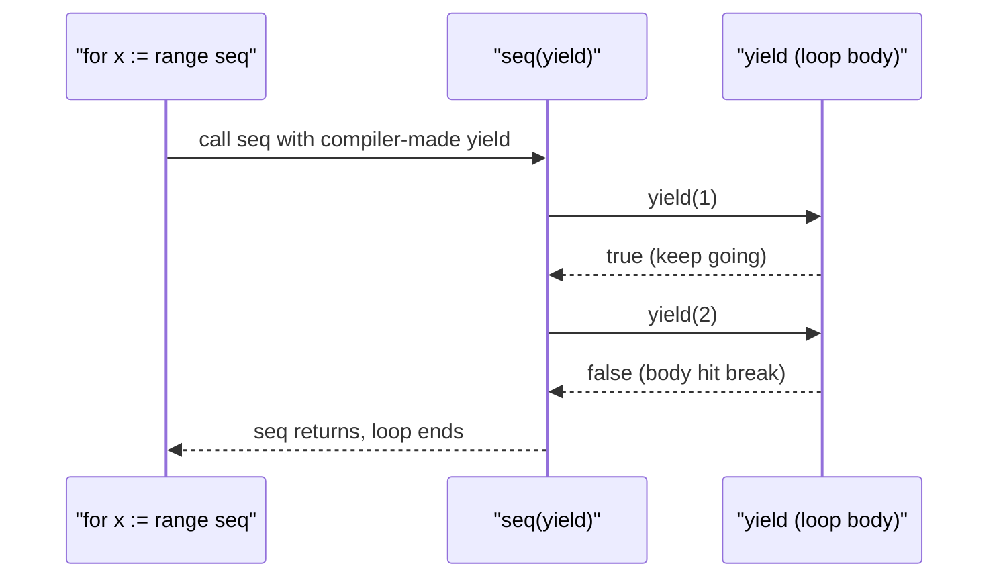

## In one minute
- A design pattern is a named, reusable answer to a problem that keeps recurring in a given context, written down with its forces and consequences. It is a description you adapt, not code you import.
- The idea came from architecture: Christopher Alexander's *A Pattern Language* (1977) catalogued 253 patterns for towns and buildings ([Wikipedia](https://en.wikipedia.org/wiki/A_Pattern_Language)). Kent Beck and Ward Cunningham applied it to Smalltalk in 1987, and the "Gang of Four" book (Gamma, Helm, Johnson, Vlissides, 1994) gave software its standard catalogue of 23.
- The GoF sort patterns by purpose: creational (how objects are made), structural (how objects are composed) and behavioural (how objects divide work and communicate).
- Many patterns compensate for missing language features. First-class functions absorb Strategy and Command, generators absorb Iterator, generics remove a family of casting wrappers, and sum types with pattern matching replace most Visitors.
- The lasting value is the shared vocabulary and the two principles under the catalogue: program to an interface, and prefer composition to inheritance.

## How it works

### What a pattern is, and what it is not
A pattern has four parts: a **name** short enough to use in conversation, a **problem** with the context in which it appears, a **solution** described as roles and relationships rather than specific classes, and **consequences**, meaning what it costs and what it makes harder. The consequences are the part most people skip and the part that matters most. "Observer decouples the subject from its listeners" is half the story; the other half is "and now the order of notifications, errors thrown by listeners and memory held by forgotten subscriptions are your problem."

A pattern is not a library. You cannot `import Observer`, because the solution has to be fitted to your types, threading model and error handling. It is also not an algorithm: quicksort has one correct implementation shape, while two correct Decorators can look quite different. And it is not a goal. A pattern solves a problem that a design has; it does not improve a design that lacks the problem.

### Where the idea came from
Alexander, an architect, noticed that good buildings reuse the same solutions to the same tensions, such as a seat by a window where people want light. *A Pattern Language* named 253 of them, larger patterns setting the context for smaller ones, so that non-experts could take part in design.

Beck and Cunningham's 1987 report, "Using Pattern Languages for Object-Oriented Programs", written for an OOPSLA-87 workshop, borrowed the idea for Smalltalk user interfaces. It summarised five patterns they had used to design window-based interfaces ([paper](http://c2.com/doc/oopsla87.html)). Through the early 1990s, the Hillside Group and the first Pattern Languages of Programs conference (PLoP, 1994) built a community around writing patterns ([Wikipedia](https://en.wikipedia.org/wiki/Pattern_Languages_of_Programs)). Ward Cunningham launched the WikiWikiWeb in March 1995 to host the Portland Pattern Repository, so the wiki itself is a by-product of the patterns movement ([Wikipedia](https://en.wikipedia.org/wiki/WikiWikiWeb)).

The GoF book, *Design Patterns: Elements of Reusable Object-Oriented Software*, appeared in late 1994 with examples in C++ and Smalltalk. Each of its 23 entries follows one template, from intent and applicability through structure and consequences to sample code and known uses. The known-uses section mattered: each pattern was shown in existing systems. Patterns were discovered, not invented.

### The three families
**Creational** patterns separate *what* gets created from *who* asks for it: Abstract Factory, Builder, Factory Method, Prototype, Singleton. They exist because a constructor call names a concrete class, and naming it everywhere spreads that decision through the code.

**Structural** patterns arrange objects into larger structures while keeping interfaces simple: Adapter, Bridge, Composite, Decorator, Facade, Flyweight, Proxy. Most of them wrap one object in another that has the same or a translated interface.

**Behavioural** patterns distribute responsibility and communication: Chain of Responsibility, Command, Interpreter, Iterator, Mediator, Memento, Observer, State, Strategy, Template Method, Visitor. Most of them turn a piece of behaviour, a request or a traversal into an object that can be passed around.

The GoF also split patterns by scope. Class patterns (Factory Method, Template Method, the class form of Adapter) fix relationships at compile time through inheritance; object patterns fix them at runtime through composition. Most of the catalogue is object-scoped, which reflects the book's second principle.

### The two principles under the catalogue
The book's opening chapter is more durable than its catalogue. It argues for **programming to an interface, not an implementation**, so that callers depend on what an object does rather than what it is, and for **favouring object composition over class inheritance**, because inheritance exposes a subclass to its parent's internals and fixes the relationship at compile time. Nearly every pattern is one of these principles applied to a specific problem. If you remember only the principles, you can rederive most patterns when you need them. The SOLID lessons in this course (OCP and DIP in particular) are later restatements of the same ideas.

### Patterns in modern languages
In 1996 Peter Norvig showed that 16 of the 23 GoF patterns are invisible or simpler in Lisp or Dylan. He credited four language features: first-class types (Abstract Factory, Factory Method, State, Proxy and others), first-class functions (Command, Strategy, Template Method, Visitor), macros (Interpreter, Iterator) and method combination (Mediator, Observer) ([Norvig's slides](https://norvig.com/design-patterns/design-patterns.pdf)). The trend since then has been for mainstream languages to absorb patterns as features.

| Pattern | What absorbed it | Example |
| --- | --- | --- |
| Strategy, Command | First-class functions and closures | `sorted(rows, key=by_price)`; Java 8 lambdas (2014) |
| Template Method | Higher-order functions | Pass the varying step as a function argument |
| Iterator | Generators and language-level iteration | Python generators ([PEP 255](https://peps.python.org/pep-0255/), 2001); C# `yield return`; Go range-over-func ([Go 1.23](https://go.dev/doc/go1.23), 2024) |
| Visitor | Sum types and pattern matching | Rust `enum` with `match`; TypeScript discriminated unions; Java sealed classes (Java 17) plus `switch` patterns (Java 21) ([JEP 409](https://openjdk.org/jeps/409), [JEP 441](https://openjdk.org/jeps/441)) |
| Builder | Named and default arguments | Python keyword arguments; Kotlin named parameters |
| Singleton | Modules | A Python module or a Go package-level value is loaded once |
| Prototype | Prototype-based objects | JavaScript `Object.create(proto)` |
| Observer | Event and reactive libraries | DOM `addEventListener`, Node `EventEmitter`, RxJS; the JDK's own `Observable` was deprecated in Java 9 |
| Decorator (function form) | Syntax for wrapping functions | Python `@decorator` (PEP 318, 2004) |

Generics remove another category: the casting wrappers around containers that pre-generics Java and Go needed. Before Go 1.18 (2022) a generic list held `interface{}` and every caller cast back.

What remains after the language takes its share is the *design decision*. A lambda makes Strategy cheap to write, but someone still decides where the seam goes and what the function's contract is. Pattern matching makes Visitor unnecessary for closed type sets (the Java proposal itself says that without it, ad-hoc polymorphism needs the "cumbersome visitor pattern", per [JEP 441](https://openjdk.org/jeps/441)), but the GoF Visitor still wins when other teams must add operations without editing your types. The patterns that survive are mostly about structure between components (Adapter, Facade, Proxy, Composite, State, Mediator) rather than about working around the language.

### Criticism worth knowing
Paul Graham argued in 2002 that patterns in a program are a sign that the programmer is doing by hand what a more powerful language would do automatically ([Revenge of the Nerds](https://www.paulgraham.com/icad.html)). That is partly right, as the table shows. The other common complaint is cargo culting: patterns applied because they exist, producing `AbstractSingletonProxyFactoryBean`-style layering with no problem underneath (Spring really does ship a class named [`AbstractSingletonProxyFactoryBean`](https://docs.spring.io/spring-framework/docs/current/javadoc-api/org/springframework/aop/framework/AbstractSingletonProxyFactoryBean.html), though it exists for a real purpose). Both critiques attack misuse rather than the idea. The idea, a named solution with stated consequences, is how teams share design knowledge, and it now extends well past the GoF: Fowler's enterprise application patterns, the microservices and cloud patterns, concurrency patterns, and anti-patterns that name what not to do.

### Learning patterns with an AI assistant
An assistant writes a textbook Observer in seconds, so the skill is no longer the class diagram. It is recognising the problem, choosing the smallest form your language allows, and spotting generated code that applies a 1994 C++ shape where a one-line feature exists. The Design Patterns lesson gives the selection method and the full catalogue table.

### The same shape elsewhere
"Name a recurring solution, state its trade-offs, let people compose them" appears far from code. Military doctrine, clinical guidelines, legal precedents and SRE runbooks are pattern languages: each entry has a context, a recommended action and known consequences, and practitioners combine them. Distributed systems have their own catalogue (Saga, Outbox, Circuit Breaker, Bulkhead), covered in the system design course.

## Down the stack

### Layer 1: The contract
A pattern's written form is its contract with the reader. Intent says which problem it solves; applicability says when to use it; consequences say what you pay. When a code reviewer says "this is a Decorator", the team can assume the wrapper has the same interface as what it wraps and always forwards; when it is a Proxy, forwarding may be skipped. The name carries those guarantees, which is why misnaming a class (calling a Proxy a Decorator) causes real bugs: readers trust the wrong contract.

### Layer 2: The mechanism
When a language absorbs a pattern, the compiler or runtime implements the pattern's structure for you. A closure in Go or JavaScript is a function pointer plus an environment record holding captured variables, which is exactly the GoF Command object with its receiver fields, generated by the compiler. A Python generator is an object that owns a suspended frame: `next()` resumes the frame at the last `yield`, and the frame's local variables are the iterator's state, so the explicit Iterator class with a cursor field disappears. Go's range-over-func rewrites `for x := range seq { body }` into a call `seq(yield)` where `yield` is a compiler-generated closure containing the loop body; the iterator is expected to stop when `yield` returns `false` ([Go blog](https://go.dev/blog/range-functions)). A Rust `match` on an enum compiles to a check of the discriminant tag followed by a jump table or branch chain, with exhaustiveness checked at compile time, replacing Visitor's double dispatch.

### Layer 3: The machine
Absorbed patterns usually get cheaper, because the compiler knows more. A Go closure that does not escape stays on the stack and costs no allocation; one that escapes allocates its environment on the heap once, typically a few dozen bytes. Range-over-func loop bodies can often be inlined so the iterator costs about the same as a hand-written loop. A Visitor costs two indirect calls per node (`accept`, then `visit`), each a vtable or itab lookup of about 1 to 2 ns when predicted; a `match` on a tag is one compare and a predictable branch, often under 1 ns, and the tag sits in the same cache line as the data. A Python generator, by contrast, allocates a generator object and frame (a few hundred bytes), and each `next()` resumes interpreted bytecode, so a list comprehension over a small list can beat a generator pipeline.

### Why it's built this way
1. Software design keeps meeting the same tensions (creation versus use, interface versus implementation, fixed flow versus varying step).
2. Solving them from scratch each time is slow and inconsistent, so practitioners named the recurring solutions and wrote down their costs.
3. In 1994 the mainstream languages (C++, early Java) lacked closures, generics and pattern matching, so the solutions had to be built from classes and interfaces.
4. Language designers saw the same boilerplate everywhere and added features that generate it, so many patterns shrank into syntax.
5. The decisions those features cannot make (where to put a seam, who owns a lifecycle) are what pattern knowledge is for today.

## Diagram


## Worked example
A payments team inherits a 2014 Java service. `FeeCalculator` has a 180-line `switch` with 11 fee types, and near-copies live in `FeePreview` and `FeeAuditReport`. Twice in a year a new fee type was added to only two of the three, so previews disagreed with charges.

The textbook answer is Strategy: an interface `FeeRule` and 11 classes. The team, now on Java 21, chose the smaller form the language allows: a `Map<FeeType, FeeFunction>` where `FeeFunction` is a functional interface, populated with lambdas and method references in one registry class. The three call sites became `registry.fee(type, amount, qty)`. The refactor was guarded by a characterisation test: before touching anything, they generated 4,000 input combinations (11 types times a grid of amounts and quantities, plus invalid inputs) and recorded the old outputs and error messages as a golden file. The new code had to match all 4,000.

The test caught two things. The old code validated amounts before looking at the type, and the first registry draft did the reverse, changing an error message a client parsed. And one old case fell through into the next (a missing `break`), producing a fee finance had relied on for years; the team kept it, made it explicit, and filed a ticket for finance to decide.

The result: 11 lambdas of 3 to 12 lines each, one registry, no class hierarchy. Adding a fee type is one line, and a startup check fails if the `EnumMap` lacks an entry for any `FeeType`. Lookups add one hash probe and one interface call per fee, a few nanoseconds against a request that spends 30 ms in the database.

## In the wild
- **Java (JDK), 2017: `Observable` deprecated.** `java.util.Observable` and `Observer` were the JDK's built-in GoF Observer. Java 9 deprecated both because the event model is limited, the order of notifications is unspecified, and state changes do not map one-for-one to notifications. The docs point to `java.beans`, `java.util.concurrent` and the `Flow` API instead ([Javadoc](https://docs.oracle.com/en/java/javase/21/docs/api/java.base/java/util/Observable.html)). Lesson: a pattern in the standard library still ages, and its consequences (ordering, threading) were the missing half.
- **Go, 2024: Iterator becomes syntax.** Go 1.23 let `for range` accept iterator functions of type `func(yield func(V) bool)`, so the Iterator pattern is a language feature with a standard `iter` package behind it ([Go 1.23 notes](https://go.dev/doc/go1.23), [Go blog](https://go.dev/blog/range-functions)).
- **Norvig, 1996: a count of absorbed patterns.** In a study presented on 5 May 1996, Norvig found 16 of the GoF's 23 patterns invisible or simpler in Lisp or Dylan ([Norvig](https://norvig.com/design-patterns/)). It remains the best-cited evidence that patterns track language gaps.

## Trade-offs
| Option | Strengths | Weaknesses | Choose when |
| --- | --- | --- | --- |
| Classic GoF class structure | Explicit roles; each variant can hold state and several methods; familiar to Java and C++ readers | Many small classes; boilerplate in languages with lighter features | Variants carry state or several operations; team shares the vocabulary |
| Language feature (lambda, generator, `match`) | Short; compiler-optimised; idiomatic | Less discoverable as a "pattern"; can hide a missing seam | The language offers it and variants are simple |
| Map or table of behaviours | Variants are data; easy to list and validate | Runtime errors for missing keys; harder to navigate in an IDE | Many stateless variants chosen by key |
| No pattern | Least code | Every change edits existing code | One variant and no known change |

## Pitfalls in production
- **Porting 1994 shapes into modern languages.** A `StrategyInterface`, `ConcreteStrategyA` and `Context` class in Python for what is one function argument. Fix: ask what the language offers first, then write the smallest form.
- **Refactoring to a pattern without a characterisation test.** Behaviour drifts in edge cases (error messages, check order, fall-through bugs that clients rely on). Fix: record current outputs for a broad input grid before the refactor and require an exact match.
- **Losing exhaustiveness.** Moving from an enum `switch` to a string-keyed map removes the compiler's "missing case" check. Fix: key the map by the enum and assert at startup that every enum value has an entry.
- **Pattern names that lie.** A class called `*Decorator` that sometimes skips the wrapped call, or a `*Factory` that caches. Fix: name by behaviour, or document the deviation at the type.
- **Using patterns as a seniority signal.** Engineers add layers to look thorough, and reviewers hesitate to question them. Fix: in review, ask for the problem sentence before discussing the structure.

## Leadership lens
- Treat the pattern vocabulary as a team tool: agree on the dozen names you use, and use them precisely in reviews and design docs.
- Set a house style for "which form": for example, functions and maps first, classes only when variants carry state. Write it down so humans and coding agents converge on it.
- When migrating language versions (Java 8 to 21, Go to 1.23), budget time to collapse old pattern boilerplate into features, guarded by characterisation tests. It cuts code and onboarding time.
- Hire and promote for judgement about when not to use a pattern, not for reciting the catalogue. Interview questions should present a problem, not a pattern name.

## Check yourself
1. Why did the GoF require "known uses" before writing a pattern down?
   **Answer:** Because a pattern is a recurring solution observed in real systems, not a new invention; the known uses show it actually solves the problem in practice.
2. Which two principles underlie most of the GoF catalogue?
   **Answer:** Program to an interface, not an implementation; and favour object composition over class inheritance.
3. Go 1.23 added range-over-func. Which pattern does it absorb, and what does the compiler generate?
   **Answer:** Iterator; the compiler turns the loop body into a `yield` closure passed to the sequence function, returning `false` when the body breaks.
4. Rust and Java 21 have exhaustive pattern matching. When would you still use a GoF Visitor?
   **Answer:** When the set of types is open to extension by others or operations must be added by code you do not own; `match` suits a closed set of types that you control.

## Practice
**Task:** Refactor a switch-heavy fee function into a registry of fee functions without changing behaviour. `legacy_fee(kind, amount, qty)` is given and must not change: amounts and quantities are integer cents and counts; a negative amount or quantity fails with `invalid input` before the kind is examined; `flat` is 250; `percent` is `amount * 3 // 100`; `tiered` is 500 below 10,000, `amount * 2 // 100` below 100,000, else `2000 + (amount - 100000) // 100`; `per_item` is 0 when `qty` is 0, else `max(100, 75 * qty)`; `free` is 0; anything else fails with `unknown fee kind: <kind>`. Implement `FeeRegistry` with `register(kind, fn)` (where `fn(amount, qty)` returns cents; a repeated kind fails with `duplicate fee kind: <kind>`), `fee(kind, amount, qty)`, and `kinds()` (sorted). Then `default_registry()` returns a registry whose `fee` matches `legacy_fee` exactly, including error messages and their order, for every input. Python raises `ValueError`, TypeScript throws `Error`, Go returns an error.

```python starter
def legacy_fee(kind, amount, qty):
    if amount < 0 or qty < 0:
        raise ValueError("invalid input")
    if kind == "flat":
        return 250
    elif kind == "percent":
        return amount * 3 // 100
    elif kind == "tiered":
        if amount < 10000:
            return 500
        elif amount < 100000:
            return amount * 2 // 100
        return 2000 + (amount - 100000) // 100
    elif kind == "per_item":
        if qty == 0:
            return 0
        return max(100, 75 * qty)
    elif kind == "free":
        return 0
    raise ValueError("unknown fee kind: " + kind)

class FeeRegistry:
    def __init__(self):
        self.fns = {}

    def register(self, kind, fn):
        # TODO
        raise NotImplementedError

    def fee(self, kind, amount, qty):
        # TODO
        raise NotImplementedError

    def kinds(self):
        # TODO
        raise NotImplementedError

def default_registry():
    # TODO
    raise NotImplementedError
```

```python tests
def outcome(fn):
    try:
        return ("ok", fn())
    except ValueError as e:
        return ("err", str(e))

KINDS = ["flat", "percent", "tiered", "per_item", "free", "bogus", ""]
AMOUNTS = [-1, 0, 1, 99, 9999, 10000, 10050, 99999, 100000, 100099, 250000]
QTYS = [-1, 0, 1, 2, 3, 10]

def test_matches_legacy_on_full_grid():
    r = default_registry()
    for k in KINDS:
        for a in AMOUNTS:
            for q in QTYS:
                want = outcome(lambda: legacy_fee(k, a, q))
                got = outcome(lambda: r.fee(k, a, q))
                assert got == want, (k, a, q, got, want)

def test_invalid_input_checked_before_kind():
    assert outcome(lambda: default_registry().fee("bogus", -5, 1)) == ("err", "invalid input")

def test_unknown_kind_message():
    assert outcome(lambda: default_registry().fee("gold", 10, 1)) == ("err", "unknown fee kind: gold")

def test_kinds_sorted():
    assert default_registry().kinds() == ["flat", "free", "per_item", "percent", "tiered"]

def test_duplicate_kind_rejected():
    r = default_registry()
    assert outcome(lambda: r.register("flat", lambda a, q: 1)) == ("err", "duplicate fee kind: flat")

def test_new_kind_without_editing_old_code():
    r = default_registry()
    r.register("capped", lambda a, q: min(a // 10, 700))
    assert r.fee("capped", 5000, 1) == 500
    assert r.fee("capped", 50000, 1) == 700
    assert r.fee("flat", 1, 1) == 250

def test_registries_are_independent():
    a = default_registry()
    a.register("extra", lambda x, q: 1)
    assert "extra" not in default_registry().kinds()
```

```python solution
def legacy_fee(kind, amount, qty):
    if amount < 0 or qty < 0:
        raise ValueError("invalid input")
    if kind == "flat":
        return 250
    elif kind == "percent":
        return amount * 3 // 100
    elif kind == "tiered":
        if amount < 10000:
            return 500
        elif amount < 100000:
            return amount * 2 // 100
        return 2000 + (amount - 100000) // 100
    elif kind == "per_item":
        if qty == 0:
            return 0
        return max(100, 75 * qty)
    elif kind == "free":
        return 0
    raise ValueError("unknown fee kind: " + kind)

class FeeRegistry:
    def __init__(self):
        self.fns = {}

    def register(self, kind, fn):
        if kind in self.fns:
            raise ValueError("duplicate fee kind: " + kind)
        self.fns[kind] = fn

    def fee(self, kind, amount, qty):
        if amount < 0 or qty < 0:
            raise ValueError("invalid input")
        fn = self.fns.get(kind)
        if fn is None:
            raise ValueError("unknown fee kind: " + kind)
        return fn(amount, qty)

    def kinds(self):
        return sorted(self.fns)

def _tiered(amount, qty):
    if amount < 10000:
        return 500
    if amount < 100000:
        return amount * 2 // 100
    return 2000 + (amount - 100000) // 100

def _per_item(amount, qty):
    return 0 if qty == 0 else max(100, 75 * qty)

def default_registry():
    r = FeeRegistry()
    r.register("flat", lambda a, q: 250)
    r.register("percent", lambda a, q: a * 3 // 100)
    r.register("tiered", _tiered)
    r.register("per_item", _per_item)
    r.register("free", lambda a, q: 0)
    return r
```

```typescript starter
export type FeeFn = (amount: number, qty: number) => number;

export function legacyFee(kind: string, amount: number, qty: number): number {
  if (amount < 0 || qty < 0) throw new Error("invalid input");
  switch (kind) {
    case "flat":
      return 250;
    case "percent":
      return Math.floor((amount * 3) / 100);
    case "tiered":
      if (amount < 10000) return 500;
      if (amount < 100000) return Math.floor((amount * 2) / 100);
      return 2000 + Math.floor((amount - 100000) / 100);
    case "per_item":
      return qty === 0 ? 0 : Math.max(100, 75 * qty);
    case "free":
      return 0;
  }
  throw new Error("unknown fee kind: " + kind);
}

export class FeeRegistry {
  register(kind: string, fn: FeeFn): void { throw new Error("TODO"); }
  fee(kind: string, amount: number, qty: number): number { throw new Error("TODO"); }
  kinds(): string[] { throw new Error("TODO"); }
}

export function defaultRegistry(): FeeRegistry {
  throw new Error("TODO");
}
```

```typescript tests
function outcome(fn: () => number): [string, string | number] {
  try { return ["ok", fn()]; } catch (e) { return ["err", (e as Error).message]; }
}

const GRID_KINDS = ["flat", "percent", "tiered", "per_item", "free", "bogus", ""];
const GRID_AMOUNTS = [-1, 0, 1, 99, 9999, 10000, 10050, 99999, 100000, 100099, 250000];
const GRID_QTYS = [-1, 0, 1, 2, 3, 10];

test("matches legacy on full grid", () => {
  const r = defaultRegistry();
  for (const k of GRID_KINDS) for (const a of GRID_AMOUNTS) for (const q of GRID_QTYS) {
    assertEqual(outcome(() => r.fee(k, a, q)), outcome(() => legacyFee(k, a, q)), `${k} ${a} ${q}`);
  }
});

test("invalid input checked before kind", () => {
  assertEqual(outcome(() => defaultRegistry().fee("bogus", -5, 1)), ["err", "invalid input"]);
});

test("unknown kind message", () => {
  assertEqual(outcome(() => defaultRegistry().fee("gold", 10, 1)), ["err", "unknown fee kind: gold"]);
});

test("kinds sorted", () => {
  assertEqual(defaultRegistry().kinds(), ["flat", "free", "per_item", "percent", "tiered"]);
});

test("duplicate kind rejected", () => {
  const r = defaultRegistry();
  assertEqual(outcome(() => { r.register("flat", () => 1); return 0; }), ["err", "duplicate fee kind: flat"]);
});

test("new kind without editing old code", () => {
  const r = defaultRegistry();
  r.register("capped", (a) => Math.min(Math.floor(a / 10), 700));
  assertEqual(r.fee("capped", 5000, 1), 500);
  assertEqual(r.fee("capped", 50000, 1), 700);
  assertEqual(r.fee("flat", 1, 1), 250);
});

test("registries are independent", () => {
  defaultRegistry().register("extra", () => 1);
  assert(!defaultRegistry().kinds().includes("extra"), "fresh registry has no extra kind");
});
```

```typescript solution
export type FeeFn = (amount: number, qty: number) => number;

export function legacyFee(kind: string, amount: number, qty: number): number {
  if (amount < 0 || qty < 0) throw new Error("invalid input");
  switch (kind) {
    case "flat":
      return 250;
    case "percent":
      return Math.floor((amount * 3) / 100);
    case "tiered":
      if (amount < 10000) return 500;
      if (amount < 100000) return Math.floor((amount * 2) / 100);
      return 2000 + Math.floor((amount - 100000) / 100);
    case "per_item":
      return qty === 0 ? 0 : Math.max(100, 75 * qty);
    case "free":
      return 0;
  }
  throw new Error("unknown fee kind: " + kind);
}

export class FeeRegistry {
  private fns = new Map<string, FeeFn>();

  register(kind: string, fn: FeeFn): void {
    if (this.fns.has(kind)) throw new Error("duplicate fee kind: " + kind);
    this.fns.set(kind, fn);
  }

  fee(kind: string, amount: number, qty: number): number {
    if (amount < 0 || qty < 0) throw new Error("invalid input");
    const fn = this.fns.get(kind);
    if (!fn) throw new Error("unknown fee kind: " + kind);
    return fn(amount, qty);
  }

  kinds(): string[] {
    return [...this.fns.keys()].sort();
  }
}

export function defaultRegistry(): FeeRegistry {
  const r = new FeeRegistry();
  r.register("flat", () => 250);
  r.register("percent", (a) => Math.floor((a * 3) / 100));
  r.register("tiered", (a) => {
    if (a < 10000) return 500;
    if (a < 100000) return Math.floor((a * 2) / 100);
    return 2000 + Math.floor((a - 100000) / 100);
  });
  r.register("per_item", (_a, q) => (q === 0 ? 0 : Math.max(100, 75 * q)));
  r.register("free", () => 0);
  return r;
}
```

```go starter
package practice

import "errors"

type FeeFunc func(amount, qty int) int

func LegacyFee(kind string, amount, qty int) (int, error) {
	if amount < 0 || qty < 0 {
		return 0, errors.New("invalid input")
	}
	switch kind {
	case "flat":
		return 250, nil
	case "percent":
		return amount * 3 / 100, nil
	case "tiered":
		if amount < 10000 {
			return 500, nil
		}
		if amount < 100000 {
			return amount * 2 / 100, nil
		}
		return 2000 + (amount-100000)/100, nil
	case "per_item":
		if qty == 0 {
			return 0, nil
		}
		return max(100, 75*qty), nil
	case "free":
		return 0, nil
	}
	return 0, errors.New("unknown fee kind: " + kind)
}

type FeeRegistry struct {
	fns map[string]FeeFunc
}

func NewFeeRegistry() *FeeRegistry { return &FeeRegistry{fns: map[string]FeeFunc{}} }

func (r *FeeRegistry) Register(kind string, f FeeFunc) error       { panic("TODO") }
func (r *FeeRegistry) Fee(kind string, amount, qty int) (int, error) { panic("TODO") }
func (r *FeeRegistry) Kinds() []string                              { panic("TODO") }

func DefaultRegistry() *FeeRegistry { panic("TODO") }
```

```go tests
package practice

import (
	"fmt"
	"reflect"
	"testing"
)

func outcome(v int, err error) string {
	if err != nil {
		return "err: " + err.Error()
	}
	return fmt.Sprintf("ok: %d", v)
}

func TestMatchesLegacyOnFullGrid(t *testing.T) {
	r := DefaultRegistry()
	kinds := []string{"flat", "percent", "tiered", "per_item", "free", "bogus", ""}
	amounts := []int{-1, 0, 1, 99, 9999, 10000, 10050, 99999, 100000, 100099, 250000}
	qtys := []int{-1, 0, 1, 2, 3, 10}
	for _, k := range kinds {
		for _, a := range amounts {
			for _, q := range qtys {
				want := outcome(LegacyFee(k, a, q))
				got := outcome(r.Fee(k, a, q))
				if got != want {
					t.Fatalf("%q %d %d: got %s, want %s", k, a, q, got, want)
				}
			}
		}
	}
}

func TestInvalidInputCheckedBeforeKind(t *testing.T) {
	if got := outcome(DefaultRegistry().Fee("bogus", -5, 1)); got != "err: invalid input" {
		t.Fatalf("got %s", got)
	}
}

func TestUnknownKindMessage(t *testing.T) {
	if got := outcome(DefaultRegistry().Fee("gold", 10, 1)); got != "err: unknown fee kind: gold" {
		t.Fatalf("got %s", got)
	}
}

func TestKindsSorted(t *testing.T) {
	want := []string{"flat", "free", "per_item", "percent", "tiered"}
	if got := DefaultRegistry().Kinds(); !reflect.DeepEqual(got, want) {
		t.Fatalf("got %v", got)
	}
}

func TestDuplicateKindRejected(t *testing.T) {
	err := DefaultRegistry().Register("flat", func(a, q int) int { return 1 })
	if err == nil || err.Error() != "duplicate fee kind: flat" {
		t.Fatalf("got %v", err)
	}
}

func TestNewKindWithoutEditingOldCode(t *testing.T) {
	r := DefaultRegistry()
	if err := r.Register("capped", func(a, q int) int { return min(a/10, 700) }); err != nil {
		t.Fatal(err)
	}
	if got := outcome(r.Fee("capped", 5000, 1)); got != "ok: 500" {
		t.Fatalf("got %s", got)
	}
	if got := outcome(r.Fee("capped", 50000, 1)); got != "ok: 700" {
		t.Fatalf("got %s", got)
	}
	if got := outcome(r.Fee("flat", 1, 1)); got != "ok: 250" {
		t.Fatalf("got %s", got)
	}
}

func TestRegistriesAreIndependent(t *testing.T) {
	DefaultRegistry().Register("extra", func(a, q int) int { return 1 })
	for _, k := range DefaultRegistry().Kinds() {
		if k == "extra" {
			t.Fatal("fresh registry has extra kind")
		}
	}
}
```

```go solution
package practice

import (
	"errors"
	"sort"
)

type FeeFunc func(amount, qty int) int

func LegacyFee(kind string, amount, qty int) (int, error) {
	if amount < 0 || qty < 0 {
		return 0, errors.New("invalid input")
	}
	switch kind {
	case "flat":
		return 250, nil
	case "percent":
		return amount * 3 / 100, nil
	case "tiered":
		if amount < 10000 {
			return 500, nil
		}
		if amount < 100000 {
			return amount * 2 / 100, nil
		}
		return 2000 + (amount-100000)/100, nil
	case "per_item":
		if qty == 0 {
			return 0, nil
		}
		return max(100, 75*qty), nil
	case "free":
		return 0, nil
	}
	return 0, errors.New("unknown fee kind: " + kind)
}

type FeeRegistry struct {
	fns map[string]FeeFunc
}

func NewFeeRegistry() *FeeRegistry { return &FeeRegistry{fns: map[string]FeeFunc{}} }

func (r *FeeRegistry) Register(kind string, f FeeFunc) error {
	if _, dup := r.fns[kind]; dup {
		return errors.New("duplicate fee kind: " + kind)
	}
	r.fns[kind] = f
	return nil
}

func (r *FeeRegistry) Fee(kind string, amount, qty int) (int, error) {
	if amount < 0 || qty < 0 {
		return 0, errors.New("invalid input")
	}
	f, ok := r.fns[kind]
	if !ok {
		return 0, errors.New("unknown fee kind: " + kind)
	}
	return f(amount, qty), nil
}

func (r *FeeRegistry) Kinds() []string {
	out := make([]string, 0, len(r.fns))
	for k := range r.fns {
		out = append(out, k)
	}
	sort.Strings(out)
	return out
}

func DefaultRegistry() *FeeRegistry {
	r := NewFeeRegistry()
	r.Register("flat", func(a, q int) int { return 250 })
	r.Register("percent", func(a, q int) int { return a * 3 / 100 })
	r.Register("tiered", func(a, q int) int {
		if a < 10000 {
			return 500
		}
		if a < 100000 {
			return a * 2 / 100
		}
		return 2000 + (a-100000)/100
	})
	r.Register("per_item", func(a, q int) int {
		if q == 0 {
			return 0
		}
		return max(100, 75*q)
	})
	r.Register("free", func(a, q int) int { return 0 })
	return r
}
```

## Mock interview
**Prompt:** Your team's Java 8 service has 40 Strategy classes, a Visitor over 12 message types and several Singletons, and is moving to Java 21. What do you modernise, what do you leave, and how do you do it safely?

- Follow-up: The Visitor's 12 message types are defined in a shared library that two other teams extend. Does that change your plan for it?
- Follow-up: How do you prove a Strategy-to-lambda refactor changed nothing, including error behaviour?
- Follow-up: A junior engineer asks why the service used classes for all this in the first place. What do you tell them?

**A strong answer covers:**
- The history: patterns were the 1994 answer to languages without lambdas, generics or pattern matching, so many class structures can collapse into features now available.
- A rule for each: stateless strategies become lambdas in a map keyed by an enum with a startup completeness check; sealed interfaces plus `switch` patterns replace the Visitor only if the type set is closed.
- Keeping the Visitor (or offering both) when other teams add types, since exhaustive `switch` breaks their code.
- Characterisation tests over a wide input grid, including error messages and ordering, before any change.
- Replacing Singletons with instances created at startup and injected, which is a dependency-injection change rather than a language one.

## Sources and further study
**Primary**
- [Using Pattern Languages for Object-Oriented Programs (Beck and Cunningham, 1987)](http://c2.com/doc/oopsla87.html): the origin of patterns in software.
- [Design Patterns in Dynamic Languages (Norvig)](https://norvig.com/design-patterns/design-patterns.pdf): the slides with the 16-of-23 breakdown by language feature.
- [Range Over Function Types (Go blog)](https://go.dev/blog/range-functions): the push-iterator design and the `yield` contract.
- [JEP 441: Pattern Matching for switch](https://openjdk.org/jeps/441) and [JEP 409: Sealed Classes](https://openjdk.org/jeps/409): the Java features that replace Visitor over closed hierarchies.

**Systems docs**
- [java.util.Observable (Java 21 API)](https://docs.oracle.com/en/java/javase/21/docs/api/java.base/java/util/Observable.html): why the JDK retired its own Observer.
- [Go 1.23 release notes](https://go.dev/doc/go1.23): range-over-func and the `iter` package.
- [PEP 255: Simple Generators](https://peps.python.org/pep-0255/): the generator mechanism behind Python's Iterator.

**Books**
- *Design Patterns* (GoF, 1994), Ch 1 (Introduction: the two principles, the template) and Ch 3 to 5 (the catalogue).
- *Head First Design Patterns*, 2nd ed., Ch 1 (Welcome to Design Patterns), for a gentler first pass at the same principles.
- *Refactoring*, 2nd ed., Ch 10 (Simplifying Conditional Logic): the refactorings that introduce or remove these structures.

**Other curricula**
- [Refactoring.Guru design patterns](https://refactoring.guru/design-patterns): frames each pattern as problem, solution and structure, a useful plain reference.
- [Game Programming Patterns](https://gameprogrammingpatterns.com/contents.html): revisits patterns with an eye on cost and on where they are overkill.

## Watch
- [Stop Writing Classes (Jack Diederich, PyCon 2012)](https://www.youtube.com/watch?v=o9pEzgHorH0): a funny, practical case for replacing class-based patterns with functions and built-ins.
- [Design Patterns in Plain English (Programming with Mosh)](https://www.youtube.com/watch?v=NU_1StN5Tkk): a beginner-friendly walk through the GoF families and why they exist.

## Free resources
- [Design Patterns (Wikipedia)](https://en.wikipedia.org/wiki/Design_Patterns): the GoF book's history, its 23 patterns by family, and the major criticisms.
- [A Pattern Language (Wikipedia)](https://en.wikipedia.org/wiki/A_Pattern_Language): Alexander's original book and how its structure inspired software patterns.
- [Using Pattern Languages for Object-Oriented Programs (Beck and Cunningham, 1987)](http://c2.com/doc/oopsla87.html): the short paper that brought patterns into software.
- [Revenge of the Nerds (Paul Graham)](https://www.paulgraham.com/icad.html): the argument that patterns signal missing language power.
- [Range Over Function Types (Go blog)](https://go.dev/blog/range-functions): how Go 1.23 turned Iterator into a language feature.
- [JEP 441: Pattern Matching for switch (OpenJDK)](https://openjdk.org/jeps/441): the Java feature that replaces most Visitors over sealed hierarchies.
