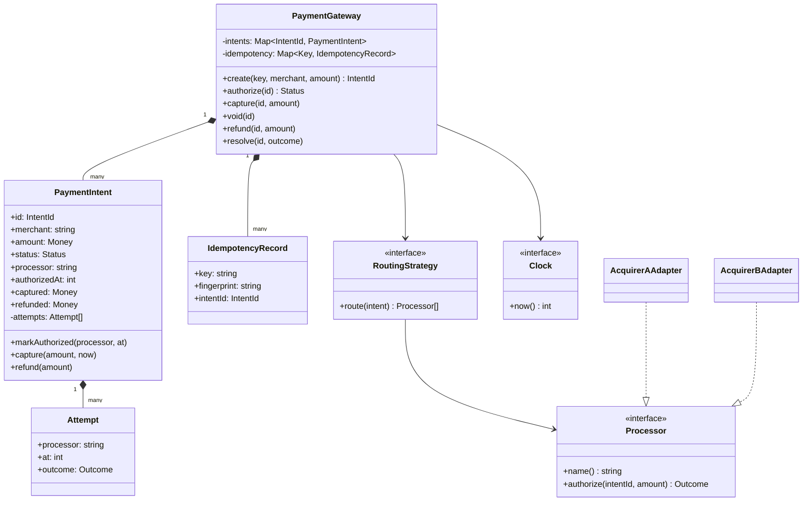
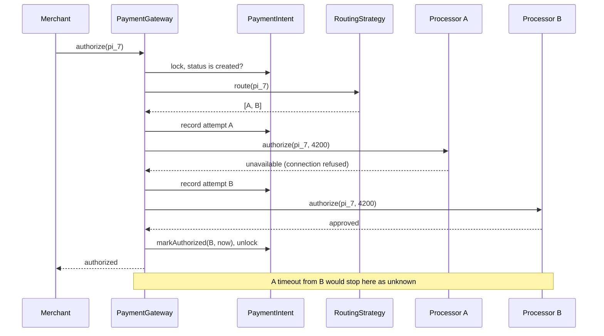

## In one minute
- A payment gateway sits between merchants and card processors. Its core object is the **payment intent**: one attempt to collect one amount, moving through a small, strict state machine (created, authorized, captured, refunded, plus the failure states).
- Every state change must be safe to retry. Merchants retry on timeouts, so `create` takes an idempotency key and every transition is checked against the current state, which makes a repeated call a no-op instead of a second charge.
- The dangerous state is **unknown**. When a processor times out, the card may or may not have been authorized. Failing over to a second processor at that point can charge the customer twice; the correct move is to stop, record the ambiguity and reconcile.
- Processors differ in API but not in meaning, so put each behind an adapter with one interface, and put the order you try them in behind a routing strategy.
- The shape is **multi-step consistency** with **trust but verify**. This lesson is the object model inside one service; the ledger, the distributed workflow and the money movement are in [Design Payment System](../sdi/design-payment-system.md). The same "ambiguous outcome means reconcile, not retry elsewhere" rule applies to any call with side effects, such as provisioning a cloud VM or sending a bank wire.

## Requirements

Functional:
- A merchant creates a payment intent for an amount in minor units (cents) with an idempotency key. Repeating the request with the same key and parameters returns the same intent; reusing the key with different parameters is an error.
- The gateway authorizes the intent by calling processors in a configured order, failing over only when it is certain the previous processor did not act.
- An authorized intent can be captured once, for any amount up to the authorized amount, before the authorization expires. It can instead be voided.
- A captured intent can be refunded in one or more partial refunds whose total never exceeds the captured amount.
- An intent whose outcome is unknown can be resolved by reconciliation to authorized or failed.

Non-functional:
- Never charge a customer twice for one intent, including under merchant retries and processor timeouts.
- Every transition is validated against the current state; an invalid call changes nothing.
- Amounts are integers in minor units; no floating point anywhere.
- Time comes from an injected clock, so authorization expiry is testable.

Out of scope: card data storage and PCI scope, 3-D Secure, currencies and FX, payouts to merchants, fraud scoring and the double-entry ledger. Name each; the ledger in particular belongs to the system design lesson.

## Entities and relationships

- **PaymentIntent** is the aggregate root: id, merchant, amount, status, the processor that authorized it, the authorization time, the captured amount and the refunded total. All rules live in its transition methods.
- **Money** is a value: an integer amount in minor units and a currency code. Arithmetic on two values with different currencies fails.
- **IdempotencyRecord** maps a merchant's key to the intent id and a fingerprint of the request (merchant plus amount), so a replay can be told apart from a conflicting reuse.
- **Processor** is the interface for a card processor: `authorize(intentId, amount)` returning approved, declined, unavailable or timeout, plus `capture`, `void` and `refund`. Each real processor gets an adapter.
- **RoutingStrategy** returns the ordered list of processors to try for an intent: by cost, by card network, by merchant, or by recent success rate.
- **PaymentGateway** is the façade merchants call. It loads the intent, delegates to the state machine and the processors, and persists the result.
- **Attempt** records each processor call (processor, request time, outcome, processor reference). It is the evidence reconciliation uses.
- **Clock** supplies time; **EventPublisher** emits webhooks such as `payment_intent.succeeded`.

Relationships: the gateway owns intents and idempotency records. An intent is composed of its attempts and refers to its processor by name, because processor configuration can change while intents live for days.

Keep refunds on the intent rather than in a separate aggregate: "total refunds never exceed capture" needs both numbers under one lock.

## Class diagram



## Key flows

Authorization with failover. The attempt is recorded before each call, so a crash mid-call leaves evidence, and failover happens only on an outcome that proves the processor did nothing.



## Design patterns used and why

- **State** for the intent lifecycle. The set of legal moves is small and strict: created to authorized, declined, failed or unknown; unknown to authorized or failed; authorized to captured, voided or expired; captured to partially refunded or refunded. A transition table (current state, operation) to next state, checked in one place, is easier to audit than status checks scattered across methods. The [State](state.md) lesson covers when to promote this to classes.
- **Adapter** for processors. Each acquirer has its own request format, error codes and idempotency header. The adapter maps "card declined, code 05" or "HTTP 503" onto the four outcomes the gateway understands. The gateway never sees a vendor type.
- **Strategy** for routing. Cheapest-first, network-specific, merchant-pinned and success-rate-weighted routing are interchangeable classes behind `route(intent)`.
- **Chain of responsibility**, constrained: the gateway walks the routed list and passes the request on only for outcomes that prove nothing happened. The constraint is the point; an unconstrained chain is how double charges happen. See the [Chain of Responsibility](chain-of-responsibility.md) lesson for the general form.
- **Idempotency key with fingerprint**, the same idea as the [Idempotency](../sd/idempotency.md) lesson, applied at intent creation; later transitions are idempotent because of the state machine itself.
- **Value object** for money: integer minor units plus currency, immutable, with arithmetic that refuses mixed currencies.

## Concurrency and edge cases

- **Merchant retries create.** Same key, same body: return the existing intent. Same key, different amount: reject with a conflict, because the merchant has a bug and silently returning the old intent would charge the wrong amount.
- **Merchant retries authorize while the first call is in flight.** Lock the intent (row lock or per-intent mutex) for the whole authorize step, or mark it `authorizing` first and make the second call return that status. Two concurrent processor calls for one intent is a double charge.
- **Processor timeout.** The request may have reached the processor. Mark the intent unknown, stop, and reconcile: query the processor by your reference, or wait for its settlement file. Retrying the same processor with its idempotency header is safe if it supports one; failing over to a different processor is not.
- **Declined is final for this attempt.** A decline is the issuer's answer about this card, so trying another processor just asks the same issuer again and looks like card testing to fraud systems.
- **Authorization expiry.** Card authorizations lapse (commonly after about seven days, varying by network and merchant type). A capture after that may fail or be downgraded, so check expiry with the injected clock and move the intent to expired rather than calling the processor.
- **Partial capture.** Capture 3,000 of a 4,200 authorization (a hotel that charged less than the hold). The remaining 1,200 is released, and refunds are bounded by 3,000, not 4,200.
- **Refund racing refund.** Two support agents refund 2,000 each on a 3,000 capture. Both checks must happen under the intent's lock so the second fails.

## Down the stack

### Layer 1: The contract
`create` returns the same intent for the same key and parameters and changes nothing on replay. `authorize` calls at most one processor that might have acted, and returns authorized, declined, failed (no processor acted) or unknown (one might have). `capture` succeeds once, only when authorized and not expired, for 1 up to the authorized amount. The sum of refunds never exceeds the captured amount. Any rejected call leaves the intent unchanged.

### Layer 2: The mechanism
In a database, intents are rows with a `status` column, and every transition is a conditional update: `UPDATE intent SET status = 'captured', captured = $2 WHERE id = $1 AND status = 'authorized' AND authorized_at > $3`, checking that one row changed. Idempotency is a table with a unique index on `(merchant_id, key)`; inserting first and reading on conflict turns the race between two retries into a database decision. Attempts are written before the network call ("record, then call"), so after a crash a sweeper finds attempts with no outcome and reconciles them. Underneath the processor's HTTP API, card authorization travels as ISO 8583 messages: an authorization request has message type `0100` and the response `0110`, with field 39 carrying the response code (`00` for approved). The adapter's job is to turn that code space into four outcomes and to forward your intent id as the processor's idempotency key or merchant reference.

### Layer 3: The machine
The local work is microseconds: a row lock, a conditional update, a commit whose write-ahead log `fsync` costs roughly 0.1 to 1 ms on an SSD. The processor call is the expensive part: a TLS connection to the acquirer, then a hop to the card network and the issuer, typically a few hundred milliseconds and sometimes several seconds. That gap shapes the code. Holding a row lock across that call is fine for one intent but not for a shared counter, so per-merchant aggregates update asynchronously. Timeouts must be shorter than the merchant's own timeout, or the merchant retries while your first attempt is still in flight; a common layout is a 30 to 60 second processor timeout under a longer merchant-facing one, with the unknown state absorbing the difference. A TCP connection reset after the request bytes left the socket buffer tells you nothing about whether the processor acted, which is why "connection refused before sending" and "reset after sending" map to different outcomes.

### Why it's built this way
1. Networks lose responses, so merchants retry, so creation needs an idempotency key and transitions need state checks.
2. A lost response can hide a successful authorization, so a timeout is unknown, not failed, and must not trigger failover.
3. Unknown outcomes must be resolved from evidence, so attempts are recorded before each call and reconciled later.
4. Processors fail independently and cost different amounts, so they sit behind adapters and a routing strategy, and failover is limited to provably safe outcomes.
5. Rounding and race errors in money are both expensive and visible, so amounts are integers and every check-then-act runs under one lock or one conditional update.

## Extensibility

- **New processor.** A new adapter and a routing rule. No change to the intent.
- **3-D Secure.** A new state, `requires_action`, between created and authorized, entered when the processor demands a challenge and left by a callback. The transition table gains two rows.
- **Multiple captures.** Some merchants ship orders in parts. Replace `captured` with a list of capture entries bounded by the authorized amount, the same shape refunds already have.
- **Ledger.** Each transition emits a balanced journal entry to the ledger described in [Design Payment System](../sdi/design-payment-system.md). The intent stays the source of truth for lifecycle; the ledger for balances.

## Leadership lens

- Build first: the transition table with tests for every illegal move, and the timeout-means-unknown rule with a reconciliation job. Fancy routing earns money; a double charge loses customers and invites chargebacks.
- Ask in review: what happens on a processor timeout; where is the lock for check-then-act; what happens if the merchant retries with a different amount; how does an unknown intent get resolved and who is paged if it does not.
- Track the share of intents in unknown and the age of the oldest one. Both are leading indicators of processor trouble and of support tickets.
- Each processor integration is a long-lived dependency with its own certification and quirks. Assign an owner per adapter, keep a sandbox contract test suite per processor, and run it daily.

## Check yourself
1. Processor A times out on an authorization. Why is failing over to processor B wrong?
   **Answer:** A may have authorized the card before the response was lost. Calling B could authorize a second time, so the intent goes to unknown and is reconciled with A instead.
2. A merchant reuses an idempotency key with a different amount. Why reject instead of returning the original intent?
   **Answer:** The merchant believes it is charging the new amount. Returning the old intent hides the bug and charges the wrong amount; a conflict error surfaces it.
3. An intent was authorized for 4,200 and captured for 3,000. What is the refund limit, and why?
   **Answer:** 3,000, because only the captured amount moved; the remaining authorization was released.
4. Why record each attempt before calling the processor rather than after?
   **Answer:** A crash during the call would otherwise leave no trace that the processor was contacted, and the intent could be retried elsewhere. The pre-recorded attempt is what reconciliation looks for.

## Practice
**Task:** Implement `PaymentGateway(processors, clock, auth_ttl)`. Each processor has a `name` and `authorize(intent_id, amount)` returning `"approved"`, `"declined"`, `"unavailable"` or `"timeout"`. `create(key, merchant, amount)` returns intent ids `pi_1`, `pi_2`, and so on; the same key with the same merchant and amount returns the same id, the same key with different parameters fails, and a non-positive amount fails. `authorize(id)` on a `created` intent tries processors in order: approved sets `authorized` and records the processor name and time; declined sets `declined` and stops; unavailable tries the next one; timeout sets `unknown` and stops; if all are unavailable the status is `failed`. On any other status it returns the current status without calling a processor. `capture(id, amount)` needs `authorized`, an amount from 1 to the intent amount, and `now - authorized_at <= auth_ttl`, otherwise it fails (and an expired authorization moves to `expired`). `void(id)` moves `authorized` to `voided`. `refund(id, amount)` needs `captured` or `partially_refunded`, a positive amount and a running total no more than the captured amount, and sets `refunded` when the total equals it. `resolve(id, outcome)` moves an `unknown` intent to `authorized` (stamped now, with the processor that timed out) or `failed`. `get(id)` returns `(status, processor, captured, refunded)`. Invalid calls fail and change nothing.

```python starter
class PaymentGateway:
    def __init__(self, processors, clock, auth_ttl):
        self._processors = processors
        self._clock = clock
        self._auth_ttl = auth_ttl

    def create(self, key, merchant, amount):
        raise NotImplementedError

    def authorize(self, intent_id):
        # TODO: fail over only on "unavailable"; "timeout" means unknown
        raise NotImplementedError

    def capture(self, intent_id, amount):
        raise NotImplementedError

    def void(self, intent_id):
        raise NotImplementedError

    def refund(self, intent_id, amount):
        raise NotImplementedError

    def resolve(self, intent_id, outcome):
        raise NotImplementedError

    def get(self, intent_id):
        raise NotImplementedError
```

```python tests
class FakeClock:
    def __init__(self):
        self.t = 0

    def now(self):
        return self.t


class FakeProcessor:
    def __init__(self, name, outcome):
        self.name = name
        self.outcome = outcome
        self.calls = []

    def authorize(self, intent_id, amount):
        self.calls.append((intent_id, amount))
        return self.outcome


def fails(fn):
    try:
        fn()
    except ValueError:
        return True
    return False


def test_idempotent_create():
    g = PaymentGateway([], FakeClock(), 100)
    a = g.create("k1", "shop", 4200)
    assert a == "pi_1"
    assert g.create("k1", "shop", 4200) == a, "replay returns the same intent"
    assert g.create("k2", "shop", 4200) == "pi_2"
    assert fails(lambda: g.create("k1", "shop", 9999)), "conflicting reuse"
    assert fails(lambda: g.create("k3", "shop", 0)), "non-positive amount"
    assert g.get(a) == ("created", "", 0, 0)


def test_failover_only_on_unavailable():
    a = FakeProcessor("acq-a", "unavailable")
    b = FakeProcessor("acq-b", "approved")
    g = PaymentGateway([a, b], FakeClock(), 100)
    pi = g.create("k", "shop", 4200)
    assert g.authorize(pi) == "authorized"
    assert g.get(pi) == ("authorized", "acq-b", 0, 0)
    assert a.calls == [(pi, 4200)] and b.calls == [(pi, 4200)]
    assert g.authorize(pi) == "authorized", "retry is a no-op"
    assert len(b.calls) == 1, "no second processor call on retry"


def test_decline_stops_and_all_unavailable_fails():
    a = FakeProcessor("acq-a", "declined")
    b = FakeProcessor("acq-b", "approved")
    g = PaymentGateway([a, b], FakeClock(), 100)
    pi = g.create("k", "shop", 500)
    assert g.authorize(pi) == "declined"
    assert b.calls == [], "a decline is not retried elsewhere"
    down = PaymentGateway([FakeProcessor("x", "unavailable"), FakeProcessor("y", "unavailable")],
                          FakeClock(), 100)
    pi2 = down.create("k", "shop", 500)
    assert down.authorize(pi2) == "failed"


def test_timeout_is_unknown_then_reconciled():
    a = FakeProcessor("acq-a", "timeout")
    b = FakeProcessor("acq-b", "approved")
    clock = FakeClock()
    g = PaymentGateway([a, b], clock, 100)
    pi = g.create("k", "shop", 4200)
    assert g.authorize(pi) == "unknown"
    assert b.calls == [], "never fail over after a timeout"
    assert fails(lambda: g.capture(pi, 4200))
    clock.t = 50
    g.resolve(pi, "authorized")
    assert g.get(pi) == ("authorized", "acq-a", 0, 0)
    clock.t = 150
    g.capture(pi, 4200)
    assert g.get(pi)[0] == "captured"
    assert fails(lambda: g.resolve(pi, "failed")), "only unknown intents resolve"


def test_partial_capture_and_refunds():
    g = PaymentGateway([FakeProcessor("acq", "approved")], FakeClock(), 100)
    pi = g.create("k", "hotel", 4200)
    assert fails(lambda: g.refund(pi, 100)), "nothing captured yet"
    g.authorize(pi)
    assert fails(lambda: g.capture(pi, 5000)), "more than authorized"
    g.capture(pi, 3000)
    assert fails(lambda: g.capture(pi, 100)), "capture happens once"
    g.refund(pi, 2000)
    assert g.get(pi) == ("partially_refunded", "acq", 3000, 2000)
    assert fails(lambda: g.refund(pi, 1001)), "refunds bounded by capture"
    g.refund(pi, 1000)
    assert g.get(pi) == ("refunded", "acq", 3000, 3000)
    assert fails(lambda: g.refund(pi, 1))


def test_authorization_expiry():
    clock = FakeClock()
    g = PaymentGateway([FakeProcessor("acq", "approved")], clock, 100)
    pi = g.create("k", "shop", 800)
    clock.t = 10
    g.authorize(pi)
    clock.t = 111
    assert fails(lambda: g.capture(pi, 800))
    assert g.get(pi)[0] == "expired"


def test_void_and_invalid_transitions():
    g = PaymentGateway([FakeProcessor("acq", "approved")], FakeClock(), 100)
    pi = g.create("k", "shop", 800)
    assert fails(lambda: g.void(pi)), "cannot void before authorizing"
    g.authorize(pi)
    g.void(pi)
    assert g.get(pi) == ("voided", "acq", 0, 0)
    assert fails(lambda: g.capture(pi, 800))
    assert g.authorize(pi) == "voided"
    assert fails(lambda: g.get("pi_404"))
```

```python solution
class _Intent:
    def __init__(self, intent_id, merchant, amount):
        self.id = intent_id
        self.merchant = merchant
        self.amount = amount
        self.status = "created"
        self.processor = ""
        self.authorized_at = 0
        self.captured = 0
        self.refunded = 0


class PaymentGateway:
    def __init__(self, processors, clock, auth_ttl):
        self._processors = list(processors)
        self._clock = clock
        self._auth_ttl = auth_ttl
        self._intents = {}
        self._keys = {}

    def _get(self, intent_id):
        if intent_id not in self._intents:
            raise ValueError("unknown intent: " + intent_id)
        return self._intents[intent_id]

    def _require(self, intent, op, *allowed):
        if intent.status not in allowed:
            raise ValueError("cannot " + op + " in " + intent.status)

    def create(self, key, merchant, amount):
        if amount <= 0:
            raise ValueError("amount must be positive")
        if key in self._keys:
            fingerprint, intent_id = self._keys[key]
            if fingerprint != (merchant, amount):
                raise ValueError("idempotency key reused with different parameters")
            return intent_id
        intent_id = "pi_" + str(len(self._intents) + 1)
        self._intents[intent_id] = _Intent(intent_id, merchant, amount)
        self._keys[key] = ((merchant, amount), intent_id)
        return intent_id

    def authorize(self, intent_id):
        intent = self._get(intent_id)
        if intent.status != "created":
            return intent.status
        for p in self._processors:
            outcome = p.authorize(intent.id, intent.amount)
            if outcome == "unavailable":
                continue
            intent.processor = p.name
            if outcome == "approved":
                intent.status = "authorized"
                intent.authorized_at = self._clock.now()
            elif outcome == "declined":
                intent.status = "declined"
            else:
                intent.status = "unknown"
            return intent.status
        intent.status = "failed"
        return intent.status

    def capture(self, intent_id, amount):
        intent = self._get(intent_id)
        self._require(intent, "capture", "authorized")
        if amount < 1 or amount > intent.amount:
            raise ValueError("capture amount out of range")
        if self._clock.now() - intent.authorized_at > self._auth_ttl:
            intent.status = "expired"
            raise ValueError("authorization expired")
        intent.captured = amount
        intent.status = "captured"

    def void(self, intent_id):
        intent = self._get(intent_id)
        self._require(intent, "void", "authorized")
        intent.status = "voided"

    def refund(self, intent_id, amount):
        intent = self._get(intent_id)
        self._require(intent, "refund", "captured", "partially_refunded")
        if amount < 1 or intent.refunded + amount > intent.captured:
            raise ValueError("refund exceeds captured amount")
        intent.refunded += amount
        if intent.refunded == intent.captured:
            intent.status = "refunded"
        else:
            intent.status = "partially_refunded"

    def resolve(self, intent_id, outcome):
        intent = self._get(intent_id)
        self._require(intent, "resolve", "unknown")
        if outcome == "authorized":
            intent.status = "authorized"
            intent.authorized_at = self._clock.now()
        elif outcome == "failed":
            intent.status = "failed"
        else:
            raise ValueError("unknown outcome: " + outcome)

    def get(self, intent_id):
        i = self._get(intent_id)
        return (i.status, i.processor, i.captured, i.refunded)
```

```typescript starter
export interface Clock { now(): number }
export type Outcome = "approved" | "declined" | "unavailable" | "timeout";
export interface Processor { name: string; authorize(intentId: string, amount: number): Outcome }
export type IntentView = [string, string, number, number];

export class PaymentGateway {
  constructor(private processors: Processor[], private clock: Clock, private authTtl: number) {}

  create(key: string, merchant: string, amount: number): string { throw new Error("TODO"); }
  authorize(intentId: string): string { throw new Error("TODO"); }
  capture(intentId: string, amount: number): void { throw new Error("TODO"); }
  void(intentId: string): void { throw new Error("TODO"); }
  refund(intentId: string, amount: number): void { throw new Error("TODO"); }
  resolve(intentId: string, outcome: string): void { throw new Error("TODO"); }
  get(intentId: string): IntentView { throw new Error("TODO"); }
}
```

```typescript tests
class FakeClock implements Clock {
  t = 0;
  now(): number { return this.t; }
}

class FakeProcessor implements Processor {
  calls: Array<[string, number]> = [];
  constructor(public name: string, private outcome: Outcome) {}
  authorize(intentId: string, amount: number): Outcome {
    this.calls.push([intentId, amount]);
    return this.outcome;
  }
}

function fails(fn: () => void): boolean {
  try { fn(); return false; } catch (e) { return true; }
}

test("idempotent create", () => {
  const g = new PaymentGateway([], new FakeClock(), 100);
  const a = g.create("k1", "shop", 4200);
  assertEqual(a, "pi_1");
  assertEqual(g.create("k1", "shop", 4200), a, "replay returns the same intent");
  assertEqual(g.create("k2", "shop", 4200), "pi_2");
  assert(fails(() => g.create("k1", "shop", 9999)), "conflicting reuse");
  assert(fails(() => g.create("k3", "shop", 0)), "non-positive amount");
  assertEqual(g.get(a), ["created", "", 0, 0]);
});

test("failover only on unavailable", () => {
  const a = new FakeProcessor("acq-a", "unavailable");
  const b = new FakeProcessor("acq-b", "approved");
  const g = new PaymentGateway([a, b], new FakeClock(), 100);
  const pi = g.create("k", "shop", 4200);
  assertEqual(g.authorize(pi), "authorized");
  assertEqual(g.get(pi), ["authorized", "acq-b", 0, 0]);
  assertEqual(a.calls, [[pi, 4200]]);
  assertEqual(b.calls, [[pi, 4200]]);
  assertEqual(g.authorize(pi), "authorized", "retry is a no-op");
  assertEqual(b.calls.length, 1, "no second processor call on retry");
});

test("decline stops and all unavailable fails", () => {
  const a = new FakeProcessor("acq-a", "declined");
  const b = new FakeProcessor("acq-b", "approved");
  const g = new PaymentGateway([a, b], new FakeClock(), 100);
  const pi = g.create("k", "shop", 500);
  assertEqual(g.authorize(pi), "declined");
  assertEqual(b.calls, [], "a decline is not retried elsewhere");
  const down = new PaymentGateway([new FakeProcessor("x", "unavailable"), new FakeProcessor("y", "unavailable")],
    new FakeClock(), 100);
  const pi2 = down.create("k", "shop", 500);
  assertEqual(down.authorize(pi2), "failed");
});

test("timeout is unknown then reconciled", () => {
  const a = new FakeProcessor("acq-a", "timeout");
  const b = new FakeProcessor("acq-b", "approved");
  const clock = new FakeClock();
  const g = new PaymentGateway([a, b], clock, 100);
  const pi = g.create("k", "shop", 4200);
  assertEqual(g.authorize(pi), "unknown");
  assertEqual(b.calls, [], "never fail over after a timeout");
  assert(fails(() => g.capture(pi, 4200)), "cannot capture unknown");
  clock.t = 50;
  g.resolve(pi, "authorized");
  assertEqual(g.get(pi), ["authorized", "acq-a", 0, 0]);
  clock.t = 150;
  g.capture(pi, 4200);
  assertEqual(g.get(pi)[0], "captured");
  assert(fails(() => g.resolve(pi, "failed")), "only unknown intents resolve");
});

test("partial capture and refunds", () => {
  const g = new PaymentGateway([new FakeProcessor("acq", "approved")], new FakeClock(), 100);
  const pi = g.create("k", "hotel", 4200);
  assert(fails(() => g.refund(pi, 100)), "nothing captured yet");
  g.authorize(pi);
  assert(fails(() => g.capture(pi, 5000)), "more than authorized");
  g.capture(pi, 3000);
  assert(fails(() => g.capture(pi, 100)), "capture happens once");
  g.refund(pi, 2000);
  assertEqual(g.get(pi), ["partially_refunded", "acq", 3000, 2000]);
  assert(fails(() => g.refund(pi, 1001)), "refunds bounded by capture");
  g.refund(pi, 1000);
  assertEqual(g.get(pi), ["refunded", "acq", 3000, 3000]);
  assert(fails(() => g.refund(pi, 1)), "fully refunded");
});

test("authorization expiry", () => {
  const clock = new FakeClock();
  const g = new PaymentGateway([new FakeProcessor("acq", "approved")], clock, 100);
  const pi = g.create("k", "shop", 800);
  clock.t = 10;
  g.authorize(pi);
  clock.t = 111;
  assert(fails(() => g.capture(pi, 800)), "expired");
  assertEqual(g.get(pi)[0], "expired");
});

test("void and invalid transitions", () => {
  const g = new PaymentGateway([new FakeProcessor("acq", "approved")], new FakeClock(), 100);
  const pi = g.create("k", "shop", 800);
  assert(fails(() => g.void(pi)), "cannot void before authorizing");
  g.authorize(pi);
  g.void(pi);
  assertEqual(g.get(pi), ["voided", "acq", 0, 0]);
  assert(fails(() => g.capture(pi, 800)), "voided");
  assertEqual(g.authorize(pi), "voided");
  assert(fails(() => g.get("pi_404")), "unknown intent");
});
```

```typescript solution
export interface Clock { now(): number }
export type Outcome = "approved" | "declined" | "unavailable" | "timeout";
export interface Processor { name: string; authorize(intentId: string, amount: number): Outcome }
export type IntentView = [string, string, number, number];

interface Intent {
  id: string;
  merchant: string;
  amount: number;
  status: string;
  processor: string;
  authorizedAt: number;
  captured: number;
  refunded: number;
}

export class PaymentGateway {
  private intents = new Map<string, Intent>();
  private keys = new Map<string, { fingerprint: string; intentId: string }>();

  constructor(private processors: Processor[], private clock: Clock, private authTtl: number) {}

  private load(intentId: string): Intent {
    const intent = this.intents.get(intentId);
    if (!intent) throw new Error("unknown intent: " + intentId);
    return intent;
  }

  private require(intent: Intent, op: string, ...allowed: string[]): void {
    if (!allowed.includes(intent.status)) throw new Error(`cannot ${op} in ${intent.status}`);
  }

  create(key: string, merchant: string, amount: number): string {
    if (amount <= 0) throw new Error("amount must be positive");
    const fingerprint = JSON.stringify([merchant, amount]);
    const prior = this.keys.get(key);
    if (prior) {
      if (prior.fingerprint !== fingerprint) throw new Error("idempotency key reused with different parameters");
      return prior.intentId;
    }
    const id = "pi_" + (this.intents.size + 1);
    this.intents.set(id, { id, merchant, amount, status: "created", processor: "",
      authorizedAt: 0, captured: 0, refunded: 0 });
    this.keys.set(key, { fingerprint, intentId: id });
    return id;
  }

  authorize(intentId: string): string {
    const intent = this.load(intentId);
    if (intent.status !== "created") return intent.status;
    for (const p of this.processors) {
      const outcome = p.authorize(intent.id, intent.amount);
      if (outcome === "unavailable") continue;
      intent.processor = p.name;
      if (outcome === "approved") {
        intent.status = "authorized";
        intent.authorizedAt = this.clock.now();
      } else {
        intent.status = outcome === "declined" ? "declined" : "unknown";
      }
      return intent.status;
    }
    intent.status = "failed";
    return intent.status;
  }

  capture(intentId: string, amount: number): void {
    const intent = this.load(intentId);
    this.require(intent, "capture", "authorized");
    if (amount < 1 || amount > intent.amount) throw new Error("capture amount out of range");
    if (this.clock.now() - intent.authorizedAt > this.authTtl) {
      intent.status = "expired";
      throw new Error("authorization expired");
    }
    intent.captured = amount;
    intent.status = "captured";
  }

  void(intentId: string): void {
    const intent = this.load(intentId);
    this.require(intent, "void", "authorized");
    intent.status = "voided";
  }

  refund(intentId: string, amount: number): void {
    const intent = this.load(intentId);
    this.require(intent, "refund", "captured", "partially_refunded");
    if (amount < 1 || intent.refunded + amount > intent.captured) {
      throw new Error("refund exceeds captured amount");
    }
    intent.refunded += amount;
    intent.status = intent.refunded === intent.captured ? "refunded" : "partially_refunded";
  }

  resolve(intentId: string, outcome: string): void {
    const intent = this.load(intentId);
    this.require(intent, "resolve", "unknown");
    if (outcome === "authorized") {
      intent.status = "authorized";
      intent.authorizedAt = this.clock.now();
    } else if (outcome === "failed") {
      intent.status = "failed";
    } else {
      throw new Error("unknown outcome: " + outcome);
    }
  }

  get(intentId: string): IntentView {
    const i = this.load(intentId);
    return [i.status, i.processor, i.captured, i.refunded];
  }
}
```

```go starter
package practice

import "errors"

var (
	ErrInvalid           = errors.New("invalid request")
	ErrIdempotencyReused = errors.New("idempotency key reused with different parameters")
	ErrUnknownIntent     = errors.New("unknown intent")
	ErrBadTransition     = errors.New("invalid transition")
	ErrExpired           = errors.New("authorization expired")
)

type Clock interface{ Now() int64 }

type Outcome string

const (
	Approved    Outcome = "approved"
	Declined    Outcome = "declined"
	Unavailable Outcome = "unavailable"
	Timeout     Outcome = "timeout"
)

type Processor interface {
	Name() string
	Authorize(intentID string, amount int64) Outcome
}

type IntentView struct {
	Status    string
	Processor string
	Captured  int64
	Refunded  int64
}

type PaymentGateway struct{}

func NewPaymentGateway(processors []Processor, clock Clock, authTTL int64) *PaymentGateway {
	return &PaymentGateway{}
}

func (g *PaymentGateway) Create(key, merchant string, amount int64) (string, error) { panic("TODO") }
func (g *PaymentGateway) Authorize(id string) (string, error)                     { panic("TODO") }
func (g *PaymentGateway) Capture(id string, amount int64) error                   { panic("TODO") }
func (g *PaymentGateway) Void(id string) error                                    { panic("TODO") }
func (g *PaymentGateway) Refund(id string, amount int64) error                    { panic("TODO") }
func (g *PaymentGateway) Resolve(id, outcome string) error                        { panic("TODO") }
func (g *PaymentGateway) Get(id string) (IntentView, error)                       { panic("TODO") }
```

```go tests
package practice

import (
	"errors"
	"testing"
)

type fakeClock struct{ t int64 }

func (c *fakeClock) Now() int64 { return c.t }

type fakeProcessor struct {
	name    string
	outcome Outcome
	calls   int
}

func (p *fakeProcessor) Name() string { return p.name }
func (p *fakeProcessor) Authorize(intentID string, amount int64) Outcome {
	p.calls++
	return p.outcome
}

func mustCreate(t *testing.T, g *PaymentGateway, key string, amount int64) string {
	t.Helper()
	id, err := g.Create(key, "shop", amount)
	if err != nil {
		t.Fatal(err)
	}
	return id
}

func expectView(t *testing.T, g *PaymentGateway, id string, want IntentView) {
	t.Helper()
	got, err := g.Get(id)
	if err != nil || got != want {
		t.Fatalf("get %s: got %+v, %v want %+v", id, got, err, want)
	}
}

func expectStatus(t *testing.T, g *PaymentGateway, id, want string) {
	t.Helper()
	if v, _ := g.Get(id); v.Status != want {
		t.Fatalf("status %s want %s", v.Status, want)
	}
}

func TestIdempotentCreate(t *testing.T) {
	g := NewPaymentGateway(nil, &fakeClock{}, 100)
	a := mustCreate(t, g, "k1", 4200)
	if a != "pi_1" || mustCreate(t, g, "k1", 4200) != a || mustCreate(t, g, "k2", 4200) != "pi_2" {
		t.Fatal("ids or replay wrong")
	}
	if _, err := g.Create("k1", "shop", 9999); !errors.Is(err, ErrIdempotencyReused) {
		t.Fatalf("want ErrIdempotencyReused, got %v", err)
	}
	if _, err := g.Create("k3", "shop", 0); !errors.Is(err, ErrInvalid) {
		t.Fatalf("want ErrInvalid, got %v", err)
	}
	expectView(t, g, a, IntentView{"created", "", 0, 0})
}

func TestFailoverOnlyOnUnavailable(t *testing.T) {
	a := &fakeProcessor{name: "acq-a", outcome: Unavailable}
	b := &fakeProcessor{name: "acq-b", outcome: Approved}
	g := NewPaymentGateway([]Processor{a, b}, &fakeClock{}, 100)
	pi := mustCreate(t, g, "k", 4200)
	if s, _ := g.Authorize(pi); s != "authorized" {
		t.Fatalf("status %s", s)
	}
	expectView(t, g, pi, IntentView{"authorized", "acq-b", 0, 0})
	if s, _ := g.Authorize(pi); s != "authorized" || a.calls != 1 || b.calls != 1 {
		t.Fatalf("retry must not call processors again: a=%d b=%d", a.calls, b.calls)
	}
}

func TestDeclineStopsAndAllUnavailableFails(t *testing.T) {
	a := &fakeProcessor{name: "acq-a", outcome: Declined}
	b := &fakeProcessor{name: "acq-b", outcome: Approved}
	g := NewPaymentGateway([]Processor{a, b}, &fakeClock{}, 100)
	pi := mustCreate(t, g, "k", 500)
	if s, _ := g.Authorize(pi); s != "declined" || b.calls != 0 {
		t.Fatalf("status %s, b calls %d", s, b.calls)
	}
	down := NewPaymentGateway([]Processor{&fakeProcessor{name: "x", outcome: Unavailable},
		&fakeProcessor{name: "y", outcome: Unavailable}}, &fakeClock{}, 100)
	pi2 := mustCreate(t, down, "k", 500)
	if s, _ := down.Authorize(pi2); s != "failed" {
		t.Fatalf("status %s", s)
	}
}

func TestTimeoutIsUnknownThenReconciled(t *testing.T) {
	a := &fakeProcessor{name: "acq-a", outcome: Timeout}
	b := &fakeProcessor{name: "acq-b", outcome: Approved}
	clock := &fakeClock{}
	g := NewPaymentGateway([]Processor{a, b}, clock, 100)
	pi := mustCreate(t, g, "k", 4200)
	if s, _ := g.Authorize(pi); s != "unknown" || b.calls != 0 {
		t.Fatalf("status %s, b calls %d", s, b.calls)
	}
	if err := g.Capture(pi, 4200); !errors.Is(err, ErrBadTransition) {
		t.Fatalf("want ErrBadTransition, got %v", err)
	}
	clock.t = 50
	if err := g.Resolve(pi, "authorized"); err != nil {
		t.Fatal(err)
	}
	expectView(t, g, pi, IntentView{"authorized", "acq-a", 0, 0})
	clock.t = 150
	if err := g.Capture(pi, 4200); err != nil {
		t.Fatal(err)
	}
	expectStatus(t, g, pi, "captured")
	if err := g.Resolve(pi, "failed"); !errors.Is(err, ErrBadTransition) {
		t.Fatalf("want ErrBadTransition, got %v", err)
	}
}

func TestPartialCaptureAndRefunds(t *testing.T) {
	g := NewPaymentGateway([]Processor{&fakeProcessor{name: "acq", outcome: Approved}}, &fakeClock{}, 100)
	pi := mustCreate(t, g, "k", 4200)
	if err := g.Refund(pi, 100); !errors.Is(err, ErrBadTransition) {
		t.Fatalf("nothing captured yet: %v", err)
	}
	g.Authorize(pi)
	if err := g.Capture(pi, 5000); !errors.Is(err, ErrInvalid) {
		t.Fatalf("more than authorized: %v", err)
	}
	if err := g.Capture(pi, 3000); err != nil {
		t.Fatal(err)
	}
	if err := g.Capture(pi, 100); err == nil {
		t.Fatal("capture happens once")
	}
	if err := g.Refund(pi, 2000); err != nil {
		t.Fatal(err)
	}
	expectView(t, g, pi, IntentView{"partially_refunded", "acq", 3000, 2000})
	if err := g.Refund(pi, 1001); !errors.Is(err, ErrInvalid) {
		t.Fatalf("refunds bounded by capture: %v", err)
	}
	if err := g.Refund(pi, 1000); err != nil {
		t.Fatal(err)
	}
	expectView(t, g, pi, IntentView{"refunded", "acq", 3000, 3000})
	if err := g.Refund(pi, 1); err == nil {
		t.Fatal("fully refunded")
	}
}

func TestAuthorizationExpiry(t *testing.T) {
	clock := &fakeClock{}
	g := NewPaymentGateway([]Processor{&fakeProcessor{name: "acq", outcome: Approved}}, clock, 100)
	pi := mustCreate(t, g, "k", 800)
	clock.t = 10
	g.Authorize(pi)
	clock.t = 111
	if err := g.Capture(pi, 800); !errors.Is(err, ErrExpired) {
		t.Fatalf("want ErrExpired, got %v", err)
	}
	expectStatus(t, g, pi, "expired")
}

func TestVoidAndInvalidTransitions(t *testing.T) {
	g := NewPaymentGateway([]Processor{&fakeProcessor{name: "acq", outcome: Approved}}, &fakeClock{}, 100)
	pi := mustCreate(t, g, "k", 800)
	if err := g.Void(pi); !errors.Is(err, ErrBadTransition) {
		t.Fatalf("cannot void before authorizing: %v", err)
	}
	g.Authorize(pi)
	if err := g.Void(pi); err != nil {
		t.Fatal(err)
	}
	expectView(t, g, pi, IntentView{"voided", "acq", 0, 0})
	if err := g.Capture(pi, 800); !errors.Is(err, ErrBadTransition) {
		t.Fatalf("voided: %v", err)
	}
	if s, _ := g.Authorize(pi); s != "voided" {
		t.Fatalf("status %s", s)
	}
	if _, err := g.Get("pi_404"); !errors.Is(err, ErrUnknownIntent) {
		t.Fatalf("want ErrUnknownIntent, got %v", err)
	}
}
```

```go solution
package practice

import (
	"errors"
	"fmt"
	"sync"
)

var (
	ErrInvalid           = errors.New("invalid request")
	ErrIdempotencyReused = errors.New("idempotency key reused with different parameters")
	ErrUnknownIntent     = errors.New("unknown intent")
	ErrBadTransition     = errors.New("invalid transition")
	ErrExpired           = errors.New("authorization expired")
)

type Clock interface{ Now() int64 }

type Outcome string

const (
	Approved    Outcome = "approved"
	Declined    Outcome = "declined"
	Unavailable Outcome = "unavailable"
	Timeout     Outcome = "timeout"
)

type Processor interface {
	Name() string
	Authorize(intentID string, amount int64) Outcome
}

type IntentView struct {
	Status    string
	Processor string
	Captured  int64
	Refunded  int64
}

type intent struct {
	IntentView
	merchant     string
	amount       int64
	authorizedAt int64
}

type idemRecord struct {
	merchant string
	amount   int64
	id       string
}

// PaymentGateway holds one lock across each operation, including the processor
// call, so two retries of one intent can never reach two processors.
type PaymentGateway struct {
	mu         sync.Mutex
	processors []Processor
	clock      Clock
	authTTL    int64
	intents    map[string]*intent
	keys       map[string]idemRecord
}

func NewPaymentGateway(processors []Processor, clock Clock, authTTL int64) *PaymentGateway {
	return &PaymentGateway{processors: processors, clock: clock, authTTL: authTTL,
		intents: map[string]*intent{}, keys: map[string]idemRecord{}}
}

func (g *PaymentGateway) load(id string) (*intent, error) {
	in, ok := g.intents[id]
	if !ok {
		return nil, fmt.Errorf("%w: %s", ErrUnknownIntent, id)
	}
	return in, nil
}

func require(in *intent, op string, allowed ...string) error {
	for _, s := range allowed {
		if in.Status == s {
			return nil
		}
	}
	return fmt.Errorf("%w: cannot %s in %s", ErrBadTransition, op, in.Status)
}

func (g *PaymentGateway) Create(key, merchant string, amount int64) (string, error) {
	g.mu.Lock()
	defer g.mu.Unlock()
	if amount <= 0 {
		return "", fmt.Errorf("%w: amount must be positive", ErrInvalid)
	}
	if rec, ok := g.keys[key]; ok {
		if rec.merchant != merchant || rec.amount != amount {
			return "", ErrIdempotencyReused
		}
		return rec.id, nil
	}
	id := fmt.Sprintf("pi_%d", len(g.intents)+1)
	g.intents[id] = &intent{IntentView: IntentView{Status: "created"}, merchant: merchant, amount: amount}
	g.keys[key] = idemRecord{merchant, amount, id}
	return id, nil
}

func (g *PaymentGateway) Authorize(id string) (string, error) {
	g.mu.Lock()
	defer g.mu.Unlock()
	in, err := g.load(id)
	if err != nil {
		return "", err
	}
	if in.Status != "created" {
		return in.Status, nil
	}
	for _, p := range g.processors {
		outcome := p.Authorize(id, in.amount)
		if outcome == Unavailable {
			continue // provably not acted on: safe to fail over
		}
		in.Processor = p.Name()
		switch outcome {
		case Approved:
			in.Status, in.authorizedAt = "authorized", g.clock.Now()
		case Declined:
			in.Status = "declined"
		default:
			in.Status = "unknown" // may have acted: stop and reconcile
		}
		return in.Status, nil
	}
	in.Status = "failed"
	return in.Status, nil
}

func (g *PaymentGateway) Capture(id string, amount int64) error {
	g.mu.Lock()
	defer g.mu.Unlock()
	in, err := g.load(id)
	if err != nil {
		return err
	}
	if err := require(in, "capture", "authorized"); err != nil {
		return err
	}
	if amount < 1 || amount > in.amount {
		return fmt.Errorf("%w: capture amount out of range", ErrInvalid)
	}
	if g.clock.Now()-in.authorizedAt > g.authTTL {
		in.Status = "expired"
		return ErrExpired
	}
	in.Captured, in.Status = amount, "captured"
	return nil
}

func (g *PaymentGateway) Void(id string) error {
	g.mu.Lock()
	defer g.mu.Unlock()
	in, err := g.load(id)
	if err != nil {
		return err
	}
	if err := require(in, "void", "authorized"); err != nil {
		return err
	}
	in.Status = "voided"
	return nil
}

func (g *PaymentGateway) Refund(id string, amount int64) error {
	g.mu.Lock()
	defer g.mu.Unlock()
	in, err := g.load(id)
	if err != nil {
		return err
	}
	if err := require(in, "refund", "captured", "partially_refunded"); err != nil {
		return err
	}
	if amount < 1 || in.Refunded+amount > in.Captured {
		return fmt.Errorf("%w: refund exceeds captured amount", ErrInvalid)
	}
	in.Refunded += amount
	if in.Refunded == in.Captured {
		in.Status = "refunded"
	} else {
		in.Status = "partially_refunded"
	}
	return nil
}

func (g *PaymentGateway) Resolve(id, outcome string) error {
	g.mu.Lock()
	defer g.mu.Unlock()
	in, err := g.load(id)
	if err != nil {
		return err
	}
	if err := require(in, "resolve", "unknown"); err != nil {
		return err
	}
	switch outcome {
	case "authorized":
		in.Status, in.authorizedAt = "authorized", g.clock.Now()
	case "failed":
		in.Status = "failed"
	default:
		return fmt.Errorf("%w: outcome %s", ErrInvalid, outcome)
	}
	return nil
}

func (g *PaymentGateway) Get(id string) (IntentView, error) {
	g.mu.Lock()
	defer g.mu.Unlock()
	in, err := g.load(id)
	if err != nil {
		return IntentView{}, err
	}
	return in.IntentView, nil
}
```

## Mock interview
**Prompt:** Design the core classes of a payment gateway that lets merchants create payments, authorize them against one of three card processors, capture, void and refund. The gateway handles 2,000 authorizations per second at peak, and processors occasionally time out or go down.

- Follow-up: Processor A times out on 0.5 percent of requests for ten minutes. What happens to those intents, what does the merchant see, and how are they resolved?
- Follow-up: A merchant's client retries `create` with the same idempotency key but a different amount because of a cart bug. What do you return?
- Follow-up: Finance wants to route to the cheapest processor per card network. Where does that change land, and what metric would make you roll it back?

**A strong answer covers:**
- A payment intent aggregate with an explicit transition table and integer minor-unit amounts.
- Idempotency keys with a request fingerprint at creation, and state checks making every later transition safely repeatable.
- Processor adapters with a four-outcome contract, and failover only on outcomes that prove the processor did not act.
- The unknown state, attempts recorded before each call, and a reconciliation path that resolves unknowns from processor evidence.
- Per-intent locking (or conditional updates) for authorize, capture and refund, with refunds bounded by captured amount.
- A clear boundary to the ledger and money-movement workflow in the system design lesson.

## Watch
- [System Design: Payment Gateway (System Design Fight Club)](https://www.youtube.com/watch?v=shipSEFMzHs): an idempotent authorize-and-capture workflow, end to end.
- [Idempotency and Intelligent Retry | PayPal (ByteMonk)](https://www.youtube.com/watch?v=S3nq_Iq4eMI): how a payments company combines idempotency keys with retries.

## Free resources
- [The PaymentIntent object (Stripe API docs)](https://docs.stripe.com/api/payment_intents/object): a production intent model with its statuses, amounts and capture fields.
- [Place a hold on a payment method (Stripe docs)](https://docs.stripe.com/payments/place-a-hold-on-a-payment-method): separate authorization and capture, partial capture and authorization validity windows.
- [Designing robust and predictable APIs with idempotency (Stripe)](https://stripe.com/blog/idempotency): why idempotency keys exist and how clients should retry.
- [Implementing Stripe-like idempotency keys in Postgres (Brandur Leach)](https://brandur.org/idempotency-keys): recovery points, atomic phases and the schema behind safe retries.
- [ISO 8583 (Wikipedia)](https://en.wikipedia.org/wiki/ISO_8583): the card message standard under processor APIs, including message type indicators and response codes.
- [Making retries safe with idempotent APIs (AWS Builders' Library)](https://aws.amazon.com/builders-library/making-retries-safe-with-idempotent-APIs/): the general rules for ambiguous outcomes and client tokens.
