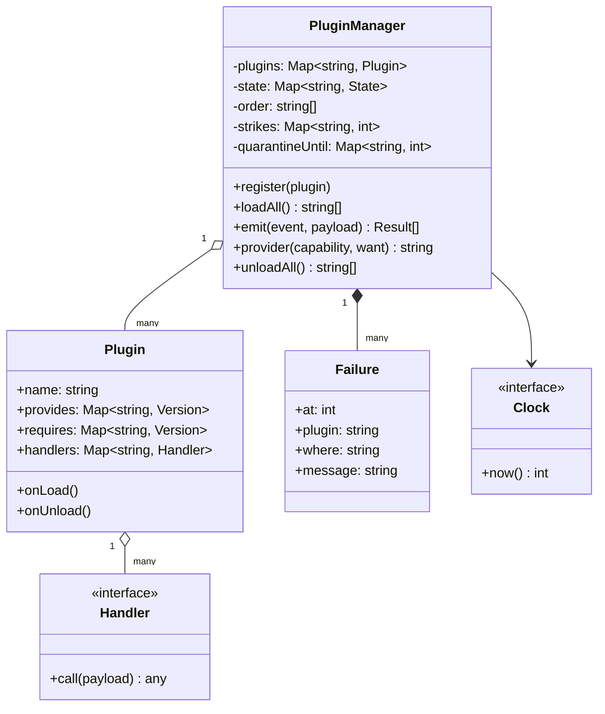
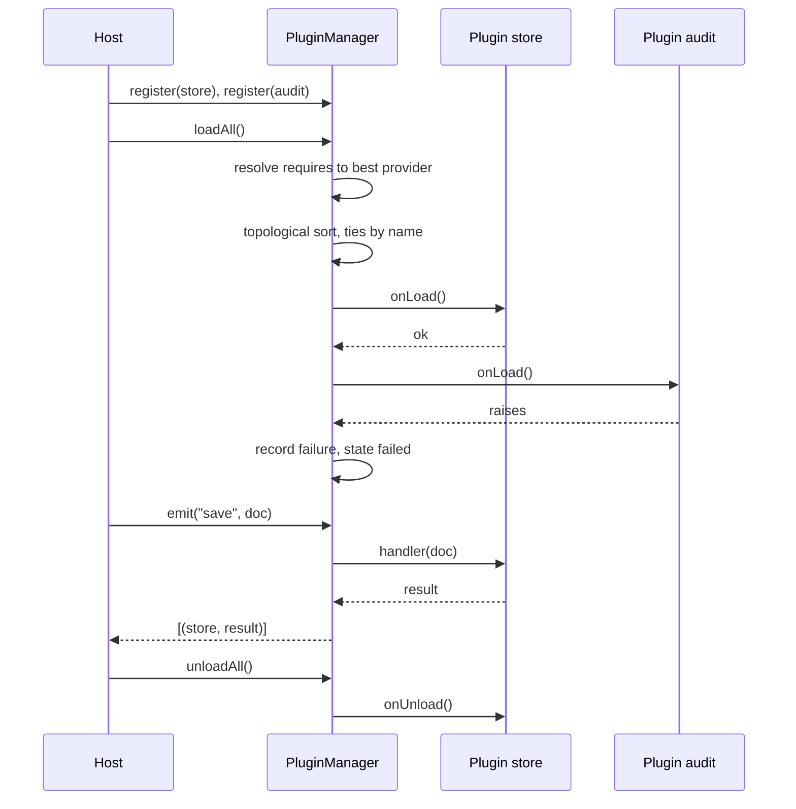

## In one minute
- A plugin system is a contract between a host that must stay up and code it did not write. The hard parts are not the `Plugin` interface; they are deciding what a plugin may rely on (versioned capabilities), what order things start in (dependencies), and what happens to everyone else when one plugin misbehaves (isolation).
- Plugins should depend on **capabilities** such as `storage 1.2`, not on each other by name. A capability has a name and a `major.minor` version: same major means compatible, higher minor means more features. This lets two plugins swap behind the same contract.
- Startup order is a topological sort of the dependency graph, with a deterministic tie-break so the same set of plugins always loads the same way. Cycles and missing dependencies reject only the plugins involved, never the whole host.
- Every call into plugin code is a trust boundary. Wrap it, record the failure, count strikes, and stop calling a plugin that keeps failing for a cooldown period. In-process isolation is only error isolation; real isolation needs a process.
- The shape is **partial failure** inside one program: the same design appears as admission webhooks in Kubernetes, extensions in an editor, and middleware in a web framework.

## Requirements

Functional:
- A host application defines named **events** (for example `request.start`, `save`) and plugins subscribe handlers to them.
- A plugin declares the capabilities it **provides** (name and version) and **requires** (name and minimum version).
- The host loads plugins in dependency order, calls each plugin's load hook once, and unloads in reverse order.
- Introspection: for each plugin, a state (`registered`, `active`, `rejected`, `failed`, `skipped`, `stopped`) and a human reason.
- `emit(event, payload)` calls every subscribed handler in load order and returns the successful results.

Non-functional:
- A plugin that throws, panics or loads badly never stops the host or unrelated plugins.
- Load order is deterministic, so a bug report can be replayed.
- A repeatedly failing plugin stops consuming the request path and is retried later.
- Time is injected, so quarantine and cooldown are testable.

Out of scope: finding plugin files on disk (discovery is sketched in Down the stack), sandboxing untrusted code, hot reload, and plugin marketplaces. Mention them, park them in Extensibility, and move on.

## Entities and relationships

- **PluginManager** is the host's façade. It owns the registry of plugins, their states, the resolved dependency edges, the load order, and the failure log.
- **Plugin** is a value-like record: a unique name, the capabilities it provides and requires, a map of event name to handler, and two lifecycle hooks (`on_load`, `on_unload`). Keep it a record with callbacks; an abstract base class with five overridable methods is the heavier, more brittle shape.
- **Capability** is a name plus a `major.minor` version. It is the unit of compatibility, and it is why plugins do not import each other.
- **State** is an enum with guarded transitions: a plugin goes from `registered` to exactly one of `active`, `rejected`, `failed` or `skipped`, and from `active` to `stopped`.
- **Failure** is an immutable log entry: time, plugin, where (`on_load`, an event name, `on_unload`) and message.
- **Clock** supplies time for failure records and cooldowns.

Relationships: the manager aggregates plugins (they are created outside it and handed in). Dependencies are not stored on a plugin; the manager computes them by matching each `requires` entry to the best `provides` entry, so the graph is derived data that can be recomputed after any change.

## Class diagram



## Key flows

Load happens once, in three passes: resolve, order, start. Emit is the hot path and wraps every handler.



## Design patterns used and why

- **Observer** is the event bus. A plugin subscribes handlers to named events and the host publishes without knowing who listens. The cost of Observer is that the publisher loses control of what runs on its thread, which is why every call is wrapped (see Concurrency and edge cases).
- **Strategy** is what a capability is. When several plugins provide `storage 1.x`, the host selects one provider and calls through the capability's contract, exactly as a context object picks a strategy. The manager's `provider(capability, want)` is the selector: highest compatible version, ties broken by name.
- **Template Method** is the lifecycle. The manager owns the fixed skeleton (check dependencies, call `on_load`, record the outcome, update state), and a plugin fills in only the hook. The skeleton is the part you never let a plugin override, because it holds the safety rules. In languages with inheritance you can expose it as a base class with `on_load` and `on_unload`; with first-class functions, a record of callbacks gives the same inversion of control with less coupling.
- **Façade** hides the registry, the sort and the failure log behind five methods.
- **Registry plus dependency injection** replaces a global plugin list. The host builds one manager, passes the clock in, and passes the manager to code that emits events. A static singleton registry makes tests share plugins.

## Concurrency and edge cases

- **Cycles.** `a` requires what `b` provides and vice versa. A topological sort cannot emit either, so after the sort, whatever remains is rejected with the reason `dependency cycle`. Everything unrelated still loads.
- **Missing or too-old capability.** Resolution runs to a fixpoint, because rejecting a plugin removes the capabilities it provided, which can orphan its dependents. Reject them in the same pass, not on the next boot.
- **Two providers.** Choose by rule, not by registration order: highest compatible version, then lowest name. Registration order depends on the filesystem listing, and filesystems do not promise one.
- **`on_load` fails.** The plugin becomes `failed`. Its dependents become `skipped` (their provider is not active), which is different from `rejected`: nothing is wrong with them, and they would load on a retry.
- **A handler throws or panics.** Catch it per handler, log it with the event name, and keep going. In Go a panic must be caught with `recover` in the same goroutine, because a panic in a goroutine you did not start cannot be recovered by the caller.
- **A handler hangs.** In-process, you cannot kill it. Either run handlers with a deadline on a worker you can abandon, or accept that only a process boundary gives real timeouts. The manager here has no timeouts and says so.
- **Flapping plugin.** A plugin failing on every event costs the request path every time. After `max_failures` consecutive failures the manager quarantines it until `now + cooldown`. When the cooldown ends, one failure puts it straight back, because the strike count was not reset; one success clears it. This is the circuit-breaker idea applied per plugin.
- **Unload.** Run in reverse load order so a dependent stops before what it depends on. An exception in one `on_unload` is logged and the rest still run.
- **Concurrency.** A manager shared by request threads needs a lock around state, but never around handler calls, or one slow plugin serialises the host. The Go version copies the order under the mutex, releases it, and calls handlers outside it.

## In the wild
- **WordPress, 2019: recovery mode for fatal plugin errors.** Before WordPress 5.2, a fatal error in a plugin or theme could produce the "white screen of death" that locked administrators out of the dashboard. Version 5.2 catches the fatal error, emails the admin a secret link, and in recovery mode pauses only the failing extensions for that browser so the admin can log in, deactivate or fix the plugin, and resume it ([WordPress core blog](https://make.wordpress.org/core/2019/04/16/fatal-error-recovery-mode-in-5-2/)). It is the same idea as quarantine: isolate, tell a human, keep the host reachable.
- **npm, 2018: the event-stream takeover.** An attacker posing as a helpful contributor became maintainer of a popular package and, on 9 September 2018, added the malicious `flatmap-stream` as a dependency in version 3.3.6. The payload only activated inside one wallet application's build and targeted accounts holding over 100 Bitcoin; it was deployed in Copay 5.0.2 to 5.1.0, and npm removed the packages on 26 November ([npm blog](https://blog.npmjs.org/post/180565383195/details-about-the-event-stream-incident)). A plugin runs with the host's privileges, so an error boundary does not make it safe: capability checks and signing are a separate layer.
- **Kubernetes admission webhooks: fail-open or fail-closed as a setting.** Each webhook declares a `failurePolicy` of `Fail` (the default, reject the request) or `Ignore`, and a timeout between 1 and 30 seconds, default 10, after which the call counts as a failure ([Kubernetes docs](https://kubernetes.io/docs/reference/access-authn-authz/extensible-admission-controllers/)). The API server cannot know whether a given plugin is a safety check or a convenience, so the plugin's author states what a failure should mean.

## Down the stack

### Layer 1: The contract
`load_all` never raises for plugin faults. Afterwards every registered plugin is in exactly one of `active`, `rejected`, `failed` or `skipped`, and the returned list is the active plugins in an order where every provider precedes the plugins that require it. A requirement `storage 1.2` is satisfied only by a provider with major 1 and minor at least 2; a major bump is a breaking change by the convention of [Semantic Versioning](https://semver.org/). `emit` returns the results of handlers that succeeded, in load order, and a failure is visible only in the failure log. A quarantined plugin receives no events until its cooldown ends.

### Layer 2: The mechanism
The sort is Kahn's algorithm: count unmet dependencies per plugin, keep a priority queue of plugins with none, pop the smallest name, and decrement its dependents. Anything never popped is on or behind a cycle. It runs in O(P + E) over plugins and edges, plus a log factor for the queue; Python's standard library has the same algorithm as [`graphlib.TopologicalSorter`](https://docs.python.org/3/library/graphlib.html), which raises `CycleError` when no order exists. Discovery is a separate layer that produces `Plugin` records. In Python, distributions advertise plugins as [entry points](https://packaging.python.org/en/latest/specifications/entry-points/) in their metadata, found with `importlib.metadata.entry_points(group=...)` without importing anything. Editors go further and delay the import: a VS Code extension is activated only when an activation event such as `onLanguage` or `onCommand` happens ([VS Code docs](https://code.visualstudio.com/api/references/activation-events)), so unused extensions cost no startup time. Choosing the strongest satisfying version, rather than the first, is what makes upgrades of one plugin invisible to its dependents.

### Layer 3: The machine
An in-process handler call is an indirect call through a map lookup and a function pointer, tens of nanoseconds in Python and a few in Go. That is why in-process plugins can sit on hot paths. The price is a shared address space: a plugin can corrupt memory, leak, spin a core or call `exit`. Go's own `plugin` package loads a shared object into the host process, and its documentation warns that crashes are likely unless the host and every plugin are built with exactly the same toolchain version, build tags and dependency sources ([Go docs](https://pkg.go.dev/plugin)). The other end is HashiCorp's go-plugin library, which launches each plugin as a subprocess and talks to it over RPC, so a panic in a plugin cannot panic the host ([go-plugin README](https://github.com/hashicorp/go-plugin)). A local RPC round trip costs on the order of tens to hundreds of microseconds, three to four orders of magnitude more than a function call, plus a process worth of memory per plugin. You buy fault isolation, language independence and killable plugins; you pay latency and serialisation. Microsoft names the general idea the [bulkhead pattern](https://learn.microsoft.com/en-us/azure/architecture/patterns/bulkhead): partition resources so that a failure in one partition does not sink the rest.

### Why it's built this way
1. The host's authors cannot review every plugin, so the host must assume any call can fail, which forces a catch around every boundary crossing.
2. Plugins are written by different teams at different times, so they need a stable contract that is versioned independently of the host, which is why capabilities carry versions.
3. Dependencies form a graph and teams add plugins in any order, so load order must be computed, and it must be deterministic or bugs cannot be reproduced.
4. A failing plugin that is called on every request turns a local fault into a global slowdown, so the host stops calling it for a while and retries later.
5. In-process calls are fast and share memory with the host, so a stronger boundary has to be an explicit, costly choice, made per plugin by what you trust.

## Extensibility

- **Hot reload:** unload a plugin and its dependents in reverse order, then reload the changed one and re-run resolution. The derived graph makes this a recompute, not a special case.
- **Out-of-process plugins:** keep the `Plugin` record, but make `on_load` start a subprocess and each handler an RPC stub. Failures, timeouts and quarantine work unchanged; only the transport differs.
- **Permissions:** add a `permissions` set to the record and pass handlers a context that exposes only what was granted. This is the layer that the event-stream incident shows is missing from an error boundary.
- **Ordering within an event:** add a numeric `priority` or `before`/`after` hints per handler, the way middleware chains do. Resist it until two plugins actually conflict, because every ordering knob is a new coupling.
- **Return-value policies:** `emit` collects results; a pipeline variant feeds each result to the next handler, and a first-wins variant stops at the first non-empty answer. Both are Strategy objects on the manager.

## Leadership lens

- Build first: the failure policy and the deterministic loader, with a test that registers a throwing plugin next to a good one. A plugin API is public the day the first outside plugin ships, and changing a contract later costs a major version for everyone.
- Ask in review: what does a plugin failure mean for the request (fail-open or fail-closed); who sees the failure log; what is the deprecation window for a capability version; and how does a user learn which plugin is slow.
- Decide the trust model before the API. In-process, same-privilege plugins are fine for your own team's modules, but third-party code needs a process boundary, a permission model and review, which is a different budget.
- Publish a compatibility policy and test against it: the host should run old plugins against new hosts in CI, because the plugin authors will not tell you when you broke them.
- In an interview, spend the first five minutes on the contract (what is versioned, what a failure means) and the rest on ordering and isolation, not on a `Plugin` class hierarchy.

## Check yourself
1. Why do plugins depend on capabilities rather than on other plugins by name?
   **Answer:** A name couples you to one implementation. A capability with a version lets any compatible provider satisfy the requirement, makes upgrades and replacement local, and lets the host choose among providers by rule.
2. A plugin's `on_load` raises. Should its dependents be `rejected` or `skipped`, and why does it matter?
   **Answer:** Skipped. Their declarations are valid; they only lack an active provider. The distinction tells an operator which plugin to fix, and the dependents can be retried once it works.
3. Why is a quarantine cooldown better than permanently disabling a failing plugin, and why keep the strike count after the cooldown?
   **Answer:** Many failures are transient (a dependency was down), so the plugin should return on its own. Keeping the count means one more failure re-trips it immediately, so a still-broken plugin costs one call per cooldown instead of a full run of failures.
4. Catching exceptions around handlers is in place. Name two failures it cannot contain.
   **Answer:** A handler that hangs or burns CPU, and one that corrupts shared memory or exits the process. Both need a process boundary with a timeout and the ability to kill it.

## Practice
**Task:** Implement `PluginManager(clock, max_failures=2, cooldown=30)` with `register`, `load_all`, `provider`, `emit`, `is_quarantined`, `unload_all`, `state`, `reason` and a `failures` log. A plugin has a name, `provides` and `requires` maps (capability to `"major.minor"`), a map of event handlers, and `on_load` and `on_unload` hooks. A requirement is met by a provider with the same major and an equal or higher minor; among several, pick the highest version, then the lowest name. Registering a duplicate name raises `PluginError`. `load_all` resolves requirements to a fixpoint (a plugin with no provider is `rejected` with reason `no provider for <cap> >= <ver>`, and so are plugins that depended on it), orders the rest with Kahn's algorithm taking the smallest ready name first (leftovers are `rejected` with reason `dependency cycle`), then calls `on_load`. A throwing `on_load` makes the plugin `failed` and its dependents `skipped`. `emit` calls handlers in load order, records each failure as `(time, plugin, event, message)`, quarantines a plugin for `cooldown` after `max_failures` consecutive failures, and clears the strike count only on success. `unload_all` runs in reverse order, tolerates errors, and marks plugins `stopped`. Go also recovers panics, and guards state with a `sync.Mutex` that is never held while a handler runs.

```python starter
class PluginError(Exception):
    pass


class Plugin:
    def __init__(self, name, provides=None, requires=None, handlers=None,
                 on_load=None, on_unload=None):
        self.name = name
        self.provides = provides or {}    # capability -> "major.minor"
        self.requires = requires or {}    # capability -> minimum "major.minor"
        self.handlers = handlers or {}    # event -> callable(payload)
        self.on_load = on_load or (lambda: None)
        self.on_unload = on_unload or (lambda: None)


def parse_version(text):
    # TODO: "1.2" -> (1, 2); "3" -> (3, 0)
    raise NotImplementedError


def compatible(have, want):
    # TODO: same major, and have.minor >= want.minor
    raise NotImplementedError


class PluginManager:
    def __init__(self, clock, max_failures=2, cooldown=30):
        self.clock = clock
        self.max_failures = max_failures
        self.cooldown = cooldown
        self.failures = []   # (time, plugin, where, message)

    def register(self, plugin):
        # TODO: reject duplicate names with PluginError; state becomes "registered"
        raise NotImplementedError

    def state(self, name):
        # TODO: registered, active, rejected, failed, skipped or stopped
        raise NotImplementedError

    def reason(self, name):
        # TODO: why a plugin is rejected, failed or skipped ("" otherwise)
        raise NotImplementedError

    def load_all(self):
        # TODO: resolve capabilities, reject bad plugins, sort, call on_load; return load order
        raise NotImplementedError

    def provider(self, capability, want):
        # TODO: name of the best active provider, or None
        raise NotImplementedError

    def emit(self, event, payload=None):
        # TODO: call handlers in load order, isolate failures, honour quarantine
        raise NotImplementedError

    def is_quarantined(self, name):
        # TODO
        raise NotImplementedError

    def unload_all(self):
        # TODO: reverse load order, tolerate failing on_unload; return names unloaded
        raise NotImplementedError
```

```python tests
class Clock:
    def __init__(self):
        self.t = 0

    def __call__(self):
        return self.t


def boom(msg):
    def fail(*args):
        raise RuntimeError(msg)
    return fail


def test_load_order_follows_capabilities_then_name():
    m = PluginManager(Clock())
    m.register(Plugin("audit", requires={"storage": "1.1"}))
    m.register(Plugin("store", provides={"storage": "1.2"}))
    m.register(Plugin("cache"))
    assert m.load_all() == ["cache", "store", "audit"]


def test_version_rules_pick_highest_compatible_minor():
    m = PluginManager(Clock())
    m.register(Plugin("s_old", provides={"storage": "1.0"}))
    m.register(Plugin("s_new", provides={"storage": "1.3"}))
    m.register(Plugin("s_v2", provides={"storage": "2.0"}))
    m.register(Plugin("audit", requires={"storage": "1.2"}))
    m.register(Plugin("future", requires={"storage": "2.1"}))
    order = m.load_all()
    assert m.provider("storage", "1.2") == "s_new"
    assert m.provider("storage", "3.0") is None
    assert m.state("future") == "rejected"
    assert order.index("s_new") < order.index("audit")


def test_missing_capability_rejects_plugin_and_its_dependents():
    m = PluginManager(Clock())
    m.register(Plugin("x", provides={"mail": "1.0"}, requires={"ghost": "1.0"}))
    m.register(Plugin("y", requires={"mail": "1.0"}))
    m.register(Plugin("z"))
    assert m.load_all() == ["z"]
    assert m.state("x") == "rejected" and "ghost" in m.reason("x")
    assert m.state("y") == "rejected"


def test_cycle_is_rejected_without_blocking_others():
    m = PluginManager(Clock())
    m.register(Plugin("a", provides={"A": "1.0"}, requires={"B": "1.0"}))
    m.register(Plugin("b", provides={"B": "1.0"}, requires={"A": "1.0"}))
    m.register(Plugin("c"))
    assert m.load_all() == ["c"]
    assert m.state("a") == "rejected" and m.reason("a") == "dependency cycle"


def test_on_load_failure_skips_dependents_only():
    clock = Clock()
    m = PluginManager(clock)
    m.register(Plugin("db", provides={"db": "1.0"}, on_load=boom("no disk")))
    m.register(Plugin("orders", requires={"db": "1.0"}))
    m.register(Plugin("web"))
    assert m.load_all() == ["web"]
    assert m.state("db") == "failed" and m.state("orders") == "skipped"
    assert m.failures == [(0, "db", "on_load", "no disk")]


def test_emit_isolates_a_failing_handler():
    m = PluginManager(Clock())
    m.register(Plugin("p1", handlers={"tick": lambda p: p + 1}))
    m.register(Plugin("p2", handlers={"tick": boom("bad")}))
    m.register(Plugin("p3", handlers={"tick": lambda p: p * 10}))
    m.load_all()
    assert m.emit("tick", 4) == [("p1", 5), ("p3", 40)]
    assert m.failures == [(0, "p2", "tick", "bad")]
    assert m.emit("other", 1) == []


def test_quarantine_then_retry_after_cooldown():
    clock = Clock()
    calls = []
    state = {"broken": True}

    def handler(p):
        calls.append(clock.t)
        if state["broken"]:
            raise RuntimeError("down")
        return "ok"

    m = PluginManager(clock, max_failures=2, cooldown=30)
    m.register(Plugin("flaky", handlers={"ping": handler}))
    m.load_all()
    m.emit("ping")
    m.emit("ping")
    assert m.is_quarantined("flaky")
    clock.t = 10
    assert m.emit("ping") == [] and calls == [0, 0]
    clock.t = 30
    state["broken"] = False
    assert not m.is_quarantined("flaky")
    assert m.emit("ping") == [("flaky", "ok")] and calls == [0, 0, 30]


def test_unload_runs_in_reverse_order_and_survives_errors():
    events = []
    m = PluginManager(Clock())
    m.register(Plugin("base", provides={"k": "1.0"}, on_unload=lambda: events.append("base")))
    m.register(Plugin("mid", requires={"k": "1.0"}, provides={"m": "1.0"}, on_unload=boom("stuck")))
    m.register(Plugin("top", requires={"m": "1.0"}, on_unload=lambda: events.append("top")))
    m.load_all()
    assert m.unload_all() == ["top", "mid", "base"]
    assert events == ["top", "base"]
    assert m.state("mid") == "stopped" and m.failures[-1][2] == "on_unload"
```

```python solution
import heapq


class PluginError(Exception):
    pass


class Plugin:
    def __init__(self, name, provides=None, requires=None, handlers=None,
                 on_load=None, on_unload=None):
        self.name = name
        self.provides = provides or {}
        self.requires = requires or {}
        self.handlers = handlers or {}
        self.on_load = on_load or (lambda: None)
        self.on_unload = on_unload or (lambda: None)


def parse_version(text):
    parts = text.split(".")
    return (int(parts[0]), int(parts[1]) if len(parts) > 1 else 0)


def compatible(have, want):
    h = parse_version(have)
    w = parse_version(want)
    return h[0] == w[0] and h[1] >= w[1]


class PluginManager:
    def __init__(self, clock, max_failures=2, cooldown=30):
        self.clock = clock
        self.max_failures = max_failures
        self.cooldown = cooldown
        self.failures = []
        self._plugins = {}
        self._state = {}
        self._reason = {}
        self._deps = {}
        self._order = []
        self._strikes = {}
        self._until = {}

    def register(self, plugin):
        if plugin.name in self._plugins:
            raise PluginError("duplicate plugin " + plugin.name)
        self._plugins[plugin.name] = plugin
        self._state[plugin.name] = "registered"
        self._reason[plugin.name] = ""
        self._strikes[plugin.name] = 0

    def state(self, name):
        return self._state[name]

    def reason(self, name):
        return self._reason[name]

    def _set(self, name, state, reason):
        self._state[name] = state
        self._reason[name] = reason
        self._deps.pop(name, None)

    def _best(self, capability, want, exclude, live):
        best = None
        for name in sorted(self._plugins):
            if name == exclude or self._state[name] not in live:
                continue
            have = self._plugins[name].provides.get(capability)
            if have is None or not compatible(have, want):
                continue
            key = parse_version(have)
            if best is None or key > best[0]:
                best = (key, name)
        return best[1] if best else None

    def _resolve(self):
        changed = True
        while changed:
            changed = False
            for name in sorted(self._plugins):
                if self._state[name] != "registered":
                    continue
                deps = set()
                for cap, want in sorted(self._plugins[name].requires.items()):
                    found = self._best(cap, want, name, ("registered",))
                    if found is None:
                        self._set(name, "rejected", "no provider for " + cap + " >= " + want)
                        changed = True
                        break
                    deps.add(found)
                else:
                    self._deps[name] = deps

    def _sort(self):
        names = [n for n in self._plugins if self._state[n] == "registered"]
        waiting = {n: len(self._deps[n]) for n in names}
        children = {n: [] for n in names}
        for n in names:
            for d in self._deps[n]:
                children[d].append(n)
        ready = [n for n in names if waiting[n] == 0]
        heapq.heapify(ready)
        order = []
        while ready:
            n = heapq.heappop(ready)
            order.append(n)
            for c in children[n]:
                waiting[c] -= 1
                if waiting[c] == 0:
                    heapq.heappush(ready, c)
        for n in names:
            if n not in order:
                self._set(n, "rejected", "dependency cycle")
        return order

    def _record(self, name, where, exc):
        self.failures.append((self.clock(), name, where, str(exc)))

    def load_all(self):
        self._resolve()
        for name in self._sort():
            blocked = [d for d in sorted(self._deps[name]) if self._state[d] != "active"]
            if blocked:
                self._set(name, "skipped", "dependency " + blocked[0] + " is " + self._state[blocked[0]])
                continue
            try:
                self._plugins[name].on_load()
            except Exception as exc:
                self._record(name, "on_load", exc)
                self._set(name, "failed", str(exc))
                continue
            self._state[name] = "active"
            self._order.append(name)
        return list(self._order)

    def provider(self, capability, want):
        return self._best(capability, want, None, ("active",))

    def is_quarantined(self, name):
        return name in self._until and self.clock() < self._until[name]

    def emit(self, event, payload=None):
        results = []
        for name in self._order:
            handler = self._plugins[name].handlers.get(event)
            if handler is None or self.is_quarantined(name):
                continue
            self._until.pop(name, None)
            try:
                value = handler(payload)
            except Exception as exc:
                self._record(name, event, exc)
                self._strikes[name] += 1
                if self._strikes[name] >= self.max_failures:
                    self._until[name] = self.clock() + self.cooldown
                continue
            self._strikes[name] = 0
            results.append((name, value))
        return results

    def unload_all(self):
        done = []
        for name in reversed(self._order):
            try:
                self._plugins[name].on_unload()
            except Exception as exc:
                self._record(name, "on_unload", exc)
            self._state[name] = "stopped"
            done.append(name)
        self._order = []
        return done
```

```typescript starter
export type Handler = (payload: unknown) => unknown;

export interface PluginSpec {
  name: string;
  provides?: Record<string, string>; // capability -> "major.minor"
  requires?: Record<string, string>; // capability -> minimum "major.minor"
  handlers?: Record<string, Handler>;
  onLoad?: () => void;
  onUnload?: () => void;
}

export interface Failure {
  at: number;
  plugin: string;
  where: string;
  message: string;
}

export type State = "registered" | "active" | "rejected" | "failed" | "skipped" | "stopped";

export class PluginError extends Error {}

export function parseVersion(text: string): [number, number] {
  // TODO: "1.2" -> [1, 2]; "3" -> [3, 0]
  throw new Error("TODO");
}

export function compatible(have: string, want: string): boolean {
  // TODO: same major, and have minor >= want minor
  throw new Error("TODO");
}

export class PluginManager {
  failures: Failure[] = [];

  constructor(private clock: () => number, private maxFailures = 2, private cooldown = 30) {}

  register(p: PluginSpec): void {
    // TODO: reject duplicate names with PluginError
    throw new Error("TODO");
  }

  state(name: string): State {
    throw new Error("TODO");
  }

  reason(name: string): string {
    throw new Error("TODO");
  }

  loadAll(): string[] {
    // TODO: resolve capabilities, reject bad plugins, sort, call onLoad; return load order
    throw new Error("TODO");
  }

  provider(capability: string, want: string): string | null {
    throw new Error("TODO");
  }

  emit(event: string, payload?: unknown): Array<[string, unknown]> {
    // TODO: call handlers in load order, isolate failures, honour quarantine
    throw new Error("TODO");
  }

  isQuarantined(name: string): boolean {
    throw new Error("TODO");
  }

  unloadAll(): string[] {
    // TODO: reverse load order, tolerate a failing onUnload
    throw new Error("TODO");
  }
}
```

```typescript tests
function mkClock(): { t: number; fn: () => number } {
  const c = { t: 0, fn: (): number => c.t };
  return c;
}

function boom(m: string): () => never {
  return () => {
    throw new Error(m);
  };
}

test("load order follows capabilities then name", () => {
  const m = new PluginManager(mkClock().fn);
  m.register({ name: "audit", requires: { storage: "1.1" } });
  m.register({ name: "store", provides: { storage: "1.2" } });
  m.register({ name: "cache" });
  assertEqual(m.loadAll(), ["cache", "store", "audit"]);
});

test("version rules pick highest compatible minor", () => {
  const m = new PluginManager(mkClock().fn);
  m.register({ name: "s_old", provides: { storage: "1.0" } });
  m.register({ name: "s_new", provides: { storage: "1.3" } });
  m.register({ name: "s_v2", provides: { storage: "2.0" } });
  m.register({ name: "audit", requires: { storage: "1.2" } });
  m.register({ name: "future", requires: { storage: "2.1" } });
  const order = m.loadAll();
  assertEqual(m.provider("storage", "1.2"), "s_new");
  assertEqual(m.provider("storage", "3.0"), null);
  assertEqual(m.state("future"), "rejected");
  assert(order.indexOf("s_new") < order.indexOf("audit"), "provider loads first");
});

test("missing capability rejects plugin and its dependents", () => {
  const m = new PluginManager(mkClock().fn);
  m.register({ name: "x", provides: { mail: "1.0" }, requires: { ghost: "1.0" } });
  m.register({ name: "y", requires: { mail: "1.0" } });
  m.register({ name: "z" });
  assertEqual(m.loadAll(), ["z"]);
  assert(m.state("x") === "rejected" && m.reason("x").indexOf("ghost") >= 0, "x rejected for ghost");
  assertEqual(m.state("y"), "rejected");
});

test("cycle is rejected without blocking others", () => {
  const m = new PluginManager(mkClock().fn);
  m.register({ name: "a", provides: { A: "1.0" }, requires: { B: "1.0" } });
  m.register({ name: "b", provides: { B: "1.0" }, requires: { A: "1.0" } });
  m.register({ name: "c" });
  assertEqual(m.loadAll(), ["c"]);
  assertEqual(m.reason("a"), "dependency cycle");
});

test("onLoad failure skips dependents only", () => {
  const m = new PluginManager(mkClock().fn);
  m.register({ name: "db", provides: { db: "1.0" }, onLoad: boom("no disk") });
  m.register({ name: "orders", requires: { db: "1.0" } });
  m.register({ name: "web" });
  assertEqual(m.loadAll(), ["web"]);
  assertEqual([m.state("db"), m.state("orders")], ["failed", "skipped"]);
  assertEqual(m.failures, [{ at: 0, plugin: "db", where: "onLoad", message: "no disk" }]);
});

test("emit isolates a failing handler", () => {
  const m = new PluginManager(mkClock().fn);
  m.register({ name: "p1", handlers: { tick: (p) => (p as number) + 1 } });
  m.register({ name: "p2", handlers: { tick: boom("bad") } });
  m.register({ name: "p3", handlers: { tick: (p) => (p as number) * 10 } });
  m.loadAll();
  assertEqual(m.emit("tick", 4), [["p1", 5], ["p3", 40]]);
  assertEqual(m.failures, [{ at: 0, plugin: "p2", where: "tick", message: "bad" }]);
  assertEqual(m.emit("other", 1), []);
});

test("quarantine then retry after cooldown", () => {
  const c = mkClock();
  const calls: number[] = [];
  let broken = true;
  const m = new PluginManager(c.fn, 2, 30);
  m.register({
    name: "flaky",
    handlers: {
      ping: () => {
        calls.push(c.t);
        if (broken) throw new Error("down");
        return "ok";
      },
    },
  });
  m.loadAll();
  m.emit("ping");
  m.emit("ping");
  assert(m.isQuarantined("flaky"), "quarantined after two failures");
  c.t = 10;
  assertEqual(m.emit("ping"), []);
  assertEqual(calls, [0, 0]);
  c.t = 30;
  broken = false;
  assert(!m.isQuarantined("flaky"), "cooldown over");
  assertEqual(m.emit("ping"), [["flaky", "ok"]]);
  assertEqual(calls, [0, 0, 30]);
});

test("unload runs in reverse order and survives errors", () => {
  const events: string[] = [];
  const m = new PluginManager(mkClock().fn);
  m.register({ name: "base", provides: { k: "1.0" }, onUnload: () => { events.push("base"); } });
  m.register({ name: "mid", requires: { k: "1.0" }, provides: { m: "1.0" }, onUnload: boom("stuck") });
  m.register({ name: "top", requires: { m: "1.0" }, onUnload: () => { events.push("top"); } });
  m.loadAll();
  assertEqual(m.unloadAll(), ["top", "mid", "base"]);
  assertEqual(events, ["top", "base"]);
  assertEqual(m.state("mid"), "stopped");
  assertEqual(m.failures[m.failures.length - 1].where, "onUnload");
});
```

```typescript solution
export type Handler = (payload: unknown) => unknown;

export interface PluginSpec {
  name: string;
  provides?: Record<string, string>;
  requires?: Record<string, string>;
  handlers?: Record<string, Handler>;
  onLoad?: () => void;
  onUnload?: () => void;
}

export interface Failure {
  at: number;
  plugin: string;
  where: string;
  message: string;
}

export type State = "registered" | "active" | "rejected" | "failed" | "skipped" | "stopped";

export class PluginError extends Error {}

export function parseVersion(text: string): [number, number] {
  const parts = text.split(".");
  return [parseInt(parts[0], 10), parts.length > 1 ? parseInt(parts[1], 10) : 0];
}

export function compatible(have: string, want: string): boolean {
  const h = parseVersion(have);
  const w = parseVersion(want);
  return h[0] === w[0] && h[1] >= w[1];
}

function msg(e: unknown): string {
  return e instanceof Error ? e.message : String(e);
}

export class PluginManager {
  failures: Failure[] = [];
  private plugins = new Map<string, PluginSpec>();
  private states = new Map<string, State>();
  private reasons = new Map<string, string>();
  private deps = new Map<string, string[]>();
  private order: string[] = [];
  private strikes = new Map<string, number>();
  private until = new Map<string, number>();

  constructor(private clock: () => number, private maxFailures = 2, private cooldown = 30) {}

  register(p: PluginSpec): void {
    if (this.plugins.has(p.name)) throw new PluginError("duplicate plugin " + p.name);
    this.plugins.set(p.name, p);
    this.states.set(p.name, "registered");
    this.reasons.set(p.name, "");
    this.strikes.set(p.name, 0);
  }

  state(name: string): State {
    return this.states.get(name) as State;
  }

  reason(name: string): string {
    return this.reasons.get(name) as string;
  }

  private set(name: string, state: State, reason: string): void {
    this.states.set(name, state);
    this.reasons.set(name, reason);
    this.deps.delete(name);
  }

  private names(): string[] {
    return Array.from(this.plugins.keys()).sort();
  }

  private best(cap: string, want: string, exclude: string | null, live: State[]): string | null {
    let best: [number, number] | null = null;
    let bestName: string | null = null;
    for (const name of this.names()) {
      if (name === exclude || live.indexOf(this.state(name)) < 0) continue;
      const have = (this.plugins.get(name)!.provides || {})[cap];
      if (have === undefined || !compatible(have, want)) continue;
      const key = parseVersion(have);
      if (best === null || key[0] > best[0] || (key[0] === best[0] && key[1] > best[1])) {
        best = key;
        bestName = name;
      }
    }
    return bestName;
  }

  private resolve(): void {
    let changed = true;
    while (changed) {
      changed = false;
      for (const name of this.names()) {
        if (this.state(name) !== "registered") continue;
        const found: string[] = [];
        const req = this.plugins.get(name)!.requires || {};
        let ok = true;
        for (const cap of Object.keys(req).sort()) {
          const prov = this.best(cap, req[cap], name, ["registered"]);
          if (prov === null) {
            this.set(name, "rejected", "no provider for " + cap + " >= " + req[cap]);
            changed = true;
            ok = false;
            break;
          }
          if (found.indexOf(prov) < 0) found.push(prov);
        }
        if (ok) this.deps.set(name, found);
      }
    }
  }

  private sort(): string[] {
    const names = this.names().filter((n) => this.state(n) === "registered");
    const waiting = new Map<string, number>();
    const children = new Map<string, string[]>();
    for (const n of names) {
      waiting.set(n, this.deps.get(n)!.length);
      children.set(n, []);
    }
    for (const n of names) for (const d of this.deps.get(n)!) children.get(d)!.push(n);
    const ready = names.filter((n) => waiting.get(n) === 0);
    const order: string[] = [];
    while (ready.length > 0) {
      ready.sort();
      const n = ready.shift()!;
      order.push(n);
      for (const c of children.get(n)!) {
        waiting.set(c, waiting.get(c)! - 1);
        if (waiting.get(c) === 0) ready.push(c);
      }
    }
    for (const n of names) if (order.indexOf(n) < 0) this.set(n, "rejected", "dependency cycle");
    return order;
  }

  private record(plugin: string, where: string, e: unknown): void {
    this.failures.push({ at: this.clock(), plugin, where, message: msg(e) });
  }

  loadAll(): string[] {
    this.resolve();
    for (const name of this.sort()) {
      const blocked = this.deps.get(name)!.slice().sort().filter((d) => this.state(d) !== "active");
      if (blocked.length > 0) {
        this.set(name, "skipped", "dependency " + blocked[0] + " is " + this.state(blocked[0]));
        continue;
      }
      try {
        const hook = this.plugins.get(name)!.onLoad;
        if (hook) hook();
      } catch (e) {
        this.record(name, "onLoad", e);
        this.set(name, "failed", msg(e));
        continue;
      }
      this.states.set(name, "active");
      this.order.push(name);
    }
    return this.order.slice();
  }

  provider(capability: string, want: string): string | null {
    return this.best(capability, want, null, ["active"]);
  }

  isQuarantined(name: string): boolean {
    const u = this.until.get(name);
    return u !== undefined && this.clock() < u;
  }

  emit(event: string, payload?: unknown): Array<[string, unknown]> {
    const results: Array<[string, unknown]> = [];
    for (const name of this.order) {
      const handler = (this.plugins.get(name)!.handlers || {})[event];
      if (!handler || this.isQuarantined(name)) continue;
      this.until.delete(name);
      try {
        results.push([name, handler(payload)]);
        this.strikes.set(name, 0);
      } catch (e) {
        this.record(name, event, e);
        const n = this.strikes.get(name)! + 1;
        this.strikes.set(name, n);
        if (n >= this.maxFailures) this.until.set(name, this.clock() + this.cooldown);
      }
    }
    return results;
  }

  unloadAll(): string[] {
    const done: string[] = [];
    for (const name of this.order.slice().reverse()) {
      try {
        const hook = this.plugins.get(name)!.onUnload;
        if (hook) hook();
      } catch (e) {
        this.record(name, "onUnload", e);
      }
      this.states.set(name, "stopped");
      done.push(name);
    }
    this.order = [];
    return done;
  }
}
```

```go starter
package practice

import "sync"

type Handler func(payload any) (any, error)

type Plugin struct {
	Name     string
	Provides map[string]string // capability -> "major.minor"
	Requires map[string]string // capability -> minimum "major.minor"
	Handlers map[string]Handler
	OnLoad   func() error
	OnUnload func() error
}

type Failure struct {
	At      int
	Plugin  string
	Where   string
	Message string
}

type Result struct {
	Plugin string
	Value  any
}

type Manager struct {
	mu          sync.Mutex
	clock       func() int
	maxFailures int
	cooldown    int
	failures    []Failure
}

func NewManager(clock func() int, maxFailures, cooldown int) *Manager {
	return &Manager{clock: clock, maxFailures: maxFailures, cooldown: cooldown}
}

// ParseVersion turns "1.2" into (1, 2) and "3" into (3, 0).
func ParseVersion(text string) (int, int) {
	panic("TODO")
}

// Compatible reports whether have satisfies want: same major, minor at least want's.
func Compatible(have, want string) bool {
	panic("TODO")
}

// Register rejects duplicate names; the new plugin's state is "registered".
func (m *Manager) Register(p *Plugin) error { panic("TODO") }

// State is registered, active, rejected, failed, skipped or stopped.
func (m *Manager) State(name string) string { panic("TODO") }

// Reason explains a rejected, failed or skipped plugin.
func (m *Manager) Reason(name string) string { panic("TODO") }

// LoadAll resolves capabilities, rejects bad plugins, sorts, calls OnLoad, returns load order.
func (m *Manager) LoadAll() []string { panic("TODO") }

// Provider names the best active provider of a capability, or "".
func (m *Manager) Provider(capability, want string) string { panic("TODO") }

// Emit calls handlers in load order, isolating errors and panics, honouring quarantine.
func (m *Manager) Emit(event string, payload any) []Result { panic("TODO") }

func (m *Manager) Quarantined(name string) bool { panic("TODO") }

// UnloadAll runs OnUnload in reverse load order and tolerates failures.
func (m *Manager) UnloadAll() []string { panic("TODO") }

func (m *Manager) Failures() []Failure { panic("TODO") }
```

```go tests
package practice

import (
	"errors"
	"reflect"
	"testing"
)

type fakeClock struct{ t int }

func (c *fakeClock) now() int { return c.t }

func boom(msg string) func() error { return func() error { return errors.New(msg) } }

func mustRegister(t *testing.T, m *Manager, p *Plugin) {
	t.Helper()
	if err := m.Register(p); err != nil {
		t.Fatal(err)
	}
}

func names(res []Result) []string {
	out := []string{}
	for _, r := range res {
		out = append(out, r.Plugin)
	}
	return out
}

func TestLoadOrderFollowsCapabilitiesThenName(t *testing.T) {
	m := NewManager((&fakeClock{}).now, 2, 30)
	mustRegister(t, m, &Plugin{Name: "audit", Requires: map[string]string{"storage": "1.1"}})
	mustRegister(t, m, &Plugin{Name: "store", Provides: map[string]string{"storage": "1.2"}})
	mustRegister(t, m, &Plugin{Name: "cache"})
	if got := m.LoadAll(); !reflect.DeepEqual(got, []string{"cache", "store", "audit"}) {
		t.Fatalf("order = %v", got)
	}
	if err := m.Register(&Plugin{Name: "cache"}); err == nil {
		t.Fatal("duplicate name must be rejected")
	}
}

func TestVersionRulesPickHighestCompatibleMinor(t *testing.T) {
	m := NewManager((&fakeClock{}).now, 2, 30)
	mustRegister(t, m, &Plugin{Name: "s_old", Provides: map[string]string{"storage": "1.0"}})
	mustRegister(t, m, &Plugin{Name: "s_new", Provides: map[string]string{"storage": "1.3"}})
	mustRegister(t, m, &Plugin{Name: "s_v2", Provides: map[string]string{"storage": "2.0"}})
	mustRegister(t, m, &Plugin{Name: "audit", Requires: map[string]string{"storage": "1.2"}})
	mustRegister(t, m, &Plugin{Name: "future", Requires: map[string]string{"storage": "2.1"}})
	order := m.LoadAll()
	if got := m.Provider("storage", "1.2"); got != "s_new" {
		t.Fatalf("provider = %q", got)
	}
	if got := m.Provider("storage", "3.0"); got != "" {
		t.Fatalf("provider = %q", got)
	}
	if m.State("future") != "rejected" {
		t.Fatalf("future = %s", m.State("future"))
	}
	idx := map[string]int{}
	for i, n := range order {
		idx[n] = i
	}
	if idx["s_new"] >= idx["audit"] {
		t.Fatalf("provider must load first: %v", order)
	}
}

func TestMissingCapabilityRejectsDependents(t *testing.T) {
	m := NewManager((&fakeClock{}).now, 2, 30)
	mustRegister(t, m, &Plugin{Name: "x", Provides: map[string]string{"mail": "1.0"}, Requires: map[string]string{"ghost": "1.0"}})
	mustRegister(t, m, &Plugin{Name: "y", Requires: map[string]string{"mail": "1.0"}})
	mustRegister(t, m, &Plugin{Name: "z"})
	if got := m.LoadAll(); !reflect.DeepEqual(got, []string{"z"}) {
		t.Fatalf("order = %v", got)
	}
	if m.State("x") != "rejected" || m.Reason("x") != "no provider for ghost >= 1.0" {
		t.Fatalf("x = %s / %s", m.State("x"), m.Reason("x"))
	}
	if m.State("y") != "rejected" {
		t.Fatalf("y = %s", m.State("y"))
	}
}

func TestCycleIsRejectedWithoutBlockingOthers(t *testing.T) {
	m := NewManager((&fakeClock{}).now, 2, 30)
	mustRegister(t, m, &Plugin{Name: "a", Provides: map[string]string{"A": "1.0"}, Requires: map[string]string{"B": "1.0"}})
	mustRegister(t, m, &Plugin{Name: "b", Provides: map[string]string{"B": "1.0"}, Requires: map[string]string{"A": "1.0"}})
	mustRegister(t, m, &Plugin{Name: "c"})
	if got := m.LoadAll(); !reflect.DeepEqual(got, []string{"c"}) {
		t.Fatalf("order = %v", got)
	}
	if m.State("a") != "rejected" || m.Reason("a") != "dependency cycle" {
		t.Fatalf("a = %s / %s", m.State("a"), m.Reason("a"))
	}
}

func TestOnLoadFailureSkipsDependentsOnly(t *testing.T) {
	m := NewManager((&fakeClock{}).now, 2, 30)
	mustRegister(t, m, &Plugin{Name: "db", Provides: map[string]string{"db": "1.0"}, OnLoad: boom("no disk")})
	mustRegister(t, m, &Plugin{Name: "orders", Requires: map[string]string{"db": "1.0"}})
	mustRegister(t, m, &Plugin{Name: "web"})
	if got := m.LoadAll(); !reflect.DeepEqual(got, []string{"web"}) {
		t.Fatalf("order = %v", got)
	}
	if m.State("db") != "failed" || m.State("orders") != "skipped" {
		t.Fatalf("states = %s, %s", m.State("db"), m.State("orders"))
	}
	want := []Failure{{At: 0, Plugin: "db", Where: "on_load", Message: "no disk"}}
	if !reflect.DeepEqual(m.Failures(), want) {
		t.Fatalf("failures = %v", m.Failures())
	}
}

func TestEmitIsolatesErrorsAndPanics(t *testing.T) {
	m := NewManager((&fakeClock{}).now, 5, 30)
	ok := func(payload any) (any, error) { return payload.(int) + 1, nil }
	bad := func(payload any) (any, error) { return nil, errors.New("bad") }
	crash := func(payload any) (any, error) { panic("kaboom") }
	mustRegister(t, m, &Plugin{Name: "p1", Handlers: map[string]Handler{"tick": ok}})
	mustRegister(t, m, &Plugin{Name: "p2", Handlers: map[string]Handler{"tick": bad}})
	mustRegister(t, m, &Plugin{Name: "p3", Handlers: map[string]Handler{"tick": crash}})
	mustRegister(t, m, &Plugin{Name: "p4", Handlers: map[string]Handler{"tick": ok}})
	m.LoadAll()
	res := m.Emit("tick", 4)
	if !reflect.DeepEqual(names(res), []string{"p1", "p4"}) || res[0].Value != 5 {
		t.Fatalf("results = %v", res)
	}
	f := m.Failures()
	if len(f) != 2 || f[0].Message != "bad" || f[1].Message != "kaboom" || f[1].Where != "tick" {
		t.Fatalf("failures = %v", f)
	}
	if len(m.Emit("other", 1)) != 0 {
		t.Fatal("no handlers for other")
	}
}

func TestQuarantineThenRetryAfterCooldown(t *testing.T) {
	c := &fakeClock{}
	var calls []int
	broken := true
	flaky := func(payload any) (any, error) {
		calls = append(calls, c.t)
		if broken {
			return nil, errors.New("down")
		}
		return "ok", nil
	}
	m := NewManager(c.now, 2, 30)
	mustRegister(t, m, &Plugin{Name: "flaky", Handlers: map[string]Handler{"ping": flaky}})
	m.LoadAll()
	m.Emit("ping", nil)
	m.Emit("ping", nil)
	if !m.Quarantined("flaky") {
		t.Fatal("must be quarantined after two failures")
	}
	c.t = 10
	if len(m.Emit("ping", nil)) != 0 || !reflect.DeepEqual(calls, []int{0, 0}) {
		t.Fatalf("quarantined plugin was called: %v", calls)
	}
	c.t, broken = 30, false
	if m.Quarantined("flaky") {
		t.Fatal("cooldown is over")
	}
	res := m.Emit("ping", nil)
	if len(res) != 1 || res[0].Value != "ok" || !reflect.DeepEqual(calls, []int{0, 0, 30}) {
		t.Fatalf("res = %v calls = %v", res, calls)
	}
}

func TestUnloadRunsInReverseOrderAndSurvivesErrors(t *testing.T) {
	var events []string
	rec := func(n string) func() error { return func() error { events = append(events, n); return nil } }
	m := NewManager((&fakeClock{}).now, 2, 30)
	mustRegister(t, m, &Plugin{Name: "base", Provides: map[string]string{"k": "1.0"}, OnUnload: rec("base")})
	mustRegister(t, m, &Plugin{Name: "mid", Requires: map[string]string{"k": "1.0"}, Provides: map[string]string{"m": "1.0"}, OnUnload: boom("stuck")})
	mustRegister(t, m, &Plugin{Name: "top", Requires: map[string]string{"m": "1.0"}, OnUnload: rec("top")})
	m.LoadAll()
	if got := m.UnloadAll(); !reflect.DeepEqual(got, []string{"top", "mid", "base"}) {
		t.Fatalf("unloaded = %v", got)
	}
	if !reflect.DeepEqual(events, []string{"top", "base"}) || m.State("mid") != "stopped" {
		t.Fatalf("events = %v", events)
	}
	f := m.Failures()
	if f[len(f)-1].Where != "on_unload" {
		t.Fatalf("failures = %v", f)
	}
}
```

```go solution
package practice

import (
	"errors"
	"fmt"
	"sort"
	"strconv"
	"strings"
	"sync"
)

type Handler func(payload any) (any, error)

type Plugin struct {
	Name     string
	Provides map[string]string
	Requires map[string]string
	Handlers map[string]Handler
	OnLoad   func() error
	OnUnload func() error
}

type Failure struct {
	At      int
	Plugin  string
	Where   string
	Message string
}

type Result struct {
	Plugin string
	Value  any
}

type Manager struct {
	mu          sync.Mutex
	clock       func() int
	maxFailures int
	cooldown    int
	failures    []Failure
	plugins     map[string]*Plugin
	state       map[string]string
	reason      map[string]string
	deps        map[string][]string
	order       []string
	strikes     map[string]int
	until       map[string]int
}

func NewManager(clock func() int, maxFailures, cooldown int) *Manager {
	return &Manager{
		clock: clock, maxFailures: maxFailures, cooldown: cooldown,
		plugins: map[string]*Plugin{}, state: map[string]string{}, reason: map[string]string{},
		deps: map[string][]string{}, strikes: map[string]int{}, until: map[string]int{},
	}
}

func ParseVersion(text string) (int, int) {
	parts := strings.Split(text, ".")
	major, _ := strconv.Atoi(parts[0])
	minor := 0
	if len(parts) > 1 {
		minor, _ = strconv.Atoi(parts[1])
	}
	return major, minor
}

func Compatible(have, want string) bool {
	hMaj, hMin := ParseVersion(have)
	wMaj, wMin := ParseVersion(want)
	return hMaj == wMaj && hMin >= wMin
}

func (m *Manager) Register(p *Plugin) error {
	m.mu.Lock()
	defer m.mu.Unlock()
	if _, dup := m.plugins[p.Name]; dup {
		return errors.New("duplicate plugin " + p.Name)
	}
	m.plugins[p.Name] = p
	m.state[p.Name] = "registered"
	return nil
}

func (m *Manager) State(name string) string {
	m.mu.Lock()
	defer m.mu.Unlock()
	return m.state[name]
}

func (m *Manager) Reason(name string) string {
	m.mu.Lock()
	defer m.mu.Unlock()
	return m.reason[name]
}

func (m *Manager) Failures() []Failure {
	m.mu.Lock()
	defer m.mu.Unlock()
	return append([]Failure(nil), m.failures...)
}

func (m *Manager) set(name, state, reason string) {
	m.state[name] = state
	m.reason[name] = reason
	delete(m.deps, name)
}

func (m *Manager) names() []string {
	out := make([]string, 0, len(m.plugins))
	for n := range m.plugins {
		out = append(out, n)
	}
	sort.Strings(out)
	return out
}

func (m *Manager) best(capability, want, exclude, live string) string {
	bestName, bMaj, bMin := "", -1, -1
	for _, name := range m.names() {
		if name == exclude || m.state[name] != live {
			continue
		}
		have, ok := m.plugins[name].Provides[capability]
		if !ok || !Compatible(have, want) {
			continue
		}
		maj, min := ParseVersion(have)
		if maj > bMaj || (maj == bMaj && min > bMin) {
			bestName, bMaj, bMin = name, maj, min
		}
	}
	return bestName
}

func (m *Manager) resolve() {
	for changed := true; changed; {
		changed = false
		for _, name := range m.names() {
			if m.state[name] != "registered" {
				continue
			}
			req := m.plugins[name].Requires
			caps := make([]string, 0, len(req))
			for c := range req {
				caps = append(caps, c)
			}
			sort.Strings(caps)
			var found []string
			ok := true
			for _, c := range caps {
				prov := m.best(c, req[c], name, "registered")
				if prov == "" {
					m.set(name, "rejected", "no provider for "+c+" >= "+req[c])
					changed, ok = true, false
					break
				}
				dup := false
				for _, f := range found {
					dup = dup || f == prov
				}
				if !dup {
					found = append(found, prov)
				}
			}
			if ok {
				m.deps[name] = found
			}
		}
	}
}

func (m *Manager) sortPlugins() []string {
	var names []string
	for _, n := range m.names() {
		if m.state[n] == "registered" {
			names = append(names, n)
		}
	}
	waiting := map[string]int{}
	children := map[string][]string{}
	for _, n := range names {
		waiting[n] = len(m.deps[n])
		for _, d := range m.deps[n] {
			children[d] = append(children[d], n)
		}
	}
	var ready, order []string
	for _, n := range names {
		if waiting[n] == 0 {
			ready = append(ready, n)
		}
	}
	for len(ready) > 0 {
		sort.Strings(ready)
		n := ready[0]
		ready = ready[1:]
		order = append(order, n)
		for _, c := range children[n] {
			waiting[c]--
			if waiting[c] == 0 {
				ready = append(ready, c)
			}
		}
	}
	placed := map[string]bool{}
	for _, n := range order {
		placed[n] = true
	}
	for _, n := range names {
		if !placed[n] {
			m.set(n, "rejected", "dependency cycle")
		}
	}
	return order
}

func (m *Manager) record(name, where string, err error) {
	m.failures = append(m.failures, Failure{At: m.clock(), Plugin: name, Where: where, Message: err.Error()})
}

// safe runs fn and turns a panic into an error.
func safe(fn func() (any, error)) (val any, err error) {
	defer func() {
		if r := recover(); r != nil {
			err = fmt.Errorf("%v", r)
		}
	}()
	return fn()
}

func (m *Manager) LoadAll() []string {
	m.mu.Lock()
	defer m.mu.Unlock()
	m.resolve()
	for _, name := range m.sortPlugins() {
		deps := append([]string(nil), m.deps[name]...)
		sort.Strings(deps)
		blocked := ""
		for _, d := range deps {
			if m.state[d] != "active" {
				blocked = d
				break
			}
		}
		if blocked != "" {
			m.set(name, "skipped", "dependency "+blocked+" is "+m.state[blocked])
			continue
		}
		if hook := m.plugins[name].OnLoad; hook != nil {
			if _, err := safe(func() (any, error) { return nil, hook() }); err != nil {
				m.record(name, "on_load", err)
				m.set(name, "failed", err.Error())
				continue
			}
		}
		m.state[name] = "active"
		m.order = append(m.order, name)
	}
	return append([]string(nil), m.order...)
}

func (m *Manager) Provider(capability, want string) string {
	m.mu.Lock()
	defer m.mu.Unlock()
	return m.best(capability, want, "", "active")
}

func (m *Manager) quarantined(name string) bool {
	u, ok := m.until[name]
	return ok && m.clock() < u
}

func (m *Manager) Quarantined(name string) bool {
	m.mu.Lock()
	defer m.mu.Unlock()
	return m.quarantined(name)
}

func (m *Manager) Emit(event string, payload any) []Result {
	m.mu.Lock()
	order := append([]string(nil), m.order...)
	m.mu.Unlock()
	var results []Result
	for _, name := range order {
		m.mu.Lock()
		handler := m.plugins[name].Handlers[event]
		skip := handler == nil || m.quarantined(name)
		if !skip {
			delete(m.until, name)
		}
		m.mu.Unlock()
		if skip {
			continue
		}
		val, err := safe(func() (any, error) { return handler(payload) })
		m.mu.Lock()
		if err != nil {
			m.record(name, event, err)
			m.strikes[name]++
			if m.strikes[name] >= m.maxFailures {
				m.until[name] = m.clock() + m.cooldown
			}
		} else {
			m.strikes[name] = 0
			results = append(results, Result{Plugin: name, Value: val})
		}
		m.mu.Unlock()
	}
	return results
}

func (m *Manager) UnloadAll() []string {
	m.mu.Lock()
	defer m.mu.Unlock()
	var done []string
	for i := len(m.order) - 1; i >= 0; i-- {
		name := m.order[i]
		if hook := m.plugins[name].OnUnload; hook != nil {
			if _, err := safe(func() (any, error) { return nil, hook() }); err != nil {
				m.record(name, "on_unload", err)
			}
		}
		m.state[name] = "stopped"
		done = append(done, name)
	}
	m.order = nil
	return done
}
```

## Mock interview
**Prompt:** Design the plugin system for an application that third parties extend, such as an editor or a web server with about 50 installed plugins. Plugins hook into lifecycle events, may depend on features of other plugins, and are written by people you do not control. Code the registry, the loader and event dispatch, and explain what happens when one plugin is broken.

- Follow-up: Plugin A needs the storage feature that plugin B provides, and B ships a breaking change. How does the system stop A from loading against it, and how would you let both versions coexist?
- Follow-up: A plugin's handler takes 20 seconds on every request. What does your design do today, and what would you change to cope?
- Follow-up: Would you load third-party plugins in the same process? What do you gain and lose by moving them out?

**A strong answer covers:**
- A short requirements pass that separates discovery, loading, dispatch and sandboxing, and names what is out of scope.
- Dependencies expressed as versioned capabilities with a clear compatibility rule (same major, minimum minor), and a deterministic provider choice.
- A topological load order with a stable tie-break, cycles and missing dependencies rejected individually, and the difference between rejected, failed and skipped.
- Observer for dispatch, Strategy for swappable providers, and Template Method for a lifecycle skeleton the plugin cannot override.
- Failure isolation per call, a failure log, strike counting with a cooldown, and an honest statement that in-process isolation cannot stop hangs, memory corruption or malicious code.
- The trade-off between in-process speed and out-of-process safety, with the cost of an RPC hop in numbers, and a trust-based decision per plugin.

## Sources and further study
**Primary**
- [Semantic Versioning 2.0.0](https://semver.org/): the major, minor, patch convention that the capability compatibility rule borrows.
- [Python graphlib: TopologicalSorter](https://docs.python.org/3/library/graphlib.html): a reference implementation of dependency ordering and cycle detection.
- [Python packaging: entry points specification](https://packaging.python.org/en/latest/specifications/entry-points/): how installed distributions advertise plugins without being imported.

**Systems docs**
- [Go plugin package](https://pkg.go.dev/plugin): shared-object plugins and the build-matching restrictions that make them fragile.
- [hashicorp/go-plugin](https://github.com/hashicorp/go-plugin): the subprocess-plus-RPC design, with a protocol version to invalidate old plugins, used by Terraform and Vault.
- [VS Code activation events](https://code.visualstudio.com/api/references/activation-events): lazy activation of extensions.
- [Kubernetes dynamic admission control](https://kubernetes.io/docs/reference/access-authn-authz/extensible-admission-controllers/): per-plugin `failurePolicy` and timeouts.
- [Azure Architecture Center: Bulkhead pattern](https://learn.microsoft.com/en-us/azure/architecture/patterns/bulkhead): partitioning so that one failing consumer does not sink the rest.

**Books**
- *Design Patterns: Elements of Reusable Object-Oriented Software*, Gamma, Helm, Johnson and Vlissides: chapter 5 (Behavioral), which covers Observer, Strategy and Template Method.
- *Head First Design Patterns*, Freeman and Robson: chapter 2 (Observer) and chapter 8 (Template Method).
- *Clean Architecture*, Robert C. Martin: chapter 17 "Boundaries: Drawing Lines", which argues for treating plugins as the way policy stays independent of details.

## Watch
- [Observer Pattern, Design Patterns ep 2 (Christopher Okhravi)](https://www.youtube.com/watch?v=_BpmfnqjgzQ): the publish and subscribe core of event dispatch.
- [Strategy Pattern, Design Patterns ep 1 (Christopher Okhravi)](https://www.youtube.com/watch?v=v9ejT8FO-7I): the pattern behind swappable capability providers.

## Free resources
- [Template Method (Refactoring.Guru)](https://refactoring.guru/design-patterns/template-method): the fixed skeleton with overridable steps, used for the load lifecycle.
- [Observer (Refactoring.Guru)](https://refactoring.guru/design-patterns/observer): subscription and notification with examples in several languages.
- [Strategy (Refactoring.Guru)](https://refactoring.guru/design-patterns/strategy): interchangeable behaviours behind one interface.
- [Topological sorting (Wikipedia)](https://en.wikipedia.org/wiki/Topological_sorting): Kahn's algorithm and depth-first ordering, with complexity.
- [Inversion of Control Containers and the Dependency Injection pattern (Martin Fowler)](https://martinfowler.com/articles/injection.html): the plugin-assembly problem that motivated dependency injection.
