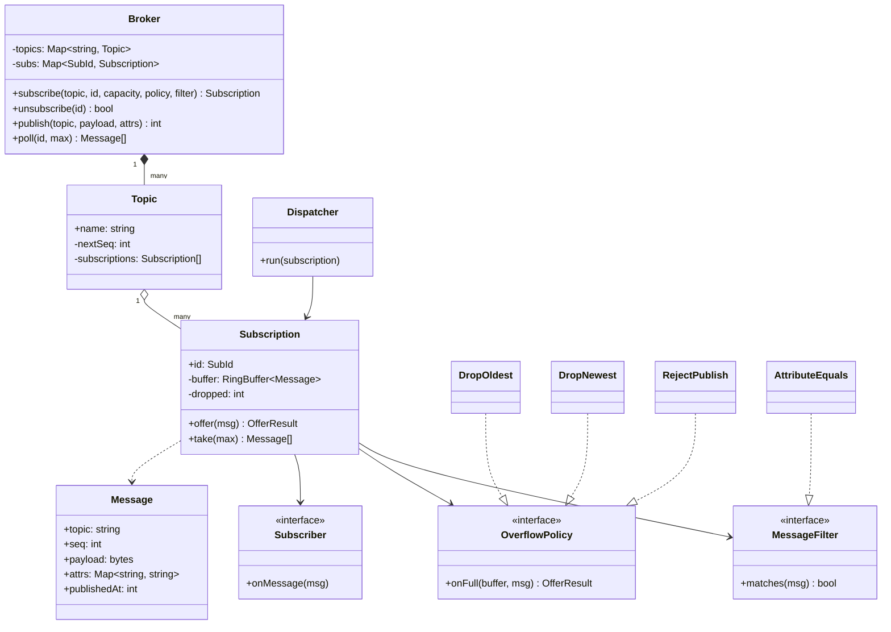
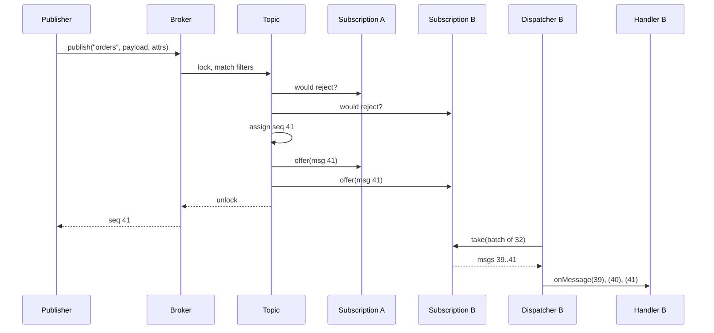

## In one minute
- An in-process pub/sub system is a router plus a set of queues. Publishers hand a message to a topic; the broker copies a reference to every matching subscription; each subscription drains its own queue at its own pace. Everything interesting happens in the gap between "publish returned" and "subscriber handled it".
- The decision that makes or breaks the design is what happens when one subscriber is slow. Each subscription needs its own bounded buffer and an explicit overflow policy (drop oldest, drop newest, or push back on the publisher). An unbounded queue just moves the failure to an out-of-memory crash.
- Keep the publisher ignorant of subscribers. Publish never calls a handler directly and never waits on one, or a single slow or throwing handler stalls every publisher in the process.
- Messages are immutable values with a per-topic sequence number. The sequence lets a subscriber detect gaps after a drop, and immutability lets the broker share one copy across a thousand subscriptions safely.
- The shape is **fan-out** with **overload** at the edges. The same object model shows up as a UI event bus, a metrics pipeline that feeds several exporters, a game engine's event system and the core of a broker such as the one in [Design Messaging Queue](../sdi/design-messaging-queue.md).

## Requirements

Functional:
- Publishers publish a message (payload plus string attributes) to a named topic. Topics are created on first use.
- Subscribers subscribe to one topic, optionally with an attribute filter such as `region = eu`, and receive every matching message published after they subscribed, in publish order.
- Each subscription has a capacity and an overflow policy: drop the oldest queued message, drop the new one, or reject the publish. (Real brokers add a fourth option, disconnecting the slow subscriber; see In the wild.)
- Subscribers can unsubscribe at any time; pending messages for that subscription are discarded.
- The broker reports per-subscription counters: queued, delivered and dropped.

Non-functional:
- A slow or failing subscriber must not delay other subscribers or the publisher (except under the explicit "reject" policy).
- Per-topic ordering is preserved for each subscriber. There is no ordering promise across topics.
- Bounded memory: the total buffered data is at most the sum of subscription capacities.
- Publish cost should be close to O(matching subscriptions), with no I/O on the publish path.

Out of scope: durability across process restarts, cross-process delivery, wildcard topic hierarchies, consumer groups that share a subscription, and exactly-once processing. Say that durability turns this into a log-based broker and point to the system design lessons; then design the in-memory core well. The [Pub/Sub](../sd/pub-sub.md) lesson covers durable hubs and topic wildcards in depth.

## Entities and relationships

- **Broker** is the façade. It owns the topic registry and the subscription index, assigns sequence numbers and runs the routing step.
- **Topic** is a name plus its next sequence number and an ordered list of subscriptions. It exists to make "who gets this message" a single lookup.
- **Message** is an immutable value: topic, sequence, payload, attributes, publish time. One instance is shared by every subscription that receives it.
- **Subscription** is the unit of isolation. It holds the filter, a bounded FIFO buffer, the overflow policy, the counters and a reference to the subscriber. It is where back pressure is decided.
- **Subscriber** is the consumer interface: `on_message(message)`. In push mode a dispatcher calls it; in pull mode the subscriber calls `poll` itself.
- **MessageFilter** decides whether a message matches a subscription. **OverflowPolicy** decides what to do when a buffer is full. **Clock** stamps publish time.

Relationships: a broker is composed of topics; a topic aggregates subscriptions (a subscription references the topic by name and can be removed independently). A subscription owns its buffer and points at, but does not own, its subscriber. Messages are referenced from many buffers and owned by none, which is why they must be immutable.

A common first draft has `Topic` loop over subscriber callbacks inside `publish`. That is Observer, not pub/sub: the publisher's thread runs every handler. The `Subscription` with its own buffer is what turns one into the other.

## Class diagram



## Key flows

Publish is a two-phase step under the topic's lock: first check whether any matching subscription would reject, then enqueue into every matching buffer. Delivery happens later, on each subscription's own dispatcher, so the publisher never runs subscriber code.



## Design patterns used and why

- **Façade**: `Broker` is the only type publishers and subscribers see. It hides topics, buffers and dispatchers, so you can swap the ring buffer for a lock-free one, or the dispatcher for a shared thread pool, without touching callers.
- **Strategy** for overflow. Different consumers want different behaviour when full: a live price feed wants the newest value (drop oldest), an audit consumer wants none silently lost (reject, so the publisher feels it), a debug tap wants to cost nothing (drop newest). One interface, three small classes, chosen per subscription.
- **Specification** for filters. `AttributeEquals("region", "eu")` composes with `And`, `Or` and `Not`. Filters run on the publisher's thread for every message, so the interface also gives you one place to optimise later, for example by indexing equality filters by attribute value. Amazon SNS does the same job with per-subscription filter policies over attributes or the JSON body, and a subscription without a policy receives everything ([AWS docs](https://docs.aws.amazon.com/sns/latest/dg/sns-message-filtering.html)).
- **Observer**, but only at the edge. The `Subscriber` interface is an observer; the dispatcher is what calls it. Keeping Observer on the far side of a buffer is the main difference from the [Observer](observer.md) lesson's synchronous subject.
- **Producer and consumer** inside each subscription: the broker produces into the bounded buffer and the dispatcher consumes. The [Producer Consumer](producer-consumer.md) lesson covers the blocking variant; here the producer side never blocks, it applies a policy instead.
- **Immutable value object** for messages, so one allocation serves every subscriber and nobody can mutate a payload another subscriber is reading.

Argue against a **Singleton** broker: tests share state, and you will soon want two brokers (domain events and telemetry).

## Concurrency and edge cases

- **Slow subscriber.** The defining case. With a shared queue, one handler that takes 200 ms per message drags every other subscriber to five messages per second. Per-subscription buffers isolate it; the overflow policy says what it loses.
- **Reject must be atomic.** If subscription C rejects after A and B already accepted, A and B have a message the publisher believes failed, and a retry delivers it twice. Check every matching subscription for room first, then enqueue into all of them, under one lock. Do not advance the sequence number on a rejected publish, or subscribers see a gap that never existed.
- **Subscribe during publish.** Iterate a snapshot of the subscription list (copy on write), so a subscriber added mid-publish either gets the whole message or none of it. A new subscription starts at the next sequence number; it never sees history in this design.
- **Unsubscribe from inside a handler.** The dispatcher checks a closed flag after each handler call and discards the rest of the batch.
- **Handler throws.** Catch it in the dispatcher, count it, and keep going, or the subscription dies silently. After N consecutive failures, park the subscription and raise an alert instead of spinning.
- **Duplicate matches.** If routing allows both exact and pattern subscriptions, one publish can reach the same client twice. Redis documents exactly this: a client subscribed to both `foo` and `f*` receives a `message` and a `pmessage` for one publish ([Redis docs](https://redis.io/docs/latest/develop/pubsub/)). Decide whether your subscription identity de-duplicates.
- **Gap detection.** After a drop, a subscriber sees sequence 7 then 10, and can resync from the source of truth.

## In the wild
- **Redis Pub/Sub: a slow subscriber is disconnected.** Redis pushes messages into a per-client output buffer. For subscribed clients the default `client-output-buffer-limit pubsub 32mb 8mb 60` disconnects a client immediately at 32 MB, or once its buffer stays above 8 MB for 60 seconds. The configuration file says the usual cause is a subscriber that cannot consume as fast as publishers produce ([redis.conf](https://github.com/redis/redis/blob/unstable/redis.conf)). This is the fourth overflow policy: protect the broker by cutting the consumer loose. Delivery is at most once, so the dropped client misses messages for good ([Redis docs](https://redis.io/docs/latest/develop/pubsub/)).
- **LMAX Exchange, 2011: the ring buffer behind an in-process event pipeline.** LMAX's paper reports 52 ns mean latency per hop through its Disruptor in a three-stage pipeline against 32,757 ns for a queue built on locks and condition variables, and attributes the difference to locks and signalling. A lagging consumer catches up by processing every entry up to the cursor in one batch ([LMAX paper](https://lmax-exchange.github.io/disruptor/disruptor.html)).
- **Google Cloud Pub/Sub: redelivery is the default.** Delivery is at-least-once, a message not acknowledged within the subscriber's `ackDeadline` can be redelivered, and ordering needs an explicit ordering key ([Google Cloud docs](https://docs.cloud.google.com/pubsub/docs/subscription-overview)). A durable broker trades the drop policies of this lesson for acknowledgements, which is why handlers must be idempotent.

## Down the stack

### Layer 1: The contract
`publish` returns a sequence number once the message is in every matching buffer, or fails with back pressure and changes nothing. For each subscription, messages are delivered in increasing sequence order with no duplicates; gaps appear only where the overflow policy dropped a message, and the dropped counter accounts for every gap. No ordering holds across topics. Delivery is at most once: a crash loses whatever is buffered. Redis Pub/Sub makes the same promise, and says a message the subscriber cannot handle is "forever lost" ([Redis docs](https://redis.io/docs/latest/develop/pubsub/)). Managed services default the other way: Google Cloud Pub/Sub is at-least-once with no ordering unless you enable ordering keys, so its subscribers must be idempotent ([Google Cloud docs](https://docs.cloud.google.com/pubsub/docs/subscription-overview)). Publish latency does not depend on any handler's speed.

### Layer 2: The mechanism
Each topic holds an array of subscriptions replaced on change (copy on write), so publish reads it without taking the subscription-set lock. Each subscription's buffer is a ring buffer: a fixed array of `capacity` slots and two counters, `head` and `tail`, where `tail - head` is the length and `index = counter mod capacity`. The LMAX Disruptor paper sizes its ring as a power of two so that a bit mask replaces the costly remainder ([LMAX paper](https://lmax-exchange.github.io/disruptor/disruptor.html)). Drop-oldest advances `head` by one before writing; drop-newest just increments `dropped`. A dispatcher per subscription takes up to a batch of messages and calls the handler; Go programs often model this as one goroutine and a buffered channel per subscription, with a `select` and `default` branch to implement drop-newest without blocking.

### Layer 3: The machine
A message here is a pointer to an immutable object, so fan-out to 100 subscriptions writes 100 pointers (800 bytes on a 64-bit machine), not 100 payloads. A ring buffer slot write is a store into memory that is usually already in L1 or L2 cache, a few nanoseconds; an uncontended Go channel send is on the order of 50 to 100 ns because it takes the channel's internal lock. When a dispatcher sleeps on an empty buffer and is woken, the cost is a futex wake and a context switch, a few microseconds. That is why dispatchers drain in batches: one wake-up for 32 messages instead of 32 wake-ups. The `head` and `tail` counters are written by different threads; if they share a 64-byte cache line, every publish invalidates the dispatcher's copy and vice versa (false sharing), which is why high-throughput rings keep them on separate lines. The LMAX paper measured the cost of locking: 500 million increments of a counter took 300 ms with no lock, 10,000 ms with a lock on one thread and 224,000 ms with two contending threads, and its ring buffer reached about 26 million operations per second in a one-producer, one-consumer test against 5.3 million for `ArrayBlockingQueue` ([LMAX paper](https://lmax-exchange.github.io/disruptor/disruptor.html)). Garbage collection is the hidden cost of unbounded buffers: a backlog of a million small messages is a million live objects the collector must trace on every cycle.

### Why it's built this way
1. Subscribers run at different speeds, so each needs its own buffer, or the slowest sets the pace for everyone.
2. Memory is finite, so buffers are bounded, which forces a decision about what to do when full.
3. That decision depends on what the consumer values (freshness, completeness or cheapness), so it is a per-subscription strategy rather than a broker setting.
4. Wake-ups cost microseconds while slot writes cost nanoseconds, so dispatchers batch, and publish never touches subscriber code.
5. Fan-out multiplies every per-message cost by the subscriber count, so messages are shared immutable references and the routing step does no I/O.

## Extensibility

- **Durability.** Replace the per-subscription ring with one append-only log per topic and a cursor per subscription. Drop policies become retention policies, and "dropped" becomes "the cursor fell behind the oldest retained offset". This is the step from this lesson to the broker in [Design Messaging Queue](../sdi/design-messaging-queue.md).
- **At-least-once delivery.** Add `ack(seq)` and an in-flight set with a redelivery deadline from the injected clock. Handlers must then be idempotent; see the [Idempotency](../sd/idempotency.md) lesson.
- **Wildcards.** Swap the topic map for a trie keyed by topic levels so `orders/+/created` matches in O(levels). Only the routing step changes. Redis supports glob patterns with `PSUBSCRIBE` ([Redis docs](https://redis.io/docs/latest/develop/pubsub/)).
- **Shared subscriptions.** Several workers attach to one subscription and compete for its messages. The buffer stays the same; the dispatcher becomes a pool.

## Leadership lens

- Build first: the per-subscription buffer with the overflow policies and a test where one handler sleeps while another must keep receiving. That test is the whole value of the component.
- Ask in review: what happens when a subscriber is ten times slower than the publish rate; which policy does each production subscription use and who chose it; is the dropped counter on a dashboard with an alert.
- If events cross team boundaries, version the payload schema and treat a topic like an API; a rename otherwise breaks another team's handler with no compiler error.
- Resist growing this into a durable broker in-house. When requirements say "survive restarts" or "across services", adopt Kafka, NATS or a cloud service and keep this design for in-process fan-out.

## Check yourself
1. Why is a loop over subscriber callbacks inside `publish` not a pub/sub system, even though it decouples the publisher from subscriber types?
   **Answer:** The publisher's thread runs every handler, so a slow or throwing handler delays or breaks the publisher and every later subscriber. Pub/sub puts a buffer and a separate dispatcher between them.
2. Subscription C uses the reject policy and is full. A and B have room. What must `publish` do, and why?
   **Answer:** Enqueue nowhere and fail, without consuming a sequence number. Partial delivery would make a publisher retry duplicate the message for A and B and leave a phantom gap for C.
3. A stock-ticker display and an audit logger subscribe to the same topic. Which overflow policy suits each?
   **Answer:** The ticker wants drop-oldest, because only the newest price matters. The audit logger needs reject (or a durable log), because losing an event silently is worse than slowing the publisher.
4. Why do dispatchers drain buffers in batches rather than one message at a time?
   **Answer:** Waking a sleeping thread costs a futex call and a context switch, microseconds, while taking a message from a ring costs nanoseconds. Batching amortises one wake-up across many messages.

## Practice
**Task:** Implement the routing core of an in-process broker in pull mode. `subscribe(topic, sub_id, capacity, policy, filter)` registers a subscription with a bounded buffer; `policy` is `"drop_oldest"`, `"drop_newest"` or `"reject"`, and `filter` is a dictionary of attributes that must all be equal on a message (empty or missing means match everything). A duplicate `sub_id`, a capacity below 1 or an unknown policy fails. `publish(topic, payload, attrs)` assigns the next per-topic sequence number starting at 1 and enqueues `(seq, payload)` into every matching subscription of that topic, in subscription order; if any matching `reject` subscription is full, it fails with a back-pressure error naming that subscription, enqueues nothing and does not consume a sequence number. `poll(sub_id, max_n)` removes and returns up to `max_n` queued pairs in order, `dropped(sub_id)` returns the number of messages dropped by the policy, and `unsubscribe(sub_id)` removes a subscription and returns whether it existed. Polling an unknown subscription fails.

```python starter
class Backpressure(Exception):
    pass


class Broker:
    def __init__(self):
        pass

    def subscribe(self, topic, sub_id, capacity, policy, filter=None):
        # TODO: validate and register a bounded subscription
        raise NotImplementedError

    def unsubscribe(self, sub_id):
        raise NotImplementedError

    def publish(self, topic, payload, attrs=None):
        # TODO: atomic reject check, then assign seq and enqueue
        raise NotImplementedError

    def poll(self, sub_id, max_n):
        raise NotImplementedError

    def dropped(self, sub_id):
        raise NotImplementedError
```

```python tests
def raises(fn, exc):
    try:
        fn()
    except exc:
        return True
    return False


def test_fan_out_with_sequences():
    b = Broker()
    b.subscribe("orders", "billing", 10, "reject")
    b.subscribe("orders", "email", 10, "drop_newest")
    assert b.publish("orders", "o1") == 1
    assert b.publish("orders", "o2") == 2
    assert b.poll("billing", 10) == [(1, "o1"), (2, "o2")]
    assert b.poll("email", 1) == [(1, "o1")]
    assert b.poll("email", 5) == [(2, "o2")]
    assert b.poll("email", 5) == []


def test_attribute_filter():
    b = Broker()
    b.subscribe("orders", "eu", 10, "drop_newest", {"region": "eu"})
    b.subscribe("orders", "eu-big", 10, "drop_newest", {"region": "eu", "size": "big"})
    b.publish("orders", "a", {"region": "us"})
    b.publish("orders", "b", {"region": "eu", "size": "small"})
    b.publish("orders", "c", {"region": "eu", "size": "big"})
    b.publish("orders", "d")
    assert b.poll("eu", 10) == [(2, "b"), (3, "c")]
    assert b.poll("eu-big", 10) == [(3, "c")]


def test_drop_oldest_keeps_newest():
    b = Broker()
    b.subscribe("prices", "ticker", 2, "drop_oldest")
    for p in ["100", "101", "102"]:
        b.publish("prices", p)
    assert b.poll("ticker", 10) == [(2, "101"), (3, "102")], "seq 1 dropped, gap visible"
    assert b.dropped("ticker") == 1


def test_drop_newest_keeps_oldest():
    b = Broker()
    b.subscribe("logs", "tap", 2, "drop_newest")
    for p in ["x", "y", "z"]:
        b.publish("logs", p)
    assert b.poll("tap", 10) == [(1, "x"), (2, "y")]
    assert b.dropped("tap") == 1


def test_reject_is_atomic_and_keeps_sequence():
    b = Broker()
    b.subscribe("audit", "fast", 10, "drop_newest")
    b.subscribe("audit", "slow", 1, "reject")
    assert b.publish("audit", "e1") == 1
    err = None
    try:
        b.publish("audit", "e2")
    except Backpressure as e:
        err = str(e)
    assert err is not None and "slow" in err, "back pressure names the subscription"
    assert b.poll("fast", 10) == [(1, "e1")], "nobody got the rejected message"
    assert b.poll("slow", 10) == [(1, "e1")]
    assert b.publish("audit", "e2") == 2, "rejected publish did not consume a seq"
    assert b.poll("fast", 10) == [(2, "e2")]


def test_reject_only_counts_matching_subscriptions():
    b = Broker()
    b.subscribe("audit", "eu-only", 1, "reject", {"region": "eu"})
    b.publish("audit", "e1", {"region": "eu"})
    assert b.publish("audit", "u1", {"region": "us"}) == 2, "full but not matching"


def test_topics_are_independent_and_unsubscribe():
    b = Broker()
    b.subscribe("a", "s1", 5, "drop_newest")
    b.subscribe("b", "s2", 5, "drop_newest")
    assert b.publish("a", "x") == 1
    assert b.publish("b", "y") == 1
    assert b.publish("c", "nobody") == 1, "topic without subscribers still sequences"
    assert b.unsubscribe("s1") is True
    assert b.unsubscribe("s1") is False
    b.publish("a", "z")
    assert raises(lambda: b.poll("s1", 1), Exception)
    assert b.poll("s2", 5) == [(1, "y")]


def test_validation():
    b = Broker()
    b.subscribe("t", "s", 1, "drop_oldest")
    assert raises(lambda: b.subscribe("t", "s", 1, "drop_oldest"), ValueError), "duplicate id"
    assert raises(lambda: b.subscribe("t", "z", 0, "drop_oldest"), ValueError), "capacity"
    assert raises(lambda: b.subscribe("t", "y", 1, "block"), ValueError), "policy"
```

```python solution
from collections import deque

POLICIES = ("drop_oldest", "drop_newest", "reject")


class Backpressure(Exception):
    pass


class _Subscription:
    def __init__(self, sub_id, topic, capacity, policy, filter):
        self.sub_id = sub_id
        self.topic = topic
        self.capacity = capacity
        self.policy = policy
        self.filter = dict(filter or {})
        self.buffer = deque()
        self.dropped = 0

    def matches(self, attrs):
        for k, v in self.filter.items():
            if attrs.get(k) != v:
                return False
        return True

    def full(self):
        return len(self.buffer) >= self.capacity

    def offer(self, item):
        if not self.full():
            self.buffer.append(item)
        elif self.policy == "drop_oldest":
            self.buffer.popleft()
            self.buffer.append(item)
            self.dropped += 1
        else:
            self.dropped += 1


class Broker:
    def __init__(self):
        self._topics = {}
        self._next_seq = {}
        self._subs = {}

    def subscribe(self, topic, sub_id, capacity, policy, filter=None):
        if sub_id in self._subs:
            raise ValueError("duplicate subscription: " + sub_id)
        if capacity < 1:
            raise ValueError("capacity must be at least 1")
        if policy not in POLICIES:
            raise ValueError("unknown policy: " + policy)
        sub = _Subscription(sub_id, topic, capacity, policy, filter)
        self._subs[sub_id] = sub
        self._topics[topic] = self._topics.get(topic, []) + [sub]
        return sub_id

    def unsubscribe(self, sub_id):
        sub = self._subs.pop(sub_id, None)
        if sub is None:
            return False
        self._topics[sub.topic] = [s for s in self._topics[sub.topic] if s is not sub]
        return True

    def publish(self, topic, payload, attrs=None):
        attrs = attrs or {}
        targets = [s for s in self._topics.get(topic, []) if s.matches(attrs)]
        for s in targets:
            if s.policy == "reject" and s.full():
                raise Backpressure("backpressure: " + s.sub_id)
        seq = self._next_seq.get(topic, 0) + 1
        self._next_seq[topic] = seq
        for s in targets:
            s.offer((seq, payload))
        return seq

    def _get(self, sub_id):
        if sub_id not in self._subs:
            raise KeyError("unknown subscription: " + sub_id)
        return self._subs[sub_id]

    def poll(self, sub_id, max_n):
        sub = self._get(sub_id)
        out = []
        while sub.buffer and len(out) < max_n:
            out.append(sub.buffer.popleft())
        return out

    def dropped(self, sub_id):
        return self._get(sub_id).dropped
```

```typescript starter
export type Policy = "drop_oldest" | "drop_newest" | "reject";
export type Delivery = [number, string];

export class Broker {
  subscribe(topic: string, subId: string, capacity: number, policy: string,
            filter: Record<string, string> = {}): string {
    throw new Error("TODO");
  }

  unsubscribe(subId: string): boolean {
    throw new Error("TODO");
  }

  publish(topic: string, payload: string, attrs: Record<string, string> = {}): number {
    throw new Error("TODO");
  }

  poll(subId: string, maxN: number): Delivery[] {
    throw new Error("TODO");
  }

  dropped(subId: string): number {
    throw new Error("TODO");
  }
}
```

```typescript tests
function errorOf(fn: () => void): string | null {
  try { fn(); return null; } catch (e) { return (e as Error).message; }
}

test("fan out with sequences", () => {
  const b = new Broker();
  b.subscribe("orders", "billing", 10, "reject");
  b.subscribe("orders", "email", 10, "drop_newest");
  assertEqual(b.publish("orders", "o1"), 1);
  assertEqual(b.publish("orders", "o2"), 2);
  assertEqual(b.poll("billing", 10), [[1, "o1"], [2, "o2"]]);
  assertEqual(b.poll("email", 1), [[1, "o1"]]);
  assertEqual(b.poll("email", 5), [[2, "o2"]]);
  assertEqual(b.poll("email", 5), []);
});

test("attribute filter", () => {
  const b = new Broker();
  b.subscribe("orders", "eu", 10, "drop_newest", { region: "eu" });
  b.subscribe("orders", "eu-big", 10, "drop_newest", { region: "eu", size: "big" });
  b.publish("orders", "a", { region: "us" });
  b.publish("orders", "b", { region: "eu", size: "small" });
  b.publish("orders", "c", { region: "eu", size: "big" });
  b.publish("orders", "d");
  assertEqual(b.poll("eu", 10), [[2, "b"], [3, "c"]]);
  assertEqual(b.poll("eu-big", 10), [[3, "c"]]);
});

test("drop oldest keeps newest", () => {
  const b = new Broker();
  b.subscribe("prices", "ticker", 2, "drop_oldest");
  for (const p of ["100", "101", "102"]) b.publish("prices", p);
  assertEqual(b.poll("ticker", 10), [[2, "101"], [3, "102"]], "seq 1 dropped");
  assertEqual(b.dropped("ticker"), 1);
});

test("drop newest keeps oldest", () => {
  const b = new Broker();
  b.subscribe("logs", "tap", 2, "drop_newest");
  for (const p of ["x", "y", "z"]) b.publish("logs", p);
  assertEqual(b.poll("tap", 10), [[1, "x"], [2, "y"]]);
  assertEqual(b.dropped("tap"), 1);
});

test("reject is atomic and keeps sequence", () => {
  const b = new Broker();
  b.subscribe("audit", "fast", 10, "drop_newest");
  b.subscribe("audit", "slow", 1, "reject");
  assertEqual(b.publish("audit", "e1"), 1);
  const err = errorOf(() => b.publish("audit", "e2"));
  assert(err !== null && err.includes("slow"), "back pressure names the subscription");
  assertEqual(b.poll("fast", 10), [[1, "e1"]], "nobody got the rejected message");
  assertEqual(b.poll("slow", 10), [[1, "e1"]]);
  assertEqual(b.publish("audit", "e2"), 2, "rejected publish did not consume a seq");
  assertEqual(b.poll("fast", 10), [[2, "e2"]]);
});

test("reject only counts matching subscriptions", () => {
  const b = new Broker();
  b.subscribe("audit", "eu-only", 1, "reject", { region: "eu" });
  b.publish("audit", "e1", { region: "eu" });
  assertEqual(b.publish("audit", "u1", { region: "us" }), 2, "full but not matching");
});

test("topics are independent and unsubscribe", () => {
  const b = new Broker();
  b.subscribe("a", "s1", 5, "drop_newest");
  b.subscribe("b", "s2", 5, "drop_newest");
  assertEqual(b.publish("a", "x"), 1);
  assertEqual(b.publish("b", "y"), 1);
  assertEqual(b.publish("c", "nobody"), 1, "topic without subscribers still sequences");
  assertEqual(b.unsubscribe("s1"), true);
  assertEqual(b.unsubscribe("s1"), false);
  b.publish("a", "z");
  assert(errorOf(() => b.poll("s1", 1)) !== null, "unknown subscription");
  assertEqual(b.poll("s2", 5), [[1, "y"]]);
});

test("validation", () => {
  const b = new Broker();
  b.subscribe("t", "s", 1, "drop_oldest");
  assert(errorOf(() => b.subscribe("t", "s", 1, "drop_oldest")) !== null, "duplicate id");
  assert(errorOf(() => b.subscribe("t", "z", 0, "drop_oldest")) !== null, "capacity");
  assert(errorOf(() => b.subscribe("t", "y", 1, "block")) !== null, "policy");
});
```

```typescript solution
export type Policy = "drop_oldest" | "drop_newest" | "reject";
export type Delivery = [number, string];

const POLICIES = ["drop_oldest", "drop_newest", "reject"];

class Subscription {
  buffer: Delivery[] = [];
  droppedCount = 0;

  constructor(readonly id: string, readonly topic: string, readonly capacity: number,
              readonly policy: Policy, readonly filter: Record<string, string>) {}

  matches(attrs: Record<string, string>): boolean {
    return Object.keys(this.filter).every((k) => attrs[k] === this.filter[k]);
  }

  full(): boolean { return this.buffer.length >= this.capacity; }

  offer(item: Delivery): void {
    if (!this.full()) {
      this.buffer.push(item);
    } else if (this.policy === "drop_oldest") {
      this.buffer.shift();
      this.buffer.push(item);
      this.droppedCount++;
    } else {
      this.droppedCount++;
    }
  }
}

export class Broker {
  private topics = new Map<string, Subscription[]>();
  private nextSeq = new Map<string, number>();
  private subs = new Map<string, Subscription>();

  subscribe(topic: string, subId: string, capacity: number, policy: string,
            filter: Record<string, string> = {}): string {
    if (this.subs.has(subId)) throw new Error("duplicate subscription: " + subId);
    if (capacity < 1) throw new Error("capacity must be at least 1");
    if (!POLICIES.includes(policy)) throw new Error("unknown policy: " + policy);
    const sub = new Subscription(subId, topic, capacity, policy as Policy, { ...filter });
    this.subs.set(subId, sub);
    this.topics.set(topic, [...(this.topics.get(topic) ?? []), sub]);
    return subId;
  }

  unsubscribe(subId: string): boolean {
    const sub = this.subs.get(subId);
    if (!sub) return false;
    this.subs.delete(subId);
    this.topics.set(sub.topic, this.topics.get(sub.topic)!.filter((s) => s !== sub));
    return true;
  }

  publish(topic: string, payload: string, attrs: Record<string, string> = {}): number {
    const targets = (this.topics.get(topic) ?? []).filter((s) => s.matches(attrs));
    for (const s of targets) {
      if (s.policy === "reject" && s.full()) throw new Error("backpressure: " + s.id);
    }
    const seq = (this.nextSeq.get(topic) ?? 0) + 1;
    this.nextSeq.set(topic, seq);
    for (const s of targets) s.offer([seq, payload]);
    return seq;
  }

  private get(subId: string): Subscription {
    const sub = this.subs.get(subId);
    if (!sub) throw new Error("unknown subscription: " + subId);
    return sub;
  }

  poll(subId: string, maxN: number): Delivery[] {
    return this.get(subId).buffer.splice(0, Math.max(0, maxN));
  }

  dropped(subId: string): number {
    return this.get(subId).droppedCount;
  }
}
```

```go starter
package practice

import "errors"

var (
	ErrBackpressure    = errors.New("backpressure")
	ErrUnknownSub      = errors.New("unknown subscription")
	ErrInvalidArgument = errors.New("invalid argument")
)

type Policy string

const (
	DropOldest Policy = "drop_oldest"
	DropNewest Policy = "drop_newest"
	Reject     Policy = "reject"
)

type Delivery struct {
	Seq     int
	Payload string
}

type Broker struct{}

func NewBroker() *Broker { return &Broker{} }

func (b *Broker) Subscribe(topic, subID string, capacity int, policy Policy, filter map[string]string) error {
	panic("TODO")
}

func (b *Broker) Unsubscribe(subID string) bool {
	panic("TODO")
}

func (b *Broker) Publish(topic, payload string, attrs map[string]string) (int, error) {
	panic("TODO")
}

func (b *Broker) Poll(subID string, maxN int) ([]Delivery, error) {
	panic("TODO")
}

func (b *Broker) Dropped(subID string) (int, error) {
	panic("TODO")
}
```

```go tests
package practice

import (
	"errors"
	"reflect"
	"strings"
	"testing"
)

func mustPublish(t *testing.T, b *Broker, topic, payload string, attrs map[string]string) int {
	t.Helper()
	seq, err := b.Publish(topic, payload, attrs)
	if err != nil {
		t.Fatalf("publish %s: %v", payload, err)
	}
	return seq
}

func expectPoll(t *testing.T, b *Broker, sub string, n int, want []Delivery) {
	t.Helper()
	got, err := b.Poll(sub, n)
	if err != nil {
		t.Fatalf("poll %s: %v", sub, err)
	}
	if len(got) == 0 && len(want) == 0 {
		return
	}
	if !reflect.DeepEqual(got, want) {
		t.Fatalf("poll %s: got %v want %v", sub, got, want)
	}
}

func TestFanOutWithSequences(t *testing.T) {
	b := NewBroker()
	b.Subscribe("orders", "billing", 10, Reject, nil)
	b.Subscribe("orders", "email", 10, DropNewest, nil)
	if mustPublish(t, b, "orders", "o1", nil) != 1 || mustPublish(t, b, "orders", "o2", nil) != 2 {
		t.Fatal("sequences should start at 1")
	}
	expectPoll(t, b, "billing", 10, []Delivery{{1, "o1"}, {2, "o2"}})
	expectPoll(t, b, "email", 1, []Delivery{{1, "o1"}})
	expectPoll(t, b, "email", 5, []Delivery{{2, "o2"}})
	expectPoll(t, b, "email", 5, nil)
}

func TestAttributeFilter(t *testing.T) {
	b := NewBroker()
	b.Subscribe("orders", "eu", 10, DropNewest, map[string]string{"region": "eu"})
	b.Subscribe("orders", "eu-big", 10, DropNewest, map[string]string{"region": "eu", "size": "big"})
	mustPublish(t, b, "orders", "a", map[string]string{"region": "us"})
	mustPublish(t, b, "orders", "b", map[string]string{"region": "eu", "size": "small"})
	mustPublish(t, b, "orders", "c", map[string]string{"region": "eu", "size": "big"})
	mustPublish(t, b, "orders", "d", nil)
	expectPoll(t, b, "eu", 10, []Delivery{{2, "b"}, {3, "c"}})
	expectPoll(t, b, "eu-big", 10, []Delivery{{3, "c"}})
}

func TestDropOldestKeepsNewest(t *testing.T) {
	b := NewBroker()
	b.Subscribe("prices", "ticker", 2, DropOldest, nil)
	for _, p := range []string{"100", "101", "102"} {
		mustPublish(t, b, "prices", p, nil)
	}
	expectPoll(t, b, "ticker", 10, []Delivery{{2, "101"}, {3, "102"}})
	if n, _ := b.Dropped("ticker"); n != 1 {
		t.Fatalf("dropped=%d", n)
	}
}

func TestDropNewestKeepsOldest(t *testing.T) {
	b := NewBroker()
	b.Subscribe("logs", "tap", 2, DropNewest, nil)
	for _, p := range []string{"x", "y", "z"} {
		mustPublish(t, b, "logs", p, nil)
	}
	expectPoll(t, b, "tap", 10, []Delivery{{1, "x"}, {2, "y"}})
	if n, _ := b.Dropped("tap"); n != 1 {
		t.Fatalf("dropped=%d", n)
	}
}

func TestRejectIsAtomicAndKeepsSequence(t *testing.T) {
	b := NewBroker()
	b.Subscribe("audit", "fast", 10, DropNewest, nil)
	b.Subscribe("audit", "slow", 1, Reject, nil)
	mustPublish(t, b, "audit", "e1", nil)
	_, err := b.Publish("audit", "e2", nil)
	if !errors.Is(err, ErrBackpressure) || !strings.Contains(err.Error(), "slow") {
		t.Fatalf("want backpressure naming slow, got %v", err)
	}
	expectPoll(t, b, "fast", 10, []Delivery{{1, "e1"}})
	expectPoll(t, b, "slow", 10, []Delivery{{1, "e1"}})
	if seq := mustPublish(t, b, "audit", "e2", nil); seq != 2 {
		t.Fatalf("rejected publish consumed a seq: got %d", seq)
	}
	expectPoll(t, b, "fast", 10, []Delivery{{2, "e2"}})
}

func TestRejectOnlyCountsMatchingSubscriptions(t *testing.T) {
	b := NewBroker()
	b.Subscribe("audit", "eu-only", 1, Reject, map[string]string{"region": "eu"})
	mustPublish(t, b, "audit", "e1", map[string]string{"region": "eu"})
	if seq := mustPublish(t, b, "audit", "u1", map[string]string{"region": "us"}); seq != 2 {
		t.Fatalf("seq=%d", seq)
	}
}

func TestTopicsAreIndependentAndUnsubscribe(t *testing.T) {
	b := NewBroker()
	b.Subscribe("a", "s1", 5, DropNewest, nil)
	b.Subscribe("b", "s2", 5, DropNewest, nil)
	if mustPublish(t, b, "a", "x", nil) != 1 || mustPublish(t, b, "b", "y", nil) != 1 ||
		mustPublish(t, b, "c", "nobody", nil) != 1 {
		t.Fatal("each topic has its own sequence")
	}
	if !b.Unsubscribe("s1") || b.Unsubscribe("s1") {
		t.Fatal("unsubscribe should report existence")
	}
	mustPublish(t, b, "a", "z", nil)
	if _, err := b.Poll("s1", 1); !errors.Is(err, ErrUnknownSub) {
		t.Fatalf("want ErrUnknownSub, got %v", err)
	}
	expectPoll(t, b, "s2", 5, []Delivery{{1, "y"}})
}

func TestValidation(t *testing.T) {
	b := NewBroker()
	if err := b.Subscribe("t", "s", 1, DropOldest, nil); err != nil {
		t.Fatal(err)
	}
	for _, tc := range []struct {
		id       string
		capacity int
		policy   Policy
	}{{"s", 1, DropOldest}, {"z", 0, DropOldest}, {"y", 1, "block"}} {
		if err := b.Subscribe("t", tc.id, tc.capacity, tc.policy, nil); !errors.Is(err, ErrInvalidArgument) {
			t.Fatalf("%+v: want ErrInvalidArgument, got %v", tc, err)
		}
	}
}
```

```go solution
package practice

import (
	"errors"
	"fmt"
	"sync"
)

var (
	ErrBackpressure    = errors.New("backpressure")
	ErrUnknownSub      = errors.New("unknown subscription")
	ErrInvalidArgument = errors.New("invalid argument")
)

type Policy string

const (
	DropOldest Policy = "drop_oldest"
	DropNewest Policy = "drop_newest"
	Reject     Policy = "reject"
)

type Delivery struct {
	Seq     int
	Payload string
}

type subscription struct {
	id       string
	topic    string
	capacity int
	policy   Policy
	filter   map[string]string
	buffer   []Delivery
	dropped  int
}

func (s *subscription) matches(attrs map[string]string) bool {
	for k, v := range s.filter {
		if got, ok := attrs[k]; !ok || got != v {
			return false
		}
	}
	return true
}

func (s *subscription) full() bool { return len(s.buffer) >= s.capacity }

func (s *subscription) offer(d Delivery) {
	switch {
	case !s.full():
		s.buffer = append(s.buffer, d)
	case s.policy == DropOldest:
		s.buffer = append(s.buffer[1:], d)
		s.dropped++
	default:
		s.dropped++
	}
}

type Broker struct {
	mu      sync.Mutex
	topics  map[string][]*subscription
	nextSeq map[string]int
	subs    map[string]*subscription
}

func NewBroker() *Broker {
	return &Broker{
		topics:  map[string][]*subscription{},
		nextSeq: map[string]int{},
		subs:    map[string]*subscription{},
	}
}

func (b *Broker) Subscribe(topic, subID string, capacity int, policy Policy, filter map[string]string) error {
	b.mu.Lock()
	defer b.mu.Unlock()
	if _, ok := b.subs[subID]; ok {
		return fmt.Errorf("%w: duplicate subscription %s", ErrInvalidArgument, subID)
	}
	if capacity < 1 {
		return fmt.Errorf("%w: capacity %d", ErrInvalidArgument, capacity)
	}
	if policy != DropOldest && policy != DropNewest && policy != Reject {
		return fmt.Errorf("%w: policy %s", ErrInvalidArgument, policy)
	}
	f := map[string]string{}
	for k, v := range filter {
		f[k] = v
	}
	s := &subscription{id: subID, topic: topic, capacity: capacity, policy: policy, filter: f}
	b.subs[subID] = s
	// Copy on write: a reader holding the old slice never sees a half-updated list.
	list := append([]*subscription{}, b.topics[topic]...)
	b.topics[topic] = append(list, s)
	return nil
}

func (b *Broker) Unsubscribe(subID string) bool {
	b.mu.Lock()
	defer b.mu.Unlock()
	s, ok := b.subs[subID]
	if !ok {
		return false
	}
	delete(b.subs, subID)
	var kept []*subscription
	for _, other := range b.topics[s.topic] {
		if other != s {
			kept = append(kept, other)
		}
	}
	b.topics[s.topic] = kept
	return true
}

// Publish checks every reject subscription before touching any buffer, so a
// rejected message reaches nobody and does not consume a sequence number.
func (b *Broker) Publish(topic, payload string, attrs map[string]string) (int, error) {
	b.mu.Lock()
	defer b.mu.Unlock()
	var targets []*subscription
	for _, s := range b.topics[topic] {
		if s.matches(attrs) {
			targets = append(targets, s)
		}
	}
	for _, s := range targets {
		if s.policy == Reject && s.full() {
			return 0, fmt.Errorf("%w: %s", ErrBackpressure, s.id)
		}
	}
	b.nextSeq[topic]++
	seq := b.nextSeq[topic]
	for _, s := range targets {
		s.offer(Delivery{Seq: seq, Payload: payload})
	}
	return seq, nil
}

func (b *Broker) Poll(subID string, maxN int) ([]Delivery, error) {
	b.mu.Lock()
	defer b.mu.Unlock()
	s, ok := b.subs[subID]
	if !ok {
		return nil, fmt.Errorf("%w: %s", ErrUnknownSub, subID)
	}
	n := maxN
	if n > len(s.buffer) {
		n = len(s.buffer)
	}
	if n < 0 {
		n = 0
	}
	out := append([]Delivery{}, s.buffer[:n]...)
	s.buffer = s.buffer[n:]
	return out, nil
}

func (b *Broker) Dropped(subID string) (int, error) {
	b.mu.Lock()
	defer b.mu.Unlock()
	s, ok := b.subs[subID]
	if !ok {
		return 0, fmt.Errorf("%w: %s", ErrUnknownSub, subID)
	}
	return s.dropped, nil
}
```

## Mock interview
**Prompt:** Design and code an in-process publish/subscribe library for a service that emits about 20,000 events per second across 50 topics, with 5 to 200 subscribers per topic. Some subscribers write to a database and take 5 ms per event; others update in-memory caches in microseconds.

- Follow-up: The database subscriber falls behind during a traffic spike. Walk me through what happens to memory, to the other subscribers and to the publisher under each overflow policy.
- Follow-up: A handler calls `unsubscribe` on itself and then throws. What does your dispatcher do?
- Follow-up: Product now needs events to survive a restart. What do you change, and at what point do you stop building and adopt Kafka or NATS?

**A strong answer covers:**
- Per-subscription bounded buffers with a dispatcher each, so publish never runs or waits on handler code.
- Overflow as a per-subscription strategy, with a concrete choice per consumer type and a dropped counter that is monitored.
- Atomic reject: check all matching subscriptions, then enqueue, with no sequence consumed on failure.
- Immutable messages shared across subscribers, per-topic sequence numbers for gap detection, and copy-on-write subscription lists.
- Dispatcher robustness: catch handler errors, tolerate self-unsubscribe, batch drains to amortise wake-ups.
- A clear boundary: durability means a log and cursors, which is a broker, not a library.

## Sources and further study
**Primary**
- [LMAX Disruptor technical paper](https://lmax-exchange.github.io/disruptor/disruptor.html): lock cost measurements, ring buffer sizing, batching and the single-writer principle.
- [redis.conf, client-output-buffer-limit](https://github.com/redis/redis/blob/unstable/redis.conf): hard and soft limits that disconnect slow pub/sub clients.

**Systems docs**
- [Redis Pub/Sub](https://redis.io/docs/latest/develop/pubsub/): at-most-once semantics, pattern subscriptions, duplicate matches and sharded channels.
- [Google Cloud Pub/Sub subscriptions](https://docs.cloud.google.com/pubsub/docs/subscription-overview): at-least-once default, ordering keys and acknowledgement deadlines.
- [Amazon SNS message filtering](https://docs.aws.amazon.com/sns/latest/dg/sns-message-filtering.html): filter policies over attributes or message body.

**Books**
- *Design Patterns*, Gamma et al., chapter 5 (Behavioral): Observer, the synchronous pattern this design puts a buffer behind, and Strategy for overflow policies.
- *Head First Design Patterns*, Freeman and Robson, chapter 2: Observer, with the same subject-and-observers model.
- *Designing Data-Intensive Applications*, Kleppmann, 1st ed., chapter 11 "Stream Processing": message brokers versus logs, and what happens when consumers fall behind.

**Other curricula**
- [Game Programming Patterns: Event Queue](https://gameprogrammingpatterns.com/event-queue.html): the same decoupling in a game loop, with ring buffers.

## Watch
- [What is the Publisher Subscriber Model? (Gaurav Sen)](https://www.youtube.com/watch?v=FMhbR_kQeHw): why systems move from direct calls to pub/sub, and what that decoupling costs.
- [Observer Pattern, Design Patterns ep 2 (Christopher Okhravi)](https://www.youtube.com/watch?v=_BpmfnqjgzQ): the synchronous pattern this design wraps behind a buffer.

## Free resources
- [LMAX Disruptor technical paper](https://lmax-exchange.github.io/disruptor/disruptor.html): ring buffers, sequence cursors, batching and false sharing in a high-throughput in-process event system.
- [Observer (Game Programming Patterns, Robert Nystrom)](https://gameprogrammingpatterns.com/observer.html): the costs of synchronous dispatch that motivate putting a queue between publisher and subscriber.
- [Event Queue (Game Programming Patterns, Robert Nystrom)](https://gameprogrammingpatterns.com/event-queue.html): decoupling when an event is handled from when it is sent, with ring buffers and feedback loops.
- [Google Cloud Pub/Sub subscriptions](https://cloud.google.com/pubsub/docs/subscription-overview): how a managed service models subscriptions, filters and acknowledgement, for comparison with the in-process core.
- [Amazon SNS message filtering](https://docs.aws.amazon.com/sns/latest/dg/sns-message-filtering.html): attribute filter policies, the production version of this lesson's filter.
