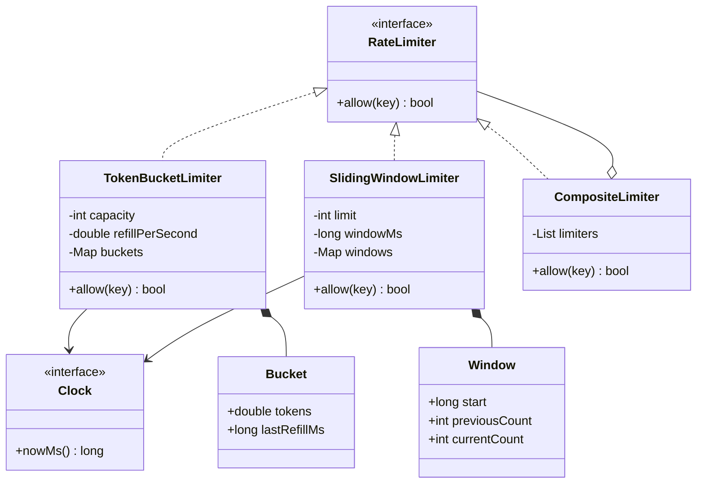
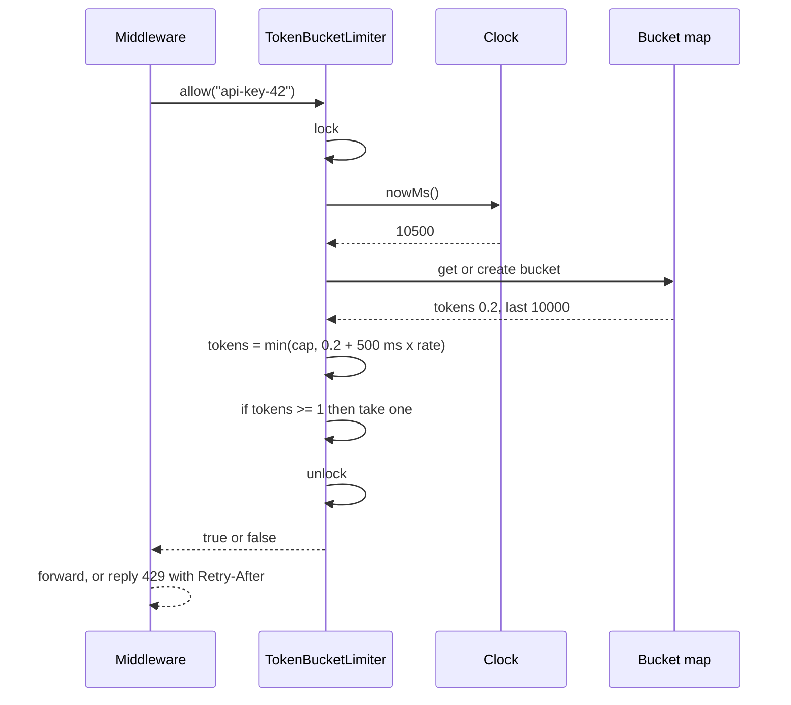

## In one minute
- Put every algorithm behind one small interface, `allow(key) -> bool`. Callers (HTTP middleware, a job queue, an outbound API client) never learn whether a token bucket or a sliding window sits behind it.
- Keep state per key (user, API key, IP, tenant). Create it lazily on first use and keep only a few numbers per key. A token bucket stores tokens and a last-refill time. A sliding-window counter stores a window start and two counts.
- Inject the clock. Time is an input to the algorithm, not something the algorithm reads from the wall. An injected clock makes every test deterministic and every boundary case reproducible.
- Refill lazily. Nothing runs in the background. Each call computes how much time has passed since the last call and updates the state in O(1).
- The in-process design is the building block for the distributed one. The same two algorithms move into Redis or a sidecar once several servers have to share one budget.

## Requirements
Functional:
- `allow(key)` returns true if the request may proceed and records it. Otherwise it returns false and records nothing.
- Support at least two strategies: a token bucket (steady rate with bursts) and a sliding-window counter (at most L requests per rolling window).
- Each key has its own independent budget.
- Limits are set at construction: capacity and refill rate, or limit and window length.

Non-functional:
- O(1) time per call and O(1) memory per active key.
- Safe under concurrent calls from many threads or goroutines.
- Deterministic and testable: no sleeps and no direct reads of the system clock.
- Cheap enough to run on every request. The limiter must never be the bottleneck it exists to prevent.

Out of scope: sharing limits across servers, persisting state across restarts, and per-route configuration loading. Extensibility covers the first.

## Entities and relationships
- **RateLimiter** (interface): `allow(key)`. This is the only thing callers depend on.
- **TokenBucketLimiter**: holds `capacity`, `refillPerSecond`, a clock and a map from key to bucket.
- **Bucket**: `tokens` (a float, because refill is fractional) and `lastRefillMs`.
- **SlidingWindowLimiter**: holds `limit`, `windowMs`, a clock and a map from key to window.
- **Window**: `start`, `previousCount` and `currentCount`.
- **Clock**: a function or interface returning the current time in milliseconds. Production passes a monotonic clock. Tests pass a fake that they advance by hand.
- **LimiterPolicy** (optional): maps a request to a key and a limiter. For example, "per API key, 100 per minute" and "per IP, 20 per second" can both apply, and the request passes only if every limiter allows it.

## Class diagram



## Key flows
A token-bucket check, with the lock held for the whole read-modify-write:



The **token bucket** starts each key full. Every call adds `elapsed × rate` tokens, caps the total at `capacity`, and spends one token if at least one is there. Capacity sets the largest burst and the rate sets the long-run average. A bucket with capacity 10 and 5 tokens per second allows a burst of 10 and then 5 per second.

The **sliding-window counter** splits time into fixed windows but smooths the edge between them. It estimates the count over the last `windowMs` as `previousCount × (windowMs − elapsedInCurrent) / windowMs + currentCount`. Take a limit of 4 per second. A key that made 4 requests in the previous second and is now 500 ms into the current one has an estimate of 4 × 0.5 = 2. Two more requests fit. A plain fixed window would let 4 more through right after the boundary, which doubles the rate across the edge. A sliding log fixes that exactly by storing every timestamp, but it costs O(L) memory per key. The counter version costs two integers and is accurate to within a few percent when traffic is spread fairly evenly across the window.

## Design patterns used and why
- **Strategy.** `RateLimiter` is the strategy interface. Token bucket, sliding-window counter, sliding log, fixed window and leaky bucket are interchangeable. The choice is policy (bursty or smooth), and the caller shouldn't care.
- **Dependency injection for time.** The clock is a constructor argument. A limiter that calls `time.now()` inside can only be tested with sleeps, which are slow and flaky.
- **Composite.** `CompositeLimiter` holds several limiters and allows a request only if all of them do. Per-second and per-day quotas then stack without new classes. Watch the subtle part: if the second limiter rejects, the first has already spent a token. Either accept that small over-count or add a two-phase `check` and `commit`.
- **Lazy initialisation and a registry per key.** Buckets are created on first use inside the map. The map is a registry, so it also needs an eviction policy (see the next section).
- **Decorator at the edge.** HTTP middleware wraps a handler and consults the limiter, so the limiter stays free of HTTP and can also guard a queue consumer.

## Concurrency and edge cases
`allow` is a read-modify-write: read tokens, compute, write tokens. Two threads that both read 1 token can both spend it. That is the classic **contention** shape, the same one that oversells the last concert seat. The simplest correct fix is one mutex around the whole operation, which the Go practice uses. Under very high concurrency a single lock becomes a hot spot. Two well-known escalations:
- Shard the map into, say, 64 stripes, each with its own lock, chosen by hashing the key. Different keys stop contending with each other.
- Pack a bucket's state into one 64-bit word and update it with compare-and-swap. This is lock-free but harder to read.

Edge cases worth naming:
- **The clock moves backwards.** Wall clocks jump under NTP and manual changes. Use a monotonic clock, and still guard against a negative elapsed time: refill nothing, and never move `last` backwards.
- **Long idle periods.** Cap the refill at capacity, or a key idle for a day will build up a huge burst.
- **Unbounded keys.** An attacker cycling through random IPs can grow the map forever. Evict keys whose bucket is full, or whose windows are both empty, after an idle period. Or use a bounded LRU and accept that an evicted key comes back with a fresh budget.
- **Floating-point drift.** Fractional tokens are fine, but compare against 1 and cap at capacity so drift can't grow over time.
- **Invalid configuration.** A capacity below 1, or a rate or window of zero or less, should fail at construction, not on the first request.

## Down the stack

### Layer 1: The contract
For a token bucket with capacity C and rate R, any interval of length T admits at most C + R×T requests per key. Each call is O(1), with no background work and no allocation after the key's first request. For the sliding-window counter, the guarantee is approximate. It never admits more than L in a single fixed window, and it smooths the boundary using an estimate that assumes requests were spread evenly across the previous window.

### Layer 2: The mechanism
Lazy refill is the central trick. Instead of a timer adding tokens every 1/R seconds, which means one timer per key and millions of wakeups, the bucket stores the time of its last update and catches up arithmetically. Go's `golang.org/x/time/rate.Limiter` works this way: it stores `tokens`, `last` and `lastEvent` under a mutex, and also offers `Reserve` and `Wait` for callers that want to queue instead of being rejected. Envoy's local rate limit filter is a token bucket configured with `max_tokens`, `tokens_per_fill` and `fill_interval`. The sliding-window counter is the approach Cloudflare described for counting requests across a large edge network, because it needs two counters per key instead of a log.

### Layer 3: The machine
A bucket is about 16 bytes of payload: a float64 and an int64. In Go, a `map[string]*bucket` entry adds the key string, a pointer and map overhead, so roughly 80–100 bytes per active key. A million keys costs about 100 MB, which is why eviction matters. An uncontended `sync.Mutex` lock and unlock costs around 10–20 ns. Under contention the cache line holding the mutex bounces between cores, at around 100 ns per transfer, and goroutines may park. That is why striping helps once you pass a few million calls per second on one process. Reading a monotonic clock through the vDSO costs about 20 ns, cheap enough to do on every call.

### Why it's built this way
- Overload has to be stopped before the expensive work starts, so the check must cost far less than the request it guards.
- To be that cheap it can't run timers or scan logs, so state is a few numbers per key, updated lazily from elapsed time.
- Elapsed time makes the algorithm depend on a clock, so the clock is injected. That keeps production monotonic and tests deterministic.
- Many callers hit the same key at once, so each update is atomic under a lock. When one lock is too hot, you shard it.

## Extensibility
- **Distributed limits.** When ten servers must share one budget per user, move the state to a shared store. In Redis, a Lua script performs the token-bucket read-modify-write atomically on one key, at the cost of one round trip (about 0.2–1 ms in the same zone) per request. To cut that cost, allocate a local slice of the budget to each server and sync it periodically, accepting a small over-admit. Or run a central limit service, as Envoy's global rate limiting does. The interface does not change. A `RedisTokenBucket` is one more `RateLimiter`.
- **Weighted requests.** Add `allow(key, cost)` so an expensive query spends 10 tokens.
- **Retry hints.** Return a decision object with `allowed`, `remaining` and `retryAfterMs`, so the middleware can set `Retry-After` and the `RateLimit` headers being standardised by the IETF.
- **Queue instead of reject.** A leaky bucket or `Reserve`-style API delays work instead of dropping it, which suits outbound calls to a partner API.

## Leadership lens
- Decide early what the limit protects: your capacity (a global and per-instance concern) or fairness between tenants (a per-key concern). The answer chooses the key, the algorithm and whether you need distribution at all.
- Prefer local, in-process limiting as the first line. It is fast, has no extra dependency and degrades gracefully. Add a shared limiter only where the business needs an exact global quota, such as a paid API tier.
- Make rejections observable. Emit allowed and rejected counts per key class, and alert on sudden spikes. A misconfigured limiter looks exactly like an outage to customers.
- Agree on fail-open versus fail-closed with product and security before launch, and test it. A rate limiter that takes the site down when Redis blips has made things worse.

## Check yourself
1. A token bucket has capacity 10 and refills at 2 tokens per second. A key has been idle for an hour. How many requests can it make in the next 3 seconds?
   **Answer:** Up to 16: 10 from the full bucket immediately, plus 2 per second for 3 seconds. The idle hour adds nothing beyond the cap.
2. Why does the sliding-window counter need the previous window's count at all?
   **Answer:** Without it, the limiter forgets everything at each boundary, so a client can send L requests just before the boundary and L just after. Weighting the previous count by how much of it still overlaps the rolling window closes that gap.
3. Why inject a clock instead of calling the system time inside `allow`?
   **Answer:** The algorithm's output depends on time, so time is an input. Injecting it makes tests deterministic and fast, and lets production choose a monotonic source that never jumps backwards.
4. Two goroutines call `allow` on a bucket holding exactly one token. Without a lock, what can happen, and why?
   **Answer:** Both read one token, both decide to allow, and both write zero, so two requests pass. The read-modify-write must be atomic, under a mutex or with a compare-and-swap loop.

## Practice
**Task:** Implement two limiters behind one interface, `allow(key) -> bool`, each taking an injected clock that returns milliseconds. `TokenBucketLimiter(capacity, refill_per_sec, clock)` starts each key full, refills lazily at `refill_per_sec` (computed as `elapsed_ms × refill_per_sec / 1000`), caps at `capacity`, and spends one token per allowed call. `SlidingWindowLimiter(limit, window_ms, clock)` uses fixed windows aligned to multiples of `window_ms`. It allows a call when `previous × (window_ms − elapsed) / window_ms + current + 1 <= limit`, where `elapsed` is the time since the current window started. If the gap since the last window is more than one window, `previous` is 0. Invalid configuration (capacity or limit below 1, or rate or window of zero or less) raises an error at construction. A clock that moves backwards must not refill tokens. The Go version guards each limiter with a `sync.Mutex`.

```python starter
class RateLimiter:
    def allow(self, key):
        raise NotImplementedError


class TokenBucketLimiter(RateLimiter):
    def __init__(self, capacity, refill_per_sec, clock):
        self.clock = clock

    def allow(self, key):
        # TODO: lazy refill, cap at capacity, spend one token
        raise NotImplementedError


class SlidingWindowLimiter(RateLimiter):
    def __init__(self, limit, window_ms, clock):
        self.clock = clock

    def allow(self, key):
        # TODO: roll windows, weight the previous count, compare with limit
        raise NotImplementedError
```

```python tests
class FakeClock:
    def __init__(self):
        self.now = 0

    def __call__(self):
        return self.now


def count_allowed(limiter, key, n):
    return sum(1 for _ in range(n) if limiter.allow(key))


def test_token_bucket_burst_then_reject():
    clock = FakeClock()
    tb = TokenBucketLimiter(3, 1, clock)
    assert [tb.allow("a") for _ in range(4)] == [True, True, True, False]


def test_token_bucket_refills_lazily_and_caps():
    clock = FakeClock()
    tb = TokenBucketLimiter(3, 2, clock)
    assert count_allowed(tb, "a", 3) == 3
    clock.now = 500
    assert count_allowed(tb, "a", 5) == 1, "500 ms at 2/s is one token"
    clock.now = 100500
    assert count_allowed(tb, "a", 10) == 3, "refill is capped at capacity"


def test_token_bucket_keys_are_independent_and_clock_backwards_is_safe():
    clock = FakeClock()
    tb = TokenBucketLimiter(2, 1, clock)
    clock.now = 10000
    assert count_allowed(tb, "a", 3) == 2
    assert count_allowed(tb, "b", 3) == 2
    clock.now = 5000
    assert tb.allow("a") is False, "a backwards clock must not refill"
    clock.now = 11000
    assert tb.allow("a") is True


def test_sliding_window_limit_within_window():
    clock = FakeClock()
    sw = SlidingWindowLimiter(4, 1000, clock)
    assert count_allowed(sw, "a", 6) == 4
    clock.now = 999
    assert sw.allow("a") is False


def test_sliding_window_weights_previous_window():
    clock = FakeClock()
    sw = SlidingWindowLimiter(4, 1000, clock)
    assert count_allowed(sw, "a", 4) == 4
    clock.now = 1500
    assert count_allowed(sw, "a", 5) == 2, "estimate starts at 4 * 0.5 = 2"
    clock.now = 3200
    assert count_allowed(sw, "a", 6) == 4, "a gap of more than one window resets"


def test_both_strategies_share_the_interface():
    clock = FakeClock()
    limiters = [TokenBucketLimiter(2, 1, clock), SlidingWindowLimiter(2, 1000, clock)]
    for lim in limiters:
        assert isinstance(lim, RateLimiter)
        assert [lim.allow("k"), lim.allow("k"), lim.allow("k")] == [True, True, False]
        assert lim.allow("other") is True


def test_invalid_configuration_rejected():
    clock = FakeClock()
    bad = [lambda: TokenBucketLimiter(0, 1, clock), lambda: TokenBucketLimiter(1, 0, clock),
           lambda: SlidingWindowLimiter(0, 1000, clock), lambda: SlidingWindowLimiter(1, 0, clock)]
    for make in bad:
        try:
            make()
        except ValueError:
            continue
        assert False, "expected ValueError"
```

```python solution
class RateLimiter:
    def allow(self, key):
        raise NotImplementedError


class TokenBucketLimiter(RateLimiter):
    def __init__(self, capacity, refill_per_sec, clock):
        if capacity < 1 or refill_per_sec <= 0:
            raise ValueError("capacity must be >= 1 and refill_per_sec > 0")
        self.capacity = capacity
        self.refill_per_sec = refill_per_sec
        self.clock = clock
        self._buckets = {}  # key -> [tokens, last_ms]

    def allow(self, key):
        now = self.clock()
        bucket = self._buckets.get(key)
        if bucket is None:
            bucket = [float(self.capacity), now]
            self._buckets[key] = bucket
        if now > bucket[1]:
            refill = (now - bucket[1]) * self.refill_per_sec / 1000.0
            bucket[0] = min(float(self.capacity), bucket[0] + refill)
            bucket[1] = now
        if bucket[0] >= 1.0:
            bucket[0] -= 1.0
            return True
        return False


class SlidingWindowLimiter(RateLimiter):
    def __init__(self, limit, window_ms, clock):
        if limit < 1 or window_ms <= 0:
            raise ValueError("limit must be >= 1 and window_ms > 0")
        self.limit = limit
        self.window_ms = window_ms
        self.clock = clock
        self._windows = {}  # key -> [start, previous, current]

    def allow(self, key):
        now = self.clock()
        start = now - now % self.window_ms
        w = self._windows.get(key)
        if w is None:
            w = [start, 0, 0]
            self._windows[key] = w
        elif start > w[0]:
            w[1] = w[2] if start - w[0] == self.window_ms else 0
            w[2] = 0
            w[0] = start
        elapsed = max(0, now - w[0])
        weight = (self.window_ms - elapsed) / self.window_ms
        estimate = w[1] * weight + w[2]
        if estimate + 1 <= self.limit:
            w[2] += 1
            return True
        return False
```

```typescript starter
export type Clock = () => number;

export interface RateLimiter {
  allow(key: string): boolean;
}

export class TokenBucketLimiter implements RateLimiter {
  constructor(capacity: number, refillPerSec: number, private clock: Clock) {}

  allow(key: string): boolean {
    // TODO: lazy refill, cap at capacity, spend one token
    throw new Error("TODO");
  }
}

export class SlidingWindowLimiter implements RateLimiter {
  constructor(limit: number, windowMs: number, private clock: Clock) {}

  allow(key: string): boolean {
    // TODO: roll windows, weight the previous count, compare with limit
    throw new Error("TODO");
  }
}
```

```typescript tests
function fakeClock(): { now: number; fn: Clock } {
  const c = { now: 0, fn: (): number => c.now };
  return c;
}

function countAllowed(l: RateLimiter, key: string, n: number): number {
  let ok = 0;
  for (let i = 0; i < n; i++) if (l.allow(key)) ok++;
  return ok;
}

test("token bucket burst then reject", () => {
  const c = fakeClock();
  const tb = new TokenBucketLimiter(3, 1, c.fn);
  assertEqual([tb.allow("a"), tb.allow("a"), tb.allow("a"), tb.allow("a")], [true, true, true, false]);
});

test("token bucket refills lazily and caps", () => {
  const c = fakeClock();
  const tb = new TokenBucketLimiter(3, 2, c.fn);
  assertEqual(countAllowed(tb, "a", 3), 3);
  c.now = 500;
  assertEqual(countAllowed(tb, "a", 5), 1, "500 ms at 2/s is one token");
  c.now = 100500;
  assertEqual(countAllowed(tb, "a", 10), 3, "refill is capped at capacity");
});

test("token bucket keys are independent and backwards clock is safe", () => {
  const c = fakeClock();
  const tb = new TokenBucketLimiter(2, 1, c.fn);
  c.now = 10000;
  assertEqual(countAllowed(tb, "a", 3), 2);
  assertEqual(countAllowed(tb, "b", 3), 2);
  c.now = 5000;
  assertEqual(tb.allow("a"), false, "a backwards clock must not refill");
  c.now = 11000;
  assertEqual(tb.allow("a"), true);
});

test("sliding window limit within window", () => {
  const c = fakeClock();
  const sw = new SlidingWindowLimiter(4, 1000, c.fn);
  assertEqual(countAllowed(sw, "a", 6), 4);
  c.now = 999;
  assertEqual(sw.allow("a"), false);
});

test("sliding window weights previous window", () => {
  const c = fakeClock();
  const sw = new SlidingWindowLimiter(4, 1000, c.fn);
  assertEqual(countAllowed(sw, "a", 4), 4);
  c.now = 1500;
  assertEqual(countAllowed(sw, "a", 5), 2, "estimate starts at 4 * 0.5 = 2");
  c.now = 3200;
  assertEqual(countAllowed(sw, "a", 6), 4, "a gap of more than one window resets");
});

test("both strategies share the interface", () => {
  const c = fakeClock();
  const limiters: RateLimiter[] = [new TokenBucketLimiter(2, 1, c.fn), new SlidingWindowLimiter(2, 1000, c.fn)];
  for (const l of limiters) {
    assertEqual([l.allow("k"), l.allow("k"), l.allow("k")], [true, true, false]);
    assertEqual(l.allow("other"), true);
  }
});

test("invalid configuration rejected", () => {
  const c = fakeClock();
  const bad: (() => RateLimiter)[] = [
    () => new TokenBucketLimiter(0, 1, c.fn),
    () => new TokenBucketLimiter(1, 0, c.fn),
    () => new SlidingWindowLimiter(0, 1000, c.fn),
    () => new SlidingWindowLimiter(1, 0, c.fn),
  ];
  for (const make of bad) {
    let threw = false;
    try {
      make();
    } catch (e) {
      threw = e instanceof RangeError;
    }
    assert(threw, "expected RangeError");
  }
});
```

```typescript solution
export type Clock = () => number;

export interface RateLimiter {
  allow(key: string): boolean;
}

interface Bucket {
  tokens: number;
  lastMs: number;
}

export class TokenBucketLimiter implements RateLimiter {
  private buckets = new Map<string, Bucket>();

  constructor(private capacity: number, private refillPerSec: number, private clock: Clock) {
    if (capacity < 1 || refillPerSec <= 0) {
      throw new RangeError("capacity must be >= 1 and refillPerSec > 0");
    }
  }

  allow(key: string): boolean {
    const now = this.clock();
    let b = this.buckets.get(key);
    if (b === undefined) {
      b = { tokens: this.capacity, lastMs: now };
      this.buckets.set(key, b);
    }
    if (now > b.lastMs) {
      const refill = ((now - b.lastMs) * this.refillPerSec) / 1000;
      b.tokens = Math.min(this.capacity, b.tokens + refill);
      b.lastMs = now;
    }
    if (b.tokens >= 1) {
      b.tokens -= 1;
      return true;
    }
    return false;
  }
}

interface Window {
  start: number;
  previous: number;
  current: number;
}

export class SlidingWindowLimiter implements RateLimiter {
  private windows = new Map<string, Window>();

  constructor(private limit: number, private windowMs: number, private clock: Clock) {
    if (limit < 1 || windowMs <= 0) {
      throw new RangeError("limit must be >= 1 and windowMs > 0");
    }
  }

  allow(key: string): boolean {
    const now = this.clock();
    const start = now - (now % this.windowMs);
    let w = this.windows.get(key);
    if (w === undefined) {
      w = { start, previous: 0, current: 0 };
      this.windows.set(key, w);
    } else if (start > w.start) {
      w.previous = start - w.start === this.windowMs ? w.current : 0;
      w.current = 0;
      w.start = start;
    }
    const elapsed = Math.max(0, now - w.start);
    const estimate = (w.previous * (this.windowMs - elapsed)) / this.windowMs + w.current;
    if (estimate + 1 <= this.limit) {
      w.current++;
      return true;
    }
    return false;
  }
}
```

```go starter
package practice

import "errors"

// Clock returns the current time in milliseconds.
type Clock func() int64

type RateLimiter interface {
	Allow(key string) bool
}

var ErrInvalidConfig = errors.New("invalid rate limiter configuration")

type TokenBucket struct{}

func NewTokenBucket(capacity int, refillPerSec float64, clock Clock) (*TokenBucket, error) {
	panic("TODO")
}

// Allow refills lazily, caps at capacity and spends one token, under a mutex.
func (tb *TokenBucket) Allow(key string) bool { panic("TODO") }

type SlidingWindow struct{}

func NewSlidingWindow(limit int, windowMs int64, clock Clock) (*SlidingWindow, error) {
	panic("TODO")
}

// Allow rolls windows, weights the previous count and compares with the limit.
func (sw *SlidingWindow) Allow(key string) bool { panic("TODO") }
```

```go tests
package practice

import (
	"errors"
	"sync"
	"sync/atomic"
	"testing"
)

type fakeClock struct{ now int64 }

func (c *fakeClock) fn() int64 { return atomic.LoadInt64(&c.now) }

func countAllowed(l RateLimiter, key string, n int) int {
	ok := 0
	for i := 0; i < n; i++ {
		if l.Allow(key) {
			ok++
		}
	}
	return ok
}

func mustTB(t *testing.T, capacity int, rate float64, c *fakeClock) *TokenBucket {
	t.Helper()
	tb, err := NewTokenBucket(capacity, rate, c.fn)
	if err != nil {
		t.Fatalf("NewTokenBucket: %v", err)
	}
	return tb
}

func mustSW(t *testing.T, limit int, window int64, c *fakeClock) *SlidingWindow {
	t.Helper()
	sw, err := NewSlidingWindow(limit, window, c.fn)
	if err != nil {
		t.Fatalf("NewSlidingWindow: %v", err)
	}
	return sw
}

func TestTokenBucketBurstThenReject(t *testing.T) {
	c := &fakeClock{}
	tb := mustTB(t, 3, 1, c)
	if got := countAllowed(tb, "a", 4); got != 3 {
		t.Fatalf("allowed %d, want 3", got)
	}
}

func TestTokenBucketRefillsLazilyAndCaps(t *testing.T) {
	c := &fakeClock{}
	tb := mustTB(t, 3, 2, c)
	countAllowed(tb, "a", 3)
	c.now = 500
	if got := countAllowed(tb, "a", 5); got != 1 {
		t.Fatalf("after 500ms allowed %d, want 1", got)
	}
	c.now = 100500
	if got := countAllowed(tb, "a", 10); got != 3 {
		t.Fatalf("after long idle allowed %d, want capacity 3", got)
	}
}

func TestTokenBucketKeysIndependentAndBackwardsClock(t *testing.T) {
	c := &fakeClock{now: 10000}
	tb := mustTB(t, 2, 1, c)
	if countAllowed(tb, "a", 3) != 2 || countAllowed(tb, "b", 3) != 2 {
		t.Fatalf("keys should have independent budgets")
	}
	c.now = 5000
	if tb.Allow("a") {
		t.Fatalf("a backwards clock must not refill")
	}
	c.now = 11000
	if !tb.Allow("a") {
		t.Fatalf("expected a refilled token")
	}
}

func TestSlidingWindowWeightsPreviousWindow(t *testing.T) {
	c := &fakeClock{}
	sw := mustSW(t, 4, 1000, c)
	if got := countAllowed(sw, "a", 6); got != 4 {
		t.Fatalf("first window allowed %d, want 4", got)
	}
	c.now = 1500
	if got := countAllowed(sw, "a", 5); got != 2 {
		t.Fatalf("at 1500 allowed %d, want 2", got)
	}
	c.now = 3200
	if got := countAllowed(sw, "a", 6); got != 4 {
		t.Fatalf("after gap allowed %d, want 4", got)
	}
}

func TestBothStrategiesShareInterface(t *testing.T) {
	c := &fakeClock{}
	limiters := []RateLimiter{mustTB(t, 2, 1, c), mustSW(t, 2, 1000, c)}
	for i, l := range limiters {
		if countAllowed(l, "k", 3) != 2 || !l.Allow("other") {
			t.Fatalf("limiter %d: wrong decisions", i)
		}
	}
}

func TestInvalidConfiguration(t *testing.T) {
	c := &fakeClock{}
	if _, err := NewTokenBucket(0, 1, c.fn); !errors.Is(err, ErrInvalidConfig) {
		t.Fatalf("capacity 0: got %v", err)
	}
	if _, err := NewTokenBucket(1, 0, c.fn); !errors.Is(err, ErrInvalidConfig) {
		t.Fatalf("rate 0: got %v", err)
	}
	if _, err := NewSlidingWindow(0, 1000, c.fn); !errors.Is(err, ErrInvalidConfig) {
		t.Fatalf("limit 0: got %v", err)
	}
	if _, err := NewSlidingWindow(1, 0, c.fn); !errors.Is(err, ErrInvalidConfig) {
		t.Fatalf("window 0: got %v", err)
	}
}

func TestConcurrentCallsNeverOverAdmit(t *testing.T) {
	c := &fakeClock{}
	limiters := []RateLimiter{mustTB(t, 50, 1, c), mustSW(t, 50, 1000, c)}
	for i, l := range limiters {
		var allowed int64
		var wg sync.WaitGroup
		for g := 0; g < 200; g++ {
			wg.Add(1)
			go func() {
				defer wg.Done()
				if l.Allow("hot") {
					atomic.AddInt64(&allowed, 1)
				}
			}()
		}
		wg.Wait()
		if allowed != 50 {
			t.Fatalf("limiter %d admitted %d of 200, want exactly 50", i, allowed)
		}
	}
}
```

```go solution
package practice

import (
	"errors"
	"math"
	"sync"
)

// Clock returns the current time in milliseconds.
type Clock func() int64

type RateLimiter interface {
	Allow(key string) bool
}

var ErrInvalidConfig = errors.New("invalid rate limiter configuration")

type bucket struct {
	tokens float64
	lastMs int64
}

type TokenBucket struct {
	mu           sync.Mutex
	capacity     float64
	refillPerSec float64
	clock        Clock
	buckets      map[string]*bucket
}

func NewTokenBucket(capacity int, refillPerSec float64, clock Clock) (*TokenBucket, error) {
	if capacity < 1 || refillPerSec <= 0 {
		return nil, ErrInvalidConfig
	}
	return &TokenBucket{
		capacity:     float64(capacity),
		refillPerSec: refillPerSec,
		clock:        clock,
		buckets:      make(map[string]*bucket),
	}, nil
}

// Allow refills lazily, caps at capacity and spends one token, under a mutex.
func (tb *TokenBucket) Allow(key string) bool {
	tb.mu.Lock()
	defer tb.mu.Unlock()
	now := tb.clock()
	b, ok := tb.buckets[key]
	if !ok {
		b = &bucket{tokens: tb.capacity, lastMs: now}
		tb.buckets[key] = b
	}
	if now > b.lastMs {
		refill := float64(now-b.lastMs) * tb.refillPerSec / 1000
		b.tokens = math.Min(tb.capacity, b.tokens+refill)
		b.lastMs = now
	}
	if b.tokens >= 1 {
		b.tokens--
		return true
	}
	return false
}

type window struct {
	start    int64
	previous int
	current  int
}

type SlidingWindow struct {
	mu       sync.Mutex
	limit    int
	windowMs int64
	clock    Clock
	windows  map[string]*window
}

func NewSlidingWindow(limit int, windowMs int64, clock Clock) (*SlidingWindow, error) {
	if limit < 1 || windowMs <= 0 {
		return nil, ErrInvalidConfig
	}
	return &SlidingWindow{
		limit:    limit,
		windowMs: windowMs,
		clock:    clock,
		windows:  make(map[string]*window),
	}, nil
}

// Allow rolls windows, weights the previous count and compares with the limit.
func (sw *SlidingWindow) Allow(key string) bool {
	sw.mu.Lock()
	defer sw.mu.Unlock()
	now := sw.clock()
	start := now - now%sw.windowMs
	w, ok := sw.windows[key]
	if !ok {
		w = &window{start: start}
		sw.windows[key] = w
	} else if start > w.start {
		if start-w.start == sw.windowMs {
			w.previous = w.current
		} else {
			w.previous = 0
		}
		w.current = 0
		w.start = start
	}
	elapsed := now - w.start
	if elapsed < 0 {
		elapsed = 0
	}
	weight := float64(sw.windowMs-elapsed) / float64(sw.windowMs)
	estimate := float64(w.previous)*weight + float64(w.current)
	if estimate+1 <= float64(sw.limit) {
		w.current++
		return true
	}
	return false
}
```

## Mock interview
**Prompt:** Design an in-process rate-limiting library that a team's API servers will use to cap each API key at 100 requests per minute with short bursts allowed, and to cap each IP at 20 requests per second. Show the interfaces and implement the core algorithm.

- Follow-up: How do you test that a key gets exactly one more request after 600 ms, without sleeping in the test?
- Follow-up: An attacker sends requests from 10 million random IPs. What happens to your process's memory, and what do you change?
- Follow-up: The company now runs 40 API servers and wants the 100-per-minute quota to be global. What changes, and what does it cost per request?

**A strong answer covers:**
- One `RateLimiter` interface with token bucket and sliding-window strategies, and a composite that applies several limits to one request.
- Lazy refill from elapsed time, the cap at capacity, and the reasoning that gives O(1) time and memory per key.
- An injected monotonic clock, with tests that advance a fake clock, plus explicit handling of a clock that moves backwards.
- Atomic read-modify-write per call (a mutex, lock striping or compare-and-swap), and idle-key eviction to bound memory.
- A path to distribution: Redis with an atomic script, a central limit service, or local budget slices, with the round-trip cost, accuracy trade-off and fail-open policy stated.

## Watch
- [Design Rate Limiter (LLD): Token Bucket, Fixed and Sliding Window with Thread Safety (Shubh Patel)](https://www.youtube.com/watch?v=7y0KWxaUn-E): a class-level design with interchangeable strategies and locking.
- [Rate Limiting system design: Token Bucket, Leaky Bucket, Sliding Logs (Tech Dummies)](https://www.youtube.com/watch?v=mhUQe4BKZXs): the main algorithms compared, then how they extend to a distributed setup.
- [Rate Limiting in Golang: Token Bucket and Sliding Window from Scratch (Arslan Ametov)](https://www.youtube.com/watch?v=59l7tTlgAn8): both algorithms implemented in Go.

## Free resources
- [golang.org/x/time/rate (Go package docs)](https://pkg.go.dev/golang.org/x/time/rate): a production token bucket with `Allow`, `Reserve` and `Wait`. Its source is short and worth reading.
- [Scaling your API with rate limiters (Stripe)](https://stripe.com/blog/rate-limiters): the four kinds of limiters Stripe runs and how they roll them out safely.
- [How we built rate limiting capable of scaling to millions of domains (Cloudflare)](https://blog.cloudflare.com/counting-things-a-lot-of-different-things/): the sliding-window counter approximation and its measured error.
- [Local rate limit filter (Envoy docs)](https://www.envoyproxy.io/docs/envoy/latest/configuration/http/http_filters/local_rate_limit_filter): a token bucket configured in a real proxy.
- [RateLimit header fields for HTTP (IETF draft)](https://datatracker.ietf.org/doc/draft-ietf-httpapi-ratelimit-headers/): how to tell clients their remaining quota and when to retry.
- [Token bucket (Wikipedia)](https://en.wikipedia.org/wiki/Token_bucket): background, including the relationship to the leaky bucket.
