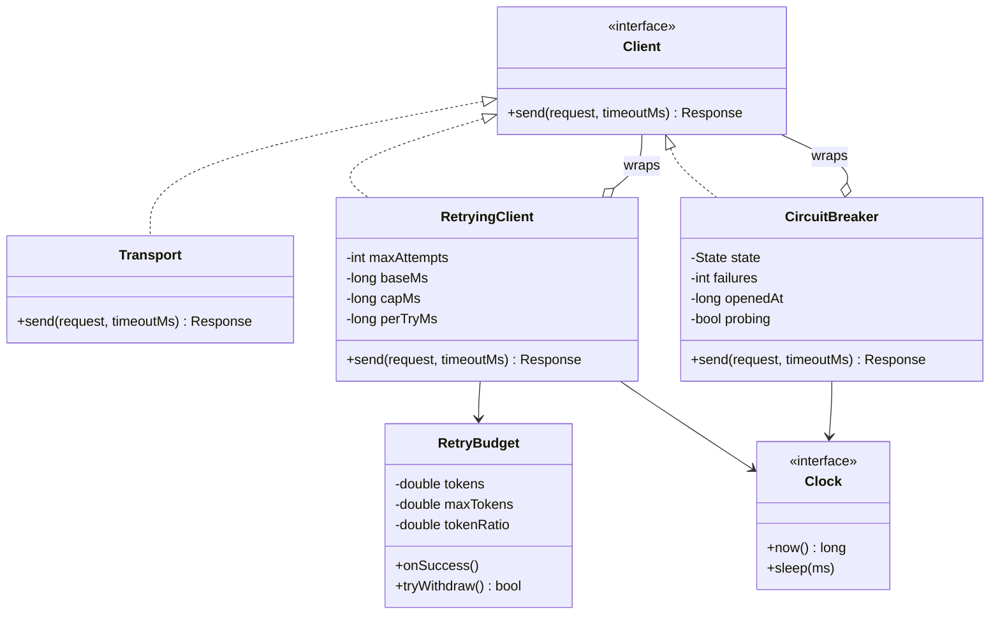
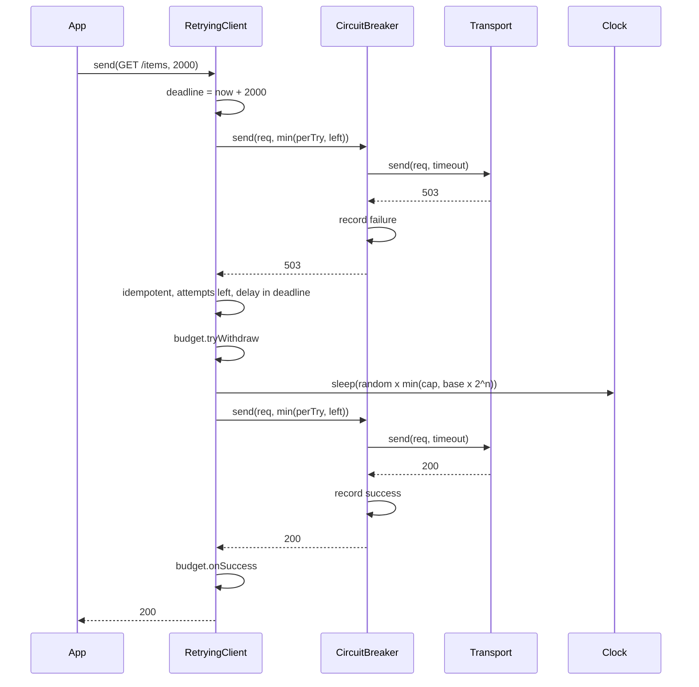
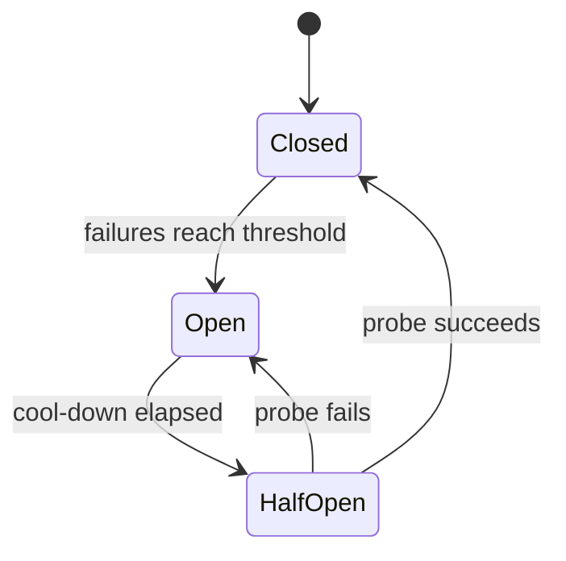

## In one minute
- A resilient client is a stack of small wrappers around one `send(request, timeout)` interface: a retry layer, a circuit breaker and the raw transport. Each wrapper adds one behaviour, and callers never know how many layers there are. That is the Decorator pattern.
- Retries are a loan against the server's capacity. Bound them three ways: a cap on attempts per request, a retry budget shared by all requests, and the caller's overall deadline. Without the second, a brief outage multiplies the load on a server that is already struggling.
- Space retries with exponential backoff and full jitter, and treat the server's `Retry-After` as a floor. Jitter spreads clients out in time; backoff gives the server room to recover.
- Retry only what is safe to repeat. A timeout does not tell you whether the server did the work, so retrying a bare `POST` can charge a card twice. Idempotent methods and requests carrying an idempotency key are retried; everything else is sent once.
- Inject the clock, the sleeper, the random source and the transport. Then every backoff schedule, deadline cut-off and breaker transition is a plain assertion in a unit test, with no sleeps.

## Requirements
Functional:
- `send(request, timeoutMs)` returns a response or raises one of a small set of errors: a transport error (connection failure or per-attempt timeout), an open-circuit error, or a deadline error.
- Retry connection failures, per-attempt timeouts and the statuses 429, 502, 503 and 504, up to a maximum number of attempts.
- Delay between attempts by exponential backoff with full jitter, capped, and never shorter than the server's `Retry-After`.
- Treat `timeoutMs` as one deadline for the whole call, retries and sleeps included. Each attempt gets the smaller of a per-try timeout and the time left.
- Retry only idempotent requests: methods that [HTTP defines as idempotent](https://www.rfc-editor.org/rfc/rfc9110.html) (GET, HEAD, OPTIONS, PUT, DELETE, TRACE), or any request that carries an idempotency key.
- A circuit breaker with closed, open and half-open states stops calls to a dependency that keeps failing, and lets a single probe through after a cool-down.
- A retry budget limits retries across all calls, not just within one.

Non-functional:
- Deterministic and testable: no real sleeps, no direct clock or random reads.
- Safe under concurrent callers. Locks protect state and are never held across the network call.
- Cheap: O(1) work and a few numbers of state per client.

Out of scope: connection pooling, TLS, request bodies and streaming, hedged requests, and per-host breaker registries. Extensibility returns to the last two.

## Entities and relationships
- **Client** (interface): `send(request, timeoutMs)`. The only thing callers depend on.
- **Transport**: the innermost `Client`. It does the real I/O and honours the timeout it is given. In tests it is a scripted fake.
- **RetryingClient**: a `Client` that wraps another `Client`. It owns the attempt loop, backoff, deadline arithmetic and the idempotency check.
- **CircuitBreaker**: a `Client` that wraps another `Client`. It owns the state machine and fails fast while open.
- **RetryBudget**: a small token pool shared by every call through one `RetryingClient`. Successes add fractional tokens and retries spend whole ones.
- **Clock**: `now()` and `sleep(ms)`. Production uses a monotonic clock and a real sleep. Tests use a fake that advances only when told to.
- **Random source**: a function returning a float in [0, 1). Tests pass a constant.
- **Request** and **Response**: value objects. A request has a method, a URL and an optional idempotency key. A response has a status and an optional `Retry-After` in milliseconds.

## Class diagram



## Key flows
One call through `RetryingClient(CircuitBreaker(Transport))`, where the first attempt gets a 503:



The breaker sits **inside** the retry loop. Each attempt is one observation of the dependency's health, so the breaker sees real failures and not whole calls. An open breaker raises an open-circuit error, and the retry layer passes that error straight up: retrying a fast failure only burns attempts and sleeps.

The breaker is a small state machine:



In **Closed** the breaker counts consecutive failures and resets the count on any success. At the threshold it moves to **Open** and records the time. While Open it rejects calls without touching the network. After the cool-down the next call moves it to **HalfOpen** and goes through as a probe; every other call is rejected until the probe finishes. A successful probe closes the circuit and a failed one reopens it with a fresh cool-down. Martin Fowler's [description of the pattern](https://martinfowler.com/bliki/CircuitBreaker.html) has the same shape: the breaker trips once failures reach a threshold, and further calls return an error without reaching the protected call.

## Design patterns used and why
- **Decorator.** `RetryingClient` and `CircuitBreaker` implement `Client` and hold a `Client`. Order is configuration: wrap the breaker in the retrier to count attempts, or the retrier in the breaker to count whole calls. New concerns such as metrics, auth headers or a deadline clamp are new wrappers, with no change to existing ones. Go's `http.RoundTripper` and Envoy's filter chain use the same idea.
- **State.** The breaker has three behaviours chosen by one field. In a language with cheap objects you could model each state as a class; for three states a small enum and a switch is clearer.
- **Strategy.** Backoff policy (full jitter, equal jitter, decorrelated jitter) and the retryable-status set are injectable decisions. The practice code hard-codes full jitter, but the seam is obvious.
- **Dependency injection for time and randomness.** The clock, the sleeper and the random source are constructor arguments. A client that calls `time.sleep` inside the loop can only be tested by waiting.
- **Token bucket, reused.** The retry budget is the rate limiter's idea pointed at retries instead of requests: deposits proportional to successes, withdrawals per retry.

## Concurrency and edge cases
The client is shared by every thread in a process, so its mutable state needs care. The breaker's counters and the budget's token count are small read-modify-write sequences, like a rate limiter's bucket: guard each with a mutex. The rule that matters is **never hold the lock across `inner.send`**. Take the lock to decide whether to admit the call, release it, make the network call, then take it again to record the outcome. Holding it across the call serialises every request behind the slowest one.

The half-open probe needs one extra flag. Without it, a hundred threads waking after the cool-down all see "half-open" and all send traffic to a dependency that may still be down. A `probing` flag, set under the lock when a thread claims the probe, lets exactly one through.

Edge cases worth naming:
- **A timeout is not a failure of the work.** The server may have processed the request. This is why the retry decision looks at idempotency and not just at the error.
- **Retry-After in the past or huge.** Take the larger of the jittered delay and the hint, but if the sleep would cross the deadline, give up now. Waiting 60 seconds to make a call that must finish in 2 helps nobody.
- **Deadline arithmetic.** Compute the deadline once from the clock at entry. Each attempt's timeout is `min(perTry, deadline - now)`. A fixed per-attempt timeout alone lets three retries of a 10-second timeout turn a "2-second" call into 30 seconds.
- **Mixed signals from the breaker.** Count only failures that say something about the dependency: transport errors and 5xx. A 404 or 400 is the dependency working correctly, and counting it would let one buggy caller open the circuit for everyone.
- **Retries at several layers.** If service A retries 3 times against B, and B retries 3 times against C, one user request can become nine calls to C. Decide which layer owns retries.
- **Clock that moves backwards.** Use a monotonic clock for cool-downs and deadlines. A wall-clock step would otherwise hold the breaker open or shorten a deadline.

## In the wild
- **AWS, 2021: connection storm in us-east-1.** An automated scaling activity on AWS's main network triggered a surge of connections from internal clients. Retries kept the congestion going, and a latent bug in client back-off stopped clients from backing off. Network devices took about 7 hours to recover, and AWS fixed the back-off bug afterwards ([AWS post-event summary](https://aws.amazon.com/message/12721/)).
- **Google Cloud, 2025: a blank policy row and a retry herd.** A policy record with blank fields crashed the Service Control component in every region. Restarting tasks without randomised backoff then overloaded a regional database, so most regions recovered within 2 hours while us-central1 took up to about 2 hours 40 minutes to resolve fully. Google's remediation list included auditing that systems use randomized exponential backoff ([Google Cloud incident report](https://status.cloud.google.com/incidents/ow5i3PPK96RduMcb1SsW)).
- **GitHub, 2022: retries of impossible webhook jobs.** Webhook jobs whose data had already been deleted were retried by the delivery workers, which blocked new events for 31 minutes. GitHub changed the workers to skip retries for jobs whose data no longer exists ([GitHub availability report](https://github.blog/2022-11-02-github-availability-report-october-2022/)).

## Down the stack

### Layer 1: The contract
`send` makes between one and `maxAttempts` calls to the inner client. It returns the first response whose status is not retryable, or the last response or error when attempts, budget or deadline run out. It never returns later than `timeoutMs` after entry, to within one inner call that honours its own timeout. It never retries a non-idempotent request, and never retries an open-circuit error. The breaker guarantees that while Open it makes zero inner calls, and that in HalfOpen at most one call is in flight.

### Layer 2: The mechanism
Backoff for attempt *n* (counting from 1) is `random() × min(cap, base × 2^(n-1))`. This is "full jitter" from the [AWS Architecture Blog's analysis of backoff and jitter](https://aws.amazon.com/blogs/architecture/exponential-backoff-and-jitter/): the delay is uniform from zero to the exponential ceiling, which removes the correlated waves that plain exponential backoff keeps producing when many clients fail together. The cap bounds worst-case sleep and prevents integer overflow of the exponent.

The retry budget follows the same accounting as gRPC's [client retry design (A6)](https://github.com/grpc/proposal/blob/master/A6-client-retries.md): a per-server token count starts at `maxTokens`, each failure removes one, each success adds `tokenRatio` (0.1 in the example config), and retries stop while the count is at or below half of `maxTokens`. With a ratio of 0.1, retries are limited to about 10% of the successful traffic in the long run. The Google SRE book's [chapter on cascading failures](https://sre.google/sre-book/addressing-cascading-failures/) recommends a similar server-wide retry budget and gives 60 retries per minute per process as an example. [Envoy's circuit-breaking docs](https://www.envoyproxy.io/docs/envoy/latest/intro/arch_overview/upstream/circuit_breaking) likewise prefer retry budgets over static limits. The practice version is a simplified form that withdraws a whole token per retry and refuses when less than one remains.

Deadlines are absolute. A deadline computed once at entry survives retries and sleeps, and in a multi-service call it should be propagated: the SRE book's example has server A, after spending 7 of its 30 seconds, call B with a 23-second deadline. gRPC [propagates deadlines](https://grpc.io/docs/guides/deadlines/) for exactly this reason. An HTTP client can pass the remaining time in a header, and the server should drop work whose caller has already given up.

Idempotency is defined by [RFC 9110](https://www.rfc-editor.org/rfc/rfc9110.html): PUT, DELETE and the safe methods have the same intended effect when repeated. For POST, the client sends a unique key and the server stores the first outcome, as in [Stripe's idempotent requests](https://docs.stripe.com/api/idempotent_requests). An in-progress [IETF draft for an `Idempotency-Key` header](https://datatracker.ietf.org/doc/draft-ietf-httpapi-idempotency-key-header/) standardises this.

### Layer 3: The machine
A timeout is a timer in the networking stack. The client library arms a deadline on a socket (in Go, [`http.Client.Timeout`](https://pkg.go.dev/net/http#Client) covers dial, redirects and reading the body), and when it fires the client closes the connection. The server may still be running the handler: the TCP FIN or RST arrives after the work started, and some servers only notice on their next write. That is the physical reason a timeout leaves the outcome unknown.

Connecting costs one round trip for TCP (about 0.2 ms in a data centre, 20-150 ms across regions) plus one or two more for TLS, so a retry on a fresh connection is not free; a retry on a kept-alive connection avoids that. Under the retry loop, a sleep is a parked thread or goroutine. A goroutine parked in `time.Sleep` costs about 2-8 KB of stack and no CPU; a blocked OS thread costs around 1 MB of reserved stack and a scheduler slot, which is why high retry volume exhausts thread pools in thread-per-request servers. The breaker's state is a few words, and the check on the hot path is one mutex acquire (about 20 ns uncontended) and a comparison.

### Why it's built this way
1. Networks fail briefly and often, so a failed call is worth repeating. Repeating adds load.
2. Added load is most dangerous exactly when the server is already slow, so retries are capped per request and metered against a shared budget that shrinks when success shrinks.
3. Synchronised retries make the load arrive in waves, so delays are randomised, and exponential so the total load falls as the outage lasts.
4. A dependency that is down gets nothing from more attempts, and each attempt ties up a caller's thread for the full timeout, so the breaker fails fast and probes sparingly.
5. A caller only has so long to wait, so one deadline bounds everything, and the retry layer has to know what is safe to repeat, since a timeout hides whether the work happened.

## Extensibility
- **Hedged requests.** Send a second copy after a delay near the p95 latency and take the first response. gRPC specifies this alongside retries; the same budget and idempotency rules apply, because a hedge is a retry sent early.
- **Per-host breakers.** Keep a map from host to breaker so one bad backend does not open the circuit for healthy ones. Evict idle entries as the rate limiter does.
- **Failure-rate breakers.** Replace consecutive failures with a sliding window of the last N calls and a failure-rate threshold, as [Resilience4j](https://resilience4j.readme.io/docs/circuitbreaker) does, plus a slow-call threshold so latency alone can trip it.
- **Observability.** Wrap the stack in a metrics decorator that counts attempts, retries, budget refusals and breaker transitions. A circuit that opens silently looks like a mystery outage.
- **Server pushback.** Honour a header that tells clients not to retry, the way gRPC defines pushback, so an overloaded server can shut off retries centrally.

## Leadership lens
- Ask in design review who owns retries. Exactly one layer per call path should retry; the [AWS Builders' Library](https://aws.amazon.com/builders-library/timeouts-retries-and-backoff-with-jitter/) shows that five stacked layers of 3 attempts mean up to 243 times the load on the bottom one.
- Make idempotency a platform rule, not a client decision. Mutating endpoints should accept an idempotency key, and the shared client should refuse to retry mutations that lack one.
- Ship one well-tested client library with sane defaults rather than letting every team hand-roll retries. Defaults to review: attempts (3), per-try timeout derived from the dependency's p99.9, and a budget of about 10%.
- Track retry ratio (retries divided by requests) per dependency as a first-class metric, and alert when it climbs. It is often the earliest sign that a dependency is degrading.
- Rehearse the failure modes: inject latency and 503s in staging and confirm that the breaker opens, the budget empties and the system recovers when the fault is removed.

## Check yourself
1. A client retries a failed `POST /payments` after a timeout, and the customer is charged twice. What went wrong, and what are two fixes?
   **Answer:** The timeout did not mean the server had not processed the request, and `POST` is not idempotent, so the retry repeated a side effect. Fix it by sending a unique idempotency key that the server uses to replay the first outcome, or by not retrying non-idempotent requests automatically.
2. Why does full jitter use `random() × ceiling` and not `ceiling ± a small random amount`?
   **Answer:** A small random offset leaves clients clustered near the same delay, so retries still arrive in waves. Drawing uniformly from zero to the ceiling spreads them across the whole window, which flattens the load on the recovering server.
3. A service calls a dependency with 3 attempts per call, and the dependency's own client also makes 3 attempts to a database. The database slows down. How much extra load can it see, and how do you reduce it?
   **Answer:** Up to 9 calls per user request instead of 1, since attempts multiply across layers. Retry at one layer only, and add a retry budget so retries cannot exceed a fraction of successful traffic.
4. Why must the breaker release its lock before calling the inner client, and what extra state does the half-open phase need?
   **Answer:** Holding the lock across a network call makes every request wait behind the slowest one. Half-open needs a `probing` flag set under the lock so that exactly one caller sends the probe and all others are rejected until it finishes.

## Practice
**Task:** Build a resilient client from three decorators over a `send(request, timeoutMs)` interface. `RetryBudget(maxTokens, tokenRatio)` starts full, `tryWithdraw()` spends one token if at least one is left, and `onSuccess()` adds `tokenRatio` up to `maxTokens`. `CircuitBreaker(inner, clock, failureThreshold, openMs)` counts consecutive failures (transport errors and statuses of 500 or more), opens at the threshold, rejects with `CircuitOpenError` while open, and after `openMs` lets exactly one probe through: a successful probe closes it and a failed one reopens it with a fresh timer. `RetryingClient(inner, clock, rand, maxAttempts, baseMs, capMs, perTryMs, budget)` computes `deadline = now + timeoutMs`, gives each attempt `min(perTryMs, remaining)`, and retries transport errors and statuses 429, 502, 503 and 504 only for idempotent requests (GET, HEAD, OPTIONS, PUT, DELETE, TRACE, or any request with a non-empty idempotency key). Between attempts it sleeps `max(floor(rand() × min(capMs, baseMs × 2^(attempt-1))), retryAfterMs)`, and it stops, returning the last response or raising the last error, when attempts run out, the sleep would reach the deadline, or the budget refuses. Successful (non-retryable) responses call `budget.onSuccess()`. A `timeoutMs` of zero or less raises `DeadlineExceeded`, and `CircuitOpenError` is never retried.

```python starter
class TransportError(Exception):
    pass


class CircuitOpenError(Exception):
    pass


class DeadlineExceeded(Exception):
    pass


class Request:
    def __init__(self, method, url, idempotency_key=""):
        self.method = method
        self.url = url
        self.idempotency_key = idempotency_key


class Response:
    def __init__(self, status, retry_after_ms=0):
        self.status = status
        self.retry_after_ms = retry_after_ms


class RetryBudget:
    def __init__(self, max_tokens, token_ratio):
        self.max_tokens = max_tokens
        self.token_ratio = token_ratio
        self.tokens = float(max_tokens)

    def on_success(self):
        # TODO: add token_ratio, capped at max_tokens
        raise NotImplementedError

    def try_withdraw(self):
        # TODO: spend one token if at least one is left
        raise NotImplementedError


class CircuitBreaker:
    def __init__(self, inner, clock, failure_threshold, open_ms):
        self.inner = inner
        self.clock = clock
        self.failure_threshold = failure_threshold
        self.open_ms = open_ms
        self.state = "closed"  # "closed", "open" or "half_open"

    def send(self, req, timeout_ms):
        # TODO: admit, call inner, record the outcome; one probe in half_open
        raise NotImplementedError


class RetryingClient:
    def __init__(self, inner, clock, rand, max_attempts, base_ms, cap_ms, per_try_ms, budget):
        self.inner = inner
        self.clock = clock
        self.rand = rand
        self.max_attempts = max_attempts
        self.base_ms = base_ms
        self.cap_ms = cap_ms
        self.per_try_ms = per_try_ms
        self.budget = budget

    def send(self, req, timeout_ms):
        # TODO: deadline, attempt loop, idempotency check, jittered backoff, budget
        raise NotImplementedError
```

```python tests
class FakeClock:
    def __init__(self):
        self.t = 0
        self.sleeps = []

    def now(self):
        return self.t

    def sleep(self, ms):
        self.sleeps.append(ms)
        self.t += ms


class FakeTransport:
    """Plays a script of Response objects (None means a connection error).
    The last item repeats. A latency above the timeout becomes a timeout error."""

    def __init__(self, clock, script, latency=0):
        self.clock = clock
        self.script = list(script)
        self.latency = latency
        self.calls = 0
        self.timeouts = []
        self.hook = None

    def send(self, req, timeout_ms):
        self.calls += 1
        self.timeouts.append(timeout_ms)
        if self.hook:
            self.hook()
        item = self.script[0] if len(self.script) == 1 else self.script.pop(0)
        if self.latency > timeout_ms:
            self.clock.t += timeout_ms
            raise TransportError("timeout")
        self.clock.t += self.latency
        if item is None:
            raise TransportError("reset")
        return item


GET = Request("GET", "/items")


def make_client(clock, transport, rand=0.5, attempts=4, base=100, cap=250, per_try=1000,
                budget=None):
    budget = budget or RetryBudget(10, 0.1)
    return RetryingClient(transport, clock, lambda: rand, attempts, base, cap, per_try, budget)


def test_full_jitter_backoff_is_exponential_and_capped():
    clock = FakeClock()
    tr = FakeTransport(clock, [Response(503), Response(503), Response(503), Response(200)])
    resp = make_client(clock, tr).send(GET, 10000)
    assert resp.status == 200
    assert clock.sleeps == [50, 100, 125], "0.5 x min(250, 100 x 2^n)"


def test_only_idempotent_requests_are_retried():
    clock = FakeClock()
    tr = FakeTransport(clock, [Response(503)])
    resp = make_client(clock, tr, attempts=3).send(Request("POST", "/pay"), 10000)
    assert resp.status == 503 and tr.calls == 1, "bare POST is sent once"
    tr2 = FakeTransport(clock, [Response(503)])
    make_client(clock, tr2, attempts=3).send(Request("POST", "/pay", "key-1"), 10000)
    assert tr2.calls == 3, "a POST with an idempotency key may be retried"


def test_retry_after_is_a_floor_for_the_delay():
    clock = FakeClock()
    tr = FakeTransport(clock, [Response(429, 1000), Response(200)])
    resp = make_client(clock, tr, rand=0.0).send(GET, 10000)
    assert resp.status == 200
    assert clock.sleeps == [1000]


def test_deadline_bounds_attempts_and_sleeps():
    clock = FakeClock()
    tr = FakeTransport(clock, [Response(503)], latency=80)
    raised = None
    try:
        make_client(clock, tr, attempts=5, per_try=150).send(GET, 200)
    except TransportError as e:
        raised = e
    assert raised is not None, "the last transport error is raised"
    assert tr.timeouts == [150, 70], "second try is clipped to the time left"
    assert clock.t == 200, "never past the deadline"
    try:
        make_client(clock, tr).send(GET, 0)
        assert False, "zero timeout must raise"
    except DeadlineExceeded:
        pass


def test_retry_budget_limits_retries_across_calls():
    b = RetryBudget(2, 0.5)
    assert [b.try_withdraw(), b.try_withdraw(), b.try_withdraw()] == [True, True, False]
    b.on_success()
    b.on_success()
    assert b.try_withdraw() is True
    clock = FakeClock()
    tr = FakeTransport(clock, [Response(503)])
    client = make_client(clock, tr, attempts=5, budget=RetryBudget(2, 0.1))
    client.send(GET, 100000)
    assert tr.calls == 3, "first call uses both tokens on two retries"
    client.send(GET, 100000)
    assert tr.calls == 4, "second call finds the budget empty and is not retried"


def test_breaker_opens_then_closes_after_a_successful_probe():
    clock = FakeClock()
    tr = FakeTransport(clock, [Response(503), Response(503), Response(503), Response(200)])
    br = CircuitBreaker(tr, clock, 3, 1000)
    for _ in range(3):
        assert br.send(GET, 100).status == 503
    assert br.state == "open"
    clock.t = 999
    try:
        br.send(GET, 100)
        assert False, "must reject while open"
    except CircuitOpenError:
        pass
    assert tr.calls == 3, "an open circuit makes no inner calls"
    clock.t = 1000
    assert br.send(GET, 100).status == 200
    assert br.state == "closed"


def test_failed_probe_reopens_and_only_one_probe_runs():
    clock = FakeClock()
    tr = FakeTransport(clock, [Response(503), Response(503), Response(200)])
    br = CircuitBreaker(tr, clock, 1, 1000)
    br.send(GET, 100)
    assert br.state == "open"
    clock.t = 1000
    nested = []

    def hook():
        if tr.calls == 2:
            try:
                br.send(GET, 100)
            except CircuitOpenError:
                nested.append("rejected")

    tr.hook = hook
    assert br.send(GET, 100).status == 503
    assert nested == ["rejected"], "calls during the probe are rejected"
    assert br.state == "open"
    clock.t = 1999
    try:
        br.send(GET, 100)
        assert False, "the cool-down restarted at the failed probe"
    except CircuitOpenError:
        pass
    clock.t = 2000
    assert br.send(GET, 100).status == 200
    assert br.state == "closed"


def test_retry_layer_does_not_retry_an_open_circuit():
    clock = FakeClock()
    tr = FakeTransport(clock, [Response(503)])
    br = CircuitBreaker(tr, clock, 2, 1000)
    client = make_client(clock, tr, attempts=5)
    client.inner = br
    try:
        client.send(GET, 100000)
        assert False, "open circuit must surface"
    except CircuitOpenError:
        pass
    assert tr.calls == 2, "two failures open the circuit, the third attempt is rejected"
    assert len(clock.sleeps) == 2
```

```python solution
class TransportError(Exception):
    pass


class CircuitOpenError(Exception):
    pass


class DeadlineExceeded(Exception):
    pass


class Request:
    def __init__(self, method, url, idempotency_key=""):
        self.method = method
        self.url = url
        self.idempotency_key = idempotency_key


class Response:
    def __init__(self, status, retry_after_ms=0):
        self.status = status
        self.retry_after_ms = retry_after_ms


IDEMPOTENT_METHODS = {"GET", "HEAD", "OPTIONS", "PUT", "DELETE", "TRACE"}
RETRYABLE_STATUS = {429, 502, 503, 504}


class RetryBudget:
    def __init__(self, max_tokens, token_ratio):
        self.max_tokens = max_tokens
        self.token_ratio = token_ratio
        self.tokens = float(max_tokens)

    def on_success(self):
        self.tokens = min(float(self.max_tokens), self.tokens + self.token_ratio)

    def try_withdraw(self):
        if self.tokens >= 1:
            self.tokens -= 1
            return True
        return False


class CircuitBreaker:
    def __init__(self, inner, clock, failure_threshold, open_ms):
        self.inner = inner
        self.clock = clock
        self.failure_threshold = failure_threshold
        self.open_ms = open_ms
        self.state = "closed"
        self.failures = 0
        self.opened_at = 0
        self.probing = False

    def _admit(self):
        # In a threaded client this runs under a lock. It returns True for the probe.
        if self.state == "open":
            if self.clock.now() - self.opened_at < self.open_ms:
                raise CircuitOpenError()
            self.state = "half_open"
            self.probing = False
        if self.state == "half_open":
            if self.probing:
                raise CircuitOpenError()
            self.probing = True
            return True
        return False

    def _record(self, ok, probe):
        if probe:
            self.probing = False
            if ok:
                self.state = "closed"
                self.failures = 0
            else:
                self.state = "open"
                self.opened_at = self.clock.now()
        elif self.state == "closed":
            if ok:
                self.failures = 0
            else:
                self.failures += 1
                if self.failures >= self.failure_threshold:
                    self.state = "open"
                    self.opened_at = self.clock.now()

    def send(self, req, timeout_ms):
        probe = self._admit()
        try:
            resp = self.inner.send(req, timeout_ms)
        except Exception:
            self._record(False, probe)
            raise
        self._record(resp.status < 500, probe)
        return resp


class RetryingClient:
    def __init__(self, inner, clock, rand, max_attempts, base_ms, cap_ms, per_try_ms, budget):
        self.inner = inner
        self.clock = clock
        self.rand = rand
        self.max_attempts = max_attempts
        self.base_ms = base_ms
        self.cap_ms = cap_ms
        self.per_try_ms = per_try_ms
        self.budget = budget

    def send(self, req, timeout_ms):
        if timeout_ms <= 0:
            raise DeadlineExceeded()
        deadline = self.clock.now() + timeout_ms
        safe = req.method.upper() in IDEMPOTENT_METHODS or bool(req.idempotency_key)
        attempt = 0
        while True:
            attempt += 1
            remaining = deadline - self.clock.now()
            resp = None
            err = None
            try:
                resp = self.inner.send(req, min(self.per_try_ms, remaining))
            except TransportError as e:
                err = e
            if resp is not None and resp.status not in RETRYABLE_STATUS:
                self.budget.on_success()
                return resp
            give_up = not safe or attempt >= self.max_attempts
            if not give_up:
                ceiling = min(self.cap_ms, self.base_ms * (2 ** (attempt - 1)))
                delay = int(self.rand() * ceiling)
                if resp is not None and resp.retry_after_ms > delay:
                    delay = resp.retry_after_ms
                give_up = self.clock.now() + delay >= deadline or not self.budget.try_withdraw()
            if give_up:
                if err is not None:
                    raise err
                return resp
            self.clock.sleep(delay)
```

The same problem in TypeScript:

```typescript starter
export class TransportError extends Error {}
export class CircuitOpenError extends Error {}
export class DeadlineExceeded extends Error {}

export interface HttpRequest {
  method: string;
  url: string;
  idempotencyKey?: string;
}

export interface HttpResponse {
  status: number;
  retryAfterMs?: number;
}

export interface Clock {
  now(): number;
  sleep(ms: number): void;
}

export interface Client {
  send(req: HttpRequest, timeoutMs: number): HttpResponse;
}

export class RetryBudget {
  tokens: number;
  constructor(private maxTokens: number, private tokenRatio: number) {
    this.tokens = maxTokens;
  }

  onSuccess(): void {
    // TODO: add tokenRatio, capped at maxTokens
    throw new Error("TODO");
  }

  tryWithdraw(): boolean {
    // TODO: spend one token if at least one is left
    throw new Error("TODO");
  }
}

export class CircuitBreaker implements Client {
  state: "closed" | "open" | "half_open" = "closed";
  constructor(
    private inner: Client,
    private clock: Clock,
    private failureThreshold: number,
    private openMs: number,
  ) {}

  send(req: HttpRequest, timeoutMs: number): HttpResponse {
    // TODO: admit, call inner, record the outcome; one probe in half_open
    throw new Error("TODO");
  }
}

export class RetryingClient implements Client {
  constructor(
    public inner: Client,
    private clock: Clock,
    private rand: () => number,
    private maxAttempts: number,
    private baseMs: number,
    private capMs: number,
    private perTryMs: number,
    private budget: RetryBudget,
  ) {}

  send(req: HttpRequest, timeoutMs: number): HttpResponse {
    // TODO: deadline, attempt loop, idempotency check, jittered backoff, budget
    throw new Error("TODO");
  }
}
```

```typescript tests
class FakeClock implements Clock {
  t = 0;
  sleeps: number[] = [];
  now(): number {
    return this.t;
  }
  sleep(ms: number): void {
    this.sleeps.push(ms);
    this.t += ms;
  }
}

// Plays a script of responses (null is a connection error). The last item repeats.
class FakeTransport implements Client {
  calls = 0;
  timeouts: number[] = [];
  hook: (() => void) | null = null;
  private script: (HttpResponse | null)[];
  constructor(private clock: FakeClock, script: (HttpResponse | null)[], private latency = 0) {
    this.script = script.slice();
  }
  send(req: HttpRequest, timeoutMs: number): HttpResponse {
    this.calls++;
    this.timeouts.push(timeoutMs);
    if (this.hook) this.hook();
    const item = this.script.length === 1 ? this.script[0] : (this.script.shift() as HttpResponse | null);
    if (this.latency > timeoutMs) {
      this.clock.t += timeoutMs;
      throw new TransportError("timeout");
    }
    this.clock.t += this.latency;
    if (item === null) throw new TransportError("reset");
    return item;
  }
}

const GET: HttpRequest = { method: "GET", url: "/items" };

function makeClient(
  clock: FakeClock,
  tr: Client,
  o: { rand?: number; attempts?: number; budget?: RetryBudget; perTry?: number } = {},
): RetryingClient {
  const rand = o.rand === undefined ? 0.5 : o.rand;
  return new RetryingClient(tr, clock, () => rand, o.attempts || 4, 100, 250, o.perTry || 1000, o.budget || new RetryBudget(10, 0.1));
}

function throws(fn: () => unknown, ctor: new (...a: never[]) => Error): boolean {
  try {
    fn();
  } catch (e) {
    return e instanceof ctor;
  }
  return false;
}

test("full jitter backoff is exponential and capped", () => {
  const clock = new FakeClock();
  const tr = new FakeTransport(clock, [{ status: 503 }, { status: 503 }, { status: 503 }, { status: 200 }]);
  const resp = makeClient(clock, tr).send(GET, 10000);
  assertEqual(resp.status, 200);
  assertEqual(clock.sleeps, [50, 100, 125], "0.5 x min(250, 100 x 2^n)");
});

test("only idempotent requests are retried", () => {
  const clock = new FakeClock();
  const tr = new FakeTransport(clock, [{ status: 503 }]);
  const resp = makeClient(clock, tr, { attempts: 3 }).send({ method: "POST", url: "/pay" }, 10000);
  assert(resp.status === 503 && tr.calls === 1, "bare POST is sent once");
  const tr2 = new FakeTransport(clock, [{ status: 503 }]);
  makeClient(clock, tr2, { attempts: 3 }).send({ method: "POST", url: "/pay", idempotencyKey: "key-1" }, 10000);
  assertEqual(tr2.calls, 3, "a POST with an idempotency key may be retried");
});

test("retry-after is a floor for the delay", () => {
  const clock = new FakeClock();
  const tr = new FakeTransport(clock, [{ status: 429, retryAfterMs: 1000 }, { status: 200 }]);
  const resp = makeClient(clock, tr, { rand: 0 }).send(GET, 10000);
  assertEqual(resp.status, 200);
  assertEqual(clock.sleeps, [1000]);
});

test("deadline bounds attempts and sleeps", () => {
  const clock = new FakeClock();
  const tr = new FakeTransport(clock, [{ status: 503 }], 80);
  const c = makeClient(clock, tr, { attempts: 5, perTry: 150 });
  assert(throws(() => c.send(GET, 200), TransportError), "the last transport error is raised");
  assertEqual(tr.timeouts, [150, 70], "second try is clipped to the time left");
  assertEqual(clock.t, 200, "never past the deadline");
  assert(throws(() => c.send(GET, 0), DeadlineExceeded), "zero timeout must raise");
});

test("retry budget limits retries across calls", () => {
  const b = new RetryBudget(2, 0.5);
  assertEqual([b.tryWithdraw(), b.tryWithdraw(), b.tryWithdraw()], [true, true, false]);
  b.onSuccess();
  b.onSuccess();
  assertEqual(b.tryWithdraw(), true);
  const clock = new FakeClock();
  const tr = new FakeTransport(clock, [{ status: 503 }]);
  const client = makeClient(clock, tr, { attempts: 5, budget: new RetryBudget(2, 0.1) });
  client.send(GET, 100000);
  assertEqual(tr.calls, 3, "first call uses both tokens on two retries");
  client.send(GET, 100000);
  assertEqual(tr.calls, 4, "second call finds the budget empty and is not retried");
});

test("breaker opens then closes after a successful probe", () => {
  const clock = new FakeClock();
  const tr = new FakeTransport(clock, [{ status: 503 }, { status: 503 }, { status: 503 }, { status: 200 }]);
  const br = new CircuitBreaker(tr, clock, 3, 1000);
  for (let i = 0; i < 3; i++) assertEqual(br.send(GET, 100).status, 503);
  assertEqual(br.state, "open");
  clock.t = 999;
  assert(throws(() => br.send(GET, 100), CircuitOpenError), "must reject while open");
  assertEqual(tr.calls, 3, "an open circuit makes no inner calls");
  clock.t = 1000;
  assertEqual(br.send(GET, 100).status, 200);
  assertEqual(br.state, "closed");
});

test("failed probe reopens and only one probe runs", () => {
  const clock = new FakeClock();
  const tr = new FakeTransport(clock, [{ status: 503 }, { status: 503 }, { status: 200 }]);
  const br = new CircuitBreaker(tr, clock, 1, 1000);
  br.send(GET, 100);
  assertEqual(br.state, "open");
  clock.t = 1000;
  const nested: string[] = [];
  tr.hook = () => {
    if (tr.calls === 2 && throws(() => br.send(GET, 100), CircuitOpenError)) nested.push("rejected");
  };
  assertEqual(br.send(GET, 100).status, 503);
  assertEqual(nested, ["rejected"], "calls during the probe are rejected");
  assertEqual(br.state, "open");
  clock.t = 1999;
  assert(throws(() => br.send(GET, 100), CircuitOpenError), "the cool-down restarted at the failed probe");
  clock.t = 2000;
  assertEqual(br.send(GET, 100).status, 200);
  assertEqual(br.state, "closed");
});

test("retry layer does not retry an open circuit", () => {
  const clock = new FakeClock();
  const tr = new FakeTransport(clock, [{ status: 503 }]);
  const client = makeClient(clock, tr, { attempts: 5 });
  client.inner = new CircuitBreaker(tr, clock, 2, 1000);
  assert(throws(() => client.send(GET, 100000), CircuitOpenError), "open circuit must surface");
  assertEqual(tr.calls, 2, "two failures open the circuit, the third attempt is rejected");
  assertEqual(clock.sleeps.length, 2);
});
```

```typescript solution
export class TransportError extends Error {}
export class CircuitOpenError extends Error {}
export class DeadlineExceeded extends Error {}

export interface HttpRequest {
  method: string;
  url: string;
  idempotencyKey?: string;
}

export interface HttpResponse {
  status: number;
  retryAfterMs?: number;
}

export interface Clock {
  now(): number;
  sleep(ms: number): void;
}

export interface Client {
  send(req: HttpRequest, timeoutMs: number): HttpResponse;
}

const IDEMPOTENT = new Set(["GET", "HEAD", "OPTIONS", "PUT", "DELETE", "TRACE"]);
const RETRYABLE = new Set([429, 502, 503, 504]);

export class RetryBudget {
  tokens: number;
  constructor(private maxTokens: number, private tokenRatio: number) {
    this.tokens = maxTokens;
  }

  onSuccess(): void {
    this.tokens = Math.min(this.maxTokens, this.tokens + this.tokenRatio);
  }

  tryWithdraw(): boolean {
    if (this.tokens >= 1) {
      this.tokens -= 1;
      return true;
    }
    return false;
  }
}

export class CircuitBreaker implements Client {
  state: "closed" | "open" | "half_open" = "closed";
  private failures = 0;
  private openedAt = 0;
  private probing = false;
  constructor(
    private inner: Client,
    private clock: Clock,
    private failureThreshold: number,
    private openMs: number,
  ) {}

  private admit(): boolean {
    if (this.state === "open") {
      if (this.clock.now() - this.openedAt < this.openMs) throw new CircuitOpenError();
      this.state = "half_open";
      this.probing = false;
    }
    if (this.state === "half_open") {
      if (this.probing) throw new CircuitOpenError();
      this.probing = true;
      return true;
    }
    return false;
  }

  private record(ok: boolean, probe: boolean): void {
    if (probe) {
      this.probing = false;
      if (ok) {
        this.state = "closed";
        this.failures = 0;
      } else {
        this.state = "open";
        this.openedAt = this.clock.now();
      }
    } else if (this.state === "closed") {
      if (ok) {
        this.failures = 0;
      } else if (++this.failures >= this.failureThreshold) {
        this.state = "open";
        this.openedAt = this.clock.now();
      }
    }
  }

  send(req: HttpRequest, timeoutMs: number): HttpResponse {
    const probe = this.admit();
    let resp: HttpResponse;
    try {
      resp = this.inner.send(req, timeoutMs);
    } catch (e) {
      this.record(false, probe);
      throw e;
    }
    this.record(resp.status < 500, probe);
    return resp;
  }
}

export class RetryingClient implements Client {
  constructor(
    public inner: Client,
    private clock: Clock,
    private rand: () => number,
    private maxAttempts: number,
    private baseMs: number,
    private capMs: number,
    private perTryMs: number,
    private budget: RetryBudget,
  ) {}

  send(req: HttpRequest, timeoutMs: number): HttpResponse {
    if (timeoutMs <= 0) throw new DeadlineExceeded();
    const deadline = this.clock.now() + timeoutMs;
    const safe = IDEMPOTENT.has(req.method.toUpperCase()) || !!req.idempotencyKey;
    let attempt = 0;
    for (;;) {
      attempt++;
      const remaining = deadline - this.clock.now();
      let resp: HttpResponse | null = null;
      let err: Error | null = null;
      try {
        resp = this.inner.send(req, Math.min(this.perTryMs, remaining));
      } catch (e) {
        if (!(e instanceof TransportError)) throw e;
        err = e;
      }
      if (resp !== null && !RETRYABLE.has(resp.status)) {
        this.budget.onSuccess();
        return resp;
      }
      let giveUp = !safe || attempt >= this.maxAttempts;
      let delay = 0;
      if (!giveUp) {
        const ceiling = Math.min(this.capMs, this.baseMs * Math.pow(2, attempt - 1));
        delay = Math.floor(this.rand() * ceiling);
        if (resp !== null && (resp.retryAfterMs || 0) > delay) delay = resp.retryAfterMs as number;
        giveUp = this.clock.now() + delay >= deadline || !this.budget.tryWithdraw();
      }
      if (giveUp) {
        if (err !== null) throw err;
        return resp as HttpResponse;
      }
      this.clock.sleep(delay);
    }
  }
}
```

The same problem in Go:

```go starter
package practice

import "errors"

var ErrTransport = errors.New("transport error")
var ErrCircuitOpen = errors.New("circuit open")
var ErrDeadline = errors.New("deadline exceeded")

type Request struct {
	Method         string
	URL            string
	IdempotencyKey string
}

type Response struct {
	Status       int
	RetryAfterMs int64
}

type Clock interface {
	Now() int64
	Sleep(ms int64)
}

type Client interface {
	Send(req Request, timeoutMs int64) (Response, error)
}

type RetryBudget struct {
	tokens, maxTokens, tokenRatio float64
}

func NewRetryBudget(maxTokens, tokenRatio float64) *RetryBudget {
	return &RetryBudget{tokens: maxTokens, maxTokens: maxTokens, tokenRatio: tokenRatio}
}

func (b *RetryBudget) OnSuccess() {
	// TODO: add tokenRatio, capped at maxTokens
	panic("TODO")
}

func (b *RetryBudget) TryWithdraw() bool {
	// TODO: spend one token if at least one is left
	panic("TODO")
}

type CircuitBreaker struct {
	inner     Client
	clock     Clock
	threshold int
	openMs    int64
}

func NewCircuitBreaker(inner Client, clock Clock, failureThreshold int, openMs int64) *CircuitBreaker {
	return &CircuitBreaker{inner: inner, clock: clock, threshold: failureThreshold, openMs: openMs}
}

// State returns "closed", "open" or "half_open".
func (b *CircuitBreaker) State() string {
	// TODO
	panic("TODO")
}

func (b *CircuitBreaker) Send(req Request, timeoutMs int64) (Response, error) {
	// TODO: admit under a lock, call inner without it, record the outcome
	panic("TODO")
}

type RetryingClient struct {
	Inner       Client
	clock       Clock
	rand        func() float64
	maxAttempts int
	baseMs      int64
	capMs       int64
	perTryMs    int64
	budget      *RetryBudget
}

func NewRetryingClient(inner Client, clock Clock, rand func() float64, maxAttempts int,
	baseMs, capMs, perTryMs int64, budget *RetryBudget) *RetryingClient {
	return &RetryingClient{Inner: inner, clock: clock, rand: rand, maxAttempts: maxAttempts,
		baseMs: baseMs, capMs: capMs, perTryMs: perTryMs, budget: budget}
}

func (c *RetryingClient) Send(req Request, timeoutMs int64) (Response, error) {
	// TODO: deadline, attempt loop, idempotency check, jittered backoff, budget
	panic("TODO")
}
```

```go tests
package practice

import (
	"errors"
	"testing"
)

type fakeClock struct {
	t      int64
	sleeps []int64
}

func (c *fakeClock) Now() int64 { return c.t }
func (c *fakeClock) Sleep(ms int64) {
	c.sleeps = append(c.sleeps, ms)
	c.t += ms
}

// item is one scripted outcome; err non-nil means a connection error.
type item struct {
	resp Response
	err  error
}

type fakeTransport struct {
	clock    *fakeClock
	script   []item
	latency  int64
	calls    int
	timeouts []int64
	hook     func()
}

func (f *fakeTransport) Send(req Request, timeoutMs int64) (Response, error) {
	f.calls++
	f.timeouts = append(f.timeouts, timeoutMs)
	if f.hook != nil {
		f.hook()
	}
	it := f.script[0]
	if len(f.script) > 1 {
		f.script = f.script[1:]
	}
	if f.latency > timeoutMs {
		f.clock.t += timeoutMs
		return Response{}, ErrTransport
	}
	f.clock.t += f.latency
	return it.resp, it.err
}

func ok(status int) item { return item{resp: Response{Status: status}} }

var get = Request{Method: "GET", URL: "/items"}

func newClientPerTry(c *fakeClock, tr Client, rnd float64, attempts int, perTry int64, b *RetryBudget) *RetryingClient {
	if b == nil {
		b = NewRetryBudget(10, 0.1)
	}
	return NewRetryingClient(tr, c, func() float64 { return rnd }, attempts, 100, 250, perTry, b)
}

func newClient(c *fakeClock, tr Client, rnd float64, attempts int, b *RetryBudget) *RetryingClient {
	return newClientPerTry(c, tr, rnd, attempts, 1000, b)
}

func equalInts(a, b []int64) bool {
	if len(a) != len(b) {
		return false
	}
	for i := range a {
		if a[i] != b[i] {
			return false
		}
	}
	return true
}

func TestFullJitterBackoffIsExponentialAndCapped(t *testing.T) {
	c := &fakeClock{}
	tr := &fakeTransport{clock: c, script: []item{ok(503), ok(503), ok(503), ok(200)}}
	resp, err := newClient(c, tr, 0.5, 4, nil).Send(get, 10000)
	if err != nil || resp.Status != 200 {
		t.Fatalf("got %v %v", resp, err)
	}
	if !equalInts(c.sleeps, []int64{50, 100, 125}) {
		t.Fatalf("sleeps = %v, want 0.5 x min(250, 100 x 2^n)", c.sleeps)
	}
}

func TestOnlyIdempotentRequestsAreRetried(t *testing.T) {
	c := &fakeClock{}
	tr := &fakeTransport{clock: c, script: []item{ok(503)}}
	resp, _ := newClient(c, tr, 0.5, 3, nil).Send(Request{Method: "POST", URL: "/pay"}, 10000)
	if resp.Status != 503 || tr.calls != 1 {
		t.Fatalf("bare POST must be sent once, calls = %d", tr.calls)
	}
	tr2 := &fakeTransport{clock: c, script: []item{ok(503)}}
	newClient(c, tr2, 0.5, 3, nil).Send(Request{Method: "POST", URL: "/pay", IdempotencyKey: "key-1"}, 10000)
	if tr2.calls != 3 {
		t.Fatalf("a POST with a key may be retried, calls = %d", tr2.calls)
	}
}

func TestRetryAfterIsAFloorForTheDelay(t *testing.T) {
	c := &fakeClock{}
	tr := &fakeTransport{clock: c, script: []item{{resp: Response{Status: 429, RetryAfterMs: 1000}}, ok(200)}}
	resp, err := newClient(c, tr, 0, 4, nil).Send(get, 10000)
	if err != nil || resp.Status != 200 || !equalInts(c.sleeps, []int64{1000}) {
		t.Fatalf("got %v %v sleeps %v", resp, err, c.sleeps)
	}
}

func TestDeadlineBoundsAttemptsAndSleeps(t *testing.T) {
	c := &fakeClock{}
	tr := &fakeTransport{clock: c, script: []item{ok(503)}, latency: 80}
	cl := newClientPerTry(c, tr, 0.5, 5, 150, nil)
	_, err := cl.Send(get, 200)
	if !errors.Is(err, ErrTransport) {
		t.Fatalf("want the last transport error, got %v", err)
	}
	if !equalInts(tr.timeouts, []int64{150, 70}) {
		t.Fatalf("timeouts = %v, second try must be clipped to the time left", tr.timeouts)
	}
	if c.t != 200 {
		t.Fatalf("clock = %d, never past the deadline", c.t)
	}
	if _, err := cl.Send(get, 0); !errors.Is(err, ErrDeadline) {
		t.Fatalf("zero timeout must be ErrDeadline, got %v", err)
	}
}

func TestRetryBudgetLimitsRetriesAcrossCalls(t *testing.T) {
	b := NewRetryBudget(2, 0.5)
	if !b.TryWithdraw() || !b.TryWithdraw() || b.TryWithdraw() {
		t.Fatal("two tokens, then empty")
	}
	b.OnSuccess()
	b.OnSuccess()
	if !b.TryWithdraw() {
		t.Fatal("two successes at 0.5 refill one token")
	}
	c := &fakeClock{}
	tr := &fakeTransport{clock: c, script: []item{ok(503)}}
	cl := newClient(c, tr, 0.5, 5, NewRetryBudget(2, 0.1))
	cl.Send(get, 100000)
	if tr.calls != 3 {
		t.Fatalf("first call uses both tokens on two retries, calls = %d", tr.calls)
	}
	cl.Send(get, 100000)
	if tr.calls != 4 {
		t.Fatalf("second call finds the budget empty, calls = %d", tr.calls)
	}
}

func TestBreakerOpensThenClosesAfterASuccessfulProbe(t *testing.T) {
	c := &fakeClock{}
	tr := &fakeTransport{clock: c, script: []item{ok(503), ok(503), ok(503), ok(200)}}
	br := NewCircuitBreaker(tr, c, 3, 1000)
	for i := 0; i < 3; i++ {
		if resp, _ := br.Send(get, 100); resp.Status != 503 {
			t.Fatal("failures are passed through")
		}
	}
	if br.State() != "open" {
		t.Fatalf("state = %s", br.State())
	}
	c.t = 999
	if _, err := br.Send(get, 100); !errors.Is(err, ErrCircuitOpen) {
		t.Fatalf("must reject while open, got %v", err)
	}
	if tr.calls != 3 {
		t.Fatal("an open circuit makes no inner calls")
	}
	c.t = 1000
	if resp, err := br.Send(get, 100); err != nil || resp.Status != 200 {
		t.Fatalf("probe: %v %v", resp, err)
	}
	if br.State() != "closed" {
		t.Fatalf("state = %s", br.State())
	}
}

func TestFailedProbeReopensAndOnlyOneProbeRuns(t *testing.T) {
	c := &fakeClock{}
	tr := &fakeTransport{clock: c, script: []item{ok(503), ok(503), ok(200)}}
	br := NewCircuitBreaker(tr, c, 1, 1000)
	br.Send(get, 100)
	if br.State() != "open" {
		t.Fatal("one failure opens a threshold-1 breaker")
	}
	c.t = 1000
	var nested []error
	tr.hook = func() {
		if tr.calls == 2 {
			_, err := br.Send(get, 100)
			nested = append(nested, err)
		}
	}
	if resp, _ := br.Send(get, 100); resp.Status != 503 {
		t.Fatal("the probe's own result is returned")
	}
	if len(nested) != 1 || !errors.Is(nested[0], ErrCircuitOpen) {
		t.Fatalf("calls during the probe must be rejected, got %v", nested)
	}
	if br.State() != "open" {
		t.Fatalf("state = %s", br.State())
	}
	c.t = 1999
	if _, err := br.Send(get, 100); !errors.Is(err, ErrCircuitOpen) {
		t.Fatal("the cool-down restarted at the failed probe")
	}
	c.t = 2000
	if resp, err := br.Send(get, 100); err != nil || resp.Status != 200 || br.State() != "closed" {
		t.Fatalf("second probe: %v %v %s", resp, err, br.State())
	}
}

func TestRetryLayerDoesNotRetryAnOpenCircuit(t *testing.T) {
	c := &fakeClock{}
	tr := &fakeTransport{clock: c, script: []item{ok(503)}}
	cl := newClient(c, tr, 0.5, 5, nil)
	cl.Inner = NewCircuitBreaker(tr, c, 2, 1000)
	_, err := cl.Send(get, 100000)
	if !errors.Is(err, ErrCircuitOpen) {
		t.Fatalf("open circuit must surface, got %v", err)
	}
	if tr.calls != 2 || len(c.sleeps) != 2 {
		t.Fatalf("calls = %d sleeps = %d, want 2 and 2", tr.calls, len(c.sleeps))
	}
}
```

```go solution
package practice

import (
	"errors"
	"strings"
	"sync"
)

var ErrTransport = errors.New("transport error")
var ErrCircuitOpen = errors.New("circuit open")
var ErrDeadline = errors.New("deadline exceeded")

type Request struct {
	Method         string
	URL            string
	IdempotencyKey string
}

type Response struct {
	Status       int
	RetryAfterMs int64
}

type Clock interface {
	Now() int64
	Sleep(ms int64)
}

type Client interface {
	Send(req Request, timeoutMs int64) (Response, error)
}

type RetryBudget struct {
	mu                            sync.Mutex
	tokens, maxTokens, tokenRatio float64
}

func NewRetryBudget(maxTokens, tokenRatio float64) *RetryBudget {
	return &RetryBudget{tokens: maxTokens, maxTokens: maxTokens, tokenRatio: tokenRatio}
}

func (b *RetryBudget) OnSuccess() {
	b.mu.Lock()
	defer b.mu.Unlock()
	b.tokens += b.tokenRatio
	if b.tokens > b.maxTokens {
		b.tokens = b.maxTokens
	}
}

func (b *RetryBudget) TryWithdraw() bool {
	b.mu.Lock()
	defer b.mu.Unlock()
	if b.tokens >= 1 {
		b.tokens--
		return true
	}
	return false
}

type CircuitBreaker struct {
	inner     Client
	clock     Clock
	threshold int
	openMs    int64

	mu       sync.Mutex
	state    string
	failures int
	openedAt int64
	probing  bool
}

func NewCircuitBreaker(inner Client, clock Clock, failureThreshold int, openMs int64) *CircuitBreaker {
	return &CircuitBreaker{inner: inner, clock: clock, threshold: failureThreshold, openMs: openMs, state: "closed"}
}

func (b *CircuitBreaker) State() string {
	b.mu.Lock()
	defer b.mu.Unlock()
	return b.state
}

func (b *CircuitBreaker) admit() (probe bool, err error) {
	b.mu.Lock()
	defer b.mu.Unlock()
	if b.state == "open" {
		if b.clock.Now()-b.openedAt < b.openMs {
			return false, ErrCircuitOpen
		}
		b.state = "half_open"
		b.probing = false
	}
	if b.state == "half_open" {
		if b.probing {
			return false, ErrCircuitOpen
		}
		b.probing = true
		return true, nil
	}
	return false, nil
}

func (b *CircuitBreaker) record(ok, probe bool) {
	b.mu.Lock()
	defer b.mu.Unlock()
	if probe {
		b.probing = false
		if ok {
			b.state = "closed"
			b.failures = 0
		} else {
			b.state = "open"
			b.openedAt = b.clock.Now()
		}
		return
	}
	if b.state != "closed" {
		return
	}
	if ok {
		b.failures = 0
		return
	}
	b.failures++
	if b.failures >= b.threshold {
		b.state = "open"
		b.openedAt = b.clock.Now()
	}
}

func (b *CircuitBreaker) Send(req Request, timeoutMs int64) (Response, error) {
	probe, err := b.admit()
	if err != nil {
		return Response{}, err
	}
	resp, err := b.inner.Send(req, timeoutMs) // no lock held across the call
	b.record(err == nil && resp.Status < 500, probe)
	return resp, err
}

type RetryingClient struct {
	Inner       Client
	clock       Clock
	rand        func() float64
	maxAttempts int
	baseMs      int64
	capMs       int64
	perTryMs    int64
	budget      *RetryBudget
}

func NewRetryingClient(inner Client, clock Clock, rand func() float64, maxAttempts int,
	baseMs, capMs, perTryMs int64, budget *RetryBudget) *RetryingClient {
	return &RetryingClient{Inner: inner, clock: clock, rand: rand, maxAttempts: maxAttempts,
		baseMs: baseMs, capMs: capMs, perTryMs: perTryMs, budget: budget}
}

func retryableStatus(s int) bool { return s == 429 || s == 502 || s == 503 || s == 504 }

func idempotent(req Request) bool {
	switch strings.ToUpper(req.Method) {
	case "GET", "HEAD", "OPTIONS", "PUT", "DELETE", "TRACE":
		return true
	}
	return req.IdempotencyKey != ""
}

func (c *RetryingClient) Send(req Request, timeoutMs int64) (Response, error) {
	if timeoutMs <= 0 {
		return Response{}, ErrDeadline
	}
	deadline := c.clock.Now() + timeoutMs
	safe := idempotent(req)
	for attempt := 1; ; attempt++ {
		timeout := deadline - c.clock.Now()
		if timeout > c.perTryMs {
			timeout = c.perTryMs
		}
		resp, err := c.Inner.Send(req, timeout)
		if err != nil && !errors.Is(err, ErrTransport) {
			return resp, err // an open circuit or any other error is not retried
		}
		if err == nil && !retryableStatus(resp.Status) {
			c.budget.OnSuccess()
			return resp, nil
		}
		giveUp := !safe || attempt >= c.maxAttempts
		var delay int64
		if !giveUp {
			ceiling := c.baseMs
			for i := 1; i < attempt && ceiling < c.capMs; i++ {
				ceiling *= 2
			}
			if ceiling > c.capMs {
				ceiling = c.capMs
			}
			delay = int64(c.rand() * float64(ceiling))
			if err == nil && resp.RetryAfterMs > delay {
				delay = resp.RetryAfterMs
			}
			giveUp = c.clock.Now()+delay >= deadline || !c.budget.TryWithdraw()
		}
		if giveUp {
			return resp, err
		}
		c.clock.Sleep(delay)
	}
}
```

## Mock interview
**Prompt:** Your team's services make about 20,000 outbound HTTP calls per second to partner and internal APIs, and a bad week of retries has just taken a dependency down for an hour. Design and code the shared client library that every service will use. It must retry sensibly, stop hammering a failing dependency, and respect each caller's time limit. Show the interfaces and implement the core loop.

- Follow-up: A dependency starts returning 503 for every request. Walk through exactly what the client does in the first 30 seconds, and how much extra load the dependency sees compared with having no retries.
- Follow-up: A caller sends `POST /orders` and the connection times out. What does your client do, and what must the server provide for your answer to be safe?
- Follow-up: How would you test the backoff schedule, the half-open probe and the deadline cut-off without sleeping, and which of those tests catches a lock held across the network call?

**A strong answer covers:**
- A single `Client` interface with the retrier and breaker as decorators, and a clear argument for the order (breaker inside the retry loop) and for retrying at one layer only.
- Full-jitter exponential backoff with a cap, the `Retry-After` floor, and the reasoning that jitter de-correlates clients while backoff reduces total load.
- Three bounds on retries: attempts per request, a shared budget tied to success traffic (about 10% is a common choice), and an overall deadline split into per-try timeouts.
- Idempotency awareness: safe methods and keyed requests are retried, bare POST is not, and a timeout means the outcome is unknown. The server side is an idempotency-key store that replays the first result.
- The breaker's three states, the single half-open probe, which outcomes count as failures, and the lock discipline of admit, call without the lock, record.
- Injected clock, sleeper, random source and transport, plus metrics for retry ratio and breaker transitions, with a note on where hedging, per-host breakers and server pushback would plug in.

## Sources and further study
**Primary**
- [RFC 9110, HTTP Semantics](https://www.rfc-editor.org/rfc/rfc9110.html): the definitions of safe and idempotent methods and of the `Retry-After` field.
- [Exponential Backoff And Jitter (AWS Architecture Blog)](https://aws.amazon.com/blogs/architecture/exponential-backoff-and-jitter/): the simulation that compares no-jitter, full, equal and decorrelated jitter.
- [gRPC A6: client retries](https://github.com/grpc/proposal/blob/master/A6-client-retries.md): retry and hedging policy fields, and the token-count throttling rule.

**Systems docs**
- [Timeouts, retries and backoff with jitter (AWS Builders' Library)](https://aws.amazon.com/builders-library/timeouts-retries-and-backoff-with-jitter/): choosing timeouts from latency percentiles, retrying at one layer, and local token-bucket limits on retries.
- [Addressing Cascading Failures (Google SRE book)](https://sre.google/sre-book/addressing-cascading-failures/): retry amplification, per-request and server-wide retry budgets, and deadline propagation.
- [Circuit breaking (Envoy docs)](https://www.envoyproxy.io/docs/envoy/latest/intro/arch_overview/upstream/circuit_breaking): how a production proxy limits connections, requests and retries.
- [Circuit Breaker pattern (Azure Architecture Center)](https://learn.microsoft.com/en-us/azure/architecture/patterns/circuit-breaker): the three states and how the pattern differs from a plain retry.

**Books**
- *Release It! Design and Deploy Production-Ready Software*, Michael T. Nygard (2nd edition): chapter 4 "Stability Antipatterns" and chapter 5 "Stability Patterns", where timeouts and circuit breakers are named and motivated.
- *Design Patterns: Elements of Reusable Object-Oriented Software*, Gamma, Helm, Johnson and Vlissides: chapter 4 (Structural), the Decorator pattern.

**Other curricula**
- [Refactoring.Guru: Decorator](https://refactoring.guru/design-patterns/decorator): presents Decorator as wrappers that share one interface with the wrapped object, which is how this lesson stacks retry and breaker layers.

## Watch
- [Decorator Pattern, Design Patterns ep 3 (Christopher Okhravi)](https://www.youtube.com/watch?v=GCraGHx6gso): a careful treatment of the pattern behind the stacked client layers.
- [The Circuit Breaker Pattern | Resilient Microservices (Nick Chapsas)](https://www.youtube.com/watch?v=5_Bt_OEg0no): the closed, open and half-open states demonstrated in code.
- [Every engineer should know this (retries with jitter) (Software Developer Diaries)](https://www.youtube.com/watch?v=yGO4Igb45V0): why retries without jitter synchronise, and what jitter changes.

## Free resources
- [Retry pattern (Azure Architecture Center)](https://learn.microsoft.com/en-us/azure/architecture/patterns/retry): when to retry, transient fault handling and the cost of aggressive retries.
- [Circuit Breaker (Martin Fowler)](https://martinfowler.com/bliki/CircuitBreaker.html): the short canonical description of the pattern.
- [Idempotent requests (Stripe docs)](https://docs.stripe.com/api/idempotent_requests): how a payment API lets clients retry a POST safely.
- [Deadlines (gRPC guides)](https://grpc.io/docs/guides/deadlines/): deadlines versus timeouts and how they propagate across calls.
- [Using load shedding to avoid overload (AWS Builders' Library)](https://aws.amazon.com/builders-library/using-load-shedding-to-avoid-overload/): the server side of the same problem, rejecting work early so retries do not pile on.
- [Resilience4j CircuitBreaker](https://resilience4j.readme.io/docs/circuitbreaker): a widely used implementation with sliding windows and slow-call thresholds.
