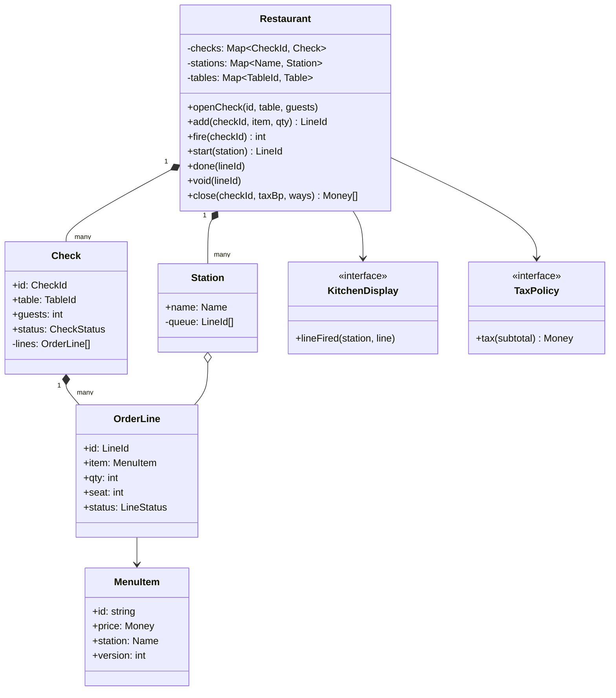
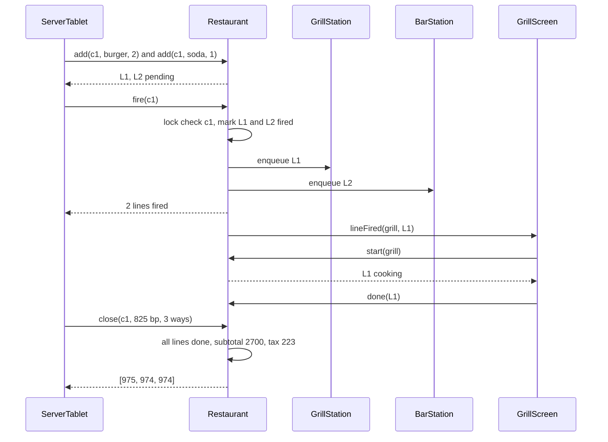

## In one minute
- A restaurant system is three small systems sharing one object: the **check**. The front of house seats guests and adds items to it, the kitchen cooks what was sent from it, and the cashier turns it into money.
- The key separation is between **adding** an item and **firing** it. Servers build an order at the table and send it to the kitchen in one step, so a guest can change their mind for free until the kitchen sees it, and courses can be held back and fired later.
- Each order line is a small state machine (pending, fired, cooking, done, void). Who may void a line and what it costs depends on that state, which is where waste and fraud live.
- Fired lines are routed to **stations** (grill, fryer, bar), each a FIFO queue that cooks pull from. That is a producer-consumer queue with a screen on it.
- Money is integer cents with one explicit rounding rule for tax and for splitting. The problem shapes are **ordering** (first fired, first cooked), **contention** (two servers on one check, two hosts on one table) and **multi-step consistency** (a check is not closed until every line is accounted for).

## Requirements

Functional:
- Hosts seat parties at tables and keep a waitlist when the room is full.
- Servers open a check for a table, add items with quantities and notes, and fire them to the kitchen; later items can be added and fired separately.
- Each menu item belongs to a station. Fired lines appear on that station's screen in the order they were fired; a cook starts a line, then bumps it as done.
- A line can be voided before cooking starts. After that, only a manager can comp it, and it is recorded as waste.
- Closing a check computes subtotal, tax and the total, splits it evenly or by seat, takes payment and frees the table.

Non-functional:
- The kitchen never loses a fired ticket, even if the network to the cloud is down; the restaurant must keep running on its local network.
- Totals are reproducible to the cent from the lines and the tax rule.
- Firing reaches the kitchen screen in well under a second; cooks notice a slow screen immediately.

Out of scope: inventory deduction per recipe (see [Design Inventory Management System](design-inventory-management-system.md)), online ordering and delivery dispatch (see [Design Food Delivery Service](../sdi/design-food-delivery-service.md)), payroll and loyalty points.

## Entities and relationships

- **MenuItem**: id, name, price in cents, station and allowed modifiers. Treat it as a versioned value: a price change makes a new version, and lines keep the version they were ordered at.
- **Table**: id, capacity and state (free, seated, needs cleaning). A **WaitlistEntry** carries party size and arrival time.
- **Check**: id, table, guest count, status (open, closed) and its lines. It is the aggregate root for ordering: every change to a line goes through its check.
- **OrderLine**: id, menu item version, quantity, seat number, course, notes and status. It is the unit the kitchen works on.
- **Station**: a name and a FIFO queue of fired line ids. A **KitchenDisplay** observes one or more stations.
- **Payment**: amount, method and reference, many per check for split bills.
- **Restaurant**: the façade the server tablets, host stand and kitchen screens call. Policies hang off it: **TaxPolicy**, **SeatingStrategy** and **SplitPolicy**.

Relationships: a check is composed of its lines (a line never exists without a check). A line references a menu item version and, once fired, sits in exactly one station queue. A table has at most one open check. Payments belong to a check.

The modelling decision that pays for itself is **line, not check, as the unit of kitchen work**. A check with a steak and a beer goes to two stations and finishes at two times. If the kitchen tracked whole checks, the bar would wait for the grill.

## Class diagram



## Key flows

Firing is the moment the order becomes the kitchen's problem. Everything before it is free to change; everything after it costs food.



## Design patterns used and why

- **Command** for order lines once fired. A fired line is a request the kitchen executes later, possibly on a different device, and it can be voided (cancelled) before execution. A command object with an id is queueable, loggable and replayable after a screen reboot. See [Command](command.md).
- **State** for the line lifecycle. `void` is legal in pending and fired, illegal in cooking and done; `done` is legal only from cooking. A transition table makes these rules testable and visible to the business.
- **Observer** for kitchen screens and printers. Stations publish "line fired", "line voided" and "line done"; screens, the expo printer and the server's tablet subscribe. Publish after the state change commits, so a slow ticket printer cannot hold the lock.
- **Producer-consumer** for stations: servers produce, cooks consume, and the queue absorbs the Friday 19:30 burst. See [Producer Consumer](producer-consumer.md).
- **Strategy** for tax, seating and splitting. Tax rules differ by city and by dine-in versus takeaway; seating may be smallest-fitting-table or server-rotation; splits may be even, by seat or by item.
- **Composite** for combos and modifiers. "Burger meal" contains a burger, fries and a drink that go to three stations; a composite menu item expands into three lines when fired while the bill shows one price. See [Composite](composite.md).

What not to do: a class per dish. Dishes differ in data (price, station, modifiers), not behaviour.

## Concurrency and edge cases

- **Two servers, one check.** A server and a bartender both add to table 12's check. Make the check the unit of locking: `add`, `fire`, `void` and `close` take the check's lock, or use a version number on the check and reject stale writes from tablets.
- **Double fire.** A tablet on bad Wi-Fi retries `fire`. Firing only moves pending lines, so a retry sends nothing new; make that idempotence explicit, because duplicate tickets mean duplicate food.
- **Void races start.** The server voids a line at the moment the cook taps start. Whichever transition takes the line lock first wins: either the line is voided and never appears as cooking, or it is cooking and the void fails, and the server must ask a manager to comp it.
- **Two hosts, one table.** Seating is select-and-claim under one lock, the same shape as the last spot in [Design Parking Lot](design-parking-lot.md).
- **Closing with food in flight.** Closing a check with lines still cooking either bills for food not yet served or loses it. Refuse to close while any line is pending, fired or cooking; voided lines are excluded.
- **Rounding.** Tax is computed once on the check subtotal with half-up rounding, not per line, or a ten-line check can be off by several cents from what the receipt rules require. An even split gives the leftover cents to the first payers so the parts always sum to the total.
- **Menu changes mid-service.** Lines keep the menu item version they were ordered at.

## Down the stack

### Layer 1: The contract
`add` returns a new line id and the line is pending; it fails on a closed or unknown check, an unknown item or a quantity below one. `fire(check)` moves every pending line of that check to fired and appends it to its station queue in line order, returning how many moved; calling it again with nothing pending returns zero and changes nothing. `start(station)` returns the oldest fired line at that station and marks it cooking, or nothing. `close(check, taxBp, ways)` succeeds only when every non-void line is done, returns `ways` amounts that differ by at most one cent and sum to `subtotal + round_half_up(subtotal * taxBp / 10000)`, and frees the table.

### Layer 2: The mechanism
Each station queue is a FIFO of line ids (a deque in Python, a slice in Go). Voiding a fired line removes it from its queue, an O(n) scan that is fine because a station rarely holds more than a few dozen lines; a linked hash set makes it O(1) if you need it. Lines live in a hash map by id so screens can address them directly. Real restaurant systems run a local server in the back office and keep tablets, screens and printers on the restaurant LAN, syncing to the cloud when they can, because a dropped internet connection on a Friday night must not stop the kitchen. Receipt and kitchen printers are commonly driven with the ESC/POS command set, a byte stream of text and control codes (cut paper, select font) sent over USB, serial or a raw TCP socket, often on port 9100.

### Layer 3: The machine
The data is tiny: a busy restaurant fires perhaps a few hundred lines an hour, and a line is under 200 bytes. A mutex at about 20 ns and a SQLite or Postgres commit at 0.1 to 1 ms are invisible next to the physical latencies: a Wi-Fi round trip on a crowded 2.4 GHz band can take tens of milliseconds and occasionally seconds, and a thermal printer prints a ticket in a second or two. The failure that matters is not speed but loss: a tablet that shows "fired" before the local server has durably stored the lines will, on a dropped packet, leave a table waiting forty minutes for food nobody is cooking. So the tablet treats `fire` as done only after the server acknowledges a committed write, and retries with the same check and line ids otherwise.

### Why it's built this way
1. Guests change their minds while ordering, so adding and firing are separate steps, and only fired lines cost the kitchen anything.
2. One check feeds several stations that finish at different times, so the unit of kitchen work is the line, routed by station.
3. Cooks work in arrival order under pressure, so each station is a FIFO queue, and every change to it is visible on a screen.
4. Food that has been started cannot be un-cooked, so void is legal only before cooking, and later corrections are a separate, audited comp.
5. The internet fails during service, so the system of record for the night runs on the local network, and the cloud is a sync target.

## Extensibility

- **Courses:** add a course number to lines and let `fire(check, course)` fire one course at a time. Mains wait until the server fires them after starters are cleared.
- **Split by seat:** lines already carry a seat number; a `BySeatSplit` policy sums each seat's lines, allocates tax proportionally and gives the remainder cents to the largest seat.
- **Recipe-based stock:** on `done`, publish an event that an inventory service consumes to decrement ingredients. Keep it asynchronous so a slow inventory call never blocks the bump.
- **Service charge for large parties:** a pricing step between subtotal and tax, keyed on guest count.

### Variant: online food delivery order

Here the order is not a check opened at a table. It is one record shared by three parties who never stand in the same room: the customer, the restaurant and a courier. The question changes from "what does the kitchen cook next" to "who is allowed to make which move, and when".

**Requirements shift.** One order belongs to one restaurant and carries a subtotal and a delivery fee. The restaurant accepts or rejects it, then marks it ready. A dispatcher assigns a courier after acceptance, and the courier picks up and delivers. Status reads vastly outnumber transitions, about six per order.

**Data model.** The order is the aggregate root, with status placed, accepted, ready, picked up and delivered, plus the endings rejected and cancelled. Customer, restaurant and courier are held by id only, so the record survives profile changes. Role is derived per order (you are the customer if you placed it, the courier if you are assigned) and is never a field on the user, because one person can be a customer on Monday and a courier on Tuesday.

**Mechanism: a transition table.** Replace the per-line state checks with rows of `(state, action, role) -> next state, refund rule`. Every rule becomes readable and testable data. A courier app bug cannot mark someone else's order delivered, because the role lookup fails before any state changes. Each transition appends an immutable history entry with a timestamp.

**Money follows state.** A cancel before acceptance refunds everything. After acceptance the customer gets the delivery fee back but pays for food the kitchen has started. The refund is computed from the state the order was in when it ended, in integer cents, so `subtotal + fee - refunded` always explains the charge.

**Time is part of the model.** An order the restaurant never accepts must expire on its own. Use an injected clock and an idempotent sweep that re-checks status under the order's lock, not a sleep inside a request handler.

**Races.** Cancel against accept, and expiry against a late accept, are settled by one lock or a versioned conditional update on the order: the first wins and the loser sees the new state and fails as invalid. Courier assignment checks and writes the "one active order per courier" map together. Reassigning before pickup releases the old courier in the same step. A retried "deliver" returns invalid, or the original success if an idempotency key is used.

The shape is multi-step consistency across parties, the same as a pull request with an author, reviewer and CI.

## Leadership lens

- Build first: the check and line state machine with fire and station queues, plus offline operation on the local network. A mis-rounded tax line is a refund; a lost ticket is a table that walks out.
- Ask in review: what is the unit of locking; is fire idempotent; what happens to the kitchen when the internet drops; who may comp a cooking line and where is that logged.
- Waste and comps are where money disappears. Every void and comp records who, when, which line and in what state, and the manager report reads straight from that log.
- Ownership: the hardware integration (printers, screens, payment terminals) is a separate team with its own simulator, so the ordering core can be tested without a kitchen.

## Check yourself
1. Why separate adding a line from firing it?
   **Answer:** Until a line is fired it costs nothing, so the guest and server can change it freely, and courses can be held back. Firing is the commitment point where the kitchen starts using food and time.
2. Why is the order line, not the check, the unit of kitchen work?
   **Answer:** A check usually spans several stations that finish at different times. Routing lines lets each station work independently and lets the bar serve drinks without waiting for the grill.
3. A server voids a line just as the cook taps start. What should happen?
   **Answer:** The two transitions are serialized on the line. If start wins, the void fails and a manager must comp it; if the void wins, the line disappears from the queue and start returns the next line.
4. Why compute tax once on the subtotal rather than per line?
   **Answer:** Rounding each line separately accumulates error of up to half a cent per line, so the receipt total drifts from the tax rule. One rounding on the subtotal is reproducible and matches the receipt.

## Practice
**Task:** Implement the ordering core. `Restaurant(menu)` takes a map from item name to `(station, price_cents)`. `open_check(check_id, table, guests)` fails for a reused check id or a table with an open check. `add(check_id, item, qty)` fails for an unknown or closed check, an unknown item or `qty < 1`, and returns a new line id `L1`, `L2`, ... numbered across the restaurant; the line is pending. `fire(check_id)` sends the check's pending lines, in line order, to the back of their stations' queues, marks them fired and returns how many it sent. `start(station)` marks the oldest fired line at that station as cooking and returns its id, or nothing when the queue is empty. `done(line_id)` requires a cooking line and marks it done. `void(line_id)` works only on pending or fired lines (a fired line leaves its queue) and marks them void; otherwise it fails. `status(line_id)` returns the line's state. `close(check_id, tax_bp, ways)` fails if the check is not open, `ways < 1`, or any line is pending, fired or cooking; otherwise it computes the subtotal of done lines, tax as `(subtotal * tax_bp + 5000) // 10000`, closes the check, frees the table, and returns `ways` amounts summing to the total, where the first `total % ways` amounts get one extra cent.

```python starter
class Restaurant:
    def __init__(self, menu):
        self._menu = dict(menu)

    def open_check(self, check_id, table, guests):
        raise NotImplementedError

    def add(self, check_id, item, qty):
        raise NotImplementedError

    def fire(self, check_id):
        # TODO: pending lines to their station queues, in line order
        raise NotImplementedError

    def start(self, station):
        raise NotImplementedError

    def done(self, line_id):
        raise NotImplementedError

    def void(self, line_id):
        raise NotImplementedError

    def status(self, line_id):
        raise NotImplementedError

    def close(self, check_id, tax_bp, ways):
        # TODO: all lines done or void; half-up tax; even split, extra cents first
        raise NotImplementedError
```

```python tests
MENU = {"burger": ("grill", 1200), "steak": ("grill", 2800),
        "fries": ("fry", 400), "soda": ("bar", 300)}


def raises(fn):
    try:
        fn()
    except ValueError:
        return True
    return False


def cook(r, station, times):
    for _ in range(times):
        r.done(r.start(station))


def test_fired_lines_queue_per_station():
    r = Restaurant(MENU)
    r.open_check("c1", "T1", 4)
    assert r.add("c1", "burger", 2) == "L1"
    assert r.add("c1", "fries", 1) == "L2"
    assert r.fire("c1") == 2
    r.open_check("c2", "T2", 2)
    assert r.add("c2", "steak", 1) == "L3"
    r.fire("c2")
    assert r.start("grill") == "L1"
    assert r.start("grill") == "L3"
    assert r.start("grill") is None
    assert r.start("fry") == "L2"
    assert r.status("L1") == "cooking"


def test_fire_sends_only_pending():
    r = Restaurant(MENU)
    r.open_check("c1", "T1", 2)
    r.add("c1", "soda", 1)
    assert r.fire("c1") == 1
    assert r.fire("c1") == 0, "retry sends nothing"
    r.add("c1", "soda", 2)
    assert r.fire("c1") == 1
    assert r.start("bar") == "L1"
    assert r.start("bar") == "L2"


def test_void_rules():
    r = Restaurant(MENU)
    r.open_check("c1", "T1", 2)
    r.add("c1", "burger", 1)
    r.add("c1", "steak", 1)
    r.add("c1", "fries", 1)
    r.void("L3")
    assert r.status("L3") == "void"
    r.fire("c1")
    r.void("L1")
    assert r.start("grill") == "L2", "voided fired line left the queue"
    assert raises(lambda: r.void("L2")), "cooking cannot be voided"
    r.done("L2")
    assert raises(lambda: r.void("L2")), "done cannot be voided"
    assert raises(lambda: r.done("L2")), "done twice"


def test_close_bill_and_split():
    r = Restaurant(MENU)
    r.open_check("c1", "T1", 3)
    r.add("c1", "burger", 2)
    r.add("c1", "soda", 1)
    r.add("c1", "steak", 1)
    r.void("L3")
    r.fire("c1")
    cook(r, "grill", 1)
    cook(r, "bar", 1)
    assert r.close("c1", 825, 3) == [975, 974, 974]


def test_close_guards_and_table_reuse():
    r = Restaurant(MENU)
    r.open_check("c1", "T1", 2)
    r.add("c1", "fries", 1)
    assert raises(lambda: r.close("c1", 0, 1)), "pending line"
    r.fire("c1")
    assert raises(lambda: r.close("c1", 0, 1)), "fired line"
    assert raises(lambda: r.open_check("c2", "T1", 2)), "table busy"
    cook(r, "fry", 1)
    assert raises(lambda: r.close("c1", 0, 0)), "ways must be positive"
    assert r.close("c1", 1000, 4) == [110, 110, 110, 110]
    assert raises(lambda: r.close("c1", 0, 1)), "already closed"
    assert raises(lambda: r.add("c1", "soda", 1)), "closed check"
    r.open_check("c2", "T1", 2)
    assert raises(lambda: r.open_check("c2", "T9", 2)), "reused check id"


def test_validation_and_rounding():
    r = Restaurant(MENU)
    assert raises(lambda: r.add("nope", "soda", 1))
    r.open_check("c1", "T1", 1)
    assert raises(lambda: r.add("c1", "lobster", 1))
    assert raises(lambda: r.add("c1", "soda", 0))
    r.add("c1", "soda", 1)
    r.fire("c1")
    cook(r, "bar", 1)
    assert r.close("c1", 750, 2) == [162, 161], "300 + 22.5 rounds up to 323"
```

```python solution
from collections import deque


class Restaurant:
    def __init__(self, menu):
        self._menu = dict(menu)
        self._checks = {}
        self._busy_tables = set()
        self._lines = {}
        self._stations = {}
        self._next_line = 1

    def open_check(self, check_id, table, guests):
        if check_id in self._checks:
            raise ValueError("check id already used: " + check_id)
        if table in self._busy_tables:
            raise ValueError("table has an open check: " + table)
        self._checks[check_id] = {"table": table, "guests": guests, "open": True, "lines": []}
        self._busy_tables.add(table)

    def _open(self, check_id):
        check = self._checks.get(check_id)
        if check is None or not check["open"]:
            raise ValueError("no open check: " + check_id)
        return check

    def add(self, check_id, item, qty):
        check = self._open(check_id)
        if item not in self._menu:
            raise ValueError("unknown item: " + item)
        if qty < 1:
            raise ValueError("quantity must be positive")
        line_id = "L" + str(self._next_line)
        self._next_line += 1
        self._lines[line_id] = {"item": item, "qty": qty, "state": "pending"}
        check["lines"].append(line_id)
        return line_id

    def fire(self, check_id):
        check = self._open(check_id)
        sent = 0
        for line_id in check["lines"]:
            line = self._lines[line_id]
            if line["state"] == "pending":
                line["state"] = "fired"
                station = self._menu[line["item"]][0]
                self._stations.setdefault(station, deque()).append(line_id)
                sent += 1
        return sent

    def start(self, station):
        queue = self._stations.get(station)
        if not queue:
            return None
        line_id = queue.popleft()
        self._lines[line_id]["state"] = "cooking"
        return line_id

    def _line(self, line_id):
        line = self._lines.get(line_id)
        if line is None:
            raise ValueError("unknown line: " + str(line_id))
        return line

    def done(self, line_id):
        line = self._line(line_id)
        if line["state"] != "cooking":
            raise ValueError("line is not cooking: " + line_id)
        line["state"] = "done"

    def void(self, line_id):
        line = self._line(line_id)
        if line["state"] == "fired":
            self._stations[self._menu[line["item"]][0]].remove(line_id)
        elif line["state"] != "pending":
            raise ValueError("cannot void a line that is " + line["state"])
        line["state"] = "void"

    def status(self, line_id):
        return self._line(line_id)["state"]

    def close(self, check_id, tax_bp, ways):
        check = self._open(check_id)
        if ways < 1:
            raise ValueError("ways must be positive")
        subtotal = 0
        for line_id in check["lines"]:
            line = self._lines[line_id]
            if line["state"] in ("pending", "fired", "cooking"):
                raise ValueError("line still in progress: " + line_id)
            if line["state"] == "done":
                subtotal += line["qty"] * self._menu[line["item"]][1]
        total = subtotal + (subtotal * tax_bp + 5000) // 10000
        check["open"] = False
        self._busy_tables.discard(check["table"])
        base, extra = divmod(total, ways)
        return [base + 1 if i < extra else base for i in range(ways)]
```

```typescript starter
export class Restaurant {
  constructor(menu: Record<string, [string, number]>) {}

  openCheck(checkId: string, table: string, guests: number): void { throw new Error("TODO"); }

  add(checkId: string, item: string, qty: number): string { throw new Error("TODO"); }

  fire(checkId: string): number { throw new Error("TODO"); }

  start(station: string): string | null { throw new Error("TODO"); }

  done(lineId: string): void { throw new Error("TODO"); }

  void(lineId: string): void { throw new Error("TODO"); }

  status(lineId: string): string { throw new Error("TODO"); }

  close(checkId: string, taxBp: number, ways: number): number[] { throw new Error("TODO"); }
}
```

```typescript tests
const MENU: Record<string, [string, number]> = {
  burger: ["grill", 1200], steak: ["grill", 2800], fries: ["fry", 400], soda: ["bar", 300],
};

function throwsErr(fn: () => void): boolean {
  try { fn(); return false; } catch (e) { return true; }
}

function cook(r: Restaurant, station: string, times: number): void {
  for (let i = 0; i < times; i++) r.done(r.start(station)!);
}

test("fired lines queue per station", () => {
  const r = new Restaurant(MENU);
  r.openCheck("c1", "T1", 4);
  assertEqual(r.add("c1", "burger", 2), "L1");
  assertEqual(r.add("c1", "fries", 1), "L2");
  assertEqual(r.fire("c1"), 2);
  r.openCheck("c2", "T2", 2);
  assertEqual(r.add("c2", "steak", 1), "L3");
  r.fire("c2");
  assertEqual(r.start("grill"), "L1");
  assertEqual(r.start("grill"), "L3");
  assertEqual(r.start("grill"), null);
  assertEqual(r.start("fry"), "L2");
  assertEqual(r.status("L1"), "cooking");
});

test("fire sends only pending", () => {
  const r = new Restaurant(MENU);
  r.openCheck("c1", "T1", 2);
  r.add("c1", "soda", 1);
  assertEqual(r.fire("c1"), 1);
  assertEqual(r.fire("c1"), 0, "retry sends nothing");
  r.add("c1", "soda", 2);
  assertEqual(r.fire("c1"), 1);
  assertEqual(r.start("bar"), "L1");
  assertEqual(r.start("bar"), "L2");
});

test("void rules", () => {
  const r = new Restaurant(MENU);
  r.openCheck("c1", "T1", 2);
  r.add("c1", "burger", 1);
  r.add("c1", "steak", 1);
  r.add("c1", "fries", 1);
  r.void("L3");
  assertEqual(r.status("L3"), "void");
  r.fire("c1");
  r.void("L1");
  assertEqual(r.start("grill"), "L2", "voided fired line left the queue");
  assert(throwsErr(() => r.void("L2")), "cooking cannot be voided");
  r.done("L2");
  assert(throwsErr(() => r.void("L2")), "done cannot be voided");
  assert(throwsErr(() => r.done("L2")), "done twice");
});

test("close bill and split", () => {
  const r = new Restaurant(MENU);
  r.openCheck("c1", "T1", 3);
  r.add("c1", "burger", 2);
  r.add("c1", "soda", 1);
  r.add("c1", "steak", 1);
  r.void("L3");
  r.fire("c1");
  cook(r, "grill", 1);
  cook(r, "bar", 1);
  assertEqual(r.close("c1", 825, 3), [975, 974, 974]);
});

test("close guards and table reuse", () => {
  const r = new Restaurant(MENU);
  r.openCheck("c1", "T1", 2);
  r.add("c1", "fries", 1);
  assert(throwsErr(() => r.close("c1", 0, 1)), "pending line");
  r.fire("c1");
  assert(throwsErr(() => r.close("c1", 0, 1)), "fired line");
  assert(throwsErr(() => r.openCheck("c2", "T1", 2)), "table busy");
  cook(r, "fry", 1);
  assert(throwsErr(() => r.close("c1", 0, 0)), "ways must be positive");
  assertEqual(r.close("c1", 1000, 4), [110, 110, 110, 110]);
  assert(throwsErr(() => r.close("c1", 0, 1)), "already closed");
  assert(throwsErr(() => r.add("c1", "soda", 1)), "closed check");
  r.openCheck("c2", "T1", 2);
  assert(throwsErr(() => r.openCheck("c2", "T9", 2)), "reused check id");
});

test("validation and rounding", () => {
  const r = new Restaurant(MENU);
  assert(throwsErr(() => r.add("nope", "soda", 1)));
  r.openCheck("c1", "T1", 1);
  assert(throwsErr(() => r.add("c1", "lobster", 1)));
  assert(throwsErr(() => r.add("c1", "soda", 0)));
  r.add("c1", "soda", 1);
  r.fire("c1");
  cook(r, "bar", 1);
  assertEqual(r.close("c1", 750, 2), [162, 161], "300 + 22.5 rounds up to 323");
});
```

```typescript solution
type LineState = "pending" | "fired" | "cooking" | "done" | "void";

interface Line { item: string; qty: number; state: LineState }
interface Check { table: string; guests: number; open: boolean; lines: string[] }

export class Restaurant {
  private menu = new Map<string, [string, number]>();
  private checks = new Map<string, Check>();
  private busyTables = new Set<string>();
  private lines = new Map<string, Line>();
  private stations = new Map<string, string[]>();
  private nextLine = 1;

  constructor(menu: Record<string, [string, number]>) {
    for (const k of Object.keys(menu)) this.menu.set(k, menu[k]);
  }

  openCheck(checkId: string, table: string, guests: number): void {
    if (this.checks.has(checkId)) throw new Error("check id already used: " + checkId);
    if (this.busyTables.has(table)) throw new Error("table has an open check: " + table);
    this.checks.set(checkId, { table, guests, open: true, lines: [] });
    this.busyTables.add(table);
  }

  private openOf(checkId: string): Check {
    const c = this.checks.get(checkId);
    if (!c || !c.open) throw new Error("no open check: " + checkId);
    return c;
  }

  add(checkId: string, item: string, qty: number): string {
    const c = this.openOf(checkId);
    if (!this.menu.has(item)) throw new Error("unknown item: " + item);
    if (qty < 1) throw new Error("quantity must be positive");
    const id = "L" + this.nextLine++;
    this.lines.set(id, { item, qty, state: "pending" });
    c.lines.push(id);
    return id;
  }

  private stationOf(line: Line): string {
    return this.menu.get(line.item)![0];
  }

  fire(checkId: string): number {
    const c = this.openOf(checkId);
    let sent = 0;
    for (const id of c.lines) {
      const line = this.lines.get(id)!;
      if (line.state !== "pending") continue;
      line.state = "fired";
      const st = this.stationOf(line);
      if (!this.stations.has(st)) this.stations.set(st, []);
      this.stations.get(st)!.push(id);
      sent++;
    }
    return sent;
  }

  start(station: string): string | null {
    const q = this.stations.get(station);
    if (!q || q.length === 0) return null;
    const id = q.shift()!;
    this.lines.get(id)!.state = "cooking";
    return id;
  }

  private lineOf(lineId: string): Line {
    const line = this.lines.get(lineId);
    if (!line) throw new Error("unknown line: " + lineId);
    return line;
  }

  done(lineId: string): void {
    const line = this.lineOf(lineId);
    if (line.state !== "cooking") throw new Error("line is not cooking: " + lineId);
    line.state = "done";
  }

  void(lineId: string): void {
    const line = this.lineOf(lineId);
    if (line.state === "fired") {
      const q = this.stations.get(this.stationOf(line))!;
      q.splice(q.indexOf(lineId), 1);
    } else if (line.state !== "pending") {
      throw new Error("cannot void a line that is " + line.state);
    }
    line.state = "void";
  }

  status(lineId: string): string {
    return this.lineOf(lineId).state;
  }

  close(checkId: string, taxBp: number, ways: number): number[] {
    const c = this.openOf(checkId);
    if (ways < 1) throw new Error("ways must be positive");
    let subtotal = 0;
    for (const id of c.lines) {
      const line = this.lines.get(id)!;
      if (line.state === "pending" || line.state === "fired" || line.state === "cooking") {
        throw new Error("line still in progress: " + id);
      }
      if (line.state === "done") subtotal += line.qty * this.menu.get(line.item)![1];
    }
    const total = subtotal + Math.floor((subtotal * taxBp + 5000) / 10000);
    c.open = false;
    this.busyTables.delete(c.table);
    const base = Math.floor(total / ways);
    const extra = total % ways;
    const out: number[] = [];
    for (let i = 0; i < ways; i++) out.push(i < extra ? base + 1 : base);
    return out;
  }
}
```

```go starter
package practice

import "errors"

var (
	ErrCheckExists = errors.New("check id already used")
	ErrTableBusy   = errors.New("table has an open check")
	ErrNoOpenCheck = errors.New("no open check")
	ErrUnknownItem = errors.New("unknown item")
	ErrInvalidQty  = errors.New("quantity must be positive")
	ErrUnknownLine = errors.New("unknown line")
	ErrBadState    = errors.New("illegal line transition")
	ErrInProgress  = errors.New("line still in progress")
	ErrInvalidWays = errors.New("ways must be positive")
)

type MenuItem struct {
	Station string
	Price   int
}

type Restaurant struct{}

func NewRestaurant(menu map[string]MenuItem) *Restaurant { return &Restaurant{} }

func (r *Restaurant) OpenCheck(checkID, table string, guests int) error { panic("TODO") }

func (r *Restaurant) Add(checkID, item string, qty int) (string, error) { panic("TODO") }

func (r *Restaurant) Fire(checkID string) (int, error) { panic("TODO") }

func (r *Restaurant) Start(station string) (string, bool) { panic("TODO") }

func (r *Restaurant) Done(lineID string) error { panic("TODO") }

func (r *Restaurant) Void(lineID string) error { panic("TODO") }

func (r *Restaurant) Status(lineID string) (string, error) { panic("TODO") }

func (r *Restaurant) Close(checkID string, taxBp, ways int) ([]int, error) { panic("TODO") }
```

```go tests
package practice

import (
	"errors"
	"reflect"
	"testing"
)

var menu = map[string]MenuItem{
	"burger": {"grill", 1200}, "steak": {"grill", 2800}, "fries": {"fry", 400}, "soda": {"bar", 300},
}

func must(t *testing.T, err error) {
	t.Helper()
	if err != nil {
		t.Fatal(err)
	}
}

func mustAdd(t *testing.T, r *Restaurant, check, item string, qty int) string {
	t.Helper()
	id, err := r.Add(check, item, qty)
	must(t, err)
	return id
}

func wantStart(t *testing.T, r *Restaurant, station, want string) {
	t.Helper()
	id, ok := r.Start(station)
	if want == "" {
		if ok {
			t.Fatalf("start %s: want empty queue, got %s", station, id)
		}
		return
	}
	if !ok || id != want {
		t.Fatalf("start %s: got %q %v want %s", station, id, ok, want)
	}
}

func cook(t *testing.T, r *Restaurant, station string) {
	t.Helper()
	id, ok := r.Start(station)
	if !ok {
		t.Fatalf("nothing to cook at %s", station)
	}
	must(t, r.Done(id))
}

func TestFiredLinesQueuePerStation(t *testing.T) {
	r := NewRestaurant(menu)
	must(t, r.OpenCheck("c1", "T1", 4))
	if a, b := mustAdd(t, r, "c1", "burger", 2), mustAdd(t, r, "c1", "fries", 1); a != "L1" || b != "L2" {
		t.Fatalf("ids %s %s", a, b)
	}
	if n, _ := r.Fire("c1"); n != 2 {
		t.Fatalf("fired %d", n)
	}
	must(t, r.OpenCheck("c2", "T2", 2))
	mustAdd(t, r, "c2", "steak", 1)
	r.Fire("c2")
	wantStart(t, r, "grill", "L1")
	wantStart(t, r, "grill", "L3")
	wantStart(t, r, "grill", "")
	wantStart(t, r, "fry", "L2")
	if s, _ := r.Status("L1"); s != "cooking" {
		t.Fatalf("status %s", s)
	}
}

func TestFireSendsOnlyPending(t *testing.T) {
	r := NewRestaurant(menu)
	must(t, r.OpenCheck("c1", "T1", 2))
	mustAdd(t, r, "c1", "soda", 1)
	for _, want := range []int{1, 0} {
		if n, _ := r.Fire("c1"); n != want {
			t.Fatalf("fired %d want %d", n, want)
		}
	}
	mustAdd(t, r, "c1", "soda", 2)
	if n, _ := r.Fire("c1"); n != 1 {
		t.Fatalf("fired %d", n)
	}
	wantStart(t, r, "bar", "L1")
	wantStart(t, r, "bar", "L2")
}

func TestVoidRules(t *testing.T) {
	r := NewRestaurant(menu)
	must(t, r.OpenCheck("c1", "T1", 2))
	mustAdd(t, r, "c1", "burger", 1)
	mustAdd(t, r, "c1", "steak", 1)
	mustAdd(t, r, "c1", "fries", 1)
	must(t, r.Void("L3"))
	if s, _ := r.Status("L3"); s != "void" {
		t.Fatalf("status %s", s)
	}
	r.Fire("c1")
	must(t, r.Void("L1"))
	wantStart(t, r, "grill", "L2")
	if err := r.Void("L2"); !errors.Is(err, ErrBadState) {
		t.Fatalf("void cooking: %v", err)
	}
	must(t, r.Done("L2"))
	if err := r.Void("L2"); !errors.Is(err, ErrBadState) {
		t.Fatalf("void done: %v", err)
	}
	if err := r.Done("L2"); !errors.Is(err, ErrBadState) {
		t.Fatalf("done twice: %v", err)
	}
}

func TestCloseBillAndSplit(t *testing.T) {
	r := NewRestaurant(menu)
	must(t, r.OpenCheck("c1", "T1", 3))
	mustAdd(t, r, "c1", "burger", 2)
	mustAdd(t, r, "c1", "soda", 1)
	mustAdd(t, r, "c1", "steak", 1)
	must(t, r.Void("L3"))
	r.Fire("c1")
	cook(t, r, "grill")
	cook(t, r, "bar")
	got, err := r.Close("c1", 825, 3)
	if err != nil || !reflect.DeepEqual(got, []int{975, 974, 974}) {
		t.Fatalf("close: %v %v", got, err)
	}
}

func TestCloseGuardsAndTableReuse(t *testing.T) {
	r := NewRestaurant(menu)
	must(t, r.OpenCheck("c1", "T1", 2))
	mustAdd(t, r, "c1", "fries", 1)
	if _, err := r.Close("c1", 0, 1); !errors.Is(err, ErrInProgress) {
		t.Fatalf("pending: %v", err)
	}
	r.Fire("c1")
	if _, err := r.Close("c1", 0, 1); !errors.Is(err, ErrInProgress) {
		t.Fatalf("fired: %v", err)
	}
	if err := r.OpenCheck("c2", "T1", 2); !errors.Is(err, ErrTableBusy) {
		t.Fatalf("table busy: %v", err)
	}
	cook(t, r, "fry")
	if _, err := r.Close("c1", 0, 0); !errors.Is(err, ErrInvalidWays) {
		t.Fatalf("ways: %v", err)
	}
	got, err := r.Close("c1", 1000, 4)
	if err != nil || !reflect.DeepEqual(got, []int{110, 110, 110, 110}) {
		t.Fatalf("close: %v %v", got, err)
	}
	if _, err := r.Close("c1", 0, 1); !errors.Is(err, ErrNoOpenCheck) {
		t.Fatalf("closed twice: %v", err)
	}
	if _, err := r.Add("c1", "soda", 1); !errors.Is(err, ErrNoOpenCheck) {
		t.Fatalf("add to closed: %v", err)
	}
	must(t, r.OpenCheck("c2", "T1", 2))
	if err := r.OpenCheck("c2", "T9", 2); !errors.Is(err, ErrCheckExists) {
		t.Fatalf("reused id: %v", err)
	}
}

func TestValidationAndRounding(t *testing.T) {
	r := NewRestaurant(menu)
	if _, err := r.Add("nope", "soda", 1); !errors.Is(err, ErrNoOpenCheck) {
		t.Fatalf("unknown check: %v", err)
	}
	must(t, r.OpenCheck("c1", "T1", 1))
	if _, err := r.Add("c1", "lobster", 1); !errors.Is(err, ErrUnknownItem) {
		t.Fatalf("unknown item: %v", err)
	}
	if _, err := r.Add("c1", "soda", 0); !errors.Is(err, ErrInvalidQty) {
		t.Fatalf("qty: %v", err)
	}
	mustAdd(t, r, "c1", "soda", 1)
	r.Fire("c1")
	cook(t, r, "bar")
	got, _ := r.Close("c1", 750, 2)
	if !reflect.DeepEqual(got, []int{162, 161}) {
		t.Fatalf("close: %v", got)
	}
}
```

```go solution
package practice

import (
	"errors"
	"fmt"
	"sync"
)

var (
	ErrCheckExists = errors.New("check id already used")
	ErrTableBusy   = errors.New("table has an open check")
	ErrNoOpenCheck = errors.New("no open check")
	ErrUnknownItem = errors.New("unknown item")
	ErrInvalidQty  = errors.New("quantity must be positive")
	ErrUnknownLine = errors.New("unknown line")
	ErrBadState    = errors.New("illegal line transition")
	ErrInProgress  = errors.New("line still in progress")
	ErrInvalidWays = errors.New("ways must be positive")
)

type MenuItem struct {
	Station string
	Price   int
}

type line struct {
	item  string
	qty   int
	state string
}

type check struct {
	table string
	open  bool
	lines []string
}

type Restaurant struct {
	mu       sync.Mutex
	menu     map[string]MenuItem
	checks   map[string]*check
	busy     map[string]bool
	lines    map[string]*line
	stations map[string][]string
	nextLine int
}

func NewRestaurant(menu map[string]MenuItem) *Restaurant {
	return &Restaurant{
		menu: menu, checks: map[string]*check{}, busy: map[string]bool{},
		lines: map[string]*line{}, stations: map[string][]string{}, nextLine: 1,
	}
}

func (r *Restaurant) OpenCheck(checkID, table string, guests int) error {
	r.mu.Lock()
	defer r.mu.Unlock()
	if _, ok := r.checks[checkID]; ok {
		return fmt.Errorf("%w: %s", ErrCheckExists, checkID)
	}
	if r.busy[table] {
		return fmt.Errorf("%w: %s", ErrTableBusy, table)
	}
	r.checks[checkID] = &check{table: table, open: true}
	r.busy[table] = true
	return nil
}

func (r *Restaurant) openCheck(checkID string) (*check, error) {
	c, ok := r.checks[checkID]
	if !ok || !c.open {
		return nil, fmt.Errorf("%w: %s", ErrNoOpenCheck, checkID)
	}
	return c, nil
}

func (r *Restaurant) Add(checkID, item string, qty int) (string, error) {
	r.mu.Lock()
	defer r.mu.Unlock()
	c, err := r.openCheck(checkID)
	if err != nil {
		return "", err
	}
	if _, ok := r.menu[item]; !ok {
		return "", fmt.Errorf("%w: %s", ErrUnknownItem, item)
	}
	if qty < 1 {
		return "", ErrInvalidQty
	}
	id := fmt.Sprintf("L%d", r.nextLine)
	r.nextLine++
	r.lines[id] = &line{item: item, qty: qty, state: "pending"}
	c.lines = append(c.lines, id)
	return id, nil
}

// Fire moves only pending lines, so a retried fire sends nothing twice.
func (r *Restaurant) Fire(checkID string) (int, error) {
	r.mu.Lock()
	defer r.mu.Unlock()
	c, err := r.openCheck(checkID)
	if err != nil {
		return 0, err
	}
	sent := 0
	for _, id := range c.lines {
		l := r.lines[id]
		if l.state != "pending" {
			continue
		}
		l.state = "fired"
		st := r.menu[l.item].Station
		r.stations[st] = append(r.stations[st], id)
		sent++
	}
	return sent, nil
}

func (r *Restaurant) Start(station string) (string, bool) {
	r.mu.Lock()
	defer r.mu.Unlock()
	q := r.stations[station]
	if len(q) == 0 {
		return "", false
	}
	id := q[0]
	r.stations[station] = q[1:]
	r.lines[id].state = "cooking"
	return id, true
}

func (r *Restaurant) line(lineID string) (*line, error) {
	l, ok := r.lines[lineID]
	if !ok {
		return nil, fmt.Errorf("%w: %s", ErrUnknownLine, lineID)
	}
	return l, nil
}

func (r *Restaurant) Done(lineID string) error {
	r.mu.Lock()
	defer r.mu.Unlock()
	l, err := r.line(lineID)
	if err != nil {
		return err
	}
	if l.state != "cooking" {
		return fmt.Errorf("%w: done from %s", ErrBadState, l.state)
	}
	l.state = "done"
	return nil
}

func (r *Restaurant) Void(lineID string) error {
	r.mu.Lock()
	defer r.mu.Unlock()
	l, err := r.line(lineID)
	if err != nil {
		return err
	}
	switch l.state {
	case "pending":
	case "fired":
		st := r.menu[l.item].Station
		q := r.stations[st]
		for i, id := range q {
			if id == lineID {
				r.stations[st] = append(q[:i:i], q[i+1:]...)
				break
			}
		}
	default:
		return fmt.Errorf("%w: void from %s", ErrBadState, l.state)
	}
	l.state = "void"
	return nil
}

func (r *Restaurant) Status(lineID string) (string, error) {
	r.mu.Lock()
	defer r.mu.Unlock()
	l, err := r.line(lineID)
	if err != nil {
		return "", err
	}
	return l.state, nil
}

func (r *Restaurant) Close(checkID string, taxBp, ways int) ([]int, error) {
	r.mu.Lock()
	defer r.mu.Unlock()
	c, err := r.openCheck(checkID)
	if err != nil {
		return nil, err
	}
	if ways < 1 {
		return nil, ErrInvalidWays
	}
	subtotal := 0
	for _, id := range c.lines {
		l := r.lines[id]
		switch l.state {
		case "pending", "fired", "cooking":
			return nil, fmt.Errorf("%w: %s", ErrInProgress, id)
		case "done":
			subtotal += l.qty * r.menu[l.item].Price
		}
	}
	total := subtotal + (subtotal*taxBp+5000)/10000
	c.open = false
	delete(r.busy, c.table)
	out := make([]int, ways)
	for i := range out {
		out[i] = total / ways
		if i < total%ways {
			out[i]++
		}
	}
	return out, nil
}
```

## Mock interview
**Prompt:** Design the software for a 120-seat restaurant with 30 tables, four kitchen stations and a bar, running on tablets for servers and screens in the kitchen. Code checks, order lines, firing to stations and closing the bill, and explain what happens when the internet goes down at 20:00 on a Saturday.

- Follow-up: A server voids the fries just as the fry cook taps start. Walk through what each person sees.
- Follow-up: The owner wants starters and mains fired separately, with mains held until the server says go. What changes?
- Follow-up: A table of nine wants to split the bill by seat, and the tax does not divide evenly. How do you allocate the cents?

**A strong answer covers:**
- The check as aggregate root, the line as the unit of kitchen work, and a clear add-versus-fire boundary.
- A line state machine with void allowed only before cooking and comps as a separate audited action.
- Station queues as FIFO producer-consumer queues with screens subscribed as observers, notified outside the lock.
- Idempotent fire, per-check locking, and atomic table seating.
- Integer cents, one half-up tax rounding on the subtotal, and a split rule whose parts always sum to the total.
- Local-first operation: a back-office server on the LAN as the system of record during service, syncing to the cloud later.

## Watch
- [Command Pattern, Design Patterns ep 7 (Christopher Okhravi)](https://www.youtube.com/watch?v=9qA5kw8dcSU): the pattern behind fired order lines that can be queued and voided.
- [State Pattern, Design Patterns ep 17 (Christopher Okhravi)](https://www.youtube.com/watch?v=N12L5D78MAA): modelling the line lifecycle as explicit states.
- [Object Oriented Design for a Restaurant Reservation System in C#, Part 1 (Clean Code Engineer)](https://www.youtube.com/watch?v=kwvtxzXvojU): a walkthrough of the front-of-house side, tables and reservations.

## Free resources
- [Point of sale (Wikipedia)](https://en.wikipedia.org/wiki/Point_of_sale): background on restaurant POS systems, including kitchen screens and offline operation.
- [Brigade de cuisine (Wikipedia)](https://en.wikipedia.org/wiki/Brigade_de_cuisine): the station structure of a professional kitchen that the station queues mirror.
- [Command pattern (Refactoring.Guru)](https://refactoring.guru/design-patterns/command): requests as objects that can be queued, logged and cancelled.
- [Observer pattern (Refactoring.Guru)](https://refactoring.guru/design-patterns/observer): how screens and printers subscribe to station events.
- [Aggregate (Martin Fowler)](https://martinfowler.com/bliki/DDD_Aggregate.html): why the check is the consistency boundary for its lines.
- [ESC/P (Wikipedia)](https://en.wikipedia.org/wiki/ESC/P): background on the Epson printer control language family that receipt and kitchen printers build on.
