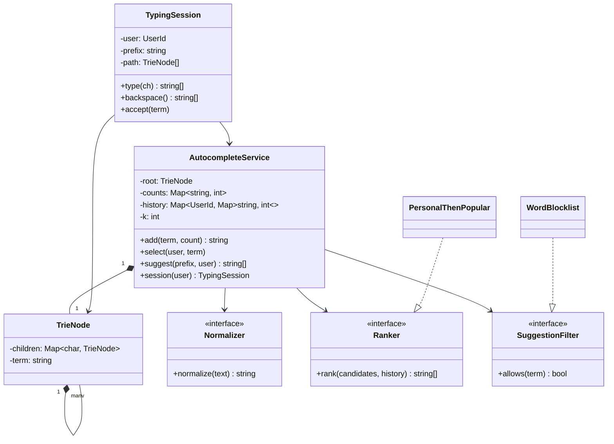
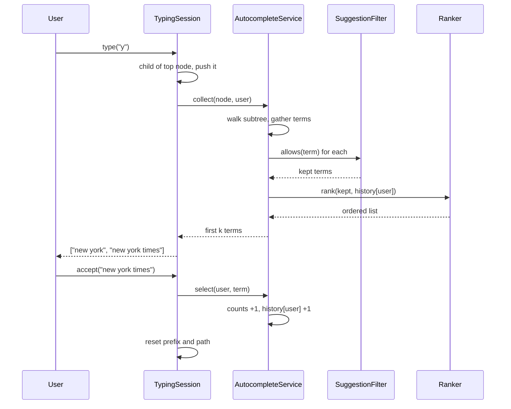

## In one minute
- In a low-level design round, autocomplete is a trie plus three policies that change independently: how text is normalised, how candidates are ranked, and which candidates are hidden. Keep each policy behind its own small interface so the trie never learns about business rules.
- Model the user's typing as a **session** object that holds a cursor into the trie. Each keystroke moves the cursor one node instead of walking the whole prefix again, and backspace pops it. This is the in-process equivalent of a client keeping state between requests.
- Rank with a sort key, not with nested `if` statements: personal history first, then global popularity, then alphabetical order as a deterministic tie-breaker. Tests and users both need the same input to give the same list.
- Filters run after ranking candidates are gathered and before truncation to k, or a blocked term silently eats a slot and the list comes back short.
- The distributed version (sharding by prefix range, decayed scores, hourly snapshots) is covered in [Design Search Autocomplete System](../sdi/design-search-autocomplete-system.md) and [Search and Typeahead](../sdi/search-and-typeahead.md). This lesson is about the object model inside one process.

## Requirements

Functional:
- `add(term, count)` loads a term with an initial popularity, for example from yesterday's query log.
- `suggest(prefix, user)` returns at most k completions that start with the prefix.
- A user can start a typing session: each typed character or backspace returns fresh suggestions, and accepting a suggestion records it as a search by that user.
- Ranking: terms this user has picked before come first (most picked first), then by global count, then alphabetically.
- Normalisation: case-insensitive, leading spaces ignored, runs of spaces treated as one. A trailing space is meaningful: `new ` should match `new york` but not `newark`.
- A blocklist of words hides any term containing one of them as a whole word.

Non-functional:
- A keystroke is answered in well under a millisecond in process, because the network and rendering already use most of the 100 ms a user tolerates.
- Results are deterministic for a given index state, so they can be tested and cached.
- Reads vastly outnumber writes, and writes must never leave a reader seeing a half-inserted term.

Out of scope: spelling correction, multi-language tokenisation, sharding, and time-decayed popularity. Name them and place them in Extensibility.

## Entities and relationships

Start from the nouns in the requirements and keep only those that hold state or vary.

- **AutocompleteService** is the façade callers use. It owns the trie, the global counts, the per-user history, and the three policies.
- **TrieNode** has a map from character to child and an optional terminal term. It is an internal detail; nothing outside the service sees nodes.
- **TermStats** holds a term's global count (a plain map in the practice code; production adds a last-used time for decay).
- **UserHistory** maps a user to the terms they accepted and how many times. It is the input for personal ranking.
- **Normalizer** turns raw text into the canonical form used as trie keys. Both terms and prefixes go through it, which is the only way they can ever match.
- **Ranker** turns a candidate list into an ordered list, given the user's history.
- **SuggestionFilter** decides whether a candidate may be shown. A blocklist filter is one implementation; "hide adult terms for child accounts" is another.
- **TypingSession** belongs to one user and holds the current prefix and a stack of trie nodes, one per typed character.

Relationships: the service is composed of the trie and the stats (they do not exist without it). Sessions reference the service but do not own it, and many sessions share one service. Policies are injected, so the service depends on their interfaces, not on concrete classes.

## Class diagram



## Key flows

The two flows that matter are a keystroke inside a session and accepting a suggestion. Note that the keystroke never re-walks the prefix from the root.



## Design patterns used and why

- **Strategy** for ranking. Ranking is the policy product managers change most: add recency, boost sponsored terms, demote terms with high abandonment. Each becomes a new `Ranker` and the trie code is untouched. The default ranker is a sort on the tuple `(-personal, -global, term)`, which is easy to explain and impossible to get subtly non-deterministic.
- **Chain of Responsibility or Specification** for filters. A candidate passes through a list of filters and survives only if all allow it. Composing them as a list keeps each rule small and lets you add "legal takedown list" without editing the profanity filter. If filters need to be combined with `or` and `not`, the [Specification](specification.md) pattern is the better fit.
- **Façade**: `AutocompleteService` is the only public entry point. That lets you swap the trie for a sorted array or a finite-state transducer later without touching callers.
- **Iterator** for subtree traversal, so a smarter ranker can stop early once it has enough high-scoring terms. The session's node stack is a small undo history: backspace rewinds it without recomputation.
- Avoid a `Singleton` index: tests need a fresh one each, and two locales need two. Wire one instance in `main`.

## Concurrency and edge cases

- **Readers during an insert.** A keystroke walks the trie while a batch job inserts new terms. With a plain map per node, a concurrent write can corrupt a Go map (the runtime detects it and crashes the process, per the [Go 1.6 notes](https://go.dev/doc/go1.6#runtime)) or expose a half-built path in other languages. Options: a reader-writer lock around the trie, or build a new trie off to the side and swap one pointer (copy-on-write snapshot). The swap gives lock-free reads and fits a "rebuild hourly" pipeline; the lock fits frequent small updates.
- **Counts under concurrent accepts.** Increment under the trie's lock or with an atomic counter per term. A lost count is harmless; a lost new term because two inserts raced on one node is not.
- **Stale session cursor.** A session typed `zq`, which did not exist, so its cursor is empty. A moment later `zqx` is added. If the session trusts its cached empty cursor it will keep returning nothing. Re-resolve from the root when the cursor is empty, or pin each session to an immutable snapshot and accept that it sees the index as of its first keystroke.
- **Trailing and repeated spaces.** Normalising prefixes with `strip()` throws away the trailing space and turns `new ` into `new`, which then matches `newark`. Collapse runs of spaces, drop leading ones, but keep a single trailing space.
- **Blocklist by substring.** Blocking `ass` by substring hides `class` and `assistant`. Match whole words after normalisation.
- **Empty prefix.** Returning the global top k on an empty prefix is a product decision (some sites show trending searches). Make it explicit; the practice code returns nothing.
- **Unicode.** Lowercasing is locale-sensitive and one visible character can be several code points. Apply one normalisation form (NFKC) at the boundary ([Unicode UAX #15](https://unicode.org/reports/tr15/)).

## In the wild
- **Elasticsearch 1.5.0, 2015: acknowledged writes lost.** Jepsen tests showed the search index losing acknowledged documents under partitions, process pauses and `kill -9`: about 22% of writes in one run that isolated a primary, and about 10% after kills because writes were acknowledged before the translog fsync, which defaulted to every 5 seconds. The recommendation was not to treat a search index as the system of record, but to keep data in a safer store and upsert it continuously ([Jepsen](https://aphyr.com/posts/323-call-me-maybe-elasticsearch-1-5-0)). A rebuildable trie or inverted index in this lesson has the same role: derived data.
- **Discord, 2025: re-architecting message search.** Two Elasticsearch clusters grew past 200 nodes, a 50-message bulk could fan out to 50 nodes, and indexes hit Lucene's roughly 2 billion document limit, after which indexing failed. Discord moved to many smaller clusters in cells, capped indexes at 200M messages, and routed bulk requests by destination node; median latency fell from 500 ms to under 100 ms ([Discord](https://discord.com/blog/how-discord-indexes-trillions-of-messages)).

## Down the stack

### Layer 1: The contract
`suggest(p, u)` returns at most k distinct terms, each of which equals `normalize(t)` for some added term `t`, starts with `normalize_prefix(p)`, and passes every filter. The list is sorted by `(-history[u][t], -count[t], t)`. A session's `type` and `backspace` return exactly what `suggest(session.prefix, user)` would return at that moment, so the session is an optimisation, never a different answer. `select(u, t)` increases `count[t]` and `history[u][t]` by one and adds `t` if it is new.

### Layer 2: The mechanism
The trie maps each character to a child node; a node with a non-null `term` marks the end of a term. Finding the prefix node costs O(length of prefix). Collecting candidates walks the whole subtree below it, which for a one-letter prefix can be a large fraction of the index, so production systems precompute the top k at every node (the approach in the sdi lesson) or store the maximum score in each subtree and run a best-first search with a heap that stops after k results. A radix (compressed) trie merges chains of single-child nodes into one edge labelled with a string, cutting node count by 3 to 10 times for natural-language queries. Lucene's suggesters compile the terms into a finite-state transducer, which shares suffixes too.

### Layer 3: The machine
A trie is a pointer-chasing structure. Each step from parent to child is a dependent load; if the child is not in cache, that is a main-memory access of roughly 80 to 100 ns. A 10-character prefix in a cold trie can therefore cost around a microsecond before any ranking happens. Per-node memory matters too: a Python dict starts at about 64 bytes empty and over 200 bytes once it holds a few keys, plus about 56 bytes for the node object itself with `__slots__`. A Go `map[rune]*node` has a header of about 48 bytes plus buckets of 8 entries. An array of 26 child pointers is 208 bytes on a 64-bit machine, mostly empty below the first few levels. Ten million terms with an average of 12 characters can produce tens of millions of nodes, which is several gigabytes in Python and is why serving systems use compact arrays, radix tries or FSTs. A pointer-heavy Go heap also lengthens garbage collector marking.

### Why it's built this way
1. Users type faster than a server round trip, so the per-keystroke work must be tiny, which means navigation by prefix rather than scanning.
2. Prefix navigation is exactly what a trie gives, and a session cursor removes even the repeated walk from the root.
3. Walking subtrees is the expensive part, so ranking data is pushed up the tree (top k per node or subtree maximum) once the index grows.
4. Pointer-heavy tries waste memory and cache, so production indexes are compressed into radix tries or FSTs that are built offline and swapped atomically.
5. Business rules change weekly while the index structure changes rarely, so normalisation, ranking and filtering live outside the trie as injected policies.

## Extensibility

- **Recency.** Replace raw counts with a decayed score: store `(score, last_update)` and decay on read. Only `TermStats` and the ranker change.
- **Precomputed top k.** When the index grows past a few hundred thousand terms, cache the top k list in each node and update the lists along the path on every insert. `suggest` then stops walking subtrees. The public interface stays the same.
- **Fuzzy matching.** To tolerate one typo, walk the trie with a Levenshtein automaton ([Gallant](https://blog.burntsushi.net/transducers/)) or allow one substitution per level with a bounded search. This is a new candidate generator; ranking and filters still apply.

### Variant: full-text search engine

Autocomplete answers "which stored strings start with this prefix?" A small text search engine answers "which documents contain these words?", and that changes the data model more than the algorithm. The unit stored is no longer a term with a count but a document, and the trie gives way to an **inverted index**: a map from each token to its **postings**, the list of documents containing it.

- **Pipeline of four objects.** An analyzer turns text into tokens, the index maps tokens to postings, a query parser turns the user's string into a tree, and a scorer orders matches. The trie's normaliser, ranker and filter policies reappear here, but the analyzer carries more weight: it must run identically on documents at index time and on queries at search time. Most "why does search miss this" bugs are the two paths tokenising differently ([Elasticsearch docs](https://www.elastic.co/guide/en/elasticsearch/reference/current/analysis-index-search-time.html)), the same failure as a prefix and a term normalised differently in the trie.
- **Positions in the postings.** Each posting holds the document id and the offsets of the token in that document. Ids alone are cheaper but cannot answer a quoted phrase such as `"new york"`, which needs the two tokens adjacent and in order. A phrase check intersects the postings of both words, then keeps documents where some offset of the second word is exactly one past an offset of the first.
- **Queries are trees.** A query is a list of clauses: a bare word must appear, a quoted phrase must appear adjacently, and a leading minus excludes. Model each as a node in a Composite (term, phrase, must-not) with one `evaluate(index)` method. A new operator becomes a new node type instead of another branch in a long `search` method, which is the same extensibility argument that justified Strategy for rankers above.
- **Different ranking inputs.** Autocomplete ranks by popularity and personal history. Here a simple deterministic score is the total occurrences of the positive clauses in the document, ties going to the smaller document id. Real engines use length-aware formulas such as BM25 ([Introduction to Information Retrieval](https://nlp.stanford.edu/IR-book/html/htmledition/okapi-bm25-a-non-binary-model-1.html)), but the scorer stays behind its own interface.
- **Updates and deletes.** Re-adding a document id must remove its old postings first, or stale tokens keep matching. Deletion must clear every posting the document appears in, so keep a forward map from document id to its token list; without it, removal means scanning the whole index.

Concurrency matches the trie: readers during a write need a lock or an immutable snapshot swap. Memory differs, since postings with positions can rival the raw text, which is why production engines compress and segment them. Stemming and synonyms are extra analyzer stages, not index changes.

## Leadership lens

- Build first: the normaliser and its tests. Every other bug in autocomplete (missing matches, duplicates that differ only by case or space) traces back to inconsistent normalisation between write and read.
- Ask in review: where does normalisation happen and is it the same function on both paths; what happens on a one-character prefix with a million terms below it; how is a new term made visible to readers without a lock on the hot path.
- Content risk is a product and legal concern, not just engineering. Make the blocklist data-driven and owned by a trust and safety team, with a fast path to hide a term within minutes.
- Measure keystroke-to-render latency and acceptance rate; a point of acceptance beats 50 microseconds saved.

## Check yourself
1. Why must the filter run before the list is cut to k, not after?
   **Answer:** If you truncate first and then filter, every blocked term removes a slot and the user sees fewer than k suggestions even though valid ones exist. Filtering first keeps the list full.
2. A session typed `qz` and has an empty cursor. Then `qzx` is added. What should the next keystroke `x` return, and why?
   **Answer:** It should return `qzx`, because the session promises the same answer as a fresh `suggest`. The session must re-resolve its cursor from the root when it holds an empty cursor, or the cache becomes a correctness bug.
3. Why is alphabetical order part of the ranking key?
   **Answer:** Without a final tie-breaker, equal-scored terms come back in hash-map or traversal order, which can change between runs and languages. A total order makes results testable and cacheable.
4. When would you prefer a copy-on-write snapshot over a reader-writer lock?
   **Answer:** When writes come in batches (an hourly rebuild) and reads are extremely frequent. Readers then never block and never see a partial insert; the cost is memory for two copies during the swap.

## Practice
**Task:** Implement an in-process autocomplete service with typing sessions. `Autocomplete(k, blocked)` takes the result size and a list of blocked words. `add(term, count=1)` normalises the term (lowercase, leading and trailing spaces removed, runs of spaces collapsed to one), adds `count` to its global count and returns the normalised term; an empty term or a count below 1 is an error. `select(user, term)` adds 1 to the global count (creating the term if needed) and 1 to that user's personal count. `suggest(prefix, user)` normalises the prefix the same way except that one trailing space is kept, and returns up to k terms starting with it, sorted by personal count descending, then global count descending, then alphabetically; terms containing a blocked word as a whole word are never returned, and an empty prefix returns an empty list. `session(user)` returns a session with `type(ch)`, `backspace()` and `accept(term)`, which keep a stack of trie nodes and must return exactly what `suggest` would return for the session's current prefix; a typed space is ignored when the prefix is empty or already ends in a space, and `accept` records a `select` and resets the prefix.

```python starter
def normalize_prefix(text):
    # TODO: lowercase, drop leading spaces, collapse runs, keep one trailing space
    raise NotImplementedError


class Autocomplete:
    def __init__(self, k, blocked=()):
        self.k = k

    def add(self, term, count=1):
        raise NotImplementedError

    def select(self, user, term):
        raise NotImplementedError

    def suggest(self, prefix, user=None):
        raise NotImplementedError

    def session(self, user):
        return Session(self, user)


class Session:
    def __init__(self, engine, user):
        self.prefix = ""

    def type(self, ch):
        raise NotImplementedError

    def backspace(self):
        raise NotImplementedError

    def accept(self, term):
        raise NotImplementedError
```

```python tests
def make():
    ac = Autocomplete(3, ["badword"])
    ac.add("new york", 50)
    ac.add("new york times", 40)
    ac.add("newark", 30)
    ac.add("new jersey", 30)
    ac.add("nest thermostat", 5)
    return ac


def test_ranks_by_count_then_alpha_and_caps_at_k():
    ac = make()
    assert ac.suggest("new") == ["new york", "new york times", "new jersey"]
    assert ac.suggest("ne") == ["new york", "new york times", "new jersey"], "tie 30/30 broken alphabetically"
    assert ac.suggest("xyz") == []
    assert ac.suggest("") == []


def test_normalisation_and_trailing_space():
    ac = make()
    assert ac.add("  Big   Apple  ", 2) == "big apple"
    assert ac.suggest("BIG   a") == ["big apple"]
    assert ac.suggest("new ") == ["new york", "new york times", "new jersey"]
    assert "newark" in ac.suggest("newa")
    assert "newark" not in ac.suggest("  new   ")


def test_blocklist_matches_whole_words_only():
    ac = Autocomplete(5, ["ass"])
    ac.add("ass jokes", 99)
    ac.add("class notes", 1)
    ac.add("assistant jobs", 1)
    assert ac.suggest("ass") == ["assistant jobs"]
    assert ac.suggest("cla") == ["class notes"]


def test_personal_history_ranks_first_for_that_user_only():
    ac = make()
    ac.select("ana", "nest thermostat")
    ac.select("ana", "newark")
    ac.select("ana", "newark")
    assert ac.suggest("ne", "ana") == ["newark", "nest thermostat", "new york"]
    assert ac.suggest("ne", "bob") == ["new york", "new york times", "newark"], "ana's picks raised the global count"
    assert ac.suggest("newa") == ["newark"]


def test_session_type_and_backspace():
    ac = make()
    s = ac.session("bob")
    assert s.type("N") == ["new york", "new york times", "new jersey"]
    assert s.type("e") == ["new york", "new york times", "new jersey"]
    assert s.type("s") == ["nest thermostat"]
    assert s.type("q") == []
    assert s.backspace() == ["nest thermostat"]
    assert s.backspace() == ["new york", "new york times", "new jersey"]
    s.type("w")
    s.type(" ")
    s.type(" ")
    assert s.prefix == "new ", "double space collapsed"
    assert s.type("j") == ["new jersey"]


def test_session_sees_new_terms_and_accept_records():
    ac = make()
    s = ac.session("cy")
    s.type("q")
    s.type("z")
    assert s.type("x") == []
    ac.add("qzx", 1)
    assert s.backspace() == ["qzx"]
    s.accept("qzx")
    assert s.prefix == ""
    assert s.type("q") == ["qzx"]
    assert ac.suggest("q", "cy") == ["qzx"]


def test_errors():
    ac = make()
    for bad in [lambda: ac.add("   "), lambda: ac.add("x", 0)]:
        failed = False
        try:
            bad()
        except ValueError:
            failed = True
        assert failed
```

```python solution
def normalize_prefix(text):
    out = []
    for ch in text.lower():
        if ch == " " and (not out or out[-1] == " "):
            continue
        out.append(ch)
    return "".join(out)


def normalize_term(text):
    return normalize_prefix(text).rstrip(" ")


class _Node:
    __slots__ = ("children", "term")

    def __init__(self):
        self.children = {}
        self.term = None


class Autocomplete:
    def __init__(self, k, blocked=()):
        self.k = k
        self.root = _Node()
        self._counts = {}
        self._history = {}
        self._blocked = set(w.lower() for w in blocked)

    def add(self, term, count=1):
        t = normalize_term(term)
        if not t:
            raise ValueError("empty term")
        if count < 1:
            raise ValueError("count must be at least 1")
        node = self.root
        for ch in t:
            node = node.children.setdefault(ch, _Node())
        node.term = t
        self._counts[t] = self._counts.get(t, 0) + count
        return t

    def select(self, user, term):
        t = self.add(term, 1)
        hist = self._history.setdefault(user, {})
        hist[t] = hist.get(t, 0) + 1

    def find(self, prefix):
        node = self.root
        for ch in prefix:
            node = node.children.get(ch)
            if node is None:
                return None
        return node

    def _allowed(self, term):
        return not any(w in self._blocked for w in term.split(" "))

    def collect(self, node, user):
        hist = self._history.get(user, {})
        found = []
        stack = [node]
        while stack:
            n = stack.pop()
            if n.term is not None and self._allowed(n.term):
                found.append(n.term)
            stack.extend(n.children.values())
        found.sort(key=lambda t: (-hist.get(t, 0), -self._counts[t], t))
        return found[: self.k]

    def suggest(self, prefix, user=None):
        p = normalize_prefix(prefix)
        if not p:
            return []
        node = self.find(p)
        return [] if node is None else self.collect(node, user)

    def session(self, user):
        return Session(self, user)


class Session:
    def __init__(self, engine, user):
        self._engine = engine
        self._user = user
        self.prefix = ""
        self._path = [engine.root]

    def _current(self):
        node = self._path[-1]
        if node is None:
            node = self._engine.find(self.prefix)
            self._path[-1] = node
        return node

    def _results(self):
        if not self.prefix:
            return []
        node = self._current()
        return [] if node is None else self._engine.collect(node, self._user)

    def type(self, ch):
        if len(ch) != 1:
            raise ValueError("type one character at a time")
        ch = ch.lower()
        if ch == " " and (not self.prefix or self.prefix.endswith(" ")):
            return self._results()
        parent = self._current() if self.prefix else self._engine.root
        child = None if parent is None else parent.children.get(ch)
        self._path.append(child)
        self.prefix += ch
        return self._results()

    def backspace(self):
        if self.prefix:
            self.prefix = self.prefix[:-1]
            self._path.pop()
        return self._results()

    def accept(self, term):
        self._engine.select(self._user, term)
        self.prefix = ""
        self._path = [self._engine.root]
```

```typescript starter
export function normalizePrefix(text: string): string {
  throw new Error("TODO");
}

export class Autocomplete {
  constructor(public k: number, blocked: string[] = []) {}

  add(term: string, count: number = 1): string {
    throw new Error("TODO");
  }

  select(user: string, term: string): void {
    throw new Error("TODO");
  }

  suggest(prefix: string, user?: string): string[] {
    throw new Error("TODO");
  }

  session(user: string): Session {
    return new Session(this, user);
  }
}

export class Session {
  prefix = "";
  constructor(engine: Autocomplete, user: string) {}

  type(ch: string): string[] {
    throw new Error("TODO");
  }

  backspace(): string[] {
    throw new Error("TODO");
  }

  accept(term: string): void {
    throw new Error("TODO");
  }
}
```

```typescript tests
function makeAc(): Autocomplete {
  const ac = new Autocomplete(3, ["badword"]);
  ac.add("new york", 50);
  ac.add("new york times", 40);
  ac.add("newark", 30);
  ac.add("new jersey", 30);
  ac.add("nest thermostat", 5);
  return ac;
}

const TOP_NE = ["new york", "new york times", "new jersey"];

function didThrow(fn: () => void): boolean {
  try { fn(); return false; } catch (e) { return true; }
}

test("ranks by count then alpha and caps at k", () => {
  const ac = makeAc();
  assertEqual(ac.suggest("new"), TOP_NE);
  assertEqual(ac.suggest("ne"), TOP_NE, "tie 30/30 broken alphabetically");
  assertEqual(ac.suggest("xyz"), []);
  assertEqual(ac.suggest(""), []);
});

test("normalisation and trailing space", () => {
  const ac = makeAc();
  assertEqual(ac.add("  Big   Apple  ", 2), "big apple");
  assertEqual(ac.suggest("BIG   a"), ["big apple"]);
  assertEqual(ac.suggest("new "), TOP_NE);
  assert(ac.suggest("newa").includes("newark"));
  assert(!ac.suggest("  new   ").includes("newark"));
});

test("blocklist matches whole words only", () => {
  const ac = new Autocomplete(5, ["ass"]);
  ac.add("ass jokes", 99);
  ac.add("class notes", 1);
  ac.add("assistant jobs", 1);
  assertEqual(ac.suggest("ass"), ["assistant jobs"]);
  assertEqual(ac.suggest("cla"), ["class notes"]);
});

test("personal history ranks first for that user only", () => {
  const ac = makeAc();
  ac.select("ana", "nest thermostat");
  ac.select("ana", "newark");
  ac.select("ana", "newark");
  assertEqual(ac.suggest("ne", "ana"), ["newark", "nest thermostat", "new york"]);
  assertEqual(ac.suggest("ne", "bob"), ["new york", "new york times", "newark"], "global count raised");
  assertEqual(ac.suggest("newa"), ["newark"]);
});

test("session type and backspace", () => {
  const ac = makeAc();
  const s = ac.session("bob");
  assertEqual(s.type("N"), TOP_NE);
  assertEqual(s.type("e"), TOP_NE);
  assertEqual(s.type("s"), ["nest thermostat"]);
  assertEqual(s.type("q"), []);
  assertEqual(s.backspace(), ["nest thermostat"]);
  assertEqual(s.backspace(), TOP_NE);
  s.type("w");
  s.type(" ");
  s.type(" ");
  assertEqual(s.prefix, "new ", "double space collapsed");
  assertEqual(s.type("j"), ["new jersey"]);
});

test("session sees new terms and accept records", () => {
  const ac = makeAc();
  const s = ac.session("cy");
  s.type("q");
  s.type("z");
  assertEqual(s.type("x"), []);
  ac.add("qzx", 1);
  assertEqual(s.backspace(), ["qzx"]);
  s.accept("qzx");
  assertEqual(s.prefix, "");
  assertEqual(s.type("q"), ["qzx"]);
  assertEqual(ac.suggest("q", "cy"), ["qzx"]);
});

test("errors", () => {
  const ac = makeAc();
  assert(didThrow(() => ac.add("   ")), "empty term");
  assert(didThrow(() => ac.add("x", 0)), "zero count");
});
```

```typescript solution
export function normalizePrefix(text: string): string {
  const out: string[] = [];
  for (const ch of text.toLowerCase()) {
    if (ch === " " && (out.length === 0 || out[out.length - 1] === " ")) continue;
    out.push(ch);
  }
  return out.join("");
}

function normalizeTerm(text: string): string {
  return normalizePrefix(text).replace(/ +$/, "");
}

export class TrieNode {
  children = new Map<string, TrieNode>();
  term: string | null = null;
}

export class Autocomplete {
  readonly root = new TrieNode();
  private counts = new Map<string, number>();
  private history = new Map<string, Map<string, number>>();
  private blocked: Set<string>;

  constructor(public k: number, blocked: string[] = []) {
    this.blocked = new Set(blocked.map((w) => w.toLowerCase()));
  }

  add(term: string, count: number = 1): string {
    const t = normalizeTerm(term);
    if (t === "") throw new Error("empty term");
    if (count < 1) throw new Error("count must be at least 1");
    let node = this.root;
    for (const ch of t) {
      let next = node.children.get(ch);
      if (!next) {
        next = new TrieNode();
        node.children.set(ch, next);
      }
      node = next;
    }
    node.term = t;
    this.counts.set(t, (this.counts.get(t) ?? 0) + count);
    return t;
  }

  select(user: string, term: string): void {
    const t = this.add(term, 1);
    let hist = this.history.get(user);
    if (!hist) {
      hist = new Map();
      this.history.set(user, hist);
    }
    hist.set(t, (hist.get(t) ?? 0) + 1);
  }

  find(prefix: string): TrieNode | null {
    let node: TrieNode | undefined = this.root;
    for (const ch of prefix) {
      node = node.children.get(ch);
      if (!node) return null;
    }
    return node;
  }

  private allowed(term: string): boolean {
    return !term.split(" ").some((w) => this.blocked.has(w));
  }

  collect(node: TrieNode, user?: string): string[] {
    const hist = (user !== undefined && this.history.get(user)) || new Map<string, number>();
    const found: string[] = [];
    const stack: TrieNode[] = [node];
    while (stack.length > 0) {
      const n = stack.pop()!;
      if (n.term !== null && this.allowed(n.term)) found.push(n.term);
      for (const c of n.children.values()) stack.push(c);
    }
    found.sort((a, b) => {
      const pa = hist.get(a) ?? 0, pb = hist.get(b) ?? 0;
      if (pa !== pb) return pb - pa;
      const ga = this.counts.get(a)!, gb = this.counts.get(b)!;
      if (ga !== gb) return gb - ga;
      return a < b ? -1 : a > b ? 1 : 0;
    });
    return found.slice(0, this.k);
  }

  suggest(prefix: string, user?: string): string[] {
    const p = normalizePrefix(prefix);
    if (p === "") return [];
    const node = this.find(p);
    return node ? this.collect(node, user) : [];
  }

  session(user: string): Session {
    return new Session(this, user);
  }
}

export class Session {
  prefix = "";
  private path: Array<TrieNode | null>;

  constructor(private engine: Autocomplete, private user: string) {
    this.path = [engine.root];
  }

  private current(): TrieNode | null {
    let node = this.path[this.path.length - 1];
    if (node === null) {
      node = this.engine.find(this.prefix);
      this.path[this.path.length - 1] = node;
    }
    return node;
  }

  private results(): string[] {
    if (this.prefix === "") return [];
    const node = this.current();
    return node ? this.engine.collect(node, this.user) : [];
  }

  type(ch: string): string[] {
    if (ch.length !== 1) throw new Error("type one character at a time");
    const c = ch.toLowerCase();
    if (c === " " && (this.prefix === "" || this.prefix.endsWith(" "))) return this.results();
    const parent = this.prefix === "" ? this.engine.root : this.current();
    const child = parent ? parent.children.get(c) ?? null : null;
    this.path.push(child);
    this.prefix += c;
    return this.results();
  }

  backspace(): string[] {
    if (this.prefix !== "") {
      this.prefix = this.prefix.slice(0, -1);
      this.path.pop();
    }
    return this.results();
  }

  accept(term: string): void {
    this.engine.select(this.user, term);
    this.prefix = "";
    this.path = [this.engine.root];
  }
}
```

```go starter
package practice

// NormalizePrefix lowercases, drops leading spaces, collapses runs and keeps one trailing space.
func NormalizePrefix(text string) string {
	panic("TODO")
}

type Autocomplete struct {
	K int
}

func NewAutocomplete(k int, blocked []string) *Autocomplete {
	return &Autocomplete{K: k}
}

// Add returns the normalised term, or an error for an empty term or count < 1.
func (a *Autocomplete) Add(term string, count int) (string, error) {
	panic("TODO")
}

func (a *Autocomplete) Select(user, term string) error {
	panic("TODO")
}

// Suggest with user "" means no personal history.
func (a *Autocomplete) Suggest(prefix, user string) []string {
	panic("TODO")
}

type Session struct {
	Prefix string
}

func (a *Autocomplete) NewSession(user string) *Session {
	return &Session{}
}

func (s *Session) Type(ch rune) []string { panic("TODO") }

func (s *Session) Backspace() []string { panic("TODO") }

func (s *Session) Accept(term string) error { panic("TODO") }
```

```go tests
package practice

import "testing"

func same(a, b []string) bool {
	if len(a) != len(b) {
		return false
	}
	for i := range a {
		if a[i] != b[i] {
			return false
		}
	}
	return true
}

func contains(xs []string, x string) bool {
	for _, v := range xs {
		if v == x {
			return true
		}
	}
	return false
}

var topNe = []string{"new york", "new york times", "new jersey"}

func makeAc() *Autocomplete {
	a := NewAutocomplete(3, []string{"badword"})
	a.Add("new york", 50)
	a.Add("new york times", 40)
	a.Add("newark", 30)
	a.Add("new jersey", 30)
	a.Add("nest thermostat", 5)
	return a
}

func TestRanksByCountThenAlpha(t *testing.T) {
	a := makeAc()
	if got := a.Suggest("new", ""); !same(got, topNe) {
		t.Fatalf("new: %v", got)
	}
	if got := a.Suggest("ne", ""); !same(got, topNe) {
		t.Fatalf("ne: %v", got)
	}
	if len(a.Suggest("xyz", "")) != 0 || len(a.Suggest("", "")) != 0 {
		t.Fatal("expected empty")
	}
}

func TestNormalisationAndTrailingSpace(t *testing.T) {
	a := makeAc()
	if got, _ := a.Add("  Big   Apple  ", 2); got != "big apple" {
		t.Fatalf("got %q", got)
	}
	if got := a.Suggest("BIG   a", ""); !same(got, []string{"big apple"}) {
		t.Fatalf("got %v", got)
	}
	if got := a.Suggest("new ", ""); !same(got, topNe) {
		t.Fatalf("got %v", got)
	}
	if !contains(a.Suggest("newa", ""), "newark") || contains(a.Suggest("  new   ", ""), "newark") {
		t.Fatal("trailing space must exclude newark")
	}
}

func TestBlocklistWholeWords(t *testing.T) {
	a := NewAutocomplete(5, []string{"ass"})
	a.Add("ass jokes", 99)
	a.Add("class notes", 1)
	a.Add("assistant jobs", 1)
	if got := a.Suggest("ass", ""); !same(got, []string{"assistant jobs"}) {
		t.Fatalf("got %v", got)
	}
	if got := a.Suggest("cla", ""); !same(got, []string{"class notes"}) {
		t.Fatalf("got %v", got)
	}
}

func TestPersonalHistory(t *testing.T) {
	a := makeAc()
	a.Select("ana", "nest thermostat")
	a.Select("ana", "newark")
	a.Select("ana", "newark")
	if got := a.Suggest("ne", "ana"); !same(got, []string{"newark", "nest thermostat", "new york"}) {
		t.Fatalf("ana: %v", got)
	}
	if got := a.Suggest("ne", "bob"); !same(got, []string{"new york", "new york times", "newark"}) {
		t.Fatalf("bob: %v", got)
	}
	if got := a.Suggest("newa", ""); !same(got, []string{"newark"}) {
		t.Fatalf("got %v", got)
	}
}

func TestSessionTypeAndBackspace(t *testing.T) {
	a := makeAc()
	s := a.NewSession("bob")
	if got := s.Type('N'); !same(got, topNe) {
		t.Fatalf("n: %v", got)
	}
	if got := s.Type('e'); !same(got, topNe) {
		t.Fatalf("ne: %v", got)
	}
	if got := s.Type('s'); !same(got, []string{"nest thermostat"}) {
		t.Fatalf("nes: %v", got)
	}
	if len(s.Type('q')) != 0 {
		t.Fatal("nesq")
	}
	if got := s.Backspace(); !same(got, []string{"nest thermostat"}) {
		t.Fatalf("back: %v", got)
	}
	if got := s.Backspace(); !same(got, topNe) {
		t.Fatalf("back2: %v", got)
	}
	s.Type('w')
	s.Type(' ')
	s.Type(' ')
	if s.Prefix != "new " {
		t.Fatalf("prefix %q", s.Prefix)
	}
	if got := s.Type('j'); !same(got, []string{"new jersey"}) {
		t.Fatalf("got %v", got)
	}
}

func TestSessionSeesNewTermsAndAccept(t *testing.T) {
	a := makeAc()
	s := a.NewSession("cy")
	s.Type('q')
	s.Type('z')
	if len(s.Type('x')) != 0 {
		t.Fatal("qzx not yet added")
	}
	a.Add("qzx", 1)
	if got := s.Backspace(); !same(got, []string{"qzx"}) {
		t.Fatalf("got %v", got)
	}
	if err := s.Accept("qzx"); err != nil || s.Prefix != "" {
		t.Fatal("accept should reset")
	}
	if got := s.Type('q'); !same(got, []string{"qzx"}) {
		t.Fatalf("got %v", got)
	}
}

func TestErrors(t *testing.T) {
	a := makeAc()
	if _, err := a.Add("   ", 1); err == nil {
		t.Fatal("empty term")
	}
	if _, err := a.Add("x", 0); err == nil {
		t.Fatal("zero count")
	}
}
```

```go solution
package practice

import (
	"errors"
	"sort"
	"strings"
	"sync"
)

func NormalizePrefix(text string) string {
	var b strings.Builder
	last := rune(-1)
	for _, ch := range strings.ToLower(text) {
		if ch == ' ' && (last == -1 || last == ' ') {
			continue
		}
		b.WriteRune(ch)
		last = ch
	}
	return b.String()
}

func normalizeTerm(text string) string {
	return strings.TrimRight(NormalizePrefix(text), " ")
}

type node struct {
	children map[rune]*node
	term     string
	terminal bool
}

func newNode() *node { return &node{children: map[rune]*node{}} }

type Autocomplete struct {
	K       int
	mu      sync.RWMutex
	root    *node
	counts  map[string]int
	history map[string]map[string]int
	blocked map[string]bool
}

func NewAutocomplete(k int, blocked []string) *Autocomplete {
	a := &Autocomplete{K: k, root: newNode(), counts: map[string]int{},
		history: map[string]map[string]int{}, blocked: map[string]bool{}}
	for _, w := range blocked {
		a.blocked[strings.ToLower(w)] = true
	}
	return a
}

func (a *Autocomplete) Add(term string, count int) (string, error) {
	t := normalizeTerm(term)
	if t == "" {
		return "", errors.New("empty term")
	}
	if count < 1 {
		return "", errors.New("count must be at least 1")
	}
	a.mu.Lock()
	defer a.mu.Unlock()
	n := a.root
	for _, ch := range t {
		next, ok := n.children[ch]
		if !ok {
			next = newNode()
			n.children[ch] = next
		}
		n = next
	}
	n.term, n.terminal = t, true
	a.counts[t] += count
	return t, nil
}

func (a *Autocomplete) Select(user, term string) error {
	t, err := a.Add(term, 1)
	if err != nil {
		return err
	}
	a.mu.Lock()
	defer a.mu.Unlock()
	if a.history[user] == nil {
		a.history[user] = map[string]int{}
	}
	a.history[user][t]++
	return nil
}

func (a *Autocomplete) find(prefix string) *node {
	a.mu.RLock()
	defer a.mu.RUnlock()
	n := a.root
	for _, ch := range prefix {
		n = n.children[ch]
		if n == nil {
			return nil
		}
	}
	return n
}

func (a *Autocomplete) allowed(term string) bool {
	for _, w := range strings.Split(term, " ") {
		if a.blocked[w] {
			return false
		}
	}
	return true
}

func (a *Autocomplete) collect(start *node, user string) []string {
	a.mu.RLock()
	defer a.mu.RUnlock()
	hist := a.history[user]
	found := []string{}
	stack := []*node{start}
	for len(stack) > 0 {
		n := stack[len(stack)-1]
		stack = stack[:len(stack)-1]
		if n.terminal && a.allowed(n.term) {
			found = append(found, n.term)
		}
		for _, c := range n.children {
			stack = append(stack, c)
		}
	}
	sort.Slice(found, func(i, j int) bool {
		x, y := found[i], found[j]
		if hist[x] != hist[y] {
			return hist[x] > hist[y]
		}
		if a.counts[x] != a.counts[y] {
			return a.counts[x] > a.counts[y]
		}
		return x < y
	})
	if len(found) > a.K {
		found = found[:a.K]
	}
	return found
}

func (a *Autocomplete) Suggest(prefix, user string) []string {
	p := NormalizePrefix(prefix)
	if p == "" {
		return []string{}
	}
	n := a.find(p)
	if n == nil {
		return []string{}
	}
	return a.collect(n, user)
}

type Session struct {
	Prefix string
	engine *Autocomplete
	user   string
	path   []*node
}

func (a *Autocomplete) NewSession(user string) *Session {
	return &Session{engine: a, user: user, path: []*node{a.root}}
}

func (s *Session) current() *node {
	n := s.path[len(s.path)-1]
	if n == nil {
		n = s.engine.find(s.Prefix)
		s.path[len(s.path)-1] = n
	}
	return n
}

func (s *Session) results() []string {
	if s.Prefix == "" {
		return []string{}
	}
	n := s.current()
	if n == nil {
		return []string{}
	}
	return s.engine.collect(n, s.user)
}

func (s *Session) Type(ch rune) []string {
	c := []rune(strings.ToLower(string(ch)))[0]
	if c == ' ' && (s.Prefix == "" || strings.HasSuffix(s.Prefix, " ")) {
		return s.results()
	}
	parent := s.engine.root
	if s.Prefix != "" {
		parent = s.current()
	}
	var child *node
	if parent != nil {
		s.engine.mu.RLock()
		child = parent.children[c]
		s.engine.mu.RUnlock()
	}
	s.path = append(s.path, child)
	s.Prefix += string(c)
	return s.results()
}

func (s *Session) Backspace() []string {
	if s.Prefix != "" {
		r := []rune(s.Prefix)
		s.Prefix = string(r[:len(r)-1])
		s.path = s.path[:len(s.path)-1]
	}
	return s.results()
}

func (s *Session) Accept(term string) error {
	if err := s.engine.Select(s.user, term); err != nil {
		return err
	}
	s.Prefix = ""
	s.path = []*node{s.engine.root}
	return nil
}
```

## Mock interview
**Prompt:** Design and code the autocomplete component for an e-commerce search box with about 2 million product queries. Show the classes, the per-keystroke path, and how personal history and a blocklist affect the results.

- Follow-up: A one-letter prefix has 300,000 terms below it and takes 40 ms. What do you change, and what does it cost on writes?
- Follow-up: The nightly import adds 50,000 terms while users are typing. How do readers avoid seeing a half-inserted term or crashing on a concurrent map write?
- Follow-up: Legal asks to hide a brand name within five minutes everywhere. Where does that rule live, and how does it reach cached results?

**A strong answer covers:**
- One normalisation function shared by insert and lookup, with an explicit rule for trailing and repeated spaces.
- A trie behind a façade, with ranking and filtering as injected strategies and a total-order sort key.
- A typing session that keeps a node stack, plus a correct answer for stale cursors.
- Top k per node or subtree-maximum best-first search for short prefixes, with the write amplification called out.
- Copy-on-write snapshot swaps or a reader-writer lock, chosen from the write pattern.
- Filters applied before truncation, and a short cache TTL or explicit invalidation for takedowns, with a pointer to the distributed design for scale.

## Sources and further study
**Primary**
- [Jepsen: Elasticsearch 1.5.0](https://aphyr.com/posts/323-call-me-maybe-elasticsearch-1-5-0): durability findings for a search index under faults.
- [Discord: how Discord indexes trillions of messages](https://discord.com/blog/how-discord-indexes-trillions-of-messages): sharding and bulk routing for a large search cluster.

**Systems docs**
- [Elasticsearch: index and search analysis](https://www.elastic.co/guide/en/elasticsearch/reference/current/analysis-index-search-time.html): why index-time and query-time analyzers must agree.
- [Apache Lucene core documentation](https://lucene.apache.org/core/): the inverted index, postings and scoring that the variant models in miniature.

**Books**
- *Introduction to Information Retrieval*, Manning, Raghavan and Schutze: chapter 1 (Boolean retrieval, inverted index), chapter 2 (term vocabulary and postings) and chapter 6 (scoring).
- *Design Patterns: Elements of Reusable Object-Oriented Software*, Gamma, Helm, Johnson and Vlissides: chapter 4 (Facade, Composite) and chapter 5 (Strategy, Iterator, Chain of Responsibility).

**Other curricula**
- [system-design-primer](https://github.com/donnemartin/system-design-primer): frames autocomplete as a trie with cached top results behind a cache, the distributed view of this object model.

## Watch
- [System design: Design Autocomplete or Typeahead Suggestions for Google search (Tushar Roy)](https://www.youtube.com/watch?v=us0qySiUsGU): the trie with cached top k per node, then how it scales.
- [Strategy Pattern, Design Patterns ep 1 (Christopher Okhravi)](https://www.youtube.com/watch?v=v9ejT8FO-7I): the pattern behind pluggable ranking.

## Free resources
- [Trie (Wikipedia)](https://en.wikipedia.org/wiki/Trie): operations, complexity and the compressed variants.
- [Radix tree (Wikipedia)](https://en.wikipedia.org/wiki/Radix_tree): how merging single-child chains shrinks a trie.
- [Index 1,600,000,000 Keys with Automata and Rust (Andrew Gallant)](https://blog.burntsushi.net/transducers/): a clear, deep explanation of finite-state transducers for prefix search.
- [Suggesters (Apache Solr Reference Guide)](https://solr.apache.org/guide/solr/latest/query-guide/suggester.html): how a production search engine builds and serves suggestions.
- [Unicode normalization forms (Unicode UAX #15)](https://unicode.org/reports/tr15/): why NFKC matters before indexing user text.
