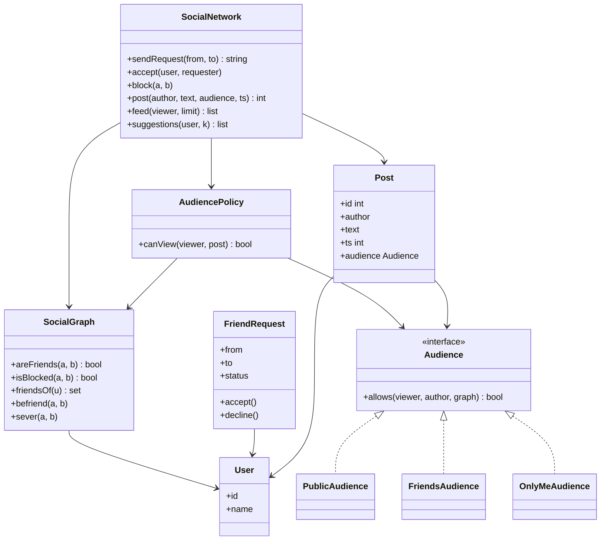
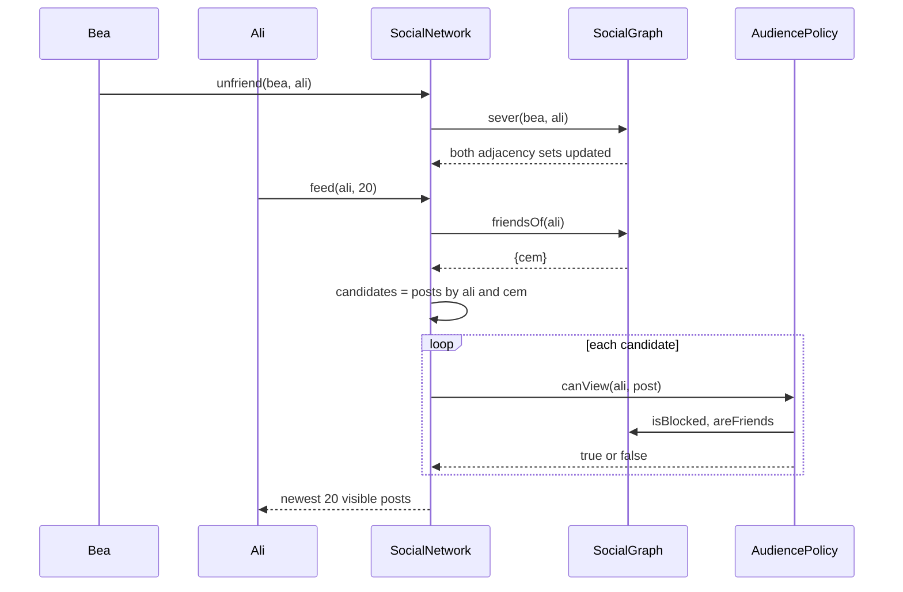

## In one minute
- The core of a social network is not posts; it is the relationship graph and the privacy rules that read it. Friendship is a symmetric edge created by a small state machine (request, accept, decline), and every read of a post asks that graph "may this viewer see this?"
- Check privacy when content is read, not when it is written. Relationships change after a post exists: an unfriend or a block must hide old posts immediately, and only a read-time check can do that.
- Blocking is the strongest relation. It overrides every audience setting in both directions, removes the friendship and any pending requests, and unblocking does not bring the friendship back.
- Keep one `AudiencePolicy` that answers `can_view(viewer, post)`. Feeds, search, profile pages and notifications all call it, so a privacy rule changes in one place.
- The problem shape is **multi-step consistency** (a friendship is two adjacency entries that must agree) plus **fan-out** (a feed merges many friends' timelines). The same audience check appears in file sharing, where "who can open this document" is also a question about a relationship graph.

## Requirements

### Functional
- Users register and send friend requests. The recipient accepts or declines. If two people send each other requests, the second request accepts the first.
- Friends can unfriend each other. Any user can block another user, and can later unblock them.
- Users create posts with an audience: `public`, `friends` or `only_me`.
- A viewer's feed shows their own posts and their friends' posts that they are allowed to see, newest first.
- Show a user's friends, the mutual friends of two users, and "people you may know" ranked by the number of mutual friends.

### Non-functional
- Privacy is never stale. After an unfriend or a block, the next read already reflects it.
- Friendship is always symmetric. No state exists where A lists B as a friend but B does not list A.
- Graph queries (is X a friend of Y, mutual friends) are fast enough to run on every read.

### Out of scope
- The distributed feed architecture (fan-out on write, ranking, caching). [Design Facebook News Feed](../sdi/design-news-feed.md) and [Design Instagram](../sdi/design-instagram.md) cover those. This lesson is the in-process object model they sit on.
- Groups, pages, followers without friendship, messaging, and custom friend lists. We note where each plugs in.

## Entities and relationships

**User** has an id, a display name and a privacy default. Users are nodes; everything interesting is an edge.

**FriendRequest** links a sender to a recipient with a status: `pending`, `accepted`, `declined` or `cancelled`. Only pending requests drive behaviour; the rest are history, useful for abuse analysis.

**Friendship** is the symmetric edge. One record keyed by the ordered pair (smaller id, larger id) makes "exactly one edge" true by construction; two adjacency entries, one in each user's friend set, make "list my friends" and "are we friends?" cheap. In memory we use adjacency sets and update both sides in one critical section.

**Block** is a directed edge from the blocker to the blocked user, but its effect is symmetric: neither side sees the other. It is directed because only the blocker can lift it.

**Post** has an id, an author, text, a timestamp and an **Audience**. **Comment** and **Reaction** hang off a post and inherit its audience.

**AudiencePolicy** is the single place that answers "may viewer V see post P?" **SocialNetwork** is the facade with one method per user action, coordinating the graph, the posts and the policy.

## Class diagram



## Key flows

The flow that shows why privacy is read-time is "Bea unfriends Ali, then Ali opens his feed". Nothing is deleted from Ali's feed when Bea unfriends him. The feed is assembled on read, and each candidate post passes through the policy, which reads the graph as it is now.



Bea's `friends` posts are no longer candidates, and if Ali opens one by a direct link, the policy rejects it too. One graph change closes both doors.

Crossing requests are the other interesting flow. If Bea sends Ali a request while his request to her is pending, the second `send_request` turns the pair into a friendship. Without this rule, both users see "request sent" and wait for each other.

## Design patterns used and why

**Strategy for audiences.** `PublicAudience`, `FriendsAudience` and `OnlyMeAudience` each implement `allows(viewer, author, graph)`. Adding `friends_of_friends` is a new class, not a new branch in `if` chains spread across feed, profile and search code. The policy wraps the strategies with rules common to all of them: the author always sees their own post, and a block always wins.

**Specification for composite rules.** "Friends, except Dan" combines predicates. A Specification (`and`, `or`, `not` over small predicates) expresses that without a class per combination. Start with Strategy; move to Specification when product asks for exclusions.

**State for friend requests.** A request moves from `pending` to `accepted`, `declined` or `cancelled` and never back. Encoding that as a state machine stops bugs like accepting a request that was already declined because two devices were open.

**Facade.** `SocialNetwork` gives controllers one call per user action. Block touches the friendship, both request directions and the block set; callers should not coordinate those.

**Observer for side effects.** `FriendshipCreated` and `PostCreated` events feed notifications, the suggestions index and the feed cache, which can be slow or fail without blocking the action.

## Concurrency and edge cases

### Two sides of one friendship
Accepting a request writes two adjacency entries and deletes one pending request. In memory, do all three under one lock (or a lock per user pair, acquired in id order so two concurrent operations on the same pair cannot deadlock). In a sharded store the two users often live on different shards. Facebook's TAO paper describes exactly this: a friend edge has a configured inverse type, TAO writes the inverse first and then the forward edge, does not make the two writes atomic, and repairs any hanging association with an asynchronous job. That is a deliberate trade: symmetric edges are cheap to read and occasionally need repair.

### Crossing requests and double taps
Two `send_request` calls between the same pair can race. Under a pair lock, the second one either sees the first (and auto-accepts or reports `already_requested`) or runs first itself. In a database, a unique index on the ordered pair for pending requests gives the same guarantee.

### Block beats everything
A block removes the friendship and both pending requests, and makes every post invisible in both directions, including public ones. It also prevents new requests in both directions. Unblocking removes only the block edge. Restoring the friendship automatically would surprise the blocked person, who may have been blocked for a reason.

### Audience changes and comments
Narrowing a post from `public` to `friends` takes effect on the next read automatically; a feed cache must still filter on read or be invalidated by an `AudienceChanged` event. A comment is visible only to its post's audience, whatever the commenter's own settings, or comments become a side channel that leaks the post.

## In the wild
- **Facebook TAO, 2013: inverse edges can hang.** TAO stores an association and its inverse as two writes that may land on different shards. If the second write fails, a "hanging" association is left behind, and an asynchronous job finds and repairs it. This is the repairable-symmetry choice made at scale ([USENIX ATC 2013](https://www.usenix.org/system/files/conference/atc13/atc13-bronson.pdf)).
- **LinkedIn LIquid: the graph leaves the application.** LinkedIn found that serving degree and connection queries from general-purpose stores was too slow and awkward, so it built an in-house graph database to answer multi-hop queries directly ([LinkedIn Engineering](https://engineering.linkedin.com/blog/2020/liquid-the-soul-of-a-new-graph-database-part-1)).
- **Slack, 2022: an emptied cache melts the database.** A Consul agent rollout replaced memcached nodes with empty ones, and a scatter query overloaded the database. A cache of graph or feed results needs the same protection against a cold start ([Slack Engineering](https://slack.engineering/slacks-incident-on-2-22-22/)).

## Down the stack

### Layer 1: The contract
For any two users, `are_friends(a, b) == are_friends(b, a)`. At most one pending request exists per ordered pair, and never two crossing ones. `can_view(v, p)` is true when `v` is the author. Otherwise it is false whenever either user blocks the other, and otherwise it follows the audience. Every read, including feeds, applies `can_view` against the graph as it stands at that moment. A rejected action changes nothing.

### Layer 2: The mechanism
Friend sets are hash sets, so "are we friends?" is one O(1) membership test, and mutual friends is an intersection costing O(min(|A|, |B|)). "People you may know" counts, for each friend f, every friend of f who is not u, not a friend and not blocked. That costs the sum of the friends' degrees: 300 friends with 300 friends each is about 90,000 increments, so production systems precompute candidates offline.

The feed is a k-way merge of per-author lists already in time order. Push each author's newest post onto a max-heap keyed by (ts, id), pop the top, check `can_view`, and push that author's next post. Twenty results from 300 friends cost about 170 heap comparisons plus 20 policy checks, however much each friend has posted. TAO keeps association lists newest first for the same reason: `assoc_range` reads the head without scanning the rest.

### Layer 3: The machine
A CPython set of 500 friend ids reports about 32 KB from `sys.getsizeof` (a 2,048-slot table at 16 bytes per slot, hash plus pointer), before the id strings themselves. A Go `map[string]bool` stores a 16-byte string header and a byte per entry in 8-entry buckets, roughly 15 KB for 500 friends. Facebook caps a profile at 5,000 friends, where the Python set is about half a megabyte. A membership test touches one or two cache lines, about 50 to 100 ns on a cache miss. A policy check is therefore far cheaper than the network hop that fetched the post. A heap of 300 tuples is a contiguous array, so the merge stays in L1 and L2 caches.

### Why it's built this way
Relationships change constantly and privacy mistakes are expensive, so privacy is evaluated on read against the live graph. Read-time checks run on every post shown, so the graph must answer membership in O(1), which means hash sets keyed by user. Symmetric friendship read from either side needs two adjacency entries, and two entries can disagree, so writes to both sides go under one lock in memory or get a repair job across shards. Feeds read only the newest few posts of many authors, so per-author lists are kept sorted and merged with a heap instead of sorted from scratch. This is the shape Facebook's [TAO](https://www.usenix.org/system/files/conference/atc13/atc13-bronson.pdf) stores: objects, typed associations with inverse edges, and time-ordered association lists. Google's [Zanzibar](https://research.google/pubs/zanzibar-googles-consistent-global-authorization-system/) answers the same "may this user see this?" question from relationship tuples.

## Extensibility
- **Followers (asymmetric edges).** A `follows` edge type with no request flow; the feed also merges followed authors. The policy is unchanged, because `PublicAudience` already allows anyone not blocked.
- **Friends of friends and custom lists.** New `Audience` strategies: one checks whether friend sets intersect, the other holds a set of user ids, with exclusions as Specifications.
- **Groups.** A group is a node with membership edges, and its posts use a `GroupAudience`.
- **Moving to a store.** Replace `SocialGraph`'s sets with a repository over an edge table keyed by (user, type, other user, time), TAO's association model. The policy and facade do not change.

### Variant: professional networking (LinkedIn-style)

A professional network keeps the same graph machinery but changes the relationship rules and the read that matters most.

**Two relationships, not one.** A connection is symmetric and needs consent, like friendship. A follow is one-way and needs none, and connecting implies following in both directions. Model `Connection` and `Follow` as separate types, because they have different rules. One `Relationship` class with a type flag ends up as a pile of `if` statements.

**A richer invitation.** The invitation is a [State pattern](https://refactoring.guru/design-patterns/state) object (pending, accepted, ignored, withdrawn) and carries a note and a sender-side rate limit over a rolling week, so the network cannot be used for bulk outreach. A withdrawn invitation does not refund its slot, and a rejected attempt consumes nothing. Ignoring is not blocking: decide whether the sender may retry at once, after a cool-down, or never. Crossing invitations resolve as in friend requests: the second one accepts the first. Accept and withdraw race, so both are conditional updates on `status = 'PENDING'`, and exactly one wins.

**Degree is the new core query.** Every profile and search result shows 1st, 2nd, 3rd or out of network, plus mutual connections. Degree is a breadth-first search capped at three hops. Searching from both ends and expanding the smaller frontier turns a three-hop question into two short expansions that meet in the middle ([bidirectional search](https://en.wikipedia.org/wiki/Bidirectional_search)). Mutuals are a set intersection that iterates the smaller set and probes the larger. The cost explodes with depth: with around 500 connections each, second degree is up to 250,000 ids and third reaches tens of millions. So a page view never runs a full search. Production systems cache second-degree sets and accept seconds of staleness. At hundreds of millions of members the adjacency leaves the process entirely; LinkedIn built its own graph database for this ([LIquid](https://engineering.linkedin.com/blog/2020/liquid-the-soul-of-a-new-graph-database-part-1)).

**Different consistency budget.** Privacy here is mostly profile visibility by degree, so a stale degree badge is cosmetic, unlike a stale friends-only post. Accept must still create the edge and close the invitation together, in one transaction or as an idempotent edge write driven by invitation state. Everything downstream (feeds, counters, suggestions) runs on a `ConnectionCreated` event after commit and may lag.

**What carries over.** Blocks still override everything, and "people you may know" still ranks second-degree members by mutuals. A block also removes a member from any degree path.

## Leadership lens
- The design review question is "show me every code path that returns a post, and prove each one calls `can_view`." Search, notifications, link previews and data exports are the usual leaks. Enforce it with a single repository method that returns only already-filtered posts.
- Treat privacy rules as a product contract with tests: a table of (relationship, audience, expected visibility) run in CI. Block and unfriend cases belong in that table, not in ad hoc unit tests.
- Decide early whether symmetric edges are atomic or repairable. Repairable is cheaper at scale, but it needs an owner for the repair job and an alert on its backlog.
- "People you may know" is a growth feature with a privacy cost. It can reveal that two people are connected. Have legal and product sign off on what signals it uses, and always respect blocks.

## Check yourself
1. Why not filter posts at write time by copying each post only into the feeds of people allowed to see it?
   **Answer:** The allowed set changes after the post is written: an unfriend, a block or an audience edit would leave stale copies that still show the post. A read-time check against the live graph is the only way to make those changes take effect on the next read.
2. Ali and Bea each send the other a friend request at almost the same moment. What should the system end up with?
   **Answer:** One friendship and no pending requests. Whichever request is processed second sees the opposite pending request and accepts it instead of creating a crossing request.
3. Bea blocks Ali, then unblocks him a day later. Are they friends? Can Ali see Bea's public posts?
   **Answer:** They are not friends, because the block severed the friendship and unblock does not restore it. Ali can see Bea's public posts again, because only the block was hiding them.
4. Why does a comment on a friends-only post not become visible to the commenter's own friends?
   **Answer:** A comment inherits the post's audience. Showing it to a wider audience would leak the existence and context of the post.

## Practice
**Task:** Implement the core of a social network. `SocialNetwork` supports `add_user(user)` (`duplicate_user` on repeat), `send_request(sender, recipient)` returning `"pending"`, or `"accepted"` when the recipient already has a pending request to the sender (that pair becomes friends). It fails with `self_action`, `blocked` (a block in either direction), `already_friends` or `already_requested`. `accept(user, requester)` and `decline(user, requester)` act on a pending request from `requester` to `user` (`no_request` otherwise). `unfriend(a, b)` fails with `not_friends`. `block(a, b)` (`self_action` for oneself) removes any friendship and pending requests between them, and `unblock(a, b)` lifts only `a`'s block. `post(author, text, audience, ts)` returns ids from 1 with audience `public`, `friends` or `only_me` (`invalid_audience`). `can_view(viewer, post_id)` is true for the author. Otherwise it is false under a block in either direction, and otherwise follows the audience. `feed(viewer, limit)` returns ids of the viewer's own and friends' posts the viewer can see, newest `ts` first with ties broken by higher id. `friends(user)` and `mutual_friends(a, b)` return sorted lists. `suggestions(user, k)` ranks non-friends (not the user, not blocked either way) by number of mutual friends, descending, then by name. Only users with at least one mutual friend are included. Unknown users and posts fail with `unknown_user` and `unknown_post`. Every failure changes nothing.

```python starter
AUDIENCES = ("public", "friends", "only_me")


class SocialError(Exception):
    def __init__(self, code):
        super().__init__(code)
        self.code = code


class SocialNetwork:
    def __init__(self):
        pass

    def add_user(self, user):
        raise NotImplementedError

    def send_request(self, sender, recipient):
        raise NotImplementedError

    def accept(self, user, requester):
        raise NotImplementedError

    def decline(self, user, requester):
        raise NotImplementedError

    def unfriend(self, a, b):
        raise NotImplementedError

    def block(self, a, b):
        raise NotImplementedError

    def unblock(self, a, b):
        raise NotImplementedError

    def post(self, author, text, audience, ts):
        raise NotImplementedError

    def can_view(self, viewer, post_id):
        raise NotImplementedError

    def feed(self, viewer, limit):
        raise NotImplementedError

    def friends(self, user):
        raise NotImplementedError

    def mutual_friends(self, a, b):
        raise NotImplementedError

    def suggestions(self, user, k):
        raise NotImplementedError
```

```python tests
def _net(*names):
    net = SocialNetwork()
    for n in names:
        net.add_user(n)
    return net


def _expect(code, fn):
    try:
        fn()
    except SocialError as e:
        assert e.code == code, "expected %s, got %s" % (code, e.code)
        return
    assert False, "expected " + code


def test_request_accept_decline():
    net = _net("ali", "bea", "cem")
    assert net.send_request("ali", "bea") == "pending"
    _expect("already_requested", lambda: net.send_request("ali", "bea"))
    net.accept("bea", "ali")
    assert net.friends("ali") == ["bea"] and net.friends("bea") == ["ali"]
    _expect("already_friends", lambda: net.send_request("bea", "ali"))
    net.send_request("cem", "ali")
    net.decline("ali", "cem")
    _expect("no_request", lambda: net.accept("ali", "cem"))
    assert net.friends("cem") == []


def test_crossing_requests_become_friends():
    net = _net("ali", "bea")
    assert net.send_request("ali", "bea") == "pending"
    assert net.send_request("bea", "ali") == "accepted"
    assert net.friends("ali") == ["bea"]
    _expect("no_request", lambda: net.accept("ali", "bea"))


def test_audience_is_checked_on_read():
    net = _net("ali", "bea", "cem")
    net.send_request("ali", "bea")
    net.accept("bea", "ali")
    pub = net.post("bea", "hello world", "public", 1)
    fr = net.post("bea", "friends only", "friends", 2)
    me = net.post("bea", "diary", "only_me", 3)
    assert [net.can_view("ali", p) for p in (pub, fr, me)] == [True, True, False]
    assert [net.can_view("cem", p) for p in (pub, fr, me)] == [True, False, False]
    assert net.can_view("bea", me)
    net.unfriend("ali", "bea")
    assert not net.can_view("ali", fr), "unfriend hides friends posts at once"
    _expect("not_friends", lambda: net.unfriend("ali", "bea"))


def test_block_overrides_everything():
    net = _net("ali", "bea")
    net.send_request("ali", "bea")
    net.accept("bea", "ali")
    pub = net.post("ali", "public news", "public", 1)
    net.block("bea", "ali")
    assert net.friends("ali") == []
    assert not net.can_view("bea", pub), "block hides public posts both ways"
    _expect("blocked", lambda: net.send_request("ali", "bea"))
    _expect("blocked", lambda: net.send_request("bea", "ali"))
    net.unblock("ali", "bea")
    _expect("blocked", lambda: net.send_request("ali", "bea"))
    net.unblock("bea", "ali")
    assert net.can_view("bea", pub)
    assert net.friends("bea") == [], "unblock does not restore friendship"


def test_feed_order_limit_and_visibility():
    net = _net("ali", "bea", "cem", "dev")
    for other in ("bea", "cem"):
        net.send_request("ali", other)
        net.accept(other, "ali")
    p1 = net.post("bea", "a", "friends", 10)
    p2 = net.post("cem", "b", "only_me", 20)
    p3 = net.post("ali", "c", "only_me", 10)
    p4 = net.post("dev", "d", "public", 30)
    p5 = net.post("cem", "e", "public", 5)
    assert net.feed("ali", 10) == [p3, p1, p5]
    assert net.feed("ali", 2) == [p3, p1]
    assert net.feed("dev", 10) == [p4]
    assert net.feed("cem", 10) == [p2, p5]


def test_mutual_friends_and_suggestions():
    net = _net("ali", "bea", "cem", "dev", "eve", "fay")
    for a, b in (("ali", "bea"), ("ali", "cem"), ("bea", "dev"), ("cem", "dev"),
                 ("bea", "eve"), ("cem", "fay"), ("bea", "fay")):
        net.send_request(a, b)
        net.accept(b, a)
    assert net.mutual_friends("ali", "dev") == ["bea", "cem"]
    assert net.suggestions("ali", 5) == ["dev", "fay", "eve"]
    assert net.suggestions("ali", 1) == ["dev"]
    net.block("fay", "ali")
    assert net.suggestions("ali", 5) == ["dev", "eve"]


def test_errors_change_nothing():
    net = _net("ali", "bea")
    _expect("duplicate_user", lambda: net.add_user("ali"))
    _expect("unknown_user", lambda: net.send_request("ali", "zed"))
    _expect("self_action", lambda: net.send_request("ali", "ali"))
    _expect("self_action", lambda: net.block("ali", "ali"))
    _expect("invalid_audience", lambda: net.post("ali", "x", "everyone", 1))
    _expect("unknown_post", lambda: net.can_view("ali", 1))
    _expect("unknown_user", lambda: net.feed("zed", 5))
    assert net.post("ali", "first", "public", 1) == 1, "failed post used no id"
    assert net.friends("ali") == [] and net.suggestions("ali", 3) == []
```

```python solution
import heapq

AUDIENCES = ("public", "friends", "only_me")


class SocialError(Exception):
    def __init__(self, code):
        super().__init__(code)
        self.code = code


class Post:
    def __init__(self, post_id, author, text, audience, ts):
        self.id = post_id
        self.author = author
        self.text = text
        self.audience = audience
        self.ts = ts


class SocialNetwork:
    def __init__(self):
        self._friends = {}      # user -> set of friends (both sides kept in sync)
        self._pending = set()   # (sender, recipient)
        self._blocks = set()    # (blocker, blocked)
        self._posts = {}
        self._by_author = {}    # user -> list of post ids in creation order
        self._next_id = 1

    def _check(self, *users):
        for u in users:
            if u not in self._friends:
                raise SocialError("unknown_user")

    def _blocked(self, a, b):
        return (a, b) in self._blocks or (b, a) in self._blocks

    def _befriend(self, a, b):
        self._friends[a].add(b)
        self._friends[b].add(a)

    def add_user(self, user):
        if user in self._friends:
            raise SocialError("duplicate_user")
        self._friends[user] = set()
        self._by_author[user] = []

    def send_request(self, sender, recipient):
        self._check(sender, recipient)
        if sender == recipient:
            raise SocialError("self_action")
        if self._blocked(sender, recipient):
            raise SocialError("blocked")
        if recipient in self._friends[sender]:
            raise SocialError("already_friends")
        if (sender, recipient) in self._pending:
            raise SocialError("already_requested")
        if (recipient, sender) in self._pending:
            self._pending.discard((recipient, sender))
            self._befriend(sender, recipient)
            return "accepted"
        self._pending.add((sender, recipient))
        return "pending"

    def _take_request(self, user, requester):
        self._check(user, requester)
        if (requester, user) not in self._pending:
            raise SocialError("no_request")
        self._pending.discard((requester, user))

    def accept(self, user, requester):
        self._take_request(user, requester)
        self._befriend(user, requester)

    def decline(self, user, requester):
        self._take_request(user, requester)

    def unfriend(self, a, b):
        self._check(a, b)
        if b not in self._friends[a]:
            raise SocialError("not_friends")
        self._friends[a].discard(b)
        self._friends[b].discard(a)

    def block(self, a, b):
        self._check(a, b)
        if a == b:
            raise SocialError("self_action")
        self._blocks.add((a, b))
        self._friends[a].discard(b)
        self._friends[b].discard(a)
        self._pending.discard((a, b))
        self._pending.discard((b, a))

    def unblock(self, a, b):
        self._check(a, b)
        self._blocks.discard((a, b))

    def post(self, author, text, audience, ts):
        self._check(author)
        if audience not in AUDIENCES:
            raise SocialError("invalid_audience")
        pid = self._next_id
        self._next_id += 1
        self._posts[pid] = Post(pid, author, text, audience, ts)
        self._by_author[author].append(pid)
        return pid

    def _allows(self, viewer, post):
        if viewer == post.author:
            return True
        if self._blocked(viewer, post.author):
            return False
        if post.audience == "public":
            return True
        if post.audience == "friends":
            return viewer in self._friends[post.author]
        return False

    def can_view(self, viewer, post_id):
        self._check(viewer)
        if post_id not in self._posts:
            raise SocialError("unknown_post")
        return self._allows(viewer, self._posts[post_id])

    def feed(self, viewer, limit):
        self._check(viewer)
        heap = []
        for author in [viewer] + sorted(self._friends[viewer]):
            ids = sorted(self._by_author[author],
                         key=lambda i: (self._posts[i].ts, i))
            if ids:
                last = ids.pop()
                heapq.heappush(heap, (-self._posts[last].ts, -last, ids))
        out = []
        while heap and len(out) < limit:
            _, neg_id, rest = heapq.heappop(heap)
            if self._allows(viewer, self._posts[-neg_id]):
                out.append(-neg_id)
            if rest:
                nxt = rest.pop()
                heapq.heappush(heap, (-self._posts[nxt].ts, -nxt, rest))
        return out

    def friends(self, user):
        self._check(user)
        return sorted(self._friends[user])

    def mutual_friends(self, a, b):
        self._check(a, b)
        return sorted(self._friends[a] & self._friends[b])

    def suggestions(self, user, k):
        self._check(user)
        mine = self._friends[user]
        counts = {}
        for f in mine:
            for g in self._friends[f]:
                if g == user or g in mine or self._blocked(user, g):
                    continue
                counts[g] = counts.get(g, 0) + 1
        ranked = sorted(counts, key=lambda g: (-counts[g], g))
        return ranked[:k]
```

```typescript starter
export const AUDIENCES = ["public", "friends", "only_me"];

export class SocialError extends Error {
  constructor(public code: string) {
    super(code);
  }
}

export class SocialNetwork {
  addUser(user: string): void { throw new Error("TODO"); }
  sendRequest(sender: string, recipient: string): string { throw new Error("TODO"); }
  accept(user: string, requester: string): void { throw new Error("TODO"); }
  decline(user: string, requester: string): void { throw new Error("TODO"); }
  unfriend(a: string, b: string): void { throw new Error("TODO"); }
  block(a: string, b: string): void { throw new Error("TODO"); }
  unblock(a: string, b: string): void { throw new Error("TODO"); }
  post(author: string, text: string, audience: string, ts: number): number { throw new Error("TODO"); }
  canView(viewer: string, postId: number): boolean { throw new Error("TODO"); }
  feed(viewer: string, limit: number): number[] { throw new Error("TODO"); }
  friends(user: string): string[] { throw new Error("TODO"); }
  mutualFriends(a: string, b: string): string[] { throw new Error("TODO"); }
  suggestions(user: string, k: number): string[] { throw new Error("TODO"); }
}
```

```typescript tests
function makeNet(...names: string[]): SocialNetwork {
  const net = new SocialNetwork();
  for (const n of names) net.addUser(n);
  return net;
}

function codeOf(fn: () => unknown): string {
  try {
    fn();
  } catch (e) {
    return e instanceof SocialError ? e.code : "other";
  }
  return "none";
}

function link(net: SocialNetwork, a: string, b: string): void {
  net.sendRequest(a, b);
  net.accept(b, a);
}

test("request, accept, decline", () => {
  const net = makeNet("ali", "bea", "cem");
  assertEqual(net.sendRequest("ali", "bea"), "pending");
  assertEqual(codeOf(() => net.sendRequest("ali", "bea")), "already_requested");
  net.accept("bea", "ali");
  assertEqual([net.friends("ali"), net.friends("bea")], [["bea"], ["ali"]]);
  assertEqual(codeOf(() => net.sendRequest("bea", "ali")), "already_friends");
  net.sendRequest("cem", "ali");
  net.decline("ali", "cem");
  assertEqual(codeOf(() => net.accept("ali", "cem")), "no_request");
  assertEqual(net.friends("cem"), []);
});

test("crossing requests become friends", () => {
  const net = makeNet("ali", "bea");
  assertEqual(net.sendRequest("ali", "bea"), "pending");
  assertEqual(net.sendRequest("bea", "ali"), "accepted");
  assertEqual(net.friends("ali"), ["bea"]);
  assertEqual(codeOf(() => net.accept("ali", "bea")), "no_request");
});

test("audience is checked on read", () => {
  const net = makeNet("ali", "bea", "cem");
  link(net, "ali", "bea");
  const pub = net.post("bea", "hello world", "public", 1);
  const fr = net.post("bea", "friends only", "friends", 2);
  const me = net.post("bea", "diary", "only_me", 3);
  assertEqual([pub, fr, me].map((p) => net.canView("ali", p)), [true, true, false]);
  assertEqual([pub, fr, me].map((p) => net.canView("cem", p)), [true, false, false]);
  assert(net.canView("bea", me), "author sees own post");
  net.unfriend("ali", "bea");
  assert(!net.canView("ali", fr), "unfriend hides friends posts at once");
  assertEqual(codeOf(() => net.unfriend("ali", "bea")), "not_friends");
});

test("block overrides everything", () => {
  const net = makeNet("ali", "bea");
  link(net, "ali", "bea");
  const pub = net.post("ali", "public news", "public", 1);
  net.block("bea", "ali");
  assertEqual(net.friends("ali"), []);
  assert(!net.canView("bea", pub), "block hides public posts both ways");
  assertEqual(codeOf(() => net.sendRequest("ali", "bea")), "blocked");
  assertEqual(codeOf(() => net.sendRequest("bea", "ali")), "blocked");
  net.unblock("ali", "bea");
  assertEqual(codeOf(() => net.sendRequest("ali", "bea")), "blocked");
  net.unblock("bea", "ali");
  assert(net.canView("bea", pub), "visible after unblock");
  assertEqual(net.friends("bea"), [], "unblock does not restore friendship");
});

test("feed order, limit and visibility", () => {
  const net = makeNet("ali", "bea", "cem", "dev");
  link(net, "ali", "bea");
  link(net, "ali", "cem");
  const p1 = net.post("bea", "a", "friends", 10);
  const p2 = net.post("cem", "b", "only_me", 20);
  const p3 = net.post("ali", "c", "only_me", 10);
  const p4 = net.post("dev", "d", "public", 30);
  const p5 = net.post("cem", "e", "public", 5);
  assertEqual(net.feed("ali", 10), [p3, p1, p5]);
  assertEqual(net.feed("ali", 2), [p3, p1]);
  assertEqual(net.feed("dev", 10), [p4]);
  assertEqual(net.feed("cem", 10), [p2, p5]);
});

test("mutual friends and suggestions", () => {
  const net = makeNet("ali", "bea", "cem", "dev", "eve", "fay");
  const pairs: [string, string][] = [["ali", "bea"], ["ali", "cem"], ["bea", "dev"],
    ["cem", "dev"], ["bea", "eve"], ["cem", "fay"], ["bea", "fay"]];
  for (const [a, b] of pairs) link(net, a, b);
  assertEqual(net.mutualFriends("ali", "dev"), ["bea", "cem"]);
  assertEqual(net.suggestions("ali", 5), ["dev", "fay", "eve"]);
  assertEqual(net.suggestions("ali", 1), ["dev"]);
  net.block("fay", "ali");
  assertEqual(net.suggestions("ali", 5), ["dev", "eve"]);
});

test("errors change nothing", () => {
  const net = makeNet("ali", "bea");
  assertEqual(codeOf(() => net.addUser("ali")), "duplicate_user");
  assertEqual(codeOf(() => net.sendRequest("ali", "zed")), "unknown_user");
  assertEqual(codeOf(() => net.sendRequest("ali", "ali")), "self_action");
  assertEqual(codeOf(() => net.block("ali", "ali")), "self_action");
  assertEqual(codeOf(() => net.post("ali", "x", "everyone", 1)), "invalid_audience");
  assertEqual(codeOf(() => net.canView("ali", 1)), "unknown_post");
  assertEqual(codeOf(() => net.feed("zed", 5)), "unknown_user");
  assertEqual(net.post("ali", "first", "public", 1), 1, "failed post used no id");
  assertEqual([net.friends("ali"), net.suggestions("ali", 3)], [[], []]);
});
```

```typescript solution
export const AUDIENCES = ["public", "friends", "only_me"];

export class SocialError extends Error {
  constructor(public code: string) {
    super(code);
  }
}

interface Post {
  id: number;
  author: string;
  text: string;
  audience: string;
  ts: number;
}

const byName = (a: string, b: string) => (a < b ? -1 : a > b ? 1 : 0);

export class SocialNetwork {
  private friendSets = new Map<string, Set<string>>();
  private pending = new Set<string>();
  private blocks = new Set<string>();
  private posts = new Map<number, Post>();
  private byAuthor = new Map<string, number[]>();
  private nextId = 1;

  private key(a: string, b: string): string {
    return a + "\u0000" + b;
  }

  private check(...users: string[]): void {
    for (const u of users) if (!this.friendSets.has(u)) throw new SocialError("unknown_user");
  }

  private isBlocked(a: string, b: string): boolean {
    return this.blocks.has(this.key(a, b)) || this.blocks.has(this.key(b, a));
  }

  private setOf(u: string): Set<string> {
    return this.friendSets.get(u)!;
  }

  private befriend(a: string, b: string): void {
    this.setOf(a).add(b);
    this.setOf(b).add(a);
  }

  addUser(user: string): void {
    if (this.friendSets.has(user)) throw new SocialError("duplicate_user");
    this.friendSets.set(user, new Set());
    this.byAuthor.set(user, []);
  }

  sendRequest(sender: string, recipient: string): string {
    this.check(sender, recipient);
    if (sender === recipient) throw new SocialError("self_action");
    if (this.isBlocked(sender, recipient)) throw new SocialError("blocked");
    if (this.setOf(sender).has(recipient)) throw new SocialError("already_friends");
    if (this.pending.has(this.key(sender, recipient))) throw new SocialError("already_requested");
    if (this.pending.delete(this.key(recipient, sender))) {
      this.befriend(sender, recipient);
      return "accepted";
    }
    this.pending.add(this.key(sender, recipient));
    return "pending";
  }

  private takeRequest(user: string, requester: string): void {
    this.check(user, requester);
    if (!this.pending.delete(this.key(requester, user))) throw new SocialError("no_request");
  }

  accept(user: string, requester: string): void {
    this.takeRequest(user, requester);
    this.befriend(user, requester);
  }

  decline(user: string, requester: string): void {
    this.takeRequest(user, requester);
  }

  unfriend(a: string, b: string): void {
    this.check(a, b);
    if (!this.setOf(a).has(b)) throw new SocialError("not_friends");
    this.setOf(a).delete(b);
    this.setOf(b).delete(a);
  }

  block(a: string, b: string): void {
    this.check(a, b);
    if (a === b) throw new SocialError("self_action");
    this.blocks.add(this.key(a, b));
    this.setOf(a).delete(b);
    this.setOf(b).delete(a);
    this.pending.delete(this.key(a, b));
    this.pending.delete(this.key(b, a));
  }

  unblock(a: string, b: string): void {
    this.check(a, b);
    this.blocks.delete(this.key(a, b));
  }

  post(author: string, text: string, audience: string, ts: number): number {
    this.check(author);
    if (AUDIENCES.indexOf(audience) < 0) throw new SocialError("invalid_audience");
    const id = this.nextId++;
    this.posts.set(id, { id, author, text, audience, ts });
    this.byAuthor.get(author)!.push(id);
    return id;
  }

  private allows(viewer: string, p: Post): boolean {
    if (viewer === p.author) return true;
    if (this.isBlocked(viewer, p.author)) return false;
    if (p.audience === "public") return true;
    if (p.audience === "friends") return this.setOf(p.author).has(viewer);
    return false;
  }

  canView(viewer: string, postId: number): boolean {
    this.check(viewer);
    const p = this.posts.get(postId);
    if (!p) throw new SocialError("unknown_post");
    return this.allows(viewer, p);
  }

  feed(viewer: string, limit: number): number[] {
    this.check(viewer);
    const newer = (a: Post, b: Post) => (a.ts !== b.ts ? b.ts - a.ts : b.id - a.id);
    const candidates: Post[] = [];
    for (const author of [viewer, ...this.setOf(viewer)]) {
      for (const id of this.byAuthor.get(author)!) candidates.push(this.posts.get(id)!);
    }
    candidates.sort(newer);
    const out: number[] = [];
    for (const p of candidates) {
      if (out.length >= limit) break;
      if (this.allows(viewer, p)) out.push(p.id);
    }
    return out;
  }

  friends(user: string): string[] {
    this.check(user);
    return [...this.setOf(user)].sort(byName);
  }

  mutualFriends(a: string, b: string): string[] {
    this.check(a, b);
    const other = this.setOf(b);
    return [...this.setOf(a)].filter((f) => other.has(f)).sort(byName);
  }

  suggestions(user: string, k: number): string[] {
    this.check(user);
    const mine = this.setOf(user);
    const counts = new Map<string, number>();
    for (const f of mine) {
      for (const g of this.setOf(f)) {
        if (g === user || mine.has(g) || this.isBlocked(user, g)) continue;
        counts.set(g, (counts.get(g) || 0) + 1);
      }
    }
    const ranked = [...counts.keys()].sort(
      (x, y) => counts.get(y)! - counts.get(x)! || byName(x, y),
    );
    return ranked.slice(0, k);
  }
}
```

```go starter
package practice

import "errors"

var (
	ErrDuplicateUser    = errors.New("duplicate_user")
	ErrUnknownUser      = errors.New("unknown_user")
	ErrUnknownPost      = errors.New("unknown_post")
	ErrSelfAction       = errors.New("self_action")
	ErrBlocked          = errors.New("blocked")
	ErrAlreadyFriends   = errors.New("already_friends")
	ErrAlreadyRequested = errors.New("already_requested")
	ErrNoRequest        = errors.New("no_request")
	ErrNotFriends       = errors.New("not_friends")
	ErrInvalidAudience  = errors.New("invalid_audience")
)

type SocialNetwork struct{}

func New() *SocialNetwork { return &SocialNetwork{} }

func (s *SocialNetwork) AddUser(user string) error                            { panic("TODO") }
func (s *SocialNetwork) SendRequest(sender, recipient string) (string, error) { panic("TODO") }
func (s *SocialNetwork) Accept(user, requester string) error                  { panic("TODO") }
func (s *SocialNetwork) Decline(user, requester string) error                 { panic("TODO") }
func (s *SocialNetwork) Unfriend(a, b string) error                           { panic("TODO") }
func (s *SocialNetwork) Block(a, b string) error                              { panic("TODO") }
func (s *SocialNetwork) Unblock(a, b string) error                            { panic("TODO") }
func (s *SocialNetwork) Post(author, text, audience string, ts int) (int, error) {
	panic("TODO")
}
func (s *SocialNetwork) CanView(viewer string, postID int) (bool, error)  { panic("TODO") }
func (s *SocialNetwork) Feed(viewer string, limit int) ([]int, error)     { panic("TODO") }
func (s *SocialNetwork) Friends(user string) ([]string, error)            { panic("TODO") }
func (s *SocialNetwork) MutualFriends(a, b string) ([]string, error)      { panic("TODO") }
func (s *SocialNetwork) Suggestions(user string, k int) ([]string, error) { panic("TODO") }
```

```go tests
package practice

import (
	"errors"
	"fmt"
	"testing"
)

func makeNet(t *testing.T, names ...string) *SocialNetwork {
	n := New()
	for _, name := range names {
		if err := n.AddUser(name); err != nil {
			t.Fatal(err)
		}
	}
	return n
}

func link(t *testing.T, n *SocialNetwork, a, b string) {
	if _, err := n.SendRequest(a, b); err != nil {
		t.Fatal(err)
	}
	if err := n.Accept(b, a); err != nil {
		t.Fatal(err)
	}
}

func same(t *testing.T, got, want interface{}, msg string) {
	t.Helper()
	if fmt.Sprint(got) != fmt.Sprint(want) {
		t.Fatalf("%s: got %v, want %v", msg, got, want)
	}
}

func wantErr(t *testing.T, err, want error) {
	t.Helper()
	if !errors.Is(err, want) {
		t.Fatalf("got %v, want %v", err, want)
	}
}

func friendsOf(n *SocialNetwork, u string) []string {
	f, _ := n.Friends(u)
	return f
}

func TestRequestAcceptDecline(t *testing.T) {
	n := makeNet(t, "ali", "bea", "cem")
	st, _ := n.SendRequest("ali", "bea")
	same(t, st, "pending", "first request")
	_, err := n.SendRequest("ali", "bea")
	wantErr(t, err, ErrAlreadyRequested)
	n.Accept("bea", "ali")
	same(t, friendsOf(n, "ali"), []string{"bea"}, "ali friends")
	same(t, friendsOf(n, "bea"), []string{"ali"}, "bea friends")
	_, err = n.SendRequest("bea", "ali")
	wantErr(t, err, ErrAlreadyFriends)
	n.SendRequest("cem", "ali")
	n.Decline("ali", "cem")
	wantErr(t, n.Accept("ali", "cem"), ErrNoRequest)
	same(t, friendsOf(n, "cem"), []string{}, "cem friends")
}

func TestCrossingRequestsBecomeFriends(t *testing.T) {
	n := makeNet(t, "ali", "bea")
	n.SendRequest("ali", "bea")
	st, _ := n.SendRequest("bea", "ali")
	same(t, st, "accepted", "crossing request")
	same(t, friendsOf(n, "ali"), []string{"bea"}, "friends")
	wantErr(t, n.Accept("ali", "bea"), ErrNoRequest)
}

func TestAudienceIsCheckedOnRead(t *testing.T) {
	n := makeNet(t, "ali", "bea", "cem")
	link(t, n, "ali", "bea")
	pub, _ := n.Post("bea", "hello world", "public", 1)
	fr, _ := n.Post("bea", "friends only", "friends", 2)
	me, _ := n.Post("bea", "diary", "only_me", 3)
	view := func(v string) []bool {
		out := []bool{}
		for _, p := range []int{pub, fr, me} {
			ok, _ := n.CanView(v, p)
			out = append(out, ok)
		}
		return out
	}
	same(t, view("ali"), []bool{true, true, false}, "friend")
	same(t, view("cem"), []bool{true, false, false}, "stranger")
	same(t, view("bea")[2], true, "author")
	n.Unfriend("ali", "bea")
	ok, _ := n.CanView("ali", fr)
	same(t, ok, false, "unfriend hides friends posts at once")
	wantErr(t, n.Unfriend("ali", "bea"), ErrNotFriends)
}

func TestBlockOverridesEverything(t *testing.T) {
	n := makeNet(t, "ali", "bea")
	link(t, n, "ali", "bea")
	pub, _ := n.Post("ali", "public news", "public", 1)
	n.Block("bea", "ali")
	same(t, friendsOf(n, "ali"), []string{}, "friendship severed")
	ok, _ := n.CanView("bea", pub)
	same(t, ok, false, "block hides public posts both ways")
	_, err := n.SendRequest("ali", "bea")
	wantErr(t, err, ErrBlocked)
	_, err = n.SendRequest("bea", "ali")
	wantErr(t, err, ErrBlocked)
	n.Unblock("ali", "bea")
	_, err = n.SendRequest("ali", "bea")
	wantErr(t, err, ErrBlocked)
	n.Unblock("bea", "ali")
	ok, _ = n.CanView("bea", pub)
	same(t, ok, true, "visible after unblock")
	same(t, friendsOf(n, "bea"), []string{}, "unblock does not restore friendship")
}

func TestFeedOrderLimitAndVisibility(t *testing.T) {
	n := makeNet(t, "ali", "bea", "cem", "dev")
	link(t, n, "ali", "bea")
	link(t, n, "ali", "cem")
	p1, _ := n.Post("bea", "a", "friends", 10)
	p2, _ := n.Post("cem", "b", "only_me", 20)
	p3, _ := n.Post("ali", "c", "only_me", 10)
	p4, _ := n.Post("dev", "d", "public", 30)
	p5, _ := n.Post("cem", "e", "public", 5)
	f, _ := n.Feed("ali", 10)
	same(t, f, []int{p3, p1, p5}, "ali feed")
	f, _ = n.Feed("ali", 2)
	same(t, f, []int{p3, p1}, "limit")
	f, _ = n.Feed("dev", 10)
	same(t, f, []int{p4}, "dev feed")
	f, _ = n.Feed("cem", 10)
	same(t, f, []int{p2, p5}, "cem feed")
}

func TestMutualFriendsAndSuggestions(t *testing.T) {
	n := makeNet(t, "ali", "bea", "cem", "dev", "eve", "fay")
	pairs := [][2]string{{"ali", "bea"}, {"ali", "cem"}, {"bea", "dev"}, {"cem", "dev"},
		{"bea", "eve"}, {"cem", "fay"}, {"bea", "fay"}}
	for _, p := range pairs {
		link(t, n, p[0], p[1])
	}
	m, _ := n.MutualFriends("ali", "dev")
	same(t, m, []string{"bea", "cem"}, "mutual")
	s, _ := n.Suggestions("ali", 5)
	same(t, s, []string{"dev", "fay", "eve"}, "suggestions")
	s, _ = n.Suggestions("ali", 1)
	same(t, s, []string{"dev"}, "top 1")
	n.Block("fay", "ali")
	s, _ = n.Suggestions("ali", 5)
	same(t, s, []string{"dev", "eve"}, "blocked excluded")
}

func TestErrorsChangeNothing(t *testing.T) {
	n := makeNet(t, "ali", "bea")
	wantErr(t, n.AddUser("ali"), ErrDuplicateUser)
	_, err := n.SendRequest("ali", "zed")
	wantErr(t, err, ErrUnknownUser)
	_, err = n.SendRequest("ali", "ali")
	wantErr(t, err, ErrSelfAction)
	wantErr(t, n.Block("ali", "ali"), ErrSelfAction)
	_, err = n.Post("ali", "x", "everyone", 1)
	wantErr(t, err, ErrInvalidAudience)
	_, err = n.CanView("ali", 1)
	wantErr(t, err, ErrUnknownPost)
	_, err = n.Feed("zed", 5)
	wantErr(t, err, ErrUnknownUser)
	id, _ := n.Post("ali", "first", "public", 1)
	same(t, id, 1, "failed post used no id")
	s, _ := n.Suggestions("ali", 3)
	same(t, s, []string{}, "no suggestions")
}
```

```go solution
package practice

import (
	"errors"
	"sort"
	"sync"
)

var (
	ErrDuplicateUser    = errors.New("duplicate_user")
	ErrUnknownUser      = errors.New("unknown_user")
	ErrUnknownPost      = errors.New("unknown_post")
	ErrSelfAction       = errors.New("self_action")
	ErrBlocked          = errors.New("blocked")
	ErrAlreadyFriends   = errors.New("already_friends")
	ErrAlreadyRequested = errors.New("already_requested")
	ErrNoRequest        = errors.New("no_request")
	ErrNotFriends       = errors.New("not_friends")
	ErrInvalidAudience  = errors.New("invalid_audience")
)

type pair struct{ a, b string }

type post struct {
	id                     int
	author, text, audience string
	ts                     int
}

type SocialNetwork struct {
	mu       sync.Mutex
	friends  map[string]map[string]bool
	pending  map[pair]bool
	blocks   map[pair]bool
	posts    map[int]*post
	byAuthor map[string][]int
	nextID   int
}

func New() *SocialNetwork {
	return &SocialNetwork{
		friends:  map[string]map[string]bool{},
		pending:  map[pair]bool{},
		blocks:   map[pair]bool{},
		posts:    map[int]*post{},
		byAuthor: map[string][]int{},
		nextID:   1,
	}
}

func (s *SocialNetwork) check(users ...string) error {
	for _, u := range users {
		if _, ok := s.friends[u]; !ok {
			return ErrUnknownUser
		}
	}
	return nil
}

func (s *SocialNetwork) blocked(a, b string) bool {
	return s.blocks[pair{a, b}] || s.blocks[pair{b, a}]
}

func (s *SocialNetwork) befriend(a, b string) {
	s.friends[a][b] = true
	s.friends[b][a] = true
}

func (s *SocialNetwork) sever(a, b string) {
	delete(s.friends[a], b)
	delete(s.friends[b], a)
}

func (s *SocialNetwork) AddUser(user string) error {
	s.mu.Lock()
	defer s.mu.Unlock()
	if _, ok := s.friends[user]; ok {
		return ErrDuplicateUser
	}
	s.friends[user] = map[string]bool{}
	return nil
}

func (s *SocialNetwork) SendRequest(sender, recipient string) (string, error) {
	s.mu.Lock()
	defer s.mu.Unlock()
	if err := s.check(sender, recipient); err != nil {
		return "", err
	}
	switch {
	case sender == recipient:
		return "", ErrSelfAction
	case s.blocked(sender, recipient):
		return "", ErrBlocked
	case s.friends[sender][recipient]:
		return "", ErrAlreadyFriends
	case s.pending[pair{sender, recipient}]:
		return "", ErrAlreadyRequested
	case s.pending[pair{recipient, sender}]:
		delete(s.pending, pair{recipient, sender})
		s.befriend(sender, recipient)
		return "accepted", nil
	}
	s.pending[pair{sender, recipient}] = true
	return "pending", nil
}

func (s *SocialNetwork) takeRequest(user, requester string) error {
	if err := s.check(user, requester); err != nil {
		return err
	}
	if !s.pending[pair{requester, user}] {
		return ErrNoRequest
	}
	delete(s.pending, pair{requester, user})
	return nil
}

func (s *SocialNetwork) Accept(user, requester string) error {
	s.mu.Lock()
	defer s.mu.Unlock()
	if err := s.takeRequest(user, requester); err != nil {
		return err
	}
	s.befriend(user, requester)
	return nil
}

func (s *SocialNetwork) Decline(user, requester string) error {
	s.mu.Lock()
	defer s.mu.Unlock()
	return s.takeRequest(user, requester)
}

func (s *SocialNetwork) Unfriend(a, b string) error {
	s.mu.Lock()
	defer s.mu.Unlock()
	if err := s.check(a, b); err != nil {
		return err
	}
	if !s.friends[a][b] {
		return ErrNotFriends
	}
	s.sever(a, b)
	return nil
}

func (s *SocialNetwork) Block(a, b string) error {
	s.mu.Lock()
	defer s.mu.Unlock()
	if err := s.check(a, b); err != nil {
		return err
	}
	if a == b {
		return ErrSelfAction
	}
	s.blocks[pair{a, b}] = true
	s.sever(a, b)
	delete(s.pending, pair{a, b})
	delete(s.pending, pair{b, a})
	return nil
}

func (s *SocialNetwork) Unblock(a, b string) error {
	s.mu.Lock()
	defer s.mu.Unlock()
	if err := s.check(a, b); err != nil {
		return err
	}
	delete(s.blocks, pair{a, b})
	return nil
}

func (s *SocialNetwork) Post(author, text, audience string, ts int) (int, error) {
	s.mu.Lock()
	defer s.mu.Unlock()
	if err := s.check(author); err != nil {
		return 0, err
	}
	if audience != "public" && audience != "friends" && audience != "only_me" {
		return 0, ErrInvalidAudience
	}
	id := s.nextID
	s.nextID++
	s.posts[id] = &post{id, author, text, audience, ts}
	s.byAuthor[author] = append(s.byAuthor[author], id)
	return id, nil
}

func (s *SocialNetwork) allows(viewer string, p *post) bool {
	if viewer == p.author {
		return true
	}
	if s.blocked(viewer, p.author) {
		return false
	}
	switch p.audience {
	case "public":
		return true
	case "friends":
		return s.friends[p.author][viewer]
	}
	return false
}

func (s *SocialNetwork) CanView(viewer string, postID int) (bool, error) {
	s.mu.Lock()
	defer s.mu.Unlock()
	if err := s.check(viewer); err != nil {
		return false, err
	}
	p, ok := s.posts[postID]
	if !ok {
		return false, ErrUnknownPost
	}
	return s.allows(viewer, p), nil
}

func (s *SocialNetwork) Feed(viewer string, limit int) ([]int, error) {
	s.mu.Lock()
	defer s.mu.Unlock()
	if err := s.check(viewer); err != nil {
		return nil, err
	}
	var cands []*post
	authors := []string{viewer}
	for f := range s.friends[viewer] {
		authors = append(authors, f)
	}
	for _, a := range authors {
		for _, id := range s.byAuthor[a] {
			cands = append(cands, s.posts[id])
		}
	}
	sort.Slice(cands, func(i, j int) bool {
		if cands[i].ts != cands[j].ts {
			return cands[i].ts > cands[j].ts
		}
		return cands[i].id > cands[j].id
	})
	out := []int{}
	for _, p := range cands {
		if len(out) >= limit {
			break
		}
		if s.allows(viewer, p) {
			out = append(out, p.id)
		}
	}
	return out, nil
}

func sortedKeys(m map[string]bool) []string {
	out := []string{}
	for k := range m {
		out = append(out, k)
	}
	sort.Strings(out)
	return out
}

func (s *SocialNetwork) Friends(user string) ([]string, error) {
	s.mu.Lock()
	defer s.mu.Unlock()
	if err := s.check(user); err != nil {
		return nil, err
	}
	return sortedKeys(s.friends[user]), nil
}

func (s *SocialNetwork) MutualFriends(a, b string) ([]string, error) {
	s.mu.Lock()
	defer s.mu.Unlock()
	if err := s.check(a, b); err != nil {
		return nil, err
	}
	common := map[string]bool{}
	for f := range s.friends[a] {
		if s.friends[b][f] {
			common[f] = true
		}
	}
	return sortedKeys(common), nil
}

func (s *SocialNetwork) Suggestions(user string, k int) ([]string, error) {
	s.mu.Lock()
	defer s.mu.Unlock()
	if err := s.check(user); err != nil {
		return nil, err
	}
	mine := s.friends[user]
	counts := map[string]int{}
	for f := range mine {
		for g := range s.friends[f] {
			if g == user || mine[g] || s.blocked(user, g) {
				continue
			}
			counts[g]++
		}
	}
	ranked := []string{}
	for g := range counts {
		ranked = append(ranked, g)
	}
	sort.Slice(ranked, func(i, j int) bool {
		if counts[ranked[i]] != counts[ranked[j]] {
			return counts[ranked[i]] > counts[ranked[j]]
		}
		return ranked[i] < ranked[j]
	})
	if len(ranked) > k {
		ranked = ranked[:k]
	}
	return ranked, nil
}
```

## Mock interview
**Prompt:** Design the object model for a social network: users, friend requests, friendships, blocking, posts with audiences, a feed, and "people you may know". Assume 500 million users with a cap of 5,000 friends each, and an average of 300. End with working code for the friendship lifecycle and the visibility check.

- Follow-up: Bea unfriends Ali, but Ali's feed is served from a precomputed cache. How do you guarantee he stops seeing her friends-only posts on his next refresh?
- Follow-up: friendships are stored on two shards and the second write fails. What state is the system in, and how do you detect and repair it?
- Follow-up: product wants "friends except these people" and "friends of friends" audiences. What changes in your classes, and how do you keep the check fast?

**A strong answer covers:**
- Friendship as a symmetric edge created through a request state machine, with crossing requests turning into a friendship.
- One policy function that every read path calls, evaluated against the live graph. Caches are filtered on read or invalidated by graph events.
- Block as the overriding relation: it severs friendship and requests, hides content both ways, and is not reversed by unblock.
- Audience strategies, with Specification when exclusions arrive. Friends of friends is a set intersection, bounded by the friend cap.
- Feed as a k-way merge of per-author time-ordered lists, and a pointer to the distributed fan-out design for scale.
- An explicit choice between atomic and repairable two-sided edges, with a repair job and monitoring for the latter.

## Sources and further study
**Primary**
- [TAO: Facebook's Distributed Data Store for the Social Graph (USENIX ATC 2013)](https://www.usenix.org/system/files/conference/atc13/atc13-bronson.pdf): objects, associations, inverse edges and repair of hanging associations.
- [Zanzibar: Google's Consistent, Global Authorization System](https://research.google/pubs/zanzibar-googles-consistent-global-authorization-system/): relationship-based access checks at scale.

**Engineering blogs**
- [LIquid: The soul of a new graph database, Part 1 (LinkedIn Engineering)](https://engineering.linkedin.com/blog/2020/liquid-the-soul-of-a-new-graph-database-part-1): why LinkedIn built its own graph database.
- [How LIquid connects everything (LinkedIn Engineering)](https://engineering.linkedin.com/blog/2023/how-liquid-connects-everything-so-our-members-can-do-anything): which member features run on the graph service.
- [Slack's incident on 2-22-22](https://slack.engineering/slacks-incident-on-2-22-22/): cold caches and scatter queries.

**Reference**
- [Relationship-based access control (Wikipedia)](https://en.wikipedia.org/wiki/Relationship-based_access_control): deciding access from the relationship graph.
- [Bidirectional search (Wikipedia)](https://en.wikipedia.org/wiki/Bidirectional_search): the meet-in-the-middle idea behind degree queries.

**Books**
- *Design Patterns*, Gamma, Helm, Johnson and Vlissides: chapter 5 (Behavioral, including State and Strategy).
- *Designing Data-Intensive Applications* (1st ed.), Martin Kleppmann: Ch 2 (Data Models and Query Languages, graph-like models).

## Watch
- [System Design 13: Design Social Media like Facebook (InterviewWithBunny)](https://www.youtube.com/watch?v=MQOz1yZaC54): covers both the high-level design and the class-level model of a Facebook-style network.
- [Facebook System Design (codeKarle)](https://www.youtube.com/watch?v=9-hjBGxuiEs): the distributed architecture that this object model sits inside, including feed generation.
- [Design Scalable News Feed System (Irtiza Hafiz)](https://www.youtube.com/watch?v=Ox-aXX2qekU): builds a feed from a simple version up to an optimised one, a good companion to the k-way merge.

## Free resources
- [TAO: Facebook's Distributed Data Store for the Social Graph (USENIX ATC 2013)](https://www.usenix.org/system/files/conference/atc13/atc13-bronson.pdf): objects, associations, inverse edges, time-ordered association lists and the repair of hanging associations.
- [TAO: The power of the graph (Engineering at Meta)](https://engineering.fb.com/2013/06/25/core-infra/tao-the-power-of-the-graph/): a shorter introduction to the same system.
- [Zanzibar: Google's Consistent, Global Authorization System](https://research.google/pubs/zanzibar-googles-consistent-global-authorization-system/): relationship-based access checks at scale, the same "can this user see this?" question applied to documents.
- [Relationship-based access control (Wikipedia)](https://en.wikipedia.org/wiki/Relationship-based_access_control): background on deciding access from the relationship graph.
- [Specifications (Evans and Fowler)](https://martinfowler.com/apsupp/spec.pdf): the pattern for composing audience rules such as "friends except these people".
- [State pattern (Refactoring.Guru)](https://refactoring.guru/design-patterns/state): the pattern behind the friend request lifecycle.
