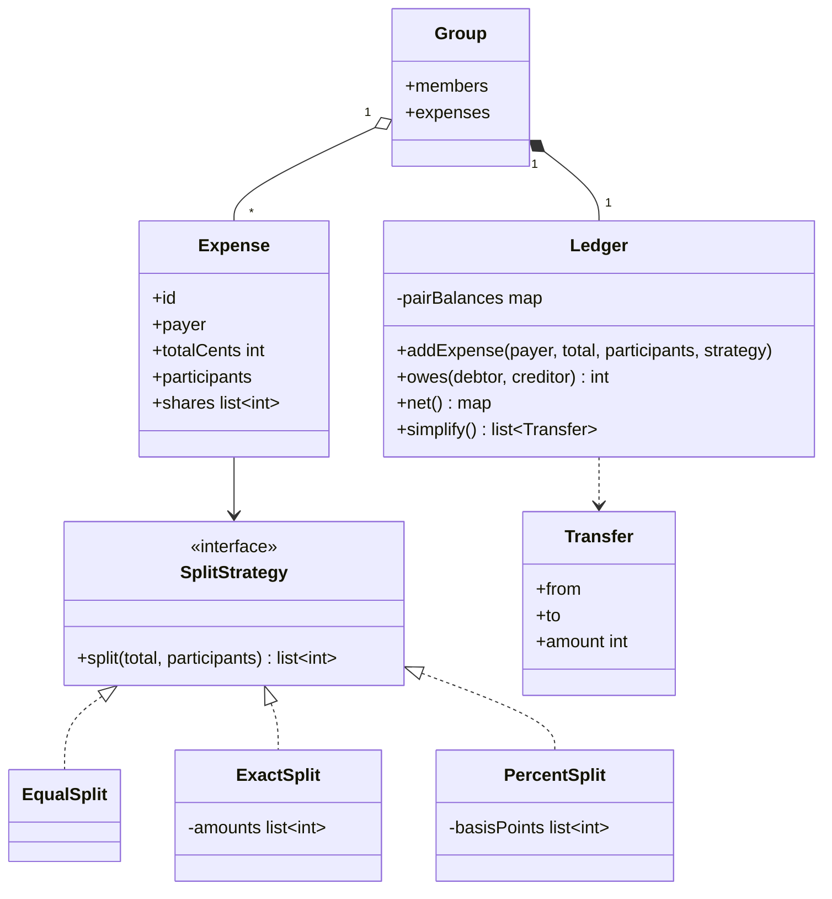
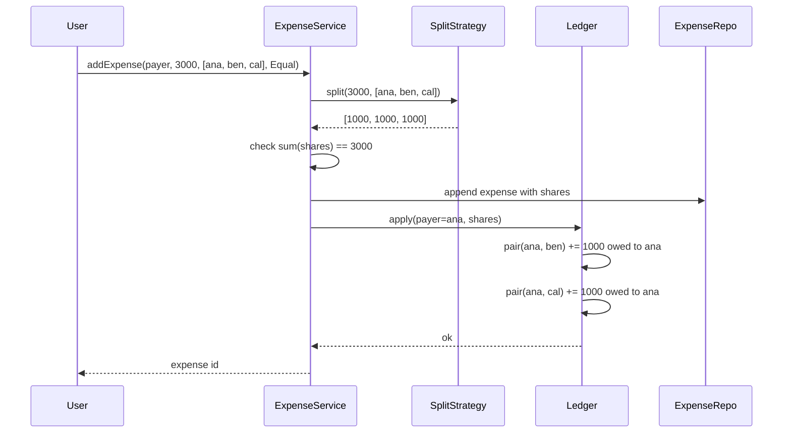

## In one minute
- Money is an integer count of the smallest currency unit (cents), never a float. Every split must add back up to the exact total, so the design needs a deterministic rule for who gets the leftover cent.
- How an expense is divided is a family of interchangeable algorithms (equal, exact, percent, shares). That is the Strategy pattern: the ledger asks a strategy for a list of shares and never branches on split type.
- Store balances per pair of people as one signed number. "Ben owes Ana 800" and "Ana owes Ben -800" are the same fact, so keep one canonical key per unordered pair and a sign.
- Debt simplification works on each person's net balance, not on the pairs. A greedy match of the biggest creditor with the biggest debtor settles a group of n people in at most n - 1 transfers. It is not always the true minimum (that problem is NP-hard), but it is fast, deterministic and good in practice.
- The shape underneath is "trust but verify" on a ledger: invariants such as "shares sum to the total" and "all net balances sum to zero" are cheap to check on every write and catch almost every bug.

## Requirements

### Functional
- Users form groups and add expenses: one payer, an amount, a set of participants and a split type.
- Split types: equal, exact amounts and percentages. The design must make adding a new one (shares, adjustments) a local change.
- Show what one user owes another, and each user's net balance in a group.
- Record a settlement (a cash or bank transfer) as a payment that reduces a balance.
- "Simplify debts": suggest a small set of transfers that settles the group.

### Non-functional
- Exactness: no rounding drift. The sum of shares equals the total to the cent, and the same input always produces the same shares.
- Auditability: balances are derived from an append-only list of expenses and payments, so they can be recomputed and explained.
- Concurrency: two members adding expenses at the same moment must not lose an update.

### Out of scope
- Multi-currency conversion, receipts and OCR, notifications, and real payment rails. We mention where they would plug in.

## Entities and relationships

**User** is an id and a display name. **Group** holds members and owns a **Ledger**. An **Expense** records who paid, the total in cents, the participants and the **SplitStrategy** used, plus the resulting list of shares. A **Payment** (settlement) is a transfer from one user to another; it can be modelled as an expense paid by the debtor with the whole amount assigned to the creditor, which keeps one code path.

The **Ledger** is the heart of the design. It applies each expense to a map of pair balances, keyed by the two user ids in sorted order, with a positive number meaning "first owes second". From those pairs it derives each user's **net balance**: positive if the group owes them money, negative if they owe the group. **DebtSimplifier** reads the net balances and returns a list of **Transfer** values (from, to, amount).

Relationships: a Group has many Users and many Expenses; an Expense has one payer, many participants and exactly one strategy; the Ledger is derived from the Expenses. Keeping the Expense list as the source of truth and the Ledger as a projection is what makes "edit an expense" and "explain this balance" tractable later.

## Class diagram



## Key flows

The main flow is adding an expense. The service validates membership, asks the strategy for shares, persists the expense, and only then updates the pair balances.



Simplify debts is a read-only flow on top: compute net balances from the pairs, then repeatedly match the largest creditor with the largest debtor, emit a transfer for the smaller of the two amounts, and drop whoever reaches zero. Each step zeroes at least one person, so a group of n people with non-zero balances needs at most n - 1 steps.

## Design patterns used and why

**Strategy** for splits. Each split type is a small object with one method, `split(total, participants) -> shares`. The ledger never asks "which kind of split is this?" because it only consumes shares. A new "split by shares" (2 shares for the adult, 1 for each child) is a new class plus a test, with no change to the ledger. Strategies also own their validation: exact amounts must sum to the total, percentages must sum to 100%.

**Value object** for money. Amounts are plain integers in cents in the practice code, but in a production codebase you would wrap them in a `Money` type that carries the currency and refuses to add USD to EUR. Fowler's Money pattern describes exactly this, including the "allocate" operation that splits an amount by ratios without losing a cent.

**Repository** and **projection**. Expenses are appended; balances are a projection that can be rebuilt from them. This is event sourcing in miniature, and it is why edits and deletes are safe: an edit is a reversal of the old expense plus a new one.

**Facade** in the form of an `ExpenseService` that coordinates validation, persistence and ledger updates, so the API layer calls one method per user action.

What we deliberately avoid: an inheritance tree of `EqualExpense`, `PercentExpense` and so on. It couples the data (an expense) to the algorithm (how it was divided) and makes "change the split type of an existing expense" an awkward type change.

## Concurrency and edge cases

### Rounding and the leftover cent
Splitting 1000 cents three ways gives 333.33. Something has to receive the extra cent, and the rule must be deterministic or two servers will disagree. For equal splits, give one extra cent to the first `total mod n` participants in the order the user listed them. For percentages, use the largest remainder method: take the floor of each exact share, then hand the leftover cents to the participants with the largest discarded fractions, breaking ties by list order. Store percentages as integer basis points (1% = 100 bp), so 33.33% is 3333 and no float ever appears.

### Validation
Reject an empty participant list, duplicate participants, a non-positive total, exact amounts that do not sum to the total, and percentages that do not sum to 10000 bp. The payer does not have to be a participant (Ana can pay for Ben's ticket), and the payer's own share creates no debt.

### Concurrent writes
Two members add expenses to the same group at the same time. Each touches several pair balances. If the ledger is updated with read-modify-write without coordination, one update is lost. In memory, a mutex per group serialises writes; that is fine because a group has a handful of members and writes are rare. In a database, store pair balances as rows and apply deltas with `UPDATE ... SET amount = amount + $delta`, in one transaction with the expense insert, touching pairs in sorted key order so two transactions cannot deadlock. A retry of the same request must not double-count, so the client sends an idempotency key that is unique per expense.

### Simplification is a suggestion
Simplification changes who pays whom, so it can propose that Cal pays Ana even though they never shared an expense. Show it as advice, and record each actual transfer as a payment. Never rewrite history to match the simplified graph.

## Down the stack

### Layer 1: The contract
For every expense, `sum(shares) == total` exactly, and the same inputs always give the same shares. At any moment, the sum of all net balances in a group is zero. `owes(a, b) == -owes(b, a)`. Simplify returns transfers that, if all paid, bring every net balance to zero, with at most n - 1 transfers for n non-zero members.

### Layer 2: The mechanism
Equal split is one `divmod`. Percent split is integer multiply, floor divide by 10000, then a sort of indices by `(-remainder, index)` to place the leftover cents. Pair balances are a hash map from a sorted `(a, b)` tuple to a signed integer, so each expense costs O(participants) map updates. Net balances are one pass over the pairs. The greedy simplifier picks max creditor and max debtor each round; with two heaps it runs in O(n log n), and with a linear scan it is O(n squared), which is fine for groups of a few dozen.

### Layer 3: The machine
An IEEE 754 double has a 53-bit significand, so 0.1 has no exact binary form and `0.1 + 0.2` is `0.30000000000000004`. Sum a few thousand such values and the result drifts by whole cents. A 64-bit integer counts cents up to about 92 quadrillion dollars, and integer add is exact and one CPU cycle. In JavaScript every `number` is a double, but integers are exact up to 2^53 (about 90 trillion dollars in cents), which is why the TypeScript version can safely use plain numbers for cents. In Postgres the matching column type is `bigint` (8 bytes), not `real` or `double precision`; `numeric` is exact too but slower because it is stored as variable-length base-10000 digits.

### Why it's built this way
Users compare totals to the cent, so any drift reads as a bug or a theft. Floats cannot represent decimal cents exactly, so use integers. Integers cannot split 1000 three ways evenly, so a remainder rule is needed. Different servers and clients must agree on that remainder, so the rule is deterministic and based only on the input order. Balances must be explainable months later, so they are a projection of an append-only expense log rather than mutable truth.

## Extensibility
- **New split type** (shares, "equal plus adjustments", itemised receipt): add a strategy class. The ledger, simplifier and storage stay the same because they only see share lists.
- **Multi-currency**: store each expense in its own currency, keep balances per currency, and convert only at settlement time with a recorded rate. Mixing currencies inside one integer is the classic mistake.
- **Recurring expenses** (rent): a scheduler that creates ordinary expenses on a calendar, using an injected clock so it is testable.
- **Edit and delete**: append a reversal of the original shares and a new expense. Balances stay correct because the projection only ever adds deltas.
- **Better simplification**: if users want the true minimum number of transfers for small groups, search over subsets that sum to zero; each zero-sum subset of size k needs only k - 1 transfers. It is exponential, so cap it to groups under about 15 people and fall back to greedy.

## Leadership lens
- The first code review question is "where can a float sneak in?" Check the API schema, the JSON parser on each client and the analytics export. A single `amount: 12.5` in a request DTO undoes the whole design.
- Decide the rounding rule once, write it in the API docs, and test it in every client that previews shares. A mobile app that shows 334/333/333 while the server stores 333/333/334 creates support tickets.
- Treat the "sum of nets is zero" invariant as a production alarm, not just a unit test. A nightly job that recomputes every group from its expense log and diffs against stored balances is cheap and finds bugs before users do.
- Simplification is a product decision as much as an algorithm. Some users dislike paying a stranger in the group; make it opt-in per group.
- The same shape appears in a company's internal cost allocation: a shared cloud bill split across teams by percentage needs the same integer cents, the same remainder rule and the same zero-sum check.

## Check yourself
1. Why does the ledger key pair balances by a sorted pair instead of storing "A owes B" and "B owes A" separately?
   **Answer:** One signed value per unordered pair makes `owes(a, b) == -owes(b, a)` true by construction and nets out mutual debts automatically. Two separate entries can drift apart and must be reconciled on every read.
2. A 1000-cent bill is split 33.33%, 33.33%, 33.34%. What does largest remainder produce, and why not just round each share?
   **Answer:** The floors are 333, 333 and 333 with remainders 0.3, 0.3 and 0.4 cents, so the single leftover cent goes to the third person: 333, 333, 334. Rounding each share independently can produce totals of 999 or 1001.
3. Why does greedy simplification never need more than n - 1 transfers?
   **Answer:** Each transfer is the smaller of the top creditor's and top debtor's balance, so at least one of them reaches zero and leaves. With n people holding non-zero balances, after n - 1 steps the last person must also be at zero because the balances sum to zero.
4. Two expenses are added to the same group concurrently from two phones. What goes wrong without coordination, and what is the database fix?
   **Answer:** Read-modify-write on the same pair balance can lose one update. Apply deltas with `amount = amount + delta` inside one transaction with the expense insert, lock pairs in sorted order, and dedupe retries with an idempotency key.

## Practice
**Task:** Build the core of a Splitwise ledger with all amounts as integer cents. Implement three split strategies with a `split(total, participants)` method that returns one share per participant, in order: `EqualSplit` gives the extra cents one each to the first `total mod n` participants; `ExactSplit(amounts)` returns the given amounts if they are non-negative and sum to the total; `PercentSplit(basisPoints)` (10000 bp = 100%) floors each share and gives leftover cents by largest remainder, ties to the earlier participant. Every strategy rejects an empty or duplicate participant list and a non-positive total. A `Ledger` applies `addExpense(payer, total, participants, strategy)`, answers `owes(debtor, creditor)` (signed, so negative means the creditor owes the debtor), returns `net()` per person with zero balances omitted (positive means the person is owed), and `simplify()` returns transfers by repeatedly matching the largest creditor with the largest debtor (ties broken by name), without changing the ledger.

```python starter
class SplitError(ValueError):
    pass


class EqualSplit:
    def split(self, total, participants):
        # TODO: divmod, extra cents to the first participants
        raise NotImplementedError


class ExactSplit:
    def __init__(self, amounts):
        self.amounts = list(amounts)

    def split(self, total, participants):
        raise NotImplementedError


class PercentSplit:
    def __init__(self, basis_points):
        self.basis_points = list(basis_points)

    def split(self, total, participants):
        raise NotImplementedError


class Ledger:
    def add_expense(self, payer, total, participants, strategy):
        raise NotImplementedError

    def owes(self, debtor, creditor):
        raise NotImplementedError

    def net(self):
        raise NotImplementedError

    def simplify(self):
        # TODO: list of (from, to, amount) tuples
        raise NotImplementedError
```

```python tests
P3 = ["ana", "ben", "cal"]


def test_equal_split_gives_extra_cents_to_first():
    assert EqualSplit().split(1000, P3) == [334, 333, 333]
    assert EqualSplit().split(1001, ["ana", "ben"]) == [501, 500]


def test_percent_split_uses_largest_remainder():
    assert PercentSplit([3333, 3333, 3334]).split(1000, P3) == [333, 333, 334]
    assert PercentSplit([5000, 2500, 2500]).split(999, P3) == [499, 250, 250]


def test_invalid_splits_are_rejected():
    assert ExactSplit([700, 300]).split(1000, ["ana", "ben"]) == [700, 300]
    bad = [
        lambda: ExactSplit([700, 200]).split(1000, ["ana", "ben"]),
        lambda: PercentSplit([5000, 4000]).split(1000, ["ana", "ben"]),
        lambda: EqualSplit().split(1000, []),
        lambda: EqualSplit().split(1000, ["ana", "ana"]),
        lambda: EqualSplit().split(0, ["ana"]),
    ]
    for call in bad:
        try:
            call()
        except ValueError:
            continue
        assert False, "expected a ValueError"


def _trip():
    ledger = Ledger()
    ledger.add_expense("ana", 3000, P3, EqualSplit())
    ledger.add_expense("ben", 600, P3, EqualSplit())
    return ledger


def test_pair_balances_net_out():
    ledger = _trip()
    assert ledger.owes("ben", "ana") == 800
    assert ledger.owes("ana", "ben") == -800
    assert ledger.owes("cal", "ana") == 1000
    assert ledger.owes("cal", "ben") == 200


def test_net_balances_sum_to_zero():
    ledger = _trip()
    assert ledger.net() == {"ana": 1800, "ben": -600, "cal": -1200}
    assert sum(ledger.net().values()) == 0


def test_simplify_matches_largest_first():
    ledger = _trip()
    assert ledger.simplify() == [("cal", "ana", 1200), ("ben", "ana", 600)]
    assert ledger.owes("cal", "ben") == 200, "simplify must not change the ledger"


def test_simplify_collapses_a_chain_and_settlement_clears():
    ledger = Ledger()
    ledger.add_expense("ben", 500, ["ana"], EqualSplit())
    ledger.add_expense("cal", 500, ["ben"], EqualSplit())
    assert ledger.simplify() == [("ana", "cal", 500)]
    ledger.add_expense("ana", 500, ["cal"], ExactSplit([500]))
    assert ledger.net() == {}, "paying the suggested transfer settles everyone"
    assert ledger.simplify() == []
    settle = Ledger()
    settle.add_expense("ana", 900, P3, EqualSplit())
    settle.add_expense("ben", 300, ["ana"], ExactSplit([300]))
    assert settle.owes("ben", "ana") == 0
    assert settle.net() == {"ana": 300, "cal": -300}
```

```python solution
class SplitError(ValueError):
    pass


def _check(total, participants):
    if total <= 0:
        raise SplitError("total must be a positive number of cents")
    if not participants:
        raise SplitError("need at least one participant")
    if len(set(participants)) != len(participants):
        raise SplitError("duplicate participant")


class EqualSplit:
    def split(self, total, participants):
        _check(total, participants)
        base, extra = divmod(total, len(participants))
        return [base + (1 if i < extra else 0) for i in range(len(participants))]


class ExactSplit:
    def __init__(self, amounts):
        self.amounts = list(amounts)

    def split(self, total, participants):
        _check(total, participants)
        if len(self.amounts) != len(participants):
            raise SplitError("one amount per participant")
        if any(a < 0 for a in self.amounts) or sum(self.amounts) != total:
            raise SplitError("amounts must be non-negative and sum to the total")
        return list(self.amounts)


class PercentSplit:
    def __init__(self, basis_points):
        self.basis_points = list(basis_points)

    def split(self, total, participants):
        _check(total, participants)
        bps = self.basis_points
        if len(bps) != len(participants):
            raise SplitError("one percentage per participant")
        if any(b < 0 for b in bps) or sum(bps) != 10000:
            raise SplitError("basis points must sum to 10000")
        shares = [total * b // 10000 for b in bps]
        leftover = total - sum(shares)
        order = sorted(range(len(bps)), key=lambda i: (-(total * bps[i] % 10000), i))
        for i in order[:leftover]:
            shares[i] += 1
        return shares


class Ledger:
    def __init__(self):
        # (a, b) with a < b -> cents that a owes b (negative: b owes a)
        self._pairs = {}

    def add_expense(self, payer, total, participants, strategy):
        shares = strategy.split(total, participants)
        for person, share in zip(participants, shares):
            if person != payer and share > 0:
                self._add(person, payer, share)

    def _add(self, debtor, creditor, cents):
        if debtor < creditor:
            key, delta = (debtor, creditor), cents
        else:
            key, delta = (creditor, debtor), -cents
        value = self._pairs.get(key, 0) + delta
        if value == 0:
            self._pairs.pop(key, None)
        else:
            self._pairs[key] = value

    def owes(self, debtor, creditor):
        if debtor < creditor:
            return self._pairs.get((debtor, creditor), 0)
        return -self._pairs.get((creditor, debtor), 0)

    def net(self):
        out = {}
        for (a, b), amount in self._pairs.items():
            out[a] = out.get(a, 0) - amount
            out[b] = out.get(b, 0) + amount
        return {p: v for p, v in out.items() if v != 0}

    def simplify(self):
        bal = self.net()
        transfers = []
        while bal:
            creditor = min((p for p in bal if bal[p] > 0), key=lambda p: (-bal[p], p))
            debtor = min((p for p in bal if bal[p] < 0), key=lambda p: (bal[p], p))
            amount = min(bal[creditor], -bal[debtor])
            transfers.append((debtor, creditor, amount))
            bal[creditor] -= amount
            bal[debtor] += amount
            bal = {p: v for p, v in bal.items() if v != 0}
        return transfers
```

```typescript starter
export class SplitError extends Error {}

export interface SplitStrategy {
  split(total: number, participants: string[]): number[];
}

export class EqualSplit implements SplitStrategy {
  split(total: number, participants: string[]): number[] {
    throw new Error("TODO");
  }
}

export class ExactSplit implements SplitStrategy {
  constructor(private amounts: number[]) {}
  split(total: number, participants: string[]): number[] {
    throw new Error("TODO");
  }
}

export class PercentSplit implements SplitStrategy {
  constructor(private basisPoints: number[]) {}
  split(total: number, participants: string[]): number[] {
    throw new Error("TODO");
  }
}

export interface Transfer {
  from: string;
  to: string;
  amount: number;
}

export class Ledger {
  addExpense(payer: string, total: number, participants: string[], strategy: SplitStrategy): void {
    throw new Error("TODO");
  }
  owes(debtor: string, creditor: string): number {
    throw new Error("TODO");
  }
  net(): Record<string, number> {
    throw new Error("TODO");
  }
  simplify(): Transfer[] {
    throw new Error("TODO");
  }
}
```

```typescript tests
const P3 = ["ana", "ben", "cal"];

function throwsSplitError(fn: () => unknown): boolean {
  try {
    fn();
  } catch (e) {
    return e instanceof SplitError;
  }
  return false;
}

function trip(): Ledger {
  const ledger = new Ledger();
  ledger.addExpense("ana", 3000, P3, new EqualSplit());
  ledger.addExpense("ben", 600, P3, new EqualSplit());
  return ledger;
}

test("equal split gives extra cents to first", () => {
  assertEqual(new EqualSplit().split(1000, P3), [334, 333, 333]);
  assertEqual(new EqualSplit().split(1001, ["ana", "ben"]), [501, 500]);
});

test("percent split uses largest remainder", () => {
  assertEqual(new PercentSplit([3333, 3333, 3334]).split(1000, P3), [333, 333, 334]);
  assertEqual(new PercentSplit([5000, 2500, 2500]).split(999, P3), [499, 250, 250]);
});

test("invalid splits are rejected", () => {
  assertEqual(new ExactSplit([700, 300]).split(1000, ["ana", "ben"]), [700, 300]);
  assert(throwsSplitError(() => new ExactSplit([700, 200]).split(1000, ["ana", "ben"])), "exact sum");
  assert(throwsSplitError(() => new PercentSplit([5000, 4000]).split(1000, ["ana", "ben"])), "percent sum");
  assert(throwsSplitError(() => new EqualSplit().split(1000, [])), "empty");
  assert(throwsSplitError(() => new EqualSplit().split(1000, ["ana", "ana"])), "duplicate");
  assert(throwsSplitError(() => new EqualSplit().split(0, ["ana"])), "zero total");
});

test("pair balances net out", () => {
  const ledger = trip();
  assertEqual(ledger.owes("ben", "ana"), 800);
  assertEqual(ledger.owes("ana", "ben"), -800);
  assertEqual(ledger.owes("cal", "ana"), 1000);
  assertEqual(ledger.owes("cal", "ben"), 200);
});

test("net balances sum to zero", () => {
  const net = trip().net();
  assertEqual(net, { ana: 1800, ben: -600, cal: -1200 });
  assertEqual(Object.values(net).reduce((a, b) => a + b, 0), 0);
});

test("simplify matches largest first", () => {
  const ledger = trip();
  assertEqual(ledger.simplify(), [
    { from: "cal", to: "ana", amount: 1200 },
    { from: "ben", to: "ana", amount: 600 },
  ]);
  assertEqual(ledger.owes("cal", "ben"), 200, "simplify must not change the ledger");
});

test("simplify collapses a chain and settlement clears", () => {
  const ledger = new Ledger();
  ledger.addExpense("ben", 500, ["ana"], new EqualSplit());
  ledger.addExpense("cal", 500, ["ben"], new EqualSplit());
  assertEqual(ledger.simplify(), [{ from: "ana", to: "cal", amount: 500 }]);
  ledger.addExpense("ana", 500, ["cal"], new ExactSplit([500]));
  assertEqual(ledger.net(), {});
  assertEqual(ledger.simplify(), []);
  const settle = new Ledger();
  settle.addExpense("ana", 900, P3, new EqualSplit());
  settle.addExpense("ben", 300, ["ana"], new ExactSplit([300]));
  assertEqual(settle.owes("ben", "ana"), 0);
  assertEqual(settle.net(), { ana: 300, cal: -300 });
});
```

```typescript solution
export class SplitError extends Error {}

export interface SplitStrategy {
  split(total: number, participants: string[]): number[];
}

function check(total: number, participants: string[]): void {
  if (!Number.isSafeInteger(total) || total <= 0) throw new SplitError("total must be positive integer cents");
  if (participants.length === 0) throw new SplitError("need at least one participant");
  if (new Set(participants).size !== participants.length) throw new SplitError("duplicate participant");
}

export class EqualSplit implements SplitStrategy {
  split(total: number, participants: string[]): number[] {
    check(total, participants);
    const n = participants.length;
    const base = Math.floor(total / n);
    const extra = total % n;
    return participants.map((_, i) => base + (i < extra ? 1 : 0));
  }
}

export class ExactSplit implements SplitStrategy {
  constructor(private amounts: number[]) {}
  split(total: number, participants: string[]): number[] {
    check(total, participants);
    if (this.amounts.length !== participants.length) throw new SplitError("one amount per participant");
    const sum = this.amounts.reduce((a, b) => a + b, 0);
    if (this.amounts.some((a) => !Number.isInteger(a) || a < 0) || sum !== total) {
      throw new SplitError("amounts must be non-negative and sum to the total");
    }
    return [...this.amounts];
  }
}

export class PercentSplit implements SplitStrategy {
  constructor(private basisPoints: number[]) {}
  split(total: number, participants: string[]): number[] {
    check(total, participants);
    const bps = this.basisPoints;
    if (bps.length !== participants.length) throw new SplitError("one percentage per participant");
    if (bps.some((b) => b < 0) || bps.reduce((a, b) => a + b, 0) !== 10000) {
      throw new SplitError("basis points must sum to 10000");
    }
    const shares = bps.map((b) => Math.floor((total * b) / 10000));
    let leftover = total - shares.reduce((a, b) => a + b, 0);
    const order = bps
      .map((b, i) => ({ i, rem: (total * b) % 10000 }))
      .sort((x, y) => y.rem - x.rem || x.i - y.i);
    for (const { i } of order) {
      if (leftover === 0) break;
      shares[i] += 1;
      leftover -= 1;
    }
    return shares;
  }
}

export interface Transfer {
  from: string;
  to: string;
  amount: number;
}

export class Ledger {
  // "a|b" with a < b -> cents that a owes b (negative: b owes a)
  private pairs = new Map<string, number>();

  addExpense(payer: string, total: number, participants: string[], strategy: SplitStrategy): void {
    const shares = strategy.split(total, participants);
    participants.forEach((person, i) => {
      if (person !== payer && shares[i] > 0) this.add(person, payer, shares[i]);
    });
  }

  private add(debtor: string, creditor: string, cents: number): void {
    const [key, delta] = debtor < creditor ? [`${debtor}|${creditor}`, cents] : [`${creditor}|${debtor}`, -cents];
    const value = (this.pairs.get(key) ?? 0) + delta;
    if (value === 0) this.pairs.delete(key);
    else this.pairs.set(key, value);
  }

  owes(debtor: string, creditor: string): number {
    if (debtor < creditor) return this.pairs.get(`${debtor}|${creditor}`) ?? 0;
    return -(this.pairs.get(`${creditor}|${debtor}`) ?? 0);
  }

  net(): Record<string, number> {
    const sums = new Map<string, number>();
    for (const [key, amount] of this.pairs) {
      const [a, b] = key.split("|");
      sums.set(a, (sums.get(a) ?? 0) - amount);
      sums.set(b, (sums.get(b) ?? 0) + amount);
    }
    const out: Record<string, number> = {};
    for (const p of [...sums.keys()].sort()) {
      const v = sums.get(p)!;
      if (v !== 0) out[p] = v;
    }
    return out;
  }

  simplify(): Transfer[] {
    const bal = new Map(Object.entries(this.net()));
    const transfers: Transfer[] = [];
    const pick = (sign: number): string => {
      let best = "";
      for (const p of [...bal.keys()].sort()) {
        const v = bal.get(p)! * sign;
        if (v > 0 && (best === "" || v > bal.get(best)! * sign)) best = p;
      }
      return best;
    };
    while (bal.size > 0) {
      const creditor = pick(1);
      const debtor = pick(-1);
      const amount = Math.min(bal.get(creditor)!, -bal.get(debtor)!);
      transfers.push({ from: debtor, to: creditor, amount });
      bal.set(creditor, bal.get(creditor)! - amount);
      bal.set(debtor, bal.get(debtor)! + amount);
      for (const p of [creditor, debtor]) if (bal.get(p) === 0) bal.delete(p);
    }
    return transfers;
  }
}
```

```go starter
package practice

import (
	"errors"
	"sync"
)

var ErrInvalidSplit = errors.New("invalid split")

type SplitStrategy interface {
	Split(total int64, participants []string) ([]int64, error)
}

type EqualSplit struct{}

func (EqualSplit) Split(total int64, participants []string) ([]int64, error) {
	panic("TODO")
}

type ExactSplit struct{ Amounts []int64 }

func (s ExactSplit) Split(total int64, participants []string) ([]int64, error) {
	panic("TODO")
}

type PercentSplit struct{ BasisPoints []int64 }

func (s PercentSplit) Split(total int64, participants []string) ([]int64, error) {
	panic("TODO")
}

type Transfer struct {
	From, To string
	Amount   int64
}

type Ledger struct {
	mu sync.Mutex
}

func NewLedger() *Ledger { return &Ledger{} }

func (l *Ledger) AddExpense(payer string, total int64, participants []string, s SplitStrategy) error {
	panic("TODO")
}

func (l *Ledger) Owes(debtor, creditor string) int64 { panic("TODO") }

func (l *Ledger) Net() map[string]int64 { panic("TODO") }

func (l *Ledger) Simplify() []Transfer { panic("TODO") }
```

```go tests
package practice

import (
	"errors"
	"reflect"
	"testing"
)

var p3 = []string{"ana", "ben", "cal"}

func mustSplit(t *testing.T, s SplitStrategy, total int64, ps []string) []int64 {
	t.Helper()
	got, err := s.Split(total, ps)
	if err != nil {
		t.Fatalf("unexpected error: %v", err)
	}
	return got
}

func trip(t *testing.T) *Ledger {
	t.Helper()
	l := NewLedger()
	if err := l.AddExpense("ana", 3000, p3, EqualSplit{}); err != nil {
		t.Fatal(err)
	}
	if err := l.AddExpense("ben", 600, p3, EqualSplit{}); err != nil {
		t.Fatal(err)
	}
	return l
}

func TestEqualSplitGivesExtraCentsToFirst(t *testing.T) {
	if got := mustSplit(t, EqualSplit{}, 1000, p3); !reflect.DeepEqual(got, []int64{334, 333, 333}) {
		t.Fatalf("got %v", got)
	}
	if got := mustSplit(t, EqualSplit{}, 1001, []string{"ana", "ben"}); !reflect.DeepEqual(got, []int64{501, 500}) {
		t.Fatalf("got %v", got)
	}
}

func TestPercentSplitUsesLargestRemainder(t *testing.T) {
	if got := mustSplit(t, PercentSplit{[]int64{3333, 3333, 3334}}, 1000, p3); !reflect.DeepEqual(got, []int64{333, 333, 334}) {
		t.Fatalf("got %v", got)
	}
	if got := mustSplit(t, PercentSplit{[]int64{5000, 2500, 2500}}, 999, p3); !reflect.DeepEqual(got, []int64{499, 250, 250}) {
		t.Fatalf("got %v", got)
	}
}

func TestInvalidSplitsAreRejected(t *testing.T) {
	if got := mustSplit(t, ExactSplit{[]int64{700, 300}}, 1000, []string{"ana", "ben"}); !reflect.DeepEqual(got, []int64{700, 300}) {
		t.Fatalf("got %v", got)
	}
	cases := []struct {
		s     SplitStrategy
		total int64
		ps    []string
	}{
		{ExactSplit{[]int64{700, 200}}, 1000, []string{"ana", "ben"}},
		{PercentSplit{[]int64{5000, 4000}}, 1000, []string{"ana", "ben"}},
		{EqualSplit{}, 1000, nil},
		{EqualSplit{}, 1000, []string{"ana", "ana"}},
		{EqualSplit{}, 0, []string{"ana"}},
	}
	for i, c := range cases {
		if _, err := c.s.Split(c.total, c.ps); !errors.Is(err, ErrInvalidSplit) {
			t.Fatalf("case %d: want ErrInvalidSplit, got %v", i, err)
		}
	}
}

func TestPairBalancesNetOut(t *testing.T) {
	l := trip(t)
	checks := []struct {
		d, c string
		want int64
	}{{"ben", "ana", 800}, {"ana", "ben", -800}, {"cal", "ana", 1000}, {"cal", "ben", 200}}
	for _, c := range checks {
		if got := l.Owes(c.d, c.c); got != c.want {
			t.Fatalf("Owes(%s, %s) = %d, want %d", c.d, c.c, got, c.want)
		}
	}
}

func TestNetBalancesSumToZero(t *testing.T) {
	net := trip(t).Net()
	want := map[string]int64{"ana": 1800, "ben": -600, "cal": -1200}
	if !reflect.DeepEqual(net, want) {
		t.Fatalf("got %v", net)
	}
}

func TestSimplifyMatchesLargestFirst(t *testing.T) {
	l := trip(t)
	want := []Transfer{{"cal", "ana", 1200}, {"ben", "ana", 600}}
	if got := l.Simplify(); !reflect.DeepEqual(got, want) {
		t.Fatalf("got %v", got)
	}
	if l.Owes("cal", "ben") != 200 {
		t.Fatal("simplify must not change the ledger")
	}
}

func TestSimplifyCollapsesChainAndSettlementClears(t *testing.T) {
	l := NewLedger()
	_ = l.AddExpense("ben", 500, []string{"ana"}, EqualSplit{})
	_ = l.AddExpense("cal", 500, []string{"ben"}, EqualSplit{})
	if got := l.Simplify(); !reflect.DeepEqual(got, []Transfer{{"ana", "cal", 500}}) {
		t.Fatalf("got %v", got)
	}
	_ = l.AddExpense("ana", 500, []string{"cal"}, ExactSplit{[]int64{500}})
	if len(l.Net()) != 0 || len(l.Simplify()) != 0 {
		t.Fatalf("expected everyone settled, got %v", l.Net())
	}
	s := NewLedger()
	_ = s.AddExpense("ana", 900, p3, EqualSplit{})
	_ = s.AddExpense("ben", 300, []string{"ana"}, ExactSplit{[]int64{300}})
	if s.Owes("ben", "ana") != 0 {
		t.Fatal("ben should be settled with ana")
	}
	if got := s.Net(); !reflect.DeepEqual(got, map[string]int64{"ana": 300, "cal": -300}) {
		t.Fatalf("got %v", got)
	}
}
```

```go solution
package practice

import (
	"errors"
	"fmt"
	"sort"
	"sync"
)

var ErrInvalidSplit = errors.New("invalid split")

type SplitStrategy interface {
	Split(total int64, participants []string) ([]int64, error)
}

func check(total int64, participants []string) error {
	if total <= 0 {
		return fmt.Errorf("%w: total must be positive", ErrInvalidSplit)
	}
	if len(participants) == 0 {
		return fmt.Errorf("%w: no participants", ErrInvalidSplit)
	}
	seen := make(map[string]bool, len(participants))
	for _, p := range participants {
		if seen[p] {
			return fmt.Errorf("%w: duplicate participant %q", ErrInvalidSplit, p)
		}
		seen[p] = true
	}
	return nil
}

type EqualSplit struct{}

func (EqualSplit) Split(total int64, participants []string) ([]int64, error) {
	if err := check(total, participants); err != nil {
		return nil, err
	}
	n := int64(len(participants))
	base, extra := total/n, total%n
	out := make([]int64, n)
	for i := range out {
		out[i] = base
		if int64(i) < extra {
			out[i]++
		}
	}
	return out, nil
}

type ExactSplit struct{ Amounts []int64 }

func (s ExactSplit) Split(total int64, participants []string) ([]int64, error) {
	if err := check(total, participants); err != nil {
		return nil, err
	}
	if len(s.Amounts) != len(participants) {
		return nil, fmt.Errorf("%w: one amount per participant", ErrInvalidSplit)
	}
	var sum int64
	for _, a := range s.Amounts {
		if a < 0 {
			return nil, fmt.Errorf("%w: negative amount", ErrInvalidSplit)
		}
		sum += a
	}
	if sum != total {
		return nil, fmt.Errorf("%w: amounts sum to %d, want %d", ErrInvalidSplit, sum, total)
	}
	return append([]int64(nil), s.Amounts...), nil
}

type PercentSplit struct{ BasisPoints []int64 }

func (s PercentSplit) Split(total int64, participants []string) ([]int64, error) {
	if err := check(total, participants); err != nil {
		return nil, err
	}
	bps := s.BasisPoints
	if len(bps) != len(participants) {
		return nil, fmt.Errorf("%w: one percentage per participant", ErrInvalidSplit)
	}
	var sumBp int64
	for _, b := range bps {
		if b < 0 {
			return nil, fmt.Errorf("%w: negative percentage", ErrInvalidSplit)
		}
		sumBp += b
	}
	if sumBp != 10000 {
		return nil, fmt.Errorf("%w: basis points sum to %d", ErrInvalidSplit, sumBp)
	}
	shares := make([]int64, len(bps))
	order := make([]int, len(bps))
	leftover := total
	for i, b := range bps {
		shares[i] = total * b / 10000
		leftover -= shares[i]
		order[i] = i
	}
	sort.SliceStable(order, func(x, y int) bool {
		return total*bps[order[x]]%10000 > total*bps[order[y]]%10000
	})
	for _, i := range order[:leftover] {
		shares[i]++
	}
	return shares, nil
}

type Transfer struct {
	From, To string
	Amount   int64
}

type pair struct{ a, b string } // a < b

// Ledger keeps one signed balance per unordered pair: positive means a owes b.
type Ledger struct {
	mu    sync.Mutex
	pairs map[pair]int64
}

func NewLedger() *Ledger { return &Ledger{pairs: make(map[pair]int64)} }

func (l *Ledger) AddExpense(payer string, total int64, participants []string, s SplitStrategy) error {
	shares, err := s.Split(total, participants)
	if err != nil {
		return err
	}
	l.mu.Lock()
	defer l.mu.Unlock()
	for i, person := range participants {
		if person != payer && shares[i] > 0 {
			l.add(person, payer, shares[i])
		}
	}
	return nil
}

func (l *Ledger) add(debtor, creditor string, cents int64) {
	key, delta := pair{debtor, creditor}, cents
	if creditor < debtor {
		key, delta = pair{creditor, debtor}, -cents
	}
	l.pairs[key] += delta
	if l.pairs[key] == 0 {
		delete(l.pairs, key)
	}
}

func (l *Ledger) Owes(debtor, creditor string) int64 {
	l.mu.Lock()
	defer l.mu.Unlock()
	if debtor < creditor {
		return l.pairs[pair{debtor, creditor}]
	}
	return -l.pairs[pair{creditor, debtor}]
}

func (l *Ledger) Net() map[string]int64 {
	l.mu.Lock()
	defer l.mu.Unlock()
	return l.netLocked()
}

func (l *Ledger) netLocked() map[string]int64 {
	out := make(map[string]int64)
	for k, amount := range l.pairs {
		out[k.a] -= amount
		out[k.b] += amount
	}
	for p, v := range out {
		if v == 0 {
			delete(out, p)
		}
	}
	return out
}

func (l *Ledger) Simplify() []Transfer {
	l.mu.Lock()
	bal := l.netLocked()
	l.mu.Unlock()
	pick := func(sign int64) string {
		names := make([]string, 0, len(bal))
		for p := range bal {
			names = append(names, p)
		}
		sort.Strings(names)
		best := ""
		for _, p := range names {
			if v := bal[p] * sign; v > 0 && (best == "" || v > bal[best]*sign) {
				best = p
			}
		}
		return best
	}
	var transfers []Transfer
	for len(bal) > 0 {
		creditor, debtor := pick(1), pick(-1)
		amount := min(bal[creditor], -bal[debtor])
		transfers = append(transfers, Transfer{debtor, creditor, amount})
		bal[creditor] -= amount
		bal[debtor] += amount
		for _, p := range []string{creditor, debtor} {
			if bal[p] == 0 {
				delete(bal, p)
			}
		}
	}
	return transfers
}
```

## Mock interview
**Prompt:** Design the object model and core logic for an expense-sharing app like Splitwise. Groups have up to 50 members; users add expenses split equally, by exact amounts or by percentages, see who owes whom, and can ask the app to simplify debts. You have 45 minutes and should end with working code for the ledger.

- Follow-up: a dinner of 100.00 is split three ways. Show me the shares your code stores, and tell me which person gets the extra cent and why that choice is safe.
- Follow-up: two people add expenses to the same group at the same instant from different phones, and one of the requests is retried after a timeout. What can go wrong in your ledger, and how do you prevent it?
- Follow-up: your greedy simplification gives four transfers where a smarter answer needs three. Is that a bug? What would it cost to always find the minimum?

**A strong answer covers:**
- Integer minor units end to end, including the API schema, with a deterministic remainder rule (first-n for equal, largest remainder for percentages) and an invariant check that shares sum to the total.
- Strategy for split types, each owning its validation, so the ledger consumes only share lists and new split types are additive.
- One signed balance per unordered pair, net balances derived from it, and the zero-sum invariant used as both a test and a production check.
- Expenses as an append-only source of truth with balances as a projection, edits as reversal plus new expense, and idempotency keys for retries.
- Greedy simplification bounded by n - 1 transfers, an honest statement that the exact minimum is NP-hard, and a capped exact search for small groups as an option.

## Watch
- [L15: Splitwise LLD (CodeNCode)](https://www.youtube.com/watch?v=DtCkzn9JiFY): a full lecture that designs the classes for an expense-sharing app and codes the solution.
- [Splitwise Machine Coding Interview: Complete Design + Code (Sanket Singh)](https://www.youtube.com/watch?v=ZmhGQNcnO9o): a machine-coding style walkthrough, useful for pacing a timed round.
- [Banking Ledger: System Design Interview (interviewing.io)](https://www.youtube.com/watch?v=AfkWaDALUsM): the same balance-as-projection and correctness concerns at a larger scale.

## Free resources
- [Money (Martin Fowler, Patterns of Enterprise Application Architecture)](https://martinfowler.com/eaaCatalog/money.html): the Money value object and the allocate operation that splits amounts without losing cents.
- [Debts made simple (Splitwise blog)](https://blog.splitwise.com/2012/09/14/debts-made-simple/): the product's own explanation of what simplify debts does for users.
- [Largest remainder method (Wikipedia)](https://en.wikipedia.org/wiki/Largest_remainder_method): the apportionment rule behind deterministic percentage splits.
- [Floating-point arithmetic: issues and limitations (Python docs)](https://docs.python.org/3/tutorial/floatingpoint.html): a short, concrete explanation of why 0.1 cannot be stored exactly.
- [Strategy pattern (Refactoring.Guru)](https://refactoring.guru/design-patterns/strategy): structure, trade-offs and examples of the pattern used for split types.
- [Currencies and minor units (Stripe docs)](https://docs.stripe.com/currencies): how a real payments API represents amounts as integers in the smallest currency unit, including zero-decimal currencies.
