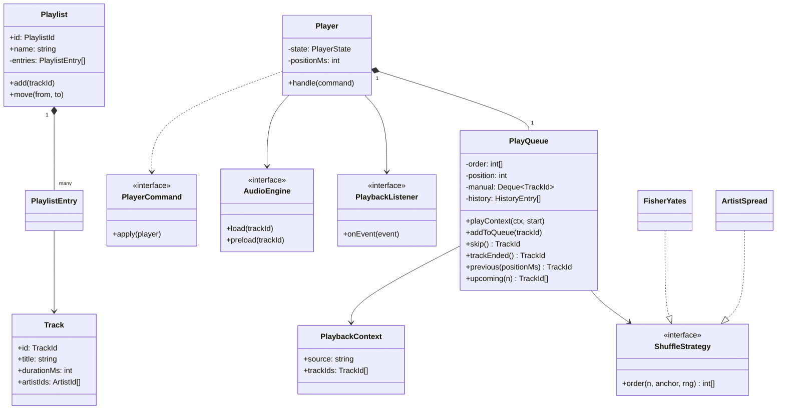
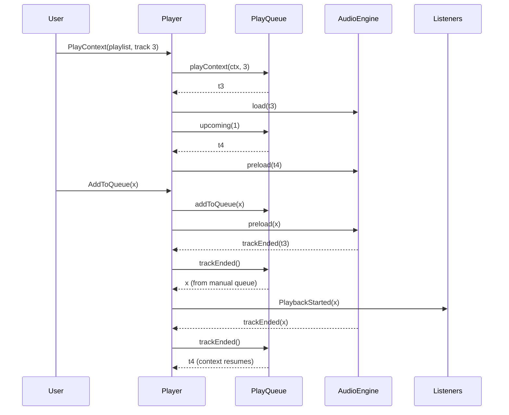

## In one minute
- As an object-design question, "Spotify" is a catalog, a library, playlists and, above all, the player: what plays next when the song ends, when the user taps skip, taps back, turns on shuffle or queues a track. The streaming backend is a different interview, covered in [Design Spotify](../sdi/design-spotify.md).
- The heart of the design is the play queue, which merges three sources in a fixed priority: the user's manual queue first, then the current context (album, playlist, artist radio), with history behind for "previous".
- Two small decisions separate strong answers: auto-advance and user skip are different events (repeat-one replays on the first and not the second), and "previous" restarts the current track if it has been playing for more than a few seconds.
- Shuffle is a view over the context, not a mutation of it. Keep the original order, keep the current track where it is, shuffle the rest with an injected random source, and restore the original order when shuffle turns off.
- The problem shape is **ordering** with several producers (user, context, remote devices) and one consumer (the audio engine). The same shape appears in a CI pipeline's job queue with priority overrides, and in a print spooler that takes "print this next".

## Requirements

Functional:
- Browse tracks, albums, artists; save tracks to a library; create, rename, reorder and delete playlists.
- Start playback from a context (an album or playlist) at a chosen track.
- Play, pause, seek, skip, previous; repeat modes off, context and track (the names Spotify's public Web API uses ([Spotify Web API](https://developer.spotify.com/documentation/web-api/reference/set-repeat-mode-on-users-playback))); shuffle on or off.
- Add to queue: queued tracks play before the rest of the context, in the order they were added, and survive a change of context.
- Show "next up" so the user sees what will play.

Non-functional:
- The next track must be known early enough to prefetch and decode it, so transitions are gapless.
- All player commands are applied in one order, whether they come from the phone's UI, a lock-screen control, or another device.
- Deterministic tests: shuffle takes its randomness as a parameter.

Out of scope: audio delivery, royalties and play counting, recommendations, social features and podcasts. The play-count side lives in the system design lesson.

## Entities and relationships

- **Track** is a value: id, title, duration, artist ids, album id. It is immutable from the player's point of view.
- **Album**, **Artist** and **Playlist** are containers. A playlist is an ordered list of **PlaylistEntry** values (track id, added by, added at), because the same track can appear twice and the entry, not the track, is what a reorder moves.
- **Library** is a member's saved tracks, albums and followed playlists.
- **PlaybackContext** is what playback was started from: a source (playlist id, album id) and the ordered track ids at that moment. It is a snapshot, so a collaborator editing the playlist does not reorder what is already playing.
- **PlayQueue** owns the context order, the manual queue, the history, the shuffle flag and the repeat mode. It answers "what is next" and "what is previous".
- **Player** owns playback state (stopped, playing, paused), position and volume, and talks to the **AudioEngine**. It asks the queue what to play and reports events.
- **ShuffleStrategy** produces an order; **RandomSource** and **Clock** are injected.

Relationships: a player has one queue (composition). The queue holds one context at a time and references tracks by id. Playlists aggregate entries. Nothing in the queue owns a track.

## Class diagram



## Key flows

The flow that tests the design is "a queued track interrupts a playlist, then playback resumes where the playlist left off". Commands from every source go through one command queue on the player's control thread.



## Design patterns used and why

- **Command** for player actions. Play, pause, skip, seek and add-to-queue are objects placed on one queue and applied in order by a single control loop. That gives one ordering for the phone UI, headphone buttons and a remote device (Spotify Connect is the product version of this; the public Web API even warns that execution order is not guaranteed when you mix its queue call with other player calls ([Spotify Web API](https://developer.spotify.com/documentation/web-api/reference/add-to-queue)), which is the problem a single control loop removes), and makes logging and replaying a session trivial.
- **State** for the player: stopped, playing, paused, buffering. The state pattern lets each state own its behaviour ([Refactoring.Guru](https://refactoring.guru/design-patterns/state)). Each state decides what `play` and `pause` mean; pausing a stopped player is a no-op, not an error.
- **Strategy** for shuffle. Plain Fisher-Yates is uniformly random ([Wikipedia](https://en.wikipedia.org/wiki/Fisher%E2%80%93Yates_shuffle)), and users complain that it is "not random" when two songs by the same artist land together. Spotify's engineering blog described in 2014 moving to an algorithm that spreads each artist's tracks across the list ([Spotify Labs, archived](https://web.archive.org/web/20150316041107/https://labs.spotify.com/2014/02/28/how-to-shuffle-songs/)). That is a second strategy behind the same interface, and the queue does not change.
- **Iterator**, in spirit. The queue is a cursor over a sequence with policies (repeat, shuffle, manual inserts). Callers ask for `next`, never for the internal list, which keeps the representation free to change.
- **Memento** for history. Each history entry records which track was playing, where in the context it was and whether it came from the manual queue, so "previous" can restore the cursor precisely.
- **Observer** for everything downstream of playback: the now-playing UI, lock-screen metadata, scrobbling and the play-event reporter that feeds stream counting. The player publishes events; it never calls those components.

## Concurrency and edge cases

- **One writer.** UI taps, media-key callbacks, the audio engine's "track ended" and remote commands arrive on different threads. Do not lock the queue from all of them; post commands to one control loop. The queue itself then needs no locking, and the order of effects is the order of commands.
- **Stale "track ended".** The user taps skip a few milliseconds before the old track's end-of-stream callback arrives. If both advance, a track is skipped silently. Tag every load with a play id and ignore `trackEnded` for any play id that is no longer current.
- **Repeat track versus skip.** With repeat set to track, the end of a song replays it, but a user's skip still moves on. Two methods (`trackEnded`, `skip`) make that rule obvious; one `next(force)` flag hides it.
- **Previous.** Past roughly three seconds into a track, "previous" restarts it; before that, it goes back. If the current track came from the manual queue, going back puts it back at the head of the queue so it is not lost.
- **Shuffle toggled mid-context.** Turning shuffle on keeps the current track playing and shuffles the rest; turning it off resumes the original order from the current track. History stores context indices, not positions, so "previous" still works after a toggle.
- **End of context.** With repeat off, playback stops at the end; with repeat context, it wraps to the start of the current order. A new context clears history, since positions from the old context mean nothing in the new one, but keeps the manual queue.
- **Duplicates.** A playlist can hold the same track twice, so the queue works with indices into the context, never with "find this track id".

## In the wild
- **Spotify, 2022-03: a service-discovery outage logs users out.** A Google Cloud Traffic Director outage, compounded by a bug in the gRPC client library, broke discovery for services that used it. From 18:12 UTC users were logged out and could not log back in, and the incident was fully mitigated at 20:35 UTC, about 2 hours 23 minutes after the first reports. Services on DNS-based discovery were unaffected. Spotify moved affected services back to DNS discovery and added monitoring for discovery health ([Spotify Engineering](https://engineering.atspotify.com/2022/03/incident-report-spotify-outage-on-march-8/)). A client player that keeps working from cached queue and downloaded audio during such an outage is a design requirement, not a luxury.
- **Spotify Web API, current: the queue as a public contract.** The API exposes "add to queue" as `POST /me/player/queue`, targets the active device unless `device_id` is given, and documents that order of execution is not guaranteed relative to other player endpoints ([Spotify Web API](https://developer.spotify.com/documentation/web-api/reference/add-to-queue)). Repeat is a three-valued state, `off`, `track` or `context`, reported in the playback state ([Spotify Web API](https://developer.spotify.com/documentation/web-api/reference/get-information-about-the-users-current-playback)).

## Down the stack

### Layer 1: The contract
`skip` returns the head of the manual queue if there is one, else the next track in the current order, wrapping only under repeat context, else nothing. `trackEnded` behaves like `skip` except that under repeat track it returns the current track again. `previous(p)` restarts when `p` is at least 3,000 ms or there is no history, and otherwise restores the previous track and cursor exactly. `upcoming(n)` predicts what successive skips would return, so the player can prefetch.

### Layer 2: The mechanism
The context is an array of track ids and the play order is an array of indices into it (identity when unshuffled). The cursor is an integer. The manual queue is a deque: O(1) at both ends, which "add to queue" and "put back on previous" both need. History is a stack of small records. Shuffle with Fisher-Yates ([Wikipedia](https://en.wikipedia.org/wiki/Fisher%E2%80%93Yates_shuffle)) walks the array from the end, swapping each element with a random earlier one including itself, O(n) with n calls to the random source and every permutation equally likely. Keeping the current track at position zero and shuffling only the rest is what makes toggling shuffle seamless. The audio side keeps two decoders: one playing, one preloading `upcoming(1)`.

### Layer 3: The machine
A 3.5-minute track at 160 kbit/s is about 4 MB compressed. Decoded to 16-bit stereo PCM at 44.1 kHz it is 176,400 bytes per second, about 37 MB, which is why players decode a few seconds ahead into a ring buffer rather than decoding whole tracks. The audio callback runs on a real-time thread with a buffer of perhaps 512 frames, about 11.6 ms at 44.1 kHz; if it blocks on a mutex, allocates, or waits on a garbage-collection pause, the buffer underruns and the user hears a click. So the control loop (commands, queue logic) and the audio thread share only a lock-free single-producer, single-consumer ring of samples and a few atomics. Queue operations themselves are nanoseconds to microseconds; shuffling a 10,000-track playlist is 10,000 swaps in a contiguous integer array, well under a millisecond.

### Why it's built this way
1. Audio glitches are audible within milliseconds, so the audio thread must never wait, which pushes all decision logic onto a separate control thread.
2. Commands arrive from many sources, so they are serialized through one queue on that control thread, which removes locking from the queue itself.
3. Gapless playback needs the next track before the current one ends, so "what is next" must be a cheap, side-effect-free query.
4. Users toggle shuffle and repeat freely and expect "previous" to work, so the queue keeps the original order and an index-based history instead of mutating the context.

## Extensibility

- **Smart shuffle.** A new `ShuffleStrategy` that spaces artists apart; tests inject a deterministic random source and assert on spacing, not on an exact order.
- **Autoplay.** When the context ends with repeat off, ask a `ContinuationProvider` for similar tracks instead of stopping. The queue gains one hook; the recommender stays outside.
- **Group sessions and remote control.** Several devices send commands to one player. Commands already serialize, so the change is transport plus authorization (who may skip), not queue logic.
- **Offline.** `upcoming` gains a filter for tracks that are not downloaded; the queue skips them rather than stalling.
- **Podcasts.** Episodes need resume positions and different skip semantics (jump 15 seconds), which argues for a separate `EpisodeQueue` behind the same player rather than flags inside `PlayQueue`.

## Leadership lens

- Build first: the queue and its tests (manual-queue priority, repeat, previous, shuffle toggle), because every bug there is user-visible and every client platform reimplements it if there is no shared core.
- Ask in review: which thread owns queue state; how stale end-of-track events are ignored; what "previous" does for a queued track; whether shuffle is a mutation or a view.
- Consider one shared playback core (for example in C++ or Rust compiled for each platform) versus per-platform rewrites. The core costs build complexity; rewrites cost behaviour drift between iOS, Android and desktop that support will hear about.
- Instrument the decisions: skip within 30 seconds, previous within 3 seconds and shuffle toggles are product signals and also the fastest way to spot a queue regression after release.

## Check yourself
1. Why are `skip` and `trackEnded` separate operations?
   **Answer:** They differ under repeat track: the end of a song should replay it, but a user's skip should move on. One method would need a flag that every caller must remember to set.
2. The user queues track X, X starts, and the user taps previous after one second. What should happen to X?
   **Answer:** The previous track plays and X goes back to the head of the manual queue, so the next skip plays X again instead of losing it.
3. Why does the queue keep the context order as indices instead of reordering the track list in place when shuffling?
   **Answer:** So turning shuffle off restores the original order from the current track, duplicates stay distinct, and history entries remain valid across a toggle.
4. Why should the audio thread not take the same lock as the queue?
   **Answer:** The audio callback has a deadline of a few milliseconds; waiting on a lock held by UI or network work causes underruns. Decisions happen on the control thread and only samples cross to the audio thread.

## Practice
**Task:** Implement `PlayQueue(rng)`, where `rng(n)` returns an integer in `[0, n)`. `play_context(tracks, start)` replaces the context, clears history (not the manual queue) and makes `tracks[start]` current; it fails on an empty list or a bad index. With shuffle on, the order is the start track followed by the other context indices shuffled with Fisher-Yates (`for i from len-1 down to 1: j = rng(i + 1); swap(i, j)`). `set_shuffle(on)` rebuilds the order the same way around the current context track, or restores the original order. `add_to_queue(t)` appends to the manual queue. `skip()` pushes the current track to history and returns the manual queue's head if any, else the next track in order, wrapping only when repeat is `context`, else `None` (playback stopped). `track_ended()` is the same except that repeat `track` returns the current track. `previous(position_ms)` returns the current track if `position_ms >= 3000` or history is empty; otherwise it puts a current manual-queue track back at the queue's head and restores the last history entry, including the context cursor. `set_repeat(mode)` accepts `off`, `context` or `track`. `upcoming(n)` returns up to `n` tracks that successive skips would play.

```python starter
RESTART_THRESHOLD_MS = 3000
REPEAT_MODES = ("off", "context", "track")


class PlayQueue:
    def __init__(self, rng):
        self._rng = rng

    def play_context(self, tracks, start):
        raise NotImplementedError

    def add_to_queue(self, track):
        raise NotImplementedError

    def set_repeat(self, mode):
        raise NotImplementedError

    def set_shuffle(self, on):
        raise NotImplementedError

    def current(self):
        raise NotImplementedError

    def skip(self):
        # TODO: manual queue first, then context order; wrap only on repeat "context"
        raise NotImplementedError

    def track_ended(self):
        raise NotImplementedError

    def previous(self, position_ms):
        raise NotImplementedError

    def upcoming(self, n):
        raise NotImplementedError
```

```python tests
def seq_rng(values):
    state = {"i": 0}

    def rng(n):
        v = values[state["i"] % len(values)] % n
        state["i"] += 1
        return v
    return rng


def zero_rng(n):
    return 0


def fails(fn):
    try:
        fn()
    except ValueError:
        return True
    return False


def test_context_plays_in_order_and_stops():
    q = PlayQueue(zero_rng)
    assert q.play_context(["a", "b", "c"], 1) == "b"
    assert q.upcoming(5) == ["c"]
    assert q.skip() == "c"
    assert q.track_ended() is None, "repeat off stops at the end"
    assert q.current() is None


def test_manual_queue_interrupts_then_context_resumes():
    q = PlayQueue(zero_rng)
    q.play_context(["a", "b", "c", "d"], 0)
    q.add_to_queue("x")
    q.add_to_queue("y")
    assert q.upcoming(4) == ["x", "y", "b", "c"]
    assert q.skip() == "x"
    assert q.track_ended() == "y"
    assert q.skip() == "b", "context resumes after a"
    q.add_to_queue("z")
    assert q.play_context(["p", "q"], 0) == "p"
    assert q.skip() == "z", "manual queue survives a context change"


def test_repeat_modes():
    q = PlayQueue(zero_rng)
    q.play_context(["a", "b"], 0)
    q.set_repeat("track")
    assert q.track_ended() == "a", "song end replays under repeat track"
    assert q.skip() == "b", "user skip still advances"
    assert q.skip() is None, "repeat track does not wrap the context"
    q.play_context(["a", "b"], 1)
    q.set_repeat("context")
    assert q.upcoming(3) == ["a", "b", "a"]
    assert q.track_ended() == "a", "wraps under repeat context"


def test_previous_rules():
    q = PlayQueue(zero_rng)
    q.play_context(["a", "b", "c"], 0)
    assert q.previous(0) == "a", "no history restarts"
    q.add_to_queue("x")
    assert q.skip() == "x"
    assert q.previous(5000) == "x", "late in the track restarts it"
    assert q.previous(1000) == "a"
    assert q.upcoming(3) == ["x", "b", "c"], "x is back at the head of the queue"
    q.skip()
    q.skip()
    assert q.current() == "b"
    assert q.previous(0) == "x"
    assert q.previous(0) == "a"
    assert q.upcoming(2) == ["x", "b"]


def test_shuffle_toggle_keeps_current_and_restores_order():
    q = PlayQueue(seq_rng([2, 0, 1]))
    q.play_context(["a", "b", "c", "d", "e"], 1)
    q.set_shuffle(True)
    assert q.current() == "b"
    assert q.upcoming(4) == ["e", "c", "a", "d"]
    assert q.skip() == "e"
    assert q.skip() == "c"
    q.set_shuffle(False)
    assert q.upcoming(5) == ["d", "e"], "original order from c"
    assert q.previous(0) == "e"
    assert q.upcoming(5) == [], "history survives the toggle"


def test_play_context_while_shuffled():
    q = PlayQueue(zero_rng)
    q.set_shuffle(True)
    assert q.play_context(["a", "b", "c", "d"], 2) == "c"
    assert q.upcoming(3) == ["b", "d", "a"]


def test_errors():
    q = PlayQueue(zero_rng)
    assert fails(lambda: q.play_context([], 0))
    assert fails(lambda: q.play_context(["a"], 1))
    assert fails(lambda: q.set_repeat("all"))
    assert q.skip() is None, "nothing to play"
```

```python solution
from collections import deque

RESTART_THRESHOLD_MS = 3000
REPEAT_MODES = ("off", "context", "track")


class PlayQueue:
    def __init__(self, rng):
        self._rng = rng
        self._tracks = []
        self._order = []
        self._pos = -1
        self._manual = deque()
        self._history = []
        self._current = None
        self._from_manual = False
        self._shuffle = False
        self._repeat = "off"

    def _build_order(self, anchor):
        if not self._shuffle:
            self._order = list(range(len(self._tracks)))
            self._pos = anchor
            return
        rest = [i for i in range(len(self._tracks)) if i != anchor]
        for i in range(len(rest) - 1, 0, -1):
            j = self._rng(i + 1)
            rest[i], rest[j] = rest[j], rest[i]
        self._order = [anchor] + rest
        self._pos = 0

    def play_context(self, tracks, start):
        if not tracks or start < 0 or start >= len(tracks):
            raise ValueError("empty context or bad start index")
        self._tracks = list(tracks)
        self._history = []
        self._build_order(start)
        self._current = self._tracks[start]
        self._from_manual = False
        return self._current

    def add_to_queue(self, track):
        self._manual.append(track)

    def set_repeat(self, mode):
        if mode not in REPEAT_MODES:
            raise ValueError("unknown repeat mode: " + str(mode))
        self._repeat = mode

    def set_shuffle(self, on):
        if on == self._shuffle:
            return
        self._shuffle = on
        if self._tracks:
            self._build_order(self._order[self._pos])

    def current(self):
        return self._current

    def _context_index(self):
        return self._order[self._pos] if self._order else -1

    def skip(self):
        if self._current is not None:
            self._history.append((self._current, self._context_index(), self._from_manual))
        if self._manual:
            self._current = self._manual.popleft()
            self._from_manual = True
            return self._current
        self._from_manual = False
        nxt = self._pos + 1
        if nxt >= len(self._order):
            if self._repeat != "context" or not self._order:
                self._current = None
                return None
            nxt = 0
        self._pos = nxt
        self._current = self._tracks[self._order[nxt]]
        return self._current

    def track_ended(self):
        if self._repeat == "track" and self._current is not None:
            return self._current
        return self.skip()

    def previous(self, position_ms):
        if position_ms >= RESTART_THRESHOLD_MS or not self._history:
            return self._current
        if self._from_manual and self._current is not None:
            self._manual.appendleft(self._current)
        track, index, from_manual = self._history.pop()
        self._current = track
        self._from_manual = from_manual
        if index >= 0:
            self._pos = self._order.index(index)
        return track

    def upcoming(self, n):
        out = list(self._manual)[:n]
        k = self._pos + 1
        while len(out) < n and self._order:
            if k >= len(self._order):
                if self._repeat != "context":
                    break
                k = 0
            out.append(self._tracks[self._order[k]])
            k += 1
        return out
```

```typescript starter
export const RESTART_THRESHOLD_MS = 3000;
export type RepeatMode = "off" | "context" | "track";

export class PlayQueue {
  constructor(private rng: (n: number) => number) {}

  playContext(tracks: string[], start: number): string { throw new Error("TODO"); }
  addToQueue(track: string): void { throw new Error("TODO"); }
  setRepeat(mode: string): void { throw new Error("TODO"); }
  setShuffle(on: boolean): void { throw new Error("TODO"); }
  current(): string | null { throw new Error("TODO"); }
  skip(): string | null { throw new Error("TODO"); }
  trackEnded(): string | null { throw new Error("TODO"); }
  previous(positionMs: number): string | null { throw new Error("TODO"); }
  upcoming(n: number): string[] { throw new Error("TODO"); }
}
```

```typescript tests
function seqRng(values: number[]): (n: number) => number {
  let i = 0;
  return (n: number) => values[i++ % values.length] % n;
}

const zeroRng = (n: number) => 0;

function fails(fn: () => unknown): boolean {
  try { fn(); return false; } catch (e) { return true; }
}

test("context plays in order and stops", () => {
  const q = new PlayQueue(zeroRng);
  assertEqual(q.playContext(["a", "b", "c"], 1), "b");
  assertEqual(q.upcoming(5), ["c"]);
  assertEqual(q.skip(), "c");
  assertEqual(q.trackEnded(), null, "repeat off stops at the end");
  assertEqual(q.current(), null);
});

test("manual queue interrupts then context resumes", () => {
  const q = new PlayQueue(zeroRng);
  q.playContext(["a", "b", "c", "d"], 0);
  q.addToQueue("x");
  q.addToQueue("y");
  assertEqual(q.upcoming(4), ["x", "y", "b", "c"]);
  assertEqual(q.skip(), "x");
  assertEqual(q.trackEnded(), "y");
  assertEqual(q.skip(), "b", "context resumes after a");
  q.addToQueue("z");
  assertEqual(q.playContext(["p", "q"], 0), "p");
  assertEqual(q.skip(), "z", "manual queue survives a context change");
});

test("repeat modes", () => {
  const q = new PlayQueue(zeroRng);
  q.playContext(["a", "b"], 0);
  q.setRepeat("track");
  assertEqual(q.trackEnded(), "a", "song end replays under repeat track");
  assertEqual(q.skip(), "b", "user skip still advances");
  assertEqual(q.skip(), null, "repeat track does not wrap the context");
  q.playContext(["a", "b"], 1);
  q.setRepeat("context");
  assertEqual(q.upcoming(3), ["a", "b", "a"]);
  assertEqual(q.trackEnded(), "a", "wraps under repeat context");
});

test("previous rules", () => {
  const q = new PlayQueue(zeroRng);
  q.playContext(["a", "b", "c"], 0);
  assertEqual(q.previous(0), "a", "no history restarts");
  q.addToQueue("x");
  assertEqual(q.skip(), "x");
  assertEqual(q.previous(5000), "x", "late in the track restarts it");
  assertEqual(q.previous(1000), "a");
  assertEqual(q.upcoming(3), ["x", "b", "c"], "x is back at the head of the queue");
  q.skip();
  q.skip();
  assertEqual(q.current(), "b");
  assertEqual(q.previous(0), "x");
  assertEqual(q.previous(0), "a");
  assertEqual(q.upcoming(2), ["x", "b"]);
});

test("shuffle toggle keeps current and restores order", () => {
  const q = new PlayQueue(seqRng([2, 0, 1]));
  q.playContext(["a", "b", "c", "d", "e"], 1);
  q.setShuffle(true);
  assertEqual(q.current(), "b");
  assertEqual(q.upcoming(4), ["e", "c", "a", "d"]);
  assertEqual(q.skip(), "e");
  assertEqual(q.skip(), "c");
  q.setShuffle(false);
  assertEqual(q.upcoming(5), ["d", "e"], "original order from c");
  assertEqual(q.previous(0), "e");
  assertEqual(q.upcoming(5), [], "history survives the toggle");
});

test("play context while shuffled", () => {
  const q = new PlayQueue(zeroRng);
  q.setShuffle(true);
  assertEqual(q.playContext(["a", "b", "c", "d"], 2), "c");
  assertEqual(q.upcoming(3), ["b", "d", "a"]);
});

test("errors", () => {
  const q = new PlayQueue(zeroRng);
  assert(fails(() => q.playContext([], 0)), "empty context");
  assert(fails(() => q.playContext(["a"], 1)), "bad index");
  assert(fails(() => q.setRepeat("all")), "bad repeat mode");
  assertEqual(q.skip(), null, "nothing to play");
});
```

```typescript solution
export const RESTART_THRESHOLD_MS = 3000;
export type RepeatMode = "off" | "context" | "track";

interface HistoryEntry { track: string; index: number; fromManual: boolean }

export class PlayQueue {
  private tracks: string[] = [];
  private order: number[] = [];
  private pos = -1;
  private manual: string[] = [];
  private history: HistoryEntry[] = [];
  private cur: string | null = null;
  private fromManual = false;
  private shuffle = false;
  private repeat: RepeatMode = "off";

  constructor(private rng: (n: number) => number) {}

  private buildOrder(anchor: number): void {
    if (!this.shuffle) {
      this.order = this.tracks.map((_, i) => i);
      this.pos = anchor;
      return;
    }
    const rest = this.tracks.map((_, i) => i).filter((i) => i !== anchor);
    for (let i = rest.length - 1; i > 0; i--) {
      const j = this.rng(i + 1);
      [rest[i], rest[j]] = [rest[j], rest[i]];
    }
    this.order = [anchor, ...rest];
    this.pos = 0;
  }

  playContext(tracks: string[], start: number): string {
    if (tracks.length === 0 || start < 0 || start >= tracks.length) {
      throw new Error("empty context or bad start index");
    }
    this.tracks = [...tracks];
    this.history = [];
    this.buildOrder(start);
    this.cur = this.tracks[start];
    this.fromManual = false;
    return this.cur;
  }

  addToQueue(track: string): void { this.manual.push(track); }

  setRepeat(mode: string): void {
    if (mode !== "off" && mode !== "context" && mode !== "track") throw new Error("unknown repeat mode: " + mode);
    this.repeat = mode;
  }

  setShuffle(on: boolean): void {
    if (on === this.shuffle) return;
    this.shuffle = on;
    if (this.tracks.length > 0) this.buildOrder(this.order[this.pos]);
  }

  current(): string | null { return this.cur; }

  skip(): string | null {
    if (this.cur !== null) {
      this.history.push({ track: this.cur, index: this.order.length ? this.order[this.pos] : -1, fromManual: this.fromManual });
    }
    if (this.manual.length > 0) {
      this.cur = this.manual.shift()!;
      this.fromManual = true;
      return this.cur;
    }
    this.fromManual = false;
    let next = this.pos + 1;
    if (next >= this.order.length) {
      if (this.repeat !== "context" || this.order.length === 0) {
        this.cur = null;
        return null;
      }
      next = 0;
    }
    this.pos = next;
    this.cur = this.tracks[this.order[next]];
    return this.cur;
  }

  trackEnded(): string | null {
    if (this.repeat === "track" && this.cur !== null) return this.cur;
    return this.skip();
  }

  previous(positionMs: number): string | null {
    if (positionMs >= RESTART_THRESHOLD_MS || this.history.length === 0) return this.cur;
    if (this.fromManual && this.cur !== null) this.manual.unshift(this.cur);
    const entry = this.history.pop()!;
    this.cur = entry.track;
    this.fromManual = entry.fromManual;
    if (entry.index >= 0) this.pos = this.order.indexOf(entry.index);
    return this.cur;
  }

  upcoming(n: number): string[] {
    const out = this.manual.slice(0, n);
    let k = this.pos + 1;
    while (out.length < n && this.order.length > 0) {
      if (k >= this.order.length) {
        if (this.repeat !== "context") break;
        k = 0;
      }
      out.push(this.tracks[this.order[k]]);
      k++;
    }
    return out;
  }
}
```

```go starter
package practice

import "errors"

const RestartThresholdMs = 3000

var (
	ErrBadContext = errors.New("empty context or bad start index")
	ErrBadRepeat  = errors.New("unknown repeat mode")
)

type PlayQueue struct{}

func NewPlayQueue(rng func(n int) int) *PlayQueue { return &PlayQueue{} }

func (q *PlayQueue) PlayContext(tracks []string, start int) (string, error) { panic("TODO") }
func (q *PlayQueue) AddToQueue(track string)                                { panic("TODO") }
func (q *PlayQueue) SetRepeat(mode string) error                            { panic("TODO") }
func (q *PlayQueue) SetShuffle(on bool)                                     { panic("TODO") }
func (q *PlayQueue) Current() (string, bool)                                { panic("TODO") }
func (q *PlayQueue) Skip() (string, bool)                                   { panic("TODO") }
func (q *PlayQueue) TrackEnded() (string, bool)                             { panic("TODO") }
func (q *PlayQueue) Previous(positionMs int) (string, bool)                 { panic("TODO") }
func (q *PlayQueue) Upcoming(n int) []string                                { panic("TODO") }
```

```go tests
package practice

import (
	"errors"
	"reflect"
	"testing"
)

func seqRng(values []int) func(int) int {
	i := 0
	return func(n int) int {
		v := values[i%len(values)] % n
		i++
		return v
	}
}

func zeroRng(n int) int { return 0 }

func want(t *testing.T, got string, ok bool, expected string, msg string) {
	t.Helper()
	if expected == "" {
		if ok {
			t.Fatalf("%s: want nothing, got %q", msg, got)
		}
		return
	}
	if !ok || got != expected {
		t.Fatalf("%s: want %q, got %q (ok=%v)", msg, expected, got, ok)
	}
}

func wantList(t *testing.T, got, expected []string, msg string) {
	t.Helper()
	if len(got) == 0 && len(expected) == 0 {
		return
	}
	if !reflect.DeepEqual(got, expected) {
		t.Fatalf("%s: want %v, got %v", msg, expected, got)
	}
}

func play(t *testing.T, q *PlayQueue, tracks []string, start int) string {
	t.Helper()
	s, err := q.PlayContext(tracks, start)
	if err != nil {
		t.Fatal(err)
	}
	return s
}

func TestContextPlaysInOrderAndStops(t *testing.T) {
	q := NewPlayQueue(zeroRng)
	if play(t, q, []string{"a", "b", "c"}, 1) != "b" {
		t.Fatal("start track")
	}
	wantList(t, q.Upcoming(5), []string{"c"}, "upcoming")
	s, ok := q.Skip()
	want(t, s, ok, "c", "skip")
	s, ok = q.TrackEnded()
	want(t, s, ok, "", "repeat off stops at the end")
	s, ok = q.Current()
	want(t, s, ok, "", "stopped")
}

func TestManualQueueInterruptsThenContextResumes(t *testing.T) {
	q := NewPlayQueue(zeroRng)
	play(t, q, []string{"a", "b", "c", "d"}, 0)
	q.AddToQueue("x")
	q.AddToQueue("y")
	wantList(t, q.Upcoming(4), []string{"x", "y", "b", "c"}, "upcoming")
	s, ok := q.Skip()
	want(t, s, ok, "x", "first queued")
	s, ok = q.TrackEnded()
	want(t, s, ok, "y", "second queued")
	s, ok = q.Skip()
	want(t, s, ok, "b", "context resumes after a")
	q.AddToQueue("z")
	play(t, q, []string{"p", "q"}, 0)
	s, ok = q.Skip()
	want(t, s, ok, "z", "manual queue survives a context change")
}

func TestRepeatModes(t *testing.T) {
	q := NewPlayQueue(zeroRng)
	play(t, q, []string{"a", "b"}, 0)
	if err := q.SetRepeat("track"); err != nil {
		t.Fatal(err)
	}
	s, ok := q.TrackEnded()
	want(t, s, ok, "a", "song end replays under repeat track")
	s, ok = q.Skip()
	want(t, s, ok, "b", "user skip still advances")
	s, ok = q.Skip()
	want(t, s, ok, "", "repeat track does not wrap the context")
	play(t, q, []string{"a", "b"}, 1)
	q.SetRepeat("context")
	wantList(t, q.Upcoming(3), []string{"a", "b", "a"}, "wrapped upcoming")
	s, ok = q.TrackEnded()
	want(t, s, ok, "a", "wraps under repeat context")
}

func TestPreviousRules(t *testing.T) {
	q := NewPlayQueue(zeroRng)
	play(t, q, []string{"a", "b", "c"}, 0)
	s, ok := q.Previous(0)
	want(t, s, ok, "a", "no history restarts")
	q.AddToQueue("x")
	q.Skip()
	s, ok = q.Previous(5000)
	want(t, s, ok, "x", "late in the track restarts it")
	s, ok = q.Previous(1000)
	want(t, s, ok, "a", "back to a")
	wantList(t, q.Upcoming(3), []string{"x", "b", "c"}, "x is back at the head of the queue")
	q.Skip()
	q.Skip()
	s, ok = q.Current()
	want(t, s, ok, "b", "current")
	s, ok = q.Previous(0)
	want(t, s, ok, "x", "back to x")
	s, ok = q.Previous(0)
	want(t, s, ok, "a", "back to a again")
	wantList(t, q.Upcoming(2), []string{"x", "b"}, "queue restored")
}

func TestShuffleToggleKeepsCurrentAndRestoresOrder(t *testing.T) {
	q := NewPlayQueue(seqRng([]int{2, 0, 1}))
	play(t, q, []string{"a", "b", "c", "d", "e"}, 1)
	q.SetShuffle(true)
	s, ok := q.Current()
	want(t, s, ok, "b", "current kept")
	wantList(t, q.Upcoming(4), []string{"e", "c", "a", "d"}, "shuffled order")
	q.Skip()
	s, ok = q.Skip()
	want(t, s, ok, "c", "second shuffled")
	q.SetShuffle(false)
	wantList(t, q.Upcoming(5), []string{"d", "e"}, "original order from c")
	s, ok = q.Previous(0)
	want(t, s, ok, "e", "previous after toggle")
	wantList(t, q.Upcoming(5), []string{}, "history survives the toggle")
}

func TestPlayContextWhileShuffled(t *testing.T) {
	q := NewPlayQueue(zeroRng)
	q.SetShuffle(true)
	if play(t, q, []string{"a", "b", "c", "d"}, 2) != "c" {
		t.Fatal("start track first")
	}
	wantList(t, q.Upcoming(3), []string{"b", "d", "a"}, "shuffled rest")
}

func TestErrors(t *testing.T) {
	q := NewPlayQueue(zeroRng)
	if _, err := q.PlayContext(nil, 0); !errors.Is(err, ErrBadContext) {
		t.Fatalf("empty context: %v", err)
	}
	if _, err := q.PlayContext([]string{"a"}, 1); !errors.Is(err, ErrBadContext) {
		t.Fatalf("bad index: %v", err)
	}
	if err := q.SetRepeat("all"); !errors.Is(err, ErrBadRepeat) {
		t.Fatalf("bad repeat: %v", err)
	}
	s, ok := q.Skip()
	want(t, s, ok, "", "nothing to play")
}
```

```go solution
package practice

import (
	"errors"
	"fmt"
	"sync"
)

const RestartThresholdMs = 3000

var (
	ErrBadContext = errors.New("empty context or bad start index")
	ErrBadRepeat  = errors.New("unknown repeat mode")
)

type historyEntry struct {
	track      string
	index      int
	fromManual bool
}

// PlayQueue is safe to call from several goroutines, but a real player
// funnels commands through one control loop so their order is defined.
type PlayQueue struct {
	mu         sync.Mutex
	rng        func(n int) int
	tracks     []string
	order      []int
	pos        int
	manual     []string
	history    []historyEntry
	cur        string
	playing    bool
	fromManual bool
	shuffle    bool
	repeat     string
}

func NewPlayQueue(rng func(n int) int) *PlayQueue {
	return &PlayQueue{rng: rng, pos: -1, repeat: "off"}
}

func (q *PlayQueue) buildOrder(anchor int) {
	q.order = q.order[:0]
	if !q.shuffle {
		for i := range q.tracks {
			q.order = append(q.order, i)
		}
		q.pos = anchor
		return
	}
	rest := make([]int, 0, len(q.tracks))
	for i := range q.tracks {
		if i != anchor {
			rest = append(rest, i)
		}
	}
	for i := len(rest) - 1; i > 0; i-- {
		j := q.rng(i + 1)
		rest[i], rest[j] = rest[j], rest[i]
	}
	q.order = append([]int{anchor}, rest...)
	q.pos = 0
}

func (q *PlayQueue) PlayContext(tracks []string, start int) (string, error) {
	q.mu.Lock()
	defer q.mu.Unlock()
	if len(tracks) == 0 || start < 0 || start >= len(tracks) {
		return "", fmt.Errorf("%w: %d of %d", ErrBadContext, start, len(tracks))
	}
	q.tracks = append([]string(nil), tracks...)
	q.history = nil
	q.buildOrder(start)
	q.cur, q.playing, q.fromManual = q.tracks[start], true, false
	return q.cur, nil
}

func (q *PlayQueue) AddToQueue(track string) {
	q.mu.Lock()
	defer q.mu.Unlock()
	q.manual = append(q.manual, track)
}

func (q *PlayQueue) SetRepeat(mode string) error {
	q.mu.Lock()
	defer q.mu.Unlock()
	switch mode {
	case "off", "context", "track":
		q.repeat = mode
		return nil
	}
	return fmt.Errorf("%w: %s", ErrBadRepeat, mode)
}

func (q *PlayQueue) SetShuffle(on bool) {
	q.mu.Lock()
	defer q.mu.Unlock()
	if on == q.shuffle {
		return
	}
	q.shuffle = on
	if len(q.tracks) > 0 {
		q.buildOrder(q.order[q.pos])
	}
}

func (q *PlayQueue) Current() (string, bool) {
	q.mu.Lock()
	defer q.mu.Unlock()
	return q.cur, q.playing
}

func (q *PlayQueue) advance() (string, bool) {
	if q.playing {
		idx := -1
		if len(q.order) > 0 {
			idx = q.order[q.pos]
		}
		q.history = append(q.history, historyEntry{q.cur, idx, q.fromManual})
	}
	if len(q.manual) > 0 {
		q.cur, q.manual = q.manual[0], q.manual[1:]
		q.playing, q.fromManual = true, true
		return q.cur, true
	}
	q.fromManual = false
	next := q.pos + 1
	if next >= len(q.order) {
		if q.repeat != "context" || len(q.order) == 0 {
			q.cur, q.playing = "", false
			return "", false
		}
		next = 0
	}
	q.pos = next
	q.cur, q.playing = q.tracks[q.order[next]], true
	return q.cur, true
}

func (q *PlayQueue) Skip() (string, bool) {
	q.mu.Lock()
	defer q.mu.Unlock()
	return q.advance()
}

func (q *PlayQueue) TrackEnded() (string, bool) {
	q.mu.Lock()
	defer q.mu.Unlock()
	if q.repeat == "track" && q.playing {
		return q.cur, true
	}
	return q.advance()
}

func (q *PlayQueue) Previous(positionMs int) (string, bool) {
	q.mu.Lock()
	defer q.mu.Unlock()
	if positionMs >= RestartThresholdMs || len(q.history) == 0 {
		return q.cur, q.playing
	}
	if q.fromManual && q.playing {
		q.manual = append([]string{q.cur}, q.manual...)
	}
	e := q.history[len(q.history)-1]
	q.history = q.history[:len(q.history)-1]
	q.cur, q.playing, q.fromManual = e.track, true, e.fromManual
	if e.index >= 0 {
		for p, idx := range q.order {
			if idx == e.index {
				q.pos = p
				break
			}
		}
	}
	return q.cur, true
}

func (q *PlayQueue) Upcoming(n int) []string {
	q.mu.Lock()
	defer q.mu.Unlock()
	out := []string{}
	for _, t := range q.manual {
		if len(out) == n {
			return out
		}
		out = append(out, t)
	}
	k := q.pos + 1
	for len(out) < n && len(q.order) > 0 {
		if k >= len(q.order) {
			if q.repeat != "context" {
				break
			}
			k = 0
		}
		out = append(out, q.tracks[q.order[k]])
		k++
	}
	return out
}
```

## Mock interview
**Prompt:** Design the classes for a music streaming client's player: catalog objects, playlists, and a play queue that supports add-to-queue, shuffle, repeat, skip and previous. Code the queue. Playlists can hold 10,000 tracks, and commands can come from the phone, a smartwatch and a smart speaker at once.

- Follow-up: The user skips a track 20 ms before it would have ended naturally. Walk through what your player does and why the next track is not skipped as well.
- Follow-up: Product says shuffle "feels repetitive" because the same artist plays twice in a row. What changes?
- Follow-up: Someone proposes storing the shuffled order by reordering the playlist's tracks in place. What goes wrong?

**A strong answer covers:**
- A scope choice that separates the client object model from the streaming backend, and a queue with explicit priority: manual queue, then context, with history behind.
- Separate `skip` and `trackEnded`, a 3-second rule for previous, and queued tracks restored on previous.
- Shuffle as an index order over an unchanged context, with the current track pinned and a seeded or injected random source; artist spreading as a new strategy.
- One control loop that serializes commands from every device, play ids to drop stale end-of-track events, and an audio thread that never takes a lock.
- `upcoming` as a side-effect-free query used for gapless preloading.

## Sources and further study

**Primary**
- [Spotify Web API: set repeat mode](https://developer.spotify.com/documentation/web-api/reference/set-repeat-mode-on-users-playback): the three repeat states this lesson models.
- [Spotify Web API: get playback state](https://developer.spotify.com/documentation/web-api/reference/get-information-about-the-users-current-playback): the repeat and shuffle state a client reports.
- [Fisher-Yates shuffle (Wikipedia)](https://en.wikipedia.org/wiki/Fisher%E2%80%93Yates_shuffle): the uniform-shuffle algorithm and its off-by-one bias traps.

**Systems docs**
- [Spotify Engineering: incident report, 8 March 2022](https://engineering.atspotify.com/2022/03/incident-report-spotify-outage-on-march-8/): a candid postmortem from the product this lesson models.
- [Spotify Web API: add to queue](https://developer.spotify.com/documentation/web-api/reference/add-to-queue): how the real queue is exposed to remote controllers.

**Books**
- *Design Patterns*, Gamma, Helm, Johnson and Vlissides: Ch 5 (Command, Iterator, Memento, Observer, State, Strategy).
- *Head First Design Patterns* (2nd ed.), Freeman and Robson: Ch 6 (Command), Ch 9 (Iterator) and Ch 10 (State).

**Other curricula**
- [Refactoring.Guru: Iterator](https://refactoring.guru/design-patterns/iterator): traversal separated from the collection, the idea behind the queue's cursor.
- [Refactoring.Guru: Strategy](https://refactoring.guru/design-patterns/strategy): swappable algorithms, as in plain versus artist-spreading shuffle.

## Watch
- [Build Spotify, Music Player App (Coder Army)](https://www.youtube.com/watch?v=DkLwFqbCsu8): a low-level design lecture that builds a music player's classes, useful to compare with the queue-centred model here.
- [Command Pattern, Design Patterns ep 7 (Christopher Okhravi)](https://www.youtube.com/watch?v=9qA5kw8dcSU): the pattern behind serializing player actions from many sources.
- [Iterator Pattern, Design Patterns ep 16 (Christopher Okhravi)](https://www.youtube.com/watch?v=uNTNEfwYXhI): traversal separated from the collection, the idea behind the play queue's cursor.

## Free resources
- [Fisher-Yates shuffle (Wikipedia)](https://en.wikipedia.org/wiki/Fisher%E2%80%93Yates_shuffle): the algorithm, its proof of uniformity and the classic off-by-one bias.
- [Set repeat mode (Spotify Web API)](https://developer.spotify.com/documentation/web-api/reference/set-repeat-mode-on-users-playback): the public contract for repeat states, matching the modes used here.
- [Add item to playback queue (Spotify Web API)](https://developer.spotify.com/documentation/web-api/reference/add-to-queue): how the real product exposes "add to queue" to remote controllers.
- [Command pattern (Refactoring.Guru)](https://refactoring.guru/design-patterns/command): structure and trade-offs for player commands.
- [Memento pattern (Refactoring.Guru)](https://refactoring.guru/design-patterns/memento): the snapshot idea behind history entries.
