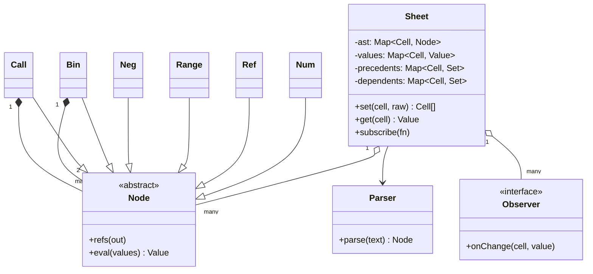
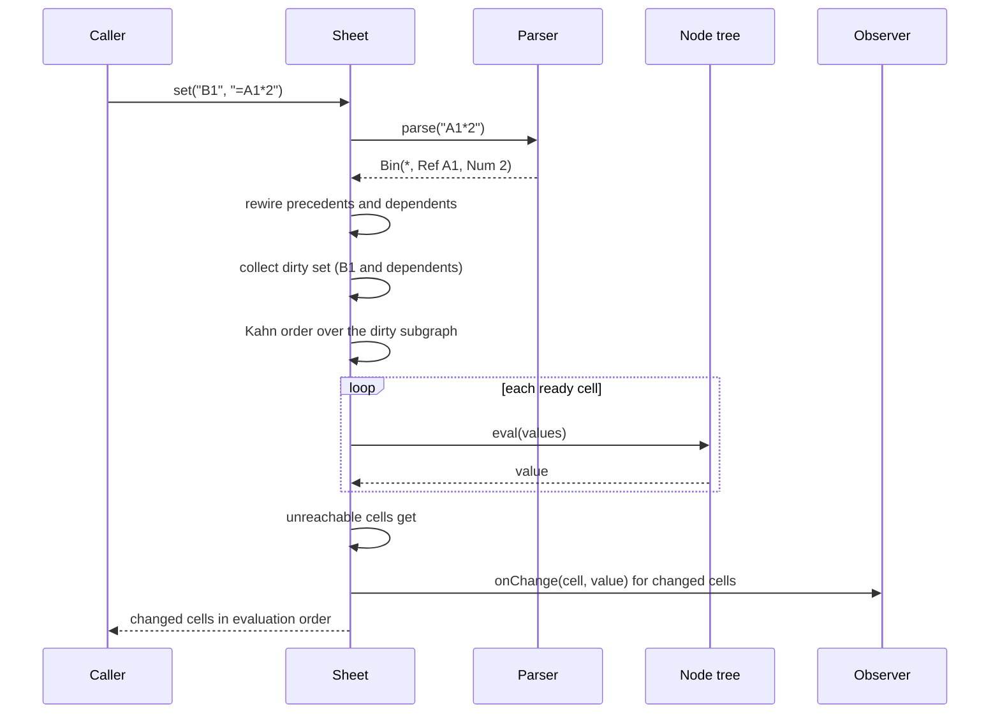

## In one minute
- A formula is a small program, so parse it once into a tree of nodes (Interpreter plus Composite) and evaluate the tree. Never re-scan the text when a value changes.
- The tree also tells you which cells the formula reads. Those reads are the edges of a dependency graph, and that graph is what makes recalculation both correct and cheap.
- On every edit, mark only the edited cell and its transitive dependents as dirty, then evaluate that subgraph in topological order, so each cell is computed once, after everything it reads.
- A cycle is not a crash. Cells that can never become ready in the topological sort are the cycle and everything downstream of it. Give them a `#CYCLE!` value and keep the engine alive.
- Errors are values, not exceptions. `#DIV/0!`, `#NAME?` and friends flow through formulas like numbers, and Observer subscribers hear only about cells whose value really changed.

## Requirements
Functional:
- `set(cell, raw)` accepts a number, an empty string (clear the cell) or a formula that starts with `=`. `get(cell)` returns the current value.
- Formulas support numbers, cell references such as `B2`, `+ - * /`, unary minus, parentheses, and `SUM` over any mix of ranges (`A1:A9`) and expressions.
- Changing a cell recalculates every cell that depends on it, directly or through other formulas, and only those.
- Cycles are detected and reported as an error value. Bad formulas and bad arithmetic produce error values too: `#PARSE!`, `#NAME?`, `#DIV/0!`, `#VALUE!`.
- Listeners can subscribe and learn which cells changed value, and what the new value is.

Non-functional:
- An edit costs time proportional to the affected subgraph, not to the size of the sheet.
- Deterministic: the same edits give the same values and the same notification order.
- A formula cannot crash the engine, however malformed or deep.

Out of scope: text cells, dates, `INDIRECT`-style dynamic references, cross-sheet references, undo, file formats, multi-user editing and threads. Extensibility covers the first two.

## Entities and relationships
- **Sheet** owns everything: the formulas by cell, the current values, the two adjacency maps and the list of observers. It is the only class with mutable state.
- **Cell address** is a plain string such as `C7`, normalised to upper case. It splits into a row number and a column number, and the order `(row, column)` is used to break ties.
- **Node** is the abstract piece of a parsed formula. `Num`, `Ref`, `Range`, `Neg`, `Bin` and `Call` are its subclasses. Each node can list the cells it reads (`refs`) and compute its value from a values table (`eval`).
- **Value** is a number or an error code. Empty cells read as 0, but are skipped by ranges.
- **Parser** turns formula text into a node tree. It is stateless between formulas.
- **Observer** is a callback `(cell, value)` registered on the sheet.

Two maps hold the graph: `precedents[c]` (what `c` reads) and `dependents[p]` (who reads `p`). They are mirror images, kept in sync by `set`. Edges point to cells that do not exist yet, so a formula can refer to a cell the user fills in later.

## Class diagram


## Key flows


The write path has six steps. Parse the raw text. Remove the cell's old edges and add the new ones. Walk `dependents` breadth first from the edited cell to get the dirty set. Count, for each dirty cell, how many of its precedents are also dirty. Start from the cells with a count of zero and repeatedly evaluate one, then decrement its dependents. Finally compare new values with old and tell the observers about the differences.

The read path is a single map lookup. `get` never recalculates, because every `set` leaves the sheet fully consistent. That keeps reads fast and makes the sheet safe to read from a renderer.

## Design patterns used and why
- **Interpreter.** The formula grammar is tiny, so each grammar rule becomes a class with an `eval` method. This is the textbook case for the pattern ([Interpreter pattern](https://en.wikipedia.org/wiki/Interpreter_pattern)). It stops being the right tool when the language grows to hundreds of functions, loops or user-defined code. Then you compile to bytecode or closures.
- **Composite.** `Bin` and `Call` hold child `Node`s and are themselves `Node`s, so callers treat a single number and a deep expression identically. `refs` and `eval` recurse through the tree with no type checks.
- **Observer.** The sheet publishes `(cell, value)` events after a recalculation finishes. The UI, a chart and an audit log subscribe without the sheet knowing they exist. Publishing after the pass, not during it, means a listener that reads other cells sees a consistent sheet.
- **Recursive-descent parser with precedence layers.** One method per precedence level (`expr`, `term`, `unary`, `atom`) gives the right order of operations without a parser generator. Pratt parsers are the next step when you have many operators ([matklad](https://matklad.github.io/2020/04/13/simple-but-powerful-pratt-parsing.html)).
- **Errors as values.** A `Value` is a number or an error code, and every operator checks its operands first. This is the same idea as a null object: the failure is part of the normal data flow, so one bad cell cannot unwind the whole recalculation.

## Concurrency and edge cases
- **Diamonds.** `D1 = B1 + C1` with both reading `A1`. A naive recursive "recompute dependents" visits `D1` twice, once per path, and the first visit sees a stale `C1` (a glitch). Ordering the dirty cells topologically evaluates each cell exactly once, after all its inputs.
- **Self reference and cycles.** `A1 = A1 + 1` has an edge from `A1` to itself, so its count never reaches zero. The same holds for a longer loop. Detection falls out of Kahn's algorithm for free: whatever is left unevaluated is the cycle plus everything fed by it. Excel treats this as a user error and warns, unless iterative calculation is enabled ([Microsoft Learn](https://learn.microsoft.com/en-us/office/client-developer/excel/excel-recalculation)).
- **Breaking a cycle.** Editing a cell that belongs to a cycle puts the whole loop in the dirty set (its members are dependents of each other), so they recover as soon as the loop is cut.
- **References to empty cells.** Reading an empty cell gives 0, and a range skips it. The edge still exists, so filling the cell later triggers the dependents.
- **Unchanged results.** `=A1*0` stays 0 whatever `A1` is. The cell is re-evaluated, since you cannot know in advance, but observers are told only when the value differs. Skipping the evaluation of its own dependents when a value did not change is an optimisation covered in Extensibility.
- **Floating point.** Values are IEEE 754 doubles, so `0.1 + 0.2` is `0.30000000000000004`. Display rounding belongs to the view, not the engine.
- **Concurrency.** The practice engine is single-threaded: one writer at a time, and `set` is atomic from the caller's point of view. In a shared editor, put one lock or one event queue around `set` and let readers use immutable snapshots of the values map.
- **Hostile input.** Deeply nested parentheses can overflow a recursive parser. Real engines cap nesting (Excel allows 64 nested function levels and 8,192 formula characters, per its [specifications and limits](https://support.microsoft.com/en-us/office/excel-specifications-and-limits-1672b34d-7043-467e-8e27-269d656771c3)). Do the same.

## In the wild
- **Public Health England, 2020: cases lost to a file format.** Test results were collected into Excel templates saved in the old XLS format, which holds about 65,000 rows, and each result used several rows, so a template fitted roughly 1,400 cases. Cases past the limit were silently dropped: 15,841 positive results from 25 September to 2 October 2020 reached contact tracers late. The lesson for an engine is to fail loudly at a capacity limit, with an error value or a rejected edit, and never to truncate ([BBC News](https://www.bbc.com/news/technology-54423988)).
- **Genomics literature, 2016: auto-conversion corrupts data.** Excel converts gene symbols such as SEPT2 and MARCH1 to the dates 2-Sep and 1-Mar by default. A screen of 35,175 supplementary Excel files found gene-name errors in 987 files from 704 published papers, 19.6% of the articles in the selected journals. The failure sits in input coercion, not in recalculation, which is why a strict, documented input grammar matters ([Ziemann, Eren and El-Osta, Genome Biology](https://genomebiology.biomedcentral.com/articles/10.1186/s13059-016-1044-7)).


## Down the stack

### Layer 1: The contract
After `set` returns, every cell's value equals what you would get by evaluating all formulas from scratch in some valid dependency order, as if the sheet were rebuilt. The tests pin this down as four checkable promises. A cell is evaluated only after every cell it reads. A cell outside the dirty set keeps its old value. A value never depends on the order of earlier edits. Cells on or below a cycle read `#CYCLE!`. `set` returns the changed cells in evaluation order and notifies observers in that same order.

This is the same contract as an incremental build system. The "Build systems à la carte" paper calls Excel a build system in disguise: formulas are the task descriptions, cell values are the build products, and an edit is a changed input ([Mokhov, Mitchell, Peyton Jones](https://www.microsoft.com/en-us/research/uploads/prod/2018/03/build-systems.pdf)).

### Layer 2: The mechanism
Excel's documented model has three stages: build a dependency tree, build a calculation chain (the formula cells in the order they must be computed), then recalculate the dirty cells in chain order ([Microsoft Learn](https://learn.microsoft.com/en-us/office/client-developer/excel/excel-recalculation)). When a cell changes, all direct and indirect dependents are marked dirty. Volatile functions such as `NOW` are re-evaluated on every recalculation, together with their dependents.

Our engine builds the order per edit instead of keeping a chain. The steps are Kahn's algorithm on the dirty subgraph ([topological sorting](https://en.wikipedia.org/wiki/Topological_sorting)): compute in-degrees restricted to dirty cells, queue the zero-degree cells, pop one, evaluate it, decrement its dependents. The queue is a min-heap on `(row, column)` so output is deterministic. Cost is O(V + E) in the dirty subgraph plus the heap's log factor.

Excel's real chain differs in one respect that matters. Because `INDIRECT` makes dependencies depend on values, Excel starts from the previous chain, and if a formula depends on a cell that has not been calculated yet, the cell being calculated and its dependents are moved down the chain. A static graph like ours is the simpler special case, and stays valid for any formula whose references can be read off the text.

Range nodes matter for scale. Expanding `SUM(A1:A100000)` into 100,000 edges is fine for a lesson. Production engines store a range as one node with interval bookkeeping, so a column total costs one edge, not one hundred thousand.

### Layer 3: The machine
A worksheet is up to 1,048,576 rows by 16,384 columns, about 17 billion addresses ([Microsoft support](https://support.microsoft.com/en-us/office/excel-specifications-and-limits-1672b34d-7043-467e-8e27-269d656771c3)), so storage must be sparse: hash maps keyed by address, not a dense grid. A used cell costs a hash lookup (tens of nanoseconds when warm) plus pointer chasing through the node tree. A tree walk is a chain of dependent loads and virtual or interface calls, so a large sheet of tiny formulas is bound by memory latency rather than arithmetic, and an interpreter language pays a further constant factor on every node visit.

Numbers are 8-byte IEEE 754 doubles with a 53-bit mantissa, which is why integers are exact only up to 2^53 and why `0.1 + 0.2` is not `0.3`. The parser's recursion uses the call stack, one frame per nesting level, so a formula of 100,000 open parentheses needs a depth cap. The evaluation order, however, is computed with an explicit queue and not recursion, so a chain of a million cells (`A2 = A1 + 1`, `A3 = A2 + 1`, ...) cannot overflow the stack. A recursive "evaluate my precedents first" design would.

### Why it's built this way
1. Typing a formula is rare and cheap; recalculating is constant. So parse once into a tree and keep the tree.
2. The tree's references are exactly the dependencies, so the graph comes free from parsing and never needs a manual declaration.
3. Most edits touch a small part of a large sheet, so recalculating everything is wasteful. Dirty marking restricts the work to the affected subgraph.
4. Evaluating a dependent before its input yields a wrong value, so the order must be topological. Doing that with an explicit queue also detects cycles and avoids deep recursion.
5. Users type nonsense all day, so failures become values that propagate. The sheet stays alive and shows where the problem is.

## Extensibility
- **Skip unchanged dependents.** Today every dirty cell is re-evaluated. With a per-cell "an input actually changed" flag, a cell is evaluated only if one of its precedents produced a different value. In the `=A1*0` case that stops the wave early. The cost is a flag per cell.
- **More functions.** Add `MIN`, `MAX`, `AVERAGE` and `IF` as a function table mapping names to implementations, so `Call` stays closed to modification. `IF` needs lazy evaluation of its branches, which changes which references are really needed.
- **Text, booleans, dates.** `Value` becomes a tagged union. Coercion rules (is `"3"` a number?) become the hardest part, and the spreadsheet's well-known surprises live there. A study of 35,175 supplementary Excel files found gene-name errors, caused by gene symbols being auto-converted to dates, in 704 papers ([Genome Biology, 2016](https://genomebiology.biomedcentral.com/articles/10.1186/s13059-016-1044-7)).
- **Dynamic references (`INDIRECT`, `OFFSET`).** Dependencies now depend on values, so edges must be recomputed during evaluation, which is the calc-chain reordering described above.
- **Undo and history.** Record each `set` as a command with the old raw text. Undo is another `set`. Because recalculation is a pure function of the raw inputs, you need not store computed values.
- **Large sheets.** Range nodes, a persistent calc order, and batch edits that mark many cells dirty and run a single recalculation (so a paste of 10,000 cells does not recalculate 10,000 times).

## Leadership lens
- Decide what correctness means before performance: "same answer as a full recalculation" is a testable property. Property-test the incremental path against a naive evaluate-everything oracle on random edit sequences.
- Ask what the spreadsheet is to the business. Models that drive money decisions need an audit trail, and the biggest risk is usually a wrong formula or an input pipeline limit, not the engine (see In the wild).
- Keep the grammar small and versioned. Every new function is a compatibility promise, and users will paste formulas from other products and expect identical results.
- Budget for the long tail: error codes, locale decimal separators, and precision rules take more time than the graph algorithm. Staff for them.
- Make failures visible. A cycle or an error cell must be easy to find, with a "trace precedents" tool, or users will quietly trust wrong totals.

## Check yourself
1. A sheet has `A1 = 1`, `B1 = A1 + 1`, `C1 = A1 + 2`, `D1 = B1 + C1`. If you change `A1` and recalculate recursively through dependents, how many times can `D1` be computed, and what is the fix?
   **Answer:** Twice, once per path, and the first time with a stale `B1` or `C1`. Evaluate the dirty cells in topological order so `D1` runs once, after both inputs are final.
2. In Kahn's algorithm over the dirty subgraph, how do you know which cells are in a cycle, and why are some non-cycle cells also reported?
   **Answer:** Cells never reaching in-degree zero are never evaluated. They are the cycle members and every cell that depends on them, because those wait forever for an input that never completes. `#CYCLE!` on all of them is consistent with error propagation.
3. Why must `set` remove a cell's old edges before adding the new ones?
   **Answer:** Otherwise a formula changed from `=A1` to `=B1` would still be recalculated when `A1` changes and could look cyclic through stale edges. The graph must always equal the references of the current formulas.
4. Why does the engine publish observer events after the whole recalculation instead of inside the loop?
   **Answer:** A listener that reads other cells mid-pass would see some cells new and some old. Publishing after the pass guarantees the sheet is consistent, and the changed list lets listeners redraw only what moved.

## Practice
**Task:** Implement a `Sheet` (Go: `NewSheet()`). `set(cell, raw)` stores a number (`"4"`, `"2.5"`), clears the cell (empty string) or stores a formula starting with `=`. Formulas support non-negative number literals, cell references, `+ - * /`, unary minus, parentheses and `SUM` over ranges and expressions (`SUM(A1:A3, 10)`). `*` and `/` bind tighter than `+` and `-`, and both are left associative. `get(cell)` returns a number (0 for empty cells) or an error string: `#DIV/0!`, `#NAME?` (unknown function), `#PARSE!` (bad formula), `#VALUE!` (raw text that is neither a number nor a formula) and `#CYCLE!`. An operand error propagates, and the left operand is checked first. Ranges skip empty cells. After a `set`, recalculate only the edited cell and its transitive dependents, in topological order with ties broken by (row, column), and return the cells whose value changed, in evaluation order. Cells on a cycle, or downstream of one, get `#CYCLE!`. Observers registered with `subscribe` are called with `(cell, value)` for each changed cell, in that order, after the pass. Cell names are case-insensitive. Go's `Get` returns a `Value{Num, Err}`.

```python starter
class Sheet:
    """Cells hold numbers or formulas such as '=A1*2+SUM(B1:B3)'."""

    def __init__(self):
        # TODO: raw cells, parsed formulas, dependents map, values, observers
        pass

    def subscribe(self, fn):
        # TODO: fn(cell, value) is called for every cell whose value changed
        raise NotImplementedError

    def get(self, cell):
        # TODO: number, or an error string such as '#DIV/0!'; empty cells are 0
        raise NotImplementedError

    def set(self, cell, raw):
        # TODO: parse, update edges, recalculate in topological order,
        # return the changed cells in evaluation order
        raise NotImplementedError
```

```python tests
def test_chain_recalculates_in_dependency_order():
    s = Sheet()
    s.set("A1", "2")
    s.set("B1", "=A1*3")
    s.set("C1", "=B1+A1")
    assert s.get("C1") == 8
    assert s.set("A1", "4") == ["A1", "B1", "C1"]
    assert s.get("B1") == 12 and s.get("C1") == 16


def test_precedence_parentheses_and_unary_minus():
    s = Sheet()
    s.set("A1", "=1+2*3")
    s.set("A2", "=(1+2)*3")
    s.set("A3", "=-(2+1)")
    s.set("A4", "=10/4")
    assert [s.get("A1"), s.get("A2"), s.get("A3"), s.get("A4")] == [7, 9, -3, 2.5]


def test_sum_over_ranges_skips_empty_cells():
    s = Sheet()
    s.set("A1", "1")
    s.set("A3", "5")
    s.set("B1", "=SUM(A1:A3, 10)")
    assert s.get("B1") == 16
    s.set("A2", "4")
    assert s.get("B1") == 20
    s.set("A3", "")
    assert s.get("B1") == 15


def test_diamond_is_evaluated_once_and_observers_see_it_once():
    s = Sheet()
    seen = []
    s.set("A1", "1")
    s.set("B1", "=A1+1")
    s.set("C1", "=A1+2")
    s.set("D1", "=B1+C1")
    s.subscribe(lambda cell, v: seen.append((cell, v)))
    assert s.set("A1", "10") == ["A1", "B1", "C1", "D1"]
    assert seen == [("A1", 10), ("B1", 11), ("C1", 12), ("D1", 23)]


def test_cycle_marks_members_and_dependents_then_recovers():
    s = Sheet()
    s.set("A1", "=B1")
    s.set("B1", "=A1")
    s.set("C1", "=A1+1")
    assert [s.get("A1"), s.get("B1"), s.get("C1")] == ["#CYCLE!"] * 3
    s.set("D1", "=D1")
    assert s.get("D1") == "#CYCLE!"
    s.set("B1", "5")
    assert [s.get("A1"), s.get("B1"), s.get("C1")] == [5, 5, 6]


def test_error_values_propagate_and_clear():
    s = Sheet()
    s.set("A1", "0")
    s.set("B1", "=1/A1")
    s.set("C1", "=B1+1")
    s.set("D1", "=FOO(1)")
    s.set("E1", "=1+")
    s.set("F1", "hello")
    assert [s.get("B1"), s.get("C1"), s.get("D1"), s.get("E1"), s.get("F1")] == [
        "#DIV/0!", "#DIV/0!", "#NAME?", "#PARSE!", "#VALUE!"]
    s.set("A1", "4")
    assert s.get("B1") == 0.25 and s.get("C1") == 1.25


def test_unchanged_values_are_not_reported():
    s = Sheet()
    s.set("A1", "1")
    s.set("B1", "=A1*0")
    assert s.set("A1", "2") == ["A1"]
    assert s.get("B1") == 0


def test_forward_reference_to_a_cell_set_later():
    s = Sheet()
    s.set("B1", "=A1+1")
    assert s.get("B1") == 1
    assert s.set("A1", "5") == ["A1", "B1"]
    assert s.get("B1") == 6
```

```python solution
import heapq
from collections import deque


def scan_digits(text, pos):
    while pos < len(text) and text[pos].isdigit():
        pos += 1
    return pos


def scan_number(text, pos):
    """End of a number literal such as 12 or 3.5 starting at pos, or pos if none."""
    end = scan_digits(text, pos)
    if end == pos:
        return pos
    if end + 1 < len(text) and text[end] == "." and text[end + 1].isdigit():
        end = scan_digits(text, end + 1)
    return end


def scan_letters(text, pos):
    while pos < len(text) and "A" <= text[pos].upper() <= "Z":
        pos += 1
    return pos


def scan_ref(text, pos):
    """End of a cell reference such as AB12 starting at pos, or pos if none."""
    mid = scan_letters(text, pos)
    if mid == pos:
        return pos
    end = scan_digits(text, mid)
    return pos if end == mid else end


def is_number(raw):
    body = raw[1:] if raw.startswith("-") else raw
    return body != "" and scan_number(body, 0) == len(body)


def split_cell(ref):
    mid = scan_letters(ref, 0)
    col = 0
    for ch in ref[:mid]:
        col = col * 26 + ord(ch) - 64
    return int(ref[mid:]), col


def cell_name(row, col):
    letters = ""
    while col > 0:
        col, r = divmod(col - 1, 26)
        letters = chr(65 + r) + letters
    return letters + str(row)


class ParseError(Exception):
    pass


class Node:
    def refs(self, out):
        pass

    def flat(self, values):
        return [self.eval(values)]


class Num(Node):
    def __init__(self, v):
        self.v = v

    def eval(self, values):
        return self.v


class Err(Num):
    pass


class Ref(Node):
    def __init__(self, name):
        self.name = name

    def refs(self, out):
        out.add(self.name)

    def eval(self, values):
        return values.get(self.name, 0)


class Range(Node):
    def __init__(self, a, b):
        r1, c1 = split_cell(a)
        r2, c2 = split_cell(b)
        self.names = [cell_name(r, c)
                      for r in range(min(r1, r2), max(r1, r2) + 1)
                      for c in range(min(c1, c2), max(c1, c2) + 1)]

    def refs(self, out):
        out.update(self.names)

    def eval(self, values):
        return "#VALUE!"

    def flat(self, values):
        return [values[n] for n in self.names if n in values]


class Neg(Node):
    def __init__(self, inner):
        self.inner = inner

    def refs(self, out):
        self.inner.refs(out)

    def eval(self, values):
        v = self.inner.eval(values)
        return v if isinstance(v, str) else -v


class Bin(Node):
    def __init__(self, op, left, right):
        self.op, self.left, self.right = op, left, right

    def refs(self, out):
        self.left.refs(out)
        self.right.refs(out)

    def eval(self, values):
        a = self.left.eval(values)
        if isinstance(a, str):
            return a
        b = self.right.eval(values)
        if isinstance(b, str):
            return b
        if self.op == "+":
            return a + b
        if self.op == "-":
            return a - b
        if self.op == "*":
            return a * b
        return "#DIV/0!" if b == 0 else a / b


class Call(Node):
    def __init__(self, name, args):
        self.name, self.args = name, args

    def refs(self, out):
        for a in self.args:
            a.refs(out)

    def eval(self, values):
        if self.name != "SUM":
            return "#NAME?"
        total = 0
        for a in self.args:
            for v in a.flat(values):
                if isinstance(v, str):
                    return v
                total += v
        return total


class Parser:
    def __init__(self, text):
        self.toks = []
        pos = 0
        while pos < len(text):
            ch = text[pos]
            if ch.isspace():
                pos += 1
                continue
            end = scan_number(text, pos)
            if end > pos:
                self.toks.append(("num", text[pos:end]))
                pos = end
                continue
            end = scan_ref(text, pos)
            if end > pos:
                if end < len(text) and text[end] == ":":
                    end2 = scan_ref(text, end + 1)
                    if end2 > end + 1:
                        end = end2
                self.toks.append(("ref", text[pos:end].upper()))
                pos = end
                continue
            end = scan_letters(text, pos)
            if end > pos:
                self.toks.append(("name", text[pos:end].upper()))
                pos = end
                continue
            self.toks.append(("op", ch))
            pos += 1
        self.i = 0

    def peek(self):
        return self.toks[self.i] if self.i < len(self.toks) else ("end", "")

    def take(self):
        t = self.peek()
        self.i += 1
        return t

    def parse(self):
        node = self.expr()
        if self.peek()[0] != "end":
            raise ParseError("trailing input")
        return node

    def expr(self):
        node = self.term()
        while self.peek() in (("op", "+"), ("op", "-")):
            op = self.take()[1]
            node = Bin(op, node, self.term())
        return node

    def term(self):
        node = self.unary()
        while self.peek() in (("op", "*"), ("op", "/")):
            op = self.take()[1]
            node = Bin(op, node, self.unary())
        return node

    def unary(self):
        if self.peek() == ("op", "-"):
            self.take()
            return Neg(self.unary())
        return self.atom()

    def atom(self):
        kind, text = self.take()
        if kind == "num":
            return Num(float(text) if "." in text else int(text))
        if kind == "ref":
            if ":" in text:
                a, b = text.split(":")
                return Range(a, b)
            return Ref(text)
        if kind == "name" and self.peek() == ("op", "("):
            self.take()
            args = []
            if self.peek() != ("op", ")"):
                args.append(self.expr())
                while self.peek() == ("op", ","):
                    self.take()
                    args.append(self.expr())
            if self.take() != ("op", ")"):
                raise ParseError("expected )")
            return Call(text, args)
        if (kind, text) == ("op", "("):
            node = self.expr()
            if self.take() != ("op", ")"):
                raise ParseError("expected )")
            return node
        raise ParseError("unexpected " + text)


def parse_input(raw):
    raw = raw.strip()
    if raw == "":
        return None
    if raw[0] == "=":
        try:
            return Parser(raw[1:]).parse()
        except ParseError:
            return Err("#PARSE!")
    if is_number(raw):
        return Num(float(raw) if "." in raw else int(raw))
    return Err("#VALUE!")


class Sheet:
    def __init__(self):
        self.ast = {}
        self.values = {}
        self.precedents = {}
        self.dependents = {}
        self.observers = []

    def subscribe(self, fn):
        self.observers.append(fn)

    def get(self, cell):
        return self.values.get(cell.upper(), 0)

    def set(self, cell, raw):
        cell = cell.upper()
        for p in self.precedents.pop(cell, ()):
            self.dependents[p].discard(cell)
        node = parse_input(raw)
        if node is None:
            self.ast.pop(cell, None)
        else:
            self.ast[cell] = node
            refs = set()
            node.refs(refs)
            self.precedents[cell] = refs
            for p in refs:
                self.dependents.setdefault(p, set()).add(cell)
        return self._recalculate(cell)

    def _recalculate(self, start):
        dirty = {start}
        queue = deque([start])
        while queue:
            for d in self.dependents.get(queue.popleft(), ()):
                if d not in dirty:
                    dirty.add(d)
                    queue.append(d)
        old = {c: self.values.get(c, 0) for c in dirty}
        waiting = {c: sum(1 for p in self.precedents.get(c, ()) if p in dirty) for c in dirty}
        ready = [(split_cell(c), c) for c in dirty if waiting[c] == 0]
        heapq.heapify(ready)
        order = []
        while ready:
            c = heapq.heappop(ready)[1]
            order.append(c)
            node = self.ast.get(c)
            if node is None:
                self.values.pop(c, None)
            else:
                self.values[c] = node.eval(self.values)
            for d in self.dependents.get(c, ()):
                if d in dirty:
                    waiting[d] -= 1
                    if waiting[d] == 0:
                        heapq.heappush(ready, (split_cell(d), d))
        stuck = sorted(dirty - set(order), key=split_cell)
        for c in stuck:
            self.values[c] = "#CYCLE!"
        changed = [c for c in order + stuck if self.values.get(c, 0) != old[c]]
        for c in changed:
            for fn in self.observers:
                fn(c, self.values.get(c, 0))
        return changed
```

```typescript starter
export type Value = number | string;

export class Sheet {
  // Cells hold numbers or formulas such as "=A1*2+SUM(B1:B3)".
  // TODO: raw cells, parsed formulas, dependents map, values, observers

  subscribe(fn: (cell: string, v: Value) => void): void {
    // TODO: fn is called for every cell whose value changed
    throw new Error("TODO");
  }

  get(cell: string): Value {
    // TODO: number, or an error string such as "#DIV/0!"; empty cells are 0
    throw new Error("TODO");
  }

  set(cell: string, raw: string): string[] {
    // TODO: parse, update edges, recalculate in topological order,
    // return the changed cells in evaluation order
    throw new Error("TODO");
  }
}
```

```typescript tests
test("chain recalculates in dependency order", () => {
  const s = new Sheet();
  s.set("A1", "2");
  s.set("B1", "=A1*3");
  s.set("C1", "=B1+A1");
  assertEqual(s.get("C1"), 8);
  assertEqual(s.set("A1", "4"), ["A1", "B1", "C1"]);
  assertEqual([s.get("B1"), s.get("C1")], [12, 16]);
});

test("precedence, parentheses and unary minus", () => {
  const s = new Sheet();
  s.set("A1", "=1+2*3");
  s.set("A2", "=(1+2)*3");
  s.set("A3", "=-(2+1)");
  s.set("A4", "=10/4");
  assertEqual([s.get("A1"), s.get("A2"), s.get("A3"), s.get("A4")], [7, 9, -3, 2.5]);
});

test("SUM over ranges skips empty cells", () => {
  const s = new Sheet();
  s.set("A1", "1");
  s.set("A3", "5");
  s.set("B1", "=SUM(A1:A3, 10)");
  assertEqual(s.get("B1"), 16);
  s.set("A2", "4");
  assertEqual(s.get("B1"), 20);
  s.set("A3", "");
  assertEqual(s.get("B1"), 15);
});

test("diamond is evaluated once and observers see it once", () => {
  const s = new Sheet();
  const seen: Array<[string, Value]> = [];
  s.set("A1", "1");
  s.set("B1", "=A1+1");
  s.set("C1", "=A1+2");
  s.set("D1", "=B1+C1");
  s.subscribe((cell, v) => seen.push([cell, v]));
  assertEqual(s.set("A1", "10"), ["A1", "B1", "C1", "D1"]);
  assertEqual(seen, [["A1", 10], ["B1", 11], ["C1", 12], ["D1", 23]]);
});

test("cycle marks members and dependents, then recovers", () => {
  const s = new Sheet();
  s.set("A1", "=B1");
  s.set("B1", "=A1");
  s.set("C1", "=A1+1");
  assertEqual([s.get("A1"), s.get("B1"), s.get("C1")], ["#CYCLE!", "#CYCLE!", "#CYCLE!"]);
  s.set("D1", "=D1");
  assertEqual(s.get("D1"), "#CYCLE!");
  s.set("B1", "5");
  assertEqual([s.get("A1"), s.get("B1"), s.get("C1")], [5, 5, 6]);
});

test("error values propagate and clear", () => {
  const s = new Sheet();
  s.set("A1", "0");
  s.set("B1", "=1/A1");
  s.set("C1", "=B1+1");
  s.set("D1", "=FOO(1)");
  s.set("E1", "=1+");
  s.set("F1", "hello");
  assertEqual(
    [s.get("B1"), s.get("C1"), s.get("D1"), s.get("E1"), s.get("F1")],
    ["#DIV/0!", "#DIV/0!", "#NAME?", "#PARSE!", "#VALUE!"]
  );
  s.set("A1", "4");
  assertEqual([s.get("B1"), s.get("C1")], [0.25, 1.25]);
});

test("unchanged values are not reported", () => {
  const s = new Sheet();
  s.set("A1", "1");
  s.set("B1", "=A1*0");
  assertEqual(s.set("A1", "2"), ["A1"]);
  assertEqual(s.get("B1"), 0);
});

test("forward reference to a cell set later", () => {
  const s = new Sheet();
  s.set("B1", "=A1+1");
  assertEqual(s.get("B1"), 1);
  assertEqual(s.set("A1", "5"), ["A1", "B1"]);
  assertEqual(s.get("B1"), 6);
});
```

```typescript solution
export type Value = number | string;
type Values = Map<string, Value>;

function splitCell(ref: string): [number, number] {
  const m = /^([A-Z]+)(\d+)$/.exec(ref)!;
  let col = 0;
  for (const ch of m[1]) col = col * 26 + ch.charCodeAt(0) - 64;
  return [Number(m[2]), col];
}

function cellName(row: number, col: number): string {
  let letters = "";
  while (col > 0) {
    const r = (col - 1) % 26;
    letters = String.fromCharCode(65 + r) + letters;
    col = (col - 1 - r) / 26;
  }
  return letters + row;
}

function before(a: string, b: string): boolean {
  const [ra, ca] = splitCell(a);
  const [rb, cb] = splitCell(b);
  return ra !== rb ? ra < rb : ca < cb;
}

abstract class Node {
  refs(_out: Set<string>): void {}
  abstract eval(v: Values): Value;
  flat(v: Values): Value[] {
    return [this.eval(v)];
  }
}

class Num extends Node {
  constructor(private n: Value) {
    super();
  }
  eval(): Value {
    return this.n;
  }
}

class Ref extends Node {
  constructor(private name: string) {
    super();
  }
  refs(out: Set<string>): void {
    out.add(this.name);
  }
  eval(v: Values): Value {
    return v.has(this.name) ? v.get(this.name)! : 0;
  }
}

class Range extends Node {
  private names: string[] = [];
  constructor(a: string, b: string) {
    super();
    const [r1, c1] = splitCell(a);
    const [r2, c2] = splitCell(b);
    for (let r = Math.min(r1, r2); r <= Math.max(r1, r2); r++) {
      for (let c = Math.min(c1, c2); c <= Math.max(c1, c2); c++) this.names.push(cellName(r, c));
    }
  }
  refs(out: Set<string>): void {
    this.names.forEach((n) => out.add(n));
  }
  eval(): Value {
    return "#VALUE!";
  }
  flat(v: Values): Value[] {
    return this.names.filter((n) => v.has(n)).map((n) => v.get(n)!);
  }
}

class Neg extends Node {
  constructor(private inner: Node) {
    super();
  }
  refs(out: Set<string>): void {
    this.inner.refs(out);
  }
  eval(v: Values): Value {
    const x = this.inner.eval(v);
    return typeof x === "string" ? x : -x;
  }
}

class Bin extends Node {
  constructor(private op: string, private left: Node, private right: Node) {
    super();
  }
  refs(out: Set<string>): void {
    this.left.refs(out);
    this.right.refs(out);
  }
  eval(v: Values): Value {
    const a = this.left.eval(v);
    if (typeof a === "string") return a;
    const b = this.right.eval(v);
    if (typeof b === "string") return b;
    if (this.op === "+") return a + b;
    if (this.op === "-") return a - b;
    if (this.op === "*") return a * b;
    return b === 0 ? "#DIV/0!" : a / b;
  }
}

class Call extends Node {
  constructor(private name: string, private args: Node[]) {
    super();
  }
  refs(out: Set<string>): void {
    this.args.forEach((a) => a.refs(out));
  }
  eval(v: Values): Value {
    if (this.name !== "SUM") return "#NAME?";
    let total = 0;
    for (const a of this.args) {
      for (const x of a.flat(v)) {
        if (typeof x === "string") return x;
        total += x;
      }
    }
    return total;
  }
}

class ParseError extends Error {}

type Tok = [string, string];

class Parser {
  private toks: Tok[] = [];
  private i = 0;

  constructor(text: string) {
    const re = /\s*(?:(\d+(?:\.\d+)?)|([A-Za-z]+\d+(?::[A-Za-z]+\d+)?)|([A-Za-z]+)|(.))/y;
    text = text.trimEnd();
    let m: RegExpExecArray | null;
    while (re.lastIndex < text.length && (m = re.exec(text)) !== null) {
      if (m[1]) this.toks.push(["num", m[1]]);
      else if (m[2]) this.toks.push(["ref", m[2].toUpperCase()]);
      else if (m[3]) this.toks.push(["name", m[3].toUpperCase()]);
      else this.toks.push(["op", m[4]]);
    }
  }

  private peek(): Tok {
    return this.i < this.toks.length ? this.toks[this.i] : ["end", ""];
  }
  private take(): Tok {
    const t = this.peek();
    this.i++;
    return t;
  }
  private isOp(...ops: string[]): boolean {
    const t = this.peek();
    return t[0] === "op" && ops.indexOf(t[1]) >= 0;
  }

  parse(): Node {
    const node = this.expr();
    if (this.peek()[0] !== "end") throw new ParseError("trailing input");
    return node;
  }

  private expr(): Node {
    let node = this.term();
    while (this.isOp("+", "-")) {
      const op = this.take()[1];
      node = new Bin(op, node, this.term());
    }
    return node;
  }

  private term(): Node {
    let node = this.unary();
    while (this.isOp("*", "/")) {
      const op = this.take()[1];
      node = new Bin(op, node, this.unary());
    }
    return node;
  }

  private unary(): Node {
    if (this.isOp("-")) {
      this.take();
      return new Neg(this.unary());
    }
    return this.atom();
  }

  private atom(): Node {
    const [kind, text] = this.take();
    if (kind === "num") return new Num(Number(text));
    if (kind === "ref") {
      if (text.indexOf(":") >= 0) {
        const [a, b] = text.split(":");
        return new Range(a, b);
      }
      return new Ref(text);
    }
    if (kind === "name" && this.isOp("(")) {
      this.take();
      const args: Node[] = [];
      if (!this.isOp(")")) {
        args.push(this.expr());
        while (this.isOp(",")) {
          this.take();
          args.push(this.expr());
        }
      }
      if (!this.isOp(")")) throw new ParseError("expected )");
      this.take();
      return new Call(text, args);
    }
    if (kind === "op" && text === "(") {
      const node = this.expr();
      if (!this.isOp(")")) throw new ParseError("expected )");
      this.take();
      return node;
    }
    throw new ParseError("unexpected " + text);
  }
}

function parseInput(raw: string): Node | null {
  raw = raw.trim();
  if (raw === "") return null;
  if (raw[0] === "=") {
    try {
      return new Parser(raw.slice(1)).parse();
    } catch (e) {
      return new Num("#PARSE!");
    }
  }
  return /^-?\d+(\.\d+)?$/.test(raw) ? new Num(Number(raw)) : new Num("#VALUE!");
}

export class Sheet {
  private ast = new Map<string, Node>();
  private values: Values = new Map();
  private precedents = new Map<string, Set<string>>();
  private dependents = new Map<string, Set<string>>();
  private observers: Array<(cell: string, v: Value) => void> = [];

  subscribe(fn: (cell: string, v: Value) => void): void {
    this.observers.push(fn);
  }

  get(cell: string): Value {
    const v = this.values.get(cell.toUpperCase());
    return v === undefined ? 0 : v;
  }

  set(cell: string, raw: string): string[] {
    cell = cell.toUpperCase();
    (this.precedents.get(cell) || new Set<string>()).forEach((p) => this.dependents.get(p)!.delete(cell));
    this.precedents.delete(cell);
    const node = parseInput(raw);
    if (node === null) {
      this.ast.delete(cell);
    } else {
      this.ast.set(cell, node);
      const refs = new Set<string>();
      node.refs(refs);
      this.precedents.set(cell, refs);
      refs.forEach((p) => {
        if (!this.dependents.has(p)) this.dependents.set(p, new Set());
        this.dependents.get(p)!.add(cell);
      });
    }
    return this.recalculate(cell);
  }

  private recalculate(start: string): string[] {
    const dirty = new Set<string>([start]);
    const queue = [start];
    while (queue.length > 0) {
      const c = queue.shift()!;
      (this.dependents.get(c) || new Set<string>()).forEach((d) => {
        if (!dirty.has(d)) {
          dirty.add(d);
          queue.push(d);
        }
      });
    }
    const old = new Map<string, Value>();
    const waiting = new Map<string, number>();
    dirty.forEach((c) => {
      old.set(c, this.get(c));
      let n = 0;
      (this.precedents.get(c) || new Set<string>()).forEach((p) => {
        if (dirty.has(p)) n++;
      });
      waiting.set(c, n);
    });
    const ready: string[] = [];
    const push = (c: string): void => {
      let i = ready.length;
      while (i > 0 && before(c, ready[i - 1])) i--;
      ready.splice(i, 0, c);
    };
    dirty.forEach((c) => {
      if (waiting.get(c) === 0) push(c);
    });
    const order: string[] = [];
    while (ready.length > 0) {
      const c = ready.shift()!;
      order.push(c);
      const node = this.ast.get(c);
      if (node === undefined) this.values.delete(c);
      else this.values.set(c, node.eval(this.values));
      (this.dependents.get(c) || new Set<string>()).forEach((d) => {
        if (dirty.has(d)) {
          waiting.set(d, waiting.get(d)! - 1);
          if (waiting.get(d) === 0) push(d);
        }
      });
    }
    const done = new Set(order);
    const stuck = Array.from(dirty).filter((c) => !done.has(c));
    stuck.sort((a, b) => (before(a, b) ? -1 : 1));
    stuck.forEach((c) => this.values.set(c, "#CYCLE!"));
    const changed = order.concat(stuck).filter((c) => this.get(c) !== old.get(c));
    for (const c of changed) for (const fn of this.observers) fn(c, this.get(c));
    return changed;
  }
}
```

```go starter
package practice

// Value is a number, or an error code such as "#DIV/0!" when Err is set.
type Value struct {
	Num float64
	Err string
}

// Sheet holds cells that are numbers or formulas such as "=A1*2+SUM(B1:B3)".
type Sheet struct {
	// TODO: parsed formulas, dependents map, values, observers
}

func NewSheet() *Sheet {
	return &Sheet{}
}

// Subscribe registers fn to be called for every cell whose value changed.
func (s *Sheet) Subscribe(fn func(cell string, v Value)) {
	panic("TODO")
}

// Get returns the cell's value; empty cells are 0.
func (s *Sheet) Get(cell string) Value {
	panic("TODO")
}

// Set stores raw, recalculates in topological order and returns the changed
// cells in evaluation order.
func (s *Sheet) Set(cell, raw string) []string {
	panic("TODO")
}
```

```go tests
package practice

import (
	"reflect"
	"testing"
)

func nums(s *Sheet, cells ...string) []Value {
	var out []Value
	for _, c := range cells {
		out = append(out, s.Get(c))
	}
	return out
}

func n(f float64) Value { return Value{Num: f} }
func e(code string) Value { return Value{Err: code} }

func TestChainRecalculatesInDependencyOrder(t *testing.T) {
	s := NewSheet()
	s.Set("A1", "2")
	s.Set("B1", "=A1*3")
	s.Set("C1", "=B1+A1")
	if s.Get("C1") != n(8) {
		t.Fatalf("C1 = %v", s.Get("C1"))
	}
	if got := s.Set("A1", "4"); !reflect.DeepEqual(got, []string{"A1", "B1", "C1"}) {
		t.Fatalf("changed = %v", got)
	}
	if !reflect.DeepEqual(nums(s, "B1", "C1"), []Value{n(12), n(16)}) {
		t.Fatalf("got %v", nums(s, "B1", "C1"))
	}
}

func TestPrecedenceParenthesesAndUnaryMinus(t *testing.T) {
	s := NewSheet()
	s.Set("A1", "=1+2*3")
	s.Set("A2", "=(1+2)*3")
	s.Set("A3", "=-(2+1)")
	s.Set("A4", "=10/4")
	want := []Value{n(7), n(9), n(-3), n(2.5)}
	if got := nums(s, "A1", "A2", "A3", "A4"); !reflect.DeepEqual(got, want) {
		t.Fatalf("got %v want %v", got, want)
	}
}

func TestSumOverRangesSkipsEmptyCells(t *testing.T) {
	s := NewSheet()
	s.Set("A1", "1")
	s.Set("A3", "5")
	s.Set("B1", "=SUM(A1:A3, 10)")
	if s.Get("B1") != n(16) {
		t.Fatalf("B1 = %v", s.Get("B1"))
	}
	s.Set("A2", "4")
	if s.Get("B1") != n(20) {
		t.Fatalf("B1 = %v", s.Get("B1"))
	}
	s.Set("A3", "")
	if s.Get("B1") != n(15) {
		t.Fatalf("B1 = %v", s.Get("B1"))
	}
}

func TestDiamondIsEvaluatedOnceAndObserversSeeItOnce(t *testing.T) {
	s := NewSheet()
	s.Set("A1", "1")
	s.Set("B1", "=A1+1")
	s.Set("C1", "=A1+2")
	s.Set("D1", "=B1+C1")
	var cells []string
	var vals []Value
	s.Subscribe(func(cell string, v Value) {
		cells = append(cells, cell)
		vals = append(vals, v)
	})
	got := s.Set("A1", "10")
	want := []string{"A1", "B1", "C1", "D1"}
	if !reflect.DeepEqual(got, want) || !reflect.DeepEqual(cells, want) {
		t.Fatalf("changed %v, observed %v", got, cells)
	}
	if !reflect.DeepEqual(vals, []Value{n(10), n(11), n(12), n(23)}) {
		t.Fatalf("values %v", vals)
	}
}

func TestCycleMarksMembersAndDependentsThenRecovers(t *testing.T) {
	s := NewSheet()
	s.Set("A1", "=B1")
	s.Set("B1", "=A1")
	s.Set("C1", "=A1+1")
	cyc := []Value{e("#CYCLE!"), e("#CYCLE!"), e("#CYCLE!")}
	if got := nums(s, "A1", "B1", "C1"); !reflect.DeepEqual(got, cyc) {
		t.Fatalf("got %v", got)
	}
	s.Set("D1", "=D1")
	if s.Get("D1") != e("#CYCLE!") {
		t.Fatalf("D1 = %v", s.Get("D1"))
	}
	s.Set("B1", "5")
	if got := nums(s, "A1", "B1", "C1"); !reflect.DeepEqual(got, []Value{n(5), n(5), n(6)}) {
		t.Fatalf("got %v", got)
	}
}

func TestErrorValuesPropagateAndClear(t *testing.T) {
	s := NewSheet()
	s.Set("A1", "0")
	s.Set("B1", "=1/A1")
	s.Set("C1", "=B1+1")
	s.Set("D1", "=FOO(1)")
	s.Set("E1", "=1+")
	s.Set("F1", "hello")
	want := []Value{e("#DIV/0!"), e("#DIV/0!"), e("#NAME?"), e("#PARSE!"), e("#VALUE!")}
	if got := nums(s, "B1", "C1", "D1", "E1", "F1"); !reflect.DeepEqual(got, want) {
		t.Fatalf("got %v", got)
	}
	s.Set("A1", "4")
	if got := nums(s, "B1", "C1"); !reflect.DeepEqual(got, []Value{n(0.25), n(1.25)}) {
		t.Fatalf("got %v", got)
	}
}

func TestUnchangedValuesAreNotReported(t *testing.T) {
	s := NewSheet()
	s.Set("A1", "1")
	s.Set("B1", "=A1*0")
	if got := s.Set("A1", "2"); !reflect.DeepEqual(got, []string{"A1"}) {
		t.Fatalf("changed = %v", got)
	}
	if s.Get("B1") != n(0) {
		t.Fatalf("B1 = %v", s.Get("B1"))
	}
}

func TestForwardReferenceToACellSetLater(t *testing.T) {
	s := NewSheet()
	s.Set("B1", "=A1+1")
	if s.Get("B1") != n(1) {
		t.Fatalf("B1 = %v", s.Get("B1"))
	}
	if got := s.Set("A1", "5"); !reflect.DeepEqual(got, []string{"A1", "B1"}) {
		t.Fatalf("changed = %v", got)
	}
	if s.Get("B1") != n(6) {
		t.Fatalf("B1 = %v", s.Get("B1"))
	}
}
```

```go solution
package practice

import (
	"regexp"
	"sort"
	"strconv"
	"strings"
)

// Value is a number, or an error code such as "#DIV/0!" when Err is set.
type Value struct {
	Num float64
	Err string
}

type values map[string]Value

var (
	cellRe   = regexp.MustCompile(`^([A-Z]+)(\d+)$`)
	numberRe = regexp.MustCompile(`^-?\d+(\.\d+)?$`)
	tokenRe  = regexp.MustCompile(`^\s*(?:(\d+(?:\.\d+)?)|([A-Za-z]+\d+(?::[A-Za-z]+\d+)?)|([A-Za-z]+)|(.))`)
)

func splitCell(ref string) (row, col int) {
	m := cellRe.FindStringSubmatch(ref)
	for _, ch := range m[1] {
		col = col*26 + int(ch) - 64
	}
	row, _ = strconv.Atoi(m[2])
	return
}

func cellName(row, col int) string {
	letters := ""
	for col > 0 {
		r := (col - 1) % 26
		letters = string(rune(65+r)) + letters
		col = (col - 1 - r) / 26
	}
	return letters + strconv.Itoa(row)
}

func before(a, b string) bool {
	ra, ca := splitCell(a)
	rb, cb := splitCell(b)
	if ra != rb {
		return ra < rb
	}
	return ca < cb
}

type node interface {
	refs(out map[string]bool)
	eval(v values) Value
	flat(v values) []Value
}

type num struct{ v Value }

func (n num) refs(map[string]bool)     {}
func (n num) eval(values) Value        { return n.v }
func (n num) flat(v values) []Value    { return []Value{n.v} }

type ref struct{ name string }

func (r ref) refs(out map[string]bool) { out[r.name] = true }
func (r ref) eval(v values) Value      { return v[r.name] }
func (r ref) flat(v values) []Value    { return []Value{r.eval(v)} }

type rng struct{ names []string }

func newRange(a, b string) rng {
	r1, c1 := splitCell(a)
	r2, c2 := splitCell(b)
	if r1 > r2 {
		r1, r2 = r2, r1
	}
	if c1 > c2 {
		c1, c2 = c2, c1
	}
	var names []string
	for r := r1; r <= r2; r++ {
		for c := c1; c <= c2; c++ {
			names = append(names, cellName(r, c))
		}
	}
	return rng{names}
}

func (r rng) refs(out map[string]bool) {
	for _, n := range r.names {
		out[n] = true
	}
}
func (r rng) eval(values) Value { return Value{Err: "#VALUE!"} }
func (r rng) flat(v values) []Value {
	var out []Value
	for _, n := range r.names {
		if x, ok := v[n]; ok {
			out = append(out, x)
		}
	}
	return out
}

type neg struct{ inner node }

func (n neg) refs(out map[string]bool) { n.inner.refs(out) }
func (n neg) flat(v values) []Value    { return []Value{n.eval(v)} }
func (n neg) eval(v values) Value {
	x := n.inner.eval(v)
	if x.Err != "" {
		return x
	}
	return Value{Num: -x.Num}
}

type bin struct {
	op          byte
	left, right node
}

func (b bin) refs(out map[string]bool) { b.left.refs(out); b.right.refs(out) }
func (b bin) flat(v values) []Value    { return []Value{b.eval(v)} }
func (b bin) eval(v values) Value {
	x := b.left.eval(v)
	if x.Err != "" {
		return x
	}
	y := b.right.eval(v)
	if y.Err != "" {
		return y
	}
	switch b.op {
	case '+':
		return Value{Num: x.Num + y.Num}
	case '-':
		return Value{Num: x.Num - y.Num}
	case '*':
		return Value{Num: x.Num * y.Num}
	}
	if y.Num == 0 {
		return Value{Err: "#DIV/0!"}
	}
	return Value{Num: x.Num / y.Num}
}

type call struct {
	name string
	args []node
}

func (c call) refs(out map[string]bool) {
	for _, a := range c.args {
		a.refs(out)
	}
}
func (c call) flat(v values) []Value { return []Value{c.eval(v)} }
func (c call) eval(v values) Value {
	if c.name != "SUM" {
		return Value{Err: "#NAME?"}
	}
	total := 0.0
	for _, a := range c.args {
		for _, x := range a.flat(v) {
			if x.Err != "" {
				return x
			}
			total += x.Num
		}
	}
	return Value{Num: total}
}

type tok struct{ kind, text string }

type parser struct {
	toks []tok
	i    int
	bad  bool
}

func newParser(text string) *parser {
	p := &parser{}
	text = strings.TrimRight(text, " \t")
	for text != "" {
		m := tokenRe.FindStringSubmatch(text)
		if m == nil {
			break
		}
		text = text[len(m[0]):]
		switch {
		case m[1] != "":
			p.toks = append(p.toks, tok{"num", m[1]})
		case m[2] != "":
			p.toks = append(p.toks, tok{"ref", strings.ToUpper(m[2])})
		case m[3] != "":
			p.toks = append(p.toks, tok{"name", strings.ToUpper(m[3])})
		default:
			p.toks = append(p.toks, tok{"op", m[4]})
		}
	}
	return p
}

func (p *parser) peek() tok {
	if p.i < len(p.toks) {
		return p.toks[p.i]
	}
	return tok{"end", ""}
}

func (p *parser) take() tok { t := p.peek(); p.i++; return t }

func (p *parser) isOp(ops string) bool {
	t := p.peek()
	return t.kind == "op" && strings.Contains(ops, t.text)
}

func (p *parser) parse() (node, bool) {
	n := p.expr()
	if p.bad || p.peek().kind != "end" {
		return nil, false
	}
	return n, true
}

func (p *parser) expr() node {
	n := p.term()
	for p.isOp("+-") {
		op := p.take().text[0]
		n = bin{op, n, p.term()}
	}
	return n
}

func (p *parser) term() node {
	n := p.unary()
	for p.isOp("*/") {
		op := p.take().text[0]
		n = bin{op, n, p.unary()}
	}
	return n
}

func (p *parser) unary() node {
	if p.isOp("-") {
		p.take()
		return neg{p.unary()}
	}
	return p.atom()
}

func (p *parser) atom() node {
	t := p.take()
	switch {
	case t.kind == "num":
		f, _ := strconv.ParseFloat(t.text, 64)
		return num{Value{Num: f}}
	case t.kind == "ref":
		if i := strings.Index(t.text, ":"); i >= 0 {
			return newRange(t.text[:i], t.text[i+1:])
		}
		return ref{t.text}
	case t.kind == "name" && p.isOp("("):
		p.take()
		var args []node
		if !p.isOp(")") {
			args = append(args, p.expr())
			for p.isOp(",") {
				p.take()
				args = append(args, p.expr())
			}
		}
		if !p.isOp(")") {
			p.bad = true
			return num{}
		}
		p.take()
		return call{t.text, args}
	case t.kind == "op" && t.text == "(":
		n := p.expr()
		if !p.isOp(")") {
			p.bad = true
			return num{}
		}
		p.take()
		return n
	}
	p.bad = true
	return num{}
}

func parseInput(raw string) node {
	raw = strings.TrimSpace(raw)
	if raw == "" {
		return nil
	}
	if raw[0] == '=' {
		if n, ok := newParser(raw[1:]).parse(); ok {
			return n
		}
		return num{Value{Err: "#PARSE!"}}
	}
	if numberRe.MatchString(raw) {
		f, _ := strconv.ParseFloat(raw, 64)
		return num{Value{Num: f}}
	}
	return num{Value{Err: "#VALUE!"}}
}

// Sheet is a grid of cells that recalculates dependents when a cell changes.
type Sheet struct {
	ast        map[string]node
	vals       values
	precedents map[string]map[string]bool
	dependents map[string]map[string]bool
	observers  []func(cell string, v Value)
}

func NewSheet() *Sheet {
	return &Sheet{
		ast:        map[string]node{},
		vals:       values{},
		precedents: map[string]map[string]bool{},
		dependents: map[string]map[string]bool{},
	}
}

func (s *Sheet) Subscribe(fn func(cell string, v Value)) { s.observers = append(s.observers, fn) }

func (s *Sheet) Get(cell string) Value { return s.vals[strings.ToUpper(cell)] }

func (s *Sheet) Set(cell, raw string) []string {
	cell = strings.ToUpper(cell)
	for p := range s.precedents[cell] {
		delete(s.dependents[p], cell)
	}
	delete(s.precedents, cell)
	n := parseInput(raw)
	if n == nil {
		delete(s.ast, cell)
	} else {
		s.ast[cell] = n
		refs := map[string]bool{}
		n.refs(refs)
		s.precedents[cell] = refs
		for p := range refs {
			if s.dependents[p] == nil {
				s.dependents[p] = map[string]bool{}
			}
			s.dependents[p][cell] = true
		}
	}
	return s.recalculate(cell)
}

func (s *Sheet) recalculate(start string) []string {
	dirty := map[string]bool{start: true}
	queue := []string{start}
	for len(queue) > 0 {
		c := queue[0]
		queue = queue[1:]
		for d := range s.dependents[c] {
			if !dirty[d] {
				dirty[d] = true
				queue = append(queue, d)
			}
		}
	}
	old := map[string]Value{}
	waiting := map[string]int{}
	for c := range dirty {
		old[c] = s.vals[c]
		for p := range s.precedents[c] {
			if dirty[p] {
				waiting[c]++
			}
		}
	}
	var ready, order []string
	push := func(c string) {
		i := sort.Search(len(ready), func(i int) bool { return before(c, ready[i]) })
		ready = append(ready, "")
		copy(ready[i+1:], ready[i:])
		ready[i] = c
	}
	for c := range dirty {
		if waiting[c] == 0 {
			push(c)
		}
	}
	for len(ready) > 0 {
		c := ready[0]
		ready = ready[1:]
		order = append(order, c)
		if n, ok := s.ast[c]; ok {
			s.vals[c] = n.eval(s.vals)
		} else {
			delete(s.vals, c)
		}
		for d := range s.dependents[c] {
			if dirty[d] {
				waiting[d]--
				if waiting[d] == 0 {
					push(d)
				}
			}
		}
	}
	var stuck []string
	for c := range dirty {
		if waiting[c] > 0 {
			stuck = append(stuck, c)
		}
	}
	sort.Slice(stuck, func(i, j int) bool { return before(stuck[i], stuck[j]) })
	for _, c := range stuck {
		s.vals[c] = Value{Err: "#CYCLE!"}
	}
	var changed []string
	for _, c := range append(order, stuck...) {
		if s.vals[c] != old[c] {
			changed = append(changed, c)
		}
	}
	for _, c := range changed {
		for _, fn := range s.observers {
			fn(c, s.vals[c])
		}
	}
	return changed
}
```

## Mock interview
**Prompt:** Design and code the core of a spreadsheet. Users type numbers and formulas such as `=A1+B2*3` or `=SUM(A1:A100)` into cells. When a cell changes, every cell that depends on it must update, circular references must not hang or crash the program, and a UI must be told which cells changed. A sheet may hold a few hundred thousand formulas.

- Follow-up: A user edits one input and 3 of 300,000 formulas depend on it. How much work does your design do, and how would you prove the incremental result equals a full recalculation?
- Follow-up: Cell `A1` holds `=B1` and `B1` holds `=A1`. What do `A1`, `B1` and a third cell `C1 = A1 + 1` show, and what happens when the user then types `5` into `B1`?
- Follow-up: Product wants `=INDIRECT("A" & C1)` and `=NOW()`. What breaks in your dependency graph, and what do you change?

**A strong answer covers:**
- Requirements first: what a cell can hold, the formula grammar, error values, and the out-of-scope list, before any class is drawn.
- A formula parsed once into a node tree (Interpreter plus Composite), with the tree supplying the cell's references for the dependency graph.
- Dirty set from the edited cell, then Kahn's algorithm over that subgraph with an explicit queue instead of recursion, evaluating each cell once.
- Cycles as the cells left unvisited, reported as an error value, with recovery when the loop is cut. Errors propagate as values.
- Observers notified after the pass with only changed cells, and a randomised comparison against a full recalculation as the test oracle.
- For the third probe: dynamic dependencies need re-wiring during evaluation, and volatile cells are always dirty, so their cost scales with their dependents.

## Sources and further study
**Primary**
- [Build systems à la carte (Mokhov, Mitchell, Peyton Jones)](https://www.microsoft.com/en-us/research/uploads/prod/2018/03/build-systems.pdf): treats Excel as a build system with a calc chain and dynamic dependencies, the clearest account of the theory behind this design.
- [Ziemann, Eren and El-Osta, Genome Biology 2016](https://genomebiology.biomedcentral.com/articles/10.1186/s13059-016-1044-7): a measured study of spreadsheet auto-conversion damage in published data.

**Systems docs**
- [Excel recalculation (Microsoft Learn)](https://learn.microsoft.com/en-us/office/client-developer/excel/excel-recalculation): the dependency tree, calculation chain, dirty cells, volatile functions and circular references.
- [Excel specifications and limits (Microsoft)](https://support.microsoft.com/en-us/office/excel-specifications-and-limits-1672b34d-7043-467e-8e27-269d656771c3): real size and nesting limits to copy as caps against hostile input.
- [OpenDocument 1.2 part 2: formula (OASIS)](https://docs.oasis-open.org/office/v1.2/OpenDocument-v1.2-part2.html): an open specification of spreadsheet formula syntax and functions.
- [Topological sorting (Wikipedia)](https://en.wikipedia.org/wiki/Topological_sorting): Kahn's algorithm and the depth-first alternative, with complexity.

**Books**
- *Design Patterns: Elements of Reusable Object-Oriented Software*, Gamma, Helm, Johnson and Vlissides: chapter 5 (Behavioral), for Interpreter and Observer, and chapter 4 (Structural), for Composite.
- *Crafting Interpreters*, Robert Nystrom, the chapter on parsing expressions: recursive descent and precedence, free to read online.

**Other curricula**
- [Refactoring.Guru: Composite](https://refactoring.guru/design-patterns/composite): presents the tree-of-uniform-nodes structure that the expression tree uses.
- [Refactoring.Guru: Observer](https://refactoring.guru/design-patterns/observer): the publish and subscribe structure behind change notifications, including its ordering caveats.

## Watch
- [Observer Pattern, Design Patterns ep 2 (Christopher Okhravi)](https://www.youtube.com/watch?v=_BpmfnqjgzQ): a careful walkthrough of the pattern behind cell change notifications.

## Free resources
- [Crafting Interpreters: parsing expressions](https://craftinginterpreters.com/parsing-expressions.html): how to turn text into an expression tree with correct precedence.
- [Simple but powerful Pratt parsing (matklad)](https://matklad.github.io/2020/04/13/simple-but-powerful-pratt-parsing.html): the compact alternative to layered recursive descent.
- [Interpreter pattern (Wikipedia)](https://en.wikipedia.org/wiki/Interpreter_pattern): the pattern's structure, uses and limits.
- [Directed acyclic graph (Wikipedia)](https://en.wikipedia.org/wiki/Directed_acyclic_graph): background on the structure that makes ordered recalculation possible.
