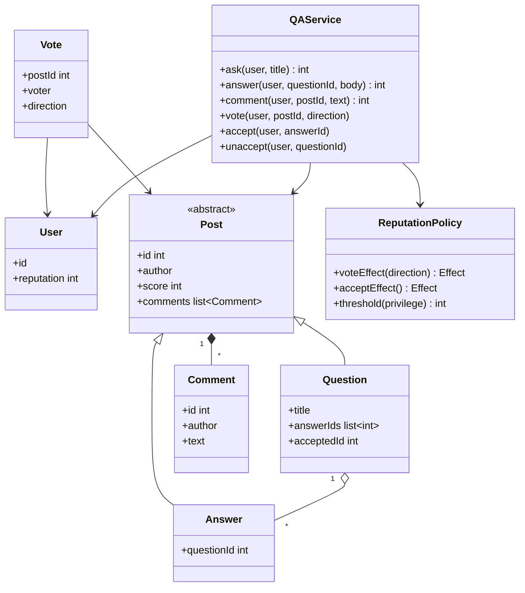
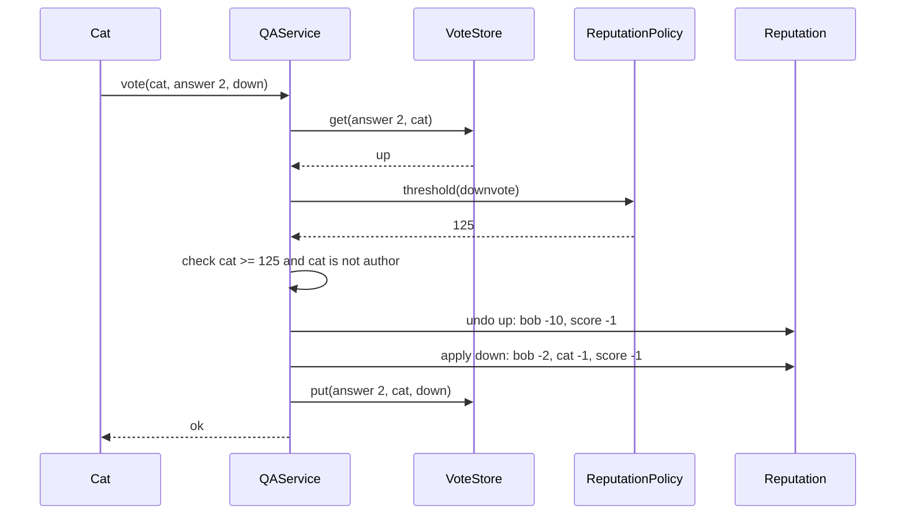

## In one minute
- The hard part is not storing questions and answers; it is the rules engine around them. Votes, accepted answers and reputation interact, and every one of them can be changed or undone later.
- Store one vote per (voter, post) as a direction: up, down or none. A vote change is then "remove the old effect, add the new one", so undo and up-to-down switches are exact and cannot drift.
- Reputation is a projection (the idea behind [event sourcing](https://martinfowler.com/eaaDev/EventSourcing.html)): 1 plus the sum of the effects of every vote and acceptance that currently stands. Apply it incrementally for speed, but keep the inputs so it can always be recomputed and checked.
- Privileges are thresholds on reputation (upvote at 15, comment anywhere at 50, downvote at 125). Put the numbers in one policy object, not scattered `if rep >= 125` checks.
- The problem shape is **contention** on hot rows (a viral answer's score and its author's reputation) plus **trust but verify** (recompute reputation from the vote log to catch drift).

## Requirements

### Functional
- Users ask questions, post answers to questions, and comment on either.
- Users vote a post up or down, change their vote, or withdraw it. Nobody votes on their own post.
- Reputation rules for this design: an upvote gives the post's author +10; a downvote costs the author 2 and the voter 1. Accepting an answer gives its author +15 and the asker +2, unless the asker accepted their own answer.
- The asker can accept one answer, switch to another, or unaccept.
- Privileges by reputation: upvote at 15, comment on other people's posts at 50, downvote at 125. Anyone can comment on their own posts. The 50-point comment gate is kept here because it makes a good threshold example and the practice tests use it; Stack Overflow itself removed it in October 2025, when commenting became available to all registered users ([Stack Overflow blog](https://stackoverflow.blog/2025/10/08/a-new-look-for-comments/)). A threshold that disappears is one more argument for keeping the numbers in a policy object.
- Show each post's score and each user's reputation.

### Non-functional
- Reputation and scores are exact and explainable: any user's number can be rebuilt from the votes that stand.
- Concurrent votes on a popular post never lose an update.
- Reads vastly outnumber writes, so page views compute nothing expensive.

### Out of scope
- Search, tags, badges, bounties, edits with revision history, moderation queues and close votes. We note where each plugs in.

## Entities and relationships

**User** has an id and a reputation. **Post** is the shared base for **Question** and **Answer**: an id, an author, a body, a score and a list of **Comment** objects. A Question also has a title, its answer ids and an optional accepted answer id. An Answer points to its question.

**Vote** is the relationship between a user and a post with a direction. It is keyed by (post, voter), which makes "one vote per user per post" a property of the data structure rather than a rule someone must remember to check. **ReputationPolicy** maps events (upvote received, downvote received, downvote cast, answer accepted, accepted an answer) to point values and holds the privilege thresholds. **QAService** is the facade that validates a request, consults the policy, and updates posts, votes and reputations together.

Comments carry no votes or reputation here, so they are a value list on a post rather than a third kind of Post.

## Class diagram



## Key flows

The interesting flow is a vote change. Cat upvoted Bob's answer yesterday and now switches to a downvote. The service reads the stored direction, checks the privilege for the new direction, then reverses the old effect and applies the new one in one critical section.



Accepting works the same way: reverse the previous acceptance's effect, then apply the new one.

## Design patterns used and why

**Strategy (a policy object)** for reputation and privileges. Point values have changed over the site's life: question upvotes went from +5 to +10 on 13 November 2019, applied retroactively to past votes ([Stack Overflow blog](https://stackoverflow.blog/2019/11/13/were-rewarding-the-question-askers/)), and the real site charges the voter only for downvoting answers, not questions ([Stack Overflow for Teams help](https://stackoverflowteams.com/help/whats-reputation/), which mirrors the public rules). When the numbers live in one `ReputationPolicy`, a rule change is a one-file diff plus a backfill job, and tests can run with a toy policy.

**Inheritance for Post**, used sparingly. Questions and answers really do share identity, authorship, score, voting and comments, and voting code should not care which one it got. The subclasses add only data (title, accepted id, question link). The "is-a" relation genuinely holds here.

**Observer or domain events** for side effects. A `VoteChanged(post, voter, old, new)` event is what badges, notifications, the "hot questions" ranker and the search indexer subscribe to. The practice applies reputation inline; at scale it becomes one more subscriber.

**Facade** in `QAService`: one method per user action, so the controller layer never coordinates posts, votes and reputations itself.

## Concurrency and edge cases

### Exactly one vote per user per post
Two clicks from the same user arrive at once (a double tap, or a retry after a timeout). With the vote keyed by (post, voter) and the read-compare-write done under one lock, the second request sees the direction already stored and is a no-op. In a database, a primary key on `(post_id, user_id)` plus `INSERT ... ON CONFLICT (post_id, user_id) DO UPDATE` gives the same guarantee: Postgres promises an atomic insert-or-update outcome even under high concurrency ([Postgres docs](https://www.postgresql.org/docs/current/sql-insert.html)), and the delta logic runs in the same transaction.

### Hot rows
A viral answer receives hundreds of votes a minute, and every one updates the same score row and the same author's reputation row. Row locks serialise them; that is correct but makes latency grow with popularity. Keep the transaction tiny (one insert, two increments), always lock in the same order (post, then author, then voter) so two transactions cannot deadlock, and use `score = score + delta` instead of read-then-write. If still too hot, log votes and fold them into the score asynchronously.

### Privilege checks use current reputation
Privileges gate new actions; a user who falls below 125 keeps the downvotes already cast. Withdrawing a vote never needs a privilege, otherwise a user who lost reputation could be stuck with a vote they regret.

### Accepting
Only the asker can accept, only an answer to that question can be accepted, and accepting the already accepted answer is a no-op. Self-accepts are allowed but earn nothing, which closes the obvious farming loop of answering your own question and accepting it.

### Caps and floors are policy
The real site floors reputation at 1 and caps reputation from votes and suggested edits at 200 per day; accepted answers, bounties and association bonuses are exempt from the cap ([help](https://stackoverflowteams.com/help/whats-reputation/)). Both break the "sum of effects" model (with a floor, undoing a downvote can return more than was taken), so they need the event log recomputed in time order with an injected clock.

## In the wild
- **Stack Overflow, 2019: a reputation rule change applied to history.** On 13 November 2019 the site raised the value of a question upvote from 5 to 10 reputation to match answer upvotes, and applied it retroactively to every past question upvote, which means every affected user's total was recomputed ([Stack Overflow blog](https://stackoverflow.blog/2019/11/13/were-rewarding-the-question-askers/)). It is only cheap if reputation is a projection of stored votes and the point values live in one policy.
- **Stack Overflow, 2025: a privilege threshold removed.** The 50-reputation requirement for commenting was dropped in October 2025; all registered users can comment, reply in threads and vote on comments ([Stack Overflow blog](https://stackoverflow.blog/2025/10/08/a-new-look-for-comments/)). Any code with `if rep >= 50` scattered around would have needed a hunt; a policy lookup needed one change.
- **Stack Overflow, 2016: a few machines serve a huge read load.** On 9 February 2016 the sites handled 209,420,973 HTTP requests (66,294,789 page loads) using 4 SQL Server machines in two AlwaysOn clusters, two main Redis servers and 9 primary web servers, with about 500,000 concurrent websocket connections at peak ([Nick Craver](https://nickcraver.com/blog/2016/02/17/stack-overflow-the-architecture-2016-edition/)). The design pressure is on caches and tiny write transactions, not on a big write cluster.

## Down the stack

### Layer 1: The contract
For every (post, voter) there is at most one standing vote. A post's score equals ups minus downs among standing votes. Every user's reputation equals 1 plus the sum of the policy effects of all standing votes and acceptances. Any sequence of vote changes that ends in the starting state leaves every number exactly where it began. A rejected action changes nothing.

### Layer 2: The mechanism
In memory: a map from post id to post, a map from user to reputation, and per post a map from voter to direction. A vote is O(1): one lookup, a delta of at most four integer updates, one store. The delta is `effect(new) - effect(old)` with `effect(none) = 0`, which is why undo and switch need no special cases. In a relational store this maps directly to the public Stack Exchange data dump's shape: a `Votes` table with a `VoteTypeId` (1 for accepted by originator, 2 for up, 3 for down), a denormalised `Score` on `Posts`, and `Reputation` on `Users`. Denormalised totals make the page read cheap; the votes table makes them verifiable.

### Layer 3: The machine
A vote in Postgres or SQL Server is a short transaction: insert or update a vote row of a few dozen bytes, update two rows with an increment, write the redo log and `fsync` on commit. On NVMe that commit is tens of microseconds; on networked storage it is about a millisecond, so one hot row tops out around a thousand serialised votes per second before batching helps. In memory, an uncontended Go `sync.Mutex` costs about 20 ns and the whole vote under it well under a microsecond. Stack Overflow's published 2016 architecture ran on four SQL Server machines, two main Redis servers and 11 IIS web servers, serving about 209 million HTTP requests on the day Nick Craver measured; vote counts were among the updates pushed over websockets ([Nick Craver](https://nickcraver.com/blog/2016/02/17/stack-overflow-the-architecture-2016-edition/)). That works because reads hit caches and writes like votes are tiny transactions.

### Why it's built this way
People change their minds, so votes are stored as current state per (post, voter), not as counters. Reputation must be explainable when someone asks "why did I lose 2 points?", so it is a projection of standing votes. Rules change over the years, so the numbers sit in one policy object. Popular posts concentrate writes on one row, so the transaction is minimal and ordered. Reads dominate, so totals are denormalised and the log exists to verify them.

## Extensibility
- **Bounties**: a new event type that moves reputation from the sponsor to the awarded answer; one policy entry and one service method, plus an expiry with an injected clock.
- **Badges and notifications**: subscribers to `VoteChanged` and `AnswerAccepted` events; the voting code does not change.
- **Close and delete**: a State for questions (open, closed, deleted). Deleting a post reverses the reputation from its votes, which the projection model handles by excluding it from the sum.

## Leadership lens
- The first review question is "can we rebuild every user's reputation from scratch, and does it match?" Run that recomputation in CI on a fixture and nightly in production; it catches every class of drift bug.
- Rule changes are product decisions with data migrations attached. The 2019 change to question upvote value needed a recalculation of every user's reputation; plan the backfill, the user communication and the rollback before merging the policy diff.
- Hot-row contention is a capacity question for the database owner, not just the feature team. Agree on a threshold (for example, votes per second on one post) at which the team switches to asynchronous score folding.
- Keep anti-abuse (serial voting, sock puppets) in a separate service that reverses votes through the normal `vote(..., none)` path, so the core stays simple and reputation stays consistent.

## Check yourself
1. Why is a vote stored as a direction per (post, voter) instead of incrementing `ups` and `downs` counters?
   **Answer:** Counters cannot tell whether this user already voted, so they cannot enforce one vote per user, reverse a vote exactly, or rebuild reputation. The per-voter record makes undo a delta between two known states.
2. Cat switches her vote on Bob's answer from up to down. What happens to Bob's and Cat's reputation and to the score?
   **Answer:** Bob loses the 10 from the upvote and 2 more for the downvote (-12), Cat pays 1, and the score drops by 2. Undoing it later restores all three exactly.
3. Ann accepted Bob's answer, then switches to Dan's. Which numbers change?
   **Answer:** Bob loses 15, Dan gains 15, and Ann's +2 stays because she still has an accepted answer. If Dan's answer were Ann's own, Ann would lose the 2 and nobody would gain.
4. A user at 125 downvotes and drops to 124. Can they withdraw that downvote? Should they be able to?
   **Answer:** Yes. Withdrawing needs no privilege; otherwise users who lose reputation would be stuck with votes they cannot change.

## Practice
**Task:** Implement the core of a Q&A site. `StackOverflow` supports `add_user(user, reputation=1)` (duplicate ids fail with `duplicate_user`), `ask(user, title)` and `answer(user, question_id, body)` returning integer post ids from one counter starting at 1 (answering a non-question fails with `not_a_question`), `comment(user, post_id, text)` returning a comment id and requiring reputation 50 unless the user wrote the post, and `comments(post_id)` returning `"author: text"` strings in order. `vote(user, post_id, direction)` with `"up"`, `"down"` or `"none"` sets that user's single vote on the post: same direction is a no-op; the author cannot vote (`self_vote`); new up needs 15 and new down needs 125 reputation (`insufficient_reputation`), withdrawing needs nothing. An upvote is worth +10 to the author and +1 score; a downvote -2 to the author, -1 to the voter and -1 score; a change reverses the old effect and applies the new one. `accept(user, answer_id)` lets only the asker (`not_owner`) accept an answer (`not_an_answer`), moving acceptance from any previous answer; acceptance gives +15 to the answerer and +2 to the asker unless they are the same person. `unaccept(user, question_id)` reverses it. `reputation(user)`, `score(post_id)`, `accepted(question_id)` (None when none) and `can(user, privilege)` for `"upvote"`, `"comment"`, `"downvote"` answer queries. Unknown users and posts fail with `unknown_user` and `unknown_post`, an unknown direction with `invalid_vote`. Every failure changes nothing.

```python starter
UPVOTE_REP = 15
COMMENT_REP = 50
DOWNVOTE_REP = 125


class QAError(Exception):
    def __init__(self, code):
        super().__init__(code)
        self.code = code


class StackOverflow:
    def add_user(self, user, reputation=1):
        raise NotImplementedError

    def ask(self, user, title):
        raise NotImplementedError

    def answer(self, user, question_id, body):
        raise NotImplementedError

    def comment(self, user, post_id, text):
        raise NotImplementedError

    def comments(self, post_id):
        raise NotImplementedError

    def vote(self, user, post_id, direction):
        raise NotImplementedError

    def accept(self, user, answer_id):
        raise NotImplementedError

    def unaccept(self, user, question_id):
        raise NotImplementedError

    def reputation(self, user):
        raise NotImplementedError

    def score(self, post_id):
        raise NotImplementedError

    def accepted(self, question_id):
        raise NotImplementedError

    def can(self, user, privilege):
        raise NotImplementedError
```

```python tests
def _setup():
    so = StackOverflow()
    so.add_user("ann")
    so.add_user("bob")
    so.add_user("cat", 200)
    so.add_user("dan", 20)
    q = so.ask("ann", "How do I reverse a list?")
    a = so.answer("bob", q, "Use slicing")
    return so, q, a


def _expect(code, fn):
    try:
        fn()
    except QAError as e:
        assert e.code == code, "expected %s, got %s" % (code, e.code)
        return
    assert False, "expected " + code


def test_upvote_rewards_author_and_score():
    so, q, a = _setup()
    so.vote("cat", a, "up")
    so.vote("dan", a, "up")
    so.vote("cat", q, "up")
    assert (so.reputation("bob"), so.score(a)) == (21, 2)
    assert (so.reputation("ann"), so.score(q)) == (11, 1)
    assert so.reputation("cat") == 200, "upvoting is free"


def test_downvote_costs_author_and_voter_and_needs_privilege():
    so, q, a = _setup()
    so.vote("cat", a, "down")
    assert (so.reputation("bob"), so.reputation("cat"), so.score(a)) == (-1, 199, -1)
    _expect("insufficient_reputation", lambda: so.vote("dan", a, "down"))
    _expect("insufficient_reputation", lambda: so.vote("ann", a, "up"))
    assert (so.reputation("dan"), so.score(a)) == (20, -1)


def test_self_vote_and_invalid_inputs_change_nothing():
    so, q, a = _setup()
    _expect("self_vote", lambda: so.vote("bob", a, "up"))
    _expect("invalid_vote", lambda: so.vote("cat", a, "sideways"))
    _expect("unknown_post", lambda: so.vote("cat", 99, "up"))
    _expect("unknown_user", lambda: so.vote("zed", a, "up"))
    _expect("duplicate_user", lambda: so.add_user("ann"))
    _expect("not_a_question", lambda: so.answer("cat", a, "nested"))
    assert (so.score(a), so.reputation("bob"), so.reputation("cat")) == (0, 1, 200)


def test_change_and_undo_restore_exactly():
    so, q, a = _setup()
    so.vote("cat", a, "up")
    so.vote("cat", a, "up")
    assert (so.reputation("bob"), so.score(a)) == (11, 1), "repeating a vote is a no-op"
    so.vote("cat", a, "down")
    assert (so.reputation("bob"), so.reputation("cat"), so.score(a)) == (-1, 199, -1)
    so.vote("cat", a, "none")
    assert (so.reputation("bob"), so.reputation("cat"), so.score(a)) == (1, 200, 0)


def test_accept_rewards_switches_and_unaccepts():
    so, q, a = _setup()
    a2 = so.answer("dan", q, "Use reversed()")
    _expect("not_owner", lambda: so.accept("bob", a))
    _expect("not_an_answer", lambda: so.accept("ann", q))
    so.accept("ann", a)
    so.accept("ann", a)
    assert (so.reputation("bob"), so.reputation("ann"), so.accepted(q)) == (16, 3, a)
    so.accept("ann", a2)
    assert (so.reputation("bob"), so.reputation("dan"), so.reputation("ann")) == (1, 35, 3)
    so.unaccept("ann", q)
    assert (so.reputation("dan"), so.reputation("ann"), so.accepted(q)) == (20, 1, None)


def test_self_accept_gives_no_reputation():
    so, q, a = _setup()
    own = so.answer("ann", q, "Found it myself")
    so.accept("ann", own)
    assert (so.reputation("ann"), so.accepted(q)) == (1, own)
    so.accept("ann", a)
    assert (so.reputation("ann"), so.reputation("bob")) == (3, 16)


def test_comment_privilege_and_earning_privileges():
    so, q, a = _setup()
    _expect("insufficient_reputation", lambda: so.comment("bob", q, "Which language?"))
    so.comment("bob", a, "Works in Python 3")
    so.comment("cat", q, "Python?")
    assert so.comments(q) == ["cat: Python?"]
    assert so.comments(a) == ["bob: Works in Python 3"]
    assert not so.can("bob", "upvote")
    so.accept("ann", a)
    assert so.can("bob", "upvote") and not so.can("bob", "comment")
    so.vote("bob", q, "up")
    assert so.reputation("ann") == 13
    assert so.can("cat", "downvote") and not so.can("dan", "downvote")
```

```python solution
UPVOTE_REP = 15
COMMENT_REP = 50
DOWNVOTE_REP = 125

THRESHOLDS = {"upvote": UPVOTE_REP, "comment": COMMENT_REP, "downvote": DOWNVOTE_REP}
# direction -> (author delta, voter delta, score delta)
VOTE_EFFECT = {"up": (10, 0, 1), "down": (-2, -1, -1), "none": (0, 0, 0)}
ACCEPT_ANSWERER, ACCEPT_ASKER = 15, 2


class QAError(Exception):
    def __init__(self, code):
        super().__init__(code)
        self.code = code


class Post:
    def __init__(self, post_id, author, question_id=None):
        self.id = post_id
        self.author = author
        self.question_id = question_id  # None for questions
        self.score = 0
        self.votes = {}
        self.comments = []
        self.accepted = None


class StackOverflow:
    def __init__(self):
        self._rep = {}
        self._posts = {}
        self._next_post = 1
        self._next_comment = 1

    def _user(self, user):
        if user not in self._rep:
            raise QAError("unknown_user")

    def _post(self, post_id):
        post = self._posts.get(post_id)
        if post is None:
            raise QAError("unknown_post")
        return post

    def _question(self, post_id):
        post = self._post(post_id)
        if post.question_id is not None:
            raise QAError("not_a_question")
        return post

    def _new_post(self, user, question_id):
        post = Post(self._next_post, user, question_id)
        self._posts[post.id] = post
        self._next_post += 1
        return post.id

    def add_user(self, user, reputation=1):
        if user in self._rep:
            raise QAError("duplicate_user")
        self._rep[user] = reputation

    def ask(self, user, title):
        self._user(user)
        return self._new_post(user, None)

    def answer(self, user, question_id, body):
        self._user(user)
        self._question(question_id)
        return self._new_post(user, question_id)

    def comment(self, user, post_id, text):
        self._user(user)
        post = self._post(post_id)
        if post.author != user and self._rep[user] < COMMENT_REP:
            raise QAError("insufficient_reputation")
        post.comments.append("%s: %s" % (user, text))
        cid = self._next_comment
        self._next_comment += 1
        return cid

    def comments(self, post_id):
        return list(self._post(post_id).comments)

    def _apply_vote(self, post, voter, direction, sign):
        author_d, voter_d, score_d = VOTE_EFFECT[direction]
        self._rep[post.author] += sign * author_d
        self._rep[voter] += sign * voter_d
        post.score += sign * score_d

    def vote(self, user, post_id, direction):
        self._user(user)
        post = self._post(post_id)
        if direction not in VOTE_EFFECT:
            raise QAError("invalid_vote")
        if post.author == user:
            raise QAError("self_vote")
        old = post.votes.get(user, "none")
        if old == direction:
            return
        if direction == "up" and self._rep[user] < UPVOTE_REP:
            raise QAError("insufficient_reputation")
        if direction == "down" and self._rep[user] < DOWNVOTE_REP:
            raise QAError("insufficient_reputation")
        self._apply_vote(post, user, old, -1)
        self._apply_vote(post, user, direction, 1)
        if direction == "none":
            del post.votes[user]
        else:
            post.votes[user] = direction

    def _apply_accept(self, question, answer_id, sign):
        answerer = self._posts[answer_id].author
        if answerer != question.author:
            self._rep[answerer] += sign * ACCEPT_ANSWERER
            self._rep[question.author] += sign * ACCEPT_ASKER

    def accept(self, user, answer_id):
        self._user(user)
        answer = self._post(answer_id)
        if answer.question_id is None:
            raise QAError("not_an_answer")
        question = self._posts[answer.question_id]
        if question.author != user:
            raise QAError("not_owner")
        if question.accepted == answer_id:
            return
        if question.accepted is not None:
            self._apply_accept(question, question.accepted, -1)
        question.accepted = answer_id
        self._apply_accept(question, answer_id, 1)

    def unaccept(self, user, question_id):
        self._user(user)
        question = self._question(question_id)
        if question.author != user:
            raise QAError("not_owner")
        if question.accepted is not None:
            self._apply_accept(question, question.accepted, -1)
            question.accepted = None

    def reputation(self, user):
        self._user(user)
        return self._rep[user]

    def score(self, post_id):
        return self._post(post_id).score

    def accepted(self, question_id):
        return self._question(question_id).accepted

    def can(self, user, privilege):
        self._user(user)
        if privilege not in THRESHOLDS:
            raise QAError("invalid_privilege")
        return self._rep[user] >= THRESHOLDS[privilege]
```

```typescript starter
export const UPVOTE_REP = 15;
export const COMMENT_REP = 50;
export const DOWNVOTE_REP = 125;

export class QAError extends Error {
  constructor(public code: string) {
    super(code);
  }
}

export class StackOverflow {
  addUser(user: string, reputation: number = 1): void {
    throw new Error("TODO");
  }
  ask(user: string, title: string): number {
    throw new Error("TODO");
  }
  answer(user: string, questionId: number, body: string): number {
    throw new Error("TODO");
  }
  comment(user: string, postId: number, text: string): number {
    throw new Error("TODO");
  }
  comments(postId: number): string[] {
    throw new Error("TODO");
  }
  vote(user: string, postId: number, direction: string): void {
    throw new Error("TODO");
  }
  accept(user: string, answerId: number): void {
    throw new Error("TODO");
  }
  unaccept(user: string, questionId: number): void {
    throw new Error("TODO");
  }
  reputation(user: string): number {
    throw new Error("TODO");
  }
  score(postId: number): number {
    throw new Error("TODO");
  }
  accepted(questionId: number): number | null {
    throw new Error("TODO");
  }
  can(user: string, privilege: string): boolean {
    throw new Error("TODO");
  }
}
```

```typescript tests
function setupSite(): [StackOverflow, number, number] {
  const so = new StackOverflow();
  so.addUser("ann");
  so.addUser("bob");
  so.addUser("cat", 200);
  so.addUser("dan", 20);
  const q = so.ask("ann", "How do I reverse a list?");
  const a = so.answer("bob", q, "Use slicing");
  return [so, q, a];
}

function errorCode(fn: () => unknown): string {
  try {
    fn();
  } catch (e) {
    return e instanceof QAError ? e.code : "other";
  }
  return "none";
}

test("upvote rewards author and score", () => {
  const [so, q, a] = setupSite();
  so.vote("cat", a, "up");
  so.vote("dan", a, "up");
  so.vote("cat", q, "up");
  assertEqual([so.reputation("bob"), so.score(a)], [21, 2]);
  assertEqual([so.reputation("ann"), so.score(q)], [11, 1]);
  assertEqual(so.reputation("cat"), 200, "upvoting is free");
});

test("downvote costs author and voter and needs privilege", () => {
  const [so, , a] = setupSite();
  so.vote("cat", a, "down");
  assertEqual([so.reputation("bob"), so.reputation("cat"), so.score(a)], [-1, 199, -1]);
  assertEqual(errorCode(() => so.vote("dan", a, "down")), "insufficient_reputation");
  assertEqual(errorCode(() => so.vote("ann", a, "up")), "insufficient_reputation");
  assertEqual([so.reputation("dan"), so.score(a)], [20, -1]);
});

test("self vote and invalid inputs change nothing", () => {
  const [so, , a] = setupSite();
  assertEqual(errorCode(() => so.vote("bob", a, "up")), "self_vote");
  assertEqual(errorCode(() => so.vote("cat", a, "sideways")), "invalid_vote");
  assertEqual(errorCode(() => so.vote("cat", 99, "up")), "unknown_post");
  assertEqual(errorCode(() => so.vote("zed", a, "up")), "unknown_user");
  assertEqual(errorCode(() => so.addUser("ann")), "duplicate_user");
  assertEqual(errorCode(() => so.answer("cat", a, "nested")), "not_a_question");
  assertEqual([so.score(a), so.reputation("bob"), so.reputation("cat")], [0, 1, 200]);
});

test("change and undo restore exactly", () => {
  const [so, , a] = setupSite();
  so.vote("cat", a, "up");
  so.vote("cat", a, "up");
  assertEqual([so.reputation("bob"), so.score(a)], [11, 1], "repeating a vote is a no-op");
  so.vote("cat", a, "down");
  assertEqual([so.reputation("bob"), so.reputation("cat"), so.score(a)], [-1, 199, -1]);
  so.vote("cat", a, "none");
  assertEqual([so.reputation("bob"), so.reputation("cat"), so.score(a)], [1, 200, 0]);
});

test("accept rewards, switches and unaccepts", () => {
  const [so, q, a] = setupSite();
  const a2 = so.answer("dan", q, "Use reversed()");
  assertEqual(errorCode(() => so.accept("bob", a)), "not_owner");
  assertEqual(errorCode(() => so.accept("ann", q)), "not_an_answer");
  so.accept("ann", a);
  so.accept("ann", a);
  assertEqual([so.reputation("bob"), so.reputation("ann"), so.accepted(q)], [16, 3, a]);
  so.accept("ann", a2);
  assertEqual([so.reputation("bob"), so.reputation("dan"), so.reputation("ann")], [1, 35, 3]);
  so.unaccept("ann", q);
  assertEqual([so.reputation("dan"), so.reputation("ann"), so.accepted(q)], [20, 1, null]);
});

test("self accept gives no reputation", () => {
  const [so, q, a] = setupSite();
  const own = so.answer("ann", q, "Found it myself");
  so.accept("ann", own);
  assertEqual([so.reputation("ann"), so.accepted(q)], [1, own]);
  so.accept("ann", a);
  assertEqual([so.reputation("ann"), so.reputation("bob")], [3, 16]);
});

test("comment privilege and earning privileges", () => {
  const [so, q, a] = setupSite();
  assertEqual(errorCode(() => so.comment("bob", q, "Which language?")), "insufficient_reputation");
  so.comment("bob", a, "Works in Python 3");
  so.comment("cat", q, "Python?");
  assertEqual(so.comments(q), ["cat: Python?"]);
  assertEqual(so.comments(a), ["bob: Works in Python 3"]);
  assert(!so.can("bob", "upvote"), "bob starts at 1");
  so.accept("ann", a);
  assert(so.can("bob", "upvote") && !so.can("bob", "comment"), "16 rep: upvote only");
  so.vote("bob", q, "up");
  assertEqual(so.reputation("ann"), 13);
  assert(so.can("cat", "downvote") && !so.can("dan", "downvote"), "downvote threshold");
});
```

```typescript solution
export const UPVOTE_REP = 15;
export const COMMENT_REP = 50;
export const DOWNVOTE_REP = 125;

const THRESHOLDS: Record<string, number> = { upvote: UPVOTE_REP, comment: COMMENT_REP, downvote: DOWNVOTE_REP };
// direction -> [author delta, voter delta, score delta]
const VOTE_EFFECT: Record<string, [number, number, number]> = {
  up: [10, 0, 1],
  down: [-2, -1, -1],
  none: [0, 0, 0],
};
const ACCEPT_ANSWERER = 15;
const ACCEPT_ASKER = 2;

export class QAError extends Error {
  constructor(public code: string) {
    super(code);
  }
}

interface Post {
  id: number;
  author: string;
  questionId: number | null;
  score: number;
  votes: Map<string, string>;
  comments: string[];
  accepted: number | null;
}

export class StackOverflow {
  private rep = new Map<string, number>();
  private posts = new Map<number, Post>();
  private nextPost = 1;
  private nextComment = 1;

  private user(user: string): void {
    if (!this.rep.has(user)) throw new QAError("unknown_user");
  }

  private post(id: number): Post {
    const p = this.posts.get(id);
    if (!p) throw new QAError("unknown_post");
    return p;
  }

  private question(id: number): Post {
    const p = this.post(id);
    if (p.questionId !== null) throw new QAError("not_a_question");
    return p;
  }

  private bump(user: string, delta: number): void {
    this.rep.set(user, this.rep.get(user)! + delta);
  }

  private newPost(author: string, questionId: number | null): number {
    const id = this.nextPost++;
    this.posts.set(id, { id, author, questionId, score: 0, votes: new Map(), comments: [], accepted: null });
    return id;
  }

  addUser(user: string, reputation: number = 1): void {
    if (this.rep.has(user)) throw new QAError("duplicate_user");
    this.rep.set(user, reputation);
  }

  ask(user: string, title: string): number {
    this.user(user);
    return this.newPost(user, null);
  }

  answer(user: string, questionId: number, body: string): number {
    this.user(user);
    this.question(questionId);
    return this.newPost(user, questionId);
  }

  comment(user: string, postId: number, text: string): number {
    this.user(user);
    const p = this.post(postId);
    if (p.author !== user && this.rep.get(user)! < COMMENT_REP) throw new QAError("insufficient_reputation");
    p.comments.push(`${user}: ${text}`);
    return this.nextComment++;
  }

  comments(postId: number): string[] {
    return [...this.post(postId).comments];
  }

  private applyVote(p: Post, voter: string, direction: string, sign: number): void {
    const [authorD, voterD, scoreD] = VOTE_EFFECT[direction];
    this.bump(p.author, sign * authorD);
    this.bump(voter, sign * voterD);
    p.score += sign * scoreD;
  }

  vote(user: string, postId: number, direction: string): void {
    this.user(user);
    const p = this.post(postId);
    if (!Object.prototype.hasOwnProperty.call(VOTE_EFFECT, direction)) throw new QAError("invalid_vote");
    if (p.author === user) throw new QAError("self_vote");
    const old = p.votes.get(user) ?? "none";
    if (old === direction) return;
    const rep = this.rep.get(user)!;
    if ((direction === "up" && rep < UPVOTE_REP) || (direction === "down" && rep < DOWNVOTE_REP)) {
      throw new QAError("insufficient_reputation");
    }
    this.applyVote(p, user, old, -1);
    this.applyVote(p, user, direction, 1);
    if (direction === "none") p.votes.delete(user);
    else p.votes.set(user, direction);
  }

  private applyAccept(q: Post, answerId: number, sign: number): void {
    const answerer = this.posts.get(answerId)!.author;
    if (answerer !== q.author) {
      this.bump(answerer, sign * ACCEPT_ANSWERER);
      this.bump(q.author, sign * ACCEPT_ASKER);
    }
  }

  accept(user: string, answerId: number): void {
    this.user(user);
    const a = this.post(answerId);
    if (a.questionId === null) throw new QAError("not_an_answer");
    const q = this.posts.get(a.questionId)!;
    if (q.author !== user) throw new QAError("not_owner");
    if (q.accepted === answerId) return;
    if (q.accepted !== null) this.applyAccept(q, q.accepted, -1);
    q.accepted = answerId;
    this.applyAccept(q, answerId, 1);
  }

  unaccept(user: string, questionId: number): void {
    this.user(user);
    const q = this.question(questionId);
    if (q.author !== user) throw new QAError("not_owner");
    if (q.accepted !== null) {
      this.applyAccept(q, q.accepted, -1);
      q.accepted = null;
    }
  }

  reputation(user: string): number {
    this.user(user);
    return this.rep.get(user)!;
  }

  score(postId: number): number {
    return this.post(postId).score;
  }

  accepted(questionId: number): number | null {
    return this.question(questionId).accepted;
  }

  can(user: string, privilege: string): boolean {
    this.user(user);
    if (!(privilege in THRESHOLDS)) throw new QAError("invalid_privilege");
    return this.rep.get(user)! >= THRESHOLDS[privilege];
  }
}
```

```go starter
package practice

import "errors"

const (
	UpvoteRep   = 15
	CommentRep  = 50
	DownvoteRep = 125
)

var (
	ErrUnknownUser    = errors.New("unknown_user")
	ErrDuplicateUser  = errors.New("duplicate_user")
	ErrUnknownPost    = errors.New("unknown_post")
	ErrNotAQuestion   = errors.New("not_a_question")
	ErrNotAnAnswer    = errors.New("not_an_answer")
	ErrSelfVote       = errors.New("self_vote")
	ErrInsufficient   = errors.New("insufficient_reputation")
	ErrInvalidVote    = errors.New("invalid_vote")
	ErrNotOwner       = errors.New("not_owner")
	ErrInvalidPrivile = errors.New("invalid_privilege")
)

type StackOverflow struct{}

func New() *StackOverflow { return &StackOverflow{} }

func (s *StackOverflow) AddUser(user string, reputation int) error { panic("TODO") }
func (s *StackOverflow) Ask(user, title string) (int, error)       { panic("TODO") }
func (s *StackOverflow) Answer(user string, questionID int, body string) (int, error) {
	panic("TODO")
}
func (s *StackOverflow) Comment(user string, postID int, text string) (int, error) {
	panic("TODO")
}
func (s *StackOverflow) Comments(postID int) ([]string, error)              { panic("TODO") }
func (s *StackOverflow) Vote(user string, postID int, direction string) error { panic("TODO") }
func (s *StackOverflow) Accept(user string, answerID int) error              { panic("TODO") }
func (s *StackOverflow) Unaccept(user string, questionID int) error          { panic("TODO") }
func (s *StackOverflow) Reputation(user string) (int, error)                 { panic("TODO") }
func (s *StackOverflow) Score(postID int) (int, error)                       { panic("TODO") }

// Accepted returns the accepted answer id, or 0 when there is none.
func (s *StackOverflow) Accepted(questionID int) (int, error)       { panic("TODO") }
func (s *StackOverflow) Can(user, privilege string) (bool, error) { panic("TODO") }
```

```go tests
package practice

import (
	"errors"
	"reflect"
	"testing"
)

func setupSite(t *testing.T) (*StackOverflow, int, int) {
	t.Helper()
	so := New()
	for _, u := range []struct {
		name string
		rep  int
	}{{"ann", 1}, {"bob", 1}, {"cat", 200}, {"dan", 20}} {
		if err := so.AddUser(u.name, u.rep); err != nil {
			t.Fatal(err)
		}
	}
	q, err := so.Ask("ann", "How do I reverse a list?")
	if err != nil {
		t.Fatal(err)
	}
	a, err := so.Answer("bob", q, "Use slicing")
	if err != nil {
		t.Fatal(err)
	}
	return so, q, a
}

func ok(t *testing.T, err error) {
	t.Helper()
	if err != nil {
		t.Fatalf("unexpected error: %v", err)
	}
}

func wantErr(t *testing.T, want, got error) {
	t.Helper()
	if !errors.Is(got, want) {
		t.Fatalf("want %v, got %v", want, got)
	}
}

func reps(so *StackOverflow, users ...string) []int {
	out := make([]int, len(users))
	for i, u := range users {
		out[i], _ = so.Reputation(u)
	}
	return out
}

func score(so *StackOverflow, id int) int {
	s, _ := so.Score(id)
	return s
}

func check(t *testing.T, got, want []int) {
	t.Helper()
	if !reflect.DeepEqual(got, want) {
		t.Fatalf("got %v, want %v", got, want)
	}
}

func TestUpvoteRewardsAuthorAndScore(t *testing.T) {
	so, q, a := setupSite(t)
	ok(t, so.Vote("cat", a, "up"))
	ok(t, so.Vote("dan", a, "up"))
	ok(t, so.Vote("cat", q, "up"))
	check(t, []int{reps(so, "bob")[0], score(so, a)}, []int{21, 2})
	check(t, []int{reps(so, "ann")[0], score(so, q)}, []int{11, 1})
	check(t, reps(so, "cat"), []int{200})
}

func TestDownvoteCostsAuthorAndVoterAndNeedsPrivilege(t *testing.T) {
	so, _, a := setupSite(t)
	ok(t, so.Vote("cat", a, "down"))
	check(t, append(reps(so, "bob", "cat"), score(so, a)), []int{-1, 199, -1})
	wantErr(t, ErrInsufficient, so.Vote("dan", a, "down"))
	wantErr(t, ErrInsufficient, so.Vote("ann", a, "up"))
	check(t, append(reps(so, "dan"), score(so, a)), []int{20, -1})
}

func TestSelfVoteAndInvalidInputsChangeNothing(t *testing.T) {
	so, _, a := setupSite(t)
	wantErr(t, ErrSelfVote, so.Vote("bob", a, "up"))
	wantErr(t, ErrInvalidVote, so.Vote("cat", a, "sideways"))
	wantErr(t, ErrUnknownPost, so.Vote("cat", 99, "up"))
	wantErr(t, ErrUnknownUser, so.Vote("zed", a, "up"))
	wantErr(t, ErrDuplicateUser, so.AddUser("ann", 1))
	_, err := so.Answer("cat", a, "nested")
	wantErr(t, ErrNotAQuestion, err)
	check(t, append([]int{score(so, a)}, reps(so, "bob", "cat")...), []int{0, 1, 200})
}

func TestChangeAndUndoRestoreExactly(t *testing.T) {
	so, _, a := setupSite(t)
	ok(t, so.Vote("cat", a, "up"))
	ok(t, so.Vote("cat", a, "up"))
	check(t, append(reps(so, "bob"), score(so, a)), []int{11, 1})
	ok(t, so.Vote("cat", a, "down"))
	check(t, append(reps(so, "bob", "cat"), score(so, a)), []int{-1, 199, -1})
	ok(t, so.Vote("cat", a, "none"))
	check(t, append(reps(so, "bob", "cat"), score(so, a)), []int{1, 200, 0})
}

func TestAcceptRewardsSwitchesAndUnaccepts(t *testing.T) {
	so, q, a := setupSite(t)
	a2, err := so.Answer("dan", q, "Use reversed()")
	ok(t, err)
	wantErr(t, ErrNotOwner, so.Accept("bob", a))
	wantErr(t, ErrNotAnAnswer, so.Accept("ann", q))
	ok(t, so.Accept("ann", a))
	ok(t, so.Accept("ann", a))
	acc, _ := so.Accepted(q)
	check(t, append(reps(so, "bob", "ann"), acc), []int{16, 3, a})
	ok(t, so.Accept("ann", a2))
	check(t, reps(so, "bob", "dan", "ann"), []int{1, 35, 3})
	ok(t, so.Unaccept("ann", q))
	acc, _ = so.Accepted(q)
	check(t, append(reps(so, "dan", "ann"), acc), []int{20, 1, 0})
}

func TestSelfAcceptGivesNoReputation(t *testing.T) {
	so, q, a := setupSite(t)
	own, err := so.Answer("ann", q, "Found it myself")
	ok(t, err)
	ok(t, so.Accept("ann", own))
	acc, _ := so.Accepted(q)
	check(t, append(reps(so, "ann"), acc), []int{1, own})
	ok(t, so.Accept("ann", a))
	check(t, reps(so, "ann", "bob"), []int{3, 16})
}

func TestCommentPrivilegeAndEarningPrivileges(t *testing.T) {
	so, q, a := setupSite(t)
	_, err := so.Comment("bob", q, "Which language?")
	wantErr(t, ErrInsufficient, err)
	_, err = so.Comment("bob", a, "Works in Python 3")
	ok(t, err)
	_, err = so.Comment("cat", q, "Python?")
	ok(t, err)
	if c, _ := so.Comments(q); !reflect.DeepEqual(c, []string{"cat: Python?"}) {
		t.Fatalf("got %v", c)
	}
	if c, _ := so.Comments(a); !reflect.DeepEqual(c, []string{"bob: Works in Python 3"}) {
		t.Fatalf("got %v", c)
	}
	if can, _ := so.Can("bob", "upvote"); can {
		t.Fatal("bob starts at 1")
	}
	ok(t, so.Accept("ann", a))
	up, _ := so.Can("bob", "upvote")
	cm, _ := so.Can("bob", "comment")
	if !up || cm {
		t.Fatal("16 rep: upvote only")
	}
	ok(t, so.Vote("bob", q, "up"))
	check(t, reps(so, "ann"), []int{13})
	catDown, _ := so.Can("cat", "downvote")
	danDown, _ := so.Can("dan", "downvote")
	if !catDown || danDown {
		t.Fatal("downvote threshold")
	}
}
```

```go solution
package practice

import (
	"errors"
	"fmt"
	"sync"
)

const (
	UpvoteRep   = 15
	CommentRep  = 50
	DownvoteRep = 125
)

var (
	ErrUnknownUser    = errors.New("unknown_user")
	ErrDuplicateUser  = errors.New("duplicate_user")
	ErrUnknownPost    = errors.New("unknown_post")
	ErrNotAQuestion   = errors.New("not_a_question")
	ErrNotAnAnswer    = errors.New("not_an_answer")
	ErrSelfVote       = errors.New("self_vote")
	ErrInsufficient   = errors.New("insufficient_reputation")
	ErrInvalidVote    = errors.New("invalid_vote")
	ErrNotOwner       = errors.New("not_owner")
	ErrInvalidPrivile = errors.New("invalid_privilege")
)

var thresholds = map[string]int{"upvote": UpvoteRep, "comment": CommentRep, "downvote": DownvoteRep}

// effect of a standing vote: author delta, voter delta, score delta.
type effect struct{ author, voter, score int }

var voteEffect = map[string]effect{"up": {10, 0, 1}, "down": {-2, -1, -1}, "none": {}}

const (
	acceptAnswerer = 15
	acceptAsker    = 2
)

type post struct {
	id, questionID int // questionID == 0 for questions
	author         string
	score          int
	votes          map[string]string
	comments       []string
	accepted       int
}

type StackOverflow struct {
	mu          sync.Mutex
	rep         map[string]int
	posts       map[int]*post
	nextPost    int
	nextComment int
}

func New() *StackOverflow {
	return &StackOverflow{rep: map[string]int{}, posts: map[int]*post{}, nextPost: 1, nextComment: 1}
}

func (s *StackOverflow) user(u string) error {
	if _, ok := s.rep[u]; !ok {
		return fmt.Errorf("%w: %s", ErrUnknownUser, u)
	}
	return nil
}

func (s *StackOverflow) post(id int) (*post, error) {
	p, ok := s.posts[id]
	if !ok {
		return nil, fmt.Errorf("%w: %d", ErrUnknownPost, id)
	}
	return p, nil
}

func (s *StackOverflow) question(id int) (*post, error) {
	p, err := s.post(id)
	if err != nil {
		return nil, err
	}
	if p.questionID != 0 {
		return nil, ErrNotAQuestion
	}
	return p, nil
}

func (s *StackOverflow) newPost(author string, questionID int) int {
	id := s.nextPost
	s.nextPost++
	s.posts[id] = &post{id: id, questionID: questionID, author: author, votes: map[string]string{}}
	return id
}

func (s *StackOverflow) AddUser(user string, reputation int) error {
	s.mu.Lock()
	defer s.mu.Unlock()
	if _, ok := s.rep[user]; ok {
		return ErrDuplicateUser
	}
	s.rep[user] = reputation
	return nil
}

func (s *StackOverflow) Ask(user, title string) (int, error) {
	s.mu.Lock()
	defer s.mu.Unlock()
	if err := s.user(user); err != nil {
		return 0, err
	}
	return s.newPost(user, 0), nil
}

func (s *StackOverflow) Answer(user string, questionID int, body string) (int, error) {
	s.mu.Lock()
	defer s.mu.Unlock()
	if err := s.user(user); err != nil {
		return 0, err
	}
	if _, err := s.question(questionID); err != nil {
		return 0, err
	}
	return s.newPost(user, questionID), nil
}

func (s *StackOverflow) Comment(user string, postID int, text string) (int, error) {
	s.mu.Lock()
	defer s.mu.Unlock()
	if err := s.user(user); err != nil {
		return 0, err
	}
	p, err := s.post(postID)
	if err != nil {
		return 0, err
	}
	if p.author != user && s.rep[user] < CommentRep {
		return 0, ErrInsufficient
	}
	p.comments = append(p.comments, user+": "+text)
	id := s.nextComment
	s.nextComment++
	return id, nil
}

func (s *StackOverflow) Comments(postID int) ([]string, error) {
	s.mu.Lock()
	defer s.mu.Unlock()
	p, err := s.post(postID)
	if err != nil {
		return nil, err
	}
	return append([]string(nil), p.comments...), nil
}

func (s *StackOverflow) applyVote(p *post, voter, direction string, sign int) {
	e := voteEffect[direction]
	s.rep[p.author] += sign * e.author
	s.rep[voter] += sign * e.voter
	p.score += sign * e.score
}

func (s *StackOverflow) Vote(user string, postID int, direction string) error {
	s.mu.Lock()
	defer s.mu.Unlock()
	if err := s.user(user); err != nil {
		return err
	}
	p, err := s.post(postID)
	if err != nil {
		return err
	}
	if _, ok := voteEffect[direction]; !ok {
		return ErrInvalidVote
	}
	if p.author == user {
		return ErrSelfVote
	}
	old, ok := p.votes[user]
	if !ok {
		old = "none"
	}
	if old == direction {
		return nil
	}
	if (direction == "up" && s.rep[user] < UpvoteRep) || (direction == "down" && s.rep[user] < DownvoteRep) {
		return ErrInsufficient
	}
	s.applyVote(p, user, old, -1)
	s.applyVote(p, user, direction, 1)
	if direction == "none" {
		delete(p.votes, user)
	} else {
		p.votes[user] = direction
	}
	return nil
}

func (s *StackOverflow) applyAccept(q *post, answerID, sign int) {
	answerer := s.posts[answerID].author
	if answerer != q.author {
		s.rep[answerer] += sign * acceptAnswerer
		s.rep[q.author] += sign * acceptAsker
	}
}

func (s *StackOverflow) Accept(user string, answerID int) error {
	s.mu.Lock()
	defer s.mu.Unlock()
	if err := s.user(user); err != nil {
		return err
	}
	a, err := s.post(answerID)
	if err != nil {
		return err
	}
	if a.questionID == 0 {
		return ErrNotAnAnswer
	}
	q := s.posts[a.questionID]
	if q.author != user {
		return ErrNotOwner
	}
	if q.accepted == answerID {
		return nil
	}
	if q.accepted != 0 {
		s.applyAccept(q, q.accepted, -1)
	}
	q.accepted = answerID
	s.applyAccept(q, answerID, 1)
	return nil
}

func (s *StackOverflow) Unaccept(user string, questionID int) error {
	s.mu.Lock()
	defer s.mu.Unlock()
	if err := s.user(user); err != nil {
		return err
	}
	q, err := s.question(questionID)
	if err != nil {
		return err
	}
	if q.author != user {
		return ErrNotOwner
	}
	if q.accepted != 0 {
		s.applyAccept(q, q.accepted, -1)
		q.accepted = 0
	}
	return nil
}

func (s *StackOverflow) Reputation(user string) (int, error) {
	s.mu.Lock()
	defer s.mu.Unlock()
	if err := s.user(user); err != nil {
		return 0, err
	}
	return s.rep[user], nil
}

func (s *StackOverflow) Score(postID int) (int, error) {
	s.mu.Lock()
	defer s.mu.Unlock()
	p, err := s.post(postID)
	if err != nil {
		return 0, err
	}
	return p.score, nil
}

// Accepted returns the accepted answer id, or 0 when there is none.
func (s *StackOverflow) Accepted(questionID int) (int, error) {
	s.mu.Lock()
	defer s.mu.Unlock()
	q, err := s.question(questionID)
	if err != nil {
		return 0, err
	}
	return q.accepted, nil
}

func (s *StackOverflow) Can(user, privilege string) (bool, error) {
	s.mu.Lock()
	defer s.mu.Unlock()
	if err := s.user(user); err != nil {
		return false, err
	}
	need, ok := thresholds[privilege]
	if !ok {
		return false, ErrInvalidPrivile
	}
	return s.rep[user] >= need, nil
}
```

## Mock interview
**Prompt:** Design the object model and core logic for a Q&A site like Stack Overflow: questions, answers, comments, voting, accepted answers, reputation and privileges unlocked by reputation. Assume 20 million users and a few thousand votes per minute at peak, with some answers receiving hundreds of votes in an hour. End with working code for voting and reputation.

- Follow-up: a user upvotes, switches to a downvote, then withdraws it. Walk me through every number that changes at each step and prove they end where they started.
- Follow-up: an answer goes viral and its vote requests start timing out on database locks. What is happening, and what do you change first?
- Follow-up: product wants a daily cap of 200 reputation from votes and a floor of 1. What breaks in your incremental design, and how do you restructure it?

**A strong answer covers:**
- One direction per (post, voter), enforced by the key or a unique index, with changes applied as `effect(new) - effect(old)`.
- Reputation and score as projections of standing votes and acceptances, verifiable by recomputation.
- One policy object for point values and thresholds, since real rules change and need backfills.
- Hot rows: minimal transactions, in-place increments, a fixed lock order, asynchronous folding as the escape hatch.
- Caps and floors make reputation order-dependent, so it is recomputed from a time-ordered event log.

## Sources and further study

**Primary**
- [PostgreSQL: INSERT and ON CONFLICT](https://www.postgresql.org/docs/current/sql-insert.html): the atomic upsert that enforces one vote per user per post.
- [Stack Overflow blog: rewarding the question askers (2019)](https://stackoverflow.blog/2019/11/13/were-rewarding-the-question-askers/): the dated, retroactive rule change.

**Systems docs**
- [Stack Overflow blog: a new look for comments (2025)](https://stackoverflow.blog/2025/10/08/a-new-look-for-comments/): the removal of the commenting threshold.
- [Stack Overflow for Teams: what is reputation](https://stackoverflowteams.com/help/whats-reputation/): point values, the 200 per day cap and its exemptions, the floor of 1 and self-acceptance.
- [Nick Craver: Stack Overflow, the architecture (2016)](https://nickcraver.com/blog/2016/02/17/stack-overflow-the-architecture-2016-edition/): hardware counts and daily traffic.

**Books**
- *Design Patterns*, Gamma, Helm, Johnson and Vlissides: chapter 4 (Structural: Facade) and chapter 5 (Behavioral: Strategy, Observer, State).
- *Head First Design Patterns*, Freeman and Robson: chapter 1 (Strategy), chapter 2 (Observer) and chapter 7 (Facade).
- *Designing Data-Intensive Applications*, Martin Kleppmann (1st edition): chapter 7 (Transactions) for atomic increments and write conflicts, and chapter 11 (Stream Processing) for deriving state from an event log.

**Other curricula**
- [Refactoring.Guru: Strategy](https://refactoring.guru/design-patterns/strategy): the pattern behind the swappable reputation policy.
- [donnemartin/system-design-primer](https://github.com/donnemartin/system-design-primer): no Q&A-site chapter; its caching and database-scaling material covers the read-heavy side of this design.

## Watch
- [Low Level Design: Live Coding, Making StackOverflow (Utkarsh Bindal)](https://www.youtube.com/watch?v=0030gDHf-QI): a live-coded object model for questions, answers and votes.
- [Flipkart LLD Round: Stack Overflow Clone, Part 1 (Deep Tech)](https://www.youtube.com/watch?v=L4ocSo6QBtI): the problem as asked in a machine-coding round, with requirements and classes.
- [Stack Overflow Low Level Design (Soumyajit Bhattacharyay)](https://www.youtube.com/watch?v=eTB0nxb-j-Q): a full code walkthrough with SOLID-based class design.

## Free resources
- [Stack Overflow: The Architecture, 2016 Edition (Nick Craver)](https://nickcraver.com/blog/2016/02/17/stack-overflow-the-architecture-2016-edition/): how the real site serves enormous read traffic from a small number of servers.
- [We're rewarding the question askers (Stack Overflow blog)](https://stackoverflow.blog/2019/11/13/were-rewarding-the-question-askers/): the 2019 change of question upvotes from +5 to +10, a real example of a reputation rule change.
- [Stack Exchange data dump (Internet Archive)](https://archive.org/details/stackexchange): the public Posts, Votes and Users tables, useful to see how votes and scores are actually stored.
- [Event Sourcing (Martin Fowler)](https://martinfowler.com/eaaDev/EventSourcing.html): the idea behind treating reputation as a projection of a vote log.
- [INSERT and ON CONFLICT (PostgreSQL docs)](https://www.postgresql.org/docs/current/sql-insert.html): the upsert that enforces one vote per user per post in a database.
- [Observer pattern (Refactoring.Guru)](https://refactoring.guru/design-patterns/observer): the pattern behind badges, notifications and indexers reacting to vote events.
