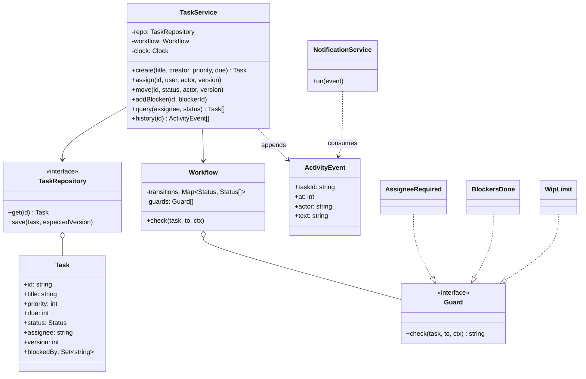
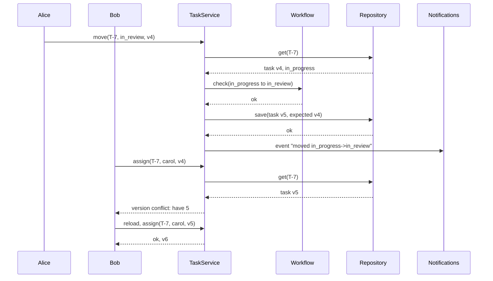

## In one minute
- A task tracker (think Jira, Asana or Linear at the size of one team) looks like CRUD, but the interview is about three rules: a workflow that decides which status changes are legal, dependencies that block work, and many people editing the same task without silently overwriting each other.
- Model the workflow as data: a transition table per project plus guards ("needs an assignee", "blockers must be done"). A class per status adds files without adding behaviour.
- Give every task a version number and make every write conditional on the version the user saw. That is optimistic concurrency, and it turns a lost update into a visible, recoverable conflict.
- Record every change as an immutable activity event. History, notifications to watchers and audit all read from the same stream.
- The shape is **multi-step consistency** plus **contention** on shared records. The same versioned-write idea guards a wiki page, a shopping cart and a Kubernetes object (its `resourceVersion`).

## Requirements

Functional:
- Create tasks with a title, description, priority (1 is highest), optional due date, creator and optional assignee.
- Move tasks through a workflow: `todo`, `in_progress`, `in_review`, `done`, with reopening allowed. Some moves have rules: nobody works on an unassigned task, and a task cannot start or finish while a task blocking it is unfinished.
- Mark one task as blocked by another and refuse dependency cycles.
- Limit work in progress: each person may have at most N tasks in `in_progress`.
- Show a task's full history and list tasks filtered by assignee and status, ordered by priority, then due date.
- Notify watchers when something they follow changes.

Non-functional:
- No lost updates: if two people edit the same task, the second sees a conflict instead of erasing the first change.
- History is append-only and attributable (who, what, when).
- Board and list views return in under 100 ms for projects with tens of thousands of tasks.

Out of scope: real-time collaborative editing of descriptions (see [Design Google Docs](../sdi/design-google-docs.md)), time tracking, and running scheduled jobs, which is a different problem covered in [Design Task Scheduler](design-task-scheduler.md).

## Entities and relationships

- **Project** owns tasks, a workflow and a WIP limit. It is the unit of permission and configuration.
- **Task** has an id, title, priority, due date, status, assignee, version, and the set of task ids that block it. It is the unit of contention.
- **User** is referenced by id. Users have roles per project (viewer, member, admin), which guards decide on.
- **Workflow** is a transition table (`from` to allowed `to` statuses) plus a list of **Guard** objects checked before a move.
- **ActivityEvent** is immutable: task id, time, actor, kind and details. **Comment** is an activity event with text.
- **Watcher** links a user to a task. **NotificationService** consumes activity events and decides who hears about them.
- **TaskRepository** stores tasks and supports conditional saves on version. **TaskQuery** describes filters and ordering.

A project composes its tasks and workflow. Tasks reference users and other tasks by id rather than holding object pointers: it keeps tasks serialisable, avoids cycles in the object graph, and matches how the database stores them. A subtask is a task with a parent id, so progress roll-ups can treat a task tree as a Composite.

## Class diagram



## Key flows

Two people open the same task at version 4. Alice moves it to review; Bob, still looking at version 4, tries to reassign it.



## Design patterns used and why

- **State as a table, not as classes.** The classic State pattern gives each status its own class. Here statuses have no behaviour of their own; the rules live on the edges between them. A transition table lets each project configure its own workflow (add `qa`, remove `in_review`) without code, and it is easy to render as a diagram for users. The [State](state.md) lesson shows the class-per-state form for comparison.
- **Specification or Chain of guards** for the rules on moves. Each guard is small (`AssigneeRequired`, `BlockersDone`, `WipLimit`, `OnlyAdminsReopen`) and returns a reason or nothing. The workflow runs them in order and reports the first failure, so new rules arrive as new classes, not as more `if` branches. Jira draws the same line between two kinds of guard: a *condition* decides whether a user may attempt a transition at all (the button is hidden), while a *validator* checks the input and rejects the move with a reason, leaving the issue in its status ([Atlassian docs](https://support.atlassian.com/jira-cloud-administration/docs/configure-advanced-issue-workflows/)). Keeping those two apart gives the UI both a clean menu of legal moves and a useful error message.
- **Observer** through the activity stream. The service appends events; notifications, search indexing and webhooks subscribe. The task code never knows who is listening.
- **Repository** for storage, with `save(task, expectedVersion)` as the only write. This puts the concurrency rule in one place instead of trusting every caller to remember it.
- **Composite** for subtasks when you need roll-ups: a parent's progress is the share of its leaf tasks that are done, computed recursively.

## Concurrency and edge cases

- **Lost update.** Without versions, Alice's status change and Bob's reassignment both read the old row and the last save wins, silently undoing one. A conditional write (`UPDATE task SET ..., version = version + 1 WHERE id = $1 AND version = $2`, checking one row changed) turns that into a conflict the client can resolve by reloading. This is the pattern Martin Fowler calls [Optimistic Offline Lock](https://martinfowler.com/eaaCatalog/optimisticOfflineLock.html). It stays correct under Postgres's default Read Committed level because a blocked updater re-evaluates its `WHERE` clause against the newly committed row, so a stale version no longer matches ([Postgres docs](https://www.postgresql.org/docs/current/transaction-iso.html)).
- **WIP limit check-then-act.** Two moves for the same person can both see "2 of 3 in progress" and both succeed, ending at 4. The count and the move must be checked in one transaction, or the per-user counter must be a row updated conditionally.
- **Blocker reopened mid-move.** If a blocker is reopened between the guard check and the save, the guard's answer is stale. Either lock the blocker rows for the transaction or accept a narrow window and run a periodic consistency check. Say which, and why.
- **Dependency cycles.** "A blocks B, B blocks C, C blocks A" deadlocks the work. Before adding an edge, search from the new blocker along its own blockers; if the search reaches the task, refuse. With a few links per task this is microseconds.
- **Deleting a blocker.** Deleting a task that blocks others should either be refused or remove the edges and record that in the history of the blocked tasks; never leave dangling ids. Prefer a soft delete (a `deleted_at` tombstone) so a mistaken bulk delete can be undone; Atlassian's April 2022 outage is the large-scale version of this lesson (see below).
- **Time zones.** Store due dates as UTC instants; sorting local date strings breaks for distributed teams.
- **Notification storms.** A bulk move of 500 tasks should produce one digest per watcher, not 500 emails. Coalesce events per recipient over a short window.

## In the wild
- **Atlassian, 2022: a deletion script took out 775 customers' Jira and Confluence sites.** A script meant to remove one retired app was given cloud site IDs instead of app IDs, and the deletion API accepted both without warning. It ran for about 23 minutes on 5 April and deleted 883 sites belonging to 775 customers; some were down for up to 14 days. Review had checked the endpoint and call method but not the IDs, and staging did not have the IDs. Atlassian blocked bulk site deletion, committed to soft-delete for customer data and accelerated multi-site restore drills ([Atlassian post-incident review](https://www.atlassian.com/engineering/post-incident-review-april-2022-outage)).
- **Kubernetes, ongoing: every object carries a version for conditional writes.** The API server rejects an update whose `resourceVersion` is stale with `409 Conflict`, and the docs tell clients that need lost-update detection to make writes conditional on it and retry on conflict. Controllers and humans editing the same object are the "two people, one task" case at cluster scale ([Kubernetes API concepts](https://kubernetes.io/docs/reference/using-api/api-concepts/)).

## Down the stack

### Layer 1: The contract
A write that names version v either applies completely and returns version v + 1, or changes nothing and reports the current version. A move succeeds only along a configured transition and only when every guard passes against the state being written. Every successful change appends exactly one activity event, in the same transaction, so history never disagrees with state. Queries return tasks ordered by priority, then due date (no date last), then creation order, and reflect all committed writes at the time of the read.

### Layer 2: The mechanism
In a relational store, a task row carries `version INT NOT NULL`. Writes are conditional updates, and the API exposes the version as an HTTP `ETag`; a client sends `If-Match`, and a server that sees no matching entity tag must not run the method and may answer `412 Precondition Failed` ([RFC 9110](https://www.rfc-editor.org/rfc/rfc9110.html#name-if-match)). The spec ties "lost update" avoidance to strong validators, so a weak `W/` tag is the wrong choice for a version number. Kubernetes uses the same idea with `metadata.resourceVersion` and returns `409 Conflict` for a stale one ([Kubernetes API concepts](https://kubernetes.io/docs/reference/using-api/api-concepts/)). The activity table is append-only with an index on `(task_id, at)`. List views use a composite index such as `(project_id, assignee_id, status, priority, due_at)` so the filter and the sort are served by one B-tree range scan instead of a sort of every row. Blocker edges live in a join table `(task_id, blocker_id)` indexed both ways, which makes "what blocks me" and "what do I block" equally cheap. The guard for blockers is a single query: count blockers whose status is not `done`.

### Layer 3: The machine
A task row with a short title and a dozen fixed fields is a few hundred bytes, so an 8 KB Postgres page holds dozens; a project with 50,000 tasks fits in a few megabytes and stays in the buffer cache. A B-tree lookup on a warm index touches three or four pages, each a memory access of well under a microsecond, so a filtered board query costs more in serialising JSON than in finding rows. A conditional update that commits waits for one write-ahead log flush, roughly 0.1 to 1 ms on NVMe. Version conflicts cost a round trip and a re-render on the client, tens to hundreds of milliseconds, but they are rare because two people rarely edit the same task in the same second. That rarity is the economic case for optimistic over pessimistic locking: no lock is held while a human thinks for 30 seconds in an edit dialog.

### Why it's built this way
1. People edit in slow dialogs, so holding a lock during an edit would block colleagues for minutes; optimistic versions hold nothing.
2. Conflicts are rare but costly when silent, so the write must detect them and the UI must show them.
3. Teams disagree on process, so the workflow is configuration, and the rules on it are small pluggable guards.
4. Questions like "who moved this and when" come up in every retrospective and audit, so history is an append-only stream written with the change.
5. Boards are read far more than written, so indexes match the board's filter and sort exactly.

## Extensibility

- **Custom workflows per project.** Store the transition table and guard list per project; validate on save that every status is reachable from the initial one and that `done` is reachable from every status.
- **Custom fields.** A JSON column with a per-project schema is simpler than an entity-attribute-value table and indexes well enough in Postgres with expression indexes. Validate values against the schema in the service, not in the UI.
- **Automation rules.** "When a pull request merges, move the task to review" is an activity subscriber that issues commands through the same service, so guards and versions still apply.
- **Sprints and boards.** A sprint is a time-boxed set of task ids with its own history. Boards are saved queries plus a column mapping from status to column.
- **Scale beyond one database.** Partition by project id: almost every query and every guard stays within one project, so the partition key matches the access pattern.

## Leadership lens

- Build first: the task model with versioned writes, the transition table with two guards, and the activity log written in the same transaction. Notifications and automation can follow.
- Ask in review: where is the version checked; what happens on conflict in the UI; which guards read data that can change concurrently, and is that window acceptable; how are workflows migrated when a project removes a status that tasks still hold.
- Ownership: one team owns the core task service and its invariants; integrations (Git, chat, email) are subscribers owned by others, and they can never bypass the service to write tasks directly.
- Cost: storage is cheap, but notification email and webhook fan-out grow with watchers times events. Batch and rate-limit them from day one.
- In an interview, do not spend 20 minutes on `Epic`, `Story` and `Bug` subclasses. A `type` field and per-type workflows cover it.

## Check yourself
1. Why is a transition table usually a better fit than one class per status here?
   **Answer:** The rules sit on transitions, not in statuses, and they vary per project. A table is configuration that each project can change without code, while classes would need a deploy for every workflow tweak.
2. Alice and Bob both load task T at version 3. Alice saves first. What does Bob see and why is that better than last-write-wins?
   **Answer:** Bob's write names version 3, the task is now at 4, so he gets a conflict and must reload. Last-write-wins would silently erase Alice's change, and nobody would know until much later.
3. How do you detect that adding "A is blocked by B" creates a cycle?
   **Answer:** Search from B through the tasks that block B, and so on. If the search reaches A (or B is A), the new edge would close a cycle, so refuse it.
4. The WIP limit is 3. Two moves for the same person arrive at once with 2 in progress. What makes the limit hold?
   **Answer:** Checking the count and writing the move in one serialised step: a lock or transaction around both, or a conditional update on a per-user counter. Two independent checks both see 2 and both pass.

## Practice
**Task:** Implement `TaskBoard(wip_limit, clock)`. `create(title, creator, priority, due)` returns ids `T-1`, `T-2` and so on; tasks start in `todo`, unassigned, at version 1 (`due` 0 means none). Every mutation takes the acting user and the version the caller saw, fails with `version conflict: have <v>` when it differs, and on success bumps the version and appends `(time, actor, text)` to the task's history (`created`, `assigned <user>`, `moved <from>-><to>`). `assign(id, user, actor, version)` sets the assignee. `move(id, status, actor, version)` allows `todo->in_progress`, `in_progress->todo`, `in_progress->in_review`, `in_review->in_progress`, `in_review->done` and `done->in_progress`, failing with `illegal transition: <from>-><to>`; moves into `in_progress` need an assignee (`unassigned`) and the assignee below the WIP limit of tasks in progress (`wip limit reached: <user>`), and moves into `in_progress` or `done` need every blocker done (`blocked by <id>`, the lowest-numbered unfinished one). Checks run in that order, after the version check. `add_blocker(id, blocker)` fails with `cycle` if it would make a task depend on itself directly or indirectly. `query(assignee, status)` (either may be empty to match all) returns ids ordered by priority, then due date with no date last, then creation order. Unknown ids fail with `unknown task: <id>`.

```python starter
class TaskBoard:
    def __init__(self, wip_limit, clock):
        self._clock = clock

    def create(self, title, creator, priority, due):
        raise NotImplementedError

    def version(self, task_id):
        raise NotImplementedError

    def status(self, task_id):
        raise NotImplementedError

    def assign(self, task_id, user, actor, version):
        raise NotImplementedError

    def move(self, task_id, status, actor, version):
        raise NotImplementedError

    def add_blocker(self, task_id, blocker_id):
        raise NotImplementedError

    def query(self, assignee, status):
        raise NotImplementedError

    def history(self, task_id):
        raise NotImplementedError
```

```python tests
class FakeClock:
    def __init__(self):
        self.t = 100

    def now(self):
        return self.t


def error_of(fn):
    try:
        fn()
    except ValueError as e:
        return str(e)
    return None


def start(board, tid, user):
    board.assign(tid, user, user, board.version(tid))
    board.move(tid, "in_progress", user, board.version(tid))


def test_create_and_query_order():
    b = TaskBoard(3, FakeClock())
    assert b.create("write spec", "ann", 2, 0) == "T-1"
    assert b.create("fix login", "ann", 1, 500) == "T-2"
    assert b.create("fix signup", "ann", 1, 300) == "T-3"
    assert b.create("triage", "ann", 1, 0) == "T-4"
    assert b.create("refactor", "ann", 2, 0) == "T-5"
    assert b.status("T-1") == "todo" and b.version("T-1") == 1
    assert b.query("", "") == ["T-3", "T-2", "T-4", "T-1", "T-5"]


def test_happy_path_and_history():
    clock = FakeClock()
    b = TaskBoard(3, clock)
    tid = b.create("ship it", "ann", 1, 0)
    clock.t = 110
    b.assign(tid, "bob", "ann", 1)
    clock.t = 120
    b.move(tid, "in_progress", "bob", 2)
    b.move(tid, "in_review", "bob", 3)
    clock.t = 130
    b.move(tid, "done", "ann", 4)
    assert b.version(tid) == 5 and b.status(tid) == "done"
    assert b.history(tid) == [
        (100, "ann", "created"),
        (110, "ann", "assigned bob"),
        (120, "bob", "moved todo->in_progress"),
        (120, "bob", "moved in_progress->in_review"),
        (130, "ann", "moved in_review->done"),
    ]


def test_illegal_and_unassigned():
    b = TaskBoard(3, FakeClock())
    tid = b.create("x", "ann", 1, 0)
    assert error_of(lambda: b.move(tid, "done", "ann", 1)) == "illegal transition: todo->done"
    assert error_of(lambda: b.move(tid, "in_progress", "ann", 1)) == "unassigned"
    assert b.version(tid) == 1 and len(b.history(tid)) == 1


def test_stale_version_is_a_conflict():
    b = TaskBoard(3, FakeClock())
    tid = b.create("x", "ann", 1, 0)
    b.assign(tid, "bob", "ann", 1)
    assert error_of(lambda: b.assign(tid, "carol", "dan", 1)) == "version conflict: have 2"
    assert b.query("bob", "") == [tid], "Bob still assigned"
    b.assign(tid, "carol", "dan", 2)
    assert b.query("carol", "todo") == [tid]


def test_blockers_and_cycles():
    b = TaskBoard(3, FakeClock())
    a = b.create("a", "ann", 1, 0)
    c = b.create("c", "ann", 1, 0)
    d = b.create("d", "ann", 1, 0)
    b.add_blocker(a, d)
    b.add_blocker(a, c)
    b.add_blocker(c, d)
    assert error_of(lambda: b.add_blocker(d, a)) == "cycle"
    assert error_of(lambda: b.add_blocker(a, a)) == "cycle"
    b.assign(a, "bob", "bob", 1)
    assert error_of(lambda: b.move(a, "in_progress", "bob", 2)) == "blocked by T-2"
    start(b, d, "eve")
    b.move(d, "in_review", "eve", b.version(d))
    b.move(d, "done", "eve", b.version(d))
    assert error_of(lambda: b.move(a, "in_progress", "bob", 2)) == "blocked by T-2"
    start(b, c, "eve")
    b.move(c, "in_review", "eve", b.version(c))
    b.move(c, "done", "eve", b.version(c))
    b.move(a, "in_progress", "bob", 2)
    assert b.status(a) == "in_progress"


def test_wip_limit_per_assignee():
    b = TaskBoard(2, FakeClock())
    ids = [b.create("t" + str(i), "ann", 1, 0) for i in range(4)]
    start(b, ids[0], "bob")
    start(b, ids[1], "bob")
    b.assign(ids[2], "bob", "bob", 1)
    assert error_of(lambda: b.move(ids[2], "in_progress", "bob", 2)) == "wip limit reached: bob"
    start(b, ids[3], "eve")
    b.move(ids[0], "in_review", "bob", b.version(ids[0]))
    b.move(ids[2], "in_progress", "bob", 2)
    assert b.query("bob", "in_progress") == [ids[1], ids[2]]


def test_unknown_task():
    b = TaskBoard(3, FakeClock())
    assert error_of(lambda: b.assign("T-9", "bob", "ann", 1)) == "unknown task: T-9"
    assert error_of(lambda: b.history("T-9")) == "unknown task: T-9"
```

```python solution
TRANSITIONS = {
    "todo": ("in_progress",),
    "in_progress": ("todo", "in_review"),
    "in_review": ("in_progress", "done"),
    "done": ("in_progress",),
}


class _Task:
    def __init__(self, num, title, priority, due):
        self.num = num
        self.title = title
        self.priority = priority
        self.due = due
        self.status = "todo"
        self.assignee = ""
        self.version = 1
        self.blockers = set()
        self.history = []


class TaskBoard:
    def __init__(self, wip_limit, clock):
        self._wip = wip_limit
        self._clock = clock
        self._tasks = {}
        self._next = 1

    def _get(self, task_id):
        if task_id not in self._tasks:
            raise ValueError("unknown task: " + task_id)
        return self._tasks[task_id]

    def _commit(self, task, actor, text):
        task.version += 1
        task.history.append((self._clock.now(), actor, text))

    def _check_version(self, task, version):
        if task.version != version:
            raise ValueError("version conflict: have %d" % task.version)

    def create(self, title, creator, priority, due):
        tid = "T-%d" % self._next
        task = _Task(self._next, title, priority, due)
        self._next += 1
        task.history.append((self._clock.now(), creator, "created"))
        self._tasks[tid] = task
        return tid

    def version(self, task_id):
        return self._get(task_id).version

    def status(self, task_id):
        return self._get(task_id).status

    def assign(self, task_id, user, actor, version):
        task = self._get(task_id)
        self._check_version(task, version)
        task.assignee = user
        self._commit(task, actor, "assigned " + user)

    def move(self, task_id, status, actor, version):
        task = self._get(task_id)
        self._check_version(task, version)
        if status not in TRANSITIONS.get(task.status, ()):
            raise ValueError("illegal transition: %s->%s" % (task.status, status))
        if status == "in_progress":
            if not task.assignee:
                raise ValueError("unassigned")
            busy = sum(1 for t in self._tasks.values()
                       if t.assignee == task.assignee and t.status == "in_progress")
            if busy >= self._wip:
                raise ValueError("wip limit reached: " + task.assignee)
        if status in ("in_progress", "done"):
            pending = [self._tasks[b] for b in task.blockers if self._tasks[b].status != "done"]
            if pending:
                first = min(pending, key=lambda t: t.num)
                raise ValueError("blocked by T-%d" % first.num)
        old = task.status
        task.status = status
        self._commit(task, actor, "moved %s->%s" % (old, status))

    def add_blocker(self, task_id, blocker_id):
        self._get(task_id)
        self._get(blocker_id)
        stack, seen = [blocker_id], set()
        while stack:
            cur = stack.pop()
            if cur == task_id:
                raise ValueError("cycle")
            if cur not in seen:
                seen.add(cur)
                stack.extend(self._tasks[cur].blockers)
        self._tasks[task_id].blockers.add(blocker_id)

    def query(self, assignee, status):
        hits = [(tid, t) for tid, t in self._tasks.items()
                if (not assignee or t.assignee == assignee) and (not status or t.status == status)]
        hits.sort(key=lambda p: (p[1].priority, p[1].due == 0, p[1].due, p[1].num))
        return [tid for tid, _ in hits]

    def history(self, task_id):
        return list(self._get(task_id).history)
```

```typescript starter
export interface Clock { now(): number }

export type HistoryEntry = [number, string, string];

export class TaskBoard {
  constructor(private wipLimit: number, private clock: Clock) {}

  create(title: string, creator: string, priority: number, due: number): string { throw new Error("TODO"); }
  version(id: string): number { throw new Error("TODO"); }
  status(id: string): string { throw new Error("TODO"); }
  assign(id: string, user: string, actor: string, version: number): void { throw new Error("TODO"); }
  move(id: string, status: string, actor: string, version: number): void { throw new Error("TODO"); }
  addBlocker(id: string, blockerId: string): void { throw new Error("TODO"); }
  query(assignee: string, status: string): string[] { throw new Error("TODO"); }
  history(id: string): HistoryEntry[] { throw new Error("TODO"); }
}
```

```typescript tests
class FakeClock implements Clock {
  t = 100;
  now(): number { return this.t; }
}

function errorOf(fn: () => void): string | null {
  try { fn(); return null; } catch (e) { return (e as Error).message; }
}

function startWork(b: TaskBoard, id: string, user: string): void {
  b.assign(id, user, user, b.version(id));
  b.move(id, "in_progress", user, b.version(id));
}

test("create and query order", () => {
  const b = new TaskBoard(3, new FakeClock());
  assertEqual(b.create("write spec", "ann", 2, 0), "T-1");
  assertEqual(b.create("fix login", "ann", 1, 500), "T-2");
  assertEqual(b.create("fix signup", "ann", 1, 300), "T-3");
  assertEqual(b.create("triage", "ann", 1, 0), "T-4");
  assertEqual(b.create("refactor", "ann", 2, 0), "T-5");
  assert(b.status("T-1") === "todo" && b.version("T-1") === 1, "defaults");
  assertEqual(b.query("", ""), ["T-3", "T-2", "T-4", "T-1", "T-5"]);
});

test("happy path and history", () => {
  const clock = new FakeClock();
  const b = new TaskBoard(3, clock);
  const id = b.create("ship it", "ann", 1, 0);
  clock.t = 110;
  b.assign(id, "bob", "ann", 1);
  clock.t = 120;
  b.move(id, "in_progress", "bob", 2);
  b.move(id, "in_review", "bob", 3);
  clock.t = 130;
  b.move(id, "done", "ann", 4);
  assert(b.version(id) === 5 && b.status(id) === "done", "done at v5");
  assertEqual(b.history(id), [
    [100, "ann", "created"],
    [110, "ann", "assigned bob"],
    [120, "bob", "moved todo->in_progress"],
    [120, "bob", "moved in_progress->in_review"],
    [130, "ann", "moved in_review->done"],
  ]);
});

test("illegal and unassigned", () => {
  const b = new TaskBoard(3, new FakeClock());
  const id = b.create("x", "ann", 1, 0);
  assertEqual(errorOf(() => b.move(id, "done", "ann", 1)), "illegal transition: todo->done");
  assertEqual(errorOf(() => b.move(id, "in_progress", "ann", 1)), "unassigned");
  assert(b.version(id) === 1 && b.history(id).length === 1, "unchanged");
});

test("stale version is a conflict", () => {
  const b = new TaskBoard(3, new FakeClock());
  const id = b.create("x", "ann", 1, 0);
  b.assign(id, "bob", "ann", 1);
  assertEqual(errorOf(() => b.assign(id, "carol", "dan", 1)), "version conflict: have 2");
  assertEqual(b.query("bob", ""), [id], "Bob still assigned");
  b.assign(id, "carol", "dan", 2);
  assertEqual(b.query("carol", "todo"), [id]);
});

test("blockers and cycles", () => {
  const b = new TaskBoard(3, new FakeClock());
  const a = b.create("a", "ann", 1, 0);
  const c = b.create("c", "ann", 1, 0);
  const d = b.create("d", "ann", 1, 0);
  b.addBlocker(a, d);
  b.addBlocker(a, c);
  b.addBlocker(c, d);
  assertEqual(errorOf(() => b.addBlocker(d, a)), "cycle");
  assertEqual(errorOf(() => b.addBlocker(a, a)), "cycle");
  b.assign(a, "bob", "bob", 1);
  assertEqual(errorOf(() => b.move(a, "in_progress", "bob", 2)), "blocked by T-2");
  startWork(b, d, "eve");
  b.move(d, "in_review", "eve", b.version(d));
  b.move(d, "done", "eve", b.version(d));
  assertEqual(errorOf(() => b.move(a, "in_progress", "bob", 2)), "blocked by T-2");
  startWork(b, c, "eve");
  b.move(c, "in_review", "eve", b.version(c));
  b.move(c, "done", "eve", b.version(c));
  b.move(a, "in_progress", "bob", 2);
  assertEqual(b.status(a), "in_progress");
});

test("wip limit per assignee", () => {
  const b = new TaskBoard(2, new FakeClock());
  const ids = [0, 1, 2, 3].map((i) => b.create("t" + i, "ann", 1, 0));
  startWork(b, ids[0], "bob");
  startWork(b, ids[1], "bob");
  b.assign(ids[2], "bob", "bob", 1);
  assertEqual(errorOf(() => b.move(ids[2], "in_progress", "bob", 2)), "wip limit reached: bob");
  startWork(b, ids[3], "eve");
  b.move(ids[0], "in_review", "bob", b.version(ids[0]));
  b.move(ids[2], "in_progress", "bob", 2);
  assertEqual(b.query("bob", "in_progress"), [ids[1], ids[2]]);
});

test("unknown task", () => {
  const b = new TaskBoard(3, new FakeClock());
  assertEqual(errorOf(() => b.assign("T-9", "bob", "ann", 1)), "unknown task: T-9");
  assertEqual(errorOf(() => b.history("T-9")), "unknown task: T-9");
});
```

```typescript solution
export interface Clock { now(): number }

export type HistoryEntry = [number, string, string];

const TRANSITIONS: Record<string, string[]> = {
  todo: ["in_progress"],
  in_progress: ["todo", "in_review"],
  in_review: ["in_progress", "done"],
  done: ["in_progress"],
};

interface TaskRec {
  num: number;
  title: string;
  priority: number;
  due: number;
  status: string;
  assignee: string;
  version: number;
  blockers: Set<string>;
  history: HistoryEntry[];
}

export class TaskBoard {
  private tasks = new Map<string, TaskRec>();
  private nextNum = 1;

  constructor(private wipLimit: number, private clock: Clock) {}

  private get(id: string): TaskRec {
    const t = this.tasks.get(id);
    if (!t) throw new Error("unknown task: " + id);
    return t;
  }

  private checkVersion(t: TaskRec, version: number): void {
    if (t.version !== version) throw new Error("version conflict: have " + t.version);
  }

  private commit(t: TaskRec, actor: string, text: string): void {
    t.version++;
    t.history.push([this.clock.now(), actor, text]);
  }

  create(title: string, creator: string, priority: number, due: number): string {
    const id = "T-" + this.nextNum;
    this.tasks.set(id, {
      num: this.nextNum++, title, priority, due, status: "todo", assignee: "",
      version: 1, blockers: new Set(), history: [[this.clock.now(), creator, "created"]],
    });
    return id;
  }

  version(id: string): number { return this.get(id).version; }

  status(id: string): string { return this.get(id).status; }

  assign(id: string, user: string, actor: string, version: number): void {
    const t = this.get(id);
    this.checkVersion(t, version);
    t.assignee = user;
    this.commit(t, actor, "assigned " + user);
  }

  move(id: string, status: string, actor: string, version: number): void {
    const t = this.get(id);
    this.checkVersion(t, version);
    if (!(TRANSITIONS[t.status] ?? []).includes(status)) {
      throw new Error(`illegal transition: ${t.status}->${status}`);
    }
    if (status === "in_progress") {
      if (!t.assignee) throw new Error("unassigned");
      let busy = 0;
      this.tasks.forEach((o) => { if (o.assignee === t.assignee && o.status === "in_progress") busy++; });
      if (busy >= this.wipLimit) throw new Error("wip limit reached: " + t.assignee);
    }
    if (status === "in_progress" || status === "done") {
      let first: TaskRec | null = null;
      t.blockers.forEach((bid) => {
        const bt = this.tasks.get(bid)!;
        if (bt.status !== "done" && (first === null || bt.num < first.num)) first = bt;
      });
      if (first !== null) throw new Error("blocked by T-" + (first as TaskRec).num);
    }
    const old = t.status;
    t.status = status;
    this.commit(t, actor, `moved ${old}->${status}`);
  }

  addBlocker(id: string, blockerId: string): void {
    const t = this.get(id);
    this.get(blockerId);
    const stack = [blockerId];
    const seen = new Set<string>();
    while (stack.length > 0) {
      const cur = stack.pop()!;
      if (cur === id) throw new Error("cycle");
      if (seen.has(cur)) continue;
      seen.add(cur);
      this.tasks.get(cur)!.blockers.forEach((b) => stack.push(b));
    }
    t.blockers.add(blockerId);
  }

  query(assignee: string, status: string): string[] {
    const hits: Array<[string, TaskRec]> = [];
    this.tasks.forEach((t, id) => {
      if ((!assignee || t.assignee === assignee) && (!status || t.status === status)) hits.push([id, t]);
    });
    const dueKey = (t: TaskRec) => (t.due === 0 ? Number.MAX_SAFE_INTEGER : t.due);
    hits.sort((x, y) => x[1].priority - y[1].priority || dueKey(x[1]) - dueKey(y[1]) || x[1].num - y[1].num);
    return hits.map((h) => h[0]);
  }

  history(id: string): HistoryEntry[] {
    return this.get(id).history.slice();
  }
}
```

```go starter
package practice

type Clock interface{ Now() int64 }

type Event struct {
	At    int64
	Actor string
	Text  string
}

type TaskBoard struct{}

func NewTaskBoard(wipLimit int, clock Clock) *TaskBoard { return &TaskBoard{} }

func (b *TaskBoard) Create(title, creator string, priority int, due int64) string { panic("TODO") }

func (b *TaskBoard) Version(id string) (int, error) { panic("TODO") }

func (b *TaskBoard) Status(id string) (string, error) { panic("TODO") }

func (b *TaskBoard) Assign(id, user, actor string, version int) error { panic("TODO") }

func (b *TaskBoard) Move(id, status, actor string, version int) error { panic("TODO") }

func (b *TaskBoard) AddBlocker(id, blockerID string) error { panic("TODO") }

func (b *TaskBoard) Query(assignee, status string) []string { panic("TODO") }

func (b *TaskBoard) History(id string) ([]Event, error) { panic("TODO") }
```

```go tests
package practice

import (
	"fmt"
	"reflect"
	"testing"
)

type fakeClock struct{ t int64 }

func (c *fakeClock) Now() int64 { return c.t }

func errText(err error) string {
	if err == nil {
		return ""
	}
	return err.Error()
}

func ver(t *testing.T, b *TaskBoard, id string) int {
	t.Helper()
	v, err := b.Version(id)
	if err != nil {
		t.Fatal(err)
	}
	return v
}

func must(t *testing.T, err error) {
	t.Helper()
	if err != nil {
		t.Fatal(err)
	}
}

func startWork(t *testing.T, b *TaskBoard, id, user string) {
	t.Helper()
	must(t, b.Assign(id, user, user, ver(t, b, id)))
	must(t, b.Move(id, "in_progress", user, ver(t, b, id)))
}

func finish(t *testing.T, b *TaskBoard, id, user string) {
	t.Helper()
	startWork(t, b, id, user)
	must(t, b.Move(id, "in_review", user, ver(t, b, id)))
	must(t, b.Move(id, "done", user, ver(t, b, id)))
}

func TestCreateAndQueryOrder(t *testing.T) {
	b := NewTaskBoard(3, &fakeClock{100})
	specs := []struct {
		prio int
		due  int64
	}{{2, 0}, {1, 500}, {1, 300}, {1, 0}, {2, 0}}
	for i, s := range specs {
		if id := b.Create("t", "ann", s.prio, s.due); id != fmt.Sprintf("T-%d", i+1) {
			t.Fatalf("id %s", id)
		}
	}
	if st, _ := b.Status("T-1"); st != "todo" || ver(t, b, "T-1") != 1 {
		t.Fatalf("defaults %s", st)
	}
	if got := b.Query("", ""); !reflect.DeepEqual(got, []string{"T-3", "T-2", "T-4", "T-1", "T-5"}) {
		t.Fatalf("order %v", got)
	}
}

func TestHappyPathAndHistory(t *testing.T) {
	c := &fakeClock{100}
	b := NewTaskBoard(3, c)
	id := b.Create("ship it", "ann", 1, 0)
	c.t = 110
	must(t, b.Assign(id, "bob", "ann", 1))
	c.t = 120
	must(t, b.Move(id, "in_progress", "bob", 2))
	must(t, b.Move(id, "in_review", "bob", 3))
	c.t = 130
	must(t, b.Move(id, "done", "ann", 4))
	if st, _ := b.Status(id); st != "done" || ver(t, b, id) != 5 {
		t.Fatalf("status %s", st)
	}
	h, _ := b.History(id)
	want := []Event{{100, "ann", "created"}, {110, "ann", "assigned bob"},
		{120, "bob", "moved todo->in_progress"}, {120, "bob", "moved in_progress->in_review"},
		{130, "ann", "moved in_review->done"}}
	if !reflect.DeepEqual(h, want) {
		t.Fatalf("history %v", h)
	}
}

func TestIllegalAndUnassigned(t *testing.T) {
	b := NewTaskBoard(3, &fakeClock{100})
	id := b.Create("x", "ann", 1, 0)
	if err := b.Move(id, "done", "ann", 1); errText(err) != "illegal transition: todo->done" {
		t.Fatalf("got %v", err)
	}
	if err := b.Move(id, "in_progress", "ann", 1); errText(err) != "unassigned" {
		t.Fatalf("got %v", err)
	}
	if h, _ := b.History(id); ver(t, b, id) != 1 || len(h) != 1 {
		t.Fatal("should be unchanged")
	}
}

func TestStaleVersionIsAConflict(t *testing.T) {
	b := NewTaskBoard(3, &fakeClock{100})
	id := b.Create("x", "ann", 1, 0)
	must(t, b.Assign(id, "bob", "ann", 1))
	if err := b.Assign(id, "carol", "dan", 1); errText(err) != "version conflict: have 2" {
		t.Fatalf("got %v", err)
	}
	if got := b.Query("bob", ""); !reflect.DeepEqual(got, []string{id}) {
		t.Fatalf("bob should still be assigned: %v", got)
	}
	must(t, b.Assign(id, "carol", "dan", 2))
	if got := b.Query("carol", "todo"); !reflect.DeepEqual(got, []string{id}) {
		t.Fatalf("carol %v", got)
	}
}

func TestBlockersAndCycles(t *testing.T) {
	b := NewTaskBoard(3, &fakeClock{100})
	a := b.Create("a", "ann", 1, 0)
	c := b.Create("c", "ann", 1, 0)
	d := b.Create("d", "ann", 1, 0)
	must(t, b.AddBlocker(a, d))
	must(t, b.AddBlocker(a, c))
	must(t, b.AddBlocker(c, d))
	if err := b.AddBlocker(d, a); errText(err) != "cycle" {
		t.Fatalf("got %v", err)
	}
	if err := b.AddBlocker(a, a); errText(err) != "cycle" {
		t.Fatalf("self: got %v", err)
	}
	must(t, b.Assign(a, "bob", "bob", 1))
	if err := b.Move(a, "in_progress", "bob", 2); errText(err) != "blocked by T-2" {
		t.Fatalf("got %v", err)
	}
	finish(t, b, d, "eve")
	if err := b.Move(a, "in_progress", "bob", 2); errText(err) != "blocked by T-2" {
		t.Fatalf("still blocked: got %v", err)
	}
	finish(t, b, c, "eve")
	must(t, b.Move(a, "in_progress", "bob", 2))
}

func TestWipLimitPerAssignee(t *testing.T) {
	b := NewTaskBoard(2, &fakeClock{100})
	ids := []string{}
	for i := 0; i < 4; i++ {
		ids = append(ids, b.Create("t", "ann", 1, 0))
	}
	startWork(t, b, ids[0], "bob")
	startWork(t, b, ids[1], "bob")
	must(t, b.Assign(ids[2], "bob", "bob", 1))
	if err := b.Move(ids[2], "in_progress", "bob", 2); errText(err) != "wip limit reached: bob" {
		t.Fatalf("got %v", err)
	}
	startWork(t, b, ids[3], "eve")
	must(t, b.Move(ids[0], "in_review", "bob", ver(t, b, ids[0])))
	must(t, b.Move(ids[2], "in_progress", "bob", 2))
	if got := b.Query("bob", "in_progress"); !reflect.DeepEqual(got, []string{ids[1], ids[2]}) {
		t.Fatalf("got %v", got)
	}
}

func TestUnknownTask(t *testing.T) {
	b := NewTaskBoard(3, &fakeClock{100})
	if err := b.Assign("T-9", "bob", "ann", 1); errText(err) != "unknown task: T-9" {
		t.Fatalf("got %v", err)
	}
	if _, err := b.History("T-9"); errText(err) != "unknown task: T-9" {
		t.Fatalf("got %v", err)
	}
}
```

```go solution
package practice

import (
	"errors"
	"fmt"
	"math"
	"sort"
	"sync"
)

type Clock interface{ Now() int64 }

type Event struct {
	At    int64
	Actor string
	Text  string
}

var transitions = map[string][]string{
	"todo":        {"in_progress"},
	"in_progress": {"todo", "in_review"},
	"in_review":   {"in_progress", "done"},
	"done":        {"in_progress"},
}

type task struct {
	num      int
	title    string
	priority int
	due      int64
	status   string
	assignee string
	version  int
	blockers map[string]bool
	history  []Event
}

type TaskBoard struct {
	mu    sync.Mutex
	wip   int
	clock Clock
	tasks map[string]*task
	next  int
}

func NewTaskBoard(wipLimit int, clock Clock) *TaskBoard {
	return &TaskBoard{wip: wipLimit, clock: clock, tasks: map[string]*task{}, next: 1}
}

func (b *TaskBoard) get(id string) (*task, error) {
	t, ok := b.tasks[id]
	if !ok {
		return nil, fmt.Errorf("unknown task: %s", id)
	}
	return t, nil
}

// getAt loads a task and checks the caller's version: the optimistic concurrency gate.
func (b *TaskBoard) getAt(id string, version int) (*task, error) {
	t, err := b.get(id)
	if err != nil {
		return nil, err
	}
	if t.version != version {
		return nil, fmt.Errorf("version conflict: have %d", t.version)
	}
	return t, nil
}

func (b *TaskBoard) commit(t *task, actor, text string) {
	t.version++
	t.history = append(t.history, Event{b.clock.Now(), actor, text})
}

func (b *TaskBoard) Create(title, creator string, priority int, due int64) string {
	b.mu.Lock()
	defer b.mu.Unlock()
	id := fmt.Sprintf("T-%d", b.next)
	b.tasks[id] = &task{num: b.next, title: title, priority: priority, due: due, status: "todo",
		version: 1, blockers: map[string]bool{}, history: []Event{{b.clock.Now(), creator, "created"}}}
	b.next++
	return id
}

func (b *TaskBoard) Version(id string) (int, error) {
	b.mu.Lock()
	defer b.mu.Unlock()
	t, err := b.get(id)
	if err != nil {
		return 0, err
	}
	return t.version, nil
}

func (b *TaskBoard) Status(id string) (string, error) {
	b.mu.Lock()
	defer b.mu.Unlock()
	t, err := b.get(id)
	if err != nil {
		return "", err
	}
	return t.status, nil
}

func (b *TaskBoard) Assign(id, user, actor string, version int) error {
	b.mu.Lock()
	defer b.mu.Unlock()
	t, err := b.getAt(id, version)
	if err != nil {
		return err
	}
	t.assignee = user
	b.commit(t, actor, "assigned "+user)
	return nil
}

func (b *TaskBoard) Move(id, status, actor string, version int) error {
	b.mu.Lock()
	defer b.mu.Unlock()
	t, err := b.getAt(id, version)
	if err != nil {
		return err
	}
	legal := false
	for _, s := range transitions[t.status] {
		legal = legal || s == status
	}
	if !legal {
		return fmt.Errorf("illegal transition: %s->%s", t.status, status)
	}
	if status == "in_progress" {
		if t.assignee == "" {
			return errors.New("unassigned")
		}
		busy := 0
		for _, o := range b.tasks {
			if o.assignee == t.assignee && o.status == "in_progress" {
				busy++
			}
		}
		if busy >= b.wip {
			return fmt.Errorf("wip limit reached: %s", t.assignee)
		}
	}
	if status == "in_progress" || status == "done" {
		first := 0
		for bid := range t.blockers {
			bt := b.tasks[bid]
			if bt.status != "done" && (first == 0 || bt.num < first) {
				first = bt.num
			}
		}
		if first != 0 {
			return fmt.Errorf("blocked by T-%d", first)
		}
	}
	old := t.status
	t.status = status
	b.commit(t, actor, fmt.Sprintf("moved %s->%s", old, status))
	return nil
}

func (b *TaskBoard) AddBlocker(id, blockerID string) error {
	b.mu.Lock()
	defer b.mu.Unlock()
	t, err := b.get(id)
	if err != nil {
		return err
	}
	if _, err := b.get(blockerID); err != nil {
		return err
	}
	stack, seen := []string{blockerID}, map[string]bool{}
	for len(stack) > 0 {
		cur := stack[len(stack)-1]
		stack = stack[:len(stack)-1]
		if cur == id {
			return errors.New("cycle")
		}
		if seen[cur] {
			continue
		}
		seen[cur] = true
		for next := range b.tasks[cur].blockers {
			stack = append(stack, next)
		}
	}
	t.blockers[blockerID] = true
	return nil
}

func (b *TaskBoard) Query(assignee, status string) []string {
	b.mu.Lock()
	defer b.mu.Unlock()
	var hits []*task
	for _, t := range b.tasks {
		if (assignee == "" || t.assignee == assignee) && (status == "" || t.status == status) {
			hits = append(hits, t)
		}
	}
	dueKey := func(t *task) int64 {
		if t.due == 0 {
			return math.MaxInt64
		}
		return t.due
	}
	sort.Slice(hits, func(i, j int) bool {
		x, y := hits[i], hits[j]
		if x.priority != y.priority {
			return x.priority < y.priority
		}
		if dueKey(x) != dueKey(y) {
			return dueKey(x) < dueKey(y)
		}
		return x.num < y.num
	})
	out := make([]string, len(hits))
	for i, t := range hits {
		out[i] = fmt.Sprintf("T-%d", t.num)
	}
	return out
}

func (b *TaskBoard) History(id string) ([]Event, error) {
	b.mu.Lock()
	defer b.mu.Unlock()
	t, err := b.get(id)
	if err != nil {
		return nil, err
	}
	return append([]Event(nil), t.history...), nil
}
```

## Mock interview
**Prompt:** Design the core of a task tracker for teams of up to 200 people: tasks with assignees, priorities and due dates, a configurable status workflow, blocking dependencies, WIP limits and an activity history. Code the task service and its main operations.

- Follow-up: Two people edit the same task within the same second. Walk through what each sees, and what the database does.
- Follow-up: A project admin removes the `in_review` status while 40 tasks are in it. What happens to those tasks?
- Follow-up: Product asks for "when all subtasks are done, close the parent automatically". Where does that logic live?

**A strong answer covers:**
- A lean task entity referencing users and tasks by id, with a `type` field rather than a subclass hierarchy.
- The workflow as a per-project transition table plus small guards, checked in a fixed order with specific error messages.
- Optimistic concurrency with a version on every write, surfaced to clients as ETags and visible conflicts, and an argument for why it beats locking for human-speed edits.
- Cycle detection on blocking links, and a clear statement of which guard reads can race and how that window is closed.
- An append-only activity stream written in the same transaction, feeding history, notifications and automation as subscribers.
- Workflow migration and automation handled through the same service so that guards and versions still apply.

## Sources and further study

**Primary**
- [RFC 9110, HTTP Semantics: If-Match and strong validators](https://www.rfc-editor.org/rfc/rfc9110.html#name-if-match): the standard form of "update only if unchanged", and why only strong entity tags qualify.
- [PostgreSQL: Read Committed isolation](https://www.postgresql.org/docs/current/transaction-iso.html): how a blocked update re-checks its `WHERE` clause, which is why the version check holds.

**Systems docs**
- [Atlassian: configure advanced issue workflows](https://support.atlassian.com/jira-cloud-administration/docs/configure-advanced-issue-workflows/): conditions, validators and post functions as a real product's guard model.
- [Kubernetes API concepts](https://kubernetes.io/docs/reference/using-api/api-concepts/): `resourceVersion` and 409 Conflict as a production optimistic-concurrency API.
- [Atlassian post-incident review, April 2022](https://www.atlassian.com/engineering/post-incident-review-april-2022-outage): the primary account of the deletion incident above.

**Books**
- *Design Patterns*, Gamma, Helm, Johnson and Vlissides: chapter 5 (Behavioral), State, Observer and Chain of Responsibility.
- *Head First Design Patterns*, Freeman and Robson: chapter 10 (State) for the class-per-state form this lesson deliberately avoids, and chapter 2 (Observer).
- *Refactoring*, Martin Fowler: chapter 10 (Simplifying Conditional Logic), the refactoring that turns scattered status `if` chains into guards.

**Other curricula**
- [Refactoring.Guru: State](https://refactoring.guru/design-patterns/state): frames status handling as one class per state; this lesson argues a transition table fits better when states carry no behaviour of their own.
- [donnemartin/system-design-primer](https://github.com/donnemartin/system-design-primer): no task-tracker chapter, but its coverage of consistency and write contention backs the versioned-write argument.

## Watch
- [Pessimistic vs Optimistic Concurrency Control in Database Systems (Hussein Nasser)](https://www.youtube.com/watch?v=I8IlO0hCSgY): the trade-off behind versioned writes, with database examples.
- [State Pattern, Design Patterns ep 17 (Christopher Okhravi)](https://www.youtube.com/watch?v=N12L5D78MAA): the class-per-state form, useful to contrast with a workflow table.

## Free resources
- [Optimistic Offline Lock (Martin Fowler, P of EAA)](https://martinfowler.com/eaaCatalog/optimisticOfflineLock.html): the canonical description of version-checked writes for long user edits.
- [RFC 9110, section 13.1.1 If-Match](https://www.rfc-editor.org/rfc/rfc9110.html#name-if-match): how HTTP expresses "update only if unchanged" with ETags and 412 responses.
- [Kubernetes API concepts](https://kubernetes.io/docs/reference/using-api/api-concepts/): see the resource versions section, the same idea applied to every object in a cluster.
- [Specification (Martin Fowler and Eric Evans)](https://martinfowler.com/apsupp/spec.pdf): the pattern behind composable guards and queries.
- [Kanban (development) (Wikipedia)](https://en.wikipedia.org/wiki/Kanban_(development)): background on WIP limits and why teams use them.
