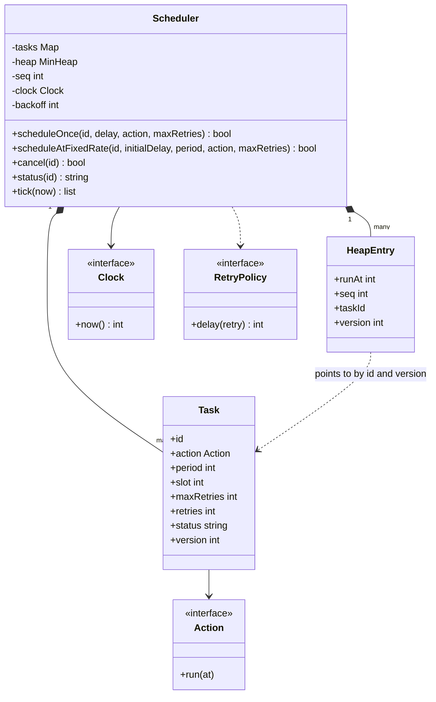
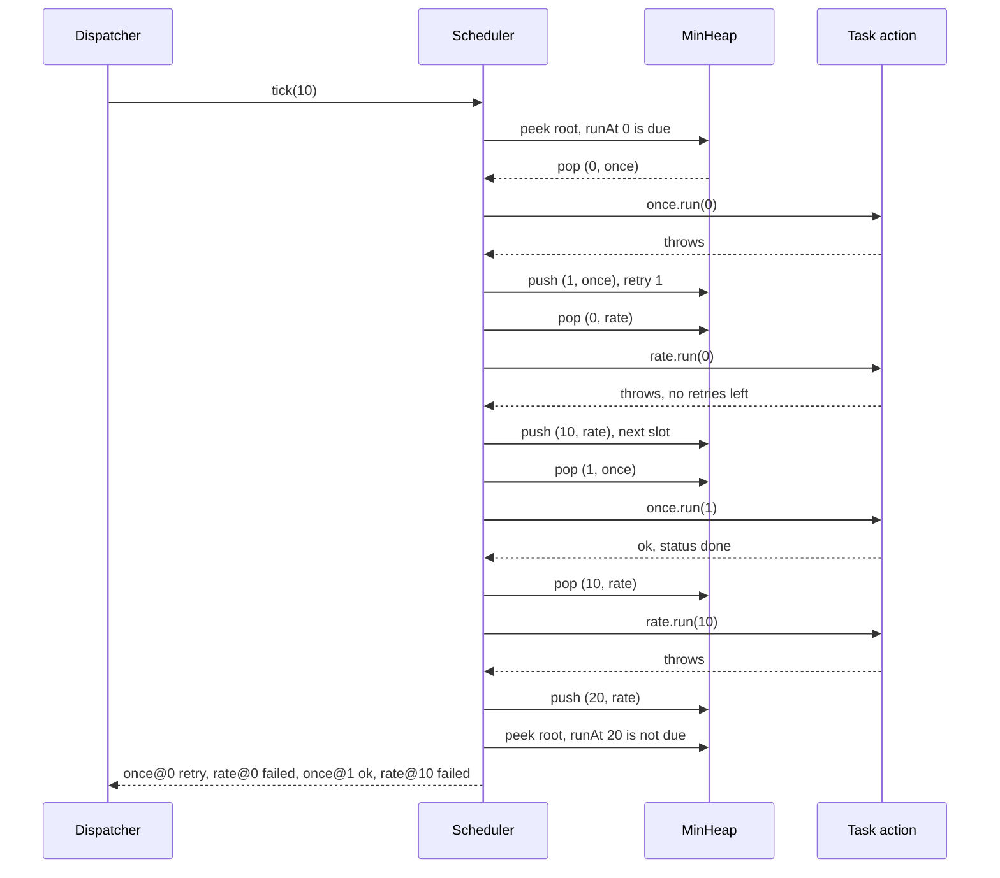

## In one minute
- A scheduler is a **priority queue keyed by next run time** plus a loop that pops everything due. A binary min-heap gives O(log n) insert and pop, and the earliest task is always at the root.
- Make time an input. Inject a clock for scheduling and drive execution with `tick(now)`, so the same code runs in production (a loop that sleeps until the next deadline) and in tests (call `tick(35)` and assert what ran).
- **Cancel lazily.** Removing an item from the middle of a heap is awkward, so bump the task's version and let the stale heap entry be skipped when it surfaces.
- Fixed-rate tasks reschedule from their **scheduled slot**, not from when they finished, so they do not drift. Decide explicitly whether missed slots are caught up or skipped.
- Never run user code while holding the scheduler's lock. Tasks cancel and schedule other tasks from inside their own run, and a lock held across that call deadlocks.

## Requirements
Functional:
- Schedule a one-off task to run after a delay.
- Schedule a fixed-rate recurring task with an initial delay and a period.
- Cancel a task before or during its run; a cancelled task never runs again.
- Retry a failed run with exponential backoff up to a per-task limit. A one-off task that exhausts its retries is marked failed; a recurring task skips that slot and continues with the next.
- Run tasks due at the same instant in the order they were scheduled, and report each run's outcome.
- Query a task's status: scheduled, running, done, failed or cancelled.

Non-functional:
- Deterministic and testable: no hidden reads of wall-clock time and no sleeps in the core.
- Schedule and cancel in O(log n) or better; finding the next due task in O(1).
- Thread-safe: many threads schedule and cancel while a dispatcher runs tasks.
- A task that throws does not stop the scheduler or other tasks.

Out of scope: persistence across restarts, distribution across machines (that is a job scheduler service), cron expressions and time zones, and a worker pool. The design leaves room for each.

## Entities and relationships
**Scheduler** owns three things: a map from task ID to Task, a min-heap of entries, and a sequence counter. It also holds the injected clock and the base backoff.

**Task** is the unit the user cares about: ID, action, period (zero for one-off), current slot, retry limit, retries used so far, status and a version number. The version is how the heap and the map stay consistent without searching the heap.

**HeapEntry** is a small value: `(runAt, seq, taskId, version)`. `runAt` orders the heap, `seq` breaks ties in insertion order, and `version` lets the scheduler tell a live entry from a stale one. A task has at most one live entry at a time.

**Action** is the callback. It receives its scheduled time and signals failure by throwing (Python, TypeScript) or returning an error (Go).

**Clock** is a function returning the current time. `schedule` reads it to turn a delay into an absolute time; `tick(now)` takes the time as an argument.

**RetryPolicy** is folded into the scheduler here as `backoff * 2^(retry - 1)`, and is the obvious thing to extract as a strategy when requirements grow.

## Class diagram


## Key flows
One `tick(10)` with a flaky one-off task `once` and a recurring task `rate` that always fails, both first due at time 0 with a base backoff of 1.



The loop is "while the root is due, pop it, skip it if stale, run it, decide what comes next". Anything pushed during the tick with a time at or before `now`, such as a retry or a task scheduled by another task, runs in the same tick, still in time order.

## Design patterns used and why
- **Priority queue as the core data structure.** Not a pattern from a catalogue, but the decision that makes the design: the next thing to do is always the minimum, and a heap gives that in O(1) peek and O(log n) update.
- **Command (Action).** A task wraps "what to do" as an object the scheduler can store, retry and cancel without knowing what it does. Java's `Runnable` and `ScheduledFuture` are the classic form.
- **Strategy (RetryPolicy, Clock).** Backoff curves and time sources vary by caller; both are passed in. The clock strategy is what makes the scheduler testable.
- **State machine (task status).** `scheduled -> running -> done | failed | scheduled`, and `cancelled` from scheduled or running. Writing the transitions down settles questions such as "can I cancel a running task?" (yes, it will not be rescheduled) before they become bugs.
- **Lazy deletion with versioning.** A general technique: instead of keeping two structures exactly in sync, let the secondary one go stale and validate on read. The same idea appears in Dijkstra implementations without decrease-key and in caches with generation numbers.

## Concurrency and edge cases
- **Run actions outside the lock.** In Go, `Tick` locks to pop the due entry and mark the task running, unlocks, calls the action, then locks again to record the outcome. That lets an action call `Cancel` or `ScheduleOnce` on the same scheduler. Holding the lock across the call would deadlock on the first re-entrant call, since `sync.Mutex` is not reentrant.
- **Cancel during a run.** The task is `running`, the cancel succeeds and sets `cancelled`, and when the action returns the scheduler sees the status and does not reschedule. The run in progress is not interrupted; cancellation is cooperative.
- **Stale heap entries.** Cancel bumps the version. The old entry stays in the heap until it reaches the root, then is discarded. If cancellations are heavy, the heap fills with garbage; rebuild it when stale entries exceed half its size.
- **Same-time ordering.** Two tasks due at time 5 run in insertion order because of `seq`. Without it, heap order for equal keys is arbitrary and tests become flaky.
- **Catch-up.** If `tick` jumps from 9 to 35, a fixed-rate task with period 10 runs at 10, 20 and 30. That matches the old `java.util.Timer`, whose fixed-rate mode runs delayed executions in rapid succession to "catch up" ([Timer Javadoc](https://docs.oracle.com/en/java/javase/21/docs/api/java.base/java/util/Timer.html)). `ScheduledThreadPoolExecutor` promises less: a late execution may start late, but executions of one periodic task never overlap ([Javadoc](https://docs.oracle.com/en/java/javase/21/docs/api/java.base/java/util/concurrent/ScheduledThreadPoolExecutor.html)). A "skip missed" policy is just as valid; choose one and document it. Quartz makes it a per-trigger setting it calls a misfire instruction ([Quartz docs](https://www.quartz-scheduler.org/documentation/quartz-2.3.0/tutorials/tutorial-lesson-04.html)).
- **Retry storms.** Exponential backoff spaces retries out, but many tasks failing against the same dependency at the same moment retry in lockstep. Add jitter in production, as Amazon does to spread out retry bursts ([AWS Builders' Library](https://aws.amazon.com/builders-library/timeouts-retries-and-backoff-with-jitter/)), with a seeded random source in tests.
- **Long-running tasks.** A single-threaded dispatcher stalls everything behind a slow task. Hand actions to a worker pool, and decide whether a fixed-rate task may overlap with its own previous run (usually not).
- **Duplicate IDs and bad periods.** Reject a second task with the same ID and a non-positive period, or a fixed-rate task will loop forever inside one tick.

## In the wild
- **Dropbox, 2020: Async Task Framework.** Dropbox replaced several team-specific async systems with one scheduler. Each task is stored with a next-trigger time, and a consumer polls for ready tasks every two seconds and hands them to per-callback queues. It served about 9,000 scheduled tasks per second for 28 teams, with a target of 95% of tasks starting within five seconds of their time. Execution is guaranteed at least once, so callbacks must be idempotent, the same reason this lesson puts idempotency on task owners ([Dropbox Tech](https://dropbox.tech/infrastructure/asynchronous-task-scheduling-at-dropbox)).
- **Apache Kafka, 2015: timer purge fills the heap.** Kafka's request purgatory kept completed requests in a `DelayQueue` until they were found later. When deletion could not keep up, the broker could exhaust its JVM heap. The fix was a hierarchical timing wheel with O(1) insert and delete, because a heap cannot cheaply remove a cancelled entry from the middle ([Confluent](https://www.confluent.io/blog/apache-kafka-purgatory-hierarchical-timing-wheels/)).
- **Linux, 2012: the leap second timer loop.** After the 30 June leap second, the kernel inserted the extra second without telling its high-resolution timers, so sub-second timeouts fired immediately in a loop and MySQL and Java processes spiked in CPU. The workaround was to set the clock to itself, and a kernel patch series fixed the notification ([LKML](https://lkml.iu.edu/hypermail/linux/kernel/1207.0/02318.html)). A scheduler that waits on wall-clock deadlines can hit the same trap.

## Down the stack

### Layer 1: The contract
`tick(now)` runs every live task whose next run time is at or before `now`, in increasing order of `(runAt, seq)`, including tasks pushed during the same tick. Each run produces one outcome: ok, retry or failed. A one-off task ends `done` or `failed`; a recurring task stays `scheduled` until cancelled. A cancelled task never starts again. An action failure never escapes `tick`. Nothing in the core reads time except through the injected clock.

### Layer 2: The mechanism
The heap is an array where the children of index i are at 2i+1 and 2i+2. Push appends and sifts up; pop moves the last element to the root and sifts down, each in at most log2(n) swaps. Python's `heapq` does exactly this on a list of tuples, comparing `(runAt, seq, ...)` lexicographically, and its docs recommend the same lazy-removal trick used here: mark the entry removed rather than break the heap invariant ([Python docs](https://docs.python.org/3/library/heapq.html)). Go's `container/heap` asks you to implement `Len`, `Less`, `Swap`, `Push` and `Pop`. Java's `ScheduledThreadPoolExecutor` uses its own `DelayedWorkQueue`, a heap that also stores each task's index so it can remove cancelled tasks directly; it offers `setRemoveOnCancelPolicy` because lazy deletion can retain cancelled tasks without bound ([Javadoc](https://docs.oracle.com/en/java/javase/21/docs/api/java.base/java/util/concurrent/ScheduledThreadPoolExecutor.html)). Kafka replaced a `DelayQueue` with hierarchical timing wheels in its request purgatory: buckets of timers give O(1) insert and delete against O(log n) for a priority queue, at the cost of tick-sized granularity ([Confluent](https://www.confluent.io/blog/apache-kafka-purgatory-hierarchical-timing-wheels/)).

### Layer 3: The machine
A heap of 1 million entries is 20 levels deep. Each pop walks one path from root to leaf, about 20 comparisons and swaps, and the lower levels miss the CPU cache at roughly 100 ns per RAM access, so a pop costs around 1 to 2 microseconds. A heap of 1,000 tasks fits in L1 and L2 cache and pops in tens of nanoseconds. In production the dispatcher does not spin: it sleeps until the root's deadline or until a new earlier task arrives, using a condition variable with a timeout, a Go `time.Timer` reset to the new deadline, or `epoll_wait` with a timeout on Linux. Wakeups are accurate to tens of microseconds on an idle machine and to milliseconds under load, so a scheduler promises "not before" and "soon after", never "exactly at". Use a monotonic clock for delays: wall-clock time jumps when NTP corrects it, and a task scheduled "in 5 seconds" must not wait an hour because the clock moved back. Go's `time.Now()` carries a monotonic reading for exactly this, and `Sub` and `Since` use it ([Go time docs](https://pkg.go.dev/time)).

### Why it's built this way
1. The only question the dispatcher asks is "what is due next?", so the structure that answers "minimum" cheaply, a heap, is the core.
2. Removing arbitrary heap entries needs an index map that must be kept consistent on every swap, so most implementations accept stale entries and validate by version instead.
3. Time makes tests slow and flaky, so time becomes a parameter, and the production loop is a thin shell around a pure `tick(now)`.
4. User code is untrusted and re-entrant, so it runs outside the lock and its failures are caught and turned into retry decisions.

## Extensibility
- **Worker pool.** `tick` hands due tasks to a pool instead of running them inline. The state machine gains a `queued` state, and fixed-rate tasks need a no-overlap rule.
- **Fixed-delay tasks.** Add a mode where the next run is `finish time + delay` instead of `slot + period`. It only changes the reschedule step.
- **Cron schedules.** Replace `period` with a `NextTime(after)` strategy. Fixed-rate becomes one implementation and cron another, with time zones handled inside it.
- **Priorities.** Extend the key to `(runAt, priority, seq)` so urgent tasks win ties, or keep separate heaps per priority if starvation matters.
- **Persistence.** Write each task and its next run time to a store and rebuild the heap on start. At that point you are designing a job scheduler service, with leases and at-least-once semantics.
- **Observability.** Record lag (`actual start - runAt`) per run. Lag is the single best signal that the scheduler is overloaded.

## Leadership lens
- Insist on the injected clock and `tick(now)` from day one. A scheduler that can only be tested with `sleep` gets few tests, and the bugs live in the edge cases those tests would have caught.
- Ask in design review: what happens to missed runs after a pause, can a recurring task overlap with itself, and is cancellation cooperative or forced? Each has a right answer only for a given product.
- Prefer the platform's scheduler (`ScheduledExecutorService`, `asyncio` loop timers, Go `time.Timer`) for simple delays. Build your own when you need deterministic tests, custom retry, or visibility into the queue.
- Ownership split: the scheduler team owns timing, retries and lag metrics; task owners own idempotency, because retries mean a task can run more than once.
- Build first: one-off tasks, fixed rate, cancel and lag metrics. Retries and worker pools come next; persistence only when a restart losing tasks is a real incident.

## Check yourself
1. Why does the heap entry carry a version, and what would go wrong without it?
   **Answer:** Cancelling or rescheduling leaves the old entry in the heap. Without a version check, the old entry would run a cancelled task or run a rescheduled task twice.
2. A fixed-rate task with period 10 started at 0 takes 3 units to run. When does it next run, and how is that different from fixed delay?
   **Answer:** At 10, because the next slot is the previous slot plus the period. Fixed delay would run at 13 (finish plus delay) and drift by the run time on every cycle.
3. Why is `seq` part of the heap key?
   **Answer:** Heaps do not preserve insertion order for equal keys, so tasks due at the same time would run in an arbitrary order. `seq` makes the order first-scheduled, first-run and the tests deterministic.
4. What breaks if the Go scheduler holds its mutex while calling the task's action?
   **Answer:** Any action that calls `Cancel` or a schedule method on the same scheduler deadlocks, and a slow action blocks every thread that wants to schedule or cancel.

## Practice
**Task:** Build an in-memory task scheduler. `Scheduler(clock, backoff=1)` holds a min-heap keyed by `(runAt, seq)`. `schedule_once(id, delay, action, max_retries=0)` runs at `clock() + delay`; `schedule_at_fixed_rate(id, initial_delay, period, action, max_retries=0)` first runs at `clock() + initial_delay`, then every `period` from its previous slot. Both return false for a duplicate ID (and fixed rate for a non-positive period). `tick(now)` runs every due task in order, calling `action(at)` with the scheduled time, and returns events `"id@at:outcome"`. A run that throws is retried at `at + backoff * 2^(retry - 1)` while retries remain (`retry`); otherwise it is `failed`, which ends a one-off task and moves a recurring task to its next slot. `cancel(id)` works on scheduled or running tasks, and `status(id)` returns `scheduled`, `running`, `done`, `failed`, `cancelled` or `unknown`.

```python starter
class Scheduler:
    def __init__(self, clock, backoff=1):
        pass

    def schedule_once(self, task_id, delay, action, max_retries=0):
        raise NotImplementedError

    def schedule_at_fixed_rate(self, task_id, initial_delay, period, action, max_retries=0):
        raise NotImplementedError

    def cancel(self, task_id):
        raise NotImplementedError

    def status(self, task_id):
        raise NotImplementedError

    def tick(self, now):
        raise NotImplementedError
```

```python tests
class Clock:
    def __init__(self):
        self.t = 0

    def __call__(self):
        return self.t


def noop(at):
    pass


def test_one_off_tasks_run_in_time_order():
    s = Scheduler(Clock())
    s.schedule_once("a", 5, noop)
    s.schedule_once("b", 1, noop)
    s.schedule_once("c", 5, noop)
    assert s.tick(0) == []
    assert s.tick(5) == ["b@1:ok", "a@5:ok", "c@5:ok"]
    assert s.status("a") == "done"
    assert s.tick(100) == []


def test_fixed_rate_catches_up_on_slots():
    s = Scheduler(Clock())
    seen = []
    s.schedule_at_fixed_rate("r", 10, 10, seen.append)
    assert s.tick(9) == []
    assert s.tick(35) == ["r@10:ok", "r@20:ok", "r@30:ok"]
    assert seen == [10, 20, 30], "action receives its scheduled time"
    assert s.tick(39) == []
    assert s.tick(40) == ["r@40:ok"]
    assert s.status("r") == "scheduled"


def test_cancel_and_duplicates():
    s = Scheduler(Clock())
    assert s.schedule_once("x", 3, noop)
    assert not s.schedule_once("x", 1, noop), "duplicate id"
    assert not s.schedule_at_fixed_rate("bad", 0, 0, noop), "period must be positive"
    assert s.cancel("x")
    assert not s.cancel("x")
    assert not s.cancel("nope")
    assert s.tick(10) == []
    assert s.status("x") == "cancelled"
    assert s.status("nope") == "unknown"


def test_retries_with_exponential_backoff():
    s = Scheduler(Clock(), 2)

    def boom(at):
        raise RuntimeError("down")

    s.schedule_once("f", 0, boom, 2)
    assert s.tick(0) == ["f@0:retry"]
    assert s.tick(1) == []
    assert s.tick(2) == ["f@2:retry"]
    assert s.tick(5) == []
    assert s.tick(6) == ["f@6:failed"]
    assert s.status("f") == "failed"


def test_flaky_recovers_and_recurring_survives_failure():
    s = Scheduler(Clock(), 1)
    calls = []

    def flaky(at):
        calls.append(at)
        if len(calls) == 1:
            raise RuntimeError("blip")

    def bad(at):
        raise RuntimeError("always")

    s.schedule_once("once", 0, flaky, 3)
    s.schedule_at_fixed_rate("rate", 0, 10, bad)
    assert s.tick(10) == ["once@0:retry", "rate@0:failed", "once@1:ok", "rate@10:failed"]
    assert s.status("once") == "done"
    assert s.status("rate") == "scheduled"


def test_actions_can_cancel_and_schedule_during_tick():
    c = Clock()
    s = Scheduler(c)

    def killer(at):
        s.cancel("victim")
        s.schedule_once("child", 0, noop)

    def self_stop(at):
        s.cancel("self")

    s.schedule_once("killer", 5, killer)
    s.schedule_once("victim", 5, noop)
    s.schedule_at_fixed_rate("self", 5, 1, self_stop)
    c.t = 5
    assert s.tick(5) == ["killer@5:ok", "self@5:ok", "child@5:ok"]
    assert s.status("victim") == "cancelled"
    assert s.status("self") == "cancelled"
    assert s.tick(50) == []
```

```python solution
import heapq


class Task:
    def __init__(self, task_id, slot, period, action, max_retries):
        self.id = task_id
        self.slot = slot
        self.period = period
        self.action = action
        self.max_retries = max_retries
        self.retries = 0
        self.status = "scheduled"
        self.version = 0


class Scheduler:
    def __init__(self, clock, backoff=1):
        self.clock = clock
        self.backoff = backoff
        self.tasks = {}
        self.heap = []  # (run_at, seq, task_id, version)
        self.seq = 0

    def _push(self, task, at):
        task.version += 1
        task.status = "scheduled"
        self.seq += 1
        heapq.heappush(self.heap, (at, self.seq, task.id, task.version))

    def _add(self, task_id, start, period, action, max_retries):
        if task_id in self.tasks:
            return False
        task = Task(task_id, start, period, action, max_retries)
        self.tasks[task_id] = task
        self._push(task, start)
        return True

    def schedule_once(self, task_id, delay, action, max_retries=0):
        return self._add(task_id, self.clock() + delay, 0, action, max_retries)

    def schedule_at_fixed_rate(self, task_id, initial_delay, period, action, max_retries=0):
        if period <= 0:
            return False
        return self._add(task_id, self.clock() + initial_delay, period, action, max_retries)

    def cancel(self, task_id):
        task = self.tasks.get(task_id)
        if task is None or task.status not in ("scheduled", "running"):
            return False
        task.status = "cancelled"
        task.version += 1
        return True

    def status(self, task_id):
        task = self.tasks.get(task_id)
        return task.status if task else "unknown"

    def _pop_due(self, now):
        while self.heap and self.heap[0][0] <= now:
            at, _, task_id, version = heapq.heappop(self.heap)
            task = self.tasks[task_id]
            if task.version == version and task.status == "scheduled":
                task.status = "running"
                return task, at
        return None, None

    def _finish(self, task, at, ok):
        if ok:
            task.retries = 0
            outcome = "ok"
        elif task.retries < task.max_retries:
            task.retries += 1
            outcome = "retry"
        else:
            task.retries = 0
            outcome = "failed"
        if task.status == "cancelled":
            return outcome
        if outcome == "retry":
            self._push(task, at + self.backoff * 2 ** (task.retries - 1))
        elif task.period > 0:
            task.slot += task.period
            self._push(task, task.slot)
        else:
            task.status = "done" if ok else "failed"
        return outcome

    def tick(self, now):
        events = []
        while True:
            task, at = self._pop_due(now)
            if task is None:
                return events
            try:
                task.action(at)
                ok = True
            except Exception:
                ok = False
            events.append(task.id + "@" + str(at) + ":" + self._finish(task, at, ok))
```

```typescript starter
export type Action = (at: number) => void;

export class Scheduler {
  constructor(clock: () => number, backoff: number = 1) {}
  scheduleOnce(id: string, delay: number, action: Action, maxRetries: number = 0): boolean {
    throw new Error("TODO");
  }
  scheduleAtFixedRate(id: string, initialDelay: number, period: number, action: Action, maxRetries: number = 0): boolean {
    throw new Error("TODO");
  }
  cancel(id: string): boolean {
    throw new Error("TODO");
  }
  status(id: string): string {
    throw new Error("TODO");
  }
  tick(now: number): string[] {
    throw new Error("TODO");
  }
}
```

```typescript tests
const noop: Action = () => {};

test("one-off tasks run in time order", () => {
  const s = new Scheduler(() => 0);
  s.scheduleOnce("a", 5, noop);
  s.scheduleOnce("b", 1, noop);
  s.scheduleOnce("c", 5, noop);
  assertEqual(s.tick(0), []);
  assertEqual(s.tick(5), ["b@1:ok", "a@5:ok", "c@5:ok"]);
  assertEqual(s.status("a"), "done");
  assertEqual(s.tick(100), []);
});

test("fixed rate catches up on slots", () => {
  const s = new Scheduler(() => 0);
  const seen: number[] = [];
  s.scheduleAtFixedRate("r", 10, 10, (at) => {
    seen.push(at);
  });
  assertEqual(s.tick(9), []);
  assertEqual(s.tick(35), ["r@10:ok", "r@20:ok", "r@30:ok"]);
  assertEqual(seen, [10, 20, 30], "action receives its scheduled time");
  assertEqual(s.tick(39), []);
  assertEqual(s.tick(40), ["r@40:ok"]);
  assertEqual(s.status("r"), "scheduled");
});

test("cancel and duplicates", () => {
  const s = new Scheduler(() => 0);
  assert(s.scheduleOnce("x", 3, noop), "first");
  assert(!s.scheduleOnce("x", 1, noop), "duplicate id");
  assert(!s.scheduleAtFixedRate("bad", 0, 0, noop), "period must be positive");
  assert(s.cancel("x"), "cancel");
  assert(!s.cancel("x"), "already cancelled");
  assert(!s.cancel("nope"), "unknown");
  assertEqual(s.tick(10), []);
  assertEqual(s.status("x"), "cancelled");
  assertEqual(s.status("nope"), "unknown");
});

test("retries with exponential backoff", () => {
  const s = new Scheduler(() => 0, 2);
  s.scheduleOnce("f", 0, () => {
    throw new Error("down");
  }, 2);
  assertEqual(s.tick(0), ["f@0:retry"]);
  assertEqual(s.tick(1), []);
  assertEqual(s.tick(2), ["f@2:retry"]);
  assertEqual(s.tick(5), []);
  assertEqual(s.tick(6), ["f@6:failed"]);
  assertEqual(s.status("f"), "failed");
});

test("flaky recovers and recurring survives failure", () => {
  const s = new Scheduler(() => 0, 1);
  const calls: number[] = [];
  s.scheduleOnce("once", 0, (at) => {
    calls.push(at);
    if (calls.length === 1) throw new Error("blip");
  }, 3);
  s.scheduleAtFixedRate("rate", 0, 10, () => {
    throw new Error("always");
  });
  assertEqual(s.tick(10), ["once@0:retry", "rate@0:failed", "once@1:ok", "rate@10:failed"]);
  assertEqual(s.status("once"), "done");
  assertEqual(s.status("rate"), "scheduled");
});

test("actions can cancel and schedule during tick", () => {
  let now = 0;
  const s = new Scheduler(() => now);
  s.scheduleOnce("killer", 5, () => {
    s.cancel("victim");
    s.scheduleOnce("child", 0, noop);
  });
  s.scheduleOnce("victim", 5, noop);
  s.scheduleAtFixedRate("self", 5, 1, () => {
    s.cancel("self");
  });
  now = 5;
  assertEqual(s.tick(5), ["killer@5:ok", "self@5:ok", "child@5:ok"]);
  assertEqual(s.status("victim"), "cancelled");
  assertEqual(s.status("self"), "cancelled");
  assertEqual(s.tick(50), []);
});
```

```typescript solution
export type Action = (at: number) => void;

type Entry = [number, number, string, number]; // runAt, seq, id, version

class MinHeap {
  private a: Entry[] = [];
  private less(x: Entry, y: Entry): boolean {
    return x[0] !== y[0] ? x[0] < y[0] : x[1] < y[1];
  }
  size(): number {
    return this.a.length;
  }
  peek(): Entry {
    return this.a[0];
  }
  push(e: Entry): void {
    const a = this.a;
    a.push(e);
    let i = a.length - 1;
    while (i > 0) {
      const p = (i - 1) >> 1;
      if (!this.less(a[i], a[p])) break;
      [a[i], a[p]] = [a[p], a[i]];
      i = p;
    }
  }
  pop(): Entry {
    const a = this.a;
    const top = a[0];
    const last = a.pop()!;
    if (a.length > 0) {
      a[0] = last;
      let i = 0;
      for (;;) {
        const l = 2 * i + 1;
        const r = l + 1;
        let m = i;
        if (l < a.length && this.less(a[l], a[m])) m = l;
        if (r < a.length && this.less(a[r], a[m])) m = r;
        if (m === i) break;
        [a[i], a[m]] = [a[m], a[i]];
        i = m;
      }
    }
    return top;
  }
}

interface Task {
  id: string;
  slot: number;
  period: number;
  action: Action;
  maxRetries: number;
  retries: number;
  status: string;
  version: number;
}

export class Scheduler {
  private tasks = new Map<string, Task>();
  private heap = new MinHeap();
  private seq = 0;

  constructor(private clock: () => number, private backoff: number = 1) {}

  private push(t: Task, at: number): void {
    t.version++;
    t.status = "scheduled";
    this.heap.push([at, ++this.seq, t.id, t.version]);
  }

  private add(id: string, start: number, period: number, action: Action, maxRetries: number): boolean {
    if (this.tasks.has(id)) return false;
    const t: Task = { id, slot: start, period, action, maxRetries, retries: 0, status: "scheduled", version: 0 };
    this.tasks.set(id, t);
    this.push(t, start);
    return true;
  }

  scheduleOnce(id: string, delay: number, action: Action, maxRetries: number = 0): boolean {
    return this.add(id, this.clock() + delay, 0, action, maxRetries);
  }

  scheduleAtFixedRate(id: string, initialDelay: number, period: number, action: Action, maxRetries: number = 0): boolean {
    if (period <= 0) return false;
    return this.add(id, this.clock() + initialDelay, period, action, maxRetries);
  }

  cancel(id: string): boolean {
    const t = this.tasks.get(id);
    if (!t || (t.status !== "scheduled" && t.status !== "running")) return false;
    t.status = "cancelled";
    t.version++;
    return true;
  }

  status(id: string): string {
    const t = this.tasks.get(id);
    return t ? t.status : "unknown";
  }

  private popDue(now: number): [Task, number] | null {
    while (this.heap.size() > 0 && this.heap.peek()[0] <= now) {
      const [at, , id, version] = this.heap.pop();
      const t = this.tasks.get(id)!;
      if (t.version === version && t.status === "scheduled") {
        t.status = "running";
        return [t, at];
      }
    }
    return null;
  }

  private finish(t: Task, at: number, ok: boolean): string {
    let outcome: string;
    if (ok) {
      t.retries = 0;
      outcome = "ok";
    } else if (t.retries < t.maxRetries) {
      t.retries++;
      outcome = "retry";
    } else {
      t.retries = 0;
      outcome = "failed";
    }
    if (t.status === "cancelled") return outcome;
    if (outcome === "retry") {
      this.push(t, at + this.backoff * Math.pow(2, t.retries - 1));
    } else if (t.period > 0) {
      t.slot += t.period;
      this.push(t, t.slot);
    } else {
      t.status = ok ? "done" : "failed";
    }
    return outcome;
  }

  tick(now: number): string[] {
    const events: string[] = [];
    for (;;) {
      const due = this.popDue(now);
      if (due === null) return events;
      const [t, at] = due;
      let ok = true;
      try {
        t.action(at);
      } catch (e) {
        ok = false;
      }
      events.push(`${t.id}@${at}:${this.finish(t, at, ok)}`);
    }
  }
}
```

```go starter
package practice

// Action runs a task at its scheduled time; a non-nil error means the run failed.
type Action func(at int64) error

type Scheduler struct{}

func NewScheduler(clock func() int64, backoff int64) *Scheduler {
	return &Scheduler{}
}

func (s *Scheduler) ScheduleOnce(id string, delay int64, action Action, maxRetries int) bool {
	panic("TODO")
}

func (s *Scheduler) ScheduleAtFixedRate(id string, initialDelay, period int64, action Action, maxRetries int) bool {
	panic("TODO")
}

func (s *Scheduler) Cancel(id string) bool {
	panic("TODO")
}

func (s *Scheduler) Status(id string) string {
	panic("TODO")
}

func (s *Scheduler) Tick(now int64) []string {
	panic("TODO")
}
```

```go tests
package practice

import "testing"

type failure struct{}

func (failure) Error() string { return "failed" }

func noop(at int64) error { return nil }

func boom(at int64) error { return failure{} }

func expect(t *testing.T, got, want []string) {
	t.Helper()
	if len(got) != len(want) {
		t.Fatalf("got %q want %q", got, want)
	}
	for i := range got {
		if got[i] != want[i] {
			t.Fatalf("got %q want %q", got, want)
		}
	}
}

func TestOneOffTasksRunInTimeOrder(t *testing.T) {
	s := NewScheduler(func() int64 { return 0 }, 1)
	s.ScheduleOnce("a", 5, noop, 0)
	s.ScheduleOnce("b", 1, noop, 0)
	s.ScheduleOnce("c", 5, noop, 0)
	expect(t, s.Tick(0), nil)
	expect(t, s.Tick(5), []string{"b@1:ok", "a@5:ok", "c@5:ok"})
	if s.Status("a") != "done" {
		t.Fatal("a should be done")
	}
	expect(t, s.Tick(100), nil)
}

func TestFixedRateCatchesUpOnSlots(t *testing.T) {
	s := NewScheduler(func() int64 { return 0 }, 1)
	var seen []int64
	s.ScheduleAtFixedRate("r", 10, 10, func(at int64) error {
		seen = append(seen, at)
		return nil
	}, 0)
	expect(t, s.Tick(9), nil)
	expect(t, s.Tick(35), []string{"r@10:ok", "r@20:ok", "r@30:ok"})
	if len(seen) != 3 || seen[0] != 10 || seen[2] != 30 {
		t.Fatalf("action receives its scheduled time, got %v", seen)
	}
	expect(t, s.Tick(39), nil)
	expect(t, s.Tick(40), []string{"r@40:ok"})
	if s.Status("r") != "scheduled" {
		t.Fatal("recurring task stays scheduled")
	}
}

func TestCancelAndDuplicates(t *testing.T) {
	s := NewScheduler(func() int64 { return 0 }, 1)
	if !s.ScheduleOnce("x", 3, noop, 0) || s.ScheduleOnce("x", 1, noop, 0) {
		t.Fatal("duplicate id must be rejected")
	}
	if s.ScheduleAtFixedRate("bad", 0, 0, noop, 0) {
		t.Fatal("period must be positive")
	}
	if !s.Cancel("x") || s.Cancel("x") || s.Cancel("nope") {
		t.Fatal("cancel semantics")
	}
	expect(t, s.Tick(10), nil)
	if s.Status("x") != "cancelled" || s.Status("nope") != "unknown" {
		t.Fatal("status after cancel")
	}
}

func TestRetriesWithExponentialBackoff(t *testing.T) {
	s := NewScheduler(func() int64 { return 0 }, 2)
	s.ScheduleOnce("f", 0, boom, 2)
	expect(t, s.Tick(0), []string{"f@0:retry"})
	expect(t, s.Tick(1), nil)
	expect(t, s.Tick(2), []string{"f@2:retry"})
	expect(t, s.Tick(5), nil)
	expect(t, s.Tick(6), []string{"f@6:failed"})
	if s.Status("f") != "failed" {
		t.Fatal("f should be failed")
	}
}

func TestFlakyRecoversAndRecurringSurvivesFailure(t *testing.T) {
	s := NewScheduler(func() int64 { return 0 }, 1)
	calls := 0
	s.ScheduleOnce("once", 0, func(at int64) error {
		calls++
		if calls == 1 {
			return failure{}
		}
		return nil
	}, 3)
	s.ScheduleAtFixedRate("rate", 0, 10, boom, 0)
	expect(t, s.Tick(10), []string{"once@0:retry", "rate@0:failed", "once@1:ok", "rate@10:failed"})
	if s.Status("once") != "done" || s.Status("rate") != "scheduled" {
		t.Fatal("final statuses")
	}
}

func TestActionsCanCancelAndScheduleDuringTick(t *testing.T) {
	now := int64(0)
	s := NewScheduler(func() int64 { return now }, 1)
	s.ScheduleOnce("killer", 5, func(at int64) error {
		s.Cancel("victim")
		s.ScheduleOnce("child", 0, noop, 0)
		return nil
	}, 0)
	s.ScheduleOnce("victim", 5, noop, 0)
	s.ScheduleAtFixedRate("self", 5, 1, func(at int64) error {
		s.Cancel("self")
		return nil
	}, 0)
	now = 5
	expect(t, s.Tick(5), []string{"killer@5:ok", "self@5:ok", "child@5:ok"})
	if s.Status("victim") != "cancelled" || s.Status("self") != "cancelled" {
		t.Fatal("cancelled during tick")
	}
	expect(t, s.Tick(50), nil)
}
```

```go solution
package practice

import (
	"container/heap"
	"fmt"
	"sync"
)

// Action runs a task at its scheduled time; a non-nil error means the run failed.
type Action func(at int64) error

type entry struct {
	at, seq int64
	id      string
	version int
}

type entryHeap []entry

func (h entryHeap) Len() int { return len(h) }
func (h entryHeap) Less(i, j int) bool {
	if h[i].at != h[j].at {
		return h[i].at < h[j].at
	}
	return h[i].seq < h[j].seq
}
func (h entryHeap) Swap(i, j int)       { h[i], h[j] = h[j], h[i] }
func (h *entryHeap) Push(x interface{}) { *h = append(*h, x.(entry)) }
func (h *entryHeap) Pop() interface{} {
	old := *h
	e := old[len(old)-1]
	*h = old[:len(old)-1]
	return e
}

type task struct {
	id                  string
	slot, period        int64
	action              Action
	maxRetries, retries int
	version             int
	status              string
}

type Scheduler struct {
	mu      sync.Mutex
	clock   func() int64
	backoff int64
	tasks   map[string]*task
	heap    entryHeap
	seq     int64
}

func NewScheduler(clock func() int64, backoff int64) *Scheduler {
	return &Scheduler{clock: clock, backoff: backoff, tasks: map[string]*task{}}
}

// push records a new live heap entry for t. Caller holds s.mu.
func (s *Scheduler) push(t *task, at int64) {
	t.version++
	t.status = "scheduled"
	s.seq++
	heap.Push(&s.heap, entry{at: at, seq: s.seq, id: t.id, version: t.version})
}

func (s *Scheduler) add(id string, start, period int64, action Action, maxRetries int) bool {
	s.mu.Lock()
	defer s.mu.Unlock()
	if _, ok := s.tasks[id]; ok {
		return false
	}
	t := &task{id: id, slot: start, period: period, action: action, maxRetries: maxRetries}
	s.tasks[id] = t
	s.push(t, start)
	return true
}

func (s *Scheduler) ScheduleOnce(id string, delay int64, action Action, maxRetries int) bool {
	return s.add(id, s.clock()+delay, 0, action, maxRetries)
}

func (s *Scheduler) ScheduleAtFixedRate(id string, initialDelay, period int64, action Action, maxRetries int) bool {
	if period <= 0 {
		return false
	}
	return s.add(id, s.clock()+initialDelay, period, action, maxRetries)
}

func (s *Scheduler) Cancel(id string) bool {
	s.mu.Lock()
	defer s.mu.Unlock()
	t, ok := s.tasks[id]
	if !ok || (t.status != "scheduled" && t.status != "running") {
		return false
	}
	t.status = "cancelled"
	t.version++
	return true
}

func (s *Scheduler) Status(id string) string {
	s.mu.Lock()
	defer s.mu.Unlock()
	if t, ok := s.tasks[id]; ok {
		return t.status
	}
	return "unknown"
}

// popDue returns the next live due task and marks it running. Caller holds s.mu.
func (s *Scheduler) popDue(now int64) (*task, int64, bool) {
	for s.heap.Len() > 0 && s.heap[0].at <= now {
		e := heap.Pop(&s.heap).(entry)
		t := s.tasks[e.id]
		if t.version == e.version && t.status == "scheduled" {
			t.status = "running"
			return t, e.at, true
		}
	}
	return nil, 0, false
}

// finish records the outcome of a run and reschedules. Caller holds s.mu.
func (s *Scheduler) finish(t *task, at int64, ok bool) string {
	var outcome string
	switch {
	case ok:
		t.retries = 0
		outcome = "ok"
	case t.retries < t.maxRetries:
		t.retries++
		outcome = "retry"
	default:
		t.retries = 0
		outcome = "failed"
	}
	if t.status == "cancelled" {
		return outcome
	}
	switch {
	case outcome == "retry":
		s.push(t, at+s.backoff*(int64(1)<<uint(t.retries-1)))
	case t.period > 0:
		t.slot += t.period
		s.push(t, t.slot)
	case ok:
		t.status = "done"
	default:
		t.status = "failed"
	}
	return outcome
}

func (s *Scheduler) Tick(now int64) []string {
	var events []string
	for {
		s.mu.Lock()
		t, at, ok := s.popDue(now)
		s.mu.Unlock()
		if !ok {
			return events
		}
		// Run user code without the lock so it can call Cancel or Schedule.
		err := t.action(at)
		s.mu.Lock()
		events = append(events, fmt.Sprintf("%s@%d:%s", t.id, at, s.finish(t, at, err == nil)))
		s.mu.Unlock()
	}
}
```

## Mock interview
**Prompt:** Design an in-process task scheduler library: callers schedule one-off tasks after a delay and fixed-rate recurring tasks, can cancel them, and failed runs retry with backoff. It will run about 50,000 timers in a busy service, and the team wants it fully unit-testable.

- Follow-up: how do you cancel a task in O(log n) or better without searching the heap?
- Follow-up: the process was paused for 30 seconds by a debugger or a long GC. What happens to a fixed-rate task with a 1-second period when it resumes?
- Follow-up: when would you use a timing wheel instead of a heap?

**A strong answer covers:**
- A min-heap keyed by `(runAt, seq)` with a task map, and lazy deletion via versions (or an index-tracking heap for eager removal).
- An injected clock and a pure `tick(now)`, with the production loop sleeping until the root's deadline or a new earlier arrival.
- An explicit task state machine, including cancel during a run and what each outcome does to the next run.
- Fixed rate versus fixed delay, and a stated policy for missed runs (catch up, skip or run once).
- Retries with exponential backoff and jitter, and the idempotency that retries require from task owners.
- Concurrency: user code runs outside the lock, failures are caught, and a worker pool handles slow tasks.

## Sources and further study
**Primary**
- [java.util.Timer (Java SE 21 API)](https://docs.oracle.com/en/java/javase/21/docs/api/java.base/java/util/Timer.html): fixed-rate catch-up and fixed-delay drift, in the library's own words.
- [Package time (Go)](https://pkg.go.dev/time): monotonic clock readings and how `Sub` and `Since` use them.
- [LKML: leap second hrtimer/futex fix (John Stultz, 2012)](https://lkml.iu.edu/hypermail/linux/kernel/1207.0/02318.html): the patch series that shows what wall-clock timers do when time steps.

**Systems docs**
- [Quartz: triggers and misfire instructions](https://www.quartz-scheduler.org/documentation/quartz-2.3.0/tutorials/tutorial-lesson-04.html): a production scheduler's answer to "what about missed runs".
- [container/heap (Go)](https://pkg.go.dev/container/heap): the five-method interface behind the Go practice code.
- [Kafka purgatory and hierarchical timing wheels (Confluent)](https://www.confluent.io/blog/apache-kafka-purgatory-hierarchical-timing-wheels/): why a broker outgrew a priority-queue timer.
- [Asynchronous task scheduling at Dropbox](https://dropbox.tech/infrastructure/asynchronous-task-scheduling-at-dropbox): a distributed scheduler with at-least-once delivery.

**Books**
- *Design Patterns*, Gamma, Helm, Johnson and Vlissides: chapter 5 (Behavioral), the Command and Strategy patterns.
- *Head First Design Patterns* (2nd ed.), Freeman and Robson: chapter 6 (Command) and chapter 1 (Strategy).

**Other curricula**
- [Refactoring.Guru: Command](https://refactoring.guru/design-patterns/command): frames a scheduled job as a command object that can be queued, delayed and undone.

## Watch
- [Implementations of Timing Wheels (Julian Squires, Systems We Love)](https://www.youtube.com/watch?v=AftX7rqx-Uc): how systems manage huge numbers of timers, and the trade-offs between wheels and heaps.

## Free resources
- [heapq: Heap queue algorithm (Python docs)](https://docs.python.org/3/library/heapq.html): the array heap invariant and a priority-queue recipe with lazy removal of cancelled entries.
- [sched: Event scheduler (Python docs)](https://docs.python.org/3/library/sched.html): a small standard-library scheduler with injectable time and delay functions, the same idea as `tick(now)`.
- [ScheduledThreadPoolExecutor (Java SE 21 API)](https://docs.oracle.com/en/java/javase/21/docs/api/java.base/java/util/concurrent/ScheduledThreadPoolExecutor.html): fixed-rate versus fixed-delay semantics and the remove-on-cancel policy.
- [Hashed and Hierarchical Timing Wheels (Varghese and Lauck, SOSP 1987)](https://www.cs.columbia.edu/~nahum/w6998/papers/sosp87-timing-wheels.pdf): the classic paper on efficient timer data structures.
- [Timeouts, retries and backoff with jitter (AWS Builders' Library)](https://aws.amazon.com/builders-library/timeouts-retries-and-backoff-with-jitter/): why retries need backoff, jitter and limits.
- [Distributed periodic scheduling with Cron (Google SRE book)](https://sre.google/sre-book/distributed-periodic-scheduling/): what changes when a scheduler must survive machine failures.
