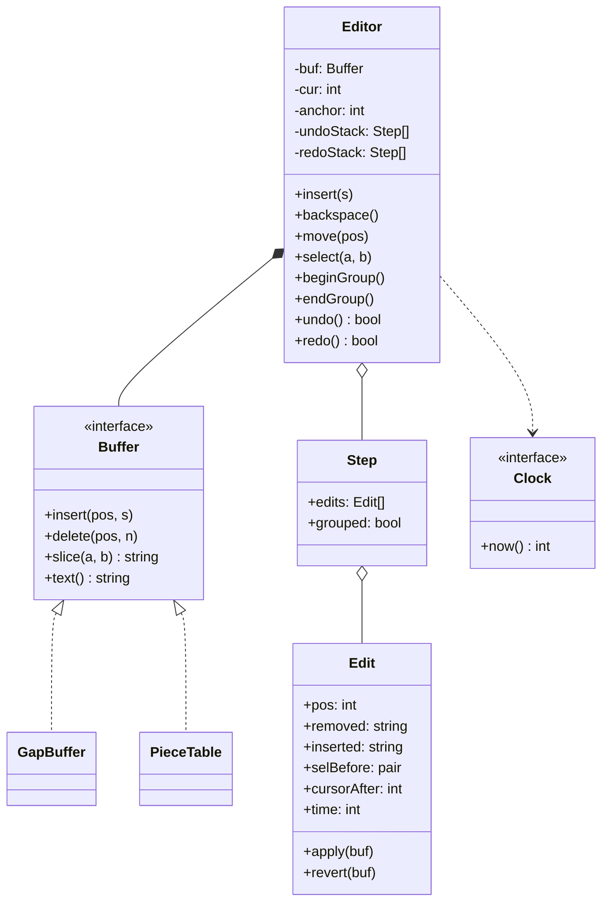
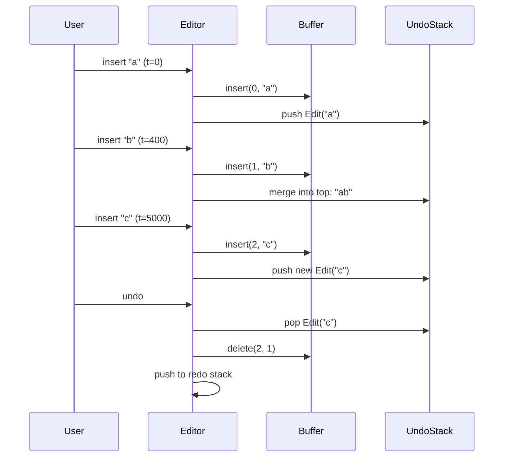

## In one minute
- A text editor is a sequence of small, reversible edits applied to a buffer. Undo is not a feature bolted on at the end; it is the reason every edit is recorded as data (a position, the text removed and the text inserted) instead of being applied and forgotten.
- Keep the buffer and the history separate. The buffer (a gap buffer or a piece table) answers "what is the text?" cheaply. The history (command objects on an undo stack and a redo stack) answers "how do I get back?".
- Store deltas, not snapshots. A Memento that copies the whole document per keystroke costs O(document) memory per step; a command that stores the changed span costs O(edit). Snapshots still win in narrow cases, such as cheap immutable structures.
- Grouping decides what "one undo" means to a human. Coalesce typing by time and contiguity, break the group when the cursor jumps, and let callers wrap multi-step operations such as replace-all in an explicit group.
- The shape is **multi-step consistency**: a batch of changes must appear to happen, and be reversed, as one unit. The same design reappears in database savepoints, saga compensation and "revert this commit" in version control.

## Requirements

Functional:
- Insert text at the cursor; delete with backspace; replace the current selection when one exists.
- Move the cursor and set a selection range.
- Undo and redo any number of steps. A new edit after an undo discards the redo history.
- Typing a word is one undo step, not one per character; a caller can also group several edits explicitly.
- Undo restores the text and puts the cursor or selection back where the user had it.

Non-functional:
- Typing at the cursor is amortised O(1) per character; undo and redo cost O(size of the edit), not O(size of the document).
- Deterministic: the grouping rule uses an injected clock, never the system time.
- Memory for history is bounded by the amount of text changed, and can be capped.

Out of scope: rich text and styles, multiple cursors, collaborative editing, persistence of the history across sessions, Unicode grapheme handling. Mention them, park them in Extensibility, and move on.

## Entities and relationships

- **Buffer** holds the characters. It offers `insert(pos, s)`, `delete(pos, n)` and `slice(a, b)` and knows nothing about undo. Two classic implementations are a gap buffer and a piece table.
- **Editor** is the receiver and façade. It owns the buffer, the cursor, an optional selection anchor, and the two stacks.
- **Edit** is the command: position, removed text, inserted text, the selection before, the cursor after and a timestamp. It has `apply` and `revert`.
- **Step** is one entry on a stack: a single edit or a group of edits that undo together. This is the Composite idea in its smallest form.
- **Clock** supplies time for the coalescing rule.

Relationships: the editor is composed of one buffer and two stacks; a step aggregates edits; an edit references no object other than the buffer it is applied to, which is what makes it replayable.

## Class diagram



## Key flows

Typing three letters quickly, pausing, then undoing twice shows the coalescing rule and the stack movement.



Undo pops a step, reverts its edits in reverse order, restores the selection that existed before the step, and pushes the step on the redo stack. Redo does the mirror image. Any fresh edit empties the redo stack, because the future it described no longer follows from the present.

## Design patterns used and why

- **Command.** Each edit is an object that knows how to apply and revert itself, which is the pattern's textbook use for undoable operations ([Refactoring.Guru: Command](https://refactoring.guru/design-patterns/command)). The history is just two lists of commands, and the editor never needs to know what kind of edit it is replaying.
- **Memento.** A memento saves a snapshot of an object's state so it can be restored later ([Refactoring.Guru: Memento](https://refactoring.guru/design-patterns/memento)). We use it in miniature: each edit keeps the pre-edit selection, and the removed text is a snapshot of just the span that changed. Snapshotting the whole buffer would work but costs memory proportional to the document for every step.
- **Composite.** A step holds one edit or many, and undo treats both the same way. That is how explicit grouping and replace-all fit without a second code path.
- **Strategy (or just an interface).** The buffer sits behind a small interface so a gap buffer can be swapped for a piece table when files get large.
- **Dependency injection.** The clock is passed in. Without it, the coalescing rule cannot be tested.

**Command versus Memento, decided.** Command stores what changed and needs both directions of every edit. It is small and fast, but every new kind of mutation must supply a correct inverse. Memento stores what the state was and needs nothing from the mutation, but costs memory per step and is slow for large state. A good rule is to use commands when edits are small and well understood, and snapshots when the state is small, immutable or the inverse is hard to write. Some editors do both: commands for typing, a snapshot for rare "transform the whole file" actions.

## Concurrency and edge cases

- **Single-threaded by design.** An editor receives events from one UI thread. Do not add locks to the buffer; instead, make long operations such as replace-all run on a snapshot or inside one group on that thread. If background features (a formatter, a linter) need to edit, they should submit edits through the same queue.
- **Positions shift.** An edit stores an absolute position, which is valid only against the exact text it was recorded on. That is why undo must pop in strict last-in first-out order, and why the redo stack must be cleared on any new edit. Apply an old edit to a changed text and the position points at the wrong characters.
- **Merging must not lose information.** Only merge pure insertions that are contiguous with the previous one (`pos == prev.pos + len(prev.inserted)`), inside the time window, with no cursor movement or undo between them. Deletions, replacements and newlines start a new step in this implementation.
- **Selection replace.** Typing over a selection is one edit with both removed and inserted text, so one undo brings the old text and the selection back together.
- **Group left open.** If a caller begins a group and forgets to end it, history stops growing. Use a try/finally or a scoped helper in real code, and refuse `undo` while a group is open as this implementation does.
- **Unbounded history.** Cap the stack by count or by total bytes of removed and inserted text, and drop the oldest steps. A single 50 MB paste is a step that costs 50 MB; budget by bytes, not entries.
- **Out-of-range positions.** Validate cursor and selection against the buffer length and fail loudly; a silent clamp hides bugs in the caller.

## In the wild

- **Visual Studio Code, 2018: replacing the line array with a piece table.** The old text buffer kept an object per line at roughly 40 to 60 bytes each. A 35 MB file with 13.7 million lines needed about 600 MB and crashed the editor with out-of-memory errors. The team moved to a piece table whose nodes point into immutable original and added buffers, then stored the nodes in a balanced tree with cached line-break counts so line lookup stays logarithmic. The write-up also notes that a V8 string length limit forced a list of chunked buffers rather than one big string ([VS Code blog](https://code.visualstudio.com/blogs/2018/03/23/text-buffer-reimplementation)).
- **CKEditor 5, 2018: undo that works with collaboration.** The authors list undo and redo among the features that had to be made collaboration-aware. Undo must be selective: a user may reverse only their own changes, even after other people have edited the same text, so a plain "pop the last operation" stack is not enough. They describe adding operation types and a graveyard for removed nodes to make this work ([CKEditor blog](https://ckeditor.com/blog/Lessons-learned-from-creating-a-rich-text-editor-with-real-time-collaboration/)).
- **Google Docs, 2010: the document as a revision log.** The rebuilt editor represents a document as a log of changes (insert text, delete text, apply style) that are replayed to display it, and concurrent changes are transformed against each other before they are applied ([Google Drive blog](https://drive.googleblog.com/2010/09/whats-different-about-new-google-docs_22.html)). The same idea scales down to this lesson: if every edit is data with a clear inverse, history, replay and undo all come from one representation.

## Down the stack

### Layer 1: The contract
The editor promises five things you can test. After `insert(s)` the text contains `s` at the cursor and the cursor sits after it. `undo()` returns true and restores the exact previous text, cursor or selection, or returns false with no change when there is nothing to undo. `redo()` after `undo()` restores the text that was undone. Any new edit clears the redo stack. A step created inside a group reverts as a unit. Everything else, including which edits merge, is policy that the contract states explicitly so users are not surprised.

### Layer 2: The mechanism
A gap buffer is an array with a hole in it. Text before the cursor lives at the start, text after lives at the end, and the gap sits at the cursor. Inserting writes into the gap and advances its start pointer. Deleting backwards moves the start pointer back. Moving the cursor slides the gap by copying characters across it, which costs the distance moved. When the gap fills, the array is reallocated, usually by doubling. Emacs is the best-known user of this structure ([Wikipedia: gap buffer](https://en.wikipedia.org/wiki/Gap_buffer)).

A piece table never moves text. It keeps the original file buffer and an append-only "added" buffer, plus a list of pieces, each pointing at a range in one of the two buffers. An insert in the middle splits one piece into two and adds a piece pointing at the new text. Deleting trims or removes pieces. Because nothing is overwritten, old piece lists are a natural way to represent history ([Wikipedia: piece table](https://en.wikipedia.org/wiki/Piece_table)). VS Code stores pieces in a balanced tree to make offset and line lookups logarithmic.

On top of the buffer, the history is two stacks of steps. Each `Edit` records `pos`, `removed`, `inserted`, the selection before and the cursor after, so `apply` deletes `len(removed)` characters at `pos` and inserts `inserted`, and `revert` does the opposite with the roles swapped. Vim calls its equivalent of a group an undo block, and offers `:undojoin` to merge a change into the previous block ([Vim documentation](https://vimhelp.org/undo.txt.html)). Vim also keeps undo branches, so undoing and then editing does not throw the abandoned future away; this lesson simply discards it.

### Layer 3: The machine
A gap buffer moves bytes with `memmove`, a sequential copy that runs near memory bandwidth, on the order of 10 GB/s on a modern core. Sliding the gap 1 MB costs around 100 microseconds, while a jump across a 100 MB file costs around 10 milliseconds, roughly a frame; typing at the gap is a pointer bump with no copy at all. Appending to a piece table's added buffer is also sequential, and its pieces are small structs (buffer index, start, length: 12 to 24 bytes each), so ten thousand edits in a session cost a few hundred kilobytes of metadata. The expensive part is locality: reading a line across many pieces touches scattered memory and misses the CPU cache, which is why VS Code caches line-break offsets per piece.

History memory is the sum of removed and inserted strings plus a fixed header per edit, about 64 to 100 bytes in a managed language. Coalescing matters here too: 100 characters typed in one burst is one edit and one string, not 100 objects with 100 headers.

### Why it's built this way
1. People type and delete near one spot, so the gap buffer makes that spot cheap and pays only when the cursor jumps.
2. Whole-file snapshots per step cost memory proportional to the document, so history stores the changed span only.
3. A span can only be applied to the text it was recorded against, so the history must be strictly last-in first-out and the redo stack must be cleared on a new edit.
4. Humans think in words and operations, not keystrokes, so adjacent edits are merged by time and contiguity and callers can open a group.
5. Large files make a contiguous array costly to open and to hold, so piece tables point at the original bytes instead of copying them.

## Extensibility

- **Large files.** Swap the buffer for a piece table behind the same interface. Edits and history do not change, because they only call `insert`, `delete` and `slice`.
- **Undo tree.** Keep the abandoned redo branch as a child node instead of discarding it, as Vim does. The stacks become a tree with a current pointer; `undo` moves to the parent, `redo` to a chosen child.
- **Multiple cursors.** An edit becomes a list of non-overlapping sub-edits applied together; the Composite step already reverts them as one.
- **Collaboration.** Local absolute positions are no longer valid after a remote edit. Transform them (operational transformation) or use identifiers instead of offsets, and make undo selective so that a user reverses only their own steps.
- **Persisted history.** Serialise the edits; because they are plain data, saving and loading is a few lines.
- **Memory cap.** Evict the oldest steps once the total bytes in history pass a budget, and mark the document as having lost deep undo.

## Leadership lens

- Decide the user-visible rule for "one undo" before coding, and write it down. Time windows, newline breaks and word boundaries are product decisions; engineers should not discover them by accident.
- Ask in review: what is the inverse of every new mutation? If a feature changes state outside the buffer (formatting, metadata), it must produce an edit or its changes will survive an undo and corrupt the document.
- Plan the data-structure upgrade path. A gap buffer is fine for files up to tens of megabytes; set a size threshold and a test with a file at 10 times that size before users find it.
- Own the test strategy: a property test that applies a random sequence of edits, then undoes all of them, and checks the text equals the original catches most history bugs in one go.
- Cost is mostly memory and correctness, not CPU. Budget history in bytes, expose it in diagnostics, and decide who is on call for "my document lost my changes" reports.

## Check yourself
1. Why must the redo stack be cleared when the user makes a new edit after an undo?
   **Answer:** Each edit stores absolute positions that are valid only for the text it was recorded against. After a new edit the text differs, so replaying the old redo steps would modify the wrong characters.
2. When would you pick snapshots (Memento) over commands for undo?
   **Answer:** When state is small or immutable so copying is cheap, or when writing a correct inverse for a mutation is hard. For large documents with small edits, commands that store only the changed span use far less memory.
3. A user types "hello", clicks elsewhere in the text, and types "x". How many undo steps exist, and why?
   **Answer:** Two. Moving the cursor seals the first group, and the next insertion is not contiguous with the previous one, so it starts a new step.
4. A gap buffer holds a 100 MB file and the user jumps from the start to the end. What does it cost, and how would you reduce it?
   **Answer:** The gap must slide across the whole file, a copy of about 100 MB, around ten milliseconds or more. A piece table avoids the copy because it changes only its piece list; so would a rope or a tree of chunks.

## Practice
**Task:** Implement a `GapBuffer` and an `Editor` with undo and redo. `GapBuffer(text, gap)` supports `insert(pos, s)`, `delete(pos, n)`, `slice(a, b)`, `text()`, `len` and `gap_position()` (the index where the gap starts, which must sit right after the last edit); out-of-range positions raise an error. `Editor(clock, text, merge_ms)` starts with the cursor at the end of `text`. `insert(s)` writes at the cursor, or replaces the selection when `select(start, end)` set one, and leaves the cursor after the new text; `backspace()` deletes the selection or the character before the cursor and does nothing at position 0. Consecutive inserts merge into the previous undo step only when they are pure insertions, contiguous, contain no newline, arrive within `merge_ms` of the previous one by the injected clock, and no `move`, `select`, undo, redo or group boundary happened in between. `begin_group()` and `end_group()` make everything in between one step (they nest). `undo()` and `redo()` return whether anything happened; undo restores the selection or cursor from before the step, redo puts the cursor after the inserted text, and any new edit clears redo.


```python starter
class GapBuffer:
    def __init__(self, text="", gap=4):
        # TODO: store characters with a gap of `gap` free slots after the text
        raise NotImplementedError

    def __len__(self):
        raise NotImplementedError

    def gap_position(self):
        raise NotImplementedError

    def insert(self, pos, s):
        raise NotImplementedError

    def delete(self, pos, n):
        raise NotImplementedError

    def slice(self, a, b):
        raise NotImplementedError

    def text(self):
        raise NotImplementedError


class Editor:
    def __init__(self, clock, text="", merge_ms=1000):
        # TODO: buffer, cursor at end of text, undo and redo stacks
        raise NotImplementedError

    def text(self):
        raise NotImplementedError

    def cursor(self):
        raise NotImplementedError

    def selection(self):
        raise NotImplementedError

    def move(self, pos):
        raise NotImplementedError

    def select(self, start, end):
        raise NotImplementedError

    def begin_group(self):
        raise NotImplementedError

    def end_group(self):
        raise NotImplementedError

    def insert(self, s):
        raise NotImplementedError

    def backspace(self):
        raise NotImplementedError

    def can_undo(self):
        raise NotImplementedError

    def can_redo(self):
        raise NotImplementedError

    def undo(self):
        raise NotImplementedError

    def redo(self):
        raise NotImplementedError
```

```python tests
class FakeClock:
    def __init__(self): self.t = 0
    def now(self): return self.t

def test_gap_buffer_edits():
    b = GapBuffer("held", gap=2)
    b.insert(2, "llo wor")
    assert b.text() == "hello world"
    assert b.gap_position() == 9, "gap sits after the last insert"
    b.delete(5, 6)
    assert b.text() == "hello"
    b.insert(0, ">> ")
    assert b.text() == ">> hello" and len(b) == 8
    try:
        b.delete(6, 5)
        assert False, "expected IndexError"
    except IndexError:
        pass

def test_insert_undo_redo():
    ed = Editor(FakeClock())
    ed.insert("hello")
    assert ed.text() == "hello" and ed.cursor() == 5
    assert ed.undo() is True
    assert ed.text() == "" and ed.cursor() == 0
    assert ed.redo() is True
    assert ed.text() == "hello" and ed.cursor() == 5
    assert ed.redo() is False

def test_typing_coalesces_by_time():
    clock = FakeClock()
    ed = Editor(clock, merge_ms=1000)
    ed.insert("a")
    clock.t = 400
    ed.insert("b")
    clock.t = 5000
    ed.insert("c")
    assert ed.text() == "abc"
    ed.undo()
    assert ed.text() == "ab", "pause started a new undo step"
    ed.undo()
    assert ed.text() == ""
    assert ed.undo() is False

def test_moving_the_cursor_breaks_coalescing():
    ed = Editor(FakeClock())
    ed.insert("ab")
    ed.move(0)
    ed.insert("x")
    ed.move(3)
    ed.insert("y")
    assert ed.text() == "xaby"
    ed.undo()
    assert ed.text() == "xab"
    ed.undo()
    assert ed.text() == "ab"

def test_selection_replace_and_undo_restores_selection():
    ed = Editor(FakeClock(), text="hello world")
    ed.select(6, 11)
    ed.insert("there")
    assert ed.text() == "hello there" and ed.selection() is None
    ed.undo()
    assert ed.text() == "hello world"
    assert ed.selection() == (6, 11), "selection comes back with the text"
    ed.redo()
    assert ed.text() == "hello there" and ed.cursor() == 11

def test_group_is_one_undo_step():
    clock = FakeClock()
    ed = Editor(clock)
    ed.begin_group()
    ed.insert("foo")
    clock.t = 99999
    ed.move(0)
    ed.insert("bar")
    ed.end_group()
    assert ed.text() == "barfoo"
    assert ed.undo() is True
    assert ed.text() == "" and ed.cursor() == 0
    ed.redo()
    assert ed.text() == "barfoo" and ed.cursor() == 3

def test_new_edit_clears_redo():
    ed = Editor(FakeClock())
    ed.insert("a")
    ed.move(1)
    ed.insert("b")
    ed.undo()
    assert ed.can_redo()
    ed.insert("c")
    assert ed.can_redo() is False
    assert ed.text() == "ac"

def test_backspace():
    ed = Editor(FakeClock(), text="abc")
    ed.backspace()
    assert ed.text() == "ab"
    ed.undo()
    assert ed.text() == "abc" and ed.cursor() == 3
    ed.move(0)
    ed.backspace()
    assert ed.text() == "abc", "nothing before the cursor"
    assert ed.undo() is False
```

```python solution
class GapBuffer:
    def __init__(self, text="", gap=4):
        self.data = list(text) + [""] * gap
        self.gs = len(text)
        self.ge = len(self.data)

    def __len__(self):
        return len(self.data) - (self.ge - self.gs)

    def gap_position(self):
        return self.gs

    def _move_gap(self, pos):
        if pos < 0 or pos > len(self):
            raise IndexError("position out of range")
        while self.gs > pos:
            self.gs -= 1
            self.ge -= 1
            self.data[self.ge] = self.data[self.gs]
        while self.gs < pos:
            self.data[self.gs] = self.data[self.ge]
            self.gs += 1
            self.ge += 1

    def _reserve(self, n):
        free = self.ge - self.gs
        if free >= n:
            return
        extra = max(n - free, len(self.data))
        self.data[self.ge:self.ge] = [""] * extra
        self.ge += extra

    def insert(self, pos, s):
        self._move_gap(pos)
        self._reserve(len(s))
        for ch in s:
            self.data[self.gs] = ch
            self.gs += 1

    def delete(self, pos, n):
        if n < 0 or pos < 0 or pos + n > len(self):
            raise IndexError("range out of bounds")
        self._move_gap(pos)
        self.ge += n

    def slice(self, a, b):
        return self.text()[a:b]

    def text(self):
        return "".join(self.data[:self.gs]) + "".join(self.data[self.ge:])


class Edit:
    def __init__(self, pos, removed, inserted, sel_before, cursor_after, time):
        self.pos = pos
        self.removed = removed
        self.inserted = inserted
        self.sel_before = sel_before
        self.cursor_after = cursor_after
        self.time = time

    def apply(self, buf):
        buf.delete(self.pos, len(self.removed))
        buf.insert(self.pos, self.inserted)

    def revert(self, buf):
        buf.delete(self.pos, len(self.inserted))
        buf.insert(self.pos, self.removed)


class Editor:
    def __init__(self, clock, text="", merge_ms=1000):
        self.clock = clock
        self.merge_ms = merge_ms
        self.buf = GapBuffer(text)
        self.cur = len(text)
        self.anchor = None
        self.undo_stack = []
        self.redo_stack = []
        self.depth = 0
        self.group = []
        self.sealed = True

    def text(self):
        return self.buf.text()

    def cursor(self):
        return self.cur

    def selection(self):
        if self.anchor is None or self.anchor == self.cur:
            return None
        return (min(self.anchor, self.cur), max(self.anchor, self.cur))

    def move(self, pos):
        if pos < 0 or pos > len(self.buf):
            raise IndexError("cursor out of range")
        self.cur = pos
        self.anchor = None
        self.sealed = True

    def select(self, start, end):
        if min(start, end) < 0 or max(start, end) > len(self.buf):
            raise IndexError("selection out of range")
        self.anchor = start
        self.cur = end
        self.sealed = True

    def begin_group(self):
        self.depth += 1

    def end_group(self):
        if self.depth == 0:
            raise ValueError("no open group")
        self.depth -= 1
        if self.depth == 0:
            if self.group:
                self.undo_stack.append(self.group)
                self.group = []
            self.sealed = True

    def insert(self, s):
        if s == "":
            return
        sel = self.selection()
        a, b = sel if sel else (self.cur, self.cur)
        self._edit(a, b, s)

    def backspace(self):
        sel = self.selection()
        if sel:
            self._edit(sel[0], sel[1], "")
        elif self.cur > 0:
            self._edit(self.cur - 1, self.cur, "")

    def _edit(self, a, b, s):
        now = self.clock.now()
        sel_before = (self.anchor if self.anchor is not None else self.cur, self.cur)
        e = Edit(a, self.buf.slice(a, b), s, sel_before, a + len(s), now)
        e.apply(self.buf)
        self.cur = e.cursor_after
        self.anchor = None
        self.redo_stack = []
        if self.depth > 0:
            self.group.append(e)
            return
        prev = self.undo_stack[-1] if self.undo_stack else None
        if (prev is not None and not self.sealed and isinstance(prev, Edit)
                and prev.removed == "" and e.removed == "" and "\n" not in s
                and e.pos == prev.pos + len(prev.inserted)
                and now - prev.time <= self.merge_ms):
            prev.inserted += s
            prev.cursor_after = e.cursor_after
            prev.time = now
        else:
            self.undo_stack.append(e)
        self.sealed = False

    def can_undo(self):
        return len(self.undo_stack) > 0

    def can_redo(self):
        return len(self.redo_stack) > 0

    def undo(self):
        if self.depth > 0 or not self.undo_stack:
            return False
        item = self.undo_stack.pop()
        edits = item if isinstance(item, list) else [item]
        for e in reversed(edits):
            e.revert(self.buf)
        first = edits[0]
        self.anchor, self.cur = first.sel_before
        self.redo_stack.append(item)
        self.sealed = True
        return True

    def redo(self):
        if self.depth > 0 or not self.redo_stack:
            return False
        item = self.redo_stack.pop()
        edits = item if isinstance(item, list) else [item]
        for e in edits:
            e.apply(self.buf)
        self.cur = edits[-1].cursor_after
        self.anchor = None
        self.undo_stack.append(item)
        self.sealed = True
        return True
```

The same problem in **TypeScript** and **Go**, with the same behaviour and equivalent tests.

```typescript starter
export interface Clock { now(): number; }

export class GapBuffer {
  constructor(text: string = "", gap: number = 4) {
    // TODO: store characters with a gap of `gap` free slots after the text
  }
  length(): number { throw new Error("TODO"); }
  gapPosition(): number { throw new Error("TODO"); }
  insert(pos: number, s: string): void { throw new Error("TODO"); }
  delete(pos: number, n: number): void { throw new Error("TODO"); }
  slice(a: number, b: number): string { throw new Error("TODO"); }
  text(): string { throw new Error("TODO"); }
}

export class Editor {
  constructor(clock: Clock, text: string = "", mergeMs: number = 1000) {
    // TODO: buffer, cursor at end of text, undo and redo stacks
  }
  text(): string { throw new Error("TODO"); }
  cursor(): number { throw new Error("TODO"); }
  selection(): [number, number] | null { throw new Error("TODO"); }
  move(pos: number): void { throw new Error("TODO"); }
  select(start: number, end: number): void { throw new Error("TODO"); }
  beginGroup(): void { throw new Error("TODO"); }
  endGroup(): void { throw new Error("TODO"); }
  insert(s: string): void { throw new Error("TODO"); }
  backspace(): void { throw new Error("TODO"); }
  canUndo(): boolean { throw new Error("TODO"); }
  canRedo(): boolean { throw new Error("TODO"); }
  undo(): boolean { throw new Error("TODO"); }
  redo(): boolean { throw new Error("TODO"); }
}
```

```typescript tests
class FakeClock implements Clock {
  t = 0;
  now(): number { return this.t; }
}

function throws(fn: () => void): boolean {
  try { fn(); return false; } catch (e) { return true; }
}

test("gap buffer edits", () => {
  const b = new GapBuffer("held", 2);
  b.insert(2, "llo wor");
  assertEqual(b.text(), "hello world");
  assertEqual(b.gapPosition(), 9, "gap sits after the last insert");
  b.delete(5, 6);
  assertEqual(b.text(), "hello");
  b.insert(0, ">> ");
  assertEqual(b.text(), ">> hello");
  assertEqual(b.length(), 8);
  assert(throws(() => b.delete(6, 5)), "out of range delete must throw");
});

test("insert undo redo", () => {
  const ed = new Editor(new FakeClock());
  ed.insert("hello");
  assertEqual(ed.text(), "hello");
  assertEqual(ed.cursor(), 5);
  assertEqual(ed.undo(), true);
  assertEqual(ed.text(), "");
  assertEqual(ed.cursor(), 0);
  assertEqual(ed.redo(), true);
  assertEqual(ed.text(), "hello");
  assertEqual(ed.cursor(), 5);
  assertEqual(ed.redo(), false);
});

test("typing coalesces by time", () => {
  const clock = new FakeClock();
  const ed = new Editor(clock, "", 1000);
  ed.insert("a");
  clock.t = 400;
  ed.insert("b");
  clock.t = 5000;
  ed.insert("c");
  assertEqual(ed.text(), "abc");
  ed.undo();
  assertEqual(ed.text(), "ab", "pause started a new undo step");
  ed.undo();
  assertEqual(ed.text(), "");
  assertEqual(ed.undo(), false);
});

test("moving the cursor breaks coalescing", () => {
  const ed = new Editor(new FakeClock());
  ed.insert("ab");
  ed.move(0);
  ed.insert("x");
  ed.move(3);
  ed.insert("y");
  assertEqual(ed.text(), "xaby");
  ed.undo();
  assertEqual(ed.text(), "xab");
  ed.undo();
  assertEqual(ed.text(), "ab");
});

test("selection replace and undo restores selection", () => {
  const ed = new Editor(new FakeClock(), "hello world");
  ed.select(6, 11);
  ed.insert("there");
  assertEqual(ed.text(), "hello there");
  assertEqual(ed.selection(), null);
  ed.undo();
  assertEqual(ed.text(), "hello world");
  assertEqual(ed.selection(), [6, 11], "selection comes back with the text");
  ed.redo();
  assertEqual(ed.text(), "hello there");
  assertEqual(ed.cursor(), 11);
});

test("group is one undo step", () => {
  const clock = new FakeClock();
  const ed = new Editor(clock);
  ed.beginGroup();
  ed.insert("foo");
  clock.t = 99999;
  ed.move(0);
  ed.insert("bar");
  ed.endGroup();
  assertEqual(ed.text(), "barfoo");
  assertEqual(ed.undo(), true);
  assertEqual(ed.text(), "");
  assertEqual(ed.cursor(), 0);
  ed.redo();
  assertEqual(ed.text(), "barfoo");
  assertEqual(ed.cursor(), 3);
});

test("new edit clears redo", () => {
  const ed = new Editor(new FakeClock());
  ed.insert("a");
  ed.move(1);
  ed.insert("b");
  ed.undo();
  assert(ed.canRedo(), "redo available after undo");
  ed.insert("c");
  assertEqual(ed.canRedo(), false);
  assertEqual(ed.text(), "ac");
});

test("backspace", () => {
  const ed = new Editor(new FakeClock(), "abc");
  ed.backspace();
  assertEqual(ed.text(), "ab");
  ed.undo();
  assertEqual(ed.text(), "abc");
  assertEqual(ed.cursor(), 3);
  ed.move(0);
  ed.backspace();
  assertEqual(ed.text(), "abc", "nothing before the cursor");
  assertEqual(ed.undo(), false);
});
```

```typescript solution
export interface Clock { now(): number; }

export class GapBuffer {
  private data: string[];
  private gs: number;
  private ge: number;

  constructor(text: string = "", gap: number = 4) {
    this.data = text.split("").concat(new Array<string>(gap).fill(""));
    this.gs = text.length;
    this.ge = this.data.length;
  }

  length(): number { return this.data.length - (this.ge - this.gs); }

  gapPosition(): number { return this.gs; }

  private moveGap(pos: number): void {
    if (pos < 0 || pos > this.length()) throw new Error("position out of range");
    while (this.gs > pos) {
      this.gs--;
      this.ge--;
      this.data[this.ge] = this.data[this.gs];
    }
    while (this.gs < pos) {
      this.data[this.gs] = this.data[this.ge];
      this.gs++;
      this.ge++;
    }
  }

  private reserve(n: number): void {
    const free = this.ge - this.gs;
    if (free >= n) return;
    const extra = Math.max(n - free, this.data.length);
    this.data.splice(this.ge, 0, ...new Array<string>(extra).fill(""));
    this.ge += extra;
  }

  insert(pos: number, s: string): void {
    this.moveGap(pos);
    this.reserve(s.length);
    for (const ch of s.split("")) {
      this.data[this.gs++] = ch;
    }
  }

  delete(pos: number, n: number): void {
    if (n < 0 || pos < 0 || pos + n > this.length()) throw new Error("range out of bounds");
    this.moveGap(pos);
    this.ge += n;
  }

  slice(a: number, b: number): string { return this.text().slice(a, b); }

  text(): string {
    return this.data.slice(0, this.gs).join("") + this.data.slice(this.ge).join("");
  }
}

interface Step { edits: Edit[]; grouped: boolean; }

class Edit {
  constructor(
    public pos: number,
    public removed: string,
    public inserted: string,
    public selBefore: [number, number],
    public cursorAfter: number,
    public time: number,
  ) {}

  apply(buf: GapBuffer): void {
    buf.delete(this.pos, this.removed.length);
    buf.insert(this.pos, this.inserted);
  }

  revert(buf: GapBuffer): void {
    buf.delete(this.pos, this.inserted.length);
    buf.insert(this.pos, this.removed);
  }
}

export class Editor {
  private buf: GapBuffer;
  private cur: number;
  private anchor: number | null = null;
  private undoStack: Step[] = [];
  private redoStack: Step[] = [];
  private depth = 0;
  private group: Edit[] = [];
  private sealed = true;

  constructor(private clock: Clock, text: string = "", private mergeMs: number = 1000) {
    this.buf = new GapBuffer(text);
    this.cur = text.length;
  }

  text(): string { return this.buf.text(); }

  cursor(): number { return this.cur; }

  selection(): [number, number] | null {
    if (this.anchor === null || this.anchor === this.cur) return null;
    return [Math.min(this.anchor, this.cur), Math.max(this.anchor, this.cur)];
  }

  move(pos: number): void {
    if (pos < 0 || pos > this.buf.length()) throw new Error("cursor out of range");
    this.cur = pos;
    this.anchor = null;
    this.sealed = true;
  }

  select(start: number, end: number): void {
    if (Math.min(start, end) < 0 || Math.max(start, end) > this.buf.length()) {
      throw new Error("selection out of range");
    }
    this.anchor = start;
    this.cur = end;
    this.sealed = true;
  }

  beginGroup(): void { this.depth++; }

  endGroup(): void {
    if (this.depth === 0) throw new Error("no open group");
    this.depth--;
    if (this.depth === 0) {
      if (this.group.length > 0) {
        this.undoStack.push({ edits: this.group, grouped: true });
        this.group = [];
      }
      this.sealed = true;
    }
  }

  insert(s: string): void {
    if (s === "") return;
    const sel = this.selection();
    const [a, b] = sel ? sel : [this.cur, this.cur];
    this.edit(a, b, s);
  }

  backspace(): void {
    const sel = this.selection();
    if (sel) this.edit(sel[0], sel[1], "");
    else if (this.cur > 0) this.edit(this.cur - 1, this.cur, "");
  }

  private edit(a: number, b: number, s: string): void {
    const now = this.clock.now();
    const before: [number, number] = [this.anchor !== null ? this.anchor : this.cur, this.cur];
    const e = new Edit(a, this.buf.slice(a, b), s, before, a + s.length, now);
    e.apply(this.buf);
    this.cur = e.cursorAfter;
    this.anchor = null;
    this.redoStack = [];
    if (this.depth > 0) {
      this.group.push(e);
      return;
    }
    const top = this.undoStack.length > 0 ? this.undoStack[this.undoStack.length - 1] : null;
    const prev = top !== null && !top.grouped ? top.edits[0] : null;
    if (prev !== null && !this.sealed && prev.removed === "" && e.removed === "" &&
        s.indexOf("\n") < 0 && e.pos === prev.pos + prev.inserted.length &&
        now - prev.time <= this.mergeMs) {
      prev.inserted += s;
      prev.cursorAfter = e.cursorAfter;
      prev.time = now;
    } else {
      this.undoStack.push({ edits: [e], grouped: false });
    }
    this.sealed = false;
  }

  canUndo(): boolean { return this.undoStack.length > 0; }

  canRedo(): boolean { return this.redoStack.length > 0; }

  undo(): boolean {
    if (this.depth > 0 || this.undoStack.length === 0) return false;
    const item = this.undoStack.pop()!;
    for (let i = item.edits.length - 1; i >= 0; i--) item.edits[i].revert(this.buf);
    [this.anchor, this.cur] = item.edits[0].selBefore;
    this.redoStack.push(item);
    this.sealed = true;
    return true;
  }

  redo(): boolean {
    if (this.depth > 0 || this.redoStack.length === 0) return false;
    const item = this.redoStack.pop()!;
    for (const e of item.edits) e.apply(this.buf);
    this.cur = item.edits[item.edits.length - 1].cursorAfter;
    this.anchor = null;
    this.undoStack.push(item);
    this.sealed = true;
    return true;
  }
}
```

```go starter
package practice

import "errors"

var (
	ErrOutOfRange = errors.New("position out of range")
	ErrNoGroup    = errors.New("no open group")
)

type Clock interface{ Now() int64 }

type GapBuffer struct{}

func NewGapBuffer(text string, gap int) *GapBuffer { return &GapBuffer{} }

func (b *GapBuffer) Len() int                       { panic("TODO") }
func (b *GapBuffer) GapPosition() int               { panic("TODO") }
func (b *GapBuffer) Insert(pos int, s string) error { panic("TODO") }
func (b *GapBuffer) Delete(pos, n int) error        { panic("TODO") }
func (b *GapBuffer) Slice(a, e int) string          { panic("TODO") }
func (b *GapBuffer) Text() string                   { panic("TODO") }

type Editor struct{}

func NewEditor(clock Clock, text string, mergeMs int64) *Editor { return &Editor{} }

func (e *Editor) Text() string                 { panic("TODO") }
func (e *Editor) Cursor() int                  { panic("TODO") }
func (e *Editor) Selection() (int, int, bool)  { panic("TODO") }
func (e *Editor) Move(pos int) error           { panic("TODO") }
func (e *Editor) Select(start, end int) error  { panic("TODO") }
func (e *Editor) BeginGroup()                  { panic("TODO") }
func (e *Editor) EndGroup() error              { panic("TODO") }
func (e *Editor) Insert(s string)              { panic("TODO") }
func (e *Editor) Backspace()                   { panic("TODO") }
func (e *Editor) CanUndo() bool                { panic("TODO") }
func (e *Editor) CanRedo() bool                { panic("TODO") }
func (e *Editor) Undo() bool                   { panic("TODO") }
func (e *Editor) Redo() bool                   { panic("TODO") }
```

```go tests
package practice

import "testing"

type fakeClock struct{ t int64 }

func (c *fakeClock) Now() int64 { return c.t }

func TestGapBufferEdits(t *testing.T) {
	b := NewGapBuffer("held", 2)
	if err := b.Insert(2, "llo wor"); err != nil {
		t.Fatal(err)
	}
	if b.Text() != "hello world" {
		t.Fatalf("got %q", b.Text())
	}
	if b.GapPosition() != 9 {
		t.Fatalf("gap should sit after the last insert, got %d", b.GapPosition())
	}
	_ = b.Delete(5, 6)
	if b.Text() != "hello" {
		t.Fatalf("got %q", b.Text())
	}
	_ = b.Insert(0, ">> ")
	if b.Text() != ">> hello" || b.Len() != 8 {
		t.Fatalf("got %q len %d", b.Text(), b.Len())
	}
	if b.Delete(6, 5) == nil {
		t.Fatal("out of range delete must fail")
	}
}

func TestInsertUndoRedo(t *testing.T) {
	ed := NewEditor(&fakeClock{}, "", 1000)
	ed.Insert("hello")
	if ed.Text() != "hello" || ed.Cursor() != 5 {
		t.Fatalf("got %q at %d", ed.Text(), ed.Cursor())
	}
	if !ed.Undo() || ed.Text() != "" || ed.Cursor() != 0 {
		t.Fatalf("undo failed: %q at %d", ed.Text(), ed.Cursor())
	}
	if !ed.Redo() || ed.Text() != "hello" || ed.Cursor() != 5 {
		t.Fatalf("redo failed: %q at %d", ed.Text(), ed.Cursor())
	}
	if ed.Redo() {
		t.Fatal("nothing left to redo")
	}
}

func TestTypingCoalescesByTime(t *testing.T) {
	clock := &fakeClock{}
	ed := NewEditor(clock, "", 1000)
	ed.Insert("a")
	clock.t = 400
	ed.Insert("b")
	clock.t = 5000
	ed.Insert("c")
	if ed.Text() != "abc" {
		t.Fatalf("got %q", ed.Text())
	}
	ed.Undo()
	if ed.Text() != "ab" {
		t.Fatalf("pause should start a new undo step, got %q", ed.Text())
	}
	ed.Undo()
	if ed.Text() != "" || ed.Undo() {
		t.Fatalf("expected empty and nothing to undo, got %q", ed.Text())
	}
}

func TestMovingTheCursorBreaksCoalescing(t *testing.T) {
	ed := NewEditor(&fakeClock{}, "", 1000)
	ed.Insert("ab")
	_ = ed.Move(0)
	ed.Insert("x")
	_ = ed.Move(3)
	ed.Insert("y")
	if ed.Text() != "xaby" {
		t.Fatalf("got %q", ed.Text())
	}
	ed.Undo()
	if ed.Text() != "xab" {
		t.Fatalf("got %q", ed.Text())
	}
	ed.Undo()
	if ed.Text() != "ab" {
		t.Fatalf("got %q", ed.Text())
	}
}

func TestSelectionReplaceAndUndoRestoresSelection(t *testing.T) {
	ed := NewEditor(&fakeClock{}, "hello world", 1000)
	_ = ed.Select(6, 11)
	ed.Insert("there")
	if _, _, ok := ed.Selection(); ed.Text() != "hello there" || ok {
		t.Fatalf("got %q", ed.Text())
	}
	ed.Undo()
	lo, hi, ok := ed.Selection()
	if ed.Text() != "hello world" || !ok || lo != 6 || hi != 11 {
		t.Fatalf("selection should come back with the text: %q %d %d %v", ed.Text(), lo, hi, ok)
	}
	ed.Redo()
	if ed.Text() != "hello there" || ed.Cursor() != 11 {
		t.Fatalf("got %q at %d", ed.Text(), ed.Cursor())
	}
}

func TestGroupIsOneUndoStep(t *testing.T) {
	clock := &fakeClock{}
	ed := NewEditor(clock, "", 1000)
	ed.BeginGroup()
	ed.Insert("foo")
	clock.t = 99999
	_ = ed.Move(0)
	ed.Insert("bar")
	if err := ed.EndGroup(); err != nil {
		t.Fatal(err)
	}
	if ed.Text() != "barfoo" {
		t.Fatalf("got %q", ed.Text())
	}
	if !ed.Undo() || ed.Text() != "" || ed.Cursor() != 0 {
		t.Fatalf("group should undo at once: %q at %d", ed.Text(), ed.Cursor())
	}
	ed.Redo()
	if ed.Text() != "barfoo" || ed.Cursor() != 3 {
		t.Fatalf("got %q at %d", ed.Text(), ed.Cursor())
	}
}

func TestNewEditClearsRedo(t *testing.T) {
	ed := NewEditor(&fakeClock{}, "", 1000)
	ed.Insert("a")
	_ = ed.Move(1)
	ed.Insert("b")
	ed.Undo()
	if !ed.CanRedo() {
		t.Fatal("redo should be available after undo")
	}
	ed.Insert("c")
	if ed.CanRedo() || ed.Text() != "ac" {
		t.Fatalf("redo must be cleared, text %q", ed.Text())
	}
}

func TestBackspace(t *testing.T) {
	ed := NewEditor(&fakeClock{}, "abc", 1000)
	ed.Backspace()
	if ed.Text() != "ab" {
		t.Fatalf("got %q", ed.Text())
	}
	ed.Undo()
	if ed.Text() != "abc" || ed.Cursor() != 3 {
		t.Fatalf("got %q at %d", ed.Text(), ed.Cursor())
	}
	_ = ed.Move(0)
	ed.Backspace()
	if ed.Text() != "abc" || ed.Undo() {
		t.Fatalf("nothing before the cursor, got %q", ed.Text())
	}
}
```

```go solution
package practice

import (
	"errors"
	"strings"
)

var (
	ErrOutOfRange = errors.New("position out of range")
	ErrNoGroup    = errors.New("no open group")
)

type Clock interface{ Now() int64 }

// GapBuffer stores text as runes with a movable gap at the edit point.
type GapBuffer struct {
	data   []rune
	gs, ge int
}

func NewGapBuffer(text string, gap int) *GapBuffer {
	r := []rune(text)
	data := make([]rune, len(r)+gap)
	copy(data, r)
	return &GapBuffer{data: data, gs: len(r), ge: len(data)}
}

func (b *GapBuffer) Len() int         { return len(b.data) - (b.ge - b.gs) }
func (b *GapBuffer) GapPosition() int { return b.gs }

func (b *GapBuffer) moveGap(pos int) error {
	if pos < 0 || pos > b.Len() {
		return ErrOutOfRange
	}
	for b.gs > pos {
		b.gs--
		b.ge--
		b.data[b.ge] = b.data[b.gs]
	}
	for b.gs < pos {
		b.data[b.gs] = b.data[b.ge]
		b.gs++
		b.ge++
	}
	return nil
}

func (b *GapBuffer) reserve(n int) {
	free := b.ge - b.gs
	if free >= n {
		return
	}
	extra := n - free
	if len(b.data) > extra {
		extra = len(b.data)
	}
	grown := make([]rune, len(b.data)+extra)
	copy(grown, b.data[:b.gs])
	copy(grown[b.ge+extra:], b.data[b.ge:])
	b.data = grown
	b.ge += extra
}

func (b *GapBuffer) Insert(pos int, s string) error {
	if err := b.moveGap(pos); err != nil {
		return err
	}
	r := []rune(s)
	b.reserve(len(r))
	copy(b.data[b.gs:], r)
	b.gs += len(r)
	return nil
}

func (b *GapBuffer) Delete(pos, n int) error {
	if n < 0 || pos < 0 || pos+n > b.Len() {
		return ErrOutOfRange
	}
	if err := b.moveGap(pos); err != nil {
		return err
	}
	b.ge += n
	return nil
}

func (b *GapBuffer) Slice(a, e int) string {
	return string([]rune(b.Text())[a:e])
}

func (b *GapBuffer) Text() string {
	var sb strings.Builder
	sb.WriteString(string(b.data[:b.gs]))
	sb.WriteString(string(b.data[b.ge:]))
	return sb.String()
}

type edit struct {
	pos         int
	removed     string
	inserted    string
	selBefore   [2]int
	cursorAfter int
	time        int64
}

func (e *edit) apply(b *GapBuffer) {
	_ = b.Delete(e.pos, len([]rune(e.removed)))
	_ = b.Insert(e.pos, e.inserted)
}

func (e *edit) revert(b *GapBuffer) {
	_ = b.Delete(e.pos, len([]rune(e.inserted)))
	_ = b.Insert(e.pos, e.removed)
}

type step struct {
	edits   []*edit
	grouped bool
}

type Editor struct {
	clock     Clock
	mergeMs   int64
	buf       *GapBuffer
	cur       int
	anchor    int
	hasAnchor bool
	undoStack []*step
	redoStack []*step
	depth     int
	group     []*edit
	sealed    bool
}

func NewEditor(clock Clock, text string, mergeMs int64) *Editor {
	return &Editor{clock: clock, mergeMs: mergeMs, buf: NewGapBuffer(text, 4),
		cur: len([]rune(text)), sealed: true}
}

func (e *Editor) Text() string  { return e.buf.Text() }
func (e *Editor) Cursor() int   { return e.cur }
func (e *Editor) CanUndo() bool { return len(e.undoStack) > 0 }
func (e *Editor) CanRedo() bool { return len(e.redoStack) > 0 }

// Selection returns the selected range and whether one exists.
func (e *Editor) Selection() (int, int, bool) {
	if !e.hasAnchor || e.anchor == e.cur {
		return 0, 0, false
	}
	if e.anchor < e.cur {
		return e.anchor, e.cur, true
	}
	return e.cur, e.anchor, true
}

func (e *Editor) Move(pos int) error {
	if pos < 0 || pos > e.buf.Len() {
		return ErrOutOfRange
	}
	e.cur, e.hasAnchor, e.sealed = pos, false, true
	return nil
}

func (e *Editor) Select(start, end int) error {
	lo, hi := start, end
	if lo > hi {
		lo, hi = hi, lo
	}
	if lo < 0 || hi > e.buf.Len() {
		return ErrOutOfRange
	}
	e.anchor, e.cur, e.hasAnchor, e.sealed = start, end, true, true
	return nil
}

func (e *Editor) BeginGroup() { e.depth++ }

func (e *Editor) EndGroup() error {
	if e.depth == 0 {
		return ErrNoGroup
	}
	e.depth--
	if e.depth == 0 {
		if len(e.group) > 0 {
			e.undoStack = append(e.undoStack, &step{edits: e.group, grouped: true})
			e.group = nil
		}
		e.sealed = true
	}
	return nil
}

func (e *Editor) Insert(s string) {
	if s == "" {
		return
	}
	a, b := e.cur, e.cur
	if lo, hi, ok := e.Selection(); ok {
		a, b = lo, hi
	}
	e.edit(a, b, s)
}

func (e *Editor) Backspace() {
	if lo, hi, ok := e.Selection(); ok {
		e.edit(lo, hi, "")
	} else if e.cur > 0 {
		e.edit(e.cur-1, e.cur, "")
	}
}

func (e *Editor) edit(a, b int, s string) {
	now := e.clock.Now()
	anchor := e.cur
	if e.hasAnchor {
		anchor = e.anchor
	}
	ed := &edit{pos: a, removed: e.buf.Slice(a, b), inserted: s,
		selBefore: [2]int{anchor, e.cur}, cursorAfter: a + len([]rune(s)), time: now}
	ed.apply(e.buf)
	e.cur, e.hasAnchor = ed.cursorAfter, false
	e.redoStack = nil
	if e.depth > 0 {
		e.group = append(e.group, ed)
		return
	}
	var prev *edit
	if n := len(e.undoStack); n > 0 && !e.undoStack[n-1].grouped {
		prev = e.undoStack[n-1].edits[0]
	}
	if prev != nil && !e.sealed && prev.removed == "" && ed.removed == "" &&
		!strings.Contains(s, "\n") && ed.pos == prev.pos+len([]rune(prev.inserted)) &&
		now-prev.time <= e.mergeMs {
		prev.inserted += s
		prev.cursorAfter = ed.cursorAfter
		prev.time = now
	} else {
		e.undoStack = append(e.undoStack, &step{edits: []*edit{ed}})
	}
	e.sealed = false
}

func (e *Editor) Undo() bool {
	if e.depth > 0 || len(e.undoStack) == 0 {
		return false
	}
	n := len(e.undoStack) - 1
	st := e.undoStack[n]
	e.undoStack = e.undoStack[:n]
	for i := len(st.edits) - 1; i >= 0; i-- {
		st.edits[i].revert(e.buf)
	}
	sb := st.edits[0].selBefore
	e.anchor, e.cur, e.hasAnchor = sb[0], sb[1], true
	e.redoStack = append(e.redoStack, st)
	e.sealed = true
	return true
}

func (e *Editor) Redo() bool {
	if e.depth > 0 || len(e.redoStack) == 0 {
		return false
	}
	n := len(e.redoStack) - 1
	st := e.redoStack[n]
	e.redoStack = e.redoStack[:n]
	for _, ed := range st.edits {
		ed.apply(e.buf)
	}
	e.cur, e.hasAnchor = st.edits[len(st.edits)-1].cursorAfter, false
	e.undoStack = append(e.undoStack, st)
	e.sealed = true
	return true
}
```

## Mock interview
**Prompt:** Design and code the core of a text editor that supports typing, deleting, a selection, and unlimited undo and redo. A user may edit a document of up to a few hundred thousand lines. Show the data structure for the text, the undo history, and how consecutive keystrokes become one undo step.

- Follow-up: A user runs "replace all" and it changes 3,000 places. How does undo behave, and what is the memory cost?
- Follow-up: Someone pastes a 200 MB log file and then keeps typing at the top. What happens to a gap buffer, and what would you switch to?
- Follow-up: Product asks for a visible undo history where the user can go back to a branch they abandoned. What changes in your design?

**A strong answer covers:**
- A requirement pass that fixes the rule for "one undo step" (time window, contiguity, cursor movement) and lists rich text and collaboration as out of scope.
- A buffer behind a small interface, with a gap buffer justified by locality of edits and a piece table named as the answer for large files.
- Command objects that store position, removed text and inserted text, so history cost is proportional to the edit and not the document, with Memento contrasted honestly.
- Two stacks, redo cleared on any new edit, and an explanation of why absolute positions force strict last-in first-out order.
- Explicit grouping (composite steps) for replace-all, with the undo restoring selection and cursor.
- A memory cap in bytes, an injected clock for tests, and a property test (random edits, undo everything, compare with the original).

## Watch
- [Command Pattern, Design Patterns ep 7 (Christopher Okhravi)](https://www.youtube.com/watch?v=9qA5kw8dcSU): invoker, receiver and command, including undo.
- [Memento Design Pattern (Derek Banas)](https://www.youtube.com/watch?v=jOnxYT8Iaoo): originator, memento and caretaker roles built step by step.

## Sources and further study
**Primary**
- [Text Buffer Reimplementation (VS Code blog)](https://code.visualstudio.com/blogs/2018/03/23/text-buffer-reimplementation): why a line array failed on large files and how a piece table with a balanced tree replaced it.
- [Lessons learned from creating a rich text editor with real-time collaboration (CKEditor)](https://ckeditor.com/blog/Lessons-learned-from-creating-a-rich-text-editor-with-real-time-collaboration/): selective undo and the operation set needed for a tree model.
- [What's different about the new Google Docs (Google Drive blog)](https://drive.googleblog.com/2010/09/whats-different-about-new-google-docs_22.html): the document as a replayable log of changes.

**Systems docs**
- [Vim documentation: undo.txt](https://vimhelp.org/undo.txt.html): undo blocks, `:undojoin` and undo branches in a production editor.
- [Gap buffer (Wikipedia)](https://en.wikipedia.org/wiki/Gap_buffer): the structure, its costs and where it is used.
- [Piece table (Wikipedia)](https://en.wikipedia.org/wiki/Piece_table): original and added buffers plus a piece list.
- [Event Sourcing (Martin Fowler)](https://martinfowler.com/eaaDev/EventSourcing.html): state as a log of events, the same idea as an edit history.

**Books**
- *Design Patterns: Elements of Reusable Object-Oriented Software*, Gamma, Helm, Johnson and Vlissides: chapter 2 "A Case Study: Designing a Document Editor", then the Command and Memento entries in chapter 5.
- *Head First Design Patterns*, Freeman and Robson: the Command chapter, which builds an undoable remote control.

**Other curricula**
- [Refactoring.Guru: Command](https://refactoring.guru/design-patterns/command): presents undo as a stack of command objects with saved backups of state.

## Free resources
- [Memento (Refactoring.Guru)](https://refactoring.guru/design-patterns/memento): the three roles and how snapshots are kept opaque.
- [Implementing Undo History (Redux docs)](https://redux.js.org/usage/implementing-undo-history): past, present and future arrays, the snapshot approach with immutable state.
- [Operational transformation (Wikipedia)](https://en.wikipedia.org/wiki/Operational_transformation): how concurrent edits are reconciled, the next step beyond this lesson.
- [Rope (data structure) (Wikipedia)](https://en.wikipedia.org/wiki/Rope_(data_structure)): another tree-based alternative for very large text.
