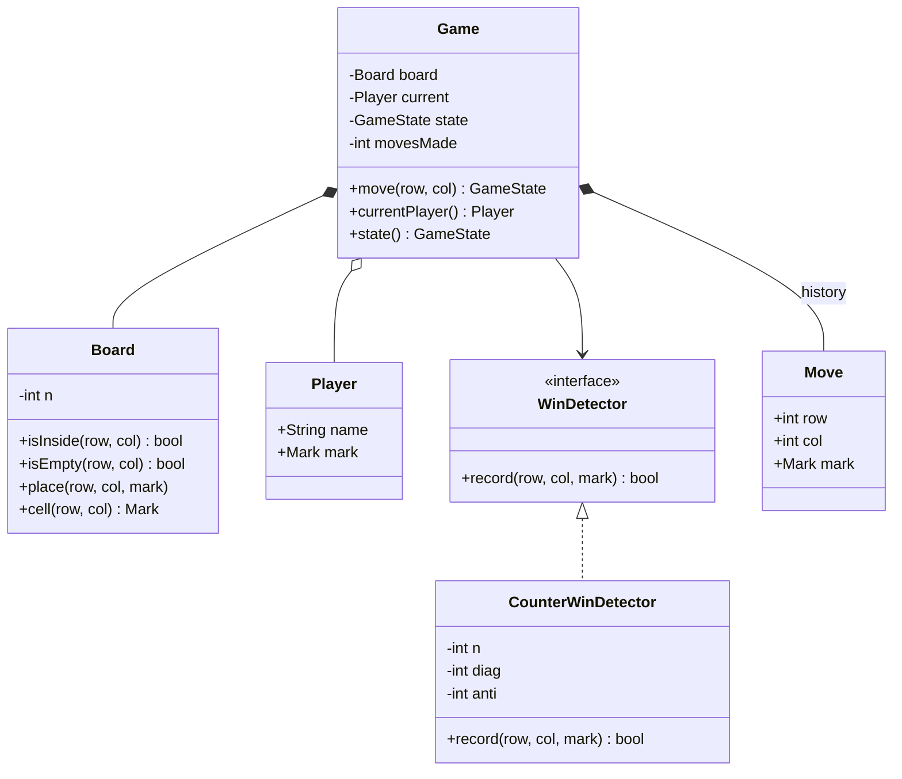
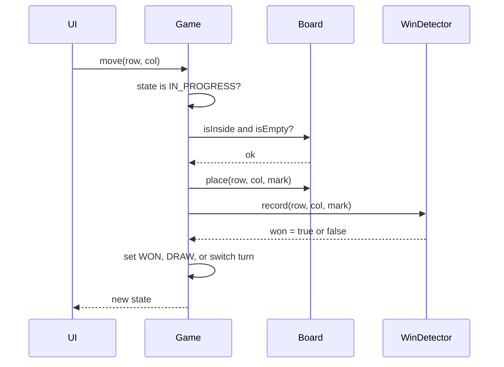

## In one minute
- Separate the rules (whose turn it is, which moves are legal, when the game ends) from the data (the grid). `Game` owns the rules and `Board` owns the cells. The UI never writes to the board directly.
- Detect a win in O(1) per move. Keep one counter per row, one per column and one for each diagonal. Add +1 for X and -1 for O. A counter that reaches +N or -N means that line is complete. You never rescan the board.
- Model the game status as an explicit state (`IN_PROGRESS`, `X_WON`, `O_WON`, `DRAW`) and reject every move once the state is no longer `IN_PROGRESS`. Most bugs in this problem come from moves that slip in after the game has ended.
- Validate before you mutate. A move that is out of bounds, lands on an occupied cell, or arrives after the game is over must leave the game exactly as it was, including whose turn it is.
- Size the board with N from the start. The interviewer's follow-up is almost always "now make it N×N" or "now K in a row", and a 3×3 hard-coded win table can't answer it.

## Requirements
Functional:
- Two players, X and O, alternate turns on an N×N board. X moves first.
- A move names a row and a column. The game rejects illegal moves with a clear reason.
- After each move the game reports its state: still in progress, won by X, won by O, or drawn.
- A player wins by filling a whole row, column or diagonal. If the board fills up with no winner, the game is a draw.
- Callers can read the board and the current player at any time.

Non-functional:
- Each move costs O(1) time. Memory is O(N²) for the grid and O(N) for the counters.
- The game is deterministic and easy to test without a UI.
- The core is a library: a CLI, a web UI or a bot can drive it.

Out of scope: networking, matchmaking, persistence, an AI opponent and timers. They come up in the Extensibility section, but they don't belong in the core.

## Entities and relationships
Start from the nouns in the requirements and keep only the ones that have behaviour or invariants.

- **Game**: the aggregate root. It holds the board, the players, the turn and the state, and it is the only object that accepts moves. It enforces the order "validate, place, check for a win, check for a draw, switch turns".
- **Board**: an N×N grid of marks. It knows its bounds and whether a cell is empty. It does not know whose turn it is or what counts as a win.
- **Player**: a name and a mark. Keeping it separate lets a human, a bot or a remote client stand behind the same interface later.
- **WinDetector**: records each placed mark and answers "did this move win?". The counter version is one implementation. A K-in-a-row scanner is another.
- **Move**: an immutable record (row, column, player). The history of moves gives you undo, replay and an audit log almost for free.

A `Cell` class is a common trap. A cell has no behaviour beyond holding a mark, so a two-dimensional array of marks is clearer and cheaper.

## Class diagram



## Key flows
The only interesting flow is a single move. Every check happens before the board changes, so a rejected move has no side effects.



The order inside the last step matters. Check for a win before you check for a draw, because the move that fills the last cell can also complete a line. That game is a win, not a draw.

## Design patterns used and why
- **[Strategy](https://refactoring.guru/design-patterns/strategy) for win detection.** The counter detector only handles "fill a whole line". Gomoku-style rules (five in a row on a 15×15 board) need a different detector that scans outward from the last move. Putting it behind `WinDetector` lets `Game` stay unchanged.
- **State as an explicit enum, not scattered booleans.** `isOver`, `hasWinner` and `winner` as three separate fields can disagree. One `GameState` value can't. A full State pattern, with one class per state, is overkill for four states with no per-state behaviour. Say so in the interview, because it shows you know when not to reach for a pattern.
- **[Command](https://refactoring.guru/design-patterns/command) for moves.** Storing each `Move` as a value object makes undo a matter of popping the last move, clearing its cell and subtracting its delta from the counters. It also gives you replay for debugging and a log for a server to persist.
- **Observer for the UI (optional).** A console renderer, a web socket broadcaster and an analytics hook can each subscribe to "move applied" and "game ended" events without `Game` knowing about any of them.
- **Factory for players.** `PlayerFactory.human("Ana", X)` and `PlayerFactory.bot(level, O)` hide how a player picks a move. This only matters once bots exist.

## Concurrency and edge cases
In a local game one thread drives everything, so there is nothing to lock. In a server, two requests for the same game can arrive at once: a double-clicked button, or both players' clients racing. That is the **contention** shape. The fix is to serialise moves per game. Use a mutex on the `Game` object in a single process, or [optimistic concurrency](https://www.postgresql.org/docs/current/transaction-iso.html) in a database: each move carries the expected move number, and the server applies it only if the number still matches. The same version-check pattern protects a shopping cart or a wiki page from lost updates.

Edge cases worth naming before you code:
- A move outside the board, including negative indices.
- A move onto an occupied cell. It must not switch the turn.
- Any move after the game has ended.
- The last empty cell completes a line. This is a win, not a draw.
- N = 1: the first move wins.
- A player taking two turns in a row. The game decides whose turn it is, so callers can't pass in a player who is out of turn.

## In the wild
- **Chess.com, 2023: the chess boom outgrows the database.** Traffic nearly doubled from early December 2022. On 20 January 2023 the site had 10 million daily active members, a record 31.7 million games and about 16,000 moves a second on average. During the noon to 4 p.m. ET peak the database could not keep up with the writes, servers were exhausted, and users saw 502 errors and game timeouts. The plan was new hardware, separate tables, sharding, in-memory services and splitting off a gameplay database ([Chess.com](https://www.chess.com/blog/CHESScom/chess-is-booming-and-our-servers-are-struggling)).
- **Lichess, 2022: lag compensation tuned after "lag cheater" complaints.** In the fastest time controls, players argued that compensating for network lag rewarded laggers. Lichess grants a per-move quota with a capped bank, now min(1 s, total seconds × 2/5 + 0.15 s), so a 1+0 game earns 0.39 s per move instead of 0.45 s. The server, not the client, owns the clock and the rules ([Lichess issue 12097](https://github.com/lichess-org/lila/issues/12097), [LagTracker.scala](https://github.com/lichess-org/scalachess/blob/master/core/src/main/scala/LagTracker.scala)).

## Down the stack

### Layer 1: The contract
`move(row, col)` either applies exactly one mark and returns the new state, or raises an error with a reason and changes nothing. Once the state is terminal, it never changes again. Each call runs in constant time regardless of N, so a 1000×1000 board is as cheap per move as a 3×3 one.

### Layer 2: The mechanism
Give X the value +1 and O the value -1. Keep `rows[N]`, `cols[N]`, `diag` and `anti`. A move at (r, c) adds its value to `rows[r]` and `cols[c]`. It also adds to `diag` if `r == c`, and to `anti` if `r + c == N - 1`. A line is complete for X exactly when its counter equals N. That can only happen if all N cells hold X, because any O would pull the sum below N. Only the lines through the latest move can have changed, so you check at most four counters. A naive version rescans the row, column and both diagonals, which is O(N) per move. A full-board rescan is O(N²). LeetCode 348 is this exact counter trick.

### Layer 3: The machine
For N = 3 the whole state fits in a few cache lines: 9 cells, plus 8 small integers, plus a turn and a state. Every operation is a handful of integer adds that finish in nanoseconds. Even for N = 10,000, the counters take 2 × 10,000 × 4 bytes, about 80 KB, which fits in L2 cache. The grid, at 100 million cells, is what grows. A server holding a million concurrent games cares more about per-object overhead than about the algorithm. In CPython a list of lists of one-character strings costs pointers plus object headers. A flat `bytearray` of N² bytes would cut that by roughly 8×. Go and TypeScript typed arrays give you the flat layout directly.

### Why it's built this way
- Players expect instant feedback, so a move must cost O(1), not a board scan.
- O(1) needs incremental state, so you keep counters that change with each move instead of recomputing.
- Incremental state can drift from the grid if a half-applied move is ever left in place, so you validate completely before mutating anything.
- Validation and turn order are rules, not data, so they live in `Game`, and `Board` stays a dumb container you can reuse for Connect Four or chess.

## Extensibility
- **K in a row on an N×N board (Gomoku, the [m,n,k-game](https://en.wikipedia.org/wiki/M,n,k-game) family).** Swap the detector. From the last move, walk outward in four directions (horizontal, vertical and the two diagonals) and count consecutive marks. That costs O(K) per move. Line counters no longer work because K < N.
- **More than two players.** The ±1 trick breaks. Use one set of counters per player, or keep per-line "owner and count" pairs that mark a line dead once a second player touches it.
- **Undo and replay.** Pop the `Move`, clear the cell, subtract the delta, decrement the move count and restore the turn. Reset the state to `IN_PROGRESS` if the undone move had ended the game.
- **Bots.** A `Player` with a `chooseMove(board)` method. Minimax works for 3×3, whose game tree is tiny (only [765 essentially different positions](https://en.wikipedia.org/wiki/Tic-tac-toe) once rotations and reflections are merged). Larger boards need heuristics or Monte Carlo search.
- **Networked play.** Put `Game` behind a service. Add a game ID and a move sequence number for optimistic concurrency, and broadcast events through the observer hook.

### Variant: snake and ladder board game
A dice-and-board race keeps the same skeleton (a `Game` that owns the rules, a `Board` that stores data, an explicit status, validate-then-mutate) but changes three things.

**Chance enters the rules.** Tic-tac-toe is deterministic: the next state depends only on the move. Here a turn depends on a die roll, so randomness must be injected as a `Dice` interface that the game asks for the next roll, never a `random` call inside the rules. Tests and replays pass a scripted sequence. A production server draws from a server-side generator and logs every roll, because Python's general-purpose [`random` module](https://docs.python.org/3/library/random.html) is documented as unsuitable for security purposes, while Go's [`math/rand/v2`](https://pkg.go.dev/math/rand/v2) top-level functions use a stronger default source. Reject a roll outside 1 to 6 and leave the game unchanged.

**The board is a lookup table, not a counter set.** Treat a snake and a ladder as one thing, a jump from a start cell to an end cell. Store `dest[0..N]` with `dest[i] = i` and one overwritten entry per jump. A move is `pos = dest[pos + roll]`, still O(1), and snakes and ladders differ only in direction. Validate at build time: jumps inside the board, a snake ending below its start, a ladder above, at most one jump per cell, and no jump ending on another jump's start unless you define chaining and guard against cycles. Nothing like the win-detection Strategy is needed, because the win rule is "reach cell N".

**A turn can contain several moves.** Typical house rules make a player roll again after a six, forfeit the turn after three sixes in a row (returning to where the turn began, even after a ladder), and land exactly on N to win. Put these behind a `RuleSet` strategy with hooks such as `onOvershoot` and `grantsExtraRoll`, and return one `TurnResult` listing each roll, jump and final position, so the UI can animate it. Compute the whole turn in locals and commit once, which keeps the atomicity of tic-tac-toe's move.

Players also have positions, not marks, so turn order is a rotating index over two or more players, and there is no draw. Online play adds a turn number to each request to reject stale ones, plus an [idempotency key](https://docs.stripe.com/api/idempotent_requests) so a retried request returns the stored `TurnResult` instead of rolling again. With a seeded die the board is also a Markov chain, so a million simulated games can be compared against the analytic expected game length to check a layout.

## Leadership lens
- In review, ask where the rules live. If the UI checks whose turn it is, the first bot or API client will cheat by accident.
- Make the error type part of the contract (out of bounds, occupied, game over). Clients render these errors to users, so changing them is a breaking change.
- Insist on a headless core with table-driven tests: win in each direction, a draw, a win on the last cell, illegal moves. These tests document the rules better than a spec does.
- Watch for over-engineering. Six classes with interfaces for a 3×3 game is fine in an interview that tests design. In production code, a reviewer should ask which extension point has a real customer.

## Check yourself
1. Why can't a row counter reach +N unless every cell in that row is X?
   **Answer:** Each X adds 1 and each O subtracts 1. Empty cells add 0, so the sum reaches N only when all N cells contribute +1.
2. The last empty cell is filled and that move also completes a diagonal. What should the game report, and what ordering in the code guarantees it?
   **Answer:** A win. Check for a win before you check whether the board is full.
3. Why do the line counters fail for "5 in a row on a 15×15 board"?
   **Answer:** A counter summarises an entire line. A row holding five Xs and some Os, or five Xs that aren't contiguous, gives sums that can't tell you whether five Xs sit next to each other. You have to count consecutive marks outward from the last move.
4. Two HTTP requests try to make a move in the same game at the same moment. What goes wrong without coordination, and what is a cheap fix?
   **Answer:** Both can pass validation against the same old state, so one player moves twice or two marks land on one turn. Serialise per game with a lock, or require an expected move number and reject stale requests.

## Practice
**Task:** Implement `Game(n)` for an N×N board with X moving first. `move(row, col)` returns the new state as a string: `"IN_PROGRESS"`, `"X_WON"`, `"O_WON"` or `"DRAW"`. Detect wins in O(1) with row, column and diagonal counters. Illegal moves raise a `MoveError` with code `"out_of_bounds"`, `"occupied"` or `"game_over"` (Go returns the sentinel errors `ErrOutOfBounds`, `ErrOccupied`, `ErrGameOver`), and leave the game unchanged. Also expose `current_player()` (`"X"` or `"O"`), `state()` and `cell(row, col)`, which returns `""` for an empty cell. After a win, `current_player()` still returns the winner.

```python starter
class MoveError(Exception):
    def __init__(self, code):
        super().__init__(code)
        self.code = code


class Game:
    def __init__(self, n):
        self.n = n

    def current_player(self):
        # TODO: "X" or "O"
        raise NotImplementedError

    def state(self):
        raise NotImplementedError

    def cell(self, row, col):
        raise NotImplementedError

    def move(self, row, col):
        # TODO: validate, place, update counters, return the new state
        raise NotImplementedError
```

```python tests
def play(game, moves):
    state = None
    for r, c in moves:
        state = game.move(r, c)
    return state


def expect_error(fn, code):
    try:
        fn()
    except MoveError as e:
        assert e.code == code, "expected " + code + ", got " + e.code
        return
    assert False, "expected MoveError " + code


def test_new_game():
    g = Game(3)
    assert g.current_player() == "X"
    assert g.state() == "IN_PROGRESS"
    assert g.cell(1, 1) == ""


def test_turns_alternate():
    g = Game(3)
    assert g.move(0, 0) == "IN_PROGRESS"
    assert g.current_player() == "O"
    g.move(1, 1)
    assert g.current_player() == "X"
    assert g.cell(0, 0) == "X" and g.cell(1, 1) == "O"


def test_row_and_column_wins():
    g = Game(3)
    assert play(g, [(0, 0), (1, 0), (0, 1), (1, 1), (0, 2)]) == "X_WON"
    g = Game(3)
    assert play(g, [(0, 0), (0, 1), (1, 0), (1, 1), (2, 2), (2, 1)]) == "O_WON"


def test_diagonals():
    g = Game(3)
    assert play(g, [(0, 0), (0, 1), (1, 1), (0, 2), (2, 2)]) == "X_WON"
    g = Game(4)
    moves = [(0, 3), (0, 0), (1, 2), (1, 1), (2, 1), (2, 2), (3, 0)]
    assert play(g, moves) == "X_WON", "anti-diagonal on 4x4"


def test_draw():
    g = Game(3)
    moves = [(0, 0), (0, 1), (0, 2), (1, 1), (1, 0), (1, 2), (2, 1), (2, 0), (2, 2)]
    assert play(g, moves) == "DRAW"
    assert g.state() == "DRAW"


def test_win_on_last_cell_is_not_draw():
    g = Game(3)
    moves = [(0, 0), (0, 1), (0, 2), (1, 0), (1, 1), (1, 2), (2, 1), (2, 0), (2, 2)]
    assert play(g, moves) == "X_WON"
    assert Game(1).move(0, 0) == "X_WON"


def test_invalid_moves_do_not_change_turn():
    g = Game(3)
    g.move(1, 1)
    expect_error(lambda: g.move(1, 1), "occupied")
    expect_error(lambda: g.move(3, 0), "out_of_bounds")
    expect_error(lambda: g.move(0, -1), "out_of_bounds")
    assert g.current_player() == "O"
    assert g.move(0, 0) == "IN_PROGRESS"


def test_no_moves_after_game_over():
    g = Game(3)
    play(g, [(0, 0), (1, 0), (0, 1), (1, 1), (0, 2)])
    expect_error(lambda: g.move(2, 2), "game_over")
    assert g.cell(2, 2) == ""
    assert g.current_player() == "X"
```

```python solution
class MoveError(Exception):
    def __init__(self, code):
        super().__init__(code)
        self.code = code


class Game:
    def __init__(self, n):
        if n < 1:
            raise ValueError("n must be at least 1")
        self.n = n
        self._cells = [[""] * n for _ in range(n)]
        self._rows = [0] * n
        self._cols = [0] * n
        self._diag = 0
        self._anti = 0
        self._moves = 0
        self._current = "X"
        self._state = "IN_PROGRESS"

    def current_player(self):
        return self._current

    def state(self):
        return self._state

    def cell(self, row, col):
        return self._cells[row][col]

    def move(self, row, col):
        if self._state != "IN_PROGRESS":
            raise MoveError("game_over")
        if not (0 <= row < self.n and 0 <= col < self.n):
            raise MoveError("out_of_bounds")
        if self._cells[row][col] != "":
            raise MoveError("occupied")

        player = self._current
        delta = 1 if player == "X" else -1
        self._cells[row][col] = player
        self._moves += 1
        self._rows[row] += delta
        self._cols[col] += delta
        on_diag = row == col
        on_anti = row + col == self.n - 1
        if on_diag:
            self._diag += delta
        if on_anti:
            self._anti += delta

        target = delta * self.n
        won = (self._rows[row] == target or self._cols[col] == target
               or (on_diag and self._diag == target)
               or (on_anti and self._anti == target))
        if won:
            self._state = player + "_WON"
        elif self._moves == self.n * self.n:
            self._state = "DRAW"
        else:
            self._current = "O" if player == "X" else "X"
        return self._state
```

```typescript starter
export type GameState = "IN_PROGRESS" | "X_WON" | "O_WON" | "DRAW";
export type Mark = "X" | "O";

export class MoveError extends Error {
  constructor(public code: "out_of_bounds" | "occupied" | "game_over") {
    super(code);
  }
}

export class Game {
  constructor(public readonly n: number) {}

  currentPlayer(): Mark {
    throw new Error("TODO");
  }

  state(): GameState {
    throw new Error("TODO");
  }

  cell(row: number, col: number): "" | Mark {
    throw new Error("TODO");
  }

  move(row: number, col: number): GameState {
    // TODO: validate, place, update counters, return the new state
    throw new Error("TODO");
  }
}
```

```typescript tests
function play(g: Game, moves: [number, number][]): GameState {
  let s: GameState = g.state();
  for (const [r, c] of moves) s = g.move(r, c);
  return s;
}

function expectError(fn: () => void, code: string): void {
  try {
    fn();
  } catch (e) {
    assert(e instanceof MoveError, "expected MoveError, got " + String(e));
    assertEqual((e as MoveError).code, code);
    return;
  }
  assert(false, "expected MoveError " + code);
}

test("new game", () => {
  const g = new Game(3);
  assertEqual(g.currentPlayer(), "X");
  assertEqual(g.state(), "IN_PROGRESS");
  assertEqual(g.cell(1, 1), "");
});

test("turns alternate", () => {
  const g = new Game(3);
  assertEqual(g.move(0, 0), "IN_PROGRESS");
  assertEqual(g.currentPlayer(), "O");
  g.move(1, 1);
  assertEqual(g.currentPlayer(), "X");
  assertEqual([g.cell(0, 0), g.cell(1, 1)], ["X", "O"]);
});

test("row and column wins", () => {
  assertEqual(play(new Game(3), [[0, 0], [1, 0], [0, 1], [1, 1], [0, 2]]), "X_WON");
  assertEqual(play(new Game(3), [[0, 0], [0, 1], [1, 0], [1, 1], [2, 2], [2, 1]]), "O_WON");
});

test("diagonals", () => {
  assertEqual(play(new Game(3), [[0, 0], [0, 1], [1, 1], [0, 2], [2, 2]]), "X_WON");
  const moves: [number, number][] = [[0, 3], [0, 0], [1, 2], [1, 1], [2, 1], [2, 2], [3, 0]];
  assertEqual(play(new Game(4), moves), "X_WON", "anti-diagonal on 4x4");
});

test("draw", () => {
  const g = new Game(3);
  const moves: [number, number][] = [[0, 0], [0, 1], [0, 2], [1, 1], [1, 0], [1, 2], [2, 1], [2, 0], [2, 2]];
  assertEqual(play(g, moves), "DRAW");
  assertEqual(g.state(), "DRAW");
});

test("win on last cell is not a draw", () => {
  const moves: [number, number][] = [[0, 0], [0, 1], [0, 2], [1, 0], [1, 1], [1, 2], [2, 1], [2, 0], [2, 2]];
  assertEqual(play(new Game(3), moves), "X_WON");
  assertEqual(new Game(1).move(0, 0), "X_WON");
});

test("invalid moves do not change turn", () => {
  const g = new Game(3);
  g.move(1, 1);
  expectError(() => g.move(1, 1), "occupied");
  expectError(() => g.move(3, 0), "out_of_bounds");
  expectError(() => g.move(0, -1), "out_of_bounds");
  assertEqual(g.currentPlayer(), "O");
  assertEqual(g.move(0, 0), "IN_PROGRESS");
});

test("no moves after game over", () => {
  const g = new Game(3);
  play(g, [[0, 0], [1, 0], [0, 1], [1, 1], [0, 2]]);
  expectError(() => g.move(2, 2), "game_over");
  assertEqual(g.cell(2, 2), "");
  assertEqual(g.currentPlayer(), "X");
});
```

```typescript solution
export type GameState = "IN_PROGRESS" | "X_WON" | "O_WON" | "DRAW";
export type Mark = "X" | "O";

export class MoveError extends Error {
  constructor(public code: "out_of_bounds" | "occupied" | "game_over") {
    super(code);
  }
}

export class Game {
  private cells: ("" | Mark)[];
  private rows: number[];
  private cols: number[];
  private diag = 0;
  private anti = 0;
  private moves = 0;
  private current: Mark = "X";
  private status: GameState = "IN_PROGRESS";

  constructor(public readonly n: number) {
    if (n < 1) throw new RangeError("n must be at least 1");
    this.cells = new Array<"" | Mark>(n * n).fill("");
    this.rows = new Array<number>(n).fill(0);
    this.cols = new Array<number>(n).fill(0);
  }

  currentPlayer(): Mark {
    return this.current;
  }

  state(): GameState {
    return this.status;
  }

  cell(row: number, col: number): "" | Mark {
    return this.cells[row * this.n + col];
  }

  move(row: number, col: number): GameState {
    if (this.status !== "IN_PROGRESS") throw new MoveError("game_over");
    if (row < 0 || row >= this.n || col < 0 || col >= this.n) throw new MoveError("out_of_bounds");
    if (this.cells[row * this.n + col] !== "") throw new MoveError("occupied");

    const player = this.current;
    const delta = player === "X" ? 1 : -1;
    this.cells[row * this.n + col] = player;
    this.moves++;
    this.rows[row] += delta;
    this.cols[col] += delta;
    const onDiag = row === col;
    const onAnti = row + col === this.n - 1;
    if (onDiag) this.diag += delta;
    if (onAnti) this.anti += delta;

    const target = delta * this.n;
    const won =
      this.rows[row] === target ||
      this.cols[col] === target ||
      (onDiag && this.diag === target) ||
      (onAnti && this.anti === target);
    if (won) {
      this.status = player === "X" ? "X_WON" : "O_WON";
    } else if (this.moves === this.n * this.n) {
      this.status = "DRAW";
    } else {
      this.current = player === "X" ? "O" : "X";
    }
    return this.status;
  }
}
```

```go starter
package practice

import "errors"

type State string

const (
	InProgress State = "IN_PROGRESS"
	XWon       State = "X_WON"
	OWon       State = "O_WON"
	Draw       State = "DRAW"
)

var (
	ErrOutOfBounds = errors.New("move out of bounds")
	ErrOccupied    = errors.New("cell occupied")
	ErrGameOver    = errors.New("game is over")
)

type Game struct {
	n int
}

func NewGame(n int) (*Game, error) {
	return &Game{n: n}, nil
}

func (g *Game) CurrentPlayer() string { panic("TODO") }

func (g *Game) State() State { panic("TODO") }

func (g *Game) Cell(row, col int) string { panic("TODO") }

// Move validates, places the mark, updates counters and returns the new state.
func (g *Game) Move(row, col int) (State, error) {
	panic("TODO")
}
```

```go tests
package practice

import (
	"errors"
	"testing"
)

func newGame(t *testing.T, n int) *Game {
	t.Helper()
	g, err := NewGame(n)
	if err != nil {
		t.Fatalf("NewGame(%d): %v", n, err)
	}
	return g
}

func play(t *testing.T, g *Game, moves [][2]int) State {
	t.Helper()
	s := g.State()
	for _, m := range moves {
		var err error
		s, err = g.Move(m[0], m[1])
		if err != nil {
			t.Fatalf("Move(%d,%d): %v", m[0], m[1], err)
		}
	}
	return s
}

func TestNewGame(t *testing.T) {
	g := newGame(t, 3)
	if g.CurrentPlayer() != "X" || g.State() != InProgress || g.Cell(1, 1) != "" {
		t.Fatalf("bad initial game: %s %s %q", g.CurrentPlayer(), g.State(), g.Cell(1, 1))
	}
}

func TestTurnsAlternate(t *testing.T) {
	g := newGame(t, 3)
	if s := play(t, g, [][2]int{{0, 0}}); s != InProgress {
		t.Fatalf("state = %s", s)
	}
	if g.CurrentPlayer() != "O" {
		t.Fatalf("expected O to move")
	}
	play(t, g, [][2]int{{1, 1}})
	if g.CurrentPlayer() != "X" || g.Cell(0, 0) != "X" || g.Cell(1, 1) != "O" {
		t.Fatalf("turns did not alternate")
	}
}

func TestRowAndColumnWins(t *testing.T) {
	if s := play(t, newGame(t, 3), [][2]int{{0, 0}, {1, 0}, {0, 1}, {1, 1}, {0, 2}}); s != XWon {
		t.Fatalf("row: got %s", s)
	}
	if s := play(t, newGame(t, 3), [][2]int{{0, 0}, {0, 1}, {1, 0}, {1, 1}, {2, 2}, {2, 1}}); s != OWon {
		t.Fatalf("column: got %s", s)
	}
}

func TestDiagonals(t *testing.T) {
	if s := play(t, newGame(t, 3), [][2]int{{0, 0}, {0, 1}, {1, 1}, {0, 2}, {2, 2}}); s != XWon {
		t.Fatalf("diagonal: got %s", s)
	}
	moves := [][2]int{{0, 3}, {0, 0}, {1, 2}, {1, 1}, {2, 1}, {2, 2}, {3, 0}}
	if s := play(t, newGame(t, 4), moves); s != XWon {
		t.Fatalf("anti-diagonal on 4x4: got %s", s)
	}
}

func TestDraw(t *testing.T) {
	g := newGame(t, 3)
	moves := [][2]int{{0, 0}, {0, 1}, {0, 2}, {1, 1}, {1, 0}, {1, 2}, {2, 1}, {2, 0}, {2, 2}}
	if s := play(t, g, moves); s != Draw || g.State() != Draw {
		t.Fatalf("expected draw, got %s", s)
	}
}

func TestWinOnLastCellIsNotDraw(t *testing.T) {
	moves := [][2]int{{0, 0}, {0, 1}, {0, 2}, {1, 0}, {1, 1}, {1, 2}, {2, 1}, {2, 0}, {2, 2}}
	if s := play(t, newGame(t, 3), moves); s != XWon {
		t.Fatalf("got %s", s)
	}
	if s := play(t, newGame(t, 1), [][2]int{{0, 0}}); s != XWon {
		t.Fatalf("1x1: got %s", s)
	}
}

func TestInvalidMovesDoNotChangeTurn(t *testing.T) {
	g := newGame(t, 3)
	play(t, g, [][2]int{{1, 1}})
	if _, err := g.Move(1, 1); !errors.Is(err, ErrOccupied) {
		t.Fatalf("expected ErrOccupied, got %v", err)
	}
	if _, err := g.Move(3, 0); !errors.Is(err, ErrOutOfBounds) {
		t.Fatalf("expected ErrOutOfBounds, got %v", err)
	}
	if _, err := g.Move(0, -1); !errors.Is(err, ErrOutOfBounds) {
		t.Fatalf("expected ErrOutOfBounds, got %v", err)
	}
	if g.CurrentPlayer() != "O" {
		t.Fatalf("turn changed after invalid move")
	}
}

func TestNoMovesAfterGameOver(t *testing.T) {
	g := newGame(t, 3)
	play(t, g, [][2]int{{0, 0}, {1, 0}, {0, 1}, {1, 1}, {0, 2}})
	if _, err := g.Move(2, 2); !errors.Is(err, ErrGameOver) {
		t.Fatalf("expected ErrGameOver, got %v", err)
	}
	if g.Cell(2, 2) != "" || g.CurrentPlayer() != "X" {
		t.Fatalf("game changed after it ended")
	}
}
```

```go solution
package practice

import "errors"

type State string

const (
	InProgress State = "IN_PROGRESS"
	XWon       State = "X_WON"
	OWon       State = "O_WON"
	Draw       State = "DRAW"
)

var (
	ErrOutOfBounds = errors.New("move out of bounds")
	ErrOccupied    = errors.New("cell occupied")
	ErrGameOver    = errors.New("game is over")
)

type Game struct {
	n          int
	cells      []string
	rows, cols []int
	diag, anti int
	moves      int
	current    string
	state      State
}

func NewGame(n int) (*Game, error) {
	if n < 1 {
		return nil, errors.New("n must be at least 1")
	}
	cells := make([]string, n*n)
	return &Game{
		n:       n,
		cells:   cells,
		rows:    make([]int, n),
		cols:    make([]int, n),
		current: "X",
		state:   InProgress,
	}, nil
}

func (g *Game) CurrentPlayer() string { return g.current }

func (g *Game) State() State { return g.state }

func (g *Game) Cell(row, col int) string { return g.cells[row*g.n+col] }

// Move validates, places the mark, updates counters and returns the new state.
func (g *Game) Move(row, col int) (State, error) {
	if g.state != InProgress {
		return g.state, ErrGameOver
	}
	if row < 0 || row >= g.n || col < 0 || col >= g.n {
		return g.state, ErrOutOfBounds
	}
	if g.cells[row*g.n+col] != "" {
		return g.state, ErrOccupied
	}

	player := g.current
	delta := 1
	if player == "O" {
		delta = -1
	}
	g.cells[row*g.n+col] = player
	g.moves++
	g.rows[row] += delta
	g.cols[col] += delta
	onDiag := row == col
	onAnti := row+col == g.n-1
	if onDiag {
		g.diag += delta
	}
	if onAnti {
		g.anti += delta
	}

	target := delta * g.n
	won := g.rows[row] == target || g.cols[col] == target ||
		(onDiag && g.diag == target) || (onAnti && g.anti == target)
	switch {
	case won && player == "X":
		g.state = XWon
	case won:
		g.state = OWon
	case g.moves == g.n*g.n:
		g.state = Draw
	case player == "X":
		g.current = "O"
	default:
		g.current = "X"
	}
	return g.state, nil
}
```

## Mock interview
**Prompt:** Design the classes for a tic-tac-toe game that a CLI and a web front end will both use. Start with 3×3 for two players, but the product team already wants larger boards. Write the code for making a move and detecting the end of the game.

- Follow-up: Your win check rescans the row, column and diagonals. Can you make each move O(1) for a 1000×1000 board?
- Follow-up: The web client double-submits a move. Walk me through what happens on your server and how you stop the same player from moving twice.
- Follow-up: The product team now wants "5 in a row on 15×15" and a three-player mode. What survives from your design and what do you replace?

**A strong answer covers:**
- A clear split: `Game` enforces rules and turn order, `Board` stores marks, and the UI only calls `move` and reads state.
- Line counters with ±1 deltas, why they give O(1) per move, and why the check looks only at lines through the last move.
- An explicit state enum, the win-before-draw ordering, and rejecting every move after the game ends.
- Validate-then-mutate so illegal moves have no side effects, with typed errors the UI can render.
- Win detection behind a strategy interface, with the K-in-a-row scan as the swap-in, and per-game serialisation or version checks for concurrent requests.

## Sources and further study
**Primary**
- [Tic-tac-toe (Wikipedia)](https://en.wikipedia.org/wiki/Tic-tac-toe): rules, the count of distinct positions and why perfect play draws.
- [m,n,k-game (Wikipedia)](https://en.wikipedia.org/wiki/M,n,k-game): the general family behind the K-in-a-row extension.

**Systems docs**
- [PostgreSQL: transaction isolation](https://www.postgresql.org/docs/current/transaction-iso.html): serialization failures and retry, the database form of a per-game move-number check.
- [Python random module](https://docs.python.org/3/library/random.html): the Mersenne Twister and its warning against security use, relevant to the dice variant.
- [Go math/rand/v2](https://pkg.go.dev/math/rand/v2): seeded generators for reproducible games and a stronger default source.
- [Stripe: idempotent requests](https://docs.stripe.com/api/idempotent_requests): making a retried move or turn safe to repeat.

**Books**
- *Design Patterns: Elements of Reusable Object-Oriented Software*, Gamma, Helm, Johnson and Vlissides: chapter 5 (Behavioral, including Strategy, Command, Observer and State).
- *Head First Design Patterns*, Freeman and Robson: chapter 1 (Strategy) and chapter 6 (Command).

**Other curricula**
- [Refactoring Guru: Strategy](https://refactoring.guru/design-patterns/strategy) and [Command](https://refactoring.guru/design-patterns/command): how that catalogue frames the two patterns used for win detection and undo.

## Watch
- [System Design: Tic Tac Toe, Low Level System Design (The Tech Granth)](https://www.youtube.com/watch?v=V7aFobyuLrU): an object-oriented breakdown with players, board and game classes.
- [Leetcode 348: Design Tic-Tac-Toe (LC Bear)](https://www.youtube.com/watch?v=oP_0hWm_bDA): the O(1) row, column and diagonal counter trick, explained step by step.

## Free resources
- [Tic-tac-toe (Wikipedia)](https://en.wikipedia.org/wiki/Tic-tac-toe): rules, game-tree size and why perfect play always ends in a draw.
- [m,n,k-game (Wikipedia)](https://en.wikipedia.org/wiki/M,n,k-game): the general family (N×M boards, K in a row) that the extensibility questions lead to.
- [Strategy pattern (Refactoring Guru)](https://refactoring.guru/design-patterns/strategy): the pattern behind a swappable win detector.
- [Command pattern (Refactoring Guru)](https://refactoring.guru/design-patterns/command): moves as objects, which is how undo and replay come cheap.
- [State pattern (Refactoring Guru)](https://refactoring.guru/design-patterns/state): when a full State pattern pays off and when an enum is enough.
