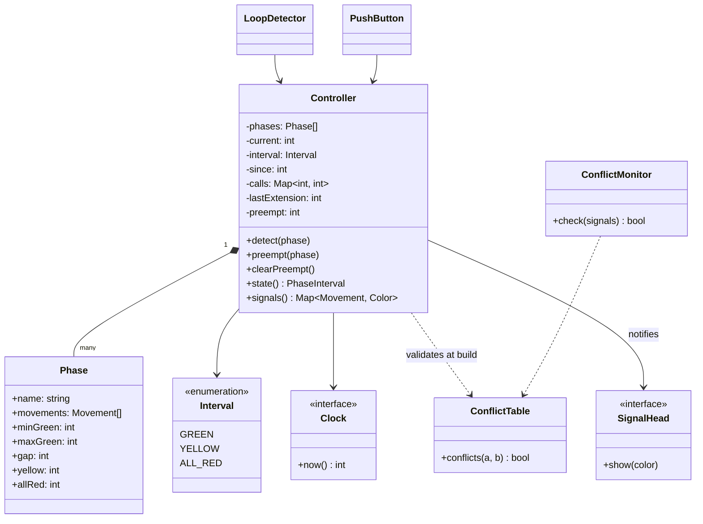
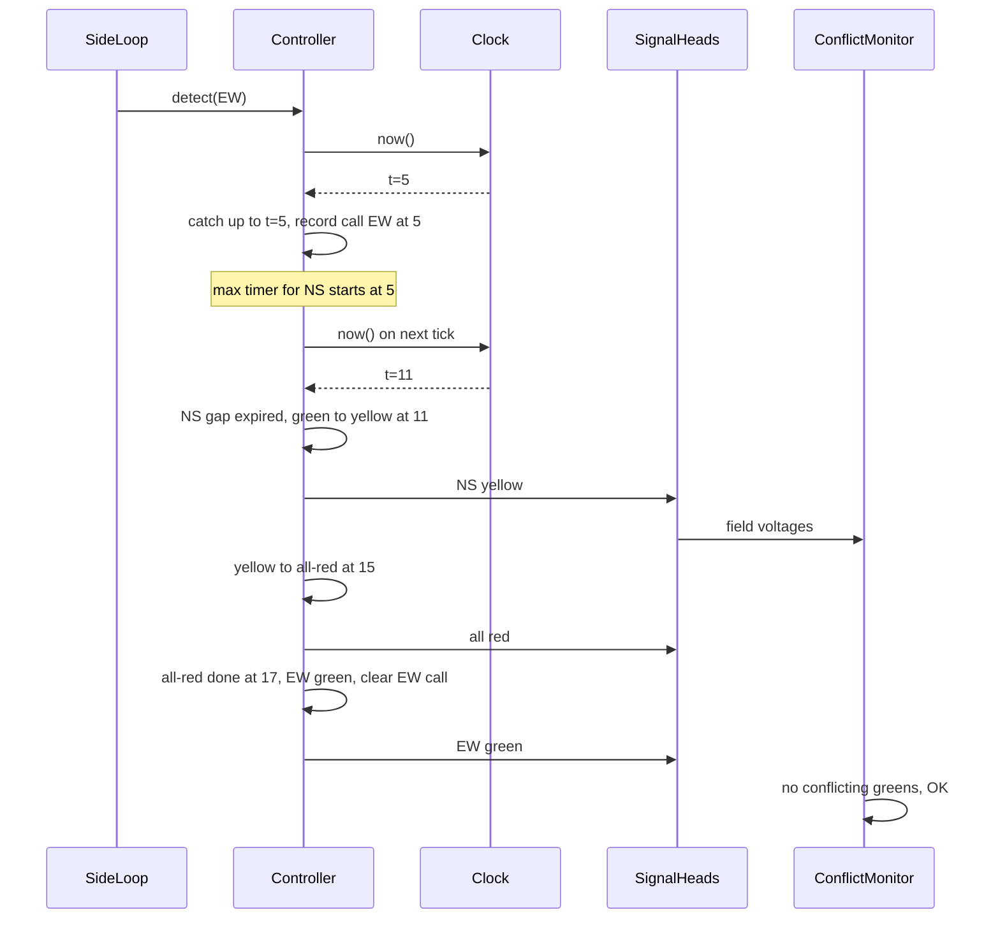

## In one minute
- A signal controller is a timed state machine with a safety invariant: movements that can collide never show green together, and every green ends with yellow and all-red clearance before a conflicting green.
- Model phases (groups of compatible movements that go green together) and intervals (green, yellow, all-red). Validate the conflict table at construction so an illegal phase cannot exist at runtime.
- Demand sets green length: a minimum green, an extension each time a detector sees a car (the gap timer), and a maximum that starts when a conflicting road is waiting. Uncalled phases are skipped.
- Inject time and advance by computing the next due transition, not by sleeping. The controller becomes a deterministic function of its event log, testable and replayable after an incident.
- The shape is **contention** for a shared resource (the conflict zone) with fairness and a hard safety rule, the same shape as a database lock manager, a railway interlocking or a time-slicing CPU scheduler.

## Requirements

Functional:
- One intersection with configurable movements (`N-through`, `S-left`, `E-ped`) and a conflict table of pairs that may not move together.
- Movements are grouped into phases served in cycle order, each with minimum green, maximum green, gap (extension), yellow and all-red times.
- Vehicle and pedestrian detectors place calls. A call on the green phase extends it; a call on any other phase asks to be served next time round. Phases with no call are skipped, and with no calls at all the controller rests in green on the current phase.
- Emergency preemption: a fire truck approaching on one phase ends the current green safely and holds that phase green until the preemption clears.
- Report every signal head's colour on demand, for the cabinet display and for logs.

Non-functional:
- Safety first: no conflicting greens, ever, and no green that skips its yellow and all-red. When unsure, go to flashing red (an all-way stop).
- Deterministic and replayable: given the configuration and a timestamped list of detector events, the output is the same every time.
- Timing resolution of 100 ms or better, on an embedded controller that runs for years without a reboot.

Out of scope for the interview: coordinating a corridor of signals for green waves, adaptive timing from a central system, transit priority and the cabinet's electrical design.

## Entities and relationships

Use traffic engineering's own vocabulary; it makes the design easier to defend.

- **Movement** is a path through the junction: a vehicle through or left turn on one approach, or a pedestrian crossing. It is a value with a name. Each movement drives one signal head.
- **ConflictTable** is the set of movement pairs whose paths cross. It is data from the intersection's drawing, owned by a traffic engineer, not code.
- **Phase** is a named set of movements that are compatible with each other, plus its timing parameters. Phases are immutable once the controller starts.
- **Interval** is an enum: green, yellow, all-red. The controller is always in exactly one phase and one interval.
- **Controller** is the context object. It holds the current phase, the current interval and when it started, the pending calls, the time of the last extension on the green phase and any active preemption.
- **Detector** is anything that calls `detect(phase)`: an inductive loop in the road, a video sensor, a pedestrian push button. Detectors do not know about timing.
- **Clock** supplies time. **SignalHead** and **ConflictMonitor** are observers of the controller's output.

The controller is composed of its phases and depends on the clock through an interface. Detectors depend on the controller, never the reverse, so a new sensor type needs no change in the core.

## Class diagram



## Key flows

The flow below shows a side street car arriving while the main road is green. Note that the controller never sleeps: each call to it first catches up to the clock's current time, firing every transition that fell due in between.



## Design patterns used and why

- **State**, in its light form. Three intervals fit in an enum and one `fire` method. If preemption grows its own sequence (railway track clearance, dwell, exit), a State object per mode earns its place.
- **Strategy** for phase selection. "Next called phase in cycle order" is the default; corridors want fixed sequences and adaptive systems pick by queue length. Behind `nextPhase(current, calls)`, the timing engine never changes.
- **Observer** for outputs. Signal heads, the cabinet display and a log writer subscribe to interval changes. Publish after the transition commits, and never let a slow subscriber block the controller.
- **Command** for inputs. Detector events are timestamped immutable records. Logging them gives a replay harness: run yesterday's events against a new plan before deploying it.
- **Validated factory** for configuration. A phase plan arrives as data; the constructor refuses conflicting movements in one phase, a movement in two phases, or impossible timings. That is "make illegal states unrepresentable" applied to safety.
- Avoid a `TrafficLight` class per pole with its own timer. Independent timers drift, and the safety rule belongs to the whole junction, so it needs one owner.

## Concurrency and edge cases

- **One writer.** Detector interrupts, preemption and the timer all change state. Funnel them through one queue or one mutex; no callback mutates the interval directly.
- **Calls arriving during clearance.** A car arriving on the green approach during yellow cannot extend it. Treat it as a call for that phase's next turn.
- **Max timer start.** Start the maximum green timer when a conflicting call arrives, not when the green began.
- **Preemption mid-clearance.** If the controller is already in yellow or all-red, let the clearance finish and then go to the preempted phase.
- **Clock jumps.** A wall clock set backwards by NTP or a technician must not rewind the controller. Use a monotonic clock for intervals and clamp time so it never goes back.
- **Stuck detector.** A loop stuck "on" extends green to max-out every cycle. Maximum green bounds the damage; diagnostics (no change in N minutes) switch the phase to a fixed recall and raise an alarm.
- **Power and boot.** After a power cut, start in flash, then run a startup all-red before the first green.

## Down the stack

### Layer 1: The contract
At every instant, the set of movements showing green or yellow contains no conflicting pair. A green on phase P ends only after at least P's minimum green, and is followed by exactly P's yellow then P's all-red. Green ends when another phase is waiting and either no detector actuation arrived within the gap time or the maximum green has run since the first waiting call. With preemption active, the target phase is reached after at most one clearance and then held. Given the same configuration and the same timestamped event list, the sequence of intervals is identical.

### Layer 2: The mechanism
The engine stores the phase index, interval kind and start time, and computes one value: when the current interval is due to end. For yellow and all-red that is start plus duration. For green it is `min(waitSince + maxGreen, max(start + minGreen, lastExtension + gap, waitSince))`, undefined while nobody else waits, which is how resting in green falls out without a special case. Every entry point runs a catch-up loop that fires each due transition at its due time, not at now, so a late tick never stretches an interval. Real controllers do the same at larger scale: NEMA TS 2 defines dual-ring, eight-phase operation with barriers between the two street directions, and NTCIP 1202 defines the objects (minimum green, passage, maximum, yellow change, red clearance) a central system uses to read and write timings.

### Layer 3: The machine
A field controller is a small embedded computer in a roadside cabinet (newer ATC designs run Linux), ticking at 10 Hz because timings are set in tenths of a second. Its outputs drive solid-state load switches that put mains voltage on the lamps. Separately, a hardware conflict monitor (in NEMA cabinets, a Malfunction Management Unit) reads the actual field voltages on every channel and compares them with a programmed compatibility card. If it sees incompatible greens or a short yellow for more than a few hundred milliseconds, it trips a relay that puts the junction into flash, independently of the CPU. Detector loops are wire coils in the pavement; a vehicle's metal changes their inductance, and the detector card reports presence within tens of milliseconds. Yellow time comes from physics: the ITE kinematic formula adds about 1 second of perception-reaction time to approach speed divided by twice a comfortable deceleration, roughly 3 to 6 seconds for common speeds.

### Why it's built this way
1. A wrong green kills people, so safety cannot depend on the general-purpose software being correct.
2. Hence two layers: software that validates the plan before it runs, and an independent hardware monitor that checks the actual outputs and fails to flash.
3. Demand varies by minute, so fixed cycles waste green on empty roads; detectors and gap timers turn spare green into shorter waits.
4. Actuation alone can starve a side street behind a busy main road, so a maximum green caps every extension once someone is waiting.
5. Incidents get investigated and plans get changed by engineers, so the controller is a pure function of configuration plus event log, which can be replayed and audited.

## Extensibility

- **Pedestrian intervals.** A pedestrian phase adds walk and flashing don't walk intervals before yellow. Its minimum green becomes "walk plus clearance", where clearance is crossing distance divided by a walking speed (the US MUTCD uses 3.5 feet per second). That is a change to timing data plus one interval kind, not a new controller.
- **Coordination.** Corridors run a common cycle length with offsets so platoons meet greens. Add a cycle timer and a "force-off" point per phase; the selection strategy gains a constraint, the engine stays.
- **Adaptive control.** A central system writes new plans through the validated factory; the controller swaps plans at a cycle boundary, never mid-green.
- **Transit priority.** A softer preemption: extend the current green a few seconds or start the bus's phase early. A new policy object, same engine.
- **Many intersections.** Each junction keeps its own controller and safety layer. Central management observes and configures but is never in the safety path; if the network drops, junctions keep running local plans.

## Leadership lens

- Build first: the plan validator and the timing engine with a replay test harness.
- Ask in review: which component can make two greens appear, what independent check catches it, what happens when the clock jumps, and how a timing change is tested before it reaches the street.
- Separate ownership of configuration (traffic engineers, who own the conflict table and timings) from software (who own the engine). Give engineers a simulator that replays real detector logs.
- Safety-critical changes get their own process: replay a recorded day of traffic, stage the rollout, keep a fast revert.
- In an interview, spend the time on phases, the conflict invariant, actuation and preemption. A `Car` class with a `speed` field means you are modelling the wrong system.

## Check yourself
1. Why model phases rather than individual lights with their own timers?
   **Answer:** The safety rule is about combinations of movements, so it needs one owner that changes them together. Independent timers drift and cannot enforce that two crossing paths are never green at once.
2. A side street car arrives after the main road has rested green for 10 minutes. With a 30 second maximum, when can the main green end at the latest?
   **Answer:** 30 seconds after the side street call arrived, because the maximum timer starts on the conflicting call. Starting it at the beginning of green would end the main green instantly and ignore cars still arriving.
3. A preemption arrives during the yellow of the phase you want to leave. What should happen?
   **Answer:** Finish the yellow and the all-red, then go green on the preempted phase. Shortening clearance to save two seconds creates exactly the crash risk it exists to prevent.
4. Why fire a transition at its due time rather than at the moment the loop notices it?
   **Answer:** A late loop would stretch the interval and shift every later one. Firing at the due time keeps replays identical regardless of tick jitter.

## Practice
**Task:** Implement an actuated `Controller(phases, conflicts, clock)`. Each phase has a name, movements and integer seconds `min_green`, `max_green`, `gap`, `yellow`, `all_red`. The constructor fails with `conflict in <phase>: <a>/<b>` (pair as given), `movement in two phases: <m>`, or `bad timing: <phase>` unless `1 <= min_green <= max_green`, `gap >= 1`, `yellow >= 1`, `all_red >= 0`. The first phase starts green and rests there without calls. `detect(name)` extends the current phase while green, else places a call (keeping the earliest time). Green ends at `min(wait + max_green, max(start + min_green, last_extension + gap, wait))`, where `wait` is the later of green start and the earliest other call; yellow and all-red follow, then the first called phase after the current one in cycle order (current last; itself if none) goes green and its call clears. `preempt(name)` cuts another phase's green to yellow at once (or lets clearance finish), then holds the target green until `clear_preempt()`, which restarts its green timing. Every method first catches up to `clock.now()`, firing transitions at their due times; time never goes backwards. `state()` returns `(phase, interval)` with `green`, `yellow` or `all_red`; `signals()` maps movements to `G`, `Y` or `R`.

```python starter
from dataclasses import dataclass

GREEN, YELLOW, ALL_RED = "green", "yellow", "all_red"


@dataclass(frozen=True)
class Phase:
    name: str
    movements: tuple
    min_green: int
    max_green: int
    gap: int
    yellow: int
    all_red: int


class Controller:
    def __init__(self, phases, conflicts, clock):
        # TODO: validate the plan, then start the first phase green
        self._clock = clock

    def detect(self, name):
        raise NotImplementedError

    def preempt(self, name):
        raise NotImplementedError

    def clear_preempt(self):
        raise NotImplementedError

    def state(self):
        raise NotImplementedError

    def signals(self):
        raise NotImplementedError
```

```python tests
class FakeClock:
    def __init__(self):
        self.t = 0

    def now(self):
        return self.t


def ns_ew(clock):
    phases = [
        Phase("NS", ("N", "S"), 10, 30, 3, 4, 2),
        Phase("EW", ("E", "W"), 8, 20, 3, 4, 2),
        Phase("NSL", ("NL", "SL"), 5, 10, 2, 3, 1),
    ]
    conflicts = [("N", "E"), ("S", "W"), ("N", "SL"), ("E", "NL")]
    return Controller(phases, conflicts, clock)


def error_of(fn):
    try:
        fn()
    except ValueError as e:
        return str(e)
    return None


def test_validation():
    c = FakeClock()
    bad = [Phase("A", ("N", "E"), 5, 10, 2, 3, 1)]
    assert error_of(lambda: Controller(bad, [("N", "E")], c)) == "conflict in A: N/E"
    dup = [Phase("A", ("N",), 5, 10, 2, 3, 1), Phase("B", ("N",), 5, 10, 2, 3, 1)]
    assert error_of(lambda: Controller(dup, [], c)) == "movement in two phases: N"
    slow = [Phase("A", ("N",), 12, 10, 2, 3, 1)]
    assert error_of(lambda: Controller(slow, [], c)) == "bad timing: A"


def test_rests_in_green_without_calls():
    c = FakeClock()
    ctl = ns_ew(c)
    c.t = 1000
    assert ctl.state() == ("NS", GREEN)
    assert ctl.signals() == {"N": "G", "S": "G", "E": "R", "W": "R", "NL": "R", "SL": "R"}


def test_gap_out_then_clearance():
    c = FakeClock()
    ctl = ns_ew(c)
    ctl.detect("EW")
    seen = {}
    for t in (9, 10, 13, 14, 15, 16):
        c.t = t
        seen[t] = ctl.state()
    assert seen[9] == ("NS", GREEN), "minimum green holds"
    assert seen[10] == ("NS", YELLOW)
    assert seen[14] == ("NS", ALL_RED)
    assert seen[15] == ("NS", ALL_RED)
    assert seen[16] == ("EW", GREEN)
    assert ctl.signals()["E"] == "G" and ctl.signals()["N"] == "R"


def test_actuation_extends_green():
    c = FakeClock()
    ctl = ns_ew(c)
    c.t = 5
    ctl.detect("EW")
    for t in (8, 10):
        c.t = t
        ctl.detect("NS")
    c.t = 12
    assert ctl.state() == ("NS", GREEN), "last extension at 10 plus gap 3"
    c.t = 13
    assert ctl.state() == ("NS", YELLOW)
    assert ctl.signals()["N"] == "Y"


def test_max_out_counts_from_waiting_call():
    c = FakeClock()
    ctl = ns_ew(c)
    c.t = 100
    ctl.detect("NS")
    ctl.detect("EW")
    for t in range(101, 131, 2):
        c.t = t
        ctl.detect("NS")
    c.t = 129
    assert ctl.state() == ("NS", GREEN)
    c.t = 130
    assert ctl.state() == ("NS", YELLOW), "max green 30 after the call at 100"


def test_skips_uncalled_phase_and_wraps():
    c = FakeClock()
    ctl = ns_ew(c)
    ctl.detect("NSL")
    c.t = 16
    assert ctl.state() == ("NSL", GREEN), "EW had no call"
    ctl.detect("EW")
    ctl.detect("NS")
    c.t = 21
    assert ctl.state() == ("NSL", YELLOW)
    c.t = 25
    assert ctl.state() == ("NS", GREEN), "NS comes before EW after wrapping"
    c.t = 35
    assert ctl.state() == ("NS", YELLOW)
    c.t = 41
    assert ctl.state() == ("EW", GREEN)


def test_preemption_holds_and_releases():
    c = FakeClock()
    ctl = ns_ew(c)
    c.t = 3
    ctl.preempt("EW")
    assert ctl.state() == ("NS", YELLOW)
    c.t = 9
    assert ctl.state() == ("EW", GREEN)
    ctl.detect("NS")
    c.t = 200
    assert ctl.state() == ("EW", GREEN), "held while preempted"
    ctl.clear_preempt()
    c.t = 207
    assert ctl.state() == ("EW", GREEN)
    c.t = 208
    assert ctl.state() == ("EW", YELLOW)


def test_clock_never_goes_backwards():
    c = FakeClock()
    ctl = ns_ew(c)
    ctl.detect("EW")
    c.t = 12
    assert ctl.state() == ("NS", YELLOW)
    c.t = 2
    assert ctl.state() == ("NS", YELLOW)
    c.t = 16
    assert ctl.state() == ("EW", GREEN)
```

```python solution
from dataclasses import dataclass

GREEN, YELLOW, ALL_RED = "green", "yellow", "all_red"


@dataclass(frozen=True)
class Phase:
    name: str
    movements: tuple
    min_green: int
    max_green: int
    gap: int
    yellow: int
    all_red: int


class Controller:
    def __init__(self, phases, conflicts, clock):
        seen = set()
        for p in phases:
            if not (1 <= p.min_green <= p.max_green and p.gap >= 1 and p.yellow >= 1
                    and p.all_red >= 0):
                raise ValueError("bad timing: " + p.name)
            for a, b in conflicts:
                if a in p.movements and b in p.movements:
                    raise ValueError("conflict in %s: %s/%s" % (p.name, a, b))
            for m in p.movements:
                if m in seen:
                    raise ValueError("movement in two phases: " + m)
                seen.add(m)
        self._phases = list(phases)
        self._index = {p.name: i for i, p in enumerate(self._phases)}
        self._clock = clock
        self._t = clock.now()
        self._cur = 0
        self._interval = GREEN
        self._start = self._t
        self._last_ext = self._t
        self._calls = {}
        self._preempt = None

    def _due(self):
        p = self._phases[self._cur]
        if self._interval == YELLOW:
            return self._start + p.yellow
        if self._interval == ALL_RED:
            return self._start + p.all_red
        if self._preempt == self._cur:
            return None
        waiting = [t for i, t in self._calls.items() if i != self._cur]
        if not waiting:
            return None
        wait = max(self._start, min(waiting))
        end = max(self._start + p.min_green, self._last_ext + p.gap, wait)
        return min(wait + p.max_green, end)

    def _fire(self, at):
        self._start = at
        if self._interval == GREEN:
            self._interval = YELLOW
        elif self._interval == YELLOW:
            self._interval = ALL_RED
        else:
            self._cur = self._next_phase()
            self._interval = GREEN
            self._last_ext = at
            self._calls.pop(self._cur, None)

    def _next_phase(self):
        if self._preempt is not None:
            return self._preempt
        n = len(self._phases)
        for step in range(1, n + 1):
            j = (self._cur + step) % n
            if j in self._calls:
                return j
        return self._cur

    def _catch_up(self):
        self._t = max(self._t, self._clock.now())
        while True:
            due = self._due()
            if due is None or due > self._t:
                return
            self._fire(due)

    def _lookup(self, name):
        if name not in self._index:
            raise ValueError("unknown phase: " + name)
        return self._index[name]

    def detect(self, name):
        self._catch_up()
        j = self._lookup(name)
        if j == self._cur and self._interval == GREEN:
            self._last_ext = self._t
        elif j not in self._calls:
            self._calls[j] = self._t

    def preempt(self, name):
        self._catch_up()
        j = self._lookup(name)
        self._preempt = j
        if self._interval == GREEN and self._cur != j:
            self._interval = YELLOW
            self._start = self._t

    def clear_preempt(self):
        self._catch_up()
        self._preempt = None
        if self._interval == GREEN:
            self._start = self._t
            self._last_ext = self._t

    def state(self):
        self._catch_up()
        return (self._phases[self._cur].name, self._interval)

    def signals(self):
        self._catch_up()
        lit = {GREEN: "G", YELLOW: "Y", ALL_RED: "R"}[self._interval]
        out = {}
        for i, p in enumerate(self._phases):
            for m in p.movements:
                out[m] = lit if i == self._cur else "R"
        return out
```

```typescript starter
export type Interval = "green" | "yellow" | "all_red";

export interface Phase {
  name: string;
  movements: string[];
  minGreen: number;
  maxGreen: number;
  gap: number;
  yellow: number;
  allRed: number;
}

export interface Clock { now(): number }

export class Controller {
  constructor(phases: Phase[], conflicts: Array<[string, string]>, private clock: Clock) {}

  detect(name: string): void { throw new Error("TODO"); }
  preempt(name: string): void { throw new Error("TODO"); }
  clearPreempt(): void { throw new Error("TODO"); }
  state(): [string, Interval] { throw new Error("TODO"); }
  signals(): Record<string, string> { throw new Error("TODO"); }
}
```

```typescript tests
class FakeClock implements Clock {
  t = 0;
  now(): number { return this.t; }
}

function ph(name: string, movements: string[], minGreen: number, maxGreen: number,
  gap: number, yellow: number, allRed: number): Phase {
  return { name, movements, minGreen, maxGreen, gap, yellow, allRed };
}

function nsEw(clock: Clock): Controller {
  return new Controller([
    ph("NS", ["N", "S"], 10, 30, 3, 4, 2),
    ph("EW", ["E", "W"], 8, 20, 3, 4, 2),
    ph("NSL", ["NL", "SL"], 5, 10, 2, 3, 1),
  ], [["N", "E"], ["S", "W"], ["N", "SL"], ["E", "NL"]], clock);
}

function errorOf(fn: () => void): string | null {
  try { fn(); return null; } catch (e) { return (e as Error).message; }
}

test("validation", () => {
  const c = new FakeClock();
  assertEqual(errorOf(() => new Controller([ph("A", ["N", "E"], 5, 10, 2, 3, 1)], [["N", "E"]], c)),
    "conflict in A: N/E");
  assertEqual(errorOf(() => new Controller([ph("A", ["N"], 5, 10, 2, 3, 1), ph("B", ["N"], 5, 10, 2, 3, 1)], [], c)),
    "movement in two phases: N");
  assertEqual(errorOf(() => new Controller([ph("A", ["N"], 12, 10, 2, 3, 1)], [], c)), "bad timing: A");
});

test("rests in green without calls", () => {
  const c = new FakeClock();
  const ctl = nsEw(c);
  c.t = 1000;
  assertEqual(ctl.state(), ["NS", "green"]);
  assertEqual(ctl.signals(), { N: "G", S: "G", E: "R", W: "R", NL: "R", SL: "R" });
});

test("gap out then clearance", () => {
  const c = new FakeClock();
  const ctl = nsEw(c);
  ctl.detect("EW");
  const at = (t: number) => { c.t = t; return ctl.state(); };
  assertEqual(at(9), ["NS", "green"], "minimum green holds");
  assertEqual(at(10), ["NS", "yellow"]);
  assertEqual(at(14), ["NS", "all_red"]);
  assertEqual(at(15), ["NS", "all_red"]);
  assertEqual(at(16), ["EW", "green"]);
  assert(ctl.signals()["E"] === "G" && ctl.signals()["N"] === "R", "EW shows green");
});

test("actuation extends green", () => {
  const c = new FakeClock();
  const ctl = nsEw(c);
  c.t = 5;
  ctl.detect("EW");
  for (const t of [8, 10]) { c.t = t; ctl.detect("NS"); }
  c.t = 12;
  assertEqual(ctl.state(), ["NS", "green"], "last extension at 10 plus gap 3");
  c.t = 13;
  assertEqual(ctl.state(), ["NS", "yellow"]);
  assertEqual(ctl.signals()["N"], "Y");
});

test("max out counts from waiting call", () => {
  const c = new FakeClock();
  const ctl = nsEw(c);
  c.t = 100;
  ctl.detect("NS");
  ctl.detect("EW");
  for (let t = 101; t < 131; t += 2) { c.t = t; ctl.detect("NS"); }
  c.t = 129;
  assertEqual(ctl.state(), ["NS", "green"]);
  c.t = 130;
  assertEqual(ctl.state(), ["NS", "yellow"], "max green 30 after the call at 100");
});

test("skips uncalled phase and wraps", () => {
  const c = new FakeClock();
  const ctl = nsEw(c);
  ctl.detect("NSL");
  c.t = 16;
  assertEqual(ctl.state(), ["NSL", "green"], "EW had no call");
  ctl.detect("EW");
  ctl.detect("NS");
  c.t = 21;
  assertEqual(ctl.state(), ["NSL", "yellow"]);
  c.t = 25;
  assertEqual(ctl.state(), ["NS", "green"], "NS comes before EW after wrapping");
  c.t = 35;
  assertEqual(ctl.state(), ["NS", "yellow"]);
  c.t = 41;
  assertEqual(ctl.state(), ["EW", "green"]);
});

test("preemption holds and releases", () => {
  const c = new FakeClock();
  const ctl = nsEw(c);
  c.t = 3;
  ctl.preempt("EW");
  assertEqual(ctl.state(), ["NS", "yellow"]);
  c.t = 9;
  assertEqual(ctl.state(), ["EW", "green"]);
  ctl.detect("NS");
  c.t = 200;
  assertEqual(ctl.state(), ["EW", "green"], "held while preempted");
  ctl.clearPreempt();
  c.t = 207;
  assertEqual(ctl.state(), ["EW", "green"]);
  c.t = 208;
  assertEqual(ctl.state(), ["EW", "yellow"]);
});

test("clock never goes backwards", () => {
  const c = new FakeClock();
  const ctl = nsEw(c);
  ctl.detect("EW");
  c.t = 12;
  assertEqual(ctl.state(), ["NS", "yellow"]);
  c.t = 2;
  assertEqual(ctl.state(), ["NS", "yellow"]);
  c.t = 16;
  assertEqual(ctl.state(), ["EW", "green"]);
});
```

```typescript solution
export type Interval = "green" | "yellow" | "all_red";

export interface Phase {
  name: string;
  movements: string[];
  minGreen: number;
  maxGreen: number;
  gap: number;
  yellow: number;
  allRed: number;
}

export interface Clock { now(): number }

export class Controller {
  private phases: Phase[];
  private index = new Map<string, number>();
  private t: number;
  private cur = 0;
  private interval: Interval = "green";
  private start: number;
  private lastExt: number;
  private calls = new Map<number, number>();
  private preemptTo: number | null = null;

  constructor(phases: Phase[], conflicts: Array<[string, string]>, private clock: Clock) {
    const seen = new Set<string>();
    for (const p of phases) {
      if (!(p.minGreen >= 1 && p.minGreen <= p.maxGreen && p.gap >= 1 && p.yellow >= 1 && p.allRed >= 0)) {
        throw new Error("bad timing: " + p.name);
      }
      for (const [a, b] of conflicts) {
        if (p.movements.includes(a) && p.movements.includes(b)) {
          throw new Error(`conflict in ${p.name}: ${a}/${b}`);
        }
      }
      for (const m of p.movements) {
        if (seen.has(m)) throw new Error("movement in two phases: " + m);
        seen.add(m);
      }
    }
    this.phases = phases.slice();
    this.phases.forEach((p, i) => this.index.set(p.name, i));
    this.t = clock.now();
    this.start = this.t;
    this.lastExt = this.t;
  }

  private due(): number | null {
    const p = this.phases[this.cur];
    if (this.interval === "yellow") return this.start + p.yellow;
    if (this.interval === "all_red") return this.start + p.allRed;
    if (this.preemptTo === this.cur) return null;
    const waiting: number[] = [];
    this.calls.forEach((t, i) => { if (i !== this.cur) waiting.push(t); });
    if (waiting.length === 0) return null;
    const wait = Math.max(this.start, Math.min(...waiting));
    const end = Math.max(this.start + p.minGreen, this.lastExt + p.gap, wait);
    return Math.min(wait + p.maxGreen, end);
  }

  private fire(at: number): void {
    this.start = at;
    if (this.interval === "green") {
      this.interval = "yellow";
    } else if (this.interval === "yellow") {
      this.interval = "all_red";
    } else {
      this.cur = this.nextPhase();
      this.interval = "green";
      this.lastExt = at;
      this.calls.delete(this.cur);
    }
  }

  private nextPhase(): number {
    if (this.preemptTo !== null) return this.preemptTo;
    const n = this.phases.length;
    for (let step = 1; step <= n; step++) {
      const j = (this.cur + step) % n;
      if (this.calls.has(j)) return j;
    }
    return this.cur;
  }

  private catchUp(): void {
    this.t = Math.max(this.t, this.clock.now());
    for (;;) {
      const d = this.due();
      if (d === null || d > this.t) return;
      this.fire(d);
    }
  }

  private lookup(name: string): number {
    const j = this.index.get(name);
    if (j === undefined) throw new Error("unknown phase: " + name);
    return j;
  }

  detect(name: string): void {
    this.catchUp();
    const j = this.lookup(name);
    if (j === this.cur && this.interval === "green") this.lastExt = this.t;
    else if (!this.calls.has(j)) this.calls.set(j, this.t);
  }

  preempt(name: string): void {
    this.catchUp();
    const j = this.lookup(name);
    this.preemptTo = j;
    if (this.interval === "green" && this.cur !== j) {
      this.interval = "yellow";
      this.start = this.t;
    }
  }

  clearPreempt(): void {
    this.catchUp();
    this.preemptTo = null;
    if (this.interval === "green") {
      this.start = this.t;
      this.lastExt = this.t;
    }
  }

  state(): [string, Interval] {
    this.catchUp();
    return [this.phases[this.cur].name, this.interval];
  }

  signals(): Record<string, string> {
    this.catchUp();
    const lit = this.interval === "green" ? "G" : this.interval === "yellow" ? "Y" : "R";
    const out: Record<string, string> = {};
    this.phases.forEach((p, i) => {
      for (const m of p.movements) out[m] = i === this.cur ? lit : "R";
    });
    return out;
  }
}
```

```go starter
package practice

type Interval string

const (
	Green  Interval = "green"
	Yellow Interval = "yellow"
	AllRed Interval = "all_red"
)

type Phase struct {
	Name      string
	Movements []string
	MinGreen  int64
	MaxGreen  int64
	Gap       int64
	Yellow    int64
	AllRed    int64
}

type Clock interface{ Now() int64 }

type Controller struct{}

func NewController(phases []Phase, conflicts [][2]string, clock Clock) (*Controller, error) {
	return &Controller{}, nil
}

func (c *Controller) Detect(name string) error { panic("TODO") }

func (c *Controller) Preempt(name string) error { panic("TODO") }

func (c *Controller) ClearPreempt() { panic("TODO") }

func (c *Controller) State() (string, Interval) { panic("TODO") }

func (c *Controller) Signals() map[string]string { panic("TODO") }
```

```go tests
package practice

import (
	"reflect"
	"testing"
)

type fakeClock struct{ t int64 }

func (c *fakeClock) Now() int64 { return c.t }

func nsEw(t *testing.T, c Clock) *Controller {
	t.Helper()
	ctl, err := NewController([]Phase{
		{"NS", []string{"N", "S"}, 10, 30, 3, 4, 2},
		{"EW", []string{"E", "W"}, 8, 20, 3, 4, 2},
		{"NSL", []string{"NL", "SL"}, 5, 10, 2, 3, 1},
	}, [][2]string{{"N", "E"}, {"S", "W"}, {"N", "SL"}, {"E", "NL"}}, c)
	if err != nil {
		t.Fatal(err)
	}
	return ctl
}

func expect(t *testing.T, ctl *Controller, phase string, iv Interval, msg string) {
	t.Helper()
	p, i := ctl.State()
	if p != phase || i != iv {
		t.Fatalf("%s: got %s/%s want %s/%s", msg, p, i, phase, iv)
	}
}

func TestValidation(t *testing.T) {
	c := &fakeClock{}
	cases := []struct {
		phases    []Phase
		conflicts [][2]string
		want      string
	}{
		{[]Phase{{"A", []string{"N", "E"}, 5, 10, 2, 3, 1}}, [][2]string{{"N", "E"}}, "conflict in A: N/E"},
		{[]Phase{{"A", []string{"N"}, 5, 10, 2, 3, 1}, {"B", []string{"N"}, 5, 10, 2, 3, 1}}, nil, "movement in two phases: N"},
		{[]Phase{{"A", []string{"N"}, 12, 10, 2, 3, 1}}, nil, "bad timing: A"},
	}
	for _, tc := range cases {
		_, err := NewController(tc.phases, tc.conflicts, c)
		if err == nil || err.Error() != tc.want {
			t.Fatalf("got %v want %s", err, tc.want)
		}
	}
}

func TestRestsInGreenWithoutCalls(t *testing.T) {
	c := &fakeClock{}
	ctl := nsEw(t, c)
	c.t = 1000
	expect(t, ctl, "NS", Green, "rest")
	want := map[string]string{"N": "G", "S": "G", "E": "R", "W": "R", "NL": "R", "SL": "R"}
	if got := ctl.Signals(); !reflect.DeepEqual(got, want) {
		t.Fatalf("signals %v", got)
	}
}

func TestGapOutThenClearance(t *testing.T) {
	c := &fakeClock{}
	ctl := nsEw(t, c)
	ctl.Detect("EW")
	steps := []struct {
		at    int64
		phase string
		iv    Interval
	}{{9, "NS", Green}, {10, "NS", Yellow}, {14, "NS", AllRed}, {15, "NS", AllRed}, {16, "EW", Green}}
	for _, s := range steps {
		c.t = s.at
		expect(t, ctl, s.phase, s.iv, "gap out")
	}
	if sig := ctl.Signals(); sig["E"] != "G" || sig["N"] != "R" {
		t.Fatalf("signals %v", sig)
	}
}

func TestActuationExtendsGreen(t *testing.T) {
	c := &fakeClock{}
	ctl := nsEw(t, c)
	c.t = 5
	ctl.Detect("EW")
	for _, at := range []int64{8, 10} {
		c.t = at
		ctl.Detect("NS")
	}
	c.t = 12
	expect(t, ctl, "NS", Green, "last extension at 10 plus gap 3")
	c.t = 13
	expect(t, ctl, "NS", Yellow, "gap out")
	if ctl.Signals()["N"] != "Y" {
		t.Fatal("N should be yellow")
	}
}

func TestMaxOutCountsFromWaitingCall(t *testing.T) {
	c := &fakeClock{}
	ctl := nsEw(t, c)
	c.t = 100
	ctl.Detect("NS")
	ctl.Detect("EW")
	for at := int64(101); at < 131; at += 2 {
		c.t = at
		ctl.Detect("NS")
	}
	c.t = 129
	expect(t, ctl, "NS", Green, "before max")
	c.t = 130
	expect(t, ctl, "NS", Yellow, "max green 30 after the call at 100")
}

func TestSkipsUncalledPhaseAndWraps(t *testing.T) {
	c := &fakeClock{}
	ctl := nsEw(t, c)
	ctl.Detect("NSL")
	c.t = 16
	expect(t, ctl, "NSL", Green, "EW had no call")
	ctl.Detect("EW")
	ctl.Detect("NS")
	c.t = 21
	expect(t, ctl, "NSL", Yellow, "NSL gap out")
	c.t = 25
	expect(t, ctl, "NS", Green, "NS comes before EW after wrapping")
	c.t = 35
	expect(t, ctl, "NS", Yellow, "NS min green")
	c.t = 41
	expect(t, ctl, "EW", Green, "EW next")
}

func TestPreemptionHoldsAndReleases(t *testing.T) {
	c := &fakeClock{}
	ctl := nsEw(t, c)
	c.t = 3
	if err := ctl.Preempt("EW"); err != nil {
		t.Fatal(err)
	}
	expect(t, ctl, "NS", Yellow, "immediate clearance")
	c.t = 9
	expect(t, ctl, "EW", Green, "preempted phase")
	ctl.Detect("NS")
	c.t = 200
	expect(t, ctl, "EW", Green, "held while preempted")
	ctl.ClearPreempt()
	c.t = 207
	expect(t, ctl, "EW", Green, "min green restarts")
	c.t = 208
	expect(t, ctl, "EW", Yellow, "released")
}

func TestClockNeverGoesBackwards(t *testing.T) {
	c := &fakeClock{}
	ctl := nsEw(t, c)
	ctl.Detect("EW")
	c.t = 12
	expect(t, ctl, "NS", Yellow, "yellow")
	c.t = 2
	expect(t, ctl, "NS", Yellow, "no rewind")
	c.t = 16
	expect(t, ctl, "EW", Green, "continues")
}
```

```go solution
package practice

import (
	"errors"
	"fmt"
	"sync"
)

type Interval string

const (
	Green  Interval = "green"
	Yellow Interval = "yellow"
	AllRed Interval = "all_red"
)

type Phase struct {
	Name      string
	Movements []string
	MinGreen  int64
	MaxGreen  int64
	Gap       int64
	Yellow    int64
	AllRed    int64
}

type Clock interface{ Now() int64 }

var ErrUnknownPhase = errors.New("unknown phase")

type Controller struct {
	mu       sync.Mutex
	phases   []Phase
	index    map[string]int
	clock    Clock
	t        int64
	cur      int
	interval Interval
	start    int64
	lastExt  int64
	calls    map[int]int64
	preempt  int // -1 when none
}

func contains(list []string, s string) bool {
	for _, x := range list {
		if x == s {
			return true
		}
	}
	return false
}

func NewController(phases []Phase, conflicts [][2]string, clock Clock) (*Controller, error) {
	seen := map[string]bool{}
	for _, p := range phases {
		if !(p.MinGreen >= 1 && p.MinGreen <= p.MaxGreen && p.Gap >= 1 && p.Yellow >= 1 && p.AllRed >= 0) {
			return nil, fmt.Errorf("bad timing: %s", p.Name)
		}
		for _, cf := range conflicts {
			if contains(p.Movements, cf[0]) && contains(p.Movements, cf[1]) {
				return nil, fmt.Errorf("conflict in %s: %s/%s", p.Name, cf[0], cf[1])
			}
		}
		for _, m := range p.Movements {
			if seen[m] {
				return nil, fmt.Errorf("movement in two phases: %s", m)
			}
			seen[m] = true
		}
	}
	now := clock.Now()
	c := &Controller{phases: phases, index: map[string]int{}, clock: clock, t: now,
		interval: Green, start: now, lastExt: now, calls: map[int]int64{}, preempt: -1}
	for i, p := range phases {
		c.index[p.Name] = i
	}
	return c, nil
}

// due returns the time the current interval ends, or false while green may rest.
func (c *Controller) due() (int64, bool) {
	p := c.phases[c.cur]
	switch c.interval {
	case Yellow:
		return c.start + p.Yellow, true
	case AllRed:
		return c.start + p.AllRed, true
	}
	if c.preempt == c.cur {
		return 0, false
	}
	first, any := int64(0), false
	for i, t := range c.calls {
		if i != c.cur && (!any || t < first) {
			first, any = t, true
		}
	}
	if !any {
		return 0, false
	}
	wait := max64(c.start, first)
	end := max64(max64(c.start+p.MinGreen, c.lastExt+p.Gap), wait)
	if wait+p.MaxGreen < end {
		end = wait + p.MaxGreen
	}
	return end, true
}

func max64(a, b int64) int64 {
	if a > b {
		return a
	}
	return b
}

func (c *Controller) fire(at int64) {
	c.start = at
	switch c.interval {
	case Green:
		c.interval = Yellow
	case Yellow:
		c.interval = AllRed
	default:
		c.cur = c.nextPhase()
		c.interval = Green
		c.lastExt = at
		delete(c.calls, c.cur)
	}
}

func (c *Controller) nextPhase() int {
	if c.preempt >= 0 {
		return c.preempt
	}
	n := len(c.phases)
	for step := 1; step <= n; step++ {
		j := (c.cur + step) % n
		if _, ok := c.calls[j]; ok {
			return j
		}
	}
	return c.cur
}

func (c *Controller) catchUp() {
	c.t = max64(c.t, c.clock.Now())
	for {
		d, ok := c.due()
		if !ok || d > c.t {
			return
		}
		c.fire(d)
	}
}

func (c *Controller) lookup(name string) (int, error) {
	j, ok := c.index[name]
	if !ok {
		return 0, fmt.Errorf("%w: %s", ErrUnknownPhase, name)
	}
	return j, nil
}

func (c *Controller) Detect(name string) error {
	c.mu.Lock()
	defer c.mu.Unlock()
	c.catchUp()
	j, err := c.lookup(name)
	if err != nil {
		return err
	}
	if j == c.cur && c.interval == Green {
		c.lastExt = c.t
	} else if _, ok := c.calls[j]; !ok {
		c.calls[j] = c.t
	}
	return nil
}

func (c *Controller) Preempt(name string) error {
	c.mu.Lock()
	defer c.mu.Unlock()
	c.catchUp()
	j, err := c.lookup(name)
	if err != nil {
		return err
	}
	c.preempt = j
	if c.interval == Green && c.cur != j {
		c.interval = Yellow
		c.start = c.t
	}
	return nil
}

func (c *Controller) ClearPreempt() {
	c.mu.Lock()
	defer c.mu.Unlock()
	c.catchUp()
	c.preempt = -1
	if c.interval == Green {
		c.start = c.t
		c.lastExt = c.t
	}
}

func (c *Controller) State() (string, Interval) {
	c.mu.Lock()
	defer c.mu.Unlock()
	c.catchUp()
	return c.phases[c.cur].Name, c.interval
}

func (c *Controller) Signals() map[string]string {
	c.mu.Lock()
	defer c.mu.Unlock()
	c.catchUp()
	lit := map[Interval]string{Green: "G", Yellow: "Y", AllRed: "R"}[c.interval]
	out := map[string]string{}
	for i, p := range c.phases {
		for _, m := range p.Movements {
			if i == c.cur {
				out[m] = lit
			} else {
				out[m] = "R"
			}
		}
	}
	return out
}
```

## Mock interview
**Prompt:** Design the software for a four-way intersection controller with protected left turns, vehicle detectors on every approach and pedestrian push buttons. Code the core classes and the timing engine, and explain how you guarantee that conflicting movements are never green together.

- Follow-up: The main road has heavy traffic all day and side street drivers complain they wait three minutes. What do you change, and what does it cost the main road?
- Follow-up: A detector fails "on" and reports a car permanently. What does the controller do, and how would you notice?
- Follow-up: The city wants a central server to set timings remotely. Where does that server sit relative to the safety guarantee?

**A strong answer covers:**
- Phases as groups of compatible movements, validated against a conflict table at construction so an illegal phase cannot be represented.
- Green, yellow and all-red intervals with clearance that is never shortened, including for preemption.
- Actuation: minimum green, gap extension and a maximum timer that starts when a conflicting call arrives, plus skipping phases with no call.
- An injected monotonic clock, a single writer and transitions fired at their due time, giving a replayable, testable controller.
- An independent hardware conflict monitor that forces flash.
- Central systems as configuration and observation only, with plan swaps at cycle boundaries and local operation when the network drops.

## Watch
- [Phases and Stages, Traffic Signals Principles Part 1 (ITS Now)](https://www.youtube.com/watch?v=liT4Ex1unpw): how movements are grouped into phases and stages, the vocabulary this design is built on.
- [State Pattern, Design Patterns ep 17 (Christopher Okhravi)](https://www.youtube.com/watch?v=N12L5D78MAA): when a state machine deserves objects per state and when an enum is enough.

## Free resources
- [Traffic Signal Timing Manual (US FHWA, 2008)](https://ops.fhwa.dot.gov/publications/fhwahop08024/index.htm): the reference for phases, actuation, clearance intervals and preemption.
- [State pattern (Refactoring.Guru)](https://refactoring.guru/design-patterns/state): the pattern behind interval transitions, and when an enum is enough.
- [Traffic light control and coordination (Wikipedia)](https://en.wikipedia.org/wiki/Traffic_light_control_and_coordination): background on fixed-time, actuated and coordinated control.
- [How Do Traffic Signals Work? (Practical Engineering)](https://practical.engineering/blog/2019/5/11/how-do-traffic-signals-work): a readable tour of movements, loop detectors and actuated timing from a civil engineer.
- [Interlocking (Wikipedia)](https://en.wikipedia.org/wiki/Interlocking): the railway version of the same safety idea, where conflicting routes are locked out by design.
