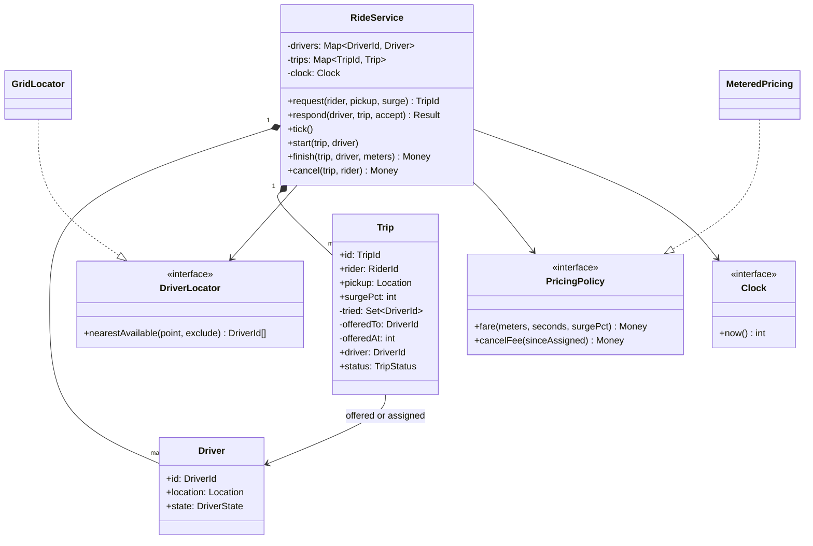
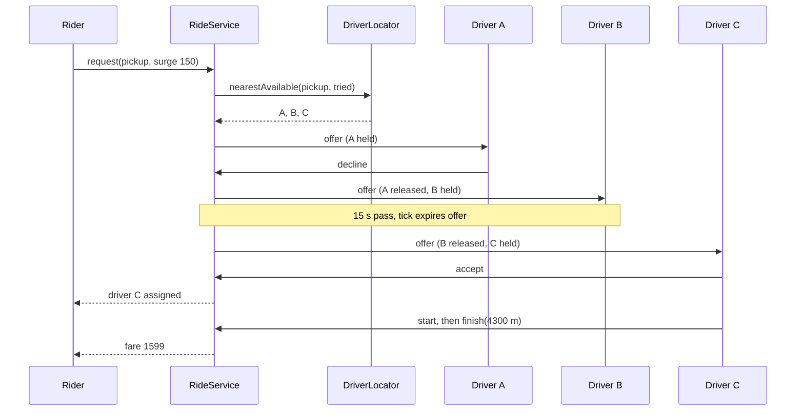

## In one minute
- Two state machines meet in one service: the **driver** (available, offered, on trip) and the **trip** (offering, driver assigned, in progress, completed, cancelled, no drivers). Most design bugs come from changing one without the other.
- Matching is a sequence of **exclusive offers**. Offer a trip to one driver at a time, hold that driver so no other trip can grab them, and move on when they decline or the offer times out. Double dispatch is the bug to design against.
- Time drives the protocol: offer timeouts, cancellation grace periods and fare duration all read the same injected clock. A matcher that sleeps or reads the wall clock directly cannot be tested.
- Pricing is a pure function of facts recorded on the trip: distance, duration and the surge multiplier snapshotted when the rider requested. Never reprice a trip with the current surge.
- The shape is **contention over a scarce pool with a hold**: the same offer, hold and expire loop runs a restaurant table waitlist, a support queue that offers chats to agents, and a job queue's visibility timeout.

## Requirements

Functional:
- Drivers go online with a location and update it as they move.
- A rider requests a trip from a pickup point. The system offers the trip to the nearest available driver; the driver accepts or declines within a fixed time, and otherwise the offer moves to the next nearest driver. When no driver is left, the trip ends as "no drivers".
- The assigned driver starts the trip at pickup and finishes it at drop-off with the distance travelled. The fare is charged from base, distance, time, surge and a minimum.
- The rider may cancel before the trip starts. Cancelling more than two minutes after a driver was assigned costs a fee, since the driver is already on the way.
- A rider has at most one active trip; a driver is offered or carries at most one trip.

Non-functional:
- No driver is ever offered two trips at once, and no trip is ever assigned two drivers.
- Fares are reproducible from the trip record.
- Offers resolve within seconds, and the matcher keeps up with a busy city's request rate.

Out of scope: the geospatial index at city scale, ETA prediction, payments, ratings and shared rides. The [Design Uber](../sdi/design-uber.md) system design lesson covers the location firehose, geo-sharding and the real-time connections. This lesson is the object model and the in-process logic of one matching cell.

## Entities and relationships

- **RideService** is the façade that rider and driver apps call: request, respond, start, finish, cancel, plus a `tick` the scheduler calls to expire stale offers.
- **Driver** has an id, a location and a state (available, offered, on trip). The state is what makes the hold explicit: an offered driver is invisible to every other trip.
- **Trip** has an id, the rider, the pickup point, the surge multiplier at request time, the set of drivers already tried, the driver currently offered and when, the assigned driver, the assignment and start times, the fare and a status.
- **Location** is a value (x, y here; latitude and longitude in production).
- **DriverLocator** answers "available drivers near this point, nearest first". In the practice it is a sort over all drivers; in production it is a geohash or H3 cell index. Hiding it behind an interface lets the matcher stay the same as the index changes.
- **PricingPolicy** turns a completed trip into money. **Clock** supplies time.
- **Rider** appears only as an id with one rule attached: at most one active trip.

Relationships: the service owns drivers and trips. A trip references drivers by id: one current offer, one assignment, many already tried. A driver does not point back to the trip in the model; the service keeps that index, so there is one source of truth for "who holds whom".

## Class diagram



## Key flows

A request where the nearest driver declines, the second lets the offer time out, and the third accepts.



## Design patterns used and why

- **State, as enums with guarded transitions.** Both machines are small, and their states differ in which operations are legal, not in rich behaviour. Each operation checks the current state of the trip and of the driver together, under one lock.
- **Strategy** for the driver locator and the pricing policy. The locator changes as the city grows (sort, then grid, then H3 cells with ring search); pricing changes by market (airport flat fares, minimum fares, time-of-day rates). The matcher depends only on the interfaces.
- **Snapshot of volatile inputs.** Surge is read once, when the rider requests and sees the price, and stored on the trip. The same idea applies to the rate card version. Anything that feeds the fare is copied onto the trip.
- **Observer** for side effects: the rider app hears "driver assigned", the driver app hears "offer", analytics hears everything. Publishing happens after the state change commits.
- **Façade** for the two apps, with idempotent operations: a repeated "accept" from a flaky phone finds the trip already assigned and returns a stable answer instead of corrupting state.
- **Singleton, avoided.** Each city or cell needs its own matcher with its own clock and locator; that is wiring in `main`, not a property of the class.

## Concurrency and edge cases

- **Two trips, one driver.** Rider P and rider Q request from the same corner. Without a hold, both offers go to driver A, A accepts both, and one rider waits forever. The hold (driver state "offered") is set in the same critical section that picks the driver, so the second request sees A as unavailable and goes to B.
- **Late accept.** Driver B taps accept 200 ms after the timeout. If `tick` already moved the offer on, B is "not offered". If `tick` has not run yet, `respond` itself checks the deadline and treats the answer as expired. Either way, the decision depends only on the clock and the offer time, not on which code path ran first.
- **Decline loops.** A driver who declined must not be offered the same trip again, or two nearby drivers ping-pong until the rider gives up. The trip keeps a set of drivers already tried.
- **Rider cancels during an offer.** Release the held driver in the same step, or that driver is stuck in "offered" and silently out of the pool.
- **Duplicate requests.** A double-tapped "request" hits the one-active-trip rule; with an idempotency key the client gets the first trip id back instead.
- **Rounding.** Do fare arithmetic in integer cents and define the order: compute each component with floor division, sum them, apply surge, then apply the minimum. Write it down, because support will ask.

## Down the stack

### Layer 1: The contract
`request` returns a trip that is either offered to exactly one available driver (now held) or ended as no drivers. `respond` from the offered driver within the timeout either assigns the trip or moves the offer to the next nearest untried driver; any other response changes nothing visible to that driver. After `tick`, no offer older than the timeout is outstanding. `finish` returns `max(minimum, (base + per_km × meters / 1000 + per_min × seconds / 60) × surge / 100)` with floor division at each step. `cancel` releases any held or assigned driver and returns the fee that the grace rule implies.

### Layer 2: The mechanism
In one process: a hash map of drivers, a hash map of trips and one mutex around both, because every interesting operation touches a trip and a driver together. Picking the next driver sorts available, untried drivers by distance then id. At city scale this becomes a grid or H3 index: the pickup's cell and its rings are scanned outwards until enough candidates are found, which is the [Design Uber](../sdi/design-uber.md) lesson's core. Offer expiry is a min-heap keyed by `offeredAt + timeout`, with stale entries skipped on pop because the trip may already have moved on; a hierarchical timing wheel does the same with O(1) inserts when there are millions of timers. When the state lives in a database, the hold is a conditional update, `UPDATE drivers SET state = 'offered', trip_id = $1 WHERE id = $2 AND state = 'available'`, and a zero row count means another matcher got that driver first; try the next candidate.

### Layer 3: The machine
The mutex is never the bottleneck. A busy city might see 50 requests per second and a few hundred driver responses; each critical section is microseconds of work (sorting a few dozen nearby candidates and flipping two enums), against a lock cost of roughly 20 ns uncontended. The real latency is the network to the driver's phone: a push over a mobile connection takes 100 ms to several seconds, which is why the offer timeout is measured in seconds, not milliseconds. One more machine-level fact matters for fairness: timeouts must use a monotonic clock, because an NTP step on the server could otherwise expire every outstanding offer at once.

### Why it's built this way
1. Drivers are scarce and riders wait in real time, so a driver must not be offered two trips at once.
2. Drivers answer through slow, unreliable phones, so each offer needs a hold with a deadline rather than a blocking call.
3. Deadlines and fares must be testable and reproducible, so time comes from an injected clock and fare inputs are snapshotted on the trip.
4. The nearest-driver query changes with scale while the offer protocol does not, so the locator sits behind an interface.
5. Matching decisions touch a trip and a driver together, so they share one serialisation point per matching cell, and cells scale out by geography.

## Extensibility

- **Batch offers:** offer to the top three drivers at once and assign the first acceptor. The trip holds a set of offered drivers; acceptance releases the others. The driver state machine stays the same.
- **Vehicle classes (XL, premium, accessible):** a `VehicleType` on driver and trip, and a locator filter. Pricing becomes a table per vehicle type.
- **Scheduled rides:** a trip created in a `scheduled` state that enters offering at pickup time minus the expected driver ETA, reusing the same timer heap.
- **Shared rides:** a driver can hold a small number of compatible trips, and the hold becomes capacity rather than a single flag. This is a large change in the matcher, which is the right place for it.

## Leadership lens

- Build first: the hold-and-offer loop with timeouts, plus a test where two riders request in the same instant near one driver. Fare rules can be corrected and refunded; a double dispatch strands a rider at night.
- Ask in review: where is the single point that decides a driver is held; what happens to a held driver when the rider cancels or the server restarts; which clock measures the offer timeout; what is snapshotted on the trip.
- Pricing is regulated in many cities (fare caps, surge limits during emergencies). Keep the policy as data with an owner, log the rule version on every trip, and make the minimum and cancellation fee configurable per market.
- Operationally, watch offer-to-accept ratio and time-to-assign by area. A rising expire rate usually means a broken push channel or a bad app release, not a lack of drivers.

## Check yourself
1. Why must choosing a driver and marking them "offered" happen in one critical section?
   **Answer:** Otherwise two concurrent requests can both read the same driver as available and both offer to them. Combining the read and the hold (a lock or a conditional update) makes one request win and the other move on.
2. A driver answers "accept" one second after the offer timeout, before the expiry job has run. What should happen?
   **Answer:** The response handler checks the deadline itself and treats the offer as expired, moving to the next driver. The result must not depend on whether the sweep ran first.
3. Why snapshot surge on the trip instead of reading it at drop-off?
   **Answer:** The rider agreed to a price at request time, and surge can change during the ride. Recording it makes the fare reproducible and fair.
4. Why keep a set of drivers already tried on the trip?
   **Answer:** Without it, a decline or timeout can return the trip to the same driver, who is still the nearest, producing a loop that never reaches other drivers.

## Practice
**Task:** Implement `RideService(clock, offer_timeout, pricing)`, where `pricing` has integer cents `base`, `per_km`, `per_min`, `minimum` and `cancel_fee`. `add_driver(id, x, y)` registers an available driver (duplicate ids fail). `request(rider, x, y, surge_pct)` returns trip ids `R1`, `R2` and so on, failing if the rider has an active trip; it offers the trip to the nearest available driver not yet tried for it (Manhattan distance, ties by id), who becomes `offered`, or sets status `no_drivers`. `respond(driver, trip, accept)` returns `"not_offered"` unless this driver holds the current offer, `"expired"` if `now - offered_at >= offer_timeout` (release and offer the next driver), `"declined"` (same), or `"accepted"` (driver `on_trip`, trip `driver_assigned`). `tick()` expires stale offers in trip creation order. `start(trip, driver)` and `finish(trip, driver, meters)` fail unless the assigned driver calls them in `driver_assigned` and `in_progress`; `finish` frees the driver and returns `max(minimum, (base + per_km*meters//1000 + per_min*seconds//60) * surge_pct // 100)`. `cancel(trip, rider)` fails for the wrong rider or once started or ended, releases any driver, and returns `cancel_fee` only if a driver was assigned more than 120 seconds ago, else 0. `status(trip)`, `offered_to(trip)` (`""` if none) and `driver_state(driver)` read state; unknown ids fail.

```python starter
from dataclasses import dataclass

CANCEL_GRACE = 120


@dataclass(frozen=True)
class Pricing:
    base: int
    per_km: int
    per_min: int
    minimum: int
    cancel_fee: int


class RideService:
    def __init__(self, clock, offer_timeout, pricing):
        self._clock = clock

    def add_driver(self, driver_id, x, y):
        raise NotImplementedError

    def request(self, rider, x, y, surge_pct):
        # TODO: create the trip and offer it to the nearest available driver
        raise NotImplementedError

    def respond(self, driver_id, trip_id, accept):
        raise NotImplementedError

    def tick(self):
        raise NotImplementedError

    def start(self, trip_id, driver_id):
        raise NotImplementedError

    def finish(self, trip_id, driver_id, meters):
        raise NotImplementedError

    def cancel(self, trip_id, rider):
        raise NotImplementedError

    def status(self, trip_id):
        raise NotImplementedError

    def offered_to(self, trip_id):
        raise NotImplementedError

    def driver_state(self, driver_id):
        raise NotImplementedError
```

```python tests
class FakeClock:
    def __init__(self):
        self.t = 0

    def now(self):
        return self.t


PRICING = Pricing(base=250, per_km=120, per_min=30, minimum=500, cancel_fee=400)


def raises(fn):
    try:
        fn()
    except ValueError:
        return True
    return False


def make(clock):
    s = RideService(clock, 15, PRICING)
    s.add_driver("d1", 0, 0)
    s.add_driver("d2", 5, 5)
    s.add_driver("d3", 1, 1)
    return s


def test_nearest_then_next_after_decline():
    s = make(FakeClock())
    t = s.request("rose", 2, 2, 100)
    assert t == "R1"
    assert s.offered_to(t) == "d3" and s.driver_state("d3") == "offered"
    assert s.respond("d1", t, True) == "not_offered"
    assert s.respond("d3", t, False) == "declined"
    assert s.driver_state("d3") == "available"
    assert s.offered_to(t) == "d1", "d3 already tried"
    assert s.respond("d1", t, True) == "accepted"
    assert s.status(t) == "driver_assigned" and s.driver_state("d1") == "on_trip"


def test_hold_prevents_double_offer():
    s = make(FakeClock())
    a = s.request("rose", 0, 0, 100)
    b = s.request("sid", 0, 0, 100)
    assert s.offered_to(a) == "d1"
    assert s.offered_to(b) == "d3", "d1 is held by R1"
    assert raises(lambda: s.request("rose", 9, 9, 100)), "one active trip per rider"


def test_timeouts_via_tick_and_late_response():
    c = FakeClock()
    s = make(c)
    t = s.request("rose", 0, 0, 100)
    c.t = 14
    s.tick()
    assert s.offered_to(t) == "d1"
    c.t = 15
    s.tick()
    assert s.offered_to(t) == "d3" and s.driver_state("d1") == "available"
    assert s.respond("d1", t, True) == "not_offered"
    c.t = 30
    assert s.respond("d3", t, True) == "expired"
    assert s.offered_to(t) == "d2"
    c.t = 45
    s.tick()
    assert s.status(t) == "no_drivers" and s.offered_to(t) == ""
    assert s.request("rose", 0, 0, 100) == "R2", "rider may try again"


def test_fare_with_surge_and_minimum():
    c = FakeClock()
    s = make(c)
    t = s.request("rose", 0, 0, 150)
    s.respond("d1", t, True)
    c.t = 100
    s.start(t, "d1")
    assert s.status(t) == "in_progress"
    c.t = 700
    assert s.finish(t, "d1", 4300) == 1599
    assert s.status(t) == "completed" and s.driver_state("d1") == "available"
    u = s.request("sid", 0, 0, 100)
    s.respond("d1", u, True)
    s.start(u, "d1")
    c.t = 760
    assert s.finish(u, "d1", 200) == 500, "minimum fare"


def test_cancel_fees_and_release():
    c = FakeClock()
    s = make(c)
    a = s.request("rose", 0, 0, 100)
    assert s.cancel(a, "rose") == 0
    assert s.status(a) == "cancelled" and s.driver_state("d1") == "available"
    b = s.request("rose", 0, 0, 100)
    s.respond("d1", b, True)
    c.t = 120
    assert s.cancel(b, "rose") == 0, "within grace"
    d = s.request("sid", 0, 0, 100)
    s.respond("d1", d, True)
    c.t = 241
    assert raises(lambda: s.cancel(d, "rose")), "wrong rider"
    assert s.cancel(d, "sid") == 400
    e = s.request("sid", 0, 0, 100)
    s.respond("d1", e, True)
    s.start(e, "d1")
    assert raises(lambda: s.cancel(e, "sid")), "already started"


def test_errors():
    s = make(FakeClock())
    assert raises(lambda: s.add_driver("d1", 3, 3))
    assert raises(lambda: s.status("R9"))
    t = s.request("rose", 0, 0, 100)
    assert raises(lambda: s.start(t, "d1")), "not accepted yet"
    s.respond("d1", t, True)
    assert raises(lambda: s.start(t, "d3")), "wrong driver"
    assert raises(lambda: s.finish(t, "d1", 100)), "not started"
    assert raises(lambda: s.driver_state("zz"))
```

```python solution
from dataclasses import dataclass

CANCEL_GRACE = 120
ACTIVE = ("offering", "driver_assigned", "in_progress")


@dataclass(frozen=True)
class Pricing:
    base: int
    per_km: int
    per_min: int
    minimum: int
    cancel_fee: int


class _Driver:
    def __init__(self, driver_id, x, y):
        self.id = driver_id
        self.x = x
        self.y = y
        self.state = "available"


class _Trip:
    def __init__(self, trip_id, rider, x, y, surge_pct):
        self.id = trip_id
        self.rider = rider
        self.x = x
        self.y = y
        self.surge_pct = surge_pct
        self.tried = set()
        self.offered = ""
        self.offered_at = 0
        self.driver = ""
        self.assigned_at = 0
        self.started_at = 0
        self.status = "offering"


class RideService:
    def __init__(self, clock, offer_timeout, pricing):
        self._clock = clock
        self._timeout = offer_timeout
        self._pricing = pricing
        self._drivers = {}
        self._trips = {}

    def _driver(self, driver_id):
        if driver_id not in self._drivers:
            raise ValueError("unknown driver: " + str(driver_id))
        return self._drivers[driver_id]

    def _trip(self, trip_id):
        if trip_id not in self._trips:
            raise ValueError("unknown trip: " + str(trip_id))
        return self._trips[trip_id]

    def add_driver(self, driver_id, x, y):
        if driver_id in self._drivers:
            raise ValueError("duplicate driver: " + driver_id)
        self._drivers[driver_id] = _Driver(driver_id, x, y)

    def _offer_next(self, trip):
        candidates = [d for d in self._drivers.values()
                      if d.state == "available" and d.id not in trip.tried]
        if not candidates:
            trip.status = "no_drivers"
            trip.offered = ""
            return
        best = min(candidates, key=lambda d: (abs(d.x - trip.x) + abs(d.y - trip.y), d.id))
        best.state = "offered"
        trip.tried.add(best.id)
        trip.offered = best.id
        trip.offered_at = self._clock.now()

    def _release_offer(self, trip):
        self._drivers[trip.offered].state = "available"
        trip.offered = ""

    def request(self, rider, x, y, surge_pct):
        for t in self._trips.values():
            if t.rider == rider and t.status in ACTIVE:
                raise ValueError("rider already has an active trip")
        trip = _Trip("R" + str(len(self._trips) + 1), rider, x, y, surge_pct)
        self._trips[trip.id] = trip
        self._offer_next(trip)
        return trip.id

    def respond(self, driver_id, trip_id, accept):
        self._driver(driver_id)
        trip = self._trip(trip_id)
        if trip.status != "offering" or trip.offered != driver_id:
            return "not_offered"
        if self._clock.now() - trip.offered_at >= self._timeout:
            self._release_offer(trip)
            self._offer_next(trip)
            return "expired"
        if not accept:
            self._release_offer(trip)
            self._offer_next(trip)
            return "declined"
        self._drivers[driver_id].state = "on_trip"
        trip.driver = driver_id
        trip.offered = ""
        trip.assigned_at = self._clock.now()
        trip.status = "driver_assigned"
        return "accepted"

    def tick(self):
        now = self._clock.now()
        for trip in self._trips.values():
            if trip.status == "offering" and now - trip.offered_at >= self._timeout:
                self._release_offer(trip)
                self._offer_next(trip)

    def start(self, trip_id, driver_id):
        trip = self._trip(trip_id)
        if trip.status != "driver_assigned" or trip.driver != driver_id:
            raise ValueError("cannot start")
        trip.status = "in_progress"
        trip.started_at = self._clock.now()

    def finish(self, trip_id, driver_id, meters):
        trip = self._trip(trip_id)
        if trip.status != "in_progress" or trip.driver != driver_id or meters < 0:
            raise ValueError("cannot finish")
        p = self._pricing
        seconds = self._clock.now() - trip.started_at
        raw = p.base + p.per_km * meters // 1000 + p.per_min * seconds // 60
        trip.status = "completed"
        self._drivers[driver_id].state = "available"
        return max(p.minimum, raw * trip.surge_pct // 100)

    def cancel(self, trip_id, rider):
        trip = self._trip(trip_id)
        if trip.rider != rider or trip.status not in ("offering", "driver_assigned"):
            raise ValueError("cannot cancel")
        fee = 0
        if trip.status == "offering":
            self._release_offer(trip)
        else:
            self._drivers[trip.driver].state = "available"
            if self._clock.now() - trip.assigned_at > CANCEL_GRACE:
                fee = self._pricing.cancel_fee
        trip.status = "cancelled"
        return fee

    def status(self, trip_id):
        return self._trip(trip_id).status

    def offered_to(self, trip_id):
        return self._trip(trip_id).offered

    def driver_state(self, driver_id):
        return self._driver(driver_id).state
```

```typescript starter
export interface Clock { now(): number }

export interface Pricing { base: number; perKm: number; perMin: number; minimum: number; cancelFee: number }

export const CANCEL_GRACE = 120;

export class RideService {
  constructor(private clock: Clock, private offerTimeout: number, private pricing: Pricing) {}

  addDriver(driverId: string, x: number, y: number): void { throw new Error("TODO"); }

  request(rider: string, x: number, y: number, surgePct: number): string { throw new Error("TODO"); }

  respond(driverId: string, tripId: string, accept: boolean): string { throw new Error("TODO"); }

  tick(): void { throw new Error("TODO"); }

  start(tripId: string, driverId: string): void { throw new Error("TODO"); }

  finish(tripId: string, driverId: string, meters: number): number { throw new Error("TODO"); }

  cancel(tripId: string, rider: string): number { throw new Error("TODO"); }

  status(tripId: string): string { throw new Error("TODO"); }

  offeredTo(tripId: string): string { throw new Error("TODO"); }

  driverState(driverId: string): string { throw new Error("TODO"); }
}
```

```typescript tests
class FakeClock implements Clock {
  t = 0;
  now(): number { return this.t; }
}

const PRICES: Pricing = { base: 250, perKm: 120, perMin: 30, minimum: 500, cancelFee: 400 };

function throwsErr(fn: () => void): boolean {
  try { fn(); return false; } catch (e) { return true; }
}

function make(clock: Clock): RideService {
  const s = new RideService(clock, 15, PRICES);
  s.addDriver("d1", 0, 0);
  s.addDriver("d2", 5, 5);
  s.addDriver("d3", 1, 1);
  return s;
}

test("nearest then next after decline", () => {
  const s = make(new FakeClock());
  const t = s.request("rose", 2, 2, 100);
  assertEqual(t, "R1");
  assertEqual([s.offeredTo(t), s.driverState("d3")], ["d3", "offered"]);
  assertEqual(s.respond("d1", t, true), "not_offered");
  assertEqual(s.respond("d3", t, false), "declined");
  assertEqual(s.driverState("d3"), "available");
  assertEqual(s.offeredTo(t), "d1", "d3 already tried");
  assertEqual(s.respond("d1", t, true), "accepted");
  assertEqual([s.status(t), s.driverState("d1")], ["driver_assigned", "on_trip"]);
});

test("hold prevents double offer", () => {
  const s = make(new FakeClock());
  const a = s.request("rose", 0, 0, 100);
  const b = s.request("sid", 0, 0, 100);
  assertEqual(s.offeredTo(a), "d1");
  assertEqual(s.offeredTo(b), "d3", "d1 is held by R1");
  assert(throwsErr(() => s.request("rose", 9, 9, 100)), "one active trip per rider");
});

test("timeouts via tick and late response", () => {
  const c = new FakeClock();
  const s = make(c);
  const t = s.request("rose", 0, 0, 100);
  c.t = 14;
  s.tick();
  assertEqual(s.offeredTo(t), "d1");
  c.t = 15;
  s.tick();
  assertEqual([s.offeredTo(t), s.driverState("d1")], ["d3", "available"]);
  assertEqual(s.respond("d1", t, true), "not_offered");
  c.t = 30;
  assertEqual(s.respond("d3", t, true), "expired");
  assertEqual(s.offeredTo(t), "d2");
  c.t = 45;
  s.tick();
  assertEqual([s.status(t), s.offeredTo(t)], ["no_drivers", ""]);
  assertEqual(s.request("rose", 0, 0, 100), "R2", "rider may try again");
});

test("fare with surge and minimum", () => {
  const c = new FakeClock();
  const s = make(c);
  const t = s.request("rose", 0, 0, 150);
  s.respond("d1", t, true);
  c.t = 100;
  s.start(t, "d1");
  assertEqual(s.status(t), "in_progress");
  c.t = 700;
  assertEqual(s.finish(t, "d1", 4300), 1599);
  assertEqual([s.status(t), s.driverState("d1")], ["completed", "available"]);
  const u = s.request("sid", 0, 0, 100);
  s.respond("d1", u, true);
  s.start(u, "d1");
  c.t = 760;
  assertEqual(s.finish(u, "d1", 200), 500, "minimum fare");
});

test("cancel fees and release", () => {
  const c = new FakeClock();
  const s = make(c);
  const a = s.request("rose", 0, 0, 100);
  assertEqual(s.cancel(a, "rose"), 0);
  assertEqual([s.status(a), s.driverState("d1")], ["cancelled", "available"]);
  const b = s.request("rose", 0, 0, 100);
  s.respond("d1", b, true);
  c.t = 120;
  assertEqual(s.cancel(b, "rose"), 0, "within grace");
  const d = s.request("sid", 0, 0, 100);
  s.respond("d1", d, true);
  c.t = 241;
  assert(throwsErr(() => s.cancel(d, "rose")), "wrong rider");
  assertEqual(s.cancel(d, "sid"), 400);
  const e = s.request("sid", 0, 0, 100);
  s.respond("d1", e, true);
  s.start(e, "d1");
  assert(throwsErr(() => s.cancel(e, "sid")), "already started");
});

test("errors", () => {
  const s = make(new FakeClock());
  assert(throwsErr(() => s.addDriver("d1", 3, 3)), "duplicate driver");
  assert(throwsErr(() => s.status("R9")), "unknown trip");
  const t = s.request("rose", 0, 0, 100);
  assert(throwsErr(() => s.start(t, "d1")), "not accepted yet");
  s.respond("d1", t, true);
  assert(throwsErr(() => s.start(t, "d3")), "wrong driver");
  assert(throwsErr(() => s.finish(t, "d1", 100)), "not started");
  assert(throwsErr(() => s.driverState("zz")), "unknown driver");
});
```

```typescript solution
export interface Clock { now(): number }

export interface Pricing { base: number; perKm: number; perMin: number; minimum: number; cancelFee: number }

export const CANCEL_GRACE = 120;

interface Driver { id: string; x: number; y: number; state: string }

interface Trip {
  id: string; rider: string; x: number; y: number; surgePct: number;
  tried: Set<string>; offered: string; offeredAt: number;
  driver: string; assignedAt: number; startedAt: number; status: string;
}

const ACTIVE = new Set(["offering", "driver_assigned", "in_progress"]);

export class RideService {
  private drivers = new Map<string, Driver>();
  private trips = new Map<string, Trip>();

  constructor(private clock: Clock, private offerTimeout: number, private pricing: Pricing) {}

  private driver(id: string): Driver {
    const d = this.drivers.get(id);
    if (!d) throw new Error("unknown driver: " + id);
    return d;
  }

  private trip(id: string): Trip {
    const t = this.trips.get(id);
    if (!t) throw new Error("unknown trip: " + id);
    return t;
  }

  addDriver(driverId: string, x: number, y: number): void {
    if (this.drivers.has(driverId)) throw new Error("duplicate driver: " + driverId);
    this.drivers.set(driverId, { id: driverId, x, y, state: "available" });
  }

  private offerNext(t: Trip): void {
    let best: Driver | null = null;
    let bestDist = 0;
    for (const d of this.drivers.values()) {
      if (d.state !== "available" || t.tried.has(d.id)) continue;
      const dist = Math.abs(d.x - t.x) + Math.abs(d.y - t.y);
      if (best === null || dist < bestDist || (dist === bestDist && d.id < best.id)) {
        best = d;
        bestDist = dist;
      }
    }
    if (best === null) {
      t.status = "no_drivers";
      t.offered = "";
      return;
    }
    best.state = "offered";
    t.tried.add(best.id);
    t.offered = best.id;
    t.offeredAt = this.clock.now();
  }

  private releaseOffer(t: Trip): void {
    this.driver(t.offered).state = "available";
    t.offered = "";
  }

  request(rider: string, x: number, y: number, surgePct: number): string {
    for (const t of this.trips.values()) {
      if (t.rider === rider && ACTIVE.has(t.status)) throw new Error("rider already has an active trip");
    }
    const t: Trip = { id: "R" + (this.trips.size + 1), rider, x, y, surgePct, tried: new Set(),
      offered: "", offeredAt: 0, driver: "", assignedAt: 0, startedAt: 0, status: "offering" };
    this.trips.set(t.id, t);
    this.offerNext(t);
    return t.id;
  }

  respond(driverId: string, tripId: string, accept: boolean): string {
    const d = this.driver(driverId);
    const t = this.trip(tripId);
    if (t.status !== "offering" || t.offered !== driverId) return "not_offered";
    if (this.clock.now() - t.offeredAt >= this.offerTimeout) {
      this.releaseOffer(t);
      this.offerNext(t);
      return "expired";
    }
    if (!accept) {
      this.releaseOffer(t);
      this.offerNext(t);
      return "declined";
    }
    d.state = "on_trip";
    t.driver = driverId;
    t.offered = "";
    t.assignedAt = this.clock.now();
    t.status = "driver_assigned";
    return "accepted";
  }

  tick(): void {
    const now = this.clock.now();
    for (const t of this.trips.values()) {
      if (t.status === "offering" && now - t.offeredAt >= this.offerTimeout) {
        this.releaseOffer(t);
        this.offerNext(t);
      }
    }
  }

  start(tripId: string, driverId: string): void {
    const t = this.trip(tripId);
    if (t.status !== "driver_assigned" || t.driver !== driverId) throw new Error("cannot start");
    t.status = "in_progress";
    t.startedAt = this.clock.now();
  }

  finish(tripId: string, driverId: string, meters: number): number {
    const t = this.trip(tripId);
    if (t.status !== "in_progress" || t.driver !== driverId || meters < 0) throw new Error("cannot finish");
    const p = this.pricing;
    const seconds = this.clock.now() - t.startedAt;
    const raw = p.base + Math.floor(p.perKm * meters / 1000) + Math.floor(p.perMin * seconds / 60);
    t.status = "completed";
    this.driver(driverId).state = "available";
    return Math.max(p.minimum, Math.floor(raw * t.surgePct / 100));
  }

  cancel(tripId: string, rider: string): number {
    const t = this.trip(tripId);
    if (t.rider !== rider || (t.status !== "offering" && t.status !== "driver_assigned")) {
      throw new Error("cannot cancel");
    }
    let fee = 0;
    if (t.status === "offering") {
      this.releaseOffer(t);
    } else {
      this.driver(t.driver).state = "available";
      if (this.clock.now() - t.assignedAt > CANCEL_GRACE) fee = this.pricing.cancelFee;
    }
    t.status = "cancelled";
    return fee;
  }

  status(tripId: string): string { return this.trip(tripId).status; }

  offeredTo(tripId: string): string { return this.trip(tripId).offered; }

  driverState(driverId: string): string { return this.driver(driverId).state; }
}
```

```go starter
package practice

import "errors"

const CancelGrace = 120

var (
	ErrUnknown     = errors.New("unknown id")
	ErrDuplicate   = errors.New("duplicate driver")
	ErrActiveTrip  = errors.New("rider already has an active trip")
	ErrInvalidMove = errors.New("operation not allowed in this state")
)

type Clock interface{ Now() int64 }

type Pricing struct {
	Base, PerKm, PerMin, Minimum, CancelFee int64
}

type RideService struct{}

func NewRideService(clock Clock, offerTimeout int64, pricing Pricing) *RideService {
	return &RideService{}
}

func (s *RideService) AddDriver(id string, x, y int64) error { panic("TODO") }

func (s *RideService) Request(rider string, x, y, surgePct int64) (string, error) { panic("TODO") }

func (s *RideService) Respond(driverID, tripID string, accept bool) (string, error) { panic("TODO") }

func (s *RideService) Tick() { panic("TODO") }

func (s *RideService) Start(tripID, driverID string) error { panic("TODO") }

func (s *RideService) Finish(tripID, driverID string, meters int64) (int64, error) { panic("TODO") }

func (s *RideService) Cancel(tripID, rider string) (int64, error) { panic("TODO") }

func (s *RideService) Status(tripID string) (string, error) { panic("TODO") }

func (s *RideService) OfferedTo(tripID string) (string, error) { panic("TODO") }

func (s *RideService) DriverState(driverID string) (string, error) { panic("TODO") }
```

```go tests
package practice

import (
	"errors"
	"testing"
)

type fakeClock struct{ t int64 }

func (c *fakeClock) Now() int64 { return c.t }

var prices = Pricing{Base: 250, PerKm: 120, PerMin: 30, Minimum: 500, CancelFee: 400}

func newSvc(c Clock) *RideService {
	s := NewRideService(c, 15, prices)
	s.AddDriver("d1", 0, 0)
	s.AddDriver("d2", 5, 5)
	s.AddDriver("d3", 1, 1)
	return s
}

func req(t *testing.T, s *RideService, rider string, x, y, surge int64) string {
	t.Helper()
	id, err := s.Request(rider, x, y, surge)
	if err != nil {
		t.Fatalf("request %s: %v", rider, err)
	}
	return id
}

func respIs(t *testing.T, s *RideService, d, trip string, accept bool, want string) {
	t.Helper()
	got, err := s.Respond(d, trip, accept)
	if err != nil || got != want {
		t.Fatalf("respond %s %s: got %q err=%v want %q", d, trip, got, err, want)
	}
}

func offeredIs(t *testing.T, s *RideService, trip, want string) {
	t.Helper()
	if got, _ := s.OfferedTo(trip); got != want {
		t.Fatalf("offered %s: got %q want %q", trip, got, want)
	}
}

func stateIs(t *testing.T, s *RideService, d, want string) {
	t.Helper()
	if got, _ := s.DriverState(d); got != want {
		t.Fatalf("driver %s: got %q want %q", d, got, want)
	}
}

func statusIs(t *testing.T, s *RideService, trip, want string) {
	t.Helper()
	if got, _ := s.Status(trip); got != want {
		t.Fatalf("status %s: got %q want %q", trip, got, want)
	}
}

func TestNearestThenNextAfterDecline(t *testing.T) {
	s := newSvc(&fakeClock{})
	tr := req(t, s, "rose", 2, 2, 100)
	if tr != "R1" {
		t.Fatalf("id %s", tr)
	}
	offeredIs(t, s, tr, "d3")
	stateIs(t, s, "d3", "offered")
	respIs(t, s, "d1", tr, true, "not_offered")
	respIs(t, s, "d3", tr, false, "declined")
	stateIs(t, s, "d3", "available")
	offeredIs(t, s, tr, "d1")
	respIs(t, s, "d1", tr, true, "accepted")
	statusIs(t, s, tr, "driver_assigned")
	stateIs(t, s, "d1", "on_trip")
}

func TestHoldPreventsDoubleOffer(t *testing.T) {
	s := newSvc(&fakeClock{})
	a := req(t, s, "rose", 0, 0, 100)
	b := req(t, s, "sid", 0, 0, 100)
	offeredIs(t, s, a, "d1")
	offeredIs(t, s, b, "d3")
	if _, err := s.Request("rose", 9, 9, 100); !errors.Is(err, ErrActiveTrip) {
		t.Fatalf("want ErrActiveTrip, got %v", err)
	}
}

func TestTimeoutsViaTickAndLateResponse(t *testing.T) {
	c := &fakeClock{}
	s := newSvc(c)
	tr := req(t, s, "rose", 0, 0, 100)
	c.t = 14
	s.Tick()
	offeredIs(t, s, tr, "d1")
	c.t = 15
	s.Tick()
	offeredIs(t, s, tr, "d3")
	stateIs(t, s, "d1", "available")
	respIs(t, s, "d1", tr, true, "not_offered")
	c.t = 30
	respIs(t, s, "d3", tr, true, "expired")
	offeredIs(t, s, tr, "d2")
	c.t = 45
	s.Tick()
	statusIs(t, s, tr, "no_drivers")
	offeredIs(t, s, tr, "")
	if id := req(t, s, "rose", 0, 0, 100); id != "R2" {
		t.Fatalf("id %s", id)
	}
}

func TestFareWithSurgeAndMinimum(t *testing.T) {
	c := &fakeClock{}
	s := newSvc(c)
	tr := req(t, s, "rose", 0, 0, 150)
	respIs(t, s, "d1", tr, true, "accepted")
	c.t = 100
	if err := s.Start(tr, "d1"); err != nil {
		t.Fatal(err)
	}
	statusIs(t, s, tr, "in_progress")
	c.t = 700
	if fare, err := s.Finish(tr, "d1", 4300); err != nil || fare != 1599 {
		t.Fatalf("fare %d err=%v want 1599", fare, err)
	}
	statusIs(t, s, tr, "completed")
	stateIs(t, s, "d1", "available")
	u := req(t, s, "sid", 0, 0, 100)
	respIs(t, s, "d1", u, true, "accepted")
	s.Start(u, "d1")
	c.t = 760
	if fare, _ := s.Finish(u, "d1", 200); fare != 500 {
		t.Fatalf("minimum fare: got %d", fare)
	}
}

func TestCancelFeesAndRelease(t *testing.T) {
	c := &fakeClock{}
	s := newSvc(c)
	a := req(t, s, "rose", 0, 0, 100)
	if fee, err := s.Cancel(a, "rose"); err != nil || fee != 0 {
		t.Fatalf("fee %d err=%v", fee, err)
	}
	statusIs(t, s, a, "cancelled")
	stateIs(t, s, "d1", "available")
	b := req(t, s, "rose", 0, 0, 100)
	respIs(t, s, "d1", b, true, "accepted")
	c.t = 120
	if fee, _ := s.Cancel(b, "rose"); fee != 0 {
		t.Fatalf("within grace: fee %d", fee)
	}
	d := req(t, s, "sid", 0, 0, 100)
	respIs(t, s, "d1", d, true, "accepted")
	c.t = 241
	if _, err := s.Cancel(d, "rose"); !errors.Is(err, ErrInvalidMove) {
		t.Fatalf("wrong rider: %v", err)
	}
	if fee, _ := s.Cancel(d, "sid"); fee != 400 {
		t.Fatalf("fee %d want 400", fee)
	}
	e := req(t, s, "sid", 0, 0, 100)
	respIs(t, s, "d1", e, true, "accepted")
	s.Start(e, "d1")
	if _, err := s.Cancel(e, "sid"); !errors.Is(err, ErrInvalidMove) {
		t.Fatalf("already started: %v", err)
	}
}

func TestErrors(t *testing.T) {
	s := newSvc(&fakeClock{})
	if err := s.AddDriver("d1", 3, 3); !errors.Is(err, ErrDuplicate) {
		t.Fatalf("want ErrDuplicate, got %v", err)
	}
	if _, err := s.Status("R9"); !errors.Is(err, ErrUnknown) {
		t.Fatalf("want ErrUnknown, got %v", err)
	}
	tr := req(t, s, "rose", 0, 0, 100)
	if err := s.Start(tr, "d1"); !errors.Is(err, ErrInvalidMove) {
		t.Fatalf("not accepted yet: %v", err)
	}
	respIs(t, s, "d1", tr, true, "accepted")
	if err := s.Start(tr, "d3"); !errors.Is(err, ErrInvalidMove) {
		t.Fatalf("wrong driver: %v", err)
	}
	if _, err := s.Finish(tr, "d1", 100); !errors.Is(err, ErrInvalidMove) {
		t.Fatalf("not started: %v", err)
	}
	if _, err := s.DriverState("zz"); !errors.Is(err, ErrUnknown) {
		t.Fatalf("want ErrUnknown, got %v", err)
	}
}
```

```go solution
package practice

import (
	"errors"
	"fmt"
	"sync"
)

const CancelGrace = 120

var (
	ErrUnknown     = errors.New("unknown id")
	ErrDuplicate   = errors.New("duplicate driver")
	ErrActiveTrip  = errors.New("rider already has an active trip")
	ErrInvalidMove = errors.New("operation not allowed in this state")
)

type Clock interface{ Now() int64 }

type Pricing struct {
	Base, PerKm, PerMin, Minimum, CancelFee int64
}

type driver struct {
	id    string
	x, y  int64
	state string
}

type trip struct {
	id, rider                        string
	x, y, surgePct                   int64
	tried                            map[string]bool
	offered, driver, status          string
	offeredAt, assignedAt, startedAt int64
}

// RideService keeps drivers and trips under one mutex: every decision touches both.
type RideService struct {
	mu      sync.Mutex
	clock   Clock
	timeout int64
	pricing Pricing
	drivers map[string]*driver
	ids     []string // driver ids in insertion order
	trips   map[string]*trip
	order   []*trip
}

func NewRideService(clock Clock, offerTimeout int64, pricing Pricing) *RideService {
	return &RideService{clock: clock, timeout: offerTimeout, pricing: pricing,
		drivers: map[string]*driver{}, trips: map[string]*trip{}}
}

func abs(v int64) int64 {
	if v < 0 {
		return -v
	}
	return v
}

func (s *RideService) getTrip(id string) (*trip, error) {
	t, ok := s.trips[id]
	if !ok {
		return nil, fmt.Errorf("%w: trip %s", ErrUnknown, id)
	}
	return t, nil
}

func (s *RideService) AddDriver(id string, x, y int64) error {
	s.mu.Lock()
	defer s.mu.Unlock()
	if _, ok := s.drivers[id]; ok {
		return fmt.Errorf("%w: %s", ErrDuplicate, id)
	}
	s.drivers[id] = &driver{id: id, x: x, y: y, state: "available"}
	s.ids = append(s.ids, id)
	return nil
}

func (s *RideService) offerNext(t *trip) {
	var best *driver
	var bestDist int64
	for _, id := range s.ids {
		d := s.drivers[id]
		if d.state != "available" || t.tried[id] {
			continue
		}
		dist := abs(d.x-t.x) + abs(d.y-t.y)
		if best == nil || dist < bestDist || (dist == bestDist && id < best.id) {
			best, bestDist = d, dist
		}
	}
	if best == nil {
		t.status, t.offered = "no_drivers", ""
		return
	}
	best.state = "offered"
	t.tried[best.id] = true
	t.offered = best.id
	t.offeredAt = s.clock.Now()
}

func (s *RideService) releaseOffer(t *trip) {
	s.drivers[t.offered].state = "available"
	t.offered = ""
}

func (s *RideService) Request(rider string, x, y, surgePct int64) (string, error) {
	s.mu.Lock()
	defer s.mu.Unlock()
	for _, t := range s.order {
		if t.rider == rider && (t.status == "offering" || t.status == "driver_assigned" || t.status == "in_progress") {
			return "", ErrActiveTrip
		}
	}
	t := &trip{id: fmt.Sprintf("R%d", len(s.order)+1), rider: rider, x: x, y: y,
		surgePct: surgePct, tried: map[string]bool{}, status: "offering"}
	s.trips[t.id] = t
	s.order = append(s.order, t)
	s.offerNext(t)
	return t.id, nil
}

func (s *RideService) Respond(driverID, tripID string, accept bool) (string, error) {
	s.mu.Lock()
	defer s.mu.Unlock()
	d, ok := s.drivers[driverID]
	if !ok {
		return "", fmt.Errorf("%w: driver %s", ErrUnknown, driverID)
	}
	t, err := s.getTrip(tripID)
	if err != nil {
		return "", err
	}
	if t.status != "offering" || t.offered != driverID {
		return "not_offered", nil
	}
	if s.clock.Now()-t.offeredAt >= s.timeout {
		s.releaseOffer(t)
		s.offerNext(t)
		return "expired", nil
	}
	if !accept {
		s.releaseOffer(t)
		s.offerNext(t)
		return "declined", nil
	}
	d.state = "on_trip"
	t.driver, t.offered, t.status = driverID, "", "driver_assigned"
	t.assignedAt = s.clock.Now()
	return "accepted", nil
}

func (s *RideService) Tick() {
	s.mu.Lock()
	defer s.mu.Unlock()
	now := s.clock.Now()
	for _, t := range s.order {
		if t.status == "offering" && now-t.offeredAt >= s.timeout {
			s.releaseOffer(t)
			s.offerNext(t)
		}
	}
}

func (s *RideService) Start(tripID, driverID string) error {
	s.mu.Lock()
	defer s.mu.Unlock()
	t, err := s.getTrip(tripID)
	if err != nil {
		return err
	}
	if t.status != "driver_assigned" || t.driver != driverID {
		return ErrInvalidMove
	}
	t.status = "in_progress"
	t.startedAt = s.clock.Now()
	return nil
}

func (s *RideService) Finish(tripID, driverID string, meters int64) (int64, error) {
	s.mu.Lock()
	defer s.mu.Unlock()
	t, err := s.getTrip(tripID)
	if err != nil {
		return 0, err
	}
	if t.status != "in_progress" || t.driver != driverID || meters < 0 {
		return 0, ErrInvalidMove
	}
	p := s.pricing
	seconds := s.clock.Now() - t.startedAt
	raw := p.Base + p.PerKm*meters/1000 + p.PerMin*seconds/60
	t.status = "completed"
	s.drivers[driverID].state = "available"
	fare := raw * t.surgePct / 100
	if fare < p.Minimum {
		fare = p.Minimum
	}
	return fare, nil
}

func (s *RideService) Cancel(tripID, rider string) (int64, error) {
	s.mu.Lock()
	defer s.mu.Unlock()
	t, err := s.getTrip(tripID)
	if err != nil {
		return 0, err
	}
	if t.rider != rider || (t.status != "offering" && t.status != "driver_assigned") {
		return 0, ErrInvalidMove
	}
	var fee int64
	if t.status == "offering" {
		s.releaseOffer(t)
	} else {
		s.drivers[t.driver].state = "available"
		if s.clock.Now()-t.assignedAt > CancelGrace {
			fee = s.pricing.CancelFee
		}
	}
	t.status = "cancelled"
	return fee, nil
}

func (s *RideService) Status(tripID string) (string, error) {
	s.mu.Lock()
	defer s.mu.Unlock()
	t, err := s.getTrip(tripID)
	if err != nil {
		return "", err
	}
	return t.status, nil
}

func (s *RideService) OfferedTo(tripID string) (string, error) {
	s.mu.Lock()
	defer s.mu.Unlock()
	t, err := s.getTrip(tripID)
	if err != nil {
		return "", err
	}
	return t.offered, nil
}

func (s *RideService) DriverState(driverID string) (string, error) {
	s.mu.Lock()
	defer s.mu.Unlock()
	d, ok := s.drivers[driverID]
	if !ok {
		return "", fmt.Errorf("%w: driver %s", ErrUnknown, driverID)
	}
	return d.state, nil
}
```

## Mock interview
**Prompt:** Design the classes for a ride hailing service in one city with 20,000 online drivers and peaks of 50 ride requests per second. Code the request, offer, accept or decline, start, finish and cancel operations, and explain how you make sure a driver is never offered two trips at once.

- Follow-up: A driver's phone loses signal right after receiving an offer. Walk me through what the rider sees and when the trip moves on.
- Follow-up: Surge goes from 1.5x to 2.0x while the rider is in the car. Which multiplier do you charge, and where is that decided in code?
- Follow-up: Product wants to offer each trip to three drivers at once to cut wait time. What changes in your model, and what new race appears?

**A strong answer covers:**
- Separate driver and trip state machines, changed together inside one critical section or one conditional database update.
- An exclusive hold on the offered driver, a per-trip set of drivers already tried, and offers that expire by deadline whether the response handler or the sweep notices first.
- An injected monotonic clock for offer timeouts, cancellation grace and trip duration, so the protocol is testable and replayable.
- Fare as a pure function of the trip record: distance, duration, surge snapshotted at request, minimum fare and documented rounding in integer cents.
- A locator interface that can grow from a sort to a grid or H3 index without touching the matcher, with the city-scale index left to the system design discussion.
- Batch offers as a set of holds with first-acceptor-wins and release of the rest, and the observation that this trades driver annoyance for rider wait time.

## Watch
- [Design Uber (LLD): Fare Calculation, Driver Matching, Real-time ETA, GeoHashing (Shubh Patel)](https://www.youtube.com/watch?v=fWWY6He81nk): class-level design covering fare strategies and matching.
- [Ride Sharing Application Low Level Design in Python (Code and Debug)](https://www.youtube.com/watch?v=Npl7nmanTg4): a complete coded solution to the machine-coding version of the problem.
- [Live Uber / Ride Sharing App Low Level Design, Part 2 (Elegant Engineer)](https://www.youtube.com/watch?v=bNiMa6qj-Oc): a live walkthrough that spends time on the trip lifecycle and classes.

## Free resources
- [H3 documentation](https://h3geo.org/docs/): the hexagonal grid index used for nearest-driver queries at city scale.
- [State pattern (Refactoring.Guru)](https://refactoring.guru/design-patterns/state): the pattern behind the driver and trip lifecycles, and when enums are enough.
- [Strategy pattern (Refactoring.Guru)](https://refactoring.guru/design-patterns/strategy): how pricing and driver location become pluggable policies.
- [Assignment problem (Wikipedia)](https://en.wikipedia.org/wiki/Assignment_problem): the optimisation behind batch matching of many riders to many drivers.
- [Explicit locking (PostgreSQL docs)](https://www.postgresql.org/docs/current/explicit-locking.html): row locks and conditional updates, the database form of the driver hold.
