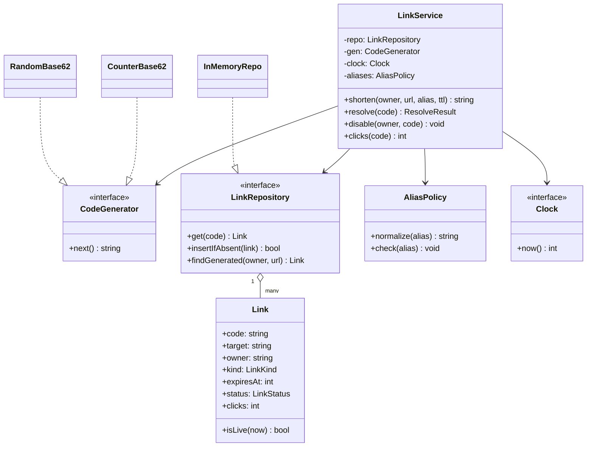
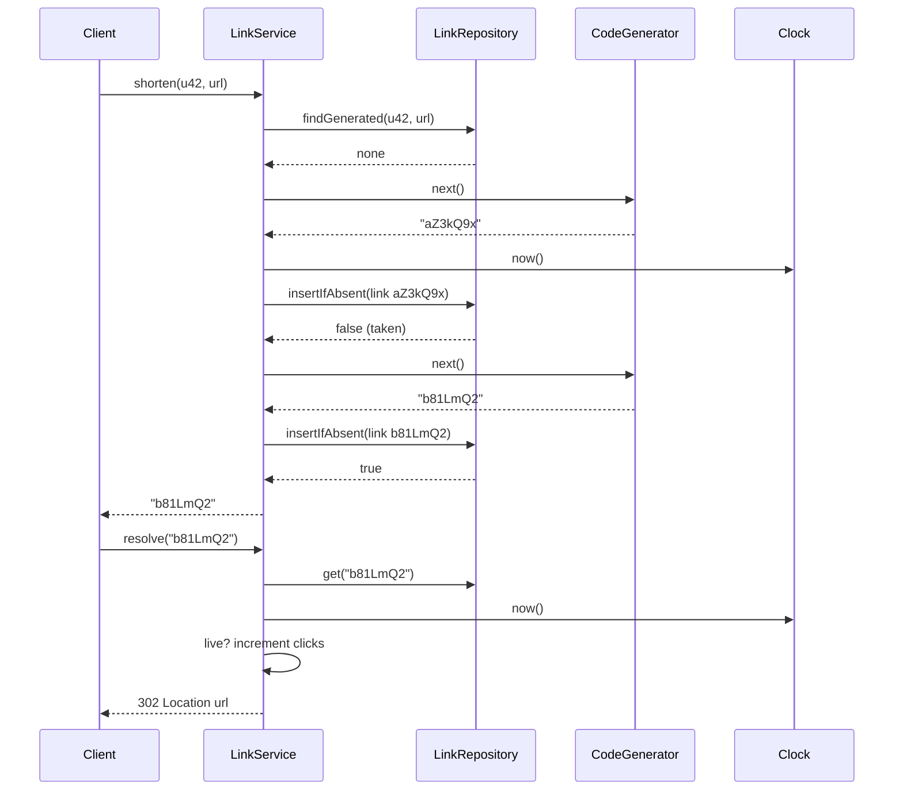

## In one minute
- In a low-level design round, a URL shortener is not about sharding or caches. It is about one object, the **link**, and the rules around it: who may create it, which codes are legal, when it stops working, and what the redirect returns in each state. The distributed version lives in [Design URL Shortener](../sdi/design-url-shortener.md); this lesson is the in-process object model behind it.
- Keep code generation behind an interface. Counter-plus-base62, random draws and hashing are all valid; the service should not care which, and tests should be able to force a collision on demand.
- Treat the code namespace as permanent. A code that once pointed somewhere must never point somewhere else, even after the link is deleted, or old printed posters start sending people to strangers.
- Model link status explicitly (active, disabled, expired, deleted) and map each to a precise HTTP answer. "Not found" (404) and "gone" (410) mean different things to browsers, crawlers and support staff.
- The shape is **duplicates and uniqueness under contention**: two requests claiming the same alias, or the same user shortening the same URL twice. The same shape shows up in username registration, coupon codes and idempotency keys for payments.

## Requirements

Functional:
- A signed-in user submits a long URL and gets back a short code. They may ask for a custom alias such as `spring-sale`.
- Anyone resolving a code is redirected to the long URL, or gets a clear error if the code is unknown, disabled or expired.
- A link can have an optional time to live. The owner can disable it; an operator can disable any link for abuse.
- Each link counts its successful redirects.
- Shortening the same URL twice by the same user without options returns the same code, so a retried request does not create a second link.

Non-functional:
- No two live links ever share a code, and a code is never reassigned.
- Resolution is a single hash lookup plus a status check. The service object itself adds microseconds, not milliseconds.
- Behaviour is deterministic under test: time and code generation are injected.

Out of scope: analytics dashboards, geo-routing, QR codes, link previews, and anything about replicas or caches.

## Entities and relationships

- **Link** is the entity. It has a code, a target URL, an owner id, a kind (generated or alias), a creation time, an optional expiry time, a status and a click counter.
- **ShortCode** is a value: a string with validation rules attached. Generated codes are case-sensitive base62; aliases are lowercase letters, digits and hyphens.
- **TargetUrl** is also a value. It is parsed and validated once at the edge, so the service only ever holds a URL it has already accepted.
- **CodeGenerator** is an interface with one method, `next()`, that proposes a candidate code.
- **LinkRepository** stores links keyed by code, plus a secondary index from `(owner, url)` to code for idempotent shortening.
- **Clock** supplies the current time so expiry can be tested.
- **ResolveResult** is a small value: an HTTP status and, for success, a location.

Relationships: the service composes a repository, a generator, a clock and an alias policy. A link references its owner by id, not a `User` object. The repository aggregates links; deleting one leaves a tombstone so the code stays reserved.

## Class diagram



## Key flows

Shortening without an alias combines idempotency and collision handling; resolution carries most of the traffic.



## Design patterns used and why

- **Strategy** for code generation. A counter encoded in base62 gives short, collision-free codes but reveals volume and ordering. Random 7-character base62 gives about 3.5 trillion codes and leaks nothing, but needs a collision check. A keyed permutation of the counter (the trick the paste-service lesson uses) gets both.
- **Repository** for storage. The service speaks in links and one conditional insert; whether that is a hash map, a Postgres table with a unique index or DynamoDB with a condition expression is the repository's business. `insertIfAbsent` is the key method: it is the only place uniqueness is enforced, so it is the only thing that must be atomic.
- **Value objects** for codes and URLs. Validation runs once, when the value is built: only `http` and `https` targets (a `javascript:` target would be cross-site scripting served from your domain), and aliases normalised to lowercase so `Spring-Sale` and `spring-sale` cannot become two links.
- **State**, kept light: an enum (`ACTIVE`, `DISABLED`, `DELETED`) plus a derived "expired" check against the clock. Expiry is not a stored state, because then a background job would have to flip it on time, and correctness would depend on that job.
- **Facade**: `LinkService` is the only entry point for controllers. It hides the alias policy, the retry loop and the idempotency index. A caching repository can later wrap the real one as a **Decorator**, which is how the cache in the distributed design attaches without changing this model.

What not to use: a `Singleton` service, or a `Link` class hierarchy (`AliasLink`, `GeneratedLink`) when a kind field carries the only difference.

## Concurrency and edge cases

- **Two users claim the same alias at once.** If the service checks `exists(alias)` and then inserts, both checks can pass. The insert itself must be conditional: a map write under a lock, or a unique index that makes the second insert fail. The loser gets "alias taken", never a silent overwrite.
- **Generated code collides.** With random codes, the chance of a collision grows with the number of live links. At 1 billion links in a 62^7 space, roughly 1 in 3,500 draws collides. Retry a bounded number of times (five is plenty), then fail loudly. An unbounded loop turns a full namespace into a hung request.
- **Idempotent shorten races.** Two retries of the same request arrive together and both miss the `(owner, url)` index. Do the index lookup and the insert under the same lock, or accept a rare duplicate and make the index the tie-breaker.
- **Reserved words.** Aliases such as `api`, `admin`, `login` and `static` would shadow your own routes. Keep a reserved list in the alias policy and reject them at creation.
- **Case.** Generated base62 codes are case-sensitive; aliases are not. Resolution therefore tries the exact code first and then the lowercase form, accepting the second only if it belongs to an alias.
- **Expiry boundary.** Decide whether a link that expires at time T works at T. The practice code treats `now >= expiresAt` as expired. Store UTC epoch seconds.
- **Deleted links.** Keep a tombstone. If you delete the row, a later random draw can reissue the code, and a QR code printed last year now advertises someone else's site.

## Down the stack

### Layer 1: The contract
`shorten` either returns a code that resolves to exactly the submitted URL, or fails with a specific reason (bad URL, bad alias, reserved alias, alias taken, no free code) and changes nothing. A code, once issued, is never bound to a different target. `resolve` returns 302 with the target for a live link and increments its counter by exactly one; 404 for a code that never existed; and 410 for one that is disabled, deleted or expired. Calling `shorten` twice with the same owner and URL and no options returns the same code while that link is live.

### Layer 2: The mechanism
In memory, the repository is a hash map from code to link plus a second map from `owner + "\x00" + url` to code. Both are updated under one mutex, so "check index, generate, insert" is atomic. Ten million links in a Go map cost on the order of a gigabyte once strings and map overhead are counted, which is why production keeps links in a database and caches only hot codes. In Postgres the same contract is `INSERT INTO link (code, ...) VALUES (...) ON CONFLICT (code) DO NOTHING RETURNING code`: a row coming back means you won; no row means retry with the next candidate. Aliases use a unique index on `lower(code)`, which is how the case rule becomes a database guarantee instead of a hope.

### Layer 3: The machine
A hash lookup on a warm map is 20 to 100 ns, dominated by one or two cache misses (each about 80 ns to DRAM). Hashing a 7-byte key is a few nanoseconds. An uncontended Go mutex is around 20 ns. The redirect response is a few hundred bytes: status line, `Location` header and some cache headers, which fits in one TCP segment. The real latency is the network round trip (tens of milliseconds on mobile) and TLS setup on a cold connection. If the counter-based generator persists its next value, it must `fsync` it or lease blocks; an `fsync` on NVMe is 0.1 to 1 ms, which is why real systems lease a block of 1,000 codes per fsync instead of one.

### Why it's built this way
1. Short links are printed, tweeted and embedded where you cannot update them, so a code must be permanent and never reused.
2. Permanence plus many concurrent creators means uniqueness must be enforced at one atomic point, the conditional insert, not by a prior check.
3. Generation schemes trade predictability for collision checks, and the business may change its mind, so generation sits behind a strategy.
4. Redirects vastly outnumber creations, so resolve must be one lookup and a branch, with the click count as a cheap increment that can later move to an asynchronous log.
5. Expiry must be correct even if no background job runs, so it is computed from the clock at read time instead of stored as a state.

## Extensibility

- **Analytics per click (referrer, country):** the click counter becomes an event emitted from `resolve` to a buffer. The object model gains a `ClickSink` interface; the service does not change shape. The distributed pipeline is covered in [Design URL Shortener](../sdi/design-url-shortener.md).
- **Password-protected or one-time links:** add a `Guard` strategy evaluated in `resolve` before the redirect. One-time links become "disable after first successful resolve", done under the same lock as the counter.
- **Editable targets:** some products let owners change where a code points. That conflicts with permanence, so make it explicit: keep a version history on the link and only allow edits by the owner, with an audit entry.
- **Branded domains:** codes become unique per domain, so the repository key becomes `(domain, code)`. The alias policy gets a per-domain reserved list.

## Leadership lens

- Build first: the conditional insert and the status-to-HTTP mapping, with tests for alias races, collisions and expiry boundaries. Code generation can change later; a reused code cannot be taken back.
- Ask in review: where is uniqueness enforced; can a deleted code ever be reissued; what does resolve return for each status and why; which clock decides expiry; how are reserved aliases maintained.
- Choose 302 over 301 deliberately and write it down. A permanent redirect is cached by browsers, which removes your ability to count clicks or disable an abusive link.
- Ownership: the abuse team will want to disable links in seconds. Give them an operator path into the same `disable` method rather than a direct database edit that bypasses the cache and the audit log.

## Check yourself
1. Why is checking `exists(alias)` before inserting not enough to guarantee unique aliases?
   **Answer:** Two requests can both pass the check before either inserts. Uniqueness must come from a single atomic step, a conditional insert under a lock or a unique index.
2. Why keep a tombstone for a deleted link instead of removing it?
   **Answer:** Removing it frees the code, and a later generated or custom code could reuse it. Anyone still holding the old short link would then land on an unrelated page.
3. Why compute "expired" from the clock at resolve time instead of storing it as a status?
   **Answer:** A stored status depends on a background job flipping it on time. Computing it from `expiresAt` and the injected clock makes resolve correct even if no job runs, and makes it testable.
4. A user shortens the same URL twice, once with a 1-hour TTL and once without. Should both calls return the same code?
   **Answer:** No. The links have different lifetimes, so they are different links. Idempotency should only merge requests whose options are identical, which is why the practice limits it to generated links without a TTL.

## Practice
**Task:** Implement `LinkService(clock, gen, max_attempts=5)`, where `clock.now()` returns integer seconds and `gen.next()` returns a candidate code. `shorten(owner, url, alias=None, ttl=None)` fails with `bad url: <url>` unless the URL starts with `http://` or `https://` and has at least one more character; fails with `bad ttl: <ttl>` if a TTL is given and is below 1. With an alias, lowercase it, fail with `bad alias: <alias>` unless it is 4 to 30 characters of `a-z`, `0-9` and `-`, with `reserved alias: <alias>` for `api`, `admin`, `login` and `static` (check reserved first), and with `alias taken: <alias>` if any link ever used that code. Without an alias and without a TTL, return the existing code if the same owner already has a live generated link for the same URL with no TTL; otherwise draw candidates, skipping any code ever issued, and fail with `no free code` after `max_attempts` draws. `resolve(code)` looks up the exact code, then the lowercase code if that link is an alias, and returns `(302, url)` and counts a click for a live link, `(404, "")` for unknown codes, and `(410, "")` for disabled links or when `now >= created + ttl`. `disable(owner, code)` fails with `unknown code: <code>` or `not owner: <code>`; `clicks(code)` returns the count or fails with `unknown code: <code>`.

```python starter
RESERVED = {"api", "admin", "login", "static"}


class LinkService:
    def __init__(self, clock, gen, max_attempts=5):
        self._clock = clock
        self._gen = gen
        self._max_attempts = max_attempts

    def shorten(self, owner, url, alias=None, ttl=None):
        # TODO: validate, handle alias or idempotent generated code
        raise NotImplementedError

    def resolve(self, code):
        # TODO: return (status, url)
        raise NotImplementedError

    def disable(self, owner, code):
        raise NotImplementedError

    def clicks(self, code):
        raise NotImplementedError
```

```python tests
class FakeClock:
    def __init__(self):
        self.t = 1000

    def now(self):
        return self.t


class FakeGen:
    def __init__(self, codes):
        self.codes = list(codes)

    def next(self):
        return self.codes.pop(0)


def error_of(fn):
    try:
        fn()
    except ValueError as e:
        return str(e)
    return ""


def test_generated_code_and_redirect():
    svc = LinkService(FakeClock(), FakeGen(["aZ3kQ9x"]))
    code = svc.shorten("u1", "https://example.com/a")
    assert code == "aZ3kQ9x"
    assert svc.resolve("aZ3kQ9x") == (302, "https://example.com/a")
    assert svc.resolve("az3kq9x") == (404, ""), "generated codes are case-sensitive"
    assert svc.clicks("aZ3kQ9x") == 1


def test_idempotent_shorten_and_collision_retry():
    svc = LinkService(FakeClock(), FakeGen(["c1", "c1", "c1", "c2", "c3"]))
    assert svc.shorten("u1", "https://x.io") == "c1"
    assert svc.shorten("u1", "https://x.io") == "c1", "same owner and url"
    assert svc.shorten("u2", "https://x.io") == "c2", "skips collisions"
    assert svc.shorten("u1", "https://x.io", ttl=60) == "c3", "ttl makes a new link"


def test_no_free_code():
    svc = LinkService(FakeClock(), FakeGen(["dup"] * 10), max_attempts=3)
    svc.shorten("u1", "https://a.io")
    assert error_of(lambda: svc.shorten("u1", "https://b.io")) == "no free code"


def test_alias_rules():
    svc = LinkService(FakeClock(), FakeGen([]))
    assert svc.shorten("u1", "https://shop.io", alias="Spring-Sale") == "spring-sale"
    assert svc.resolve("SPRING-SALE") == (302, "https://shop.io")
    assert error_of(lambda: svc.shorten("u2", "https://y.io", alias="spring-sale")) == "alias taken: spring-sale"
    assert error_of(lambda: svc.shorten("u2", "https://y.io", alias="Admin")) == "reserved alias: admin"
    assert error_of(lambda: svc.shorten("u2", "https://y.io", alias="ab")) == "bad alias: ab"
    assert error_of(lambda: svc.shorten("u2", "https://y.io", alias="a_b_c")) == "bad alias: a_b_c"


def test_bad_inputs():
    svc = LinkService(FakeClock(), FakeGen(["x1"]))
    assert error_of(lambda: svc.shorten("u1", "javascript:alert(1)")) == "bad url: javascript:alert(1)"
    assert error_of(lambda: svc.shorten("u1", "https://")) == "bad url: https://"
    assert error_of(lambda: svc.shorten("u1", "https://a.io", ttl=0)) == "bad ttl: 0"


def test_expiry_boundary():
    clock = FakeClock()
    svc = LinkService(clock, FakeGen(["e1"]))
    svc.shorten("u1", "https://a.io", ttl=60)
    clock.t = 1059
    assert svc.resolve("e1") == (302, "https://a.io")
    clock.t = 1060
    assert svc.resolve("e1") == (410, "")
    assert svc.clicks("e1") == 1


def test_disable_and_ownership():
    svc = LinkService(FakeClock(), FakeGen(["d1", "d2"]))
    svc.shorten("u1", "https://a.io")
    assert error_of(lambda: svc.disable("u2", "d1")) == "not owner: d1"
    assert error_of(lambda: svc.disable("u1", "zz")) == "unknown code: zz"
    svc.disable("u1", "d1")
    assert svc.resolve("d1") == (410, "")
    assert svc.shorten("u1", "https://a.io") == "d2", "disabled link is not reused"
    assert error_of(lambda: svc.clicks("nope")) == "unknown code: nope"
```

```python solution
import string

RESERVED = {"api", "admin", "login", "static"}
ALIAS_CHARS = set(string.ascii_lowercase + string.digits + "-")


class _Link:
    def __init__(self, code, url, owner, is_alias, created, ttl):
        self.code = code
        self.url = url
        self.owner = owner
        self.is_alias = is_alias
        self.created = created
        self.ttl = ttl
        self.disabled = False
        self.clicks = 0

    def live(self, now):
        if self.disabled:
            return False
        return self.ttl is None or now < self.created + self.ttl


class LinkService:
    def __init__(self, clock, gen, max_attempts=5):
        self._clock = clock
        self._gen = gen
        self._max_attempts = max_attempts
        self._links = {}
        self._by_owner_url = {}

    def shorten(self, owner, url, alias=None, ttl=None):
        ok = False
        for prefix in ("http://", "https://"):
            if url.startswith(prefix) and len(url) > len(prefix):
                ok = True
        if not ok:
            raise ValueError("bad url: " + url)
        if ttl is not None and ttl < 1:
            raise ValueError("bad ttl: " + str(ttl))
        now = self._clock.now()
        if alias is not None:
            a = alias.lower()
            if a in RESERVED:
                raise ValueError("reserved alias: " + a)
            if not (4 <= len(a) <= 30) or any(ch not in ALIAS_CHARS for ch in a):
                raise ValueError("bad alias: " + a)
            if a in self._links:
                raise ValueError("alias taken: " + a)
            self._links[a] = _Link(a, url, owner, True, now, ttl)
            return a
        key = (owner, url)
        if ttl is None and key in self._by_owner_url:
            existing = self._links[self._by_owner_url[key]]
            if existing.live(now):
                return existing.code
        for _ in range(self._max_attempts):
            code = self._gen.next()
            if code in self._links:
                continue
            self._links[code] = _Link(code, url, owner, False, now, ttl)
            if ttl is None:
                self._by_owner_url[key] = code
            return code
        raise ValueError("no free code")

    def _find(self, code):
        link = self._links.get(code)
        if link is None:
            low = self._links.get(code.lower())
            if low is not None and low.is_alias:
                link = low
        return link

    def resolve(self, code):
        link = self._find(code)
        if link is None:
            return (404, "")
        if not link.live(self._clock.now()):
            return (410, "")
        link.clicks += 1
        return (302, link.url)

    def disable(self, owner, code):
        link = self._find(code)
        if link is None:
            raise ValueError("unknown code: " + code)
        if link.owner != owner:
            raise ValueError("not owner: " + code)
        link.disabled = True

    def clicks(self, code):
        link = self._find(code)
        if link is None:
            raise ValueError("unknown code: " + code)
        return link.clicks
```

```typescript starter
export const RESERVED = new Set(["api", "admin", "login", "static"]);

export interface Clock { now(): number }
export interface CodeGen { next(): string }

export class LinkService {
  constructor(private clock: Clock, private gen: CodeGen, private maxAttempts: number = 5) {}

  shorten(owner: string, url: string, alias?: string, ttl?: number): string {
    throw new Error("TODO");
  }

  resolve(code: string): [number, string] {
    throw new Error("TODO");
  }

  disable(owner: string, code: string): void {
    throw new Error("TODO");
  }

  clicks(code: string): number {
    throw new Error("TODO");
  }
}
```

```typescript tests
class FakeClock implements Clock {
  t = 1000;
  now(): number { return this.t; }
}

class FakeGen implements CodeGen {
  constructor(private codes: string[]) {}
  next(): string { return this.codes.shift()!; }
}

function errorOf(fn: () => void): string {
  try { fn(); } catch (e) { return (e as Error).message; }
  return "";
}

test("generated code and redirect", () => {
  const svc = new LinkService(new FakeClock(), new FakeGen(["aZ3kQ9x"]));
  assertEqual(svc.shorten("u1", "https://example.com/a"), "aZ3kQ9x");
  assertEqual(svc.resolve("aZ3kQ9x"), [302, "https://example.com/a"]);
  assertEqual(svc.resolve("az3kq9x"), [404, ""], "generated codes are case-sensitive");
  assertEqual(svc.clicks("aZ3kQ9x"), 1);
});

test("idempotent shorten and collision retry", () => {
  const svc = new LinkService(new FakeClock(), new FakeGen(["c1", "c1", "c1", "c2", "c3"]));
  assertEqual(svc.shorten("u1", "https://x.io"), "c1");
  assertEqual(svc.shorten("u1", "https://x.io"), "c1", "same owner and url");
  assertEqual(svc.shorten("u2", "https://x.io"), "c2", "skips collisions");
  assertEqual(svc.shorten("u1", "https://x.io", undefined, 60), "c3", "ttl makes a new link");
});

test("no free code", () => {
  const svc = new LinkService(new FakeClock(), new FakeGen(Array(10).fill("dup")), 3);
  svc.shorten("u1", "https://a.io");
  assertEqual(errorOf(() => svc.shorten("u1", "https://b.io")), "no free code");
});

test("alias rules", () => {
  const svc = new LinkService(new FakeClock(), new FakeGen([]));
  assertEqual(svc.shorten("u1", "https://shop.io", "Spring-Sale"), "spring-sale");
  assertEqual(svc.resolve("SPRING-SALE"), [302, "https://shop.io"]);
  assertEqual(errorOf(() => svc.shorten("u2", "https://y.io", "spring-sale")), "alias taken: spring-sale");
  assertEqual(errorOf(() => svc.shorten("u2", "https://y.io", "Admin")), "reserved alias: admin");
  assertEqual(errorOf(() => svc.shorten("u2", "https://y.io", "ab")), "bad alias: ab");
  assertEqual(errorOf(() => svc.shorten("u2", "https://y.io", "a_b_c")), "bad alias: a_b_c");
});

test("bad inputs", () => {
  const svc = new LinkService(new FakeClock(), new FakeGen(["x1"]));
  assertEqual(errorOf(() => svc.shorten("u1", "javascript:alert(1)")), "bad url: javascript:alert(1)");
  assertEqual(errorOf(() => svc.shorten("u1", "https://")), "bad url: https://");
  assertEqual(errorOf(() => svc.shorten("u1", "https://a.io", undefined, 0)), "bad ttl: 0");
});

test("expiry boundary", () => {
  const clock = new FakeClock();
  const svc = new LinkService(clock, new FakeGen(["e1"]));
  svc.shorten("u1", "https://a.io", undefined, 60);
  clock.t = 1059;
  assertEqual(svc.resolve("e1"), [302, "https://a.io"]);
  clock.t = 1060;
  assertEqual(svc.resolve("e1"), [410, ""]);
  assertEqual(svc.clicks("e1"), 1);
});

test("disable and ownership", () => {
  const svc = new LinkService(new FakeClock(), new FakeGen(["d1", "d2"]));
  svc.shorten("u1", "https://a.io");
  assertEqual(errorOf(() => svc.disable("u2", "d1")), "not owner: d1");
  assertEqual(errorOf(() => svc.disable("u1", "zz")), "unknown code: zz");
  svc.disable("u1", "d1");
  assertEqual(svc.resolve("d1"), [410, ""]);
  assertEqual(svc.shorten("u1", "https://a.io"), "d2", "disabled link is not reused");
  assertEqual(errorOf(() => svc.clicks("nope")), "unknown code: nope");
});
```

```typescript solution
export const RESERVED = new Set(["api", "admin", "login", "static"]);

export interface Clock { now(): number }
export interface CodeGen { next(): string }

interface Link {
  code: string;
  url: string;
  owner: string;
  isAlias: boolean;
  created: number;
  ttl?: number;
  disabled: boolean;
  clicks: number;
}

function isLive(link: Link, now: number): boolean {
  if (link.disabled) return false;
  return link.ttl === undefined || now < link.created + link.ttl;
}

export class LinkService {
  private links = new Map<string, Link>();
  private byOwnerUrl = new Map<string, string>();

  constructor(private clock: Clock, private gen: CodeGen, private maxAttempts: number = 5) {}

  shorten(owner: string, url: string, alias?: string, ttl?: number): string {
    const ok = ["http://", "https://"].some((p) => url.startsWith(p) && url.length > p.length);
    if (!ok) throw new Error("bad url: " + url);
    if (ttl !== undefined && ttl < 1) throw new Error("bad ttl: " + ttl);
    const now = this.clock.now();
    if (alias !== undefined) {
      const a = alias.toLowerCase();
      if (RESERVED.has(a)) throw new Error("reserved alias: " + a);
      if (!/^[a-z0-9-]{4,30}$/.test(a)) throw new Error("bad alias: " + a);
      if (this.links.has(a)) throw new Error("alias taken: " + a);
      this.links.set(a, { code: a, url, owner, isAlias: true, created: now, ttl, disabled: false, clicks: 0 });
      return a;
    }
    const key = owner + "\u0000" + url;
    if (ttl === undefined && this.byOwnerUrl.has(key)) {
      const existing = this.links.get(this.byOwnerUrl.get(key)!)!;
      if (isLive(existing, now)) return existing.code;
    }
    for (let i = 0; i < this.maxAttempts; i++) {
      const code = this.gen.next();
      if (this.links.has(code)) continue;
      this.links.set(code, { code, url, owner, isAlias: false, created: now, ttl, disabled: false, clicks: 0 });
      if (ttl === undefined) this.byOwnerUrl.set(key, code);
      return code;
    }
    throw new Error("no free code");
  }

  private find(code: string): Link | undefined {
    const exact = this.links.get(code);
    if (exact) return exact;
    const low = this.links.get(code.toLowerCase());
    return low && low.isAlias ? low : undefined;
  }

  resolve(code: string): [number, string] {
    const link = this.find(code);
    if (!link) return [404, ""];
    if (!isLive(link, this.clock.now())) return [410, ""];
    link.clicks++;
    return [302, link.url];
  }

  disable(owner: string, code: string): void {
    const link = this.find(code);
    if (!link) throw new Error("unknown code: " + code);
    if (link.owner !== owner) throw new Error("not owner: " + code);
    link.disabled = true;
  }

  clicks(code: string): number {
    const link = this.find(code);
    if (!link) throw new Error("unknown code: " + code);
    return link.clicks;
  }
}
```

```go starter
package practice

type Clock interface{ Now() int64 }

type CodeGen interface{ Next() string }

// Options for Shorten. Alias "" means none; HasTTL marks that TTL was given.
type Options struct {
	Alias  string
	TTL    int64
	HasTTL bool
}

type LinkService struct{}

func NewLinkService(clock Clock, gen CodeGen, maxAttempts int) *LinkService {
	return &LinkService{}
}

func (s *LinkService) Shorten(owner, url string, opt Options) (string, error) {
	panic("TODO")
}

func (s *LinkService) Resolve(code string) (int, string) {
	panic("TODO")
}

func (s *LinkService) Disable(owner, code string) error {
	panic("TODO")
}

func (s *LinkService) Clicks(code string) (int, error) {
	panic("TODO")
}
```

```go tests
package practice

import "testing"

type fakeClock struct{ t int64 }

func (c *fakeClock) Now() int64 { return c.t }

type fakeGen struct{ codes []string }

func (g *fakeGen) Next() string {
	c := g.codes[0]
	g.codes = g.codes[1:]
	return c
}

func errText(err error) string {
	if err == nil {
		return ""
	}
	return err.Error()
}

func mustShorten(t *testing.T, s *LinkService, owner, url string, opt Options) string {
	t.Helper()
	code, err := s.Shorten(owner, url, opt)
	if err != nil {
		t.Fatalf("shorten %s: %v", url, err)
	}
	return code
}

func TestGeneratedCodeAndRedirect(t *testing.T) {
	s := NewLinkService(&fakeClock{t: 1000}, &fakeGen{codes: []string{"aZ3kQ9x"}}, 5)
	if got := mustShorten(t, s, "u1", "https://example.com/a", Options{}); got != "aZ3kQ9x" {
		t.Fatalf("got %s", got)
	}
	if st, u := s.Resolve("aZ3kQ9x"); st != 302 || u != "https://example.com/a" {
		t.Fatalf("got %d %s", st, u)
	}
	if st, _ := s.Resolve("az3kq9x"); st != 404 {
		t.Fatalf("generated codes are case-sensitive, got %d", st)
	}
	if n, _ := s.Clicks("aZ3kQ9x"); n != 1 {
		t.Fatalf("clicks %d", n)
	}
}

func TestIdempotentShortenAndCollisionRetry(t *testing.T) {
	s := NewLinkService(&fakeClock{t: 1000}, &fakeGen{codes: []string{"c1", "c1", "c1", "c2", "c3"}}, 5)
	want := []string{"c1", "c1", "c2", "c3"}
	got := []string{
		mustShorten(t, s, "u1", "https://x.io", Options{}),
		mustShorten(t, s, "u1", "https://x.io", Options{}),
		mustShorten(t, s, "u2", "https://x.io", Options{}),
		mustShorten(t, s, "u1", "https://x.io", Options{TTL: 60, HasTTL: true}),
	}
	for i := range want {
		if got[i] != want[i] {
			t.Fatalf("call %d: got %s want %s", i, got[i], want[i])
		}
	}
}

func TestNoFreeCode(t *testing.T) {
	codes := []string{}
	for i := 0; i < 10; i++ {
		codes = append(codes, "dup")
	}
	s := NewLinkService(&fakeClock{t: 1000}, &fakeGen{codes: codes}, 3)
	mustShorten(t, s, "u1", "https://a.io", Options{})
	if _, err := s.Shorten("u1", "https://b.io", Options{}); errText(err) != "no free code" {
		t.Fatalf("got %v", err)
	}
}

func TestAliasRules(t *testing.T) {
	s := NewLinkService(&fakeClock{t: 1000}, &fakeGen{}, 5)
	if got := mustShorten(t, s, "u1", "https://shop.io", Options{Alias: "Spring-Sale"}); got != "spring-sale" {
		t.Fatalf("got %s", got)
	}
	if st, u := s.Resolve("SPRING-SALE"); st != 302 || u != "https://shop.io" {
		t.Fatalf("got %d %s", st, u)
	}
	cases := map[string]string{
		"spring-sale": "alias taken: spring-sale",
		"Admin":       "reserved alias: admin",
		"ab":          "bad alias: ab",
		"a_b_c":       "bad alias: a_b_c",
	}
	for alias, want := range cases {
		if _, err := s.Shorten("u2", "https://y.io", Options{Alias: alias}); errText(err) != want {
			t.Fatalf("%s: got %v want %s", alias, err, want)
		}
	}
}

func TestBadInputs(t *testing.T) {
	s := NewLinkService(&fakeClock{t: 1000}, &fakeGen{codes: []string{"x1"}}, 5)
	if _, err := s.Shorten("u1", "javascript:alert(1)", Options{}); errText(err) != "bad url: javascript:alert(1)" {
		t.Fatalf("got %v", err)
	}
	if _, err := s.Shorten("u1", "https://", Options{}); errText(err) != "bad url: https://" {
		t.Fatalf("got %v", err)
	}
	if _, err := s.Shorten("u1", "https://a.io", Options{TTL: 0, HasTTL: true}); errText(err) != "bad ttl: 0" {
		t.Fatalf("got %v", err)
	}
}

func TestExpiryBoundary(t *testing.T) {
	c := &fakeClock{t: 1000}
	s := NewLinkService(c, &fakeGen{codes: []string{"e1"}}, 5)
	mustShorten(t, s, "u1", "https://a.io", Options{TTL: 60, HasTTL: true})
	c.t = 1059
	if st, _ := s.Resolve("e1"); st != 302 {
		t.Fatalf("got %d", st)
	}
	c.t = 1060
	if st, _ := s.Resolve("e1"); st != 410 {
		t.Fatalf("got %d", st)
	}
	if n, _ := s.Clicks("e1"); n != 1 {
		t.Fatalf("clicks %d", n)
	}
}

func TestDisableAndOwnership(t *testing.T) {
	s := NewLinkService(&fakeClock{t: 1000}, &fakeGen{codes: []string{"d1", "d2"}}, 5)
	mustShorten(t, s, "u1", "https://a.io", Options{})
	if err := s.Disable("u2", "d1"); errText(err) != "not owner: d1" {
		t.Fatalf("got %v", err)
	}
	if err := s.Disable("u1", "zz"); errText(err) != "unknown code: zz" {
		t.Fatalf("got %v", err)
	}
	if err := s.Disable("u1", "d1"); err != nil {
		t.Fatal(err)
	}
	if st, _ := s.Resolve("d1"); st != 410 {
		t.Fatalf("got %d", st)
	}
	if got := mustShorten(t, s, "u1", "https://a.io", Options{}); got != "d2" {
		t.Fatalf("disabled link reused: %s", got)
	}
	if _, err := s.Clicks("nope"); errText(err) != "unknown code: nope" {
		t.Fatalf("got %v", err)
	}
}
```

```go solution
package practice

import (
	"errors"
	"fmt"
	"strings"
	"sync"
)

type Clock interface{ Now() int64 }

type CodeGen interface{ Next() string }

// Options for Shorten. Alias "" means none; HasTTL marks that TTL was given.
type Options struct {
	Alias  string
	TTL    int64
	HasTTL bool
}

var reserved = map[string]bool{"api": true, "admin": true, "login": true, "static": true}

type link struct {
	code, url, owner string
	isAlias          bool
	created          int64
	ttl              int64
	hasTTL           bool
	disabled         bool
	clicks           int
}

func (l *link) live(now int64) bool {
	if l.disabled {
		return false
	}
	return !l.hasTTL || now < l.created+l.ttl
}

type LinkService struct {
	mu          sync.Mutex
	clock       Clock
	gen         CodeGen
	maxAttempts int
	links       map[string]*link
	byOwnerURL  map[string]string
}

func NewLinkService(clock Clock, gen CodeGen, maxAttempts int) *LinkService {
	return &LinkService{clock: clock, gen: gen, maxAttempts: maxAttempts,
		links: map[string]*link{}, byOwnerURL: map[string]string{}}
}

func validAlias(a string) bool {
	if len(a) < 4 || len(a) > 30 {
		return false
	}
	for _, r := range a {
		if !(r >= 'a' && r <= 'z' || r >= '0' && r <= '9' || r == '-') {
			return false
		}
	}
	return true
}

// Shorten validates, then checks and inserts under one lock so uniqueness is atomic.
func (s *LinkService) Shorten(owner, url string, opt Options) (string, error) {
	ok := false
	for _, p := range []string{"http://", "https://"} {
		if strings.HasPrefix(url, p) && len(url) > len(p) {
			ok = true
		}
	}
	if !ok {
		return "", fmt.Errorf("bad url: %s", url)
	}
	if opt.HasTTL && opt.TTL < 1 {
		return "", fmt.Errorf("bad ttl: %d", opt.TTL)
	}
	s.mu.Lock()
	defer s.mu.Unlock()
	now := s.clock.Now()
	if opt.Alias != "" {
		a := strings.ToLower(opt.Alias)
		if reserved[a] {
			return "", fmt.Errorf("reserved alias: %s", a)
		}
		if !validAlias(a) {
			return "", fmt.Errorf("bad alias: %s", a)
		}
		if _, taken := s.links[a]; taken {
			return "", fmt.Errorf("alias taken: %s", a)
		}
		s.links[a] = &link{code: a, url: url, owner: owner, isAlias: true, created: now,
			ttl: opt.TTL, hasTTL: opt.HasTTL}
		return a, nil
	}
	key := owner + "\x00" + url
	if !opt.HasTTL {
		if code, found := s.byOwnerURL[key]; found && s.links[code].live(now) {
			return code, nil
		}
	}
	for i := 0; i < s.maxAttempts; i++ {
		code := s.gen.Next()
		if _, taken := s.links[code]; taken {
			continue
		}
		s.links[code] = &link{code: code, url: url, owner: owner, created: now,
			ttl: opt.TTL, hasTTL: opt.HasTTL}
		if !opt.HasTTL {
			s.byOwnerURL[key] = code
		}
		return code, nil
	}
	return "", errors.New("no free code")
}

func (s *LinkService) find(code string) *link {
	if l, ok := s.links[code]; ok {
		return l
	}
	if l, ok := s.links[strings.ToLower(code)]; ok && l.isAlias {
		return l
	}
	return nil
}

func (s *LinkService) Resolve(code string) (int, string) {
	s.mu.Lock()
	defer s.mu.Unlock()
	l := s.find(code)
	if l == nil {
		return 404, ""
	}
	if !l.live(s.clock.Now()) {
		return 410, ""
	}
	l.clicks++
	return 302, l.url
}

func (s *LinkService) Disable(owner, code string) error {
	s.mu.Lock()
	defer s.mu.Unlock()
	l := s.find(code)
	if l == nil {
		return fmt.Errorf("unknown code: %s", code)
	}
	if l.owner != owner {
		return fmt.Errorf("not owner: %s", code)
	}
	l.disabled = true
	return nil
}

func (s *LinkService) Clicks(code string) (int, error) {
	s.mu.Lock()
	defer s.mu.Unlock()
	l := s.find(code)
	if l == nil {
		return 0, fmt.Errorf("unknown code: %s", code)
	}
	return l.clicks, nil
}
```

## Mock interview
**Prompt:** Design and code the core classes of a link shortener for a marketing platform: 50,000 users, custom aliases for campaigns, optional expiry, and an operator kill switch for abusive links. Focus on the object model and the in-process behaviour; assume storage is a single map you can lock.

- Follow-up: Two campaign managers request the alias `black-friday` within the same millisecond. Walk through exactly what each one sees.
- Follow-up: Marketing wants to change where an existing alias points after the posters are printed. What does that do to your invariants, and how would you allow it safely?
- Follow-up: Your generator is random 7-character base62. At what point do collision retries start to matter, and what would you switch to?

**A strong answer covers:**
- A link entity with a status enum and an expiry computed from an injected clock, mapped to 302, 404 and 410 on resolve.
- One atomic uniqueness point (conditional insert under a lock or a unique index), with "check then insert" called out as the race.
- Code generation as a strategy with bounded retries, and a clear statement that codes are never reused, backed by tombstones.
- Alias policy as its own class: normalisation to lowercase, a character and length rule, and a reserved list that protects the app's own routes.
- Idempotent shortening scoped to identical requests, and a reason for choosing 302 over 301.

## Watch
- [High-Level vs Low-Level Design with URL Shortener Explained (Lazy Programmer)](https://www.youtube.com/watch?v=84m4h_xxNBg): contrasts the class-level view of a shortener with the architecture view.
- [Design a URL Shortener Like Bitly (KodeKloud)](https://www.youtube.com/watch?v=9OtPnpTiLag): builds a working shortener as a project, useful to see the moving parts in code.
- [System Design: URL Shortener like TinyURL (System Design Fight Club)](https://www.youtube.com/watch?v=tm-SWO9gUAU): the distributed version, for when the interview moves past the object model.

## Free resources
- [RFC 9110, HTTP Semantics](https://www.rfc-editor.org/rfc/rfc9110.html): the definitions of 301, 302, 307, 308, 404 and 410, which decide what browsers and crawlers do with your redirects.
- [Redirections in HTTP (MDN)](https://developer.mozilla.org/en-US/docs/Web/HTTP/Redirections): a practical guide to permanent versus temporary redirects and how browsers cache them.
- [INSERT and ON CONFLICT (PostgreSQL docs)](https://www.postgresql.org/docs/current/sql-insert.html): the conditional insert that makes code and alias uniqueness atomic in a database.
- [Strategy pattern (Refactoring.Guru)](https://refactoring.guru/design-patterns/strategy): the pattern behind swappable code generators.
- [Value Object (Martin Fowler)](https://martinfowler.com/bliki/ValueObject.html): why codes and target URLs are better as validated values than raw strings.
- [URL shortening (Wikipedia)](https://en.wikipedia.org/wiki/URL_shortening): background on techniques, history and the abuse problems short links create.
