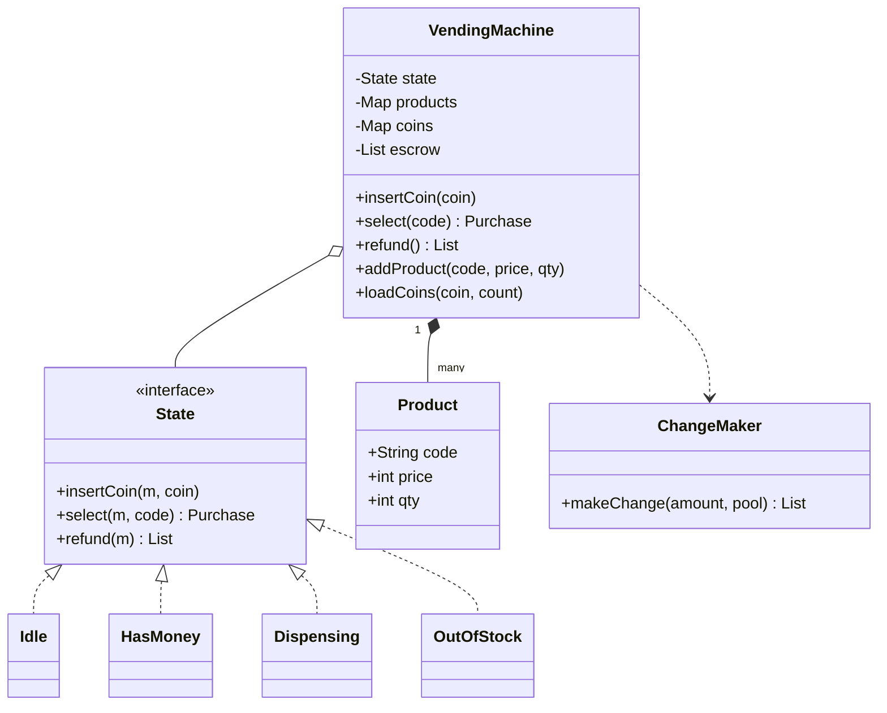
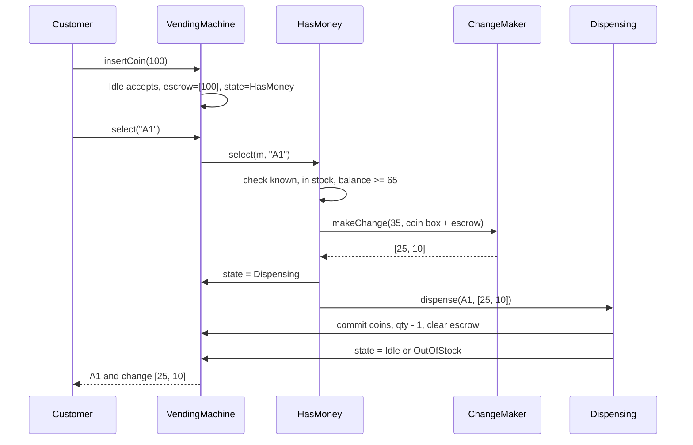

## In one minute
- A vending machine is a small state machine with money inside it. The design is graded on whether every operation is legal only in the right state, and whether money is never created or lost.
- Model the states (idle, has money, dispensing, out of stock) as objects that share one interface. The machine delegates every button press to its current state, so "what happens if I press select with no money" has exactly one home.
- Inserted coins sit in escrow until a sale commits. A refund returns the same coins. A sale moves escrow into the cash box, pays change out of the combined pool and decrements stock in one step.
- Change-making with a limited coin inventory is not greedy. Greedy fails when the big coin it grabs leaves a remainder it cannot pay, so use a small bounded dynamic program and refuse the sale if no exact change exists.
- The same shape (a multi-step transaction that must commit all-or-nothing and a state that gates which commands are legal) shows up in checkout flows, payment intents and order lifecycles.

## Requirements

### Functional
- Accept a fixed set of coin denominations (for example 5, 10, 25 and 100 cents). Reject anything else and hand it back.
- Show the current balance. Let the customer select a product by code (for example `A1`).
- Dispense the product and return change when the balance covers the price. Refuse the sale, keeping the balance, if the product is unknown, sold out, too expensive or if exact change cannot be made.
- Refund on request, returning the coins the customer inserted.
- Let an operator restock products and load coins for change. Stop accepting money when every slot is empty.

### Non-functional
- Money is conserved: coins in equal coins out plus coins kept, for every sequence of actions.
- Operations are deterministic and finish in milliseconds on a small embedded CPU.
- A power cut in the middle of a sale must not lose the customer's credit or dispense twice.

### Out of scope
- Card and mobile payments (covered under Extensibility), remote telemetry, dynamic pricing and the physical motor control loop.

## Entities and relationships
- **VendingMachine:** the context object. It owns the inventory, the coin box, the escrow and a reference to the current state. Client code only ever talks to it.
- **State:** an interface with `insert_coin`, `select` and `refund`. Four concrete states implement it: `Idle`, `HasMoney`, `Dispensing` and `OutOfStock`. States are stateless singletons; the data lives in the machine.
- **Product slot:** a code, a price in integer cents and a quantity. Prices are integers because floating-point cents drift (0.1 + 0.2 is not 0.3).
- **Coin box:** a count per denomination, used to pay change.
- **Escrow:** the list of coins the current customer has inserted but not yet spent. Keeping it separate is what makes "refund the same coins" possible.
- **ChangeMaker:** a pure function from (amount, coin pool) to a list of coins or "impossible". Pulling it out keeps the algorithm testable and replaceable.

The machine has a state (composition, one at a time), owns many slots and one coin box, and uses a change maker. States depend on the machine through a narrow set of methods, not the other way round.

## Class diagram



## Key flows



The order inside `select` matters. Every check that can fail (unknown code, sold out, insufficient funds, no exact change) runs before any data changes. Only when all of them pass does the machine enter `Dispensing` and commit. A failed selection leaves the customer exactly where they were: still in `HasMoney`, same balance, free to choose something else or refund.

Refund is the short flow: `HasMoney.refund` returns the escrow list, clears it and moves to `Idle`. Pressing refund in `Idle` returns nothing and changes nothing.

## Design patterns used and why
- **State.** Without it, every method starts with a `switch` on a status enum, and adding a state means editing every switch. With it, each state is one class that answers every command, and the illegal combinations are explicit methods that raise "no money" or "out of stock". The transition table is readable by opening four small files.
- **Singleton states (flyweight).** The states hold no data, so one shared instance per state is enough. Transitions are pointer assignments, not allocations.
- **Strategy for change-making.** The bounded dynamic program is the default. A machine in a country with a canonical coin system could plug in greedy, and a test can plug in a stub.
- **Facade.** `VendingMachine` is the only public surface. The UI, the coin mechanism driver and the maintenance panel all call it, and none of them can set a state directly.
- **Command (optional).** If you need an audit log or replay after power loss, record each accepted operation as a command object before applying it.

A common interview mistake is to put the data in the states (for example `HasMoney` holding the balance). Then every transition has to copy data between objects, and a bug in one copy loses money. Keep data on the context and behaviour on the states.

## Concurrency and edge cases
- **Single owner of the state.** A real controller runs a single event loop: coin interrupts, keypad presses and the service panel all enqueue events that one thread processes in order. In a multi-threaded design, a mutex around each public method gives the same guarantee. The Go solution below does that.
- **Two inputs at once.** A coin lands while the customer presses select. Whichever event the loop processes first wins, and the other is handled in the new state. Because `Dispensing` rejects new coins and selections, a coin that arrives mid-vend is returned, not silently added to a finished sale.
- **No exact change.** Refuse the sale before touching stock, and display "exact change only". Some operators prefer to keep the overpayment as credit; that is a product decision, so make it a policy, not a hard-coded branch.
- **Greedy trap** ([change-making problem](https://en.wikipedia.org/wiki/Change-making_problem)). With one 25 and three 10s, change of 30 cannot start with the 25. A bounded dynamic program over the available coins finds 10+10+10.
- **Coins as change.** The coins just inserted are in the pool for change. A machine with an empty coin box can still sell a 50-cent item to someone who inserted three quarters.
- **Dispense failure.** The motor turns but the product sticks. Real machines have a drop sensor; if it does not fire within a time limit, the machine treats the sale as failed and refunds. The model should allow `Dispensing` to roll back, which is why stock and coins are committed only once the vend is confirmed in a fuller design.
- **Restock while busy.** Restocking from `HasMoney` must not reset the customer's balance. Restocking from `OutOfStock` moves to `Idle`.

## In the wild
- **Stripe, 2017: designing APIs for safe retries.** A charge must happen exactly once even when a network failure leaves it unclear whether the request arrived, half-completed or succeeded with the response lost. Clients attach a unique Idempotency-Key to each POST, and the server replays the stored result instead of charging again, with retries using exponential backoff plus jitter. The same rule protects a machine that loses power between capture and dispense ([Stripe blog](https://stripe.com/blog/idempotency)).
- **Knight Capital, 2012: a half-finished change.** New code was copied to seven of eight servers, and on the eighth a reused flag woke retired trading logic that no longer tracked filled quantity. About 4 million executions in 154 stocks in roughly 45 minutes cost over $460M. Rolling back the seven good servers made all eight misbehave. The lesson for a multi-step commit is that a partly applied change is worse than none, and that the rollback path needs the same review as the change ([SEC order](https://www.sec.gov/litigation/admin/2013/34-70694.pdf)).

## Down the stack

### Layer 1: The contract
- After every public call: `coins_in = coins_kept + coins_returned`, counted per denomination.
- A failed `select` changes nothing observable except the error shown.
- `refund` in `HasMoney` returns exactly the multiset of coins in escrow, in insertion order.
- Stock never goes negative, and a sale decrements exactly one unit.

### Layer 2: The mechanism
The state objects are a transition table written as code. Each method either raises, mutates the context, or assigns `machine.state`. Change-making is a 0/1 knapsack over individual coins: `best[a]` holds the fewest-coin list that sums to `a`, and each coin is used at most once by iterating amounts downward. With 100 coins and a 200-cent amount, that is 20,000 cheap steps.

Real machines speak MDB (Multi-Drop Bus), the vending industry's serial protocol. The vending machine controller is the bus master and polls each peripheral by address: the coin changer at 0x08, cashless readers from 0x10, the bill validator at 0x30. The changer reports coins routed to its tubes, and the controller commands payouts with a dispense message. The software state machine sits on top of those messages.

### Layer 3: The machine
The controller is typically a microcontroller with tens of KB of RAM. MDB runs at 9600 baud with 9-bit bytes (the ninth bit marks an address byte), so one poll and reply takes a few milliseconds; the state machine is never the bottleneck, the coin mechanism is. Credit has to survive a power cut, so controllers write the balance to EEPROM or flash. Flash endures roughly 10,000 to 100,000 erase cycles per block, which is why firmware writes credit records round-robin across a region (wear levelling) instead of rewriting one cell per coin.

### Why it's built this way
1. Coins are physical and cannot be un-dispensed, so every check must happen before any irreversible action.
2. Checks must run first, so the sale is split into validate (in `HasMoney`) and commit (in `Dispensing`).
3. Commit can fail mechanically, so `Dispensing` exists as a separate state that refuses input until the vend is confirmed.
4. Coin tubes hold a limited mix of coins, so change-making must respect counts, and greedy is not safe.
5. Power can fail at any instant, so credit is persisted, and the persistent write pattern follows the wear limits of flash.

## Extensibility
- **Card payments.** Add a `Payment` abstraction with `authorize(amount)` and `capture` or `void`. Cash becomes one implementation. Card payment adds an `Authorizing` state, because the authorization round trip takes seconds and can time out.
- **Bills.** Another input device, same escrow concept. Most bill validators can hold one bill in escrow and return it, so refund still returns the same bill.
- **Promotions and dynamic prices.** Move price lookup behind a `PricingPolicy` so a "two for one" rule does not touch the states.
- **Telemetry.** Emit an event on each transition (observer). Operators use sales and "exact change only" events to plan restock routes.
- **Multiple items per transaction.** Turn the single selection into a cart; `HasMoney` accumulates selections and `Dispensing` vends a list. The commit rule stays the same.

### Variant: coffee machine with recipes and ingredients

A coffee machine keeps the state machine and changes what a "product" is. A snack is a unit on a shelf with its own stock count. A latte is a recipe: amounts of water, beans and milk drawn from containers that every drink shares. The unit of contention moves from slots to containers, and one order must check several of them at once.

- **Recipes are data.** A recipe is a price plus a map of ingredient to integer amount (millilitres, grams). An option such as an extra shot is the same shape: a price delta and ingredient deltas. Do not write `Latte extends Coffee`; load recipes from configuration so a new drink is a config change.
- **A pure plan function.** Resolving an order (drink plus options) against the menu yields a `BrewPlan`: the total ingredient need and the final price. Quoting and ordering share this one function, and it can reject absurd orders such as ten extra shots in one cup.
- **Atomic check and consume.** `Inventory.canSupply(need)` and `consume(need)` run under one lock, so a refill or a second front end cannot slip between them. The menu shows only drinks whose plan is currently supplyable, which replaces the sold-out slot of the snack design.
- **Authorise, brew, capture.** Cash escrow is replaced by a card hold: authorise the price, brew, then capture on success or void on failure ([Stripe: place a hold](https://docs.stripe.com/payments/place-a-hold-on-a-payment-method) shows the same two-step shape). A fault after grinding wastes beans but must not charge, so record actual consumption separately from sales and reconcile the two independently.
- **Template Method for brewing.** Grind, brew, add milk and dispense are a fixed sequence with variable steps, so the brewer owns the sequence and recipes only fill in parameters. Machine modes (ready, brewing, cleaning, fault) reuse the State pattern from this lesson.
- **Power loss.** Write a journal entry (order id, authorisation id, step) before each irreversible step. On boot, an order found authorised but not dispensed is voided; one dispensed but not captured is captured. Use stable authorisation ids so a retried call is safe ([Stripe: idempotent requests](https://docs.stripe.com/api/idempotent_requests)).
- **Low-stock alerts.** An observer fires once per threshold crossing, not on every consume. Software levels are estimates, so treat a sensor or flow-meter timeout as the truth and move to a fault mode.

The problem shape is multi-step consistency over shared stock, the same as reserving several seats in one booking or filling a warehouse order from three bins. Keep money in integer minor units (see Fowler on [Money](https://martinfowler.com/eaaCatalog/money.html)) and pair it with a currency code ([Stripe: currencies](https://docs.stripe.com/currencies)).

## Leadership lens
- **Invariant first.** In design review, ask for the money-conservation invariant written as a test before the class diagram. It catches more real bugs than any pattern discussion.
- **Policy versus mechanism.** "Keep overpayment as credit" or "refuse without exact change" are business decisions. Make them configuration, owned by the product side, so engineering does not ship a firmware update for each market.
- **Hardware boundary.** The team that owns the MDB driver and the team that owns the state machine need a written contract for failure signals (jam, tube empty, coin rejected). Most field incidents happen at that boundary.
- **Cost of field bugs.** A bug that loses customer money on thousands of machines becomes refunds and service visits. Budget for a simulator that replays recorded event logs against new firmware before rollout.

## Check yourself
1. Why should a failed `select` leave the machine in `HasMoney` instead of returning to `Idle`?
   **Answer:** The customer still has credit in escrow. Returning to `Idle` would either lose that credit or force an implicit refund the customer did not ask for.
2. Give a coin inventory where greedy change-making fails but an exact answer exists.
   **Answer:** One 25 and three 10s, with 30 to return. Greedy takes the 25 and is left needing 5; the right answer is three 10s.
3. Why keep the balance on the machine rather than on the `HasMoney` state object?
   **Answer:** States should be stateless and shared. If data lived in states, every transition would copy it, and a missed copy would create or destroy money.
4. What does the `Dispensing` state buy you if the sale is synchronous in your code?
   **Answer:** It is the place where a real vend waits for the drop sensor and rejects coins and selections meanwhile. It also gives you a hook to roll back on a jam without changing the other states.

## Practice
**Task:** Build a vending machine using the State pattern with four states: `idle`, `has_money`, `dispensing` and `out_of_stock`. The machine accepts only its configured coin denominations, tracks inserted coins in escrow, and on `select` returns the product code plus change, paid with the fewest coins from the coin box plus escrow (a bounded search, not greedy). Failures raise or return errors with these exact messages: `invalid coin`, `out of stock`, `no money`, `unknown product`, `sold out`, `insufficient funds`, `cannot make change`; a failed selection changes nothing. `refund` returns the escrowed coins in insertion order. A machine with no stock starts in `out_of_stock`; selling the last unit moves it there, and restocking moves it back to `idle`.

```python starter
class VendingError(Exception):
    pass


def make_change(amount, pool):
    """Return the fewest coins (largest first) summing to amount from pool {coin: count}, or None."""
    # TODO
    raise NotImplementedError


class VendingMachine:
    def __init__(self, denominations):
        # TODO: coin box, products, escrow, initial state
        pass

    def load_coins(self, coin, count):
        raise NotImplementedError

    def add_product(self, code, price, qty):
        raise NotImplementedError

    def stock(self, code):
        raise NotImplementedError

    def coin_count(self, coin):
        raise NotImplementedError

    def balance(self):
        raise NotImplementedError

    def state_name(self):
        raise NotImplementedError

    def insert_coin(self, coin):
        raise NotImplementedError

    def select(self, code):
        """Return (code, change) or raise VendingError."""
        raise NotImplementedError

    def refund(self):
        raise NotImplementedError
```

```python tests
def expect_error(fn, message):
    try:
        fn()
    except VendingError as e:
        assert str(e) == message, "expected %r, got %r" % (message, str(e))
        return
    assert False, "expected VendingError(%r)" % message


def stocked():
    m = VendingMachine([5, 10, 25, 100])
    m.load_coins(25, 2)
    m.load_coins(10, 5)
    m.load_coins(5, 5)
    m.add_product("A1", 65, 3)
    return m


def test_starts_out_of_stock_until_product_added():
    m = VendingMachine([25, 100])
    assert m.state_name() == "out_of_stock"
    expect_error(lambda: m.insert_coin(25), "out of stock")
    m.add_product("A1", 50, 1)
    assert m.state_name() == "idle"


def test_purchase_returns_item_and_fewest_coins():
    m = stocked()
    m.insert_coin(100)
    assert m.state_name() == "has_money"
    assert m.select("A1") == ("A1", [25, 10])
    assert m.state_name() == "idle"
    assert m.balance() == 0
    assert m.stock("A1") == 2
    assert m.coin_count(100) == 1
    assert m.coin_count(25) == 1


def test_invalid_coin_and_select_without_money():
    m = stocked()
    expect_error(lambda: m.insert_coin(3), "invalid coin")
    assert m.state_name() == "idle"
    expect_error(lambda: m.select("A1"), "no money")


def test_failed_selection_keeps_balance_and_refund_returns_same_coins():
    m = stocked()
    m.insert_coin(25)
    m.insert_coin(10)
    expect_error(lambda: m.select("A1"), "insufficient funds")
    expect_error(lambda: m.select("Z9"), "unknown product")
    assert m.state_name() == "has_money"
    assert m.balance() == 35
    assert m.refund() == [25, 10]
    assert m.state_name() == "idle"
    assert m.refund() == []


def test_change_avoids_greedy_trap():
    m = VendingMachine([10, 25, 100])
    m.load_coins(25, 1)
    m.load_coins(10, 3)
    m.add_product("B2", 70, 5)
    m.insert_coin(100)
    assert m.select("B2") == ("B2", [10, 10, 10])
    assert m.coin_count(25) == 1


def test_cannot_make_change_keeps_money_and_stock():
    m = VendingMachine([25, 100])
    m.add_product("A1", 65, 2)
    m.insert_coin(100)
    expect_error(lambda: m.select("A1"), "cannot make change")
    assert m.state_name() == "has_money"
    assert m.stock("A1") == 2
    assert m.refund() == [100]
    assert m.coin_count(100) == 0


def test_inserted_coins_can_be_used_as_change():
    m = VendingMachine([25])
    m.add_product("C3", 50, 2)
    for _ in range(3):
        m.insert_coin(25)
    assert m.select("C3") == ("C3", [25])
    assert m.coin_count(25) == 2


def test_selling_last_item_moves_to_out_of_stock():
    m = VendingMachine([25])
    m.add_product("A1", 25, 1)
    m.add_product("B1", 25, 1)
    m.insert_coin(25)
    assert m.select("A1") == ("A1", [])
    assert m.state_name() == "idle"
    m.insert_coin(25)
    expect_error(lambda: m.select("A1"), "sold out")
    assert m.select("B1") == ("B1", [])
    assert m.state_name() == "out_of_stock"
    expect_error(lambda: m.insert_coin(25), "out of stock")
    m.add_product("A1", 25, 4)
    assert m.state_name() == "idle"
```

```python solution
class VendingError(Exception):
    pass


def make_change(amount, pool):
    """Return the fewest coins (largest first) summing to amount from pool {coin: count}, or None."""
    if amount == 0:
        return []
    coins = []
    for denom in sorted(pool, reverse=True):
        coins.extend([denom] * pool[denom])
    best = [None] * (amount + 1)
    best[0] = []
    for coin in coins:
        for a in range(amount, coin - 1, -1):
            prev = best[a - coin]
            if prev is not None and (best[a] is None or len(prev) + 1 < len(best[a])):
                best[a] = prev + [coin]
    if best[amount] is None:
        return None
    return sorted(best[amount], reverse=True)


class State:
    name = "state"

    def insert_coin(self, m, coin):
        raise NotImplementedError

    def select(self, m, code):
        raise NotImplementedError

    def refund(self, m):
        return []


class Idle(State):
    name = "idle"

    def insert_coin(self, m, coin):
        m._accept(coin)
        m._state = HAS_MONEY

    def select(self, m, code):
        raise VendingError("no money")


class HasMoney(State):
    name = "has_money"

    def insert_coin(self, m, coin):
        m._accept(coin)

    def select(self, m, code):
        product = m._products.get(code)
        if product is None:
            raise VendingError("unknown product")
        price, qty = product
        if qty == 0:
            raise VendingError("sold out")
        if m.balance() < price:
            raise VendingError("insufficient funds")
        pool = dict(m._coins)
        for c in m._escrow:
            pool[c] = pool.get(c, 0) + 1
        change = make_change(m.balance() - price, pool)
        if change is None:
            raise VendingError("cannot make change")
        m._state = DISPENSING
        return DISPENSING.dispense(m, code, change, pool)

    def refund(self, m):
        coins = m._escrow
        m._escrow = []
        m._state = IDLE
        return coins


class Dispensing(State):
    name = "dispensing"

    def insert_coin(self, m, coin):
        raise VendingError("busy")

    def select(self, m, code):
        raise VendingError("busy")

    def dispense(self, m, code, change, pool):
        for c in change:
            pool[c] -= 1
        m._coins = pool
        m._escrow = []
        m._products[code][1] -= 1
        m._state = IDLE if m._has_stock() else OUT_OF_STOCK
        return code, change


class OutOfStock(State):
    name = "out_of_stock"

    def insert_coin(self, m, coin):
        raise VendingError("out of stock")

    def select(self, m, code):
        raise VendingError("out of stock")


IDLE = Idle()
HAS_MONEY = HasMoney()
DISPENSING = Dispensing()
OUT_OF_STOCK = OutOfStock()


class VendingMachine:
    def __init__(self, denominations):
        self._denominations = set(denominations)
        self._coins = {}
        self._products = {}
        self._escrow = []
        self._state = OUT_OF_STOCK

    def load_coins(self, coin, count):
        if coin not in self._denominations:
            raise VendingError("invalid coin")
        self._coins[coin] = self._coins.get(coin, 0) + count

    def add_product(self, code, price, qty):
        if code in self._products:
            self._products[code][0] = price
            self._products[code][1] += qty
        else:
            self._products[code] = [price, qty]
        if self._state is OUT_OF_STOCK and self._has_stock():
            self._state = IDLE

    def stock(self, code):
        product = self._products.get(code)
        return product[1] if product else 0

    def coin_count(self, coin):
        return self._coins.get(coin, 0)

    def balance(self):
        return sum(self._escrow)

    def state_name(self):
        return self._state.name

    def insert_coin(self, coin):
        self._state.insert_coin(self, coin)

    def select(self, code):
        return self._state.select(self, code)

    def refund(self):
        return self._state.refund(self)

    def _accept(self, coin):
        if coin not in self._denominations:
            raise VendingError("invalid coin")
        self._escrow.append(coin)

    def _has_stock(self):
        return any(qty > 0 for _, qty in self._products.values())
```

```typescript starter
export class VendingError extends Error {}

export interface Purchase {
  item: string;
  change: number[];
}

export function makeChange(amount: number, pool: Map<number, number>): number[] | null {
  throw new Error("TODO");
}

export class VendingMachine {
  constructor(denominations: number[]) {}

  loadCoins(coin: number, count: number): void {
    throw new Error("TODO");
  }

  addProduct(code: string, price: number, qty: number): void {
    throw new Error("TODO");
  }

  stock(code: string): number {
    throw new Error("TODO");
  }

  coinCount(coin: number): number {
    throw new Error("TODO");
  }

  balance(): number {
    throw new Error("TODO");
  }

  stateName(): string {
    throw new Error("TODO");
  }

  insertCoin(coin: number): void {
    throw new Error("TODO");
  }

  select(code: string): Purchase {
    throw new Error("TODO");
  }

  refund(): number[] {
    throw new Error("TODO");
  }
}
```

```typescript tests
function expectError(fn: () => unknown, message: string): void {
  try {
    fn();
  } catch (e) {
    assert(e instanceof VendingError, "expected VendingError, got " + String(e));
    assertEqual((e as Error).message, message, "error message");
    return;
  }
  assert(false, "expected VendingError(" + message + ")");
}

function stocked(): VendingMachine {
  const m = new VendingMachine([5, 10, 25, 100]);
  m.loadCoins(25, 2);
  m.loadCoins(10, 5);
  m.loadCoins(5, 5);
  m.addProduct("A1", 65, 3);
  return m;
}

test("starts out of stock until a product is added", () => {
  const m = new VendingMachine([25, 100]);
  assertEqual(m.stateName(), "out_of_stock");
  expectError(() => m.insertCoin(25), "out of stock");
  m.addProduct("A1", 50, 1);
  assertEqual(m.stateName(), "idle");
});

test("purchase returns item and fewest coins", () => {
  const m = stocked();
  m.insertCoin(100);
  assertEqual(m.stateName(), "has_money");
  assertEqual(m.select("A1"), { item: "A1", change: [25, 10] });
  assertEqual(m.stateName(), "idle");
  assertEqual(m.balance(), 0);
  assertEqual(m.stock("A1"), 2);
  assertEqual(m.coinCount(100), 1);
  assertEqual(m.coinCount(25), 1);
});

test("invalid coin and select without money", () => {
  const m = stocked();
  expectError(() => m.insertCoin(3), "invalid coin");
  assertEqual(m.stateName(), "idle");
  expectError(() => m.select("A1"), "no money");
});

test("failed selection keeps balance and refund returns same coins", () => {
  const m = stocked();
  m.insertCoin(25);
  m.insertCoin(10);
  expectError(() => m.select("A1"), "insufficient funds");
  expectError(() => m.select("Z9"), "unknown product");
  assertEqual(m.stateName(), "has_money");
  assertEqual(m.balance(), 35);
  assertEqual(m.refund(), [25, 10]);
  assertEqual(m.stateName(), "idle");
  assertEqual(m.refund(), []);
});

test("change avoids the greedy trap", () => {
  const m = new VendingMachine([10, 25, 100]);
  m.loadCoins(25, 1);
  m.loadCoins(10, 3);
  m.addProduct("B2", 70, 5);
  m.insertCoin(100);
  assertEqual(m.select("B2"), { item: "B2", change: [10, 10, 10] });
  assertEqual(m.coinCount(25), 1);
});

test("cannot make change keeps money and stock", () => {
  const m = new VendingMachine([25, 100]);
  m.addProduct("A1", 65, 2);
  m.insertCoin(100);
  expectError(() => m.select("A1"), "cannot make change");
  assertEqual(m.stateName(), "has_money");
  assertEqual(m.stock("A1"), 2);
  assertEqual(m.refund(), [100]);
  assertEqual(m.coinCount(100), 0);
});

test("inserted coins can be used as change", () => {
  const m = new VendingMachine([25]);
  m.addProduct("C3", 50, 2);
  for (let i = 0; i < 3; i++) m.insertCoin(25);
  assertEqual(m.select("C3"), { item: "C3", change: [25] });
  assertEqual(m.coinCount(25), 2);
});

test("selling the last item moves to out of stock", () => {
  const m = new VendingMachine([25]);
  m.addProduct("A1", 25, 1);
  m.addProduct("B1", 25, 1);
  m.insertCoin(25);
  assertEqual(m.select("A1"), { item: "A1", change: [] });
  assertEqual(m.stateName(), "idle");
  m.insertCoin(25);
  expectError(() => m.select("A1"), "sold out");
  assertEqual(m.select("B1"), { item: "B1", change: [] });
  assertEqual(m.stateName(), "out_of_stock");
  expectError(() => m.insertCoin(25), "out of stock");
  m.addProduct("A1", 25, 4);
  assertEqual(m.stateName(), "idle");
});
```

```typescript solution
export class VendingError extends Error {}

export interface Purchase {
  item: string;
  change: number[];
}

export function makeChange(amount: number, pool: Map<number, number>): number[] | null {
  if (amount === 0) return [];
  const coins: number[] = [];
  const denoms = Array.from(pool.keys()).sort((a, b) => b - a);
  for (const d of denoms) {
    for (let i = 0; i < (pool.get(d) ?? 0); i++) coins.push(d);
  }
  const best: (number[] | null)[] = new Array(amount + 1).fill(null);
  best[0] = [];
  for (const coin of coins) {
    for (let a = amount; a >= coin; a--) {
      const prev = best[a - coin];
      const cur = best[a];
      if (prev !== null && (cur === null || prev.length + 1 < cur.length)) {
        best[a] = [...prev, coin];
      }
    }
  }
  const result = best[amount];
  return result === null ? null : [...result].sort((a, b) => b - a);
}

interface State {
  readonly name: string;
  insertCoin(m: VendingMachine, coin: number): void;
  select(m: VendingMachine, code: string): Purchase;
  refund(m: VendingMachine): number[];
}

const idle: State = {
  name: "idle",
  insertCoin(m, coin) {
    m.accept(coin);
    m.state = hasMoney;
  },
  select() {
    throw new VendingError("no money");
  },
  refund() {
    return [];
  },
};

const hasMoney: State = {
  name: "has_money",
  insertCoin(m, coin) {
    m.accept(coin);
  },
  select(m, code) {
    const product = m.products.get(code);
    if (product === undefined) throw new VendingError("unknown product");
    if (product.qty === 0) throw new VendingError("sold out");
    if (m.balance() < product.price) throw new VendingError("insufficient funds");
    const pool = new Map(m.coins);
    for (const c of m.escrow) pool.set(c, (pool.get(c) ?? 0) + 1);
    const change = makeChange(m.balance() - product.price, pool);
    if (change === null) throw new VendingError("cannot make change");
    m.state = dispensing;
    return dispensing.dispense(m, code, change, pool);
  },
  refund(m) {
    const coins = m.escrow;
    m.escrow = [];
    m.state = idle;
    return coins;
  },
};

const dispensing = {
  name: "dispensing",
  insertCoin(): void {
    throw new VendingError("busy");
  },
  select(): Purchase {
    throw new VendingError("busy");
  },
  refund(): number[] {
    return [];
  },
  dispense(m: VendingMachine, code: string, change: number[], pool: Map<number, number>): Purchase {
    for (const c of change) pool.set(c, (pool.get(c) ?? 0) - 1);
    m.coins = pool;
    m.escrow = [];
    m.products.get(code)!.qty -= 1;
    m.state = m.hasStock() ? idle : outOfStock;
    return { item: code, change };
  },
};

const outOfStock: State = {
  name: "out_of_stock",
  insertCoin() {
    throw new VendingError("out of stock");
  },
  select() {
    throw new VendingError("out of stock");
  },
  refund() {
    return [];
  },
};

export class VendingMachine {
  state: State = outOfStock;
  coins = new Map<number, number>();
  products = new Map<string, { price: number; qty: number }>();
  escrow: number[] = [];
  private readonly denominations: Set<number>;

  constructor(denominations: number[]) {
    this.denominations = new Set(denominations);
  }

  loadCoins(coin: number, count: number): void {
    if (!this.denominations.has(coin)) throw new VendingError("invalid coin");
    this.coins.set(coin, (this.coins.get(coin) ?? 0) + count);
  }

  addProduct(code: string, price: number, qty: number): void {
    const existing = this.products.get(code);
    if (existing) {
      existing.price = price;
      existing.qty += qty;
    } else {
      this.products.set(code, { price, qty });
    }
    if (this.state === outOfStock && this.hasStock()) this.state = idle;
  }

  stock(code: string): number {
    return this.products.get(code)?.qty ?? 0;
  }

  coinCount(coin: number): number {
    return this.coins.get(coin) ?? 0;
  }

  balance(): number {
    return this.escrow.reduce((sum, c) => sum + c, 0);
  }

  stateName(): string {
    return this.state.name;
  }

  insertCoin(coin: number): void {
    this.state.insertCoin(this, coin);
  }

  select(code: string): Purchase {
    return this.state.select(this, code);
  }

  refund(): number[] {
    return this.state.refund(this);
  }

  accept(coin: number): void {
    if (!this.denominations.has(coin)) throw new VendingError("invalid coin");
    this.escrow.push(coin);
  }

  hasStock(): boolean {
    for (const p of this.products.values()) if (p.qty > 0) return true;
    return false;
  }
}
```

```go starter
package practice

import "errors"

var (
	ErrInvalidCoin       = errors.New("invalid coin")
	ErrOutOfStock        = errors.New("out of stock")
	ErrNoMoney           = errors.New("no money")
	ErrUnknownProduct    = errors.New("unknown product")
	ErrSoldOut           = errors.New("sold out")
	ErrInsufficientFunds = errors.New("insufficient funds")
	ErrCannotMakeChange  = errors.New("cannot make change")
)

// Purchase is the result of a successful selection.
type Purchase struct {
	Item   string
	Change []int
}

// MakeChange returns the fewest coins (largest first) summing to amount, or ok=false.
func MakeChange(amount int, pool map[int]int) ([]int, bool) {
	panic("TODO")
}

type Machine struct{}

func NewMachine(denominations []int) *Machine {
	return &Machine{}
}

func (m *Machine) LoadCoins(coin, count int) error             { panic("TODO") }
func (m *Machine) AddProduct(code string, price, qty int)       { panic("TODO") }
func (m *Machine) Stock(code string) int                        { panic("TODO") }
func (m *Machine) CoinCount(coin int) int                       { panic("TODO") }
func (m *Machine) Balance() int                                 { panic("TODO") }
func (m *Machine) StateName() string                            { panic("TODO") }
func (m *Machine) InsertCoin(coin int) error                    { panic("TODO") }
func (m *Machine) Select(code string) (Purchase, error)         { panic("TODO") }
func (m *Machine) Refund() []int                                { panic("TODO") }
```

```go tests
package practice

import (
	"errors"
	"testing"
)

func equalInts(a, b []int) bool {
	if len(a) != len(b) {
		return false
	}
	for i := range a {
		if a[i] != b[i] {
			return false
		}
	}
	return true
}

func expectErr(t *testing.T, err, want error) {
	t.Helper()
	if !errors.Is(err, want) {
		t.Fatalf("expected %v, got %v", want, err)
	}
}

func expectPurchase(t *testing.T, m *Machine, code string, change []int) {
	t.Helper()
	p, err := m.Select(code)
	if err != nil {
		t.Fatalf("select %s: %v", code, err)
	}
	if p.Item != code || !equalInts(p.Change, change) {
		t.Fatalf("got %+v, want %s with change %v", p, code, change)
	}
}

func stocked() *Machine {
	m := NewMachine([]int{5, 10, 25, 100})
	m.LoadCoins(25, 2)
	m.LoadCoins(10, 5)
	m.LoadCoins(5, 5)
	m.AddProduct("A1", 65, 3)
	return m
}

func TestStartsOutOfStockUntilProductAdded(t *testing.T) {
	m := NewMachine([]int{25, 100})
	if m.StateName() != "out_of_stock" {
		t.Fatalf("state %s", m.StateName())
	}
	expectErr(t, m.InsertCoin(25), ErrOutOfStock)
	m.AddProduct("A1", 50, 1)
	if m.StateName() != "idle" {
		t.Fatalf("state %s", m.StateName())
	}
}

func TestPurchaseReturnsItemAndFewestCoins(t *testing.T) {
	m := stocked()
	if err := m.InsertCoin(100); err != nil {
		t.Fatal(err)
	}
	if m.StateName() != "has_money" {
		t.Fatalf("state %s", m.StateName())
	}
	expectPurchase(t, m, "A1", []int{25, 10})
	if m.StateName() != "idle" || m.Balance() != 0 || m.Stock("A1") != 2 {
		t.Fatalf("state %s balance %d stock %d", m.StateName(), m.Balance(), m.Stock("A1"))
	}
	if m.CoinCount(100) != 1 || m.CoinCount(25) != 1 {
		t.Fatalf("coin box 100=%d 25=%d", m.CoinCount(100), m.CoinCount(25))
	}
}

func TestInvalidCoinAndSelectWithoutMoney(t *testing.T) {
	m := stocked()
	expectErr(t, m.InsertCoin(3), ErrInvalidCoin)
	if m.StateName() != "idle" {
		t.Fatalf("state %s", m.StateName())
	}
	_, err := m.Select("A1")
	expectErr(t, err, ErrNoMoney)
}

func TestFailedSelectionKeepsBalanceAndRefundReturnsSameCoins(t *testing.T) {
	m := stocked()
	m.InsertCoin(25)
	m.InsertCoin(10)
	_, err := m.Select("A1")
	expectErr(t, err, ErrInsufficientFunds)
	_, err = m.Select("Z9")
	expectErr(t, err, ErrUnknownProduct)
	if m.StateName() != "has_money" || m.Balance() != 35 {
		t.Fatalf("state %s balance %d", m.StateName(), m.Balance())
	}
	if got := m.Refund(); !equalInts(got, []int{25, 10}) {
		t.Fatalf("refund %v", got)
	}
	if m.StateName() != "idle" || len(m.Refund()) != 0 {
		t.Fatalf("expected idle with nothing to refund")
	}
}

func TestChangeAvoidsGreedyTrap(t *testing.T) {
	m := NewMachine([]int{10, 25, 100})
	m.LoadCoins(25, 1)
	m.LoadCoins(10, 3)
	m.AddProduct("B2", 70, 5)
	m.InsertCoin(100)
	expectPurchase(t, m, "B2", []int{10, 10, 10})
	if m.CoinCount(25) != 1 {
		t.Fatalf("quarter should stay, got %d", m.CoinCount(25))
	}
}

func TestCannotMakeChangeKeepsMoneyAndStock(t *testing.T) {
	m := NewMachine([]int{25, 100})
	m.AddProduct("A1", 65, 2)
	m.InsertCoin(100)
	_, err := m.Select("A1")
	expectErr(t, err, ErrCannotMakeChange)
	if m.StateName() != "has_money" || m.Stock("A1") != 2 {
		t.Fatalf("state %s stock %d", m.StateName(), m.Stock("A1"))
	}
	if got := m.Refund(); !equalInts(got, []int{100}) {
		t.Fatalf("refund %v", got)
	}
	if m.CoinCount(100) != 0 {
		t.Fatalf("coin box should be empty")
	}
}

func TestInsertedCoinsCanBeUsedAsChange(t *testing.T) {
	m := NewMachine([]int{25})
	m.AddProduct("C3", 50, 2)
	for i := 0; i < 3; i++ {
		m.InsertCoin(25)
	}
	expectPurchase(t, m, "C3", []int{25})
	if m.CoinCount(25) != 2 {
		t.Fatalf("coin box 25=%d", m.CoinCount(25))
	}
}

func TestSellingLastItemMovesToOutOfStock(t *testing.T) {
	m := NewMachine([]int{25})
	m.AddProduct("A1", 25, 1)
	m.AddProduct("B1", 25, 1)
	m.InsertCoin(25)
	expectPurchase(t, m, "A1", []int{})
	if m.StateName() != "idle" {
		t.Fatalf("state %s", m.StateName())
	}
	m.InsertCoin(25)
	_, err := m.Select("A1")
	expectErr(t, err, ErrSoldOut)
	expectPurchase(t, m, "B1", []int{})
	if m.StateName() != "out_of_stock" {
		t.Fatalf("state %s", m.StateName())
	}
	expectErr(t, m.InsertCoin(25), ErrOutOfStock)
	m.AddProduct("A1", 25, 4)
	if m.StateName() != "idle" {
		t.Fatalf("state %s", m.StateName())
	}
}
```

```go solution
package practice

import (
	"errors"
	"sort"
	"sync"
)

var (
	ErrInvalidCoin       = errors.New("invalid coin")
	ErrOutOfStock        = errors.New("out of stock")
	ErrNoMoney           = errors.New("no money")
	ErrUnknownProduct    = errors.New("unknown product")
	ErrSoldOut           = errors.New("sold out")
	ErrInsufficientFunds = errors.New("insufficient funds")
	ErrCannotMakeChange  = errors.New("cannot make change")
	ErrBusy              = errors.New("busy")
)

// Purchase is the result of a successful selection.
type Purchase struct {
	Item   string
	Change []int
}

// MakeChange returns the fewest coins (largest first) summing to amount, or ok=false.
func MakeChange(amount int, pool map[int]int) ([]int, bool) {
	if amount == 0 {
		return []int{}, true
	}
	denoms := make([]int, 0, len(pool))
	for d := range pool {
		denoms = append(denoms, d)
	}
	sort.Sort(sort.Reverse(sort.IntSlice(denoms)))
	var coins []int
	for _, d := range denoms {
		for i := 0; i < pool[d]; i++ {
			coins = append(coins, d)
		}
	}
	best := make([][]int, amount+1)
	best[0] = []int{}
	for _, coin := range coins {
		for a := amount; a >= coin; a-- {
			prev := best[a-coin]
			if prev != nil && (best[a] == nil || len(prev)+1 < len(best[a])) {
				next := make([]int, len(prev), len(prev)+1)
				copy(next, prev)
				best[a] = append(next, coin)
			}
		}
	}
	if best[amount] == nil {
		return nil, false
	}
	sort.Sort(sort.Reverse(sort.IntSlice(best[amount])))
	return best[amount], true
}

type state interface {
	name() string
	insertCoin(m *Machine, coin int) error
	selectProduct(m *Machine, code string) (Purchase, error)
	refund(m *Machine) []int
}

type product struct {
	price, qty int
}

type (
	idleState       struct{}
	hasMoneyState   struct{}
	dispensingState struct{}
	outOfStockState struct{}
)

var (
	idle       state = idleState{}
	hasMoney   state = hasMoneyState{}
	dispensing       = dispensingState{}
	outOfStock state = outOfStockState{}
)

func (idleState) name() string { return "idle" }
func (idleState) insertCoin(m *Machine, coin int) error {
	if err := m.accept(coin); err != nil {
		return err
	}
	m.state = hasMoney
	return nil
}
func (idleState) selectProduct(*Machine, string) (Purchase, error) { return Purchase{}, ErrNoMoney }
func (idleState) refund(*Machine) []int                            { return []int{} }

func (hasMoneyState) name() string                          { return "has_money" }
func (hasMoneyState) insertCoin(m *Machine, coin int) error { return m.accept(coin) }
func (hasMoneyState) selectProduct(m *Machine, code string) (Purchase, error) {
	p, ok := m.products[code]
	if !ok {
		return Purchase{}, ErrUnknownProduct
	}
	if p.qty == 0 {
		return Purchase{}, ErrSoldOut
	}
	balance := m.balance()
	if balance < p.price {
		return Purchase{}, ErrInsufficientFunds
	}
	pool := make(map[int]int, len(m.coins))
	for c, n := range m.coins {
		pool[c] = n
	}
	for _, c := range m.escrow {
		pool[c]++
	}
	change, ok := MakeChange(balance-p.price, pool)
	if !ok {
		return Purchase{}, ErrCannotMakeChange
	}
	m.state = dispensing
	return dispensing.dispense(m, code, change, pool), nil
}
func (hasMoneyState) refund(m *Machine) []int {
	coins := m.escrow
	m.escrow = []int{}
	m.state = idle
	return coins
}

func (dispensingState) name() string                                  { return "dispensing" }
func (dispensingState) insertCoin(*Machine, int) error                { return ErrBusy }
func (dispensingState) selectProduct(*Machine, string) (Purchase, error) { return Purchase{}, ErrBusy }
func (dispensingState) refund(*Machine) []int                         { return []int{} }
func (dispensingState) dispense(m *Machine, code string, change []int, pool map[int]int) Purchase {
	for _, c := range change {
		pool[c]--
	}
	m.coins = pool
	m.escrow = []int{}
	m.products[code].qty--
	if m.hasStock() {
		m.state = idle
	} else {
		m.state = outOfStock
	}
	return Purchase{Item: code, Change: change}
}

func (outOfStockState) name() string                                  { return "out_of_stock" }
func (outOfStockState) insertCoin(*Machine, int) error                { return ErrOutOfStock }
func (outOfStockState) selectProduct(*Machine, string) (Purchase, error) { return Purchase{}, ErrOutOfStock }
func (outOfStockState) refund(*Machine) []int                         { return []int{} }

// Machine is safe for concurrent use: every public method holds mu.
type Machine struct {
	mu            sync.Mutex
	state         state
	denominations map[int]bool
	coins         map[int]int
	products      map[string]*product
	escrow        []int
}

func NewMachine(denominations []int) *Machine {
	m := &Machine{
		state:         outOfStock,
		denominations: make(map[int]bool),
		coins:         make(map[int]int),
		products:      make(map[string]*product),
		escrow:        []int{},
	}
	for _, d := range denominations {
		m.denominations[d] = true
	}
	return m
}

func (m *Machine) LoadCoins(coin, count int) error {
	m.mu.Lock()
	defer m.mu.Unlock()
	if !m.denominations[coin] {
		return ErrInvalidCoin
	}
	m.coins[coin] += count
	return nil
}

func (m *Machine) AddProduct(code string, price, qty int) {
	m.mu.Lock()
	defer m.mu.Unlock()
	if p, ok := m.products[code]; ok {
		p.price = price
		p.qty += qty
	} else {
		m.products[code] = &product{price: price, qty: qty}
	}
	if m.state == outOfStock && m.hasStock() {
		m.state = idle
	}
}

func (m *Machine) Stock(code string) int {
	m.mu.Lock()
	defer m.mu.Unlock()
	if p, ok := m.products[code]; ok {
		return p.qty
	}
	return 0
}

func (m *Machine) CoinCount(coin int) int {
	m.mu.Lock()
	defer m.mu.Unlock()
	return m.coins[coin]
}

func (m *Machine) Balance() int {
	m.mu.Lock()
	defer m.mu.Unlock()
	return m.balance()
}

func (m *Machine) StateName() string {
	m.mu.Lock()
	defer m.mu.Unlock()
	return m.state.name()
}

func (m *Machine) InsertCoin(coin int) error {
	m.mu.Lock()
	defer m.mu.Unlock()
	return m.state.insertCoin(m, coin)
}

func (m *Machine) Select(code string) (Purchase, error) {
	m.mu.Lock()
	defer m.mu.Unlock()
	return m.state.selectProduct(m, code)
}

func (m *Machine) Refund() []int {
	m.mu.Lock()
	defer m.mu.Unlock()
	return m.state.refund(m)
}

func (m *Machine) accept(coin int) error {
	if !m.denominations[coin] {
		return ErrInvalidCoin
	}
	m.escrow = append(m.escrow, coin)
	return nil
}

func (m *Machine) balance() int {
	sum := 0
	for _, c := range m.escrow {
		sum += c
	}
	return sum
}

func (m *Machine) hasStock() bool {
	for _, p := range m.products {
		if p.qty > 0 {
			return true
		}
	}
	return false
}
```

## Mock interview
**Prompt:** Design the software for a snack vending machine that takes coins, sells about 40 products from coded slots, gives change and supports refunds. Write the classes and the main operations; we will run your code against a few scenarios.

- Follow-up: The machine has one quarter and three dimes and owes 30 cents. Walk through what your change algorithm does.
- Follow-up: The product jams after the motor turns. Which state are you in, and what happens to the customer's money and to the stock count?
- Follow-up: The company wants contactless card payments next quarter. What changes in your design, and what stays the same?

**A strong answer covers:**
- An explicit state set with a transition for every (state, command) pair, including the illegal ones.
- Integer cents, an escrow separate from the coin box, and refund returning the exact inserted coins.
- Validate-then-commit inside `select`, so a failed sale changes nothing.
- A bounded change-making algorithm, with the greedy counterexample and a clear "exact change only" behaviour.
- A dispensing state that can roll back on a jam, and persistence of credit across power loss.
- A payment abstraction for cards, with an authorizing state and timeout handling, leaving product and change logic untouched.

## Sources and further study
**Primary**
- [Stripe: idempotency write-up](https://stripe.com/blog/idempotency): why a payment step must be safe to retry after a timeout.
- [SEC order on Knight Capital](https://www.sec.gov/litigation/admin/2013/34-70694.pdf): the regulator's account of a partly deployed change.

**Systems docs**
- [Stripe: idempotent requests](https://docs.stripe.com/api/idempotent_requests): how the key works in a real payment API.
- [Stripe: place a hold on a payment method](https://docs.stripe.com/payments/place-a-hold-on-a-payment-method): authorise now, capture later, the card analogue of coin escrow.
- [Stripe: currencies and minor units](https://docs.stripe.com/currencies): why integer cents needs a currency code.

**Books**
- *Design Patterns: Elements of Reusable Object-Oriented Software*, Gamma, Helm, Johnson and Vlissides: chapter 5 (Behavioral), covering State, Observer and Template Method.
- *Head First Design Patterns*, Freeman and Robson, 2nd edition: chapter 10 "The State of Things: The State Pattern".

**Other curricula**
- [Refactoring.Guru: State](https://refactoring.guru/design-patterns/state): the structure of the pattern and its contrast with Strategy.
- [Game Programming Patterns: State](https://gameprogrammingpatterns.com/state.html): the path from boolean flags to state objects.

## Watch
- [State Pattern, Design Patterns ep 17 (Christopher Okhravi)](https://www.youtube.com/watch?v=N12L5D78MAA): a careful whiteboard derivation of the State pattern and how it differs from Strategy.
- [State Design Pattern (Derek Banas)](https://www.youtube.com/watch?v=MGEx35FjBuo): a short coded example of the pattern applied to a machine that takes money.

## Free resources
- [State (Refactoring.Guru)](https://refactoring.guru/design-patterns/state): the pattern's structure, when to apply it and how it relates to Strategy.
- [State (Game Programming Patterns, Robert Nystrom)](https://gameprogrammingpatterns.com/state.html): a practical tour from boolean flags to finite state machines to state objects.
- [Change-making problem (Wikipedia)](https://en.wikipedia.org/wiki/Change-making_problem): why greedy works only for canonical coin systems and the dynamic-programming solution.
- [Money (Martin Fowler, P of EAA)](https://martinfowler.com/eaaCatalog/money.html): why money deserves its own type and should never be a float.
- [Finite-state machine (Wikipedia)](https://en.wikipedia.org/wiki/Finite-state_machine): background on state machines, including the classic turnstile example.
