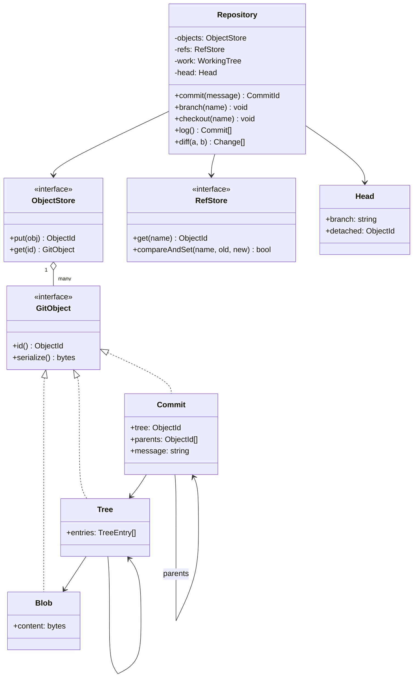
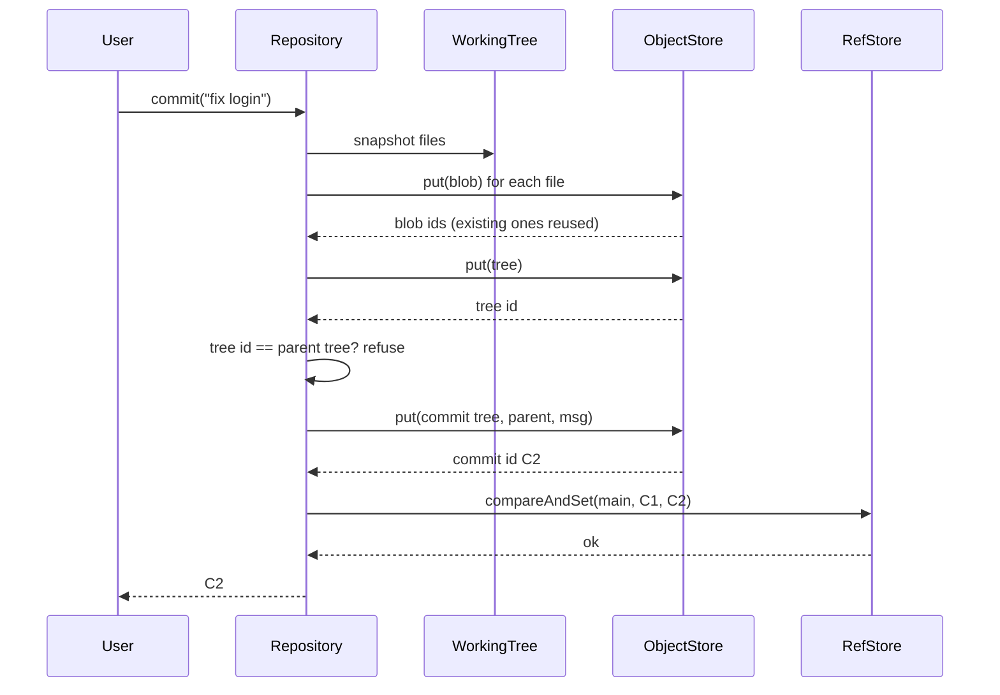

## In one minute
- A version control system is two data structures glued together: an **immutable, content-addressed object store** (file contents, directory snapshots, commits) and a tiny **mutable table of names** (branches and HEAD) that point into it. Almost every design decision follows from keeping those two apart.
- Content addressing means an object's id is the hash of its bytes. Identical files are stored once, history cannot be rewritten without changing every later id, and two copies of the store can be compared by id alone.
- A commit is a snapshot plus parent pointers, not a diff. Diffs are computed on demand by comparing two snapshots, which keeps commits simple and lets the diff algorithm change without touching stored history.
- Concurrency is easy for objects (writing the same immutable object twice is harmless) and hard for names. A branch update must be a compare-and-swap: "move `main` from X to Y only if it still points at X".
- The shape is **trust but verify** plus **multi-step consistency**: ids that prove integrity, and a pointer flip that must happen only after everything it points to is safely stored. The same structure powers container image layers, Nix store paths, IPFS and the Merkle trees in [Design Google Drive](../sdi/design-google-drive.md)-style sync.

## Requirements

Functional:
- A working tree of files that the user edits freely.
- `commit(message)` records a snapshot of the working tree with a parent link; refuse empty commits.
- Branches: create a branch at the current commit, switch to it, and see `HEAD` follow it as new commits are made.
- `checkout` replaces the working tree with a branch's snapshot, refusing if there are uncommitted changes that would be lost.
- `log` walks history from HEAD; `diff` lists added, modified and deleted paths between two commits.
- Identical content is stored once, however many commits or paths contain it.

Non-functional:
- Commit ids are deterministic: the same content, parent and message always produce the same id.
- Stored history is immutable; corruption is detectable by rehashing.
- Operations are proportional to the size of what changed or what is listed, not to the age of the repository.

Out of scope for the interview: merging (covered in [Git, Testing and Code Review Basics](../fd/git-testing-code-review.md), which implements merge base and three-way merge), remotes and network sync, a staging area with partial commits, and line-level diff algorithms. Name each and place it in Extensibility.

## Entities and relationships

- **Blob** holds one file's content. Its id is the hash of that content with a type prefix. It has no name; names live in trees.
- **Tree** is a snapshot of a directory: a sorted list of entries `(name, mode, child id)`, where a child is a blob or another tree. Its id is the hash of its serialised entries, so it changes if and only if something beneath it changes.
- **Commit** holds a root tree id, zero or more parent commit ids, an author, a timestamp and a message. It is the unit of history.
- **ObjectStore** maps id to object and supports `put` (idempotent) and `get`. It never updates or deletes in normal operation.
- **Ref** is a name (`main`, `feature/login`) that points at a commit id. **HEAD** is a special ref that usually points at another ref ("I am on `main`"), and only in the detached state points straight at a commit.
- **RefStore** holds refs and offers `compareAndSet(name, expected, new)`.
- **WorkingTree** is the user's mutable files. **Repository** is the facade that ties them together.

Relationships: commits reference trees, trees reference blobs and subtrees, commits reference parents. Nothing in the object store references a ref; refs only point inward. That one-way arrow is why branches are cheap (a 41-byte file in Git) and why deleting a branch never deletes history until garbage collection proves it unreachable.

## Class diagram



## Key flows

Commit writes objects bottom-up (blobs, then trees, then the commit) and only then moves the branch. If the process dies before the last step, the new objects are unreachable garbage and the repository is still consistent.



## Design patterns used and why

- **Composite** for trees: a tree contains blobs and trees, and operations such as "list every path" or "count bytes" recurse uniformly. It is the same structure as [Design In Memory File System](design-in-memory-file-system.md), frozen.
- **Immutable value objects** for blobs, trees and commits. Immutability is what makes content addressing sound (an id must never describe two different byte strings), what lets readers skip locks, and what makes caching trivially correct.
- **Repository** and **Facade**: `ObjectStore` and `RefStore` are interfaces with in-memory, loose-file and packed implementations behind them. `Repository` is the facade the commands use.
- **Command** for user operations (`commit`, `checkout`, `branch`), each a class with validation and execution. Hooks (pre-commit, post-checkout) wrap them.
- **Strategy** for diff and merge algorithms. Git ships several line diff algorithms (Myers, patience, histogram) selectable per call; the stored data does not change. Merge strategies are pluggable the same way.
- **Memento**, in spirit: each commit is a memento of the working tree that the repository can restore on checkout. Unlike a classic [Memento](memento.md), it is shared and deduplicated.

## Concurrency and edge cases

- **Two writers move the same branch.** Process A and process B both read `main = C1`, build commits C2 and C3, and write `main`. Without a check, one commit vanishes from the branch. The fix is compare-and-swap on the ref: B's update from C1 fails because `main` is now C2, and B must rebase or merge. Git implements this with a lock file (`refs/heads/main.lock`), a check of the old value, and an atomic `rename` over the real ref file.
- **Concurrent object writes.** Two processes writing the same blob is harmless: both produce the same bytes under the same id. Writers create a temporary file and rename it into place, so a reader never sees half an object.
- **Crash mid-commit.** Because the ref moves last, a crash leaves only unreferenced objects. `git gc` and `git fsck` find and remove them later. `git gc` only prunes unreachable loose objects older than two weeks by default (`gc.pruneExpire`), because another process may have just written objects it has not yet linked to a ref ([git-gc docs](https://git-scm.com/docs/git-gc)). Reverse the order and a crash leaves a branch pointing at a missing commit.
- **Empty commit.** If the new root tree id equals the parent's, nothing changed; refuse unless the user explicitly allows it.
- **Checkout with local changes.** Overwriting edited files loses work. Compare the working tree against HEAD's tree first and refuse, or carry the changes over when they do not touch files that differ between the two branches (Git's real behaviour).
- **First commit and empty branches.** A fresh repository has a HEAD that names `main` but `main` points at nothing. `log` returns nothing, `branch` has nothing to point at, and the first commit has no parent.
- **Hash collisions.** Accidental collisions are not a practical concern at 160 bits, but deliberate SHA-1 collisions are (SHAttered, 2017). Git 2.13.0 and later use a hardened SHA-1 that detects the SHAttered attack, and SHA-256 repositories exist but do not interoperate with SHA-1 repositories ([Git hash transition](https://git-scm.com/docs/hash-function-transition), [git init](https://git-scm.com/docs/git-init)). `sha1` is still the default object format.

## In the wild
- **SHAttered, 2017: the first SHA-1 collision.** On 23 February 2017 researchers at CWI and Google published two different PDF files with the same SHA-1 hash, the first practical collision. Git names every object by SHA-1, so Git 2.13.0 and later moved to a hardened implementation that detects this attack, and the project designed a SHA-256 transition that rewrites both object names and the references inside objects ([shattered.io](https://shattered.io/), [Git hash transition](https://git-scm.com/docs/hash-function-transition)).
- **GitHub, 2015: rewriting the Merge button in memory.** The pull-request merge used a shell script around `git merge` on a temporary checkout. GitHub replaced it with libgit2, which merges two trees through an in-memory index without touching a working directory, and ran both paths on live traffic with its Scientist library. The comparison caught a legacy bug: Git's merge helper returns the number of conflicts as its exit value, so a file with exactly 768 conflicts wrapped to zero and was reported as a clean merge. After four days of iteration the experiment ran at 100% of requests for 24 hours with no mismatches over tens of millions of merges ([GitHub Engineering](https://github.blog/engineering/engineering-principles/move-fast/)).

## Down the stack

### Layer 1: The contract
`commit` either returns a new id whose tree exactly matches the working tree and whose parent is the previous HEAD commit, with the current branch moved to it, or fails and moves nothing. The same tree, parent and message always yield the same id. A ref update succeeds only if the ref still holds the value the writer last read. `checkout` either replaces the working tree completely and moves HEAD, or refuses and changes nothing. `diff(a, b)` depends only on the two snapshots, never on the path between them.

### Layer 2: The mechanism
Git serialises every object as `<type> <size>\0<payload>` and names it by the hash of that byte string. A tree payload is a sequence of entries `<mode> <name>\0<20 raw hash bytes>`, sorted by name. A commit payload is text: `tree <id>`, one `parent <id>` line per parent, `author`, `committer`, a blank line and the message. Loose objects are zlib-compressed and stored at `.git/objects/ab/cdef...`, the first two hex digits forming 256 subdirectories so no single directory grows huge ([Pro Git](https://git-scm.com/book/en/v2/Git-Internals-Git-Objects)). Refs are small text files under `.git/refs/heads/`, many of them consolidated into `packed-refs`, and HEAD usually contains `ref: refs/heads/main`. Because trees nest per directory, a commit that changes one file deep in a large repository writes one new blob plus one new tree per directory level on its path, and reuses every other subtree id unchanged. Diffing two commits walks both trees in parallel and skips any subtree whose ids are equal, which is why `git diff` between nearby commits is fast in a repository with a million files.

### Layer 3: The machine
Git's collision-detecting SHA-1 runs at several hundred MB/s per core, so hashing a 10 KB source file costs tens of microseconds. zlib compresses source code to roughly a quarter to a third of its size. A loose object costs one inode and at least one 4 KB filesystem block regardless of size, which is why Git periodically packs them: a packfile stores objects back to back, with similar blobs stored as deltas against each other, and a companion `.idx` file holds sorted ids plus a 256-entry fanout table so a lookup is one table read and a binary search ([pack format](https://git-scm.com/docs/gitformat-pack)). Durability is a matter of `fsync`: Git's `core.fsync` setting chooses which components (loose objects, packs, references, the index) are flushed to disk, trading roughly 0.1 to several milliseconds per commit for crash safety, and the docs warn that unhardened components may be lost after an unclean shutdown ([git-config](https://git-scm.com/docs/git-config)).

### Why it's built this way
1. Developers need to trust that history has not been altered, so objects are named by the hash of their content and any change produces a new name.
2. Hash-named objects are immutable, so they can be shared freely: identical files and unchanged subtrees are stored once and copied between repositories by id.
3. Immutable objects cannot express "the latest version", so a separate, tiny mutable layer of refs is needed, and all contention concentrates there.
4. Contention on a single small name is best handled by compare-and-swap, so refs update with a lock file and an atomic rename.
5. Storing snapshots rather than diffs makes every commit independently readable, and compression plus delta packing recovers the space a diff-based design would have saved.

## Extensibility

- **Merging:** a commit with two parents. Find the merge base with a graph walk, run a three-way merge per file through a merge Strategy, and write conflicts into the working tree. The object model does not change at all.
- **Staging area:** an index between the working tree and the next commit, holding `(path, blob id, stat info)`. Commit builds trees from the index instead of the working tree, enabling partial commits and fast status checks.
- **Remotes:** fetch is "send me every object reachable from your refs that I lack", computed by exchanging ids. Content addressing makes this safe and resumable. Push is a remote compare-and-swap on a ref.

## Leadership lens

- Build first: the object store with deterministic serialisation and a test that the same snapshot always produces the same id. Any nondeterminism there (map iteration order, timestamps sneaking into trees) breaks deduplication and comparison forever.
- Ask in review: what is immutable and what is not; in what order are objects and refs written; how is a concurrent ref update detected; what happens on crash between the two; how is the hash function versioned.
- Plan the hash migration on day one. Git's move from SHA-1 to SHA-256 has taken years because ids are embedded in tools, URLs and commit messages. Put the algorithm in the object format or repository config.

## Check yourself
1. Why does a commit store a snapshot (a root tree) instead of a diff against its parent?
   **Answer:** Each commit can then be read without replaying history, diffs can be computed between any two commits with any algorithm, and unchanged files cost nothing because their blob ids are reused.
2. Why must the branch ref be updated last when creating a commit?
   **Answer:** So that a crash leaves only unreachable objects, which garbage collection can remove. Updating the ref first would leave it pointing at a commit, tree or blob that may not exist.
3. Two people commit on top of the same `main` at the same time. Which part of the system detects the conflict, and how?
   **Answer:** The ref store, through compare-and-swap: the second writer's update expects `main` to be the old commit, finds the first writer's commit instead, and fails, so the second writer must merge or rebase.
4. How can comparing two commits skip most of a huge repository?
   **Answer:** Trees are hashed per directory, so equal subtree ids mean identical contents. The diff walks both trees together and descends only where ids differ.

## Practice
**Task:** Implement a minimal content-addressed `Repo` with a flat tree (paths map directly to blobs). `fnv1a(s)` returns the 32-bit FNV-1a hash of the ASCII string as 8 lowercase hex digits. A blob id is `fnv1a("blob " + content)`; a tree id is `fnv1a` of `"tree\n"` followed by one line `path + " " + blob_id + "\n"` per file in sorted path order; a commit id is `fnv1a("commit " + tree_id + " " + parent + " " + message)`, where `parent` is the empty string for the first commit. `write(path, content)` and `delete(path)` change the working tree (`delete` fails with `no such file: <path>`). `commit(message)` stores blobs (deduplicated by id), fails with `nothing to commit` if the tree id equals the parent's (or the working tree is empty on the first commit), moves the current branch and returns the commit id. The repository starts on branch `main` with no commits. `branch(name)` creates a branch at HEAD, failing with `no commits yet` or `branch exists: <name>`. `checkout(name)` fails with `no such branch: <name>` or `uncommitted changes`, and otherwise switches HEAD and replaces the working tree with that commit's files. `log()` returns messages from HEAD back to the root. `diff(a, b)` returns sorted strings `"A path"`, `"M path"` or `"D path"` going from commit `a` to commit `b`, failing with `unknown commit: <id>`. `blob_count()` returns the number of distinct blobs stored.

```python starter
def fnv1a(s):
    raise NotImplementedError


class Repo:
    def __init__(self):
        pass

    def write(self, path, content):
        raise NotImplementedError

    def delete(self, path):
        raise NotImplementedError

    def commit(self, message):
        raise NotImplementedError

    def branch(self, name):
        raise NotImplementedError

    def checkout(self, name):
        raise NotImplementedError

    def log(self):
        raise NotImplementedError

    def diff(self, a, b):
        raise NotImplementedError

    def blob_count(self):
        raise NotImplementedError
```

```python tests
def error_of(fn):
    try:
        fn()
    except ValueError as e:
        return str(e)
    return ""


def test_fnv1a_vectors():
    assert fnv1a("") == "811c9dc5"
    assert fnv1a("a") == "e40c292c"
    assert fnv1a("foobar") == "bf9cf968"


def test_commit_ids_are_deterministic():
    r1, r2 = Repo(), Repo()
    for r in (r1, r2):
        r.write("b.txt", "two")
        r.write("a.txt", "one")
    c1 = r1.commit("init")
    assert c1 == r2.commit("init"), "same snapshot, parent and message"
    tree = fnv1a("tree\na.txt " + fnv1a("blob one") + "\nb.txt " + fnv1a("blob two") + "\n")
    assert c1 == fnv1a("commit " + tree + "  init")
    r3 = Repo()
    r3.write("a.txt", "one")
    r3.write("b.txt", "two")
    assert r3.commit("other") != c1


def test_empty_commit_and_dedup():
    r = Repo()
    assert error_of(lambda: r.commit("empty")) == "nothing to commit"
    r.write("x", "same")
    r.write("y", "same")
    r.commit("c1")
    assert r.blob_count() == 1, "identical content stored once"
    assert error_of(lambda: r.commit("again")) == "nothing to commit"
    r.write("y", "new")
    r.commit("c2")
    assert r.blob_count() == 2
    assert r.log() == ["c2", "c1"]


def test_branch_and_checkout():
    r = Repo()
    assert error_of(lambda: r.branch("dev")) == "no commits yet"
    r.write("f", "v1")
    r.commit("base")
    r.branch("dev")
    assert error_of(lambda: r.branch("dev")) == "branch exists: dev"
    r.checkout("dev")
    r.write("g", "dev-only")
    r.commit("dev work")
    assert r.log() == ["dev work", "base"]
    r.checkout("main")
    assert r.log() == ["base"]
    assert error_of(lambda: r.delete("g")) == "no such file: g", "checkout replaced the tree"
    r.checkout("dev")
    r.delete("g")
    assert error_of(lambda: r.checkout("main")) == "uncommitted changes"
    assert error_of(lambda: r.checkout("nope")) == "no such branch: nope"


def test_diff():
    r = Repo()
    r.write("keep", "k")
    r.write("edit", "1")
    r.write("gone", "g")
    a = r.commit("a")
    r.write("edit", "2")
    r.delete("gone")
    r.write("new", "n")
    b = r.commit("b")
    assert r.diff(a, b) == ["A new", "D gone", "M edit"]
    assert r.diff(b, a) == ["A gone", "D new", "M edit"]
    assert r.diff(a, a) == []
    assert error_of(lambda: r.diff(a, "deadbeef")) == "unknown commit: deadbeef"


def test_checkout_restores_files():
    r = Repo()
    r.write("f", "old")
    r.commit("one")
    r.branch("keep")
    r.write("f", "newer")
    r.commit("two")
    r.checkout("keep")
    r.write("f", "old")
    assert error_of(lambda: r.commit("noop")) == "nothing to commit", "tree equals branch tip"
```

```python solution
def fnv1a(s):
    h = 0x811C9DC5
    for ch in s.encode():
        h = ((h ^ ch) * 0x01000193) & 0xFFFFFFFF
    return "%08x" % h


class Repo:
    def __init__(self):
        self._blobs = {}
        self._commits = {}
        self._branches = {"main": ""}
        self._head = "main"
        self._work = {}

    def write(self, path, content):
        self._work[path] = content

    def delete(self, path):
        if path not in self._work:
            raise ValueError("no such file: " + path)
        del self._work[path]

    def _tree_id(self, files):
        lines = "".join(p + " " + fnv1a("blob " + files[p]) + "\n" for p in sorted(files))
        return fnv1a("tree\n" + lines)

    def _head_files(self):
        cid = self._branches[self._head]
        if cid == "":
            return {}
        return {p: self._blobs[b] for p, b in self._commits[cid]["files"].items()}

    def commit(self, message):
        parent = self._branches[self._head]
        tree = self._tree_id(self._work)
        if parent == "" and not self._work:
            raise ValueError("nothing to commit")
        if parent != "" and self._commits[parent]["tree"] == tree:
            raise ValueError("nothing to commit")
        files = {}
        for path, content in self._work.items():
            bid = fnv1a("blob " + content)
            self._blobs[bid] = content
            files[path] = bid
        cid = fnv1a("commit " + tree + " " + parent + " " + message)
        self._commits[cid] = {"tree": tree, "parent": parent, "message": message, "files": files}
        self._branches[self._head] = cid
        return cid

    def branch(self, name):
        if self._branches[self._head] == "":
            raise ValueError("no commits yet")
        if name in self._branches:
            raise ValueError("branch exists: " + name)
        self._branches[name] = self._branches[self._head]

    def checkout(self, name):
        if name not in self._branches:
            raise ValueError("no such branch: " + name)
        if self._work != self._head_files():
            raise ValueError("uncommitted changes")
        self._head = name
        self._work = self._head_files()

    def log(self):
        out = []
        cid = self._branches[self._head]
        while cid != "":
            c = self._commits[cid]
            out.append(c["message"])
            cid = c["parent"]
        return out

    def diff(self, a, b):
        for cid in (a, b):
            if cid not in self._commits:
                raise ValueError("unknown commit: " + cid)
        fa = self._commits[a]["files"]
        fb = self._commits[b]["files"]
        out = []
        for p in fb:
            if p not in fa:
                out.append("A " + p)
            elif fa[p] != fb[p]:
                out.append("M " + p)
        for p in fa:
            if p not in fb:
                out.append("D " + p)
        return sorted(out)

    def blob_count(self):
        return len(self._blobs)
```

```typescript starter
export function fnv1a(s: string): string {
  throw new Error("TODO");
}

export class Repo {
  write(path: string, content: string): void { throw new Error("TODO"); }
  delete(path: string): void { throw new Error("TODO"); }
  commit(message: string): string { throw new Error("TODO"); }
  branch(name: string): void { throw new Error("TODO"); }
  checkout(name: string): void { throw new Error("TODO"); }
  log(): string[] { throw new Error("TODO"); }
  diff(a: string, b: string): string[] { throw new Error("TODO"); }
  blobCount(): number { throw new Error("TODO"); }
}
```

```typescript tests
function errorOf(fn: () => void): string {
  try { fn(); } catch (e) { return (e as Error).message; }
  return "";
}

test("fnv1a vectors", () => {
  assertEqual(fnv1a(""), "811c9dc5");
  assertEqual(fnv1a("a"), "e40c292c");
  assertEqual(fnv1a("foobar"), "bf9cf968");
});

test("commit ids are deterministic", () => {
  const r1 = new Repo();
  const r2 = new Repo();
  for (const r of [r1, r2]) {
    r.write("b.txt", "two");
    r.write("a.txt", "one");
  }
  const c1 = r1.commit("init");
  assertEqual(r2.commit("init"), c1, "same snapshot, parent and message");
  const tree = fnv1a("tree\na.txt " + fnv1a("blob one") + "\nb.txt " + fnv1a("blob two") + "\n");
  assertEqual(c1, fnv1a("commit " + tree + "  init"));
  const r3 = new Repo();
  r3.write("a.txt", "one");
  r3.write("b.txt", "two");
  assert(r3.commit("other") !== c1, "message changes id");
});

test("empty commit and dedup", () => {
  const r = new Repo();
  assertEqual(errorOf(() => r.commit("empty")), "nothing to commit");
  r.write("x", "same");
  r.write("y", "same");
  r.commit("c1");
  assertEqual(r.blobCount(), 1, "identical content stored once");
  assertEqual(errorOf(() => r.commit("again")), "nothing to commit");
  r.write("y", "new");
  r.commit("c2");
  assertEqual(r.blobCount(), 2);
  assertEqual(r.log(), ["c2", "c1"]);
});

test("branch and checkout", () => {
  const r = new Repo();
  assertEqual(errorOf(() => r.branch("dev")), "no commits yet");
  r.write("f", "v1");
  r.commit("base");
  r.branch("dev");
  assertEqual(errorOf(() => r.branch("dev")), "branch exists: dev");
  r.checkout("dev");
  r.write("g", "dev-only");
  r.commit("dev work");
  assertEqual(r.log(), ["dev work", "base"]);
  r.checkout("main");
  assertEqual(r.log(), ["base"]);
  assertEqual(errorOf(() => r.delete("g")), "no such file: g", "checkout replaced the tree");
  r.checkout("dev");
  r.delete("g");
  assertEqual(errorOf(() => r.checkout("main")), "uncommitted changes");
  assertEqual(errorOf(() => r.checkout("nope")), "no such branch: nope");
});

test("diff", () => {
  const r = new Repo();
  r.write("keep", "k");
  r.write("edit", "1");
  r.write("gone", "g");
  const a = r.commit("a");
  r.write("edit", "2");
  r.delete("gone");
  r.write("new", "n");
  const b = r.commit("b");
  assertEqual(r.diff(a, b), ["A new", "D gone", "M edit"]);
  assertEqual(r.diff(b, a), ["A gone", "D new", "M edit"]);
  assertEqual(r.diff(a, a), []);
  assertEqual(errorOf(() => r.diff(a, "deadbeef")), "unknown commit: deadbeef");
});

test("checkout restores files", () => {
  const r = new Repo();
  r.write("f", "old");
  r.commit("one");
  r.branch("keep");
  r.write("f", "newer");
  r.commit("two");
  r.checkout("keep");
  r.write("f", "old");
  assertEqual(errorOf(() => r.commit("noop")), "nothing to commit", "tree equals branch tip");
});
```

```typescript solution
export function fnv1a(s: string): string {
  let h = 0x811c9dc5;
  for (let i = 0; i < s.length; i++) {
    h = Math.imul(h ^ s.charCodeAt(i), 0x01000193) >>> 0;
  }
  return h.toString(16).padStart(8, "0");
}

interface CommitObj {
  tree: string;
  parent: string;
  message: string;
  files: Map<string, string>;
}

function sameFiles(a: Map<string, string>, b: Map<string, string>): boolean {
  if (a.size !== b.size) return false;
  for (const [k, v] of a) if (b.get(k) !== v) return false;
  return true;
}

export class Repo {
  private blobs = new Map<string, string>();
  private commits = new Map<string, CommitObj>();
  private branches = new Map<string, string>([["main", ""]]);
  private head = "main";
  private work = new Map<string, string>();

  write(path: string, content: string): void {
    this.work.set(path, content);
  }

  delete(path: string): void {
    if (!this.work.has(path)) throw new Error("no such file: " + path);
    this.work.delete(path);
  }

  private treeId(files: Map<string, string>): string {
    const paths = Array.from(files.keys()).sort();
    let body = "tree\n";
    for (const p of paths) body += p + " " + fnv1a("blob " + files.get(p)!) + "\n";
    return fnv1a(body);
  }

  private headFiles(): Map<string, string> {
    const cid = this.branches.get(this.head)!;
    const out = new Map<string, string>();
    if (cid === "") return out;
    for (const [p, bid] of this.commits.get(cid)!.files) out.set(p, this.blobs.get(bid)!);
    return out;
  }

  commit(message: string): string {
    const parent = this.branches.get(this.head)!;
    const tree = this.treeId(this.work);
    if (parent === "" && this.work.size === 0) throw new Error("nothing to commit");
    if (parent !== "" && this.commits.get(parent)!.tree === tree) throw new Error("nothing to commit");
    const files = new Map<string, string>();
    for (const [p, content] of this.work) {
      const bid = fnv1a("blob " + content);
      this.blobs.set(bid, content);
      files.set(p, bid);
    }
    const cid = fnv1a("commit " + tree + " " + parent + " " + message);
    this.commits.set(cid, { tree, parent, message, files });
    this.branches.set(this.head, cid);
    return cid;
  }

  branch(name: string): void {
    if (this.branches.get(this.head) === "") throw new Error("no commits yet");
    if (this.branches.has(name)) throw new Error("branch exists: " + name);
    this.branches.set(name, this.branches.get(this.head)!);
  }

  checkout(name: string): void {
    if (!this.branches.has(name)) throw new Error("no such branch: " + name);
    if (!sameFiles(this.work, this.headFiles())) throw new Error("uncommitted changes");
    this.head = name;
    this.work = this.headFiles();
  }

  log(): string[] {
    const out: string[] = [];
    let cid = this.branches.get(this.head)!;
    while (cid !== "") {
      const c = this.commits.get(cid)!;
      out.push(c.message);
      cid = c.parent;
    }
    return out;
  }

  diff(a: string, b: string): string[] {
    for (const cid of [a, b]) {
      if (!this.commits.has(cid)) throw new Error("unknown commit: " + cid);
    }
    const fa = this.commits.get(a)!.files;
    const fb = this.commits.get(b)!.files;
    const out: string[] = [];
    for (const [p, bid] of fb) {
      if (!fa.has(p)) out.push("A " + p);
      else if (fa.get(p) !== bid) out.push("M " + p);
    }
    for (const p of fa.keys()) if (!fb.has(p)) out.push("D " + p);
    return out.sort();
  }

  blobCount(): number {
    return this.blobs.size;
  }
}
```

```go starter
package practice

func Fnv1a(s string) string { panic("TODO") }

type Repo struct{}

func NewRepo() *Repo { return &Repo{} }

func (r *Repo) Write(path, content string)              { panic("TODO") }
func (r *Repo) Delete(path string) error                { panic("TODO") }
func (r *Repo) Commit(message string) (string, error)   { panic("TODO") }
func (r *Repo) Branch(name string) error                { panic("TODO") }
func (r *Repo) Checkout(name string) error              { panic("TODO") }
func (r *Repo) Log() []string                           { panic("TODO") }
func (r *Repo) Diff(a, b string) ([]string, error)      { panic("TODO") }
func (r *Repo) BlobCount() int                          { panic("TODO") }
```

```go tests
package practice

import (
	"reflect"
	"testing"
)

func errText(err error) string {
	if err == nil {
		return ""
	}
	return err.Error()
}

func mustCommit(t *testing.T, r *Repo, msg string) string {
	t.Helper()
	id, err := r.Commit(msg)
	if err != nil {
		t.Fatalf("commit %s: %v", msg, err)
	}
	return id
}

func check(t *testing.T, got, want interface{}) {
	t.Helper()
	if !reflect.DeepEqual(got, want) {
		t.Fatalf("got %v want %v", got, want)
	}
}

func TestFnv1aVectors(t *testing.T) {
	check(t, Fnv1a(""), "811c9dc5")
	check(t, Fnv1a("a"), "e40c292c")
	check(t, Fnv1a("foobar"), "bf9cf968")
}

func TestCommitIDsAreDeterministic(t *testing.T) {
	r1, r2 := NewRepo(), NewRepo()
	for _, r := range []*Repo{r1, r2} {
		r.Write("b.txt", "two")
		r.Write("a.txt", "one")
	}
	c1 := mustCommit(t, r1, "init")
	check(t, mustCommit(t, r2, "init"), c1)
	tree := Fnv1a("tree\na.txt " + Fnv1a("blob one") + "\nb.txt " + Fnv1a("blob two") + "\n")
	check(t, c1, Fnv1a("commit "+tree+"  init"))
	r3 := NewRepo()
	r3.Write("a.txt", "one")
	r3.Write("b.txt", "two")
	if mustCommit(t, r3, "other") == c1 {
		t.Fatal("message must change id")
	}
}

func TestEmptyCommitAndDedup(t *testing.T) {
	r := NewRepo()
	_, err := r.Commit("empty")
	check(t, errText(err), "nothing to commit")
	r.Write("x", "same")
	r.Write("y", "same")
	mustCommit(t, r, "c1")
	check(t, r.BlobCount(), 1)
	_, err = r.Commit("again")
	check(t, errText(err), "nothing to commit")
	r.Write("y", "new")
	mustCommit(t, r, "c2")
	check(t, r.BlobCount(), 2)
	check(t, r.Log(), []string{"c2", "c1"})
}

func TestBranchAndCheckout(t *testing.T) {
	r := NewRepo()
	check(t, errText(r.Branch("dev")), "no commits yet")
	r.Write("f", "v1")
	mustCommit(t, r, "base")
	check(t, errText(r.Branch("dev")), "")
	check(t, errText(r.Branch("dev")), "branch exists: dev")
	check(t, errText(r.Checkout("dev")), "")
	r.Write("g", "dev-only")
	mustCommit(t, r, "dev work")
	check(t, r.Log(), []string{"dev work", "base"})
	check(t, errText(r.Checkout("main")), "")
	check(t, r.Log(), []string{"base"})
	check(t, errText(r.Delete("g")), "no such file: g")
	check(t, errText(r.Checkout("dev")), "")
	check(t, errText(r.Delete("g")), "")
	check(t, errText(r.Checkout("main")), "uncommitted changes")
	check(t, errText(r.Checkout("nope")), "no such branch: nope")
}

func TestDiff(t *testing.T) {
	r := NewRepo()
	r.Write("keep", "k")
	r.Write("edit", "1")
	r.Write("gone", "g")
	a := mustCommit(t, r, "a")
	r.Write("edit", "2")
	if err := r.Delete("gone"); err != nil {
		t.Fatal(err)
	}
	r.Write("new", "n")
	b := mustCommit(t, r, "b")
	d, _ := r.Diff(a, b)
	check(t, d, []string{"A new", "D gone", "M edit"})
	d, _ = r.Diff(b, a)
	check(t, d, []string{"A gone", "D new", "M edit"})
	d, _ = r.Diff(a, a)
	check(t, len(d), 0)
	_, err := r.Diff(a, "deadbeef")
	check(t, errText(err), "unknown commit: deadbeef")
}

func TestCheckoutRestoresFiles(t *testing.T) {
	r := NewRepo()
	r.Write("f", "old")
	mustCommit(t, r, "one")
	check(t, errText(r.Branch("keep")), "")
	r.Write("f", "newer")
	mustCommit(t, r, "two")
	check(t, errText(r.Checkout("keep")), "")
	r.Write("f", "old")
	_, err := r.Commit("noop")
	check(t, errText(err), "nothing to commit")
}
```

```go solution
package practice

import (
	"errors"
	"fmt"
	"sort"
	"sync"
)

func Fnv1a(s string) string {
	h := uint32(0x811c9dc5)
	for i := 0; i < len(s); i++ {
		h ^= uint32(s[i])
		h *= 0x01000193
	}
	return fmt.Sprintf("%08x", h)
}

type commitObj struct {
	tree, parent, message string
	files                 map[string]string // path -> blob id
}

type Repo struct {
	mu       sync.Mutex
	blobs    map[string]string
	commits  map[string]commitObj
	branches map[string]string
	head     string
	work     map[string]string
}

func NewRepo() *Repo {
	return &Repo{blobs: map[string]string{}, commits: map[string]commitObj{},
		branches: map[string]string{"main": ""}, head: "main", work: map[string]string{}}
}

func treeID(files map[string]string) string {
	paths := make([]string, 0, len(files))
	for p := range files {
		paths = append(paths, p)
	}
	sort.Strings(paths)
	body := "tree\n"
	for _, p := range paths {
		body += p + " " + Fnv1a("blob "+files[p]) + "\n"
	}
	return Fnv1a(body)
}

func (r *Repo) headFiles() map[string]string {
	out := map[string]string{}
	cid := r.branches[r.head]
	if cid == "" {
		return out
	}
	for p, bid := range r.commits[cid].files {
		out[p] = r.blobs[bid]
	}
	return out
}

func sameFiles(a, b map[string]string) bool {
	if len(a) != len(b) {
		return false
	}
	for k, v := range a {
		if w, ok := b[k]; !ok || w != v {
			return false
		}
	}
	return true
}

func (r *Repo) Write(path, content string) {
	r.mu.Lock()
	defer r.mu.Unlock()
	r.work[path] = content
}

func (r *Repo) Delete(path string) error {
	r.mu.Lock()
	defer r.mu.Unlock()
	if _, ok := r.work[path]; !ok {
		return fmt.Errorf("no such file: %s", path)
	}
	delete(r.work, path)
	return nil
}

// Commit stores blobs first, then the commit, and moves the branch last.
func (r *Repo) Commit(message string) (string, error) {
	r.mu.Lock()
	defer r.mu.Unlock()
	parent := r.branches[r.head]
	tree := treeID(r.work)
	if parent == "" && len(r.work) == 0 {
		return "", errors.New("nothing to commit")
	}
	if parent != "" && r.commits[parent].tree == tree {
		return "", errors.New("nothing to commit")
	}
	files := map[string]string{}
	for p, content := range r.work {
		bid := Fnv1a("blob " + content)
		r.blobs[bid] = content
		files[p] = bid
	}
	cid := Fnv1a("commit " + tree + " " + parent + " " + message)
	r.commits[cid] = commitObj{tree: tree, parent: parent, message: message, files: files}
	r.branches[r.head] = cid
	return cid, nil
}

func (r *Repo) Branch(name string) error {
	r.mu.Lock()
	defer r.mu.Unlock()
	if r.branches[r.head] == "" {
		return errors.New("no commits yet")
	}
	if _, ok := r.branches[name]; ok {
		return fmt.Errorf("branch exists: %s", name)
	}
	r.branches[name] = r.branches[r.head]
	return nil
}

func (r *Repo) Checkout(name string) error {
	r.mu.Lock()
	defer r.mu.Unlock()
	if _, ok := r.branches[name]; !ok {
		return fmt.Errorf("no such branch: %s", name)
	}
	if !sameFiles(r.work, r.headFiles()) {
		return errors.New("uncommitted changes")
	}
	r.head = name
	r.work = r.headFiles()
	return nil
}

func (r *Repo) Log() []string {
	r.mu.Lock()
	defer r.mu.Unlock()
	out := []string{}
	for cid := r.branches[r.head]; cid != ""; cid = r.commits[cid].parent {
		out = append(out, r.commits[cid].message)
	}
	return out
}

func (r *Repo) Diff(a, b string) ([]string, error) {
	r.mu.Lock()
	defer r.mu.Unlock()
	for _, cid := range []string{a, b} {
		if _, ok := r.commits[cid]; !ok {
			return nil, fmt.Errorf("unknown commit: %s", cid)
		}
	}
	fa, fb := r.commits[a].files, r.commits[b].files
	out := []string{}
	for p, bid := range fb {
		if old, ok := fa[p]; !ok {
			out = append(out, "A "+p)
		} else if old != bid {
			out = append(out, "M "+p)
		}
	}
	for p := range fa {
		if _, ok := fb[p]; !ok {
			out = append(out, "D "+p)
		}
	}
	sort.Strings(out)
	return out, nil
}

func (r *Repo) BlobCount() int {
	r.mu.Lock()
	defer r.mu.Unlock()
	return len(r.blobs)
}
```

## Mock interview
**Prompt:** Design the core of a version control system for a team's configuration repository: about 20,000 files, a few hundred commits a day from people and automation, branches for experiments, and a requirement that any past state can be restored exactly. Code the object model, commit and checkout.

- Follow-up: Two automation jobs commit to `main` within the same second. Walk through what each sees, and what you do with the loser.
- Follow-up: The process is killed halfway through a commit. What is on disk, and is the repository still valid?
- Follow-up: A colleague proposes storing each commit as a diff against its parent to save space. Argue for or against.

**A strong answer covers:**
- A clear split between immutable content-addressed objects (blob, tree, commit) and mutable refs, with HEAD pointing at a branch name.
- Deterministic serialisation (sorted entries, no hidden timestamps in trees) so identical snapshots get identical ids and deduplicate.
- Write order: objects bottom-up, ref last, so a crash leaves only unreachable garbage.
- Compare-and-swap on refs (lock file plus atomic rename, or a conditional update) to detect concurrent commits, with the loser merging or rebasing.
- Snapshots plus delta compression at the storage layer, rather than diffs as the logical model, and diff computed by walking trees with equal-subtree skipping.
- Awareness of hash choice and migration (SHA-1 collision attacks, SHA-256 support).

## Sources and further study
**Primary**
- [Git hash function transition](https://git-scm.com/docs/hash-function-transition): how a content-addressed store changes its hash without breaking every stored id.
- [SHAttered](https://shattered.io/): the first practical SHA-1 collision and what it means for content addressing.
- [gitformat-pack](https://git-scm.com/docs/gitformat-pack): packfile and index layout, including the fanout table and delta encoding.

**Systems docs**
- [git-update-ref](https://git-scm.com/docs/git-update-ref): ref updates with an expected old value and lock-file transactions.
- [git-config: core.fsync](https://git-scm.com/docs/git-config): which repository components are flushed to disk, and the durability trade-off.
- [GitHub Engineering: move fast and fix things](https://github.blog/engineering/engineering-principles/move-fast/): a production rewrite of Git merging verified by running old and new side by side.

**Books**
- *Pro Git*, Chacon and Straub (free online), chapter 10 "Git Internals": objects, references, packfiles and transfer protocols.
- *Design Patterns*, Gamma, Helm, Johnson and Vlissides: chapter 4 (Composite, Facade) and chapter 5 (Command, Memento, Strategy).
- *Designing Data-Intensive Applications* (1st ed.), Kleppmann: chapter 5 (Replication) and chapter 7 (Transactions), the compare-and-swap idea behind ref updates.

**Other curricula**
- [Refactoring.Guru: Memento](https://refactoring.guru/design-patterns/memento): frames snapshots for undo, a useful contrast with Git's shared, deduplicated snapshots.

## Watch
- [Tech Talk: Linus Torvalds on git (Google)](https://www.youtube.com/watch?v=4XpnKHJAok8): the original design reasoning, including why content addressing and distributed history matter.
- [Git Internals: Demystifying Git Objects (CodeLucky)](https://www.youtube.com/watch?v=1eHwkyOmb-4): blobs, trees, commits and tags shown on a real repository.
- [Git INTERNALS part 2, the beauty of TREES (Luke Nobel)](https://www.youtube.com/watch?v=reacnJArQXc): how tree objects make unchanged directories free to reuse.

## Free resources
- [Git Internals: Git Objects (Pro Git)](https://git-scm.com/book/en/v2/Git-Internals-Git-Objects): the exact format of blobs, trees and commits, with commands to inspect them by hand.
- [Git Internals: Git References (Pro Git)](https://git-scm.com/book/en/v2/Git-Internals-Git-References): how branches, HEAD and tags are stored as small files.
- [Inside .git (Julia Evans)](https://jvns.ca/blog/2024/01/26/inside-git/): a friendly tour of what each file in the repository directory does.
- [git-gc documentation](https://git-scm.com/docs/git-gc): how unreachable objects are pruned and loose objects are packed.
- [Merkle tree (Wikipedia)](https://en.wikipedia.org/wiki/Merkle_tree): the general structure behind hashing trees of content, used well beyond Git.
- [Fowler-Noll-Vo hash function (Wikipedia)](https://en.wikipedia.org/wiki/Fowler%E2%80%93Noll%E2%80%93Vo_hash_function): the simple hash used in the practice, and why it is fine for a toy but not for integrity.
