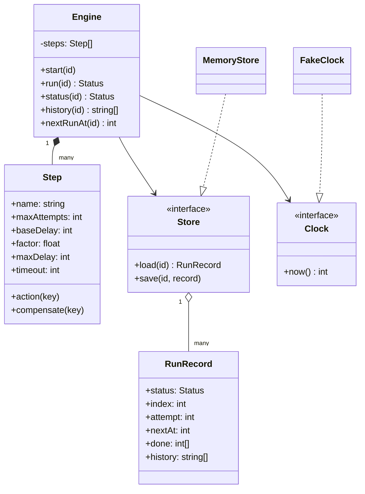
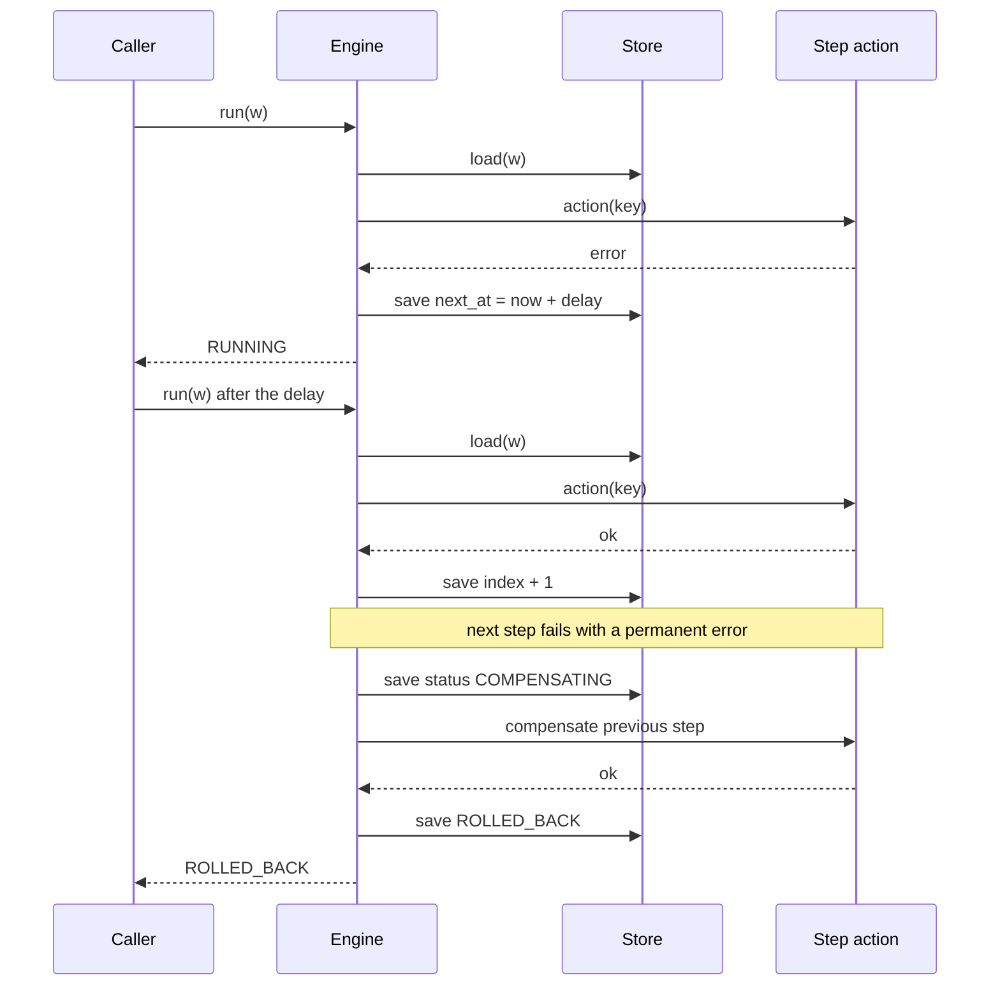

## In one minute
- A workflow engine is a durable state machine for a multi-step business process. The hard part is not running step one then step two; it is that the process, the machine and the network can each fail halfway, and the engine must still end in a state you can explain.
- Persist progress after every attempt, in a store the engine does not own, so a restarted engine picks up exactly where the last one stopped. Memory is a cache of the record, never the record.
- Retries need a policy (attempts, exponential delay, a cap, jitter) and a rule for which failures are worth retrying. Retrying a permanent error only delays the bad news.
- A saga replaces a distributed transaction: when a step fails for good, run the undo action of every completed step in reverse order, and treat each undo as a retried, idempotent step in its own right.
- The shape is **multi-step consistency** with **partial failure** and **duplicates**. It reappears in order checkout (reserve, charge, ship), cloud provisioning (network, disk, VM) and AI agent runs (plan, call tools, write results).

## Requirements

Functional:
- A workflow is an ordered list of steps. Each step has an action, an optional compensation (undo), a retry policy and an optional timeout.
- `start(id)` creates a run; `run(id)` performs whatever attempts are due and returns the run's status.
- A failed attempt is retried after an exponentially growing, capped, optionally jittered delay, up to a maximum number of attempts. A step may fail permanently, which skips the remaining retries.
- A step that exceeds its timeout counts as failed, and its late result is ignored.
- When a step fails for good, the engine compensates completed steps in reverse order and ends in a terminal status.
- Progress is saved to a store after every attempt. A new engine over the same store resumes the run without redoing finished steps.

Non-functional:
- Deterministic and testable: time and randomness are injected, and the engine never sleeps.
- Every action receives a stable idempotency key, because delivery is at least once.
- Every run ends in `COMPLETED`, `ROLLED_BACK` or `COMPENSATION_FAILED`, and the history says why.

Out of scope: parallel branches, timers and signals, sub-workflows, versioning of running definitions, and a real database. Mention them in Extensibility.

## Entities and relationships

- **Step** is a value: a name, an `action`, an optional `compensate`, and the policy knobs `max_attempts`, `base_delay`, `factor`, `max_delay` and `timeout`. Resist a subclass per step type. What differs between steps is the function they call, so a function-valued field carries it.
- **Engine** owns the definition (the ordered steps), the clock, the random source and a store. It holds no run state in its fields, which is what makes a restart safe.
- **Run record** is the persisted state of one workflow id: `status`, `index` of the next step, `attempt` count for the current step, `next_at` (when the next attempt is due), the `done` stack of completed step indices and a `history` of outcomes. It is plain data that serialises to JSON.
- **Store** has `load(id)` and `save(id, record)`. In production it is a table row or a document; here it is in memory. The engine treats it as the single source of truth.
- **Clock** supplies integer milliseconds. **Rng** supplies a fraction used for jitter.

The status field is the state machine. `RUNNING` moves to `COMPLETED` when the last step succeeds, or to `COMPENSATING` when a step fails for good. `COMPENSATING` moves to `ROLLED_BACK` when the `done` stack is empty, or to `COMPENSATION_FAILED` when an undo exhausts its attempts. Three states are terminal, and nothing leaves them. Within `RUNNING`, a failed attempt does not change status; it moves `next_at` into the future.

The engine is a composition: it owns its steps, and it uses the store, clock and rng through narrow interfaces, so each can be replaced by a fake.

## Class diagram



## Key flows

One call to `run` loops: load the record, stop if it is terminal or not yet due, otherwise perform a single attempt, save, and repeat. The sequence below shows a step that fails once, then succeeds after its backoff, followed by a later step that fails permanently and triggers compensation.



Note that `run` never sleeps. A waiting run just returns `RUNNING` with a `next_at`, and something else (a scheduler, a timer wheel, a test) calls it again. That separation is the reason the engine is testable.

## Design patterns used and why

- **State** for the run lifecycle, kept light: a status enum with guarded transitions inside one method. A class per state would spread six lines of logic across four files.
- **Strategy** for the retry policy. In the practice it is five fields on `Step`; in a larger engine it becomes an object (fixed, exponential, decorrelated jitter) behind one `delay(attempt)` method. Delay and "is this error retryable" are the two things teams tune.
- **Memento** for the run record: a snapshot of everything needed to resume, saved after each attempt. It is the same idea as a database checkpoint.
- **Command** for compensation. Each step pairs a do with an undo, and the `done` stack is a command history that unwinds in reverse. See the [saga pattern](https://microservices.io/patterns/data/saga.html) for the distributed version.
- **Dependency injection** for the clock, rng and store. The test suite runs an hour of retries in microseconds because of it.

## Concurrency and edge cases

- **Two engines, one run.** After a restart or a rolling deploy, two workers may both load the same record and both run the next attempt. Give each record a version and save with compare-and-set (`UPDATE ... WHERE version = $v`), or lease the run to one worker. Without it, an action runs twice concurrently.
- **Crash between action and save.** The action's effect happened, but the record still says it is pending. On resume the engine runs it again. That is at-least-once, and it is why every action gets a stable key (`workflow id : step name`) that the downstream service uses to deduplicate. The AWS Builders' Library puts it plainly: an API with side effects is not safe to retry unless it is idempotent ([Amazon Builders' Library](https://aws.amazon.com/builders-library/timeouts-retries-and-backoff-with-jitter/)).
- **Timeouts do not cancel.** A timeout means the engine stopped waiting, not that the action stopped. The late call may still succeed, so a timed-out step's retry must be as idempotent as any other. In this design the late result is discarded and the attempt counts as failed.
- **Permanent versus transient.** Retrying "insufficient funds" three times wastes time and, for a side-effecting call, risks harm. Let actions signal permanent failure explicitly. Temporal makes the same split with non-retryable error types in the retry policy ([Temporal docs](https://docs.temporal.io/encyclopedia/retry-policies)).
- **Compensation can fail.** An undo is a call to another system and can time out too. Retry it with the same policy. When it still fails, stop in `COMPENSATION_FAILED` and alert a human; silently skipping an undo leaves the world half-changed with no record. Azure's guidance adds that compensations should be idempotent commands because they may run more than once ([Azure Architecture Center](https://learn.microsoft.com/en-us/azure/architecture/patterns/compensating-transaction)).
- **The failed step itself.** A step that fails is not in `done`, so it is not undone. If it can half-succeed, its action must clean up after itself.
- **Clocks.** `next_at` is a wall-clock timestamp saved in the store, so it must come from a clock all workers agree on within the smallest delay. Durations inside one attempt (the timeout) should use a monotonic reading where the platform has one.

## In the wild
- **AWS, 2011: the EBS re-mirroring storm.** A network change cut Elastic Block Store nodes off from their replicas. When connectivity returned, the nodes all searched for free space to re-mirror at once, exhausted the cluster's capacity, and, by AWS's own account, did not back off aggressively enough when they could not find space, so the searching itself made the shortage worse. About 13% of volumes in the zone were stuck at the peak, and recovery took days. AWS changed the retry logic to back off harder and reconnect to the previous replicas first ([AWS post-event summary](https://aws.amazon.com/message/65648/)).
- **Uber, 2023: Cadence after six years.** Uber's open-source workflow engine handled more than 12 billion executions and 270 billion actions a month for over 1,000 services. Its feature list is this lesson's scope at scale: automatic retries, region failover, and resets that rewind an execution to an earlier point after a bad deploy ([Uber Engineering](https://www.uber.com/en/blog/announcing-cadence/)).
- **Jepsen on TiDB, 2019: automatic retries broke transactions.** Jepsen found read skew and lost updates in TiDB 2.1.7 because two automatic retry paths re-applied writes from conflicting transactions, with one path returning reads from the aborted attempt (a set test lost 64 of 378 inserts). TiDB 3.0.0-rc.2 turned automatic retries off by default. A retry that is not idempotent is a second write ([Jepsen](https://jepsen.io/analyses/tidb-2.1.7)).

## Down the stack

### Layer 1: The contract
`run(id)` returns the status after performing every attempt due at the current clock time. It never performs an attempt before `next_at`. For a step with `maxAttempts = n`, the action is called at most n times in one forward pass, at least once per resume in the worst case, and never after the step has succeeded and been saved. If a step fails for good, undo actions run in reverse order of completion, each at most `maxAttempts` times, and the failed step itself is not undone. A terminal status is final. Each attempt appends exactly one `name:outcome:n` entry to the history, so the audit trail matches the calls made.

### Layer 2: The mechanism
The delay after the nth failure is `min(max_delay, base * factor^(n-1))`, multiplied by a random fraction when jitter is on. AWS's analysis of contention found that exponential backoff alone still clusters retries and that adding jitter spreads them and reduces total work ([AWS Architecture Blog](https://aws.amazon.com/blogs/architecture/exponential-backoff-and-jitter/)). Real engines expose the same four knobs. Temporal defaults to a 1 second initial interval, a coefficient of 2.0, a cap of 100 times the initial interval, and unlimited attempts ([Temporal docs](https://docs.temporal.io/encyclopedia/retry-policies)). AWS Step Functions defaults to `IntervalSeconds` 1, `MaxAttempts` 3 and `BackoffRate` 2.0, and its `JitterStrategy` defaults to `NONE` ([Step Functions docs](https://docs.aws.amazon.com/step-functions/latest/dg/concepts-error-handling.html)). A timeout in Step Functions is itself an error name, `States.Timeout`, which a Retry block can match.

Where this lesson stores a record and rewrites it, Temporal and Cadence store an append-only event history and rebuild state by replaying workflow code against it, which forces the code to be deterministic. Temporal caps one execution at 51,200 events and offers Continue-As-New to start a fresh history ([Temporal docs](https://docs.temporal.io/workflow-execution/event)). The record design is simpler; the log gives audit and rewind. The saga idea itself is older: Garcia-Molina and Salem proposed splitting a long transaction into sub-transactions, each with a compensating one, in 1987 ([Sagas, SIGMOD 1987](https://www.cs.cornell.edu/andru/cs711/2002fa/reading/sagas.pdf)).

### Layer 3: The machine
A save is the expensive operation. On Postgres a commit waits for the write-ahead log `fsync`, roughly 0.1 to 1 ms on NVMe and several milliseconds on network storage, so a five-step workflow with no failures costs five commits, a few milliseconds of engine overhead beside steps that make network calls of 10 to 500 ms. Saving after every attempt is therefore cheap relative to the work and buys exactness at restart. A record of this shape is a few hundred bytes of JSON, so 10 million active runs is a few gigabytes. The scheduling side is the costlier part: finding runs whose `next_at` has passed needs an index on `(status, next_at)` and a poller, or a delay queue, so due runs are found in O(log n) instead of a table scan. The poller must tolerate the same row being claimed twice, which returns to compare-and-set.

### Why it's built this way
1. Business processes touch several systems that cannot share one transaction, so the engine owns the "what happened so far" record and compensation replaces rollback.
2. Processes and machines crash mid-step, so state is saved after every attempt to a store outside the process.
3. A crash between an effect and its save cannot be eliminated, so delivery is at-least-once and steps carry idempotency keys.
4. Failures are often correlated overload, so retries use capped exponential delay with jitter, and permanent errors skip retries.
5. Waiting must not tie up a thread, so the engine records `next_at` and returns, and a clock and rng injected from outside keep all of it testable.

## Extensibility

- **Parallel branches:** replace `index` with a set of ready steps and a dependency graph. `done` stays a stack of completions for reverse compensation, ordered by completion time.
- **Timers and human approval:** a step that returns "wait until T" or "wait for signal X" writes `next_at` or a pending-signal field. The scheduler wakes the run; the engine is unchanged.
- **Versioning:** store the definition version on the record at `start`, and keep old definitions loadable until their runs finish. Changing step order under a live run is the classic way to corrupt one.

## Leadership lens

- Build first: the persisted record, the retry timing and the reverse-order compensation, with the fake clock tests. Dashboards and a designer UI can wait; a run that loses its place cannot be repaired later.
- Ask in review: what makes each action idempotent; what happens on a crash between an effect and the save; who is paged when a run reaches `COMPENSATION_FAILED`; how a definition changes while runs are live.
- Operational cost: a stuck-run view (status, step, attempts, next_at, last error) and a way to retry, skip or cancel one run will save more hours than any feature. Buy an engine like Temporal, Step Functions or Cadence unless your needs are small; build your own only for narrow, in-process cases.
- Ownership: the platform team owns the engine and its guarantees; each product team owns its steps and, critically, their compensations.

## Check yourself
1. A worker crashes after the payment step charged the card but before it saved progress. What happens on restart, and what prevents a double charge?
   **Answer:** The record still says the payment step is pending, so the engine runs it again (at-least-once). The action sends a stable idempotency key derived from the workflow id and step name, and the payment service returns the first result for a repeated key.
2. Why does the engine record `next_at` and return instead of sleeping for the backoff?
   **Answer:** Sleeping holds a thread and is lost on crash. A saved `next_at` survives restarts, frees the worker, and lets tests drive time with a fake clock.
3. Why add jitter to exponential backoff, and what does it cost?
   **Answer:** Without it, many failed runs retry at the same instants and re-create the overload. Jitter spreads them out. The cost is a less predictable individual delay and harder exact-timing tests, solved by an injected rng.
4. Step 4 of 5 fails permanently. Which compensations run, in which order, and is step 4's undo among them?
   **Answer:** Steps 3, 2, 1 in that order, skipping any step without a compensation. Step 4 never completed, so it is not in the done stack; if it can leave partial effects, its own action must clean up or tolerate retries.

## Practice
**Task:** Implement `Engine`. `start(id)` saves a `RUNNING` record due now and raises if the id exists. `run(id)` repeatedly loads the record and, while it is not terminal and `next_at <= clock.now()`, performs one attempt and saves. A forward attempt calls `action(id + ":" + step.name)`. On success the step joins the `done` stack and the next step starts at once; after the last step the status is `COMPLETED`. On failure after the nth try, if the error is `PermanentError` or `n >= max_attempts`, switch to `COMPENSATING` (or straight to `ROLLED_BACK` if nothing is done); otherwise set `next_at = now + int(min(max_delay, base_delay * factor^(n-1)) * rng())`. A successful action that took longer than `timeout` ms by the clock counts as outcome `timeout` and is handled like a failure. Compensating pops the `done` stack, calls `compensate` (skipping steps without one) with the same retry policy, ends in `ROLLED_BACK`, and ends in `COMPENSATION_FAILED` if an undo exhausts its attempts. Append `name:outcome:n` (or `undo name:outcome:n`) to the history for each call.

```python starter
import json

RUNNING = "RUNNING"
COMPLETED = "COMPLETED"
COMPENSATING = "COMPENSATING"
ROLLED_BACK = "ROLLED_BACK"
COMPENSATION_FAILED = "COMPENSATION_FAILED"
TERMINAL = (COMPLETED, ROLLED_BACK, COMPENSATION_FAILED)


class PermanentError(Exception):
    """Raise from an action to skip the remaining retries."""


class MemoryStore:
    def __init__(self):
        self._rows = {}

    def load(self, wid):
        row = self._rows.get(wid)
        return None if row is None else json.loads(row)

    def save(self, wid, record):
        self._rows[wid] = json.dumps(record)


class Step:
    def __init__(self, name, action, compensate=None, max_attempts=3,
                 base_delay=100, factor=2, max_delay=10000, timeout=None):
        self.name = name
        self.action = action
        self.compensate = compensate
        self.max_attempts = max_attempts
        self.base_delay = base_delay
        self.factor = factor
        self.max_delay = max_delay
        self.timeout = timeout


class Engine:
    def __init__(self, steps, store, clock, rng=None):
        self._steps = steps
        self._store = store
        self._clock = clock
        self._rng = rng or (lambda: 1.0)

    def start(self, wid):
        # TODO: save a RUNNING record due now; ValueError if wid exists
        raise NotImplementedError

    def run(self, wid):
        # TODO: perform every attempt that is due now, persist after each, return the status
        raise NotImplementedError

    def status(self, wid):
        raise NotImplementedError

    def history(self, wid):
        raise NotImplementedError

    def next_run_at(self, wid):
        raise NotImplementedError
```

```python tests
class FakeClock:
    def __init__(self):
        self.t = 0

    def now(self):
        return self.t


class Recorder:
    """Builds actions that log calls and fail on a script."""

    def __init__(self):
        self.calls = []
        self.fail_counts = {}

    def act(self, name, fails=0, permanent=False, clock=None, takes=0):
        self.fail_counts[name] = fails

        def fn(key):
            self.calls.append(name)
            if clock is not None:
                clock.t += takes
            if self.fail_counts[name] > 0:
                self.fail_counts[name] -= 1
                raise (PermanentError if permanent else RuntimeError)(name)
        return fn


def test_happy_path_runs_steps_in_order():
    clock, rec = FakeClock(), Recorder()
    steps = [Step(n, rec.act(n)) for n in "ABC"]
    eng = Engine(steps, MemoryStore(), clock)
    eng.start("w1")
    assert eng.run("w1") == COMPLETED
    assert rec.calls == ["A", "B", "C"]
    assert eng.history("w1") == ["A:ok:1", "B:ok:1", "C:ok:1"]


def test_retry_waits_for_backoff():
    clock, rec = FakeClock(), Recorder()
    steps = [Step("A", rec.act("A")), Step("B", rec.act("B", fails=2), base_delay=100)]
    eng = Engine(steps, MemoryStore(), clock)
    eng.start("w")
    assert eng.run("w") == RUNNING
    assert eng.next_run_at("w") == 100, "first retry after base delay"
    clock.t = 50
    eng.run("w")
    assert rec.calls == ["A", "B"], "not due yet, nothing runs"
    clock.t = 100
    eng.run("w")
    assert eng.next_run_at("w") == 300, "second retry doubles the delay"
    clock.t = 300
    assert eng.run("w") == COMPLETED
    assert eng.history("w") == ["A:ok:1", "B:fail:1", "B:fail:2", "B:ok:3"]


def test_delay_is_capped_and_jittered():
    clock, rec = FakeClock(), Recorder()
    step = Step("A", rec.act("A", fails=99), max_attempts=4, base_delay=100,
                factor=10, max_delay=500)
    eng = Engine([step], MemoryStore(), clock)
    eng.start("w")
    seen = []
    for _ in range(3):
        eng.run("w")
        seen.append(eng.next_run_at("w") - clock.t)
        clock.t = eng.next_run_at("w")
    assert seen == [100, 500, 500], "100, then 1000 capped to 500"
    half = Engine([Step("A", rec.act("A", fails=1), base_delay=100)], MemoryStore(),
                  FakeClock(), rng=lambda: 0.5)
    half.start("j")
    half.run("j")
    assert half.next_run_at("j") == 50, "jitter scales the delay"


def test_timeout_counts_as_failure():
    clock, rec = FakeClock(), Recorder()
    slow = rec.act("A", clock=clock, takes=500)
    eng = Engine([Step("A", slow, timeout=300, max_attempts=2, base_delay=10)],
                 MemoryStore(), clock)
    eng.start("w")
    eng.run("w")
    assert eng.history("w") == ["A:timeout:1"]
    clock.t = 10000
    assert eng.run("w") == ROLLED_BACK, "second timeout exhausts attempts"
    assert eng.history("w") == ["A:timeout:1", "A:timeout:2"]


def test_permanent_error_compensates_in_reverse():
    clock, rec = FakeClock(), Recorder()
    undone = []
    steps = [
        Step("A", rec.act("A"), compensate=lambda k: undone.append("A")),
        Step("B", rec.act("B"), compensate=None),
        Step("C", rec.act("C"), compensate=lambda k: undone.append("C")),
        Step("D", rec.act("D", fails=1, permanent=True), compensate=lambda k: undone.append("D")),
    ]
    eng = Engine(steps, MemoryStore(), clock)
    eng.start("w")
    assert eng.run("w") == ROLLED_BACK
    assert undone == ["C", "A"], "reverse order, B has no undo, failed D is not undone"
    assert rec.calls.count("D") == 1, "permanent errors are not retried"
    assert eng.history("w")[-3:] == ["D:fail:1", "undo C:ok:1", "undo A:ok:1"]


def test_exhausted_retries_trigger_compensation():
    clock, rec = FakeClock(), Recorder()
    undone = []
    steps = [Step("A", rec.act("A"), compensate=lambda k: undone.append("A")),
             Step("B", rec.act("B", fails=9), max_attempts=2, base_delay=10)]
    eng = Engine(steps, MemoryStore(), clock)
    eng.start("w")
    assert eng.run("w") == RUNNING
    clock.t = 10
    assert eng.run("w") == ROLLED_BACK
    assert rec.calls == ["A", "B", "B"]
    assert undone == ["A"]


def test_resume_from_store_in_new_engine():
    clock, rec = FakeClock(), Recorder()
    store = MemoryStore()
    steps = [Step("A", rec.act("A")), Step("B", rec.act("B", fails=1), base_delay=100)]
    first = Engine(steps, store, clock)
    first.start("w")
    assert first.run("w") == RUNNING
    clock.t = 100
    second = Engine(steps, store, clock)
    assert second.run("w") == COMPLETED
    assert rec.calls == ["A", "B", "B"], "A is not re-run after the restart"


def test_failed_compensation_is_reported():
    clock, rec = FakeClock(), Recorder()

    def bad_undo(key):
        raise RuntimeError("cannot undo")

    steps = [Step("A", rec.act("A"), compensate=bad_undo, max_attempts=2, base_delay=5),
             Step("B", rec.act("B", fails=1, permanent=True))]
    eng = Engine(steps, MemoryStore(), clock)
    eng.start("w")
    eng.run("w")
    clock.t = 5
    assert eng.run("w") == COMPENSATION_FAILED
    assert eng.history("w")[-2:] == ["undo A:fail:1", "undo A:fail:2"]
```

```python solution
import json

RUNNING = "RUNNING"
COMPLETED = "COMPLETED"
COMPENSATING = "COMPENSATING"
ROLLED_BACK = "ROLLED_BACK"
COMPENSATION_FAILED = "COMPENSATION_FAILED"
TERMINAL = (COMPLETED, ROLLED_BACK, COMPENSATION_FAILED)


class PermanentError(Exception):
    """Raise from an action to skip the remaining retries."""


class MemoryStore:
    def __init__(self):
        self._rows = {}

    def load(self, wid):
        row = self._rows.get(wid)
        return None if row is None else json.loads(row)

    def save(self, wid, record):
        self._rows[wid] = json.dumps(record)


class Step:
    def __init__(self, name, action, compensate=None, max_attempts=3,
                 base_delay=100, factor=2, max_delay=10000, timeout=None):
        self.name = name
        self.action = action
        self.compensate = compensate
        self.max_attempts = max_attempts
        self.base_delay = base_delay
        self.factor = factor
        self.max_delay = max_delay
        self.timeout = timeout


class Engine:
    def __init__(self, steps, store, clock, rng=None):
        self._steps = steps
        self._store = store
        self._clock = clock
        self._rng = rng or (lambda: 1.0)

    def start(self, wid):
        if self._store.load(wid) is not None:
            raise ValueError("workflow exists: " + wid)
        self._store.save(wid, {"status": RUNNING, "index": 0, "attempt": 0,
                               "next_at": self._clock.now(), "done": [], "history": []})

    def status(self, wid):
        return self._load(wid)["status"]

    def history(self, wid):
        return list(self._load(wid)["history"])

    def next_run_at(self, wid):
        return self._load(wid)["next_at"]

    def run(self, wid):
        while True:
            rec = self._load(wid)
            if rec["status"] in TERMINAL or rec["next_at"] > self._clock.now():
                return rec["status"]
            self._attempt(wid, rec)

    def _load(self, wid):
        rec = self._store.load(wid)
        if rec is None:
            raise ValueError("unknown workflow: " + wid)
        return rec

    def _delay(self, step, failures):
        cap = min(step.max_delay, step.base_delay * step.factor ** (failures - 1))
        return int(cap * self._rng())

    def _attempt(self, wid, rec):
        undoing = rec["status"] == COMPENSATING
        if undoing:
            step = self._steps[rec["done"][-1]]
            fn, label = step.compensate, "undo " + step.name
            if fn is None:
                rec["done"].pop()
                self._finish_undo_if_empty(rec)
                self._store.save(wid, rec)
                return
        else:
            step = self._steps[rec["index"]]
            fn, label = step.action, step.name
        n = rec["attempt"] + 1
        started = self._clock.now()
        outcome = "ok"
        permanent = False
        try:
            fn(wid + ":" + step.name)
        except PermanentError:
            outcome, permanent = "fail", True
        except Exception:
            outcome = "fail"
        if outcome == "ok" and step.timeout is not None \
                and self._clock.now() - started > step.timeout:
            outcome = "timeout"
        rec["history"].append("%s:%s:%d" % (label, outcome, n))
        now = self._clock.now()
        if outcome == "ok":
            rec["attempt"], rec["next_at"] = 0, now
            if undoing:
                rec["done"].pop()
                self._finish_undo_if_empty(rec)
            else:
                rec["done"].append(rec["index"])
                rec["index"] += 1
                if rec["index"] == len(self._steps):
                    rec["status"] = COMPLETED
        elif permanent or n >= step.max_attempts:
            rec["attempt"], rec["next_at"] = 0, now
            rec["status"] = COMPENSATION_FAILED if undoing else COMPENSATING
            if not undoing:
                self._finish_undo_if_empty(rec)
        else:
            rec["attempt"] = n
            rec["next_at"] = now + self._delay(step, n)
        self._store.save(wid, rec)

    def _finish_undo_if_empty(self, rec):
        if not rec["done"]:
            rec["status"] = ROLLED_BACK
```

```typescript starter
export type Status = "RUNNING" | "COMPLETED" | "COMPENSATING" | "ROLLED_BACK" | "COMPENSATION_FAILED";

export interface Clock { now(): number }

export class PermanentError extends Error {}

export interface Step {
  name: string;
  action: (key: string) => void;
  compensate?: (key: string) => void;
  maxAttempts: number;
  baseDelay: number;
  factor: number;
  maxDelay: number;
  timeout?: number;
}

export function step(name: string, action: (key: string) => void, opts: Partial<Step> = {}): Step {
  return { maxAttempts: 3, baseDelay: 100, factor: 2, maxDelay: 10000, ...opts, name, action };
}

interface Row {
  status: Status;
  index: number;
  attempt: number;
  nextAt: number;
  done: number[];
  history: string[];
}

export class MemoryStore {
  private rows = new Map<string, string>();
  load(id: string): Row | null {
    const row = this.rows.get(id);
    return row === undefined ? null : (JSON.parse(row) as Row);
  }
  save(id: string, rec: Row): void {
    this.rows.set(id, JSON.stringify(rec));
  }
}

export class Engine {
  constructor(private steps: Step[], private store: MemoryStore, private clock: Clock,
              private rng: () => number = () => 1) {}

  // TODO: save a RUNNING row due now; throw if the id exists
  start(id: string): void { throw new Error("TODO"); }

  // TODO: perform every attempt that is due now, persist after each, return the status
  run(id: string): Status { throw new Error("TODO"); }

  status(id: string): Status { throw new Error("TODO"); }
  history(id: string): string[] { throw new Error("TODO"); }
  nextRunAt(id: string): number { throw new Error("TODO"); }
}
```

```typescript tests
class FakeClock implements Clock {
  t = 0;
  now(): number { return this.t; }
}

class Recorder {
  calls: string[] = [];
  failCounts: { [name: string]: number } = {};
  act(name: string, fails = 0, permanent = false, clock?: FakeClock, takes = 0): (key: string) => void {
    this.failCounts[name] = fails;
    return () => {
      this.calls.push(name);
      if (clock) clock.t += takes;
      if (this.failCounts[name] > 0) {
        this.failCounts[name]--;
        throw permanent ? new PermanentError(name) : new Error(name);
      }
    };
  }
}

test("happy path runs steps in order", () => {
  const clock = new FakeClock(), rec = new Recorder();
  const eng = new Engine(["A", "B", "C"].map(n => step(n, rec.act(n))), new MemoryStore(), clock);
  eng.start("w1");
  assertEqual(eng.run("w1"), "COMPLETED");
  assertEqual(rec.calls, ["A", "B", "C"]);
  assertEqual(eng.history("w1"), ["A:ok:1", "B:ok:1", "C:ok:1"]);
});

test("retry waits for backoff", () => {
  const clock = new FakeClock(), rec = new Recorder();
  const eng = new Engine([step("A", rec.act("A")), step("B", rec.act("B", 2), { baseDelay: 100 })],
    new MemoryStore(), clock);
  eng.start("w");
  assertEqual(eng.run("w"), "RUNNING");
  assertEqual(eng.nextRunAt("w"), 100, "first retry after base delay");
  clock.t = 50;
  eng.run("w");
  assertEqual(rec.calls, ["A", "B"], "not due yet, nothing runs");
  clock.t = 100;
  eng.run("w");
  assertEqual(eng.nextRunAt("w"), 300, "second retry doubles the delay");
  clock.t = 300;
  assertEqual(eng.run("w"), "COMPLETED");
  assertEqual(eng.history("w"), ["A:ok:1", "B:fail:1", "B:fail:2", "B:ok:3"]);
});

test("delay is capped and jittered", () => {
  const clock = new FakeClock(), rec = new Recorder();
  const s = step("A", rec.act("A", 99), { maxAttempts: 4, baseDelay: 100, factor: 10, maxDelay: 500 });
  const eng = new Engine([s], new MemoryStore(), clock);
  eng.start("w");
  const seen: number[] = [];
  for (let i = 0; i < 3; i++) {
    eng.run("w");
    seen.push(eng.nextRunAt("w") - clock.t);
    clock.t = eng.nextRunAt("w");
  }
  assertEqual(seen, [100, 500, 500], "100, then 1000 capped to 500");
  const half = new Engine([step("A", rec.act("A", 1), { baseDelay: 100 })], new MemoryStore(), new FakeClock(), () => 0.5);
  half.start("j");
  half.run("j");
  assertEqual(half.nextRunAt("j"), 50, "jitter scales the delay");
});

test("timeout counts as failure", () => {
  const clock = new FakeClock(), rec = new Recorder();
  const eng = new Engine([step("A", rec.act("A", 0, false, clock, 500), { timeout: 300, maxAttempts: 2, baseDelay: 10 })],
    new MemoryStore(), clock);
  eng.start("w");
  eng.run("w");
  assertEqual(eng.history("w"), ["A:timeout:1"]);
  clock.t = 10000;
  assertEqual(eng.run("w"), "ROLLED_BACK", "second timeout exhausts attempts");
  assertEqual(eng.history("w"), ["A:timeout:1", "A:timeout:2"]);
});

test("permanent error compensates in reverse", () => {
  const clock = new FakeClock(), rec = new Recorder();
  const undone: string[] = [];
  const eng = new Engine([
    step("A", rec.act("A"), { compensate: () => { undone.push("A"); } }),
    step("B", rec.act("B")),
    step("C", rec.act("C"), { compensate: () => { undone.push("C"); } }),
    step("D", rec.act("D", 1, true), { compensate: () => { undone.push("D"); } }),
  ], new MemoryStore(), clock);
  eng.start("w");
  assertEqual(eng.run("w"), "ROLLED_BACK");
  assertEqual(undone, ["C", "A"], "reverse order, B has no undo, failed D is not undone");
  assertEqual(rec.calls.filter(c => c === "D").length, 1, "permanent errors are not retried");
  assertEqual(eng.history("w").slice(-3), ["D:fail:1", "undo C:ok:1", "undo A:ok:1"]);
});

test("exhausted retries trigger compensation", () => {
  const clock = new FakeClock(), rec = new Recorder();
  const undone: string[] = [];
  const eng = new Engine([
    step("A", rec.act("A"), { compensate: () => { undone.push("A"); } }),
    step("B", rec.act("B", 9), { maxAttempts: 2, baseDelay: 10 }),
  ], new MemoryStore(), clock);
  eng.start("w");
  assertEqual(eng.run("w"), "RUNNING");
  clock.t = 10;
  assertEqual(eng.run("w"), "ROLLED_BACK");
  assertEqual(rec.calls, ["A", "B", "B"]);
  assertEqual(undone, ["A"]);
});

test("resume from store in new engine", () => {
  const clock = new FakeClock(), rec = new Recorder();
  const store = new MemoryStore();
  const steps = [step("A", rec.act("A")), step("B", rec.act("B", 1), { baseDelay: 100 })];
  const first = new Engine(steps, store, clock);
  first.start("w");
  assertEqual(first.run("w"), "RUNNING");
  clock.t = 100;
  const second = new Engine(steps, store, clock);
  assertEqual(second.run("w"), "COMPLETED");
  assertEqual(rec.calls, ["A", "B", "B"], "A is not re-run after the restart");
});

test("failed compensation is reported", () => {
  const clock = new FakeClock(), rec = new Recorder();
  const badUndo = () => { throw new Error("cannot undo"); };
  const eng = new Engine([
    step("A", rec.act("A"), { compensate: badUndo, maxAttempts: 2, baseDelay: 5 }),
    step("B", rec.act("B", 1, true)),
  ], new MemoryStore(), clock);
  eng.start("w");
  eng.run("w");
  clock.t = 5;
  assertEqual(eng.run("w"), "COMPENSATION_FAILED");
  assertEqual(eng.history("w").slice(-2), ["undo A:fail:1", "undo A:fail:2"]);
});
```

```typescript solution
export type Status = "RUNNING" | "COMPLETED" | "COMPENSATING" | "ROLLED_BACK" | "COMPENSATION_FAILED";

export interface Clock { now(): number }

export class PermanentError extends Error {}

export interface Step {
  name: string;
  action: (key: string) => void;
  compensate?: (key: string) => void;
  maxAttempts: number;
  baseDelay: number;
  factor: number;
  maxDelay: number;
  timeout?: number;
}

export function step(name: string, action: (key: string) => void, opts: Partial<Step> = {}): Step {
  return { maxAttempts: 3, baseDelay: 100, factor: 2, maxDelay: 10000, ...opts, name, action };
}

interface Row {
  status: Status;
  index: number;
  attempt: number;
  nextAt: number;
  done: number[];
  history: string[];
}

export class MemoryStore {
  private rows = new Map<string, string>();
  load(id: string): Row | null {
    const row = this.rows.get(id);
    return row === undefined ? null : (JSON.parse(row) as Row);
  }
  save(id: string, rec: Row): void {
    this.rows.set(id, JSON.stringify(rec));
  }
}

export class Engine {
  constructor(private steps: Step[], private store: MemoryStore, private clock: Clock,
              private rng: () => number = () => 1) {}

  start(id: string): void {
    if (this.store.load(id) !== null) throw new Error("workflow exists: " + id);
    this.store.save(id, { status: "RUNNING", index: 0, attempt: 0, nextAt: this.clock.now(), done: [], history: [] });
  }

  status(id: string): Status { return this.get(id).status; }
  history(id: string): string[] { return [...this.get(id).history]; }
  nextRunAt(id: string): number { return this.get(id).nextAt; }

  run(id: string): Status {
    for (;;) {
      const rec = this.get(id);
      const terminal = rec.status === "COMPLETED" || rec.status === "ROLLED_BACK" || rec.status === "COMPENSATION_FAILED";
      if (terminal || rec.nextAt > this.clock.now()) return rec.status;
      this.attempt(id, rec);
    }
  }

  private get(id: string): Row {
    const rec = this.store.load(id);
    if (rec === null) throw new Error("unknown workflow: " + id);
    return rec;
  }

  private delay(s: Step, failures: number): number {
    const cap = Math.min(s.maxDelay, s.baseDelay * Math.pow(s.factor, failures - 1));
    return Math.floor(cap * this.rng());
  }

  private attempt(id: string, rec: Row): void {
    const undoing = rec.status === "COMPENSATING";
    const s = this.steps[undoing ? rec.done[rec.done.length - 1] : rec.index];
    const fn = undoing ? s.compensate : s.action;
    const label = undoing ? "undo " + s.name : s.name;
    if (fn === undefined) {
      rec.done.pop();
      if (rec.done.length === 0) rec.status = "ROLLED_BACK";
      this.store.save(id, rec);
      return;
    }
    const n = rec.attempt + 1;
    const started = this.clock.now();
    let outcome = "ok";
    let permanent = false;
    try {
      fn(id + ":" + s.name);
    } catch (e) {
      outcome = "fail";
      permanent = e instanceof PermanentError;
    }
    if (outcome === "ok" && s.timeout !== undefined && this.clock.now() - started > s.timeout) outcome = "timeout";
    rec.history.push(label + ":" + outcome + ":" + n);
    const now = this.clock.now();
    if (outcome === "ok") {
      rec.attempt = 0;
      rec.nextAt = now;
      if (undoing) {
        rec.done.pop();
        if (rec.done.length === 0) rec.status = "ROLLED_BACK";
      } else {
        rec.done.push(rec.index);
        rec.index += 1;
        if (rec.index === this.steps.length) rec.status = "COMPLETED";
      }
    } else if (permanent || n >= s.maxAttempts) {
      rec.attempt = 0;
      rec.nextAt = now;
      if (undoing) {
        rec.status = "COMPENSATION_FAILED";
      } else {
        rec.status = rec.done.length === 0 ? "ROLLED_BACK" : "COMPENSATING";
      }
    } else {
      rec.attempt = n;
      rec.nextAt = now + this.delay(s, n);
    }
    this.store.save(id, rec);
  }
}
```

```go starter
package practice

import (
	"encoding/json"
	"errors"
)

type Status string

const (
	Running            Status = "RUNNING"
	Completed          Status = "COMPLETED"
	Compensating       Status = "COMPENSATING"
	RolledBack         Status = "ROLLED_BACK"
	CompensationFailed Status = "COMPENSATION_FAILED"
)

// ErrPermanent marks a failure that must not be retried; wrap it with %w.
var ErrPermanent = errors.New("permanent failure")

var ErrUnknownWorkflow = errors.New("unknown workflow")
var ErrExists = errors.New("workflow exists")

type Clock interface{ Now() int64 }

// Step zero values mean defaults: 3 attempts, 100 ms base delay, factor 2, 10000 ms cap.
type Step struct {
	Name        string
	Action      func(key string) error
	Compensate  func(key string) error
	MaxAttempts int
	BaseDelay   int64
	Factor      float64
	MaxDelay    int64
	Timeout     int64 // 0 means no timeout
}

type Row struct {
	Status  Status   `json:"status"`
	Index   int      `json:"index"`
	Attempt int      `json:"attempt"`
	NextAt  int64    `json:"next_at"`
	Done    []int    `json:"done"`
	History []string `json:"history"`
}

type MemoryStore struct{ rows map[string][]byte }

func NewMemoryStore() *MemoryStore { return &MemoryStore{rows: map[string][]byte{}} }

func (m *MemoryStore) Load(id string) (*Row, bool) {
	b, ok := m.rows[id]
	if !ok {
		return nil, false
	}
	var r Row
	_ = json.Unmarshal(b, &r)
	return &r, true
}

func (m *MemoryStore) Save(id string, r *Row) {
	b, _ := json.Marshal(r)
	m.rows[id] = b
}

type Engine struct{}

func NewEngine(steps []Step, store *MemoryStore, clock Clock, rng func() float64) *Engine {
	return &Engine{}
}

// Start saves a RUNNING row due now; ErrExists if the id is taken.
func (e *Engine) Start(id string) error { panic("TODO") }

// Run performs every attempt that is due now, persisting after each, and returns the status.
func (e *Engine) Run(id string) (Status, error) { panic("TODO") }

func (e *Engine) Status(id string) (Status, error) { panic("TODO") }
func (e *Engine) History(id string) []string       { panic("TODO") }
func (e *Engine) NextRunAt(id string) int64        { panic("TODO") }
```

```go tests
package practice

import (
	"errors"
	"fmt"
	"reflect"
	"testing"
)

type fakeClock struct{ t int64 }

func (c *fakeClock) Now() int64 { return c.t }

type recorder struct {
	calls []string
	fails map[string]int
}

func newRecorder() *recorder { return &recorder{fails: map[string]int{}} }

func (r *recorder) act(name string, fails int, permanent bool, c *fakeClock, takes int64) func(string) error {
	r.fails[name] = fails
	return func(key string) error {
		r.calls = append(r.calls, name)
		if c != nil {
			c.t += takes
		}
		if r.fails[name] > 0 {
			r.fails[name]--
			if permanent {
				return fmt.Errorf("%w: %s", ErrPermanent, name)
			}
			return errors.New(name)
		}
		return nil
	}
}

func mustRun(t *testing.T, e *Engine, id string) Status {
	t.Helper()
	st, err := e.Run(id)
	if err != nil {
		t.Fatal(err)
	}
	return st
}

func mustStart(t *testing.T, e *Engine, id string) {
	t.Helper()
	if err := e.Start(id); err != nil {
		t.Fatal(err)
	}
}

func eq(t *testing.T, got, want interface{}, msg string) {
	t.Helper()
	if !reflect.DeepEqual(got, want) {
		t.Fatalf("%s: got %v want %v", msg, got, want)
	}
}

func TestHappyPathRunsStepsInOrder(t *testing.T) {
	c, rec := &fakeClock{}, newRecorder()
	steps := []Step{{Name: "A", Action: rec.act("A", 0, false, nil, 0)},
		{Name: "B", Action: rec.act("B", 0, false, nil, 0)},
		{Name: "C", Action: rec.act("C", 0, false, nil, 0)}}
	e := NewEngine(steps, NewMemoryStore(), c, nil)
	mustStart(t, e, "w1")
	eq(t, mustRun(t, e, "w1"), Completed, "status")
	eq(t, rec.calls, []string{"A", "B", "C"}, "calls")
	eq(t, e.History("w1"), []string{"A:ok:1", "B:ok:1", "C:ok:1"}, "history")
}

func TestRetryWaitsForBackoff(t *testing.T) {
	c, rec := &fakeClock{}, newRecorder()
	steps := []Step{{Name: "A", Action: rec.act("A", 0, false, nil, 0)},
		{Name: "B", Action: rec.act("B", 2, false, nil, 0), BaseDelay: 100}}
	e := NewEngine(steps, NewMemoryStore(), c, nil)
	mustStart(t, e, "w")
	eq(t, mustRun(t, e, "w"), Running, "after first failure")
	eq(t, e.NextRunAt("w"), int64(100), "first retry after base delay")
	c.t = 50
	mustRun(t, e, "w")
	eq(t, rec.calls, []string{"A", "B"}, "not due yet, nothing runs")
	c.t = 100
	mustRun(t, e, "w")
	eq(t, e.NextRunAt("w"), int64(300), "second retry doubles the delay")
	c.t = 300
	eq(t, mustRun(t, e, "w"), Completed, "final")
	eq(t, e.History("w"), []string{"A:ok:1", "B:fail:1", "B:fail:2", "B:ok:3"}, "history")
}

func TestDelayIsCappedAndJittered(t *testing.T) {
	c, rec := &fakeClock{}, newRecorder()
	s := Step{Name: "A", Action: rec.act("A", 99, false, nil, 0), MaxAttempts: 4, BaseDelay: 100,
		Factor: 10, MaxDelay: 500}
	e := NewEngine([]Step{s}, NewMemoryStore(), c, nil)
	mustStart(t, e, "w")
	var seen []int64
	for i := 0; i < 3; i++ {
		mustRun(t, e, "w")
		seen = append(seen, e.NextRunAt("w")-c.t)
		c.t = e.NextRunAt("w")
	}
	eq(t, seen, []int64{100, 500, 500}, "100, then 1000 capped to 500")
	half := NewEngine([]Step{{Name: "A", Action: rec.act("A", 1, false, nil, 0), BaseDelay: 100}},
		NewMemoryStore(), &fakeClock{}, func() float64 { return 0.5 })
	mustStart(t, half, "j")
	mustRun(t, half, "j")
	eq(t, half.NextRunAt("j"), int64(50), "jitter scales the delay")
}

func TestTimeoutCountsAsFailure(t *testing.T) {
	c, rec := &fakeClock{}, newRecorder()
	s := Step{Name: "A", Action: rec.act("A", 0, false, c, 500), Timeout: 300, MaxAttempts: 2, BaseDelay: 10}
	e := NewEngine([]Step{s}, NewMemoryStore(), c, nil)
	mustStart(t, e, "w")
	mustRun(t, e, "w")
	eq(t, e.History("w"), []string{"A:timeout:1"}, "first")
	c.t = 10000
	eq(t, mustRun(t, e, "w"), RolledBack, "second timeout exhausts attempts")
	eq(t, e.History("w"), []string{"A:timeout:1", "A:timeout:2"}, "history")
}

func TestPermanentErrorCompensatesInReverse(t *testing.T) {
	c, rec := &fakeClock{}, newRecorder()
	var undone []string
	undo := func(n string) func(string) error {
		return func(string) error { undone = append(undone, n); return nil }
	}
	steps := []Step{
		{Name: "A", Action: rec.act("A", 0, false, nil, 0), Compensate: undo("A")},
		{Name: "B", Action: rec.act("B", 0, false, nil, 0)},
		{Name: "C", Action: rec.act("C", 0, false, nil, 0), Compensate: undo("C")},
		{Name: "D", Action: rec.act("D", 1, true, nil, 0), Compensate: undo("D")},
	}
	e := NewEngine(steps, NewMemoryStore(), c, nil)
	mustStart(t, e, "w")
	eq(t, mustRun(t, e, "w"), RolledBack, "status")
	eq(t, undone, []string{"C", "A"}, "reverse order, B has no undo, failed D is not undone")
	d := 0
	for _, call := range rec.calls {
		if call == "D" {
			d++
		}
	}
	eq(t, d, 1, "permanent errors are not retried")
	h := e.History("w")
	eq(t, h[len(h)-3:], []string{"D:fail:1", "undo C:ok:1", "undo A:ok:1"}, "tail of history")
}

func TestExhaustedRetriesTriggerCompensation(t *testing.T) {
	c, rec := &fakeClock{}, newRecorder()
	var undone []string
	steps := []Step{
		{Name: "A", Action: rec.act("A", 0, false, nil, 0),
			Compensate: func(string) error { undone = append(undone, "A"); return nil }},
		{Name: "B", Action: rec.act("B", 9, false, nil, 0), MaxAttempts: 2, BaseDelay: 10},
	}
	e := NewEngine(steps, NewMemoryStore(), c, nil)
	mustStart(t, e, "w")
	eq(t, mustRun(t, e, "w"), Running, "waiting to retry")
	c.t = 10
	eq(t, mustRun(t, e, "w"), RolledBack, "after exhaustion")
	eq(t, rec.calls, []string{"A", "B", "B"}, "calls")
	eq(t, undone, []string{"A"}, "undone")
}

func TestResumeFromStoreInNewEngine(t *testing.T) {
	c, rec := &fakeClock{}, newRecorder()
	store := NewMemoryStore()
	steps := []Step{{Name: "A", Action: rec.act("A", 0, false, nil, 0)},
		{Name: "B", Action: rec.act("B", 1, false, nil, 0), BaseDelay: 100}}
	first := NewEngine(steps, store, c, nil)
	mustStart(t, first, "w")
	eq(t, mustRun(t, first, "w"), Running, "waiting")
	c.t = 100
	second := NewEngine(steps, store, c, nil)
	eq(t, mustRun(t, second, "w"), Completed, "resumed")
	eq(t, rec.calls, []string{"A", "B", "B"}, "A is not re-run after the restart")
}

func TestFailedCompensationIsReported(t *testing.T) {
	c, rec := &fakeClock{}, newRecorder()
	steps := []Step{
		{Name: "A", Action: rec.act("A", 0, false, nil, 0), MaxAttempts: 2, BaseDelay: 5,
			Compensate: func(string) error { return errors.New("cannot undo") }},
		{Name: "B", Action: rec.act("B", 1, true, nil, 0)},
	}
	e := NewEngine(steps, NewMemoryStore(), c, nil)
	mustStart(t, e, "w")
	mustRun(t, e, "w")
	c.t = 5
	eq(t, mustRun(t, e, "w"), CompensationFailed, "status")
	h := e.History("w")
	eq(t, h[len(h)-2:], []string{"undo A:fail:1", "undo A:fail:2"}, "tail")
}
```

```go solution
package practice

import (
	"encoding/json"
	"errors"
	"fmt"
	"math"
)

type Status string

const (
	Running            Status = "RUNNING"
	Completed          Status = "COMPLETED"
	Compensating       Status = "COMPENSATING"
	RolledBack         Status = "ROLLED_BACK"
	CompensationFailed Status = "COMPENSATION_FAILED"
)

// ErrPermanent marks a failure that must not be retried; wrap it with %w.
var ErrPermanent = errors.New("permanent failure")

var ErrUnknownWorkflow = errors.New("unknown workflow")
var ErrExists = errors.New("workflow exists")

type Clock interface{ Now() int64 }

// Step zero values mean defaults: 3 attempts, 100 ms base delay, factor 2, 10000 ms cap.
type Step struct {
	Name        string
	Action      func(key string) error
	Compensate  func(key string) error
	MaxAttempts int
	BaseDelay   int64
	Factor      float64
	MaxDelay    int64
	Timeout     int64 // 0 means no timeout
}

type Row struct {
	Status  Status   `json:"status"`
	Index   int      `json:"index"`
	Attempt int      `json:"attempt"`
	NextAt  int64    `json:"next_at"`
	Done    []int    `json:"done"`
	History []string `json:"history"`
}

type MemoryStore struct{ rows map[string][]byte }

func NewMemoryStore() *MemoryStore { return &MemoryStore{rows: map[string][]byte{}} }

func (m *MemoryStore) Load(id string) (*Row, bool) {
	b, ok := m.rows[id]
	if !ok {
		return nil, false
	}
	var r Row
	_ = json.Unmarshal(b, &r)
	return &r, true
}

func (m *MemoryStore) Save(id string, r *Row) {
	b, _ := json.Marshal(r)
	m.rows[id] = b
}

type Engine struct {
	steps []Step
	store *MemoryStore
	clock Clock
	rng   func() float64
}

func NewEngine(steps []Step, store *MemoryStore, clock Clock, rng func() float64) *Engine {
	if rng == nil {
		rng = func() float64 { return 1 }
	}
	s := make([]Step, len(steps))
	for i, st := range steps {
		if st.MaxAttempts == 0 {
			st.MaxAttempts = 3
		}
		if st.BaseDelay == 0 {
			st.BaseDelay = 100
		}
		if st.Factor == 0 {
			st.Factor = 2
		}
		if st.MaxDelay == 0 {
			st.MaxDelay = 10000
		}
		s[i] = st
	}
	return &Engine{steps: s, store: store, clock: clock, rng: rng}
}

func (e *Engine) Start(id string) error {
	if _, ok := e.store.Load(id); ok {
		return fmt.Errorf("%w: %s", ErrExists, id)
	}
	e.store.Save(id, &Row{Status: Running, NextAt: e.clock.Now(), Done: []int{}, History: []string{}})
	return nil
}

func (e *Engine) get(id string) (*Row, error) {
	r, ok := e.store.Load(id)
	if !ok {
		return nil, fmt.Errorf("%w: %s", ErrUnknownWorkflow, id)
	}
	return r, nil
}

func (e *Engine) Status(id string) (Status, error) {
	r, err := e.get(id)
	if err != nil {
		return "", err
	}
	return r.Status, nil
}

func (e *Engine) History(id string) []string {
	r, err := e.get(id)
	if err != nil {
		return nil
	}
	return r.History
}

func (e *Engine) NextRunAt(id string) int64 {
	r, err := e.get(id)
	if err != nil {
		return 0
	}
	return r.NextAt
}

// Run performs every attempt that is due now and returns the resulting status.
func (e *Engine) Run(id string) (Status, error) {
	for {
		r, err := e.get(id)
		if err != nil {
			return "", err
		}
		if r.Status == Completed || r.Status == RolledBack || r.Status == CompensationFailed ||
			r.NextAt > e.clock.Now() {
			return r.Status, nil
		}
		e.attempt(id, r)
	}
}

func (e *Engine) delay(s Step, failures int) int64 {
	cap := math.Min(float64(s.MaxDelay), float64(s.BaseDelay)*math.Pow(s.Factor, float64(failures-1)))
	return int64(cap * e.rng())
}

func (e *Engine) attempt(id string, r *Row) {
	undoing := r.Status == Compensating
	var s Step
	var fn func(string) error
	label := ""
	if undoing {
		s = e.steps[r.Done[len(r.Done)-1]]
		fn, label = s.Compensate, "undo "+s.Name
	} else {
		s = e.steps[r.Index]
		fn, label = s.Action, s.Name
	}
	if fn == nil {
		r.Done = r.Done[:len(r.Done)-1]
		if len(r.Done) == 0 {
			r.Status = RolledBack
		}
		e.store.Save(id, r)
		return
	}
	n := r.Attempt + 1
	started := e.clock.Now()
	outcome := "ok"
	err := fn(id + ":" + s.Name)
	permanent := false
	if err != nil {
		outcome = "fail"
		permanent = errors.Is(err, ErrPermanent)
	}
	if outcome == "ok" && s.Timeout > 0 && e.clock.Now()-started > s.Timeout {
		outcome = "timeout"
	}
	r.History = append(r.History, fmt.Sprintf("%s:%s:%d", label, outcome, n))
	now := e.clock.Now()
	switch {
	case outcome == "ok":
		r.Attempt, r.NextAt = 0, now
		if undoing {
			r.Done = r.Done[:len(r.Done)-1]
			if len(r.Done) == 0 {
				r.Status = RolledBack
			}
		} else {
			r.Done = append(r.Done, r.Index)
			r.Index++
			if r.Index == len(e.steps) {
				r.Status = Completed
			}
		}
	case permanent || n >= s.MaxAttempts:
		r.Attempt, r.NextAt = 0, now
		if undoing {
			r.Status = CompensationFailed
		} else if len(r.Done) == 0 {
			r.Status = RolledBack
		} else {
			r.Status = Compensating
		}
	default:
		r.Attempt = n
		r.NextAt = now + e.delay(s, n)
	}
	e.store.Save(id, r)
}
```

## Mock interview
**Prompt:** Design and code a workflow engine for an order flow with four steps: reserve stock, charge the card, create the shipment and send the confirmation. Steps can fail or time out, the process can crash at any point, and a failed order must release stock and refund the card. Expect about 2 million orders a day with bursts of 20x at sale time.

- Follow-up: Your worker dies right after the card was charged and before the record was saved. Walk through what happens next and what stops a double charge.
- Follow-up: The shipping service goes down for 20 minutes during a sale. What do your retries do to the 50,000 runs waiting on it, and to the service when it comes back?
- Follow-up: The refund in your compensation fails three times. What is the state of the order, who finds out, and what would you change in the design?
- Follow-up: Would you store a mutable record per run or an append-only event history? What does each make easy and hard?

**A strong answer covers:**
- A short requirement pass that names parallel branches, signals and versioning as out of scope before any classes appear.
- A state machine with explicit terminal statuses, and a persisted record updated after every attempt, with the store, clock and rng injected.
- Retry policy as data: attempt cap, exponential delay with a cap and jitter, permanent versus transient errors, and the reason jitter matters for 50,000 runs waiting on one dependency.
- At-least-once execution made safe by idempotency keys derived from workflow id and step name, and a clear statement of the crash window between effect and save.
- Reverse-order compensation as idempotent, retried steps, with a terminal "needs a human" status and an alert rather than a silent skip.
- Concurrency control for two workers on one run (version check or lease), an index on due time for the scheduler, and a view of stuck runs for operators.

## Sources and further study
**Primary**
- [Sagas, Garcia-Molina and Salem (SIGMOD 1987)](https://www.cs.cornell.edu/andru/cs711/2002fa/reading/sagas.pdf): the original proposal to split a long transaction into sub-transactions with compensating ones.
- [Exponential Backoff and Jitter (AWS Architecture Blog)](https://aws.amazon.com/blogs/architecture/exponential-backoff-and-jitter/): simulation of contending clients with and without jitter.
- [Timeouts, retries, and backoff with jitter (Amazon Builders' Library)](https://aws.amazon.com/builders-library/timeouts-retries-and-backoff-with-jitter/): why retries need idempotency and how to bound them.

**Systems docs**
- [Temporal: retry policies](https://docs.temporal.io/encyclopedia/retry-policies): the four retry knobs, their defaults and non-retryable errors.
- [Temporal: events and event history](https://docs.temporal.io/workflow-execution/event): replay, history limits and Continue-As-New.
- [AWS Step Functions: error handling](https://docs.aws.amazon.com/step-functions/latest/dg/concepts-error-handling.html): `Retry`, `Catch`, `States.Timeout` and jitter strategy in a declarative state machine.
- [Azure: Compensating Transaction pattern](https://learn.microsoft.com/en-us/azure/architecture/patterns/compensating-transaction): idempotent undo steps and what to do when they fail.

**Books**
- *Building Microservices* (2nd edition), Sam Newman: chapter 6 "Workflow", on sagas, orchestration and choreography; chapter 12 "Resiliency".
- *Release It!* (2nd edition), Michael Nygard: chapter 4 "Stability Antipatterns" and chapter 5 "Stability Patterns", for timeouts, retries and circuit breakers.
- *Designing Data-Intensive Applications* (1st edition), Martin Kleppmann: chapter 7 "Transactions" and chapter 8 "The Trouble with Distributed Systems", for why distributed atomic commit is avoided.

**Other curricula**
- [microservices.io: Saga pattern](https://microservices.io/patterns/data/saga.html): frames sagas as orchestration versus choreography, with compensating transactions for each step.

## Watch
- [Applying the Saga Pattern (Caitie McCaffrey, GOTO 2015)](https://www.youtube.com/watch?v=xDuwrtwYHu8): the saga idea, compensations and the failure cases that make them hard.
- [Distributed Sagas: A Protocol for Coordinating Microservices (Caitie McCaffrey, JOTB17)](https://www.youtube.com/watch?v=0UTOLRTwOX0): a later, more protocol-focused version of the same talk.

## Free resources
- [Saga pattern (Azure Architecture Center)](https://learn.microsoft.com/en-us/azure/architecture/patterns/saga): orchestration and choreography trade-offs, with the problems each brings.
- [Temporal: workflows](https://docs.temporal.io/workflows): how a production engine describes durable execution.
- [Circuit Breaker (Martin Fowler)](https://martinfowler.com/bliki/CircuitBreaker.html): the companion to retries when a dependency stays down.
- [State pattern (Refactoring.Guru)](https://refactoring.guru/design-patterns/state): the pattern behind the run lifecycle.
- [Enterprise Integration Patterns](https://www.enterpriseintegrationpatterns.com/): the catalogue of messaging patterns that workflow engines build on.
