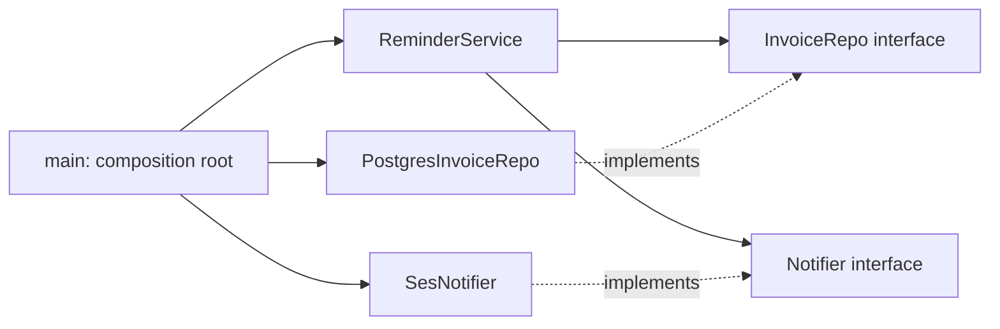

## In one minute
- High-level policy (the business rule) should not depend on low-level detail (the database driver, the email vendor, the system clock). Both should depend on an abstraction, and the policy side owns that abstraction.
- "Inversion" refers to the direction of the source-code dependency: control still flows from policy to database at runtime, but the import arrow points from the database adapter to the policy's interface.
- Dependency injection is the usual mechanism: pass the clock, repository and notifier in through the constructor instead of creating them inside. A composition root at the program's edge wires the real ones; tests wire fakes.
- Overdone, it becomes needless indirection: interfaces for things that never vary, DI containers that hide where objects come from, and stack traces ten frames deep.
- Agent-written code often calls `datetime.now()`, `os.environ` or an SDK client directly from business logic. It works, the happy-path test passes, and the code becomes impossible to test at the edges. Review for hidden dependencies.

## How it works

### The "before": policy welded to detail
A billing service sends reminders for unpaid invoices. The first version, written in a hurry:

```python
import os, sendgrid, psycopg
from datetime import datetime, timedelta, timezone

class ReminderJob:
    def run(self):
        conn = psycopg.connect(os.environ["DB_URL"])
        rows = conn.execute("SELECT id, email, due_at FROM invoices WHERE paid = false")
        now = datetime.now(timezone.utc)
        mail = sendgrid.SendGridAPIClient(os.environ["SG_KEY"])
        for inv_id, email, due_at in rows:
            if due_at - now < timedelta(days=3):
                mail.send(build_message(email, inv_id))
                conn.execute("UPDATE invoices SET reminded_at = now() WHERE id = %s", [inv_id])
```

The rule that matters to the business is one line: remind when an invoice is due within three days. Everything else is detail, yet the rule cannot be tested without a Postgres database, a SendGrid key and control of the current time. Switching from SendGrid to SES means editing the class that holds the business rule.

### The "after": policy owns its interfaces
Martin's original statement has two halves: high-level modules should not depend on low-level modules, and abstractions should not depend on details, with both sides depending on abstractions ([Martin, "The Dependency Inversion Principle", C++ Report](https://web.archive.org/web/2010/http://www.objectmentor.com/resources/articles/dip.pdf)). Invert the dependencies. The reminder module declares what it needs, in its own terms:

```python
class Clock(Protocol):
    def now(self) -> int: ...

class InvoiceRepo(Protocol):
    def unpaid(self) -> list[Invoice]: ...
    def mark_reminded(self, invoice_id: str, at: int) -> None: ...

class Notifier(Protocol):
    def send(self, customer: str, message: str) -> None: ...

class ReminderService:
    def __init__(self, clock: Clock, repo: InvoiceRepo, notifier: Notifier):
        self.clock, self.repo, self.notifier = clock, repo, notifier
```

A separate `adapters` package contains `PostgresInvoiceRepo`, `SesNotifier` and `SystemClock`, each importing the reminder module to implement its interfaces. A `main.py` (the composition root) constructs them and passes them in. The reminder module imports nothing from Postgres or AWS. The import graph now points inward, toward the policy.

The clock deserves its own interface because time is the dependency most often hidden. The JDK ships the idea in `java.time.Clock`, whose stated purpose is to let alternate clocks be plugged in, which can simplify testing ([Java docs](https://docs.oracle.com/en/java/javase/21/docs/api/java.base/java/time/Clock.html)), and Kubernetes' Go utilities publish a `clock.Clock` interface with a real implementation and a fake in the `clock/testing` subpackage ([k8s.io/utils/clock](https://pkg.go.dev/k8s.io/utils/clock/testing)).

Tests now construct the service with a fixed clock, an in-memory repo and a recording notifier, and run in microseconds. Swapping vendors means writing a new adapter, not editing the rule. And the interfaces describe the domain (`unpaid`, `mark_reminded`) rather than the database (`execute`, `cursor`): the abstraction belongs to the policy, so it speaks the policy's language.

### Inversion is not the same as injection
Dependency injection (passing collaborators in) is a technique. Dependency inversion is a statement about which module owns the abstraction. You can inject a `psycopg.Connection` into a service: that is injection without inversion, because the policy still depends on the driver's API. Fowler's article that named the pattern compares constructor, setter and interface injection, and contrasts injection with a service locator ([Fowler](https://martinfowler.com/articles/injection.html)). Microsoft's guidance for .NET says the same in practice: avoid direct instantiation of dependent classes inside services, because it couples the code to a particular implementation ([Microsoft Learn](https://learn.microsoft.com/en-us/dotnet/core/extensions/dependency-injection-guidelines)). You can also invert without a framework: a constructor with three parameters and a 20-line `main` is enough for most services. DI containers and generators (Spring, Guice, .NET's built-in container, Go's Fx, Python's `dependency-injector`) automate the wiring when the object graph gets large, at the cost of making it less visible.

### When inversion is overkill
Not every dependency deserves an interface. The standard library's string functions, a pure math helper, an internal data class: these are stable, deterministic and fast, and wrapping them adds nothing. The useful test is volatility and side effects. Invert a dependency when it does I/O, reads time or randomness, has a vendor you might replace, or is slow enough to keep out of unit tests. Leave it concrete otherwise.

Signs of over-application: an `IStringFormatter`; a `UserServiceImpl` that is the only implementation of `UserService` and has no fake; a container configuration file longer than the code it wires; new engineers unable to find which class runs in production without starting the app.

### The same shape elsewhere
This is the trust-but-verify shape. You can only verify what you can control, and you can only control what you inject. The same idea appears in hardware (a device driver implements the kernel's interface, not the reverse), in plugin systems (a browser defines the extension API and extensions depend on it) and in AI tooling: an agent framework that defines a `Tool` interface and lets you plug in implementations is dependency inversion, and it is what makes agent runs replayable in tests with fake tools.

## Down the stack

### Layer 1: The contract
The policy module promises behaviour in terms of its own interfaces: given a clock reading, a repository's contents and a notifier's responses, it produces a defined sequence of calls. Testable form: with injected fakes, the same inputs always give the same calls and the same result, and the module's import list contains no infrastructure package.

### Layer 2: The mechanism
Constructor injection stores references in fields; each call goes through an interface. Wiring happens once, at startup, in a composition root. Containers automate that step in different ways. Spring scans the classpath, reads annotations by reflection and builds a bean graph, often creating proxies for scoped or transactional beans. Go's Wire generated plain constructor calls at compile time, so there was no runtime container; note that Google archived the Wire repository in August 2025 and it no longer accepts new features ([google/wire](https://github.com/google/wire)), so new Go services usually hand-write the wiring or use Fx. Dagger does the same compile-time generation for Java and Android ([Dagger guide](https://dagger.dev/dev-guide/)). Uber's Fx resolves the graph by reflection at startup. In Python and TypeScript, most teams pass dependencies explicitly; monkeypatching is a weaker substitute, because it patches a module global rather than the one object under test.

Package boundaries enforce the inversion. Go forbids import cycles, so if `adapters` imports `reminder`, `reminder` cannot import `adapters`; the compiler checks the direction. Tools such as [import-linter](https://import-linter.readthedocs.io/en/stable/) for Python and [ArchUnit](https://www.archunit.org/) for Java let you write that rule for languages that do not enforce it.

### Layer 3: The machine
Each call through an injected interface is an indirect call: about 1 to 3 ns with a warm branch predictor, plus a lost inlining opportunity. Compared to what these dependencies do (a Postgres query at 0.5 to 5 ms, an HTTP call to an email vendor at 50 to 300 ms) that is under one part in 100,000. Injection is effectively free on I/O paths. It is not free in a tight CPU loop, where an injected `Hasher` called 100 million times can cost a few hundred milliseconds that a direct call would not; keep inversion at I/O boundaries, not inside hot kernels.

The visible runtime costs come from containers. Reflection-based wiring at startup can take hundreds of milliseconds to several seconds in large Spring applications, which matters for serverless cold starts; ahead-of-time processing (Spring AOT, GraalVM native images) or compile-time wiring (Dagger, or generated Go code) moves that work to build time. Proxies add a frame and sometimes an allocation per call. Injected singletons are shared across threads or goroutines, so a fake that is safe in a single-threaded test may race in production; real adapters need their own locking or connection pools.

### Why it's built this way
1. Business rules change at one rate, infrastructure at another; coupling them makes each change pay for both.
2. Side effects (time, network, disk) make code slow and nondeterministic to test.
3. So isolate side effects behind interfaces the policy owns, and pass implementations in.
4. Interfaces add an indirection per call, which costs nanoseconds against milliseconds of I/O.
5. Wiring large graphs by hand gets tedious, so containers emerged, and their own costs (startup, opacity) are why many teams still prefer a hand-written composition root.

## Diagram


## Worked example
The reminder job runs hourly over about 40,000 unpaid invoices. Before the refactor, its test suite had two tests, both needing Docker Postgres; the suite took 38 seconds and failed about once a week when the run crossed midnight UTC, because `datetime.now()` moved during the test. No test covered the "notifier failed for one customer" case, and in production a single SendGrid 500 aborted the loop, so every invoice after the failing one was skipped until the next hour.

After inversion, the team wrote 14 unit tests with a fixed clock, an in-memory repo and a notifier fake that can be told to fail for specific customers. The suite runs in 0.2 seconds. The failure test immediately exposed the abort bug: the fix was to catch the send error, leave that invoice unmarked so it is retried next hour, and continue. They also found that the "remind at most once per 24 hours" rule had an off-by-one at exactly 86,400 seconds, which was invisible with a real clock.

One integration test still runs the Postgres adapter against a real database to check the SQL. That is the right split: policy tested with fakes, adapter tested against the real thing.

## In the wild
- **Microsoft Azure, 2012: the leap-day certificate.** The guest agent computed a certificate's expiry as the current date with the year plus one, which on 29 February gave 29 February 2013, a date that does not exist. Certificate creation failed, hosts read the failures as faults, and service management was disrupted for many hours. Among Microsoft's stated fixes were better tests to detect time-related bugs and code analysis for the same class of error. Code that reads the clock directly cannot be driven to 29 February in a unit test; code that takes a clock can ([Azure blog](https://azure.microsoft.com/en-us/blog/summary-of-windows-azure-service-disruption-on-feb-29th-2012/)).
- **Cloudflare, 2017: the leap second and a negative number.** At midnight UTC on 1 January the wall clock stepped back, so a time difference in Cloudflare's DNS software came out negative, and a negative value reached a random-number call that panics on negative input. Affected resolutions failed until a patch discarded negative intervals ([Cloudflare](https://blog.cloudflare.com/how-and-why-the-leap-second-affected-cloudflare-dns/)). The lesson for design is the same: a clock behind an interface can be made to step backwards in a test.
- **Kubernetes, ongoing: a shared clock interface.** The `k8s.io/utils/clock` package exists so controllers and caches take a `Clock` with real and fake implementations instead of calling `time.Now` and `time.After` directly, which lets tests move time forward without sleeping ([package docs](https://pkg.go.dev/k8s.io/utils/clock)).

## Trade-offs
| Option | Strengths | Weaknesses | Choose when |
| --- | --- | --- | --- |
| Direct instantiation inside policy | Simple, easy to navigate | Untestable side effects, vendor lock-in in the rule | Scripts and prototypes |
| Constructor injection, hand-written root | Explicit, no magic, fast startup | Wiring boilerplate in large graphs | Most services |
| Reflection DI container | Wires large graphs, scopes, lifecycles | Startup cost, hidden wiring, runtime errors | Large Java or .NET apps with established conventions |
| Compile-time DI (Dagger; Go's Wire, now archived) | Checked wiring, no runtime cost | Code generation step; tool maintenance risk | Large Android or Java graphs |
| Monkeypatching globals in tests | No production changes | Brittle, leaks between tests, hides design problems | Legacy code before a refactor |

## Pitfalls in production
- Interfaces shaped like the vendor SDK (`send_email(template_id, dynamic_template_data)`) instead of the domain. Fix: name methods in the policy's terms; the adapter translates.
- Fakes that drift from real behaviour, so tests pass and production fails. Fix: run the same contract tests against the fake and the real adapter.
- Hidden dependencies that slipped back in: `time.Now()`, `uuid4()`, `os.Getenv` inside the service. Fix: grep for them in review and lint for them in policy packages.
- A container that silently injects the wrong implementation when two match. Fix: fail startup on ambiguity and log the resolved graph.
- Injected singletons with mutable state shared across requests. Fix: make adapters stateless or guard them, and test them under concurrency.
- Interfaces for every class, including value objects. Fix: invert only at I/O, time, randomness and replaceable vendor boundaries.

## Leadership lens
- Decide where the boundaries are as a team: which packages are policy, which are adapters, and which direction imports may go. Then enforce it with a linter, not code review memory.
- When reviewing agent-written changes, check the import list of policy modules first. Agents reach for the nearest working call, often `datetime.now()` or a concrete SDK client, and the tests they write alongside tend to mock at the wrong level.
- Prefer a plain composition root until the wiring is genuinely painful. A container is a team-wide dependency with its own learning curve and failure modes.
- Watch the cost of fakes: each is code to maintain. Shared, contract-tested fakes for the main adapters pay off; ad hoc mocks in every test file do not.

## Check yourself
1. What exactly is inverted in dependency inversion?
   **Answer:** The direction of the source-code dependency. The low-level adapter imports and implements an interface owned by the high-level policy, even though at runtime the policy calls the adapter.
2. A service takes a `psycopg.Connection` in its constructor. Is that dependency inversion?
   **Answer:** It is injection but not inversion: the policy still depends on the driver's API. Inversion needs an interface in the policy's own terms, such as `InvoiceRepo.unpaid()`.
3. Why is injecting an interface essentially free for a repository call but possibly costly for a hash function?
   **Answer:** The indirect call costs nanoseconds, which vanishes against milliseconds of database I/O but adds up when called hundreds of millions of times in a CPU-bound loop where inlining matters.
4. Why should time be an injected dependency?
   **Answer:** Real time makes tests nondeterministic and makes boundary cases (exactly 24 hours later, midnight, DST) impossible to reproduce; an injected clock lets tests set it precisely.

## Practice
**Task:** Implement `ReminderService`, constructed with three injected dependencies: a clock with `now()` returning Unix seconds, a repository with `unpaid()` returning invoices and `mark_reminded(id, at)`, and a notifier with `send(customer, message)` that may fail. Each invoice has `id`, `customer`, `due_at` and `last_reminded_at` (absent if never reminded). `run()` processes unpaid invoices in ascending `id` order. An invoice is eligible when `now >= due_at - 3 days` and it has never been reminded or `now - last_reminded_at >= 1 day` (one day is 86,400 seconds). The message is `"invoice <id> overdue"` if `now > due_at`, otherwise `"invoice <id> due soon"`. On a successful send, call `mark_reminded(id, now)`; if the send fails, do not mark it and carry on with the next invoice. `run()` returns the ids successfully reminded, in order. The tests provide the fakes.

```python starter
from dataclasses import dataclass
from typing import Optional

DAY = 86400


@dataclass
class Invoice:
    id: str
    customer: str
    due_at: int
    last_reminded_at: Optional[int] = None


class ReminderService:
    def __init__(self, clock, repo, notifier):
        self.clock = clock
        self.repo = repo
        self.notifier = notifier

    def run(self):
        # TODO: return ids reminded, in id order
        raise NotImplementedError
```

```python tests
class FixedClock:
    def __init__(self, t):
        self.t = t

    def now(self):
        return self.t


class MemoryRepo:
    def __init__(self, invoices):
        self.invoices = {i.id: i for i in invoices}
        self.marked = []

    def unpaid(self):
        return list(self.invoices.values())

    def mark_reminded(self, invoice_id, at):
        self.invoices[invoice_id].last_reminded_at = at
        self.marked.append((invoice_id, at))


class FakeNotifier:
    def __init__(self, fail_for=()):
        self.sent = []
        self.fail_for = set(fail_for)

    def send(self, customer, message):
        if customer in self.fail_for:
            raise RuntimeError("provider down")
        self.sent.append((customer, message))


T = 1_000_000


def test_due_soon_and_not_yet_due():
    repo = MemoryRepo([Invoice("a", "ann", T + 2 * DAY), Invoice("b", "bob", T + 5 * DAY)])
    n = FakeNotifier()
    assert ReminderService(FixedClock(T), repo, n).run() == ["a"]
    assert n.sent == [("ann", "invoice a due soon")]
    assert repo.marked == [("a", T)]


def test_overdue_message():
    n = FakeNotifier()
    svc = ReminderService(FixedClock(T), MemoryRepo([Invoice("c", "cat", T - 1)]), n)
    assert svc.run() == ["c"]
    assert n.sent == [("cat", "invoice c overdue")]


def test_boundaries_exactly_three_days_and_due_now():
    n = FakeNotifier()
    repo = MemoryRepo([Invoice("e", "eve", T + 3 * DAY), Invoice("d", "dan", T)])
    assert ReminderService(FixedClock(T), repo, n).run() == ["d", "e"]
    assert n.sent == [("dan", "invoice d due soon"), ("eve", "invoice e due soon")]


def test_throttle_one_day():
    repo = MemoryRepo([
        Invoice("a", "ann", T, last_reminded_at=T - DAY + 1),
        Invoice("b", "bob", T, last_reminded_at=T - DAY),
    ])
    n = FakeNotifier()
    assert ReminderService(FixedClock(T), repo, n).run() == ["b"]


def test_failure_does_not_mark_and_continues():
    repo = MemoryRepo([Invoice("a", "ann", T), Invoice("b", "bob", T)])
    n = FakeNotifier(fail_for=["ann"])
    assert ReminderService(FixedClock(T), repo, n).run() == ["b"]
    assert repo.marked == [("b", T)]
    assert repo.invoices["a"].last_reminded_at is None


def test_rerun_with_advancing_clock():
    repo = MemoryRepo([Invoice("a", "ann", T)])
    clock = FixedClock(T)
    svc = ReminderService(clock, repo, FakeNotifier())
    assert svc.run() == ["a"]
    clock.t = T + 3600
    assert svc.run() == []
    clock.t = T + DAY
    assert svc.run() == ["a"]


def test_empty_repo():
    assert ReminderService(FixedClock(T), MemoryRepo([]), FakeNotifier()).run() == []
```

```python solution
from dataclasses import dataclass
from typing import Optional

DAY = 86400


@dataclass
class Invoice:
    id: str
    customer: str
    due_at: int
    last_reminded_at: Optional[int] = None


class ReminderService:
    def __init__(self, clock, repo, notifier):
        self.clock = clock
        self.repo = repo
        self.notifier = notifier

    def run(self):
        now = self.clock.now()
        done = []
        for inv in sorted(self.repo.unpaid(), key=lambda i: i.id):
            if now < inv.due_at - 3 * DAY:
                continue
            if inv.last_reminded_at is not None and now - inv.last_reminded_at < DAY:
                continue
            kind = "overdue" if now > inv.due_at else "due soon"
            try:
                self.notifier.send(inv.customer, "invoice %s %s" % (inv.id, kind))
            except Exception:
                continue
            self.repo.mark_reminded(inv.id, now)
            done.append(inv.id)
        return done
```

```typescript starter
export const DAY = 86400;

export interface Invoice { id: string; customer: string; dueAt: number; lastRemindedAt?: number; }
export interface Clock { now(): number; }
export interface InvoiceRepo { unpaid(): Invoice[]; markReminded(id: string, at: number): void; }
export interface Notifier { send(customer: string, message: string): void; }

export class ReminderService {
  constructor(private clock: Clock, private repo: InvoiceRepo, private notifier: Notifier) {}

  run(): string[] {
    throw new Error("TODO");
  }
}
```

```typescript tests
class FixedClock implements Clock {
  constructor(public t: number) {}
  now(): number { return this.t; }
}

class MemoryRepo implements InvoiceRepo {
  invoices = new Map<string, Invoice>();
  marked: [string, number][] = [];
  constructor(list: Invoice[]) { for (const i of list) this.invoices.set(i.id, i); }
  unpaid(): Invoice[] { return [...this.invoices.values()]; }
  markReminded(id: string, at: number): void {
    this.invoices.get(id)!.lastRemindedAt = at;
    this.marked.push([id, at]);
  }
}

class FakeNotifier implements Notifier {
  sent: [string, string][] = [];
  constructor(private failFor: string[] = []) {}
  send(customer: string, message: string): void {
    if (this.failFor.includes(customer)) throw new Error("provider down");
    this.sent.push([customer, message]);
  }
}

const T = 1_000_000;

test("due soon and not yet due", () => {
  const repo = new MemoryRepo([{ id: "a", customer: "ann", dueAt: T + 2 * DAY }, { id: "b", customer: "bob", dueAt: T + 5 * DAY }]);
  const n = new FakeNotifier();
  assertEqual(new ReminderService(new FixedClock(T), repo, n).run(), ["a"]);
  assertEqual(n.sent, [["ann", "invoice a due soon"]]);
  assertEqual(repo.marked, [["a", T]]);
});

test("overdue message", () => {
  const n = new FakeNotifier();
  const svc = new ReminderService(new FixedClock(T), new MemoryRepo([{ id: "c", customer: "cat", dueAt: T - 1 }]), n);
  assertEqual(svc.run(), ["c"]);
  assertEqual(n.sent, [["cat", "invoice c overdue"]]);
});

test("boundaries: exactly three days and due now", () => {
  const n = new FakeNotifier();
  const repo = new MemoryRepo([{ id: "e", customer: "eve", dueAt: T + 3 * DAY }, { id: "d", customer: "dan", dueAt: T }]);
  assertEqual(new ReminderService(new FixedClock(T), repo, n).run(), ["d", "e"]);
  assertEqual(n.sent, [["dan", "invoice d due soon"], ["eve", "invoice e due soon"]]);
});

test("throttle one day", () => {
  const repo = new MemoryRepo([
    { id: "a", customer: "ann", dueAt: T, lastRemindedAt: T - DAY + 1 },
    { id: "b", customer: "bob", dueAt: T, lastRemindedAt: T - DAY },
  ]);
  assertEqual(new ReminderService(new FixedClock(T), repo, new FakeNotifier()).run(), ["b"]);
});

test("failure does not mark and continues", () => {
  const repo = new MemoryRepo([{ id: "a", customer: "ann", dueAt: T }, { id: "b", customer: "bob", dueAt: T }]);
  const n = new FakeNotifier(["ann"]);
  assertEqual(new ReminderService(new FixedClock(T), repo, n).run(), ["b"]);
  assertEqual(repo.marked, [["b", T]]);
  assert(repo.invoices.get("a")!.lastRemindedAt === undefined, "a must stay unmarked");
});

test("rerun with advancing clock", () => {
  const repo = new MemoryRepo([{ id: "a", customer: "ann", dueAt: T }]);
  const clock = new FixedClock(T);
  const svc = new ReminderService(clock, repo, new FakeNotifier());
  assertEqual(svc.run(), ["a"]);
  clock.t = T + 3600;
  assertEqual(svc.run(), []);
  clock.t = T + DAY;
  assertEqual(svc.run(), ["a"]);
});

test("empty repo", () => {
  assertEqual(new ReminderService(new FixedClock(T), new MemoryRepo([]), new FakeNotifier()).run(), []);
});
```

```typescript solution
export const DAY = 86400;

export interface Invoice { id: string; customer: string; dueAt: number; lastRemindedAt?: number; }
export interface Clock { now(): number; }
export interface InvoiceRepo { unpaid(): Invoice[]; markReminded(id: string, at: number): void; }
export interface Notifier { send(customer: string, message: string): void; }

export class ReminderService {
  constructor(private clock: Clock, private repo: InvoiceRepo, private notifier: Notifier) {}

  run(): string[] {
    const now = this.clock.now();
    const done: string[] = [];
    const list = [...this.repo.unpaid()].sort((a, b) => (a.id < b.id ? -1 : a.id > b.id ? 1 : 0));
    for (const inv of list) {
      if (now < inv.dueAt - 3 * DAY) continue;
      if (inv.lastRemindedAt !== undefined && now - inv.lastRemindedAt < DAY) continue;
      const kind = now > inv.dueAt ? "overdue" : "due soon";
      try {
        this.notifier.send(inv.customer, `invoice ${inv.id} ${kind}`);
      } catch {
        continue;
      }
      this.repo.markReminded(inv.id, now);
      done.push(inv.id);
    }
    return done;
  }
}
```

```go starter
package practice

const Day = 86400

type Invoice struct {
	ID             string
	Customer       string
	DueAt          int64
	LastRemindedAt *int64 // nil if never reminded
}

type Clock interface{ Now() int64 }

type InvoiceRepo interface {
	Unpaid() []Invoice
	MarkReminded(id string, at int64)
}

type Notifier interface {
	Send(customer, message string) error
}

type ReminderService struct {
	Clock    Clock
	Repo     InvoiceRepo
	Notifier Notifier
}

// Run returns the ids reminded, in ascending id order.
func (s *ReminderService) Run() []string {
	panic("TODO")
}
```

```go tests
package practice

import (
	"errors"
	"reflect"
	"testing"
)

type fixedClock struct{ t int64 }

func (c *fixedClock) Now() int64 { return c.t }

type memoryRepo struct {
	invoices map[string]*Invoice
	marked   []string
}

func newRepo(list ...Invoice) *memoryRepo {
	r := &memoryRepo{invoices: map[string]*Invoice{}}
	for i := range list {
		inv := list[i]
		r.invoices[inv.ID] = &inv
	}
	return r
}

func (r *memoryRepo) Unpaid() []Invoice {
	out := []Invoice{}
	for _, inv := range r.invoices {
		out = append(out, *inv)
	}
	return out
}

func (r *memoryRepo) MarkReminded(id string, at int64) {
	r.invoices[id].LastRemindedAt = &at
	r.marked = append(r.marked, id)
}

type fakeNotifier struct {
	sent    []string
	failFor map[string]bool
}

func (n *fakeNotifier) Send(customer, message string) error {
	if n.failFor[customer] {
		return errors.New("provider down")
	}
	n.sent = append(n.sent, customer+": "+message)
	return nil
}

const T int64 = 1_000_000

func ptr(v int64) *int64 { return &v }

func TestDueSoonAndNotYetDue(t *testing.T) {
	repo := newRepo(Invoice{ID: "a", Customer: "ann", DueAt: T + 2*Day}, Invoice{ID: "b", Customer: "bob", DueAt: T + 5*Day})
	n := &fakeNotifier{}
	got := (&ReminderService{&fixedClock{T}, repo, n}).Run()
	if !reflect.DeepEqual(got, []string{"a"}) || !reflect.DeepEqual(n.sent, []string{"ann: invoice a due soon"}) {
		t.Fatalf("got %v sent %v", got, n.sent)
	}
	if *repo.invoices["a"].LastRemindedAt != T {
		t.Fatal("a not marked at now")
	}
}

func TestOverdueMessage(t *testing.T) {
	n := &fakeNotifier{}
	got := (&ReminderService{&fixedClock{T}, newRepo(Invoice{ID: "c", Customer: "cat", DueAt: T - 1}), n}).Run()
	if !reflect.DeepEqual(got, []string{"c"}) || !reflect.DeepEqual(n.sent, []string{"cat: invoice c overdue"}) {
		t.Fatalf("got %v sent %v", got, n.sent)
	}
}

func TestBoundaries(t *testing.T) {
	n := &fakeNotifier{}
	repo := newRepo(Invoice{ID: "e", Customer: "eve", DueAt: T + 3*Day}, Invoice{ID: "d", Customer: "dan", DueAt: T})
	got := (&ReminderService{&fixedClock{T}, repo, n}).Run()
	want := []string{"dan: invoice d due soon", "eve: invoice e due soon"}
	if !reflect.DeepEqual(got, []string{"d", "e"}) || !reflect.DeepEqual(n.sent, want) {
		t.Fatalf("got %v sent %v", got, n.sent)
	}
}

func TestThrottleOneDay(t *testing.T) {
	repo := newRepo(
		Invoice{ID: "a", Customer: "ann", DueAt: T, LastRemindedAt: ptr(T - Day + 1)},
		Invoice{ID: "b", Customer: "bob", DueAt: T, LastRemindedAt: ptr(T - Day)},
	)
	got := (&ReminderService{&fixedClock{T}, repo, &fakeNotifier{}}).Run()
	if !reflect.DeepEqual(got, []string{"b"}) {
		t.Fatalf("got %v", got)
	}
}

func TestFailureDoesNotMark(t *testing.T) {
	repo := newRepo(Invoice{ID: "a", Customer: "ann", DueAt: T}, Invoice{ID: "b", Customer: "bob", DueAt: T})
	n := &fakeNotifier{failFor: map[string]bool{"ann": true}}
	got := (&ReminderService{&fixedClock{T}, repo, n}).Run()
	if !reflect.DeepEqual(got, []string{"b"}) || !reflect.DeepEqual(repo.marked, []string{"b"}) {
		t.Fatalf("got %v marked %v", got, repo.marked)
	}
	if repo.invoices["a"].LastRemindedAt != nil {
		t.Fatal("a must stay unmarked")
	}
}

func TestRerunWithAdvancingClock(t *testing.T) {
	repo := newRepo(Invoice{ID: "a", Customer: "ann", DueAt: T})
	clock := &fixedClock{T}
	svc := &ReminderService{clock, repo, &fakeNotifier{}}
	if got := svc.Run(); !reflect.DeepEqual(got, []string{"a"}) {
		t.Fatalf("first %v", got)
	}
	clock.t = T + 3600
	if got := svc.Run(); len(got) != 0 {
		t.Fatalf("second %v", got)
	}
	clock.t = T + Day
	if got := svc.Run(); !reflect.DeepEqual(got, []string{"a"}) {
		t.Fatalf("third %v", got)
	}
}

func TestEmptyRepo(t *testing.T) {
	if got := (&ReminderService{&fixedClock{T}, newRepo(), &fakeNotifier{}}).Run(); len(got) != 0 {
		t.Fatalf("got %v", got)
	}
}
```

```go solution
package practice

import (
	"fmt"
	"sort"
)

const Day = 86400

type Invoice struct {
	ID             string
	Customer       string
	DueAt          int64
	LastRemindedAt *int64 // nil if never reminded
}

type Clock interface{ Now() int64 }

type InvoiceRepo interface {
	Unpaid() []Invoice
	MarkReminded(id string, at int64)
}

type Notifier interface {
	Send(customer, message string) error
}

type ReminderService struct {
	Clock    Clock
	Repo     InvoiceRepo
	Notifier Notifier
}

func (s *ReminderService) Run() []string {
	now := s.Clock.Now()
	list := s.Repo.Unpaid()
	sort.Slice(list, func(i, j int) bool { return list[i].ID < list[j].ID })
	done := []string{}
	for _, inv := range list {
		if now < inv.DueAt-3*Day {
			continue
		}
		if inv.LastRemindedAt != nil && now-*inv.LastRemindedAt < Day {
			continue
		}
		kind := "due soon"
		if now > inv.DueAt {
			kind = "overdue"
		}
		if err := s.Notifier.Send(inv.Customer, fmt.Sprintf("invoice %s %s", inv.ID, kind)); err != nil {
			continue
		}
		s.Repo.MarkReminded(inv.ID, now)
		done = append(done, inv.ID)
	}
	return done
}
```

## Mock interview
**Prompt:** A 4,000-line order service creates its own Kafka producer, Redis client and HTTP clients inside methods and reads the time with `Instant.now()` throughout. Its tests take 9 minutes and need Docker, so engineers skip them. Walk me through making the core order rules unit-testable without stopping feature work.

- Follow-up: Where do you draw the first interface, and who owns it?
- Follow-up: Your fakes pass but production breaks because the real Redis adapter behaves differently. How do you prevent that?
- Follow-up: Would you introduce a DI container? What would make you say yes?

**A strong answer covers:**
- Starting at the side effects: time, randomness, network and storage, extracting one domain-shaped interface at a time behind the existing behaviour.
- Constructor injection with a composition root, keeping defaults so call sites change gradually.
- Policy-owned interfaces in domain terms, with adapters in a separate package and an import rule enforced by tooling.
- Contract tests run against both the fake and the real adapter to keep them honest.
- A reasoned stance on containers: wiring pain and team familiarity versus startup cost and opacity.

## Sources and further study
**Primary**
- [Robert C. Martin, "The Dependency Inversion Principle" (C++ Report, 1996)](https://web.archive.org/web/2010/http://www.objectmentor.com/resources/articles/dip.pdf): the original two-part statement and the copy-program example.
- [Java `java.time.Clock` documentation](https://docs.oracle.com/en/java/javase/21/docs/api/java.base/java/time/Clock.html): a standard-library clock abstraction built so that tests can plug in another one.

**Systems docs**
- [Microsoft Learn: dependency injection guidelines for .NET](https://learn.microsoft.com/en-us/dotnet/core/extensions/dependency-injection-guidelines): avoid static state and direct instantiation inside services.
- [k8s.io/utils/clock](https://pkg.go.dev/k8s.io/utils/clock): real and fake clocks behind one interface in a large Go codebase.
- [google/wire](https://github.com/google/wire): compile-time DI for Go, now archived, useful as a case of tooling risk.
- [Dagger user guide](https://dagger.dev/dev-guide/): generated, compile-time dependency injection for Java and Android.
- [import-linter](https://import-linter.readthedocs.io/en/stable/) and [ArchUnit](https://www.archunit.org/): enforcing the direction of imports with tests or lint contracts.

**Books**
- *Clean Architecture*, Robert C. Martin: chapter 11 "DIP: The Dependency Inversion Principle", and chapter 26 "The Main Component", which is the composition root.
- *Head First Design Patterns*, Freeman and Robson: chapter 4, where the Factory pattern is used to motivate depending on abstractions.

**Other curricula**
- [Microsoft Learn: .NET dependency injection](https://learn.microsoft.com/en-us/dotnet/core/extensions/dependency-injection): how a platform vendor frames injection and its built-in container.

## Watch
- [Dependency Injection, The Best Pattern (CodeAesthetic)](https://www.youtube.com/watch?v=J1f5b4vcxCQ): a short, concrete refactor from hard-wired dependencies to injected ones.
- [The Clean Code Talks: Don't Look For Things! (Google TechTalks)](https://www.youtube.com/watch?v=RlfLCWKxHJ0): Misko Hevery on asking for dependencies instead of fetching them.
- [The Clean Code Talks: Unit Testing (Google TechTalks)](https://www.youtube.com/watch?v=wEhu57pih5w): why testability depends on how objects get their collaborators.

## Free resources
- [Dependency inversion principle (Wikipedia)](https://en.wikipedia.org/wiki/Dependency_inversion_principle): the two rules, ownership of abstractions and common variations.
- [DIP in the Wild (Brett Schuchert, martinfowler.com)](https://martinfowler.com/articles/dipInTheWild.html): worked examples of inversion in real code, including where it goes wrong.
- [Inversion of Control Containers and the Dependency Injection pattern (Martin Fowler)](https://martinfowler.com/articles/injection.html): the article that named dependency injection and compared its forms.
- [Mocks Aren't Stubs (Martin Fowler)](https://martinfowler.com/articles/mocksArentStubs.html): the kinds of test doubles and when each fits.
- [Clean Code Talks: Dependency Injection (Google Testing Blog)](https://testing.googleblog.com/2008/11/clean-code-talks-dependency-injection.html): a short write-up of injection for testability.
