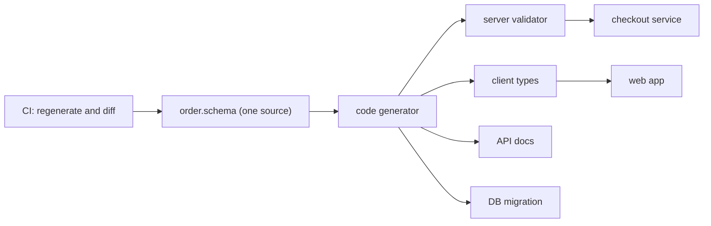

## In one minute
- DRY ("Don't Repeat Yourself") says every piece of knowledge in a system should have one authoritative representation. It is about knowledge (a rule, a format, a limit), not about lines of text that happen to look alike.
- Duplicated knowledge drifts: someone changes the tax rule in the backend and not in the checkout page, and the two disagree in production.
- Duplicated text that encodes different knowledge is fine. Merging two lookalike functions that change for different reasons creates the wrong abstraction, which is more expensive than the copy.
- The strongest DRY tool is often generation: one schema produces the validator, the docs, the client types and the database migration.
- Agents duplicate freely, because pasting a working snippet is the shortest path to green tests. They also over-abstract when asked to "clean up". Review both directions: is this the same rule written twice, or two rules that only look alike today?

## How it works

### The definition is about knowledge
The phrase comes from *The Pragmatic Programmer* (Hunt and Thomas, 1999), whose section "DRY: The Evils of Duplication" defines it as "every piece of knowledge must have a single, unambiguous, authoritative representation within a system". The key words are knowledge and authoritative. A shipping-weight limit of 30 kg is knowledge. If it appears as `30` in the API validator, as `30000` grams in the warehouse service and as "up to 30 kg" in the help page, the system holds three copies of one fact, and nothing forces them to agree.

Dave Thomas stresses the same point: most people take DRY to mean not duplicating code, but it covers database schemas, test plans, the build system and documentation too ([Artima interview](https://www.artima.com/articles/orthogonality-and-the-dry-principle)). Code, schemas, configuration, documentation, tests and database constraints can all hold knowledge. DRY applies to all of them, which is why a principle that sounds like "extract a function" is really about where facts live.

### What drift looks like
```python
# checkout/api.py
def can_ship(weight_g):
    return weight_g <= 30_000

# warehouse/labels.py
MAX_PARCEL_KG = 30
def label_class(weight_kg):
    return "heavy" if weight_kg > MAX_PARCEL_KG * 0.8 else "standard"
```

Then the carrier raises the limit to 32 kg. The team updates `MAX_PARCEL_KG`, and checkout keeps rejecting parcels between 30 and 32 kg for a month. Each copy was correct when written. The defect is that they were copies.

The ordinary code-level treatment is the one Refactoring.Guru gives for its duplicate-code smell: extract the shared part into one method and call it from both places ([Refactoring.Guru](https://refactoring.guru/smells/duplicate-code)). Here the fact crosses services, so the fix is one owner of the fact, `shipping_limits.MAX_PARCEL_GRAMS = 32_000`, imported by both. When the services are separate deploy units, the owner might be a config service, a shared schema, or one service exposing the limit through its API.

### Coincidental duplication
Two functions can be textually identical and still represent different knowledge:

```python
def free_shipping_eligible(order_cents):
    return order_cents >= 5_000

def loyalty_bonus_eligible(order_cents):
    return order_cents >= 5_000
```

Marketing owns one threshold, the loyalty team the other. Merging them into `over_fifty_dollars()` couples two policies that will diverge next quarter. The test is the reason to change: if the two would always change together, they are one piece of knowledge; if they change for different reasons and by different people, they are two, however alike they look.

### The wrong abstraction
Sandi Metz's claim is that duplication is far cheaper than the wrong abstraction ([The Wrong Abstraction](https://sandimetz.com/blog/2016/1/20/the-wrong-abstraction)). She describes the usual decay: someone extracts a shared helper; a new caller needs something slightly different, so a parameter is added; then a flag; then a branch for a third caller. After a year the helper is a switch statement over callers, each change risks the others, and nobody dares touch it. Her advice is to inline the abstraction back into its callers and let them diverge, then look again for what is truly shared. The rule of three is the practical version: tolerate the second copy, extract on the third, when you can see what actually varies.

### Generate instead of copy
Some knowledge must exist in several forms: a request format appears as server validation, client types, API docs and a database column. Writing each by hand is four copies. Generating them from one definition (Protocol Buffers, OpenAPI, JSON Schema, an ORM model) keeps one authoritative source: protobuf's own overview describes defining how data is structured once and generating native language bindings for many languages ([Protobuf docs](https://protobuf.dev/overview/)), and Kubernetes ships generators that produce clients and informers from API type definitions ([kubernetes/code-generator](https://github.com/kubernetes/code-generator)). That keeps one authoritative source and lets tools produce the rest. The practice task builds a small version: one field schema that drives both validation and documentation.

### Reviewing agent-written code
A coding agent asked to add a "premium" plan often copies the "standard" plan's pricing function and edits two numbers. That is duplication of the rounding and proration rules, which will drift. Asked to "reduce duplication", the same agent may merge two unrelated validators behind a `mode` parameter. Ask, for each copy or each merge: what is the fact here, who owns it, and will these change together?

### The same shape elsewhere
DRY is the *multi-step consistency* problem in source code. Two copies of a fact behave like two replicas of a database row without replication: they agree at write time and diverge silently afterwards. The remedies are the same as in data systems. Keep one leader (a single source of truth), derive the rest from it (generation, like a materialised view), or detect divergence (a test that compares the copies, like an anti-entropy check).

## Down the stack

### Layer 1: The contract
A DRY design promises that changing a piece of knowledge requires editing one place, and that every consumer sees the change after the next build or deploy. Testable form: grep for the fact (the literal, the regex, the field name) and find one definition; change it and watch every dependent test respond. The flip side of the contract is coupling: every consumer of the shared definition now changes when it changes, whether it wanted to or not.

### Layer 2: The mechanism
Languages offer several ways to keep one copy, each with a different cost. A function is the simplest. Generics remove duplication across types, and are implemented very differently: C++ templates and Rust generics are monomorphised, meaning the compiler emits a separate machine-code copy per type; Java erases type parameters to one shared body that works on `Object` references; Go uses "GC shape stenciling", producing one body per memory shape (all pointer types share one) plus a dictionary argument that carries type information ([Go design document](https://github.com/golang/proposal/blob/master/design/generics-implementation-gcshape.md)). Code generators (`protoc`, OpenAPI generators, `sqlc`) produce source from a schema at build time. Shared libraries move a definition into a separate package that several programs import.

Each of these adds an edge to the build graph. In a monorepo built with Bazel or a similar tool, a change to a widely shared package invalidates every target that depends on it, so editing one constant in a `common` library can rebuild and retest thousands of targets. Across services, a shared library ties deploy units together: to change the shared model, every service that embeds it must be rebuilt and redeployed, or run with mismatched versions in the meantime.

### Layer 3: The machine
Extracting a helper adds a call: a few nanoseconds at most, and usually zero, because compilers inline small functions. Go inlines functions under a cost budget of 80 nodes of its intermediate representation, raised to 2000 for hot call sites when profile-guided optimisation is on ([Go compiler source](https://github.com/golang/go/blob/master/src/cmd/compile/internal/inline/inl.go)); HotSpot inlines hot methods up to a bytecode size threshold of a few hundred bytes. So the compiler often undoes your DRY at the machine level by copying the helper into each caller, which is fine: duplication in machine code is cheap and does not drift.

Monomorphisation is the same trade made deliberately. Each instantiation of a C++ template gets its own specialised, fast code, at the price of binary size and instruction-cache pressure; a heavily templated library can add megabytes to a binary. Go's shape-based approach keeps binaries smaller but routes some method calls through the dictionary, which can be slower than a direct call in hot loops. Dynamic linking is DRY at the operating-system level: one copy of `libc` lives in the page cache and is mapped read-only into every process, so 200 processes share one set of physical pages instead of 200.

### Why it's built this way
1. Facts change, and every copy of a fact must change with it, so copies multiply the cost of change and the risk of missing one.
2. So keep one authoritative copy and derive the others.
3. But every derivation is a dependency, and dependencies couple the things that share them.
4. So apply DRY to knowledge that genuinely changes together, and accept duplicated text, or let the compiler duplicate machine code, where coupling would cost more than drift.

## Diagram


## Worked example
An online store computes discounts in two places: the TypeScript cart shows a price as the shopper builds an order, and the Go payment service charges the card. Both implement "10 percent off orders over 100 dollars, rounded to the cent". The cart rounds each line item and sums; the payment service sums and then rounds. For three items at 33.35 dollars, the cart discounts each line to 30.015, rounds it to 30.02 and shows 90.06; the payment service discounts the 100.05 total to 90.045, rounds once and charges 90.05. Across 40,000 orders a day, about 0.6 percent end with the displayed and charged totals a cent apart: around 240 orders and a steady trickle of support tickets asking why the price changed at payment.

The team considered sharing a library between the two codebases, which is awkward across languages and would couple the web release to the payment release. They chose a single source of truth instead: the payment service exposes a `quote` endpoint that returns the exact total, and the cart calls it on each change (about 20 ms per call). The discount rule now exists once. For the offline preview, the cart shows "about 90 dollars" until the quote returns. Mismatch tickets went to zero, and the next pricing change touched one file.

## In the wild
- **Google Cloud, 2016: one fact in two config files.** An engineer removed an unused IP block from Google's network configuration. The block had been removed from one configuration file but the change had not yet reached a second file the management software also used, so the software saw an inconsistency. It was designed to fail safe and keep the old configuration, but a latent bug made it remove every Compute Engine IP block instead. Inbound traffic to Compute Engine fell by more than 95 percent in all regions, and instances lost external connectivity for a total of 18 minutes ([Google Cloud incident 16007](https://status.cloud.google.com/incident/compute/16007)). The root cause was the bug, not the duplication, but two copies of one fact are what produced the inconsistent input.
- **npm, 2016: the cost of DRY by dependency.** When an author unpublished 273 packages, including the tiny `left-pad`, thousands of projects that depended on it directly or indirectly began failing at hundreds of failures per minute until someone published a functionally identical replacement about ten minutes in ([npm blog](https://blog.npmjs.org/post/141577284765/kik-left-pad-and-npm)). It is the counterweight to deduplication: every shared definition is a dependency, which is why Go's proverb says a little copying is better than a little dependency ([Go Proverbs](https://go-proverbs.github.io/)).
- **Kubernetes, ongoing: generation as DRY.** Kubernetes derives versioned clients, informers and helpers such as conversions and defaulters for its API types with `code-generator`, so changing a type does not mean hand-editing each of those artefacts ([kubernetes/code-generator](https://github.com/kubernetes/code-generator)).

## Trade-offs
| Option | Strengths | Weaknesses | Choose when |
| --- | --- | --- | --- |
| Duplicate the code | No coupling, each copy evolves freely | Copies drift when the knowledge is shared | The copies encode different knowledge, or you have only two |
| Extract a function or module | One place to change; cheap after inlining | Couples every caller to one definition | Same knowledge, same reason to change, same deploy unit |
| Generate from a schema | One source across languages and layers | Build step, generator quirks, generated code to read | Formats shared across services, clients and storage |
| Shared library across services | Real code reuse | Couples deploy units; version skew | Stable, slow-changing utilities (logging, auth clients) |
| One service owns the fact | Single runtime source of truth | Network hop, availability dependency | Business rules such as prices, limits and entitlements |

## Pitfalls in production
- The same validation regex in frontend, backend and database, with one copy stricter than the others. Fix: generate the client check from the server's schema, or make the server the only authority and treat the client check as a hint.
- A `common` library that every service imports and every team edits, so one change forces a fleet-wide redeploy. Fix: split by reason to change; copy small utilities instead of sharing them.
- Helpers with boolean flags for each caller (`format(x, is_invoice, legacy_mode)`). Fix: inline back into callers, then extract only what is genuinely common.
- Constants duplicated in tests, so a changed limit leaves the test asserting the old value and passing against stale code. Fix: tests import the constant, or assert on behaviour at the boundary.
- Documentation that restates code and goes stale. Fix: generate reference docs from the source, and keep hand-written docs to the reasons behind the code.

## Leadership lens
- Ask "who owns this fact?" for every business rule: prices, limits, retention periods, feature eligibility. If the answer is "it is in three places", plan to consolidate it.
- Weigh a shared library by its change rate and number of consumers. A fast-changing library shared across ten deploy units turns every edit into a coordinated release.
- Budget for code generation as infrastructure: someone must own the generator, the CI check that generated files are up to date, and upgrades.
- When AI agents produce code, duplication is the cheapest output. Add a review question ("is any of this knowledge already defined somewhere?") and a lint or search step for repeated literals in domain code.
- Do not reward "lines removed" from deduplication on its own. A merge that couples two teams' policies is a regression even if the diff is negative.

## Check yourself
1. Two functions have identical bodies. Under what condition should you leave them duplicated?
   **Answer:** When they encode different knowledge that changes for different reasons or is owned by different people. Merging them would couple policies that will diverge.
2. Why can monomorphised generics increase binary size, and why is that not a DRY violation?
   **Answer:** The compiler emits a separate copy of the code for each type instantiation. The source still has one definition, so there is one place to change; the machine-code copies are derived and cannot drift.
3. A constant shared through a library used by 12 services needs to change. What does DRY cost you here?
   **Answer:** Every service must rebuild and redeploy to pick up the change, and until then services disagree. If the value changes often, it belongs in configuration or behind one service's API instead.
4. What is the rule of three, and what problem does it guard against?
   **Answer:** Allow a second copy and extract a shared abstraction only at the third. It guards against premature abstraction built from too few examples to see what actually varies.

## Practice
**Task:** Build one field schema that drives both validation and documentation, so the rules exist exactly once. A schema is a list of rules, each with `name`, `type` (`"int"` or `"str"`), `required`, and optional `min` and `max` (a value range for ints, a length range for strings). Before use, a schema is checked: an unknown type fails with `<name>: unknown type <type>`, `min` greater than `max` fails with `<name>: min > max`, and a repeated name fails with `duplicate field: <name>`, checking rules in order. `validate(schema, record)` returns a list of errors in schema order, then unknown record keys sorted: `<name>: required`, `<name>: must be int` (booleans are not ints) or `must be str`, `<name>: must be >= <min>` or `<= <max>` for ints, `<name>: length must be >= <min>` or `<= <max>` for strings, and `<name>: unknown field`. Missing optional fields are fine, and each field reports at most one error (min is checked before max). `describe(schema)` returns one line per rule: `<name> (<type>, required|optional): <range>`, where range is `<min>..<max>`, `>= <min>`, `<= <max>` or `any`, prefixed with `length ` for strings. Python raises `ValueError`, TypeScript throws `Error`, Go returns an error.

```python starter
def validate(schema, record):
    # TODO: check the schema, then validate the record against it
    raise NotImplementedError

def describe(schema):
    # TODO: one documentation line per rule, from the same schema
    raise NotImplementedError
```

```python tests
USER = [
    {"name": "username", "type": "str", "required": True, "min": 3, "max": 20},
    {"name": "age", "type": "int", "required": False, "min": 13},
    {"name": "bio", "type": "str", "required": False, "max": 160},
    {"name": "score", "type": "int", "required": True},
]

def test_valid_record():
    assert validate(USER, {"username": "ada", "score": 0}) == []
    assert validate(USER, {"username": "grace", "age": 13, "bio": "", "score": -5}) == []

def test_errors_in_schema_order_then_unknown_sorted():
    rec = {"username": "al", "age": 12, "zeta": 1, "alpha": 2}
    assert validate(USER, rec) == [
        "username: length must be >= 3",
        "age: must be >= 13",
        "score: required",
        "alpha: unknown field",
        "zeta: unknown field",
    ]

def test_types_and_max():
    rec = {"username": "x" * 21, "age": "30", "bio": 7, "score": True}
    assert validate(USER, rec) == [
        "username: length must be <= 20",
        "age: must be int",
        "bio: must be str",
        "score: must be int",
    ]

def test_describe():
    assert describe(USER) == [
        "username (str, required): length 3..20",
        "age (int, optional): >= 13",
        "bio (str, optional): length <= 160",
        "score (int, required): any",
    ]

def test_bad_schema_rejected_by_both():
    bad = [{"name": "n", "type": "int", "required": True, "min": 5, "max": 1}]
    for fn in (lambda: validate(bad, {}), lambda: describe(bad)):
        try:
            fn()
            assert False, "expected ValueError"
        except ValueError as e:
            assert str(e) == "n: min > max"

def test_unknown_type_and_duplicate():
    try:
        describe([{"name": "f", "type": "float", "required": False}])
        assert False, "expected ValueError"
    except ValueError as e:
        assert str(e) == "f: unknown type float"
    try:
        validate([{"name": "a", "type": "int", "required": False},
                  {"name": "a", "type": "str", "required": False}], {})
        assert False, "expected ValueError"
    except ValueError as e:
        assert str(e) == "duplicate field: a"

def test_empty_schema():
    assert describe([]) == []
    assert validate([], {"x": 1}) == ["x: unknown field"]
```

```python solution
TYPES = ("int", "str")

def _check(schema):
    seen = set()
    for r in schema:
        name = r["name"]
        if r["type"] not in TYPES:
            raise ValueError(name + ": unknown type " + r["type"])
        lo, hi = r.get("min"), r.get("max")
        if lo is not None and hi is not None and lo > hi:
            raise ValueError(name + ": min > max")
        if name in seen:
            raise ValueError("duplicate field: " + name)
        seen.add(name)

def _field_error(r, v):
    if r["type"] == "int":
        if type(v) is not int:
            return "must be int"
        size, prefix = v, ""
    else:
        if not isinstance(v, str):
            return "must be str"
        size, prefix = len(v), "length "
    lo, hi = r.get("min"), r.get("max")
    if lo is not None and size < lo:
        return prefix + "must be >= " + str(lo)
    if hi is not None and size > hi:
        return prefix + "must be <= " + str(hi)
    return None

def validate(schema, record):
    _check(schema)
    errors = []
    for r in schema:
        name = r["name"]
        if name not in record:
            if r["required"]:
                errors.append(name + ": required")
            continue
        err = _field_error(r, record[name])
        if err:
            errors.append(name + ": " + err)
    known = set(r["name"] for r in schema)
    for key in sorted(k for k in record if k not in known):
        errors.append(key + ": unknown field")
    return errors

def describe(schema):
    _check(schema)
    lines = []
    for r in schema:
        lo, hi = r.get("min"), r.get("max")
        if lo is not None and hi is not None:
            rng = str(lo) + ".." + str(hi)
        elif lo is not None:
            rng = ">= " + str(lo)
        elif hi is not None:
            rng = "<= " + str(hi)
        else:
            rng = "any"
        if r["type"] == "str" and rng != "any":
            rng = "length " + rng
        req = "required" if r["required"] else "optional"
        lines.append(r["name"] + " (" + r["type"] + ", " + req + "): " + rng)
    return lines
```

```typescript starter
export interface Rule {
  name: string;
  type: string;
  required: boolean;
  min?: number;
  max?: number;
}

export function validate(schema: Rule[], record: Record<string, unknown>): string[] {
  throw new Error("TODO");
}

export function describe(schema: Rule[]): string[] {
  throw new Error("TODO");
}
```

```typescript tests
const USER: Rule[] = [
  { name: "username", type: "str", required: true, min: 3, max: 20 },
  { name: "age", type: "int", required: false, min: 13 },
  { name: "bio", type: "str", required: false, max: 160 },
  { name: "score", type: "int", required: true },
];

function errorOf(fn: () => unknown): string {
  try { fn(); } catch (e) { return (e as Error).message; }
  return "no error";
}

test("valid record", () => {
  assertEqual(validate(USER, { username: "ada", score: 0 }), []);
  assertEqual(validate(USER, { username: "grace", age: 13, bio: "", score: -5 }), []);
});

test("errors in schema order then unknown sorted", () => {
  const rec = { username: "al", age: 12, zeta: 1, alpha: 2 };
  assertEqual(validate(USER, rec), [
    "username: length must be >= 3",
    "age: must be >= 13",
    "score: required",
    "alpha: unknown field",
    "zeta: unknown field",
  ]);
});

test("types and max", () => {
  const rec = { username: "x".repeat(21), age: "30", bio: 7, score: true };
  assertEqual(validate(USER, rec), [
    "username: length must be <= 20",
    "age: must be int",
    "bio: must be str",
    "score: must be int",
  ]);
});

test("describe", () => {
  assertEqual(describe(USER), [
    "username (str, required): length 3..20",
    "age (int, optional): >= 13",
    "bio (str, optional): length <= 160",
    "score (int, required): any",
  ]);
});

test("bad schema rejected by both", () => {
  const bad: Rule[] = [{ name: "n", type: "int", required: true, min: 5, max: 1 }];
  assertEqual(errorOf(() => validate(bad, {})), "n: min > max");
  assertEqual(errorOf(() => describe(bad)), "n: min > max");
});

test("unknown type and duplicate", () => {
  assertEqual(errorOf(() => describe([{ name: "f", type: "float", required: false }])), "f: unknown type float");
  const dup: Rule[] = [{ name: "a", type: "int", required: false }, { name: "a", type: "str", required: false }];
  assertEqual(errorOf(() => validate(dup, {})), "duplicate field: a");
});

test("empty schema", () => {
  assertEqual(describe([]), []);
  assertEqual(validate([], { x: 1 }), ["x: unknown field"]);
});
```

```typescript solution
export interface Rule {
  name: string;
  type: string;
  required: boolean;
  min?: number;
  max?: number;
}

function check(schema: Rule[]): void {
  const seen = new Set<string>();
  for (const r of schema) {
    if (r.type !== "int" && r.type !== "str") throw new Error(r.name + ": unknown type " + r.type);
    if (r.min !== undefined && r.max !== undefined && r.min > r.max) throw new Error(r.name + ": min > max");
    if (seen.has(r.name)) throw new Error("duplicate field: " + r.name);
    seen.add(r.name);
  }
}

function fieldError(r: Rule, v: unknown): string | null {
  let size: number;
  let prefix = "";
  if (r.type === "int") {
    if (typeof v !== "number" || !Number.isInteger(v)) return "must be int";
    size = v;
  } else {
    if (typeof v !== "string") return "must be str";
    size = v.length;
    prefix = "length ";
  }
  if (r.min !== undefined && size < r.min) return prefix + "must be >= " + r.min;
  if (r.max !== undefined && size > r.max) return prefix + "must be <= " + r.max;
  return null;
}

export function validate(schema: Rule[], record: Record<string, unknown>): string[] {
  check(schema);
  const errors: string[] = [];
  for (const r of schema) {
    if (!(r.name in record)) {
      if (r.required) errors.push(r.name + ": required");
      continue;
    }
    const err = fieldError(r, record[r.name]);
    if (err !== null) errors.push(r.name + ": " + err);
  }
  const known = new Set(schema.map((r) => r.name));
  for (const key of Object.keys(record).filter((k) => !known.has(k)).sort()) {
    errors.push(key + ": unknown field");
  }
  return errors;
}

export function describe(schema: Rule[]): string[] {
  check(schema);
  return schema.map((r) => {
    let range = "any";
    if (r.min !== undefined && r.max !== undefined) range = r.min + ".." + r.max;
    else if (r.min !== undefined) range = ">= " + r.min;
    else if (r.max !== undefined) range = "<= " + r.max;
    if (r.type === "str" && range !== "any") range = "length " + range;
    return r.name + " (" + r.type + ", " + (r.required ? "required" : "optional") + "): " + range;
  });
}
```

```go starter
package practice

type Rule struct {
	Name     string
	Type     string
	Required bool
	Min      *int
	Max      *int
}

func Validate(schema []Rule, record map[string]any) ([]string, error) {
	panic("TODO")
}

func Describe(schema []Rule) ([]string, error) {
	panic("TODO")
}
```

```go tests
package practice

import (
	"reflect"
	"strings"
	"testing"
)

func p(n int) *int { return &n }

var user = []Rule{
	{Name: "username", Type: "str", Required: true, Min: p(3), Max: p(20)},
	{Name: "age", Type: "int", Min: p(13)},
	{Name: "bio", Type: "str", Max: p(160)},
	{Name: "score", Type: "int", Required: true},
}

func TestValidRecord(t *testing.T) {
	for _, rec := range []map[string]any{
		{"username": "ada", "score": 0},
		{"username": "grace", "age": 13, "bio": "", "score": -5},
	} {
		got, err := Validate(user, rec)
		if err != nil || len(got) != 0 {
			t.Fatalf("got %v %v", got, err)
		}
	}
}

func TestErrorsInSchemaOrderThenUnknownSorted(t *testing.T) {
	got, err := Validate(user, map[string]any{"username": "al", "age": 12, "zeta": 1, "alpha": 2})
	want := []string{
		"username: length must be >= 3",
		"age: must be >= 13",
		"score: required",
		"alpha: unknown field",
		"zeta: unknown field",
	}
	if err != nil || !reflect.DeepEqual(got, want) {
		t.Fatalf("got %v %v", got, err)
	}
}

func TestTypesAndMax(t *testing.T) {
	rec := map[string]any{"username": strings.Repeat("x", 21), "age": "30", "bio": 7, "score": true}
	got, err := Validate(user, rec)
	want := []string{
		"username: length must be <= 20",
		"age: must be int",
		"bio: must be str",
		"score: must be int",
	}
	if err != nil || !reflect.DeepEqual(got, want) {
		t.Fatalf("got %v %v", got, err)
	}
}

func TestDescribe(t *testing.T) {
	got, err := Describe(user)
	want := []string{
		"username (str, required): length 3..20",
		"age (int, optional): >= 13",
		"bio (str, optional): length <= 160",
		"score (int, required): any",
	}
	if err != nil || !reflect.DeepEqual(got, want) {
		t.Fatalf("got %v %v", got, err)
	}
}

func TestBadSchemaRejectedByBoth(t *testing.T) {
	bad := []Rule{{Name: "n", Type: "int", Required: true, Min: p(5), Max: p(1)}}
	if _, err := Validate(bad, map[string]any{}); err == nil || err.Error() != "n: min > max" {
		t.Fatalf("validate: %v", err)
	}
	if _, err := Describe(bad); err == nil || err.Error() != "n: min > max" {
		t.Fatalf("describe: %v", err)
	}
}

func TestUnknownTypeAndDuplicate(t *testing.T) {
	if _, err := Describe([]Rule{{Name: "f", Type: "float"}}); err == nil || err.Error() != "f: unknown type float" {
		t.Fatalf("got %v", err)
	}
	dup := []Rule{{Name: "a", Type: "int"}, {Name: "a", Type: "str"}}
	if _, err := Validate(dup, map[string]any{}); err == nil || err.Error() != "duplicate field: a" {
		t.Fatalf("got %v", err)
	}
}

func TestEmptySchema(t *testing.T) {
	d, err := Describe(nil)
	if err != nil || len(d) != 0 {
		t.Fatalf("got %v %v", d, err)
	}
	got, err := Validate(nil, map[string]any{"x": 1})
	if err != nil || !reflect.DeepEqual(got, []string{"x: unknown field"}) {
		t.Fatalf("got %v %v", got, err)
	}
}
```

```go solution
package practice

import (
	"fmt"
	"sort"
)

type Rule struct {
	Name     string
	Type     string
	Required bool
	Min      *int
	Max      *int
}

func check(schema []Rule) error {
	seen := map[string]bool{}
	for _, r := range schema {
		if r.Type != "int" && r.Type != "str" {
			return fmt.Errorf("%s: unknown type %s", r.Name, r.Type)
		}
		if r.Min != nil && r.Max != nil && *r.Min > *r.Max {
			return fmt.Errorf("%s: min > max", r.Name)
		}
		if seen[r.Name] {
			return fmt.Errorf("duplicate field: %s", r.Name)
		}
		seen[r.Name] = true
	}
	return nil
}

func fieldError(r Rule, v any) string {
	var size int
	prefix := ""
	if r.Type == "int" {
		n, ok := v.(int)
		if !ok {
			return "must be int"
		}
		size = n
	} else {
		s, ok := v.(string)
		if !ok {
			return "must be str"
		}
		size, prefix = len(s), "length "
	}
	if r.Min != nil && size < *r.Min {
		return fmt.Sprintf("%smust be >= %d", prefix, *r.Min)
	}
	if r.Max != nil && size > *r.Max {
		return fmt.Sprintf("%smust be <= %d", prefix, *r.Max)
	}
	return ""
}

func Validate(schema []Rule, record map[string]any) ([]string, error) {
	if err := check(schema); err != nil {
		return nil, err
	}
	errs := []string{}
	known := map[string]bool{}
	for _, r := range schema {
		known[r.Name] = true
		v, ok := record[r.Name]
		if !ok {
			if r.Required {
				errs = append(errs, r.Name+": required")
			}
			continue
		}
		if e := fieldError(r, v); e != "" {
			errs = append(errs, r.Name+": "+e)
		}
	}
	var unknown []string
	for k := range record {
		if !known[k] {
			unknown = append(unknown, k)
		}
	}
	sort.Strings(unknown)
	for _, k := range unknown {
		errs = append(errs, k+": unknown field")
	}
	return errs, nil
}

func Describe(schema []Rule) ([]string, error) {
	if err := check(schema); err != nil {
		return nil, err
	}
	lines := []string{}
	for _, r := range schema {
		rng := "any"
		switch {
		case r.Min != nil && r.Max != nil:
			rng = fmt.Sprintf("%d..%d", *r.Min, *r.Max)
		case r.Min != nil:
			rng = fmt.Sprintf(">= %d", *r.Min)
		case r.Max != nil:
			rng = fmt.Sprintf("<= %d", *r.Max)
		}
		if r.Type == "str" && rng != "any" {
			rng = "length " + rng
		}
		req := "optional"
		if r.Required {
			req = "required"
		}
		lines = append(lines, fmt.Sprintf("%s (%s, %s): %s", r.Name, r.Type, req, rng))
	}
	return lines, nil
}
```

## Mock interview
**Prompt:** A fintech company has a card-spend limit (daily maximum, per-merchant-category caps) enforced in the mobile app, the web app, the authorisation service and a nightly reconciliation job, each written by a different team. Last month the authorisation service and the app disagreed for 2,000 customers after a limit change. Design how the limit rules should live.

- Follow-up: The mobile app must show the remaining limit offline. How do you keep that without a second copy of the rules drifting?
- Follow-up: A teammate proposes a shared `limits` library imported by all four codebases. What are the costs?
- Follow-up: Two of the "limits" turn out to be owned by different departments with different change schedules. Does that change your design?

**A strong answer covers:**
- Identifying the knowledge (limit values and evaluation rules) and naming one owner, most likely the authorisation service, which already makes the binding decision.
- Exposing the rules as data (a versioned limits document or a quote API) instead of reimplementing logic in each client; clients display, the server decides.
- For offline display, shipping a versioned snapshot of the rules generated from the source, with the version checked on reconnect, and labelling offline numbers as estimates.
- The cost of a shared library across four codebases and languages: coupled releases, version skew, and per-language reimplementation anyway.
- Separating rules with different owners and change rates, rather than forcing them into one abstraction because they look alike.

## Sources and further study
**Primary**
- [Protocol Buffers overview](https://protobuf.dev/overview/): one `.proto` definition as the source for serialisation code in many languages.
- [Go generics: GC shape stenciling design](https://github.com/golang/proposal/blob/master/design/generics-implementation-gcshape.md): how Go shares one body per shape, a compiler-level answer to duplication.

**Systems docs**
- [Google Cloud incident 16007 (April 2016)](https://status.cloud.google.com/incident/compute/16007): the postmortem in which an inconsistency between two config files played a part.
- [kubernetes/code-generator](https://github.com/kubernetes/code-generator): generated clients and helpers for API types.
- [npm: kik, left-pad, and npm](https://blog.npmjs.org/post/141577284765/kik-left-pad-and-npm): what happened when a tiny shared package disappeared.
- [OpenAPI Specification overview](https://swagger.io/docs/specification/about/): one API description that drives docs, clients and servers.

**Books**
- *The Pragmatic Programmer*, Hunt and Thomas: the section "DRY: The Evils of Duplication" (Topic 9 in the 20th anniversary edition).
- *Refactoring*, Martin Fowler (2nd ed.): chapter 3 "Bad Smells in Code" (duplicated code) and chapter 6 "A First Set of Refactorings" (Extract Function).

**Other curricula**
- [Refactoring.Guru: Duplicate Code](https://refactoring.guru/smells/duplicate-code): frames duplication as a smell caused by copy and paste and treated mainly with Extract Method.

## Watch
- [All the Little Things (Sandi Metz, RailsConf 2014)](https://www.youtube.com/watch?v=8bZh5LMaSmE): refactoring tangled conditionals step by step, and why duplication is cheaper than the wrong abstraction.

## Free resources
- [Orthogonality and the DRY Principle (Artima interview with Dave Thomas)](https://www.artima.com/articles/orthogonality-and-the-dry-principle): the authors of the principle explain that it is about knowledge, not code.
- [The Wrong Abstraction (Sandi Metz)](https://sandimetz.com/blog/2016/1/20/the-wrong-abstraction): how shared helpers decay into flag-driven tangles, and how to back out.
- [Rule of three (Wikipedia)](https://en.wikipedia.org/wiki/Rule_of_three_(computer_programming)): the heuristic for when to extract duplicated code.
- [AHA Programming (Kent C. Dodds)](https://kentcdodds.com/blog/aha-programming): "avoid hasty abstractions" as a counterweight to aggressive deduplication.
- [Go Proverbs](https://go-proverbs.github.io/): includes "a little copying is better than a little dependency", the cross-package side of the trade-off.
- [Don't repeat yourself (Wikipedia)](https://en.wikipedia.org/wiki/Don%27t_repeat_yourself): background, the opposing WET label and related principles.
