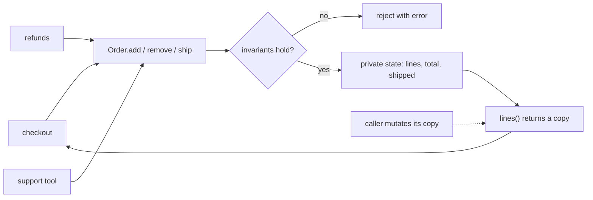

## In one minute
- Encapsulation means an object owns its data and every change goes through code that keeps it valid. The point is protecting invariants, not hiding fields.
- A private field with a public getter and setter is not encapsulated. Ask what rule must always hold, and whether any outside path can break it.
- The usual leaks are aliases: returning an internal list, or storing a list the caller still holds.
- `private` means different things at runtime. Java enforces it in the JVM, JavaScript `#fields` are truly inaccessible, Go hides lowercase names at package level, TypeScript `private` disappears at compile time, and Python only renames `__x` to `_Class__x`.
- Agents often "fix" a compile error by making a field public, add a setter for every field, or have tests poke at `obj._items`. Each one moves an invariant out of the class and into everyone's memory.

## How it works

### The problem: rules that live in callers
An order has line items and a total. The first version is a plain record:

```python
class Order:
    def __init__(self):
        self.items = []        # list of (sku, qty, unit_cents)
        self.total_cents = 0
        self.status = "open"
```

Checkout appends to `items` and adds to `total_cents`. The refund handler removes an item and forgets to subtract. A support tool sets `status = "shipped"` on an empty order. Every rule ("total equals the sum of the lines", "a shipped order cannot change") is enforced, or not, by whichever of 40 call sites touched the data last.

### Move the rules next to the data
```python
class Order:
    def __init__(self):
        self._lines = {}
        self._total = 0
        self._shipped = False

    def add(self, sku, qty, unit_cents):
        if self._shipped:
            raise ValueError("order already shipped")
        if qty <= 0:
            raise ValueError("quantity must be positive")
        old_qty, _ = self._lines.get(sku, (0, unit_cents))
        self._lines[sku] = (old_qty + qty, unit_cents)
        self._total += qty * unit_cents

    def total_cents(self):
        return self._total
```

Now each invariant has one guardian. Callers say what they want (`add`, `ship`) instead of pulling data out, deciding, and pushing new data back: the "tell, don't ask" style. The representation is also free to change: `_total` could be computed on demand without any caller noticing.

### Getters and setters are not encapsulation
Generating `get_total()` and `set_total()` changes the syntax and keeps the problem: the setter is a public door to the same invariant. Expose domain operations (`apply_discount(pct)`, `ship()`) and read access only where callers need it. A type with no rules, such as a DTO or config record, is honestly a plain struct.

### Aliasing: the leak that passes review
```go
func (o *Order) Lines() []Line { return o.lines }
```

The returned slice shares the backing array, so `lines[0].Qty = 100` changes the order without touching the total. The leak also runs inbound: `NewOrder(lines)` that stores the caller's slice lets the caller keep mutating it. Python lists, Java `ArrayList`s and JavaScript arrays behave the same way.

Fixes, from cheapest to strongest:
- **Copy at the boundary** on the way in and out (`slices.Clone`, `list(self._lines)`, `[...this.lines]`).
- **Read-only views**: `types.MappingProxyType` in Python and `Collections.unmodifiableList` in Java are wrappers that refuse writes. TypeScript `ReadonlyArray` is compile-time only.
- **Iteration instead of collections**: offer `for_each` or an iterator, so no container escapes.
- **Immutable values**: if `Line` is immutable and the collection is persistent, sharing is safe and copying is unnecessary.

### Encapsulation beyond the class
A Go `internal/` directory hides a package from code outside its parent tree, and a Java module exports only the packages it lists. A service whose tables other teams query directly is not encapsulated: its schema is frozen by people it has never met. The Coupling and Cohesion lesson covers measuring such dependencies.

### When not to bother
- **Plain data.** Records, events and DTOs with no rules gain nothing from private fields and accessors.
- **Inside a small module.** Two functions in the same file sharing a struct do not need a defensive API between them.
- **Hot paths where copying dominates.** Return a read-only view or an iterator instead of copying a 100,000-element list per call.

### Reviewing agent-written code
Agents optimise for compiling and passing. When code needs a private field, the quickest fix is a setter; when a test needs state, it is `order._lines` or `(order as any).lines`. In review, look for new setters, internal collections in return values, constructors storing caller-owned lists, and tests reaching into private state. Ask for domain operations, copies or views at the boundary, and tests through the public API.

### The same shape elsewhere
Encapsulation is the *multi-step consistency* shape solved by giving one party exclusive write access. A database enforces `CHECK` constraints and foreign keys so no client can write an inconsistent row. A Kubernetes controller is the only writer of a resource's `status`. A mutex only works if every access goes through the lock, which is the same thing as all access going through methods.

## Down the stack

### Layer 1: The contract
An encapsulated type promises that its invariants hold before and after every public operation, and that outside code reaches its representation only through those operations. The compiler, the runtime or only convention enforces this, depending on the language, and none makes it a security boundary inside a process: reflection, `unsafe` or a debugger gets through.

### Layer 2: The mechanism
**Python.** A single underscore (`_lines`) is convention only; tools such as linters and `from module import *` respect it. A double underscore (`__lines`) inside a class body is rewritten by the compiler to `_Order__lines` in the bytecode, so a subclass's `__lines` does not collide with the parent's. It is name mangling for collision avoidance, not access control: `order._Order__lines` works. A frozen dataclass blocks assignment by overriding `__setattr__`, which `object.__setattr__(obj, "x", 1)` bypasses.

**TypeScript.** `private` and `readonly` are type-checker rules. `tsc` emits an ordinary JavaScript property, so `(o as any).lines`, `Object.keys(o)` and `JSON.stringify(o)` all see it.

**JavaScript `#private`.** A `#lines` field is not a property at all. Each evaluation of a class body creates a unique private name, and the field is stored on the instance under that name, where only code lexically inside the class can name it. `Object.keys`, `Reflect.ownKeys` and `JSON.stringify` do not see it, reading it on the wrong object throws `TypeError`, and `#lines in obj` is a brand check that tells you whether an object came from this class. One consequence: a `Proxy` around such an object breaks methods that read `#lines`, because the proxy itself does not have the field.

**Go.** Visibility is decided by the first letter of the identifier and enforced per package by the compiler. Every file in the package sees everything, so a package, not a struct, is Go's unit of encapsulation. The `reflect` package can read an unexported field's value, but `CanSet` reports false and calling `Interface()` on it panics; only `unsafe` pointer arithmetic gets past that.

**Java.** `private` is checked by the compiler and again by the JVM's access control when a call or field reference is resolved. `setAccessible(true)` used to open anything; since JDK 16 and 17 (JEP 396 and JEP 403), reflection into packages a module does not open fails unless the application is launched with `--add-opens`.

### Layer 3: The machine
Encapsulation through methods is usually free after compilation. A Go or JVM getter that returns a field is inlined to a single load at a fixed offset from the object pointer, the same instruction as a public field access. V8 implements `#private` fields as properties keyed by private symbols, so they use the same hidden classes and inline caches as public fields and cost the same. CPython is the exception: a `property` is a descriptor that runs a Python function, typically two to three times the cost of a plain attribute load.

The real costs are copies. Returning a defensive copy of a 10,000-element slice of 24-byte structs allocates 240 KB and does a `memmove` of the same size, about 10 to 30 us plus garbage collector work. Called once per request that is invisible; called inside a loop it dominates the profile. Views and iterators avoid the allocation.

Encapsulation is also what makes a lock mean anything. A mutex protects only the paths that take it: if `Lines()` returns the internal slice, a caller reads it while another goroutine appends under the lock, a race the lock never sees. `go test -race` catches it because it tracks memory accesses, not methods.

### Why it's built this way
1. Rules that span several fields (total equals the sum of lines) can only be kept if every write goes through code that knows the rule.
2. The fewer places can write, the fewer places can break the rule, so access is narrowed to a type or a package.
3. Narrowing costs nothing at runtime once calls are inlined, so most languages enforce it at compile time and leave escape hatches for tools.
4. References make sharing cheap but let state escape the boundary, so data crossing it is copied, viewed read-only, or made immutable.

## Diagram


## Worked example
A subscription billing service had a `Plan` object with a public `prices` map (currency to cents) and a cached `display_price` string. Eleven code paths wrote to `prices`, three of which also refreshed `display_price`. In one quarter, support logged 230 tickets where the checkout page showed a different price from the invoice. Every ticket traced to a path that updated `prices` and not the cache.

The fix made `prices` private, added `set_price(currency, cents)` that validated the currency and refreshed the display string, and made `prices()` return a read-only view. Moving the 11 call sites took two days. Tickets of that kind fell to zero, and a later change that computed `display_price` on demand instead of caching it touched one file.

The one performance surprise was a reporting job that called `prices()` for each of 2 million plans. The first version returned a copied dict, adding 2 million small allocations and about 4 seconds to a 40-second job. Switching to `MappingProxyType`, which wraps the dict without copying, removed the overhead.

## Trade-offs
| Option | Strengths | Weaknesses | Choose when |
| --- | --- | --- | --- |
| Public fields | Simple, fast, no boilerplate | Any caller can break rules | Plain data with no invariants |
| Private fields with domain operations | One place guards each rule | More API to design | State with rules that span fields |
| Getters and setters for every field | Familiar | Same exposure as public fields, more code | Rarely; frameworks that demand it |
| Defensive copies | Simple, complete isolation | Allocation per call | Small collections, cold paths |
| Read-only views or iterators | No copy | Caller sees later changes; views can be cast away in some languages | Large collections, hot paths |
| Immutable values | Safe to share across threads | New object per change | Value objects, concurrent readers |

## Pitfalls in production
- Returning internal mutable collections, so callers change state without passing the rules. Fix: copy, view or iterate at the boundary.
- Storing caller-owned lists or slices in constructors. Fix: copy on the way in.
- A setter for every field "for flexibility". Fix: replace with operations named after domain actions, each checking its rule.
- Treating TypeScript `private` or Python `_x` as a security boundary, for example for secrets in objects that get logged. Fix: keep secrets out of serialised objects; use `#private` or a separate holder.
- Tests that read private state and break on every refactor. Fix: assert through public behaviour; if that is hard, the class is probably missing an operation.
- A mutex inside a struct whose methods leak references to protected data. Fix: never return references to guarded state; run tests with `-race`.

## Leadership lens
- Ask "what are the invariants and who can break them?" in design review. If the answer is "anyone with the object", the design is not done.
- Treat schema access the same way: a service whose tables other teams read directly cannot change its own representation. Budget for an API instead.
- Watch for setter sprawl in agent-written diffs; it is a cheap signal that domain logic is leaking into callers.
- Do not mandate getters and setters as a style rule. It produces boilerplate without protecting anything and teaches the wrong lesson.

## Check yourself
1. A class has private fields and a public getter and setter for each. In what sense is it not encapsulated?
   **Answer:** Any caller can still set any field to any value, so the class enforces no rules. Encapsulation protects invariants through meaningful operations, not through access syntax.
2. A Go method returns `o.items` where `items` is a slice. What can a caller do with it that breaks the object?
   **Answer:** Overwrite elements in place, since the returned slice shares the backing array; the object's derived state, such as a cached total, no longer matches.
3. Why does Python rewrite `__balance` to `_Account__balance`?
   **Answer:** To stop a subclass that also defines `__balance` from silently overwriting the parent's attribute. It is collision avoidance; the mangled name is still reachable.
4. What does `#token in obj` tell you in JavaScript that `"token" in obj` cannot?
   **Answer:** Whether `obj` was constructed by this exact class (it carries this class's private name), not merely whether it has a property called `token`.

## Practice
**Task:** Build `RangeSet`, a set of integers stored as half-open ranges `[lo, hi)`, that keeps its invariants no matter what callers do. Internally the ranges must stay sorted, non-overlapping and non-adjacent (`[1, 3)` and `[3, 5)` become `[1, 5)`). `add(lo, hi)` adds every integer in the range; `remove(lo, hi)` removes them, splitting a range if needed. Both fail with `bad range: [lo, hi)` (for example `bad range: [5, 5)`) when `lo >= hi`. `contains(x)` reports membership. `size()` returns how many integers the set holds. `ranges()` returns the ranges as a list of `[lo, hi]` pairs in order, and must be a fresh copy: changing what it returns must not affect the set. Python raises `ValueError`, TypeScript throws `Error`, Go returns an error.

```python starter
class RangeSet:
    def __init__(self):
        self._spans = []   # sorted, disjoint, non-adjacent (lo, hi) pairs

    def add(self, lo, hi):
        # TODO: validate, then merge with overlapping or adjacent spans
        raise NotImplementedError

    def remove(self, lo, hi):
        # TODO
        raise NotImplementedError

    def contains(self, x):
        # TODO
        raise NotImplementedError

    def size(self):
        # TODO
        raise NotImplementedError

    def ranges(self):
        # TODO: return a copy
        raise NotImplementedError
```

```python tests
def error_of(fn):
    try:
        fn()
    except ValueError as e:
        return str(e)
    return None

def test_add_merges_overlapping_and_adjacent():
    s = RangeSet()
    s.add(10, 20)
    s.add(1, 3)
    s.add(3, 5)
    s.add(15, 25)
    assert s.ranges() == [[1, 5], [10, 25]]
    assert s.size() == 19

def test_add_bridges_several_ranges():
    s = RangeSet()
    for lo in (0, 10, 20, 30):
        s.add(lo, lo + 2)
    s.add(1, 21)
    assert s.ranges() == [[0, 22], [30, 32]]

def test_remove_splits_and_trims():
    s = RangeSet()
    s.add(0, 10)
    s.remove(3, 5)
    assert s.ranges() == [[0, 3], [5, 10]]
    s.remove(8, 100)
    s.remove(-5, 1)
    assert s.ranges() == [[1, 3], [5, 8]]
    assert s.size() == 5

def test_contains_respects_half_open_bounds():
    s = RangeSet()
    s.add(5, 8)
    assert s.contains(5) and s.contains(7)
    assert not s.contains(8) and not s.contains(4)
    s.remove(6, 7)
    assert not s.contains(6) and s.contains(7)

def test_bad_ranges_rejected_and_state_unchanged():
    s = RangeSet()
    s.add(1, 4)
    assert error_of(lambda: s.add(5, 5)) == "bad range: [5, 5)"
    assert error_of(lambda: s.remove(9, 2)) == "bad range: [9, 2)"
    assert s.ranges() == [[1, 4]] and s.size() == 3

def test_returned_ranges_are_a_copy():
    s = RangeSet()
    s.add(0, 10)
    r = s.ranges()
    r[0][1] = 1000
    r.append([50, 60])
    assert s.ranges() == [[0, 10]]
    assert s.size() == 10 and not s.contains(55)

def test_empty_set():
    s = RangeSet()
    assert s.ranges() == [] and s.size() == 0 and not s.contains(0)
    s.remove(0, 5)
    assert s.ranges() == []
```

```python solution
class RangeSet:
    def __init__(self):
        self._spans = []   # sorted, disjoint, non-adjacent (lo, hi) pairs
        self._size = 0

    def _check(self, lo, hi):
        if lo >= hi:
            raise ValueError("bad range: [%d, %d)" % (lo, hi))

    def _replace(self, spans):
        self._spans = spans
        self._size = sum(hi - lo for lo, hi in spans)

    def add(self, lo, hi):
        self._check(lo, hi)
        out = []
        placed = False
        for a, b in self._spans:
            if b < lo:
                out.append((a, b))
            elif a > hi:
                if not placed:
                    out.append((lo, hi))
                    placed = True
                out.append((a, b))
            else:
                lo, hi = min(a, lo), max(b, hi)
        if not placed:
            out.append((lo, hi))
        self._replace(out)

    def remove(self, lo, hi):
        self._check(lo, hi)
        out = []
        for a, b in self._spans:
            if b <= lo or a >= hi:
                out.append((a, b))
                continue
            if a < lo:
                out.append((a, lo))
            if b > hi:
                out.append((hi, b))
        self._replace(out)

    def contains(self, x):
        for a, b in self._spans:
            if a <= x < b:
                return True
            if a > x:
                return False
        return False

    def size(self):
        return self._size

    def ranges(self):
        return [[a, b] for a, b in self._spans]
```

```typescript starter
export class RangeSet {
  #spans: [number, number][] = [];

  add(lo: number, hi: number): void { throw new Error("TODO"); }
  remove(lo: number, hi: number): void { throw new Error("TODO"); }
  contains(x: number): boolean { throw new Error("TODO"); }
  size(): number { throw new Error("TODO"); }
  ranges(): [number, number][] { throw new Error("TODO"); }
}
```

```typescript tests
function errorOf(fn: () => void): string | undefined {
  try { fn(); } catch (e) { return (e as Error).message; }
  return undefined;
}

test("add merges overlapping and adjacent", () => {
  const s = new RangeSet();
  s.add(10, 20);
  s.add(1, 3);
  s.add(3, 5);
  s.add(15, 25);
  assertEqual(s.ranges(), [[1, 5], [10, 25]]);
  assertEqual(s.size(), 19);
});

test("add bridges several ranges", () => {
  const s = new RangeSet();
  for (const lo of [0, 10, 20, 30]) s.add(lo, lo + 2);
  s.add(1, 21);
  assertEqual(s.ranges(), [[0, 22], [30, 32]]);
});

test("remove splits and trims", () => {
  const s = new RangeSet();
  s.add(0, 10);
  s.remove(3, 5);
  assertEqual(s.ranges(), [[0, 3], [5, 10]]);
  s.remove(8, 100);
  s.remove(-5, 1);
  assertEqual(s.ranges(), [[1, 3], [5, 8]]);
  assertEqual(s.size(), 5);
});

test("contains respects half-open bounds", () => {
  const s = new RangeSet();
  s.add(5, 8);
  assert(s.contains(5) && s.contains(7), "5 and 7 inside");
  assert(!s.contains(8) && !s.contains(4), "8 and 4 outside");
  s.remove(6, 7);
  assert(!s.contains(6) && s.contains(7), "6 removed, 7 kept");
});

test("bad ranges rejected and state unchanged", () => {
  const s = new RangeSet();
  s.add(1, 4);
  assertEqual(errorOf(() => s.add(5, 5)), "bad range: [5, 5)");
  assertEqual(errorOf(() => s.remove(9, 2)), "bad range: [9, 2)");
  assertEqual(s.ranges(), [[1, 4]]);
  assertEqual(s.size(), 3);
});

test("returned ranges are a copy", () => {
  const s = new RangeSet();
  s.add(0, 10);
  const r = s.ranges();
  r[0][1] = 1000;
  r.push([50, 60]);
  assertEqual(s.ranges(), [[0, 10]]);
  assertEqual(s.size(), 10);
  assert(!s.contains(55), "55 not added");
});

test("empty set", () => {
  const s = new RangeSet();
  assertEqual(s.ranges(), []);
  assertEqual(s.size(), 0);
  assert(!s.contains(0), "empty");
  s.remove(0, 5);
  assertEqual(s.ranges(), []);
});
```

```typescript solution
export class RangeSet {
  // Invariant: sorted, disjoint, non-adjacent; #size equals the sum of lengths.
  #spans: [number, number][] = [];
  #size = 0;

  #check(lo: number, hi: number): void {
    if (lo >= hi) throw new Error(`bad range: [${lo}, ${hi})`);
  }

  #replace(spans: [number, number][]): void {
    this.#spans = spans;
    this.#size = spans.reduce((n, [a, b]) => n + (b - a), 0);
  }

  add(lo: number, hi: number): void {
    this.#check(lo, hi);
    const out: [number, number][] = [];
    let placed = false;
    for (const [a, b] of this.#spans) {
      if (b < lo) {
        out.push([a, b]);
      } else if (a > hi) {
        if (!placed) { out.push([lo, hi]); placed = true; }
        out.push([a, b]);
      } else {
        lo = Math.min(a, lo);
        hi = Math.max(b, hi);
      }
    }
    if (!placed) out.push([lo, hi]);
    this.#replace(out);
  }

  remove(lo: number, hi: number): void {
    this.#check(lo, hi);
    const out: [number, number][] = [];
    for (const [a, b] of this.#spans) {
      if (b <= lo || a >= hi) { out.push([a, b]); continue; }
      if (a < lo) out.push([a, lo]);
      if (b > hi) out.push([hi, b]);
    }
    this.#replace(out);
  }

  contains(x: number): boolean {
    for (const [a, b] of this.#spans) {
      if (a <= x && x < b) return true;
      if (a > x) return false;
    }
    return false;
  }

  size(): number { return this.#size; }

  ranges(): [number, number][] {
    return this.#spans.map(([a, b]) => [a, b] as [number, number]);
  }
}
```

```go starter
package practice

// RangeSet holds integers as half-open ranges [lo, hi).
type RangeSet struct {
	spans [][2]int // sorted, disjoint, non-adjacent
}

func (s *RangeSet) Add(lo, hi int) error    { panic("TODO") }
func (s *RangeSet) Remove(lo, hi int) error { panic("TODO") }
func (s *RangeSet) Contains(x int) bool     { panic("TODO") }
func (s *RangeSet) Size() int               { panic("TODO") }
func (s *RangeSet) Ranges() [][2]int        { panic("TODO") }
```

```go tests
package practice

import (
	"reflect"
	"testing"
)

func want(t *testing.T, s *RangeSet, exp [][2]int) {
	t.Helper()
	got := s.Ranges()
	if len(got) == 0 && len(exp) == 0 {
		return
	}
	if !reflect.DeepEqual(got, exp) {
		t.Fatalf("ranges: want %v, got %v", exp, got)
	}
}

func must(t *testing.T, err error) {
	t.Helper()
	if err != nil {
		t.Fatal(err)
	}
}

func TestAddMergesOverlappingAndAdjacent(t *testing.T) {
	s := &RangeSet{}
	must(t, s.Add(10, 20))
	must(t, s.Add(1, 3))
	must(t, s.Add(3, 5))
	must(t, s.Add(15, 25))
	want(t, s, [][2]int{{1, 5}, {10, 25}})
	if s.Size() != 19 {
		t.Fatalf("size %d", s.Size())
	}
}

func TestAddBridgesSeveralRanges(t *testing.T) {
	s := &RangeSet{}
	for _, lo := range []int{0, 10, 20, 30} {
		must(t, s.Add(lo, lo+2))
	}
	must(t, s.Add(1, 21))
	want(t, s, [][2]int{{0, 22}, {30, 32}})
}

func TestRemoveSplitsAndTrims(t *testing.T) {
	s := &RangeSet{}
	must(t, s.Add(0, 10))
	must(t, s.Remove(3, 5))
	want(t, s, [][2]int{{0, 3}, {5, 10}})
	must(t, s.Remove(8, 100))
	must(t, s.Remove(-5, 1))
	want(t, s, [][2]int{{1, 3}, {5, 8}})
	if s.Size() != 5 {
		t.Fatalf("size %d", s.Size())
	}
}

func TestContainsRespectsHalfOpenBounds(t *testing.T) {
	s := &RangeSet{}
	must(t, s.Add(5, 8))
	if !s.Contains(5) || !s.Contains(7) || s.Contains(8) || s.Contains(4) {
		t.Fatal("bounds wrong")
	}
	must(t, s.Remove(6, 7))
	if s.Contains(6) || !s.Contains(7) {
		t.Fatal("remove wrong")
	}
}

func TestBadRangesRejectedAndStateUnchanged(t *testing.T) {
	s := &RangeSet{}
	must(t, s.Add(1, 4))
	if err := s.Add(5, 5); err == nil || err.Error() != "bad range: [5, 5)" {
		t.Fatalf("got %v", err)
	}
	if err := s.Remove(9, 2); err == nil || err.Error() != "bad range: [9, 2)" {
		t.Fatalf("got %v", err)
	}
	want(t, s, [][2]int{{1, 4}})
	if s.Size() != 3 {
		t.Fatalf("size %d", s.Size())
	}
}

func TestReturnedRangesAreACopy(t *testing.T) {
	s := &RangeSet{}
	must(t, s.Add(0, 10))
	r := s.Ranges()
	r[0][1] = 1000
	_ = append(r[:1], [2]int{50, 60})
	want(t, s, [][2]int{{0, 10}})
	if s.Size() != 10 || s.Contains(55) {
		t.Fatal("internal state changed through returned slice")
	}
}

func TestEmptySet(t *testing.T) {
	s := &RangeSet{}
	if len(s.Ranges()) != 0 || s.Size() != 0 || s.Contains(0) {
		t.Fatal("empty set not empty")
	}
	must(t, s.Remove(0, 5))
	want(t, s, nil)
}
```

```go solution
package practice

import "fmt"

// RangeSet holds integers as half-open ranges [lo, hi).
type RangeSet struct {
	spans [][2]int // sorted, disjoint, non-adjacent
	size  int      // always the sum of span lengths
}

func check(lo, hi int) error {
	if lo >= hi {
		return fmt.Errorf("bad range: [%d, %d)", lo, hi)
	}
	return nil
}

func (s *RangeSet) replace(spans [][2]int) {
	s.spans = spans
	s.size = 0
	for _, sp := range spans {
		s.size += sp[1] - sp[0]
	}
}

func (s *RangeSet) Add(lo, hi int) error {
	if err := check(lo, hi); err != nil {
		return err
	}
	out := make([][2]int, 0, len(s.spans)+1)
	placed := false
	for _, sp := range s.spans {
		a, b := sp[0], sp[1]
		switch {
		case b < lo:
			out = append(out, sp)
		case a > hi:
			if !placed {
				out = append(out, [2]int{lo, hi})
				placed = true
			}
			out = append(out, sp)
		default:
			lo, hi = min(a, lo), max(b, hi)
		}
	}
	if !placed {
		out = append(out, [2]int{lo, hi})
	}
	s.replace(out)
	return nil
}

func (s *RangeSet) Remove(lo, hi int) error {
	if err := check(lo, hi); err != nil {
		return err
	}
	out := make([][2]int, 0, len(s.spans)+1)
	for _, sp := range s.spans {
		a, b := sp[0], sp[1]
		if b <= lo || a >= hi {
			out = append(out, sp)
			continue
		}
		if a < lo {
			out = append(out, [2]int{a, lo})
		}
		if b > hi {
			out = append(out, [2]int{hi, b})
		}
	}
	s.replace(out)
	return nil
}

func (s *RangeSet) Contains(x int) bool {
	for _, sp := range s.spans {
		if sp[0] <= x && x < sp[1] {
			return true
		}
		if sp[0] > x {
			return false
		}
	}
	return false
}

func (s *RangeSet) Size() int { return s.size }

// Ranges returns a copy, so callers cannot reach the internal slice.
func (s *RangeSet) Ranges() [][2]int {
	out := make([][2]int, len(s.spans))
	copy(out, s.spans)
	return out
}
```

## Mock interview
**Prompt:** Design the `Cart` for a checkout handling 3,000 orders per minute at peak. Carts hold line items, coupons and a total, and are read by pricing, inventory and the web front end. Last quarter a bug applied a coupon twice.

- Follow-up: The front end needs the list of items to render. What does `items()` return, and why?
- Follow-up: Pricing runs in parallel goroutines that read the cart while the user adds items. How do you keep reads consistent?
- Follow-up: A team wants direct read access to the cart table for analytics. What do you say?

**A strong answer covers:**
- Invariants stated explicitly: positive quantities, each coupon at most once, total equal to the priced lines minus discounts, no changes after checkout starts.
- Operations named after actions (`add_item`, `apply_coupon`) that check those rules; no setters.
- Returning copies or immutable snapshots of items, so the front end and pricing cannot mutate the cart through a shared reference.
- Concurrency handled inside the cart: a lock around every operation, or an immutable cart replaced atomically, with no references to guarded state escaping.
- An event stream or a read model for analytics instead of direct table access, so the cart's storage can change without breaking another team.

## Watch
- [Core Design Principles for Software Developers (Venkat Subramaniam, Devoxx)](https://www.youtube.com/watch?v=llGgO74uXMI): a practical talk on keeping design simple, cohesive and well encapsulated.
- [Object-Oriented Programming is Bad (Brian Will)](https://www.youtube.com/watch?v=QM1iUe6IofM): a strong critique of encapsulation applied at the wrong granularity, worth watching to sharpen your own position.

## Free resources
- [TellDontAsk (Martin Fowler)](https://martinfowler.com/bliki/TellDontAsk.html): moving behaviour next to the data it guards, and where the idea stops being useful.
- [Private properties (MDN)](https://developer.mozilla.org/en-US/docs/Web/JavaScript/Reference/Classes/Private_properties): the exact semantics of `#private` fields, brand checks and their interaction with proxies.
- [Private Variables (Python tutorial)](https://docs.python.org/3/tutorial/classes.html#private-variables): name mangling explained by the language's own documentation.
- [JEP 403: Strongly Encapsulate JDK Internals](https://openjdk.org/jeps/403): how Java closed reflective access to private internals and what `--add-opens` does.
- [On the Criteria To Be Used in Decomposing Systems into Modules (David Parnas, 1972)](https://www.win.tue.nl/~wstomv/edu/2ip30/references/criteria_for_modularization.pdf): the paper that introduced information hiding.
- [Internal directories (Go command docs)](https://pkg.go.dev/cmd/go#hdr-Internal_Directories): package-level encapsulation enforced by the Go toolchain.
