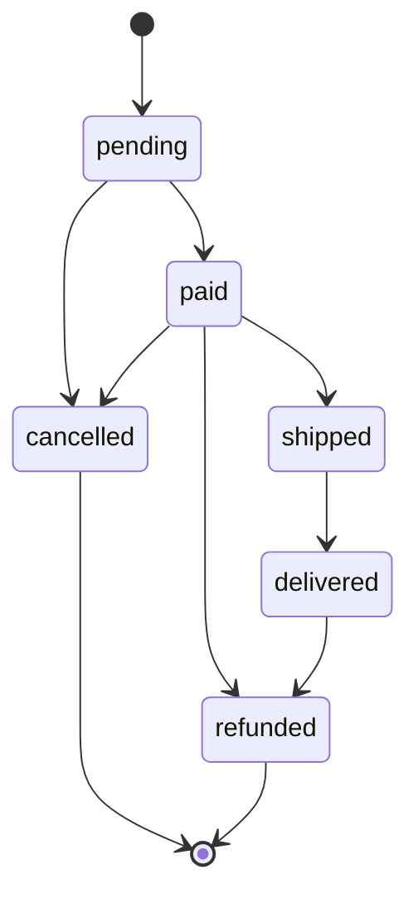

## In one minute
- An enum is a type with a fixed, named set of values: order statuses, card suits, log levels, HTTP methods. It replaces magic strings and integers with names the compiler or runtime can check, so `"canceled"` versus `"cancelled"` becomes an error instead of a silent new state.
- The big win is exhaustiveness. When code switches over an enum, a good toolchain tells you about every place that forgot the new member you just added. Rust, Swift, Kotlin and TypeScript (with a `never` check) do this; Python and Go need a test or a linter.
- Enums live in three places at once: in memory as a small integer or singleton object, on the wire as a string or number, and in the database as a column. The in-memory form is free to change; the wire and storage forms are a contract.
- Serialise by name, not by position. Persisting ordinals means inserting a member in the middle silently renames every stored row. Parse at the edge, strictly, with aliases for legacy spellings and a clear error for unknown values.
- Agents scatter string literals (`if status == "shipped"`) and add `default:` branches that swallow new members. Review asks for one enum, one parse function, one transition table and a test that every member is covered.

## How it works

### Strings everywhere
An order service stored `status` as a free-form string. Two years later the database contains `paid`, `Paid`, `canceled`, `cancelled` and `cancel`, because six services wrote it with their own spellings. The fulfilment worker checks `status == "paid"` and skips every `Paid` order.

An enum gives the set a single definition:

```python
class OrderStatus(Enum):
    PENDING = "pending"
    PAID = "paid"
    SHIPPED = "shipped"
    DELIVERED = "delivered"
    CANCELLED = "cancelled"
    REFUNDED = "refunded"
```

Inside the program there is now exactly one `PAID`, and a typo like `OrderStatus.PIAD` fails at the point of use. Strings still arrive at the edges (HTTP bodies, queue messages, old rows), so one `parse_status` function turns them into members: trim, lowercase, map known legacy spellings such as `canceled`, and reject everything else with an error that names the bad value. Everything past the edge handles members, never raw strings.

### Transitions as a table
Order statuses are not just labels; they move. Pending orders can be paid or cancelled, paid orders can ship, be cancelled or be refunded, and delivered orders can be refunded. Encode that as data, one entry per member:

```python
TRANSITIONS = {
    PENDING:   [PAID, CANCELLED],
    PAID:      [SHIPPED, CANCELLED, REFUNDED],
    SHIPPED:   [DELIVERED],
    DELIVERED: [REFUNDED],
    CANCELLED: [],
    REFUNDED:  [],
}
```

Now `transition(current, target)` is a lookup, illegal moves fail with a message naming both ends, "terminal" is derived (no outgoing edges), and the whole lifecycle fits on one screen. When each status needs real behaviour (different validation, side effects, timers), the State pattern from its own lesson gives each status a class; for a lifecycle that is mostly "which moves are legal", an enum and a table are clearer and cheaper.

### Exhaustiveness
Adding `ON_HOLD` must force every piece of code that reasons about statuses to decide what to do with it. Languages give that guarantee in different ways:

- **TypeScript:** model statuses as a union of string literals (`type OrderStatus = "pending" | "paid" | ...`). A `Record<OrderStatus, ...>` must list every key, and a `switch` whose `default` assigns the value to `never` fails to compile when a case is missing.
- **Rust, Swift, Kotlin:** `match`, `switch` and `when` over an enum must be exhaustive, or the compiler rejects them.
- **Java:** a `switch` expression over an enum (Java 14 and later) must cover every constant unless it has a `default`.
- **Go:** constants declared with `iota` are not a closed set; any integer converts to the type, and `switch` is never checked. The `exhaustive` linter fills the gap, and a test that iterates over an `All` slice catches table gaps.
- **Python:** `match` does not check exhaustiveness, but a type checker such as mypy or pyright can with `assert_never`, and a one-line test that every member has a table entry covers the rest.

The common trap in every language is `default:`. A default branch tells the compiler "I have handled everything else", so a new member falls into it silently. Prefer listing every member and keeping the default only for genuinely open sets.

### Parsing and serialisation
The wire form is a contract with other services and with your own past. Use stable lowercase names, not ordinals, and not the language's default representation if that might change. Kubernetes' API conventions go one step further: avoid numeric enums, use CamelCase strings such as `Pending` or `ClusterFirst`, and note that adding a value to a phase-style field breaks compatibility ([API conventions](https://github.com/kubernetes/community/blob/master/contributors/devel/sig-architecture/api-conventions.md)). Parse strictly, in one place, and decide deliberately what an unknown value means. For a command ("set status to X"), reject it. For data from a newer producer (a status added by a service that deployed first), a tolerant reader may map it to an explicit `UNKNOWN` member and skip the record, so an old consumer does not crash on a new value. Protocol Buffers bakes this in: the first proto3 enum value must be zero and is conventionally named `*_UNSPECIFIED`, and unrecognised numbers are preserved and re-serialised, as the raw integer in open-enum languages such as Go and as a special case in closed ones such as Java. Removed entries should be marked `reserved` so no one reuses the number ([Protobuf guide](https://protobuf.dev/programming-guides/proto3/)).

### Reviewing agent-written code
Asked to "add an on-hold status", an agent will often grep for `"shipped"`, add `"on_hold"` beside it in a few places, miss the others, and add a `default` branch where the compiler would have complained. Point it at the single enum, the parse function and the transition table, and ask for a test that iterates over every member. In review, check for raw string comparisons outside the parse function, `default` branches over closed enums, ordinals written to storage, and whether consumers deploy before producers start emitting the new value.

### The same shape elsewhere
An enum with a parse function is the *trust but verify* shape: outside data is untrusted until one gatekeeper validates it into a closed set. Kernels validate syscall numbers against a table and SQL `CHECK (status IN (...))` constraints do it at the storage layer, each deciding spellings, aliases and the unknown-value policy.

## Down the stack

### Layer 1: The contract
An enum promises a closed set: every value of the type is one of the declared members, members are distinct, and comparison is by identity or by a small integer. The parse function promises that every accepted input maps to exactly one member, that known aliases map to their canonical member, and that every other input fails with an error naming it. Serialisation promises that `parse(to_wire(m)) == m` for every member and that the wire name of a member never changes once published. The transition table promises an entry for every member.

### Layer 2: The mechanism
Python's `Enum` is built by the `EnumType` metaclass when the class body runs. Each member is a singleton instance created once, kept in lookup tables by name and by value, so `OrderStatus("paid")` returns the existing member and `is` comparison is safe ([Enum HOWTO](https://docs.python.org/3/howto/enum.html)). Members pickle by value by default, so renaming a stored value breaks old pickles; `enum.pickle_by_enum_name` opts in to pickling by name (same HOWTO). Extra names with the same value are aliases, left out of iteration unless you apply `@unique`. `StrEnum` (Python 3.11, [Enum HOWTO](https://docs.python.org/3/howto/enum.html)) makes members real strings, which compares equal to `"paid"` and also lets raw strings leak back in.

TypeScript numeric enums compile to an object with a reverse mapping (`Status[Status["Paid"] = 1] = "Paid"`), so `Status[1]` is `"Paid"`. String enums have no reverse mapping, `const enum` is inlined at use sites and breaks under single-file compilers, and the `--erasableSyntaxOnly` flag added in TypeScript 5.8 rejects enums entirely so code can run under Node's type-stripping ([TypeScript 5.8](https://devblogs.microsoft.com/typescript/announcing-typescript-5-8/)). The handbook itself suggests an `as const` object as an alternative ([Handbook](https://www.typescriptlang.org/docs/handbook/enums.html)). A union of string literals erases to nothing, which is why many codebases prefer it.

Go's `iota` numbers constants 0, 1, 2 within a `const` block, and the `stringer` tool generates a `String()` method that slices one concatenated string using an offsets array (`_Status_index`), so there is no map and no allocation. Implementing `encoding.TextMarshaler` and `TextUnmarshaler` makes `encoding/json` read and write the names. Java's `EnumSet` is a bit vector in a single `long` for up to 64 constants, and Rust stores a discriminant plus the largest payload, using spare bit patterns so `Option<&T>` is the size of a pointer.

### Layer 3: The machine
A plain enum is a small integer: one byte in Go with `uint8`, four bytes in C by default, and a pointer to a shared singleton in Python and Java. Comparing two members is one instruction, against a `memcmp` for strings (a few nanoseconds for short strings, more for long ones). A `switch` over dense values compiles to a jump table: a bounds check and an indirect jump, about 1 to 3 ns, or under 1 ns when predicted. A transition table over six statuses fits in six bytes as bitmasks, `allowed[from] & (1 << to)`, one load and one AND.

Storage is where size adds up. A Postgres enum column is 4 bytes per row and sorts in declaration order ([Postgres docs](https://www.postgresql.org/docs/current/datatype-enum.html)); a `text` column holding `"delivered"` is 10 bytes (1-byte header plus 9 characters) and sorts alphabetically. Across 500 million order rows that is roughly 3 GB of heap and index space. The catch is change: Postgres can add and rename enum values with `ALTER TYPE` but cannot remove one or reorder them without dropping and re-creating the type (same page), so fast-changing sets often use a `smallint` or `text` column with a `CHECK` constraint or a reference table instead. On the wire, a protobuf enum is a varint (1 byte for values under 128), while JSON carries the name, a few bytes more and far easier to debug.

### Why it's built this way
1. Free-form strings drift in spelling across writers, so the set of legal values is declared once as a type.
2. Programs change and sets grow, so the compiler or a test must find every place that does not handle a new member, which only works if the set is closed and switches avoid defaults.
3. Memory representation is an implementation detail but storage and wire formats outlive the code, so serialise stable names, not positions.
4. Other systems send values you do not recognise, so parsing happens at one edge with an explicit policy for unknowns.
5. Lifecycle rules are data about the set, so they live in a table keyed by member rather than in conditionals spread across services.

## Diagram


## Worked example
Picture a retailer's Java order service (a constructed scenario, not a reported incident) that mapped `OrderStatus` with JPA, whose `@Enumerated` default is `ORDINAL` ([Jakarta Persistence source](https://github.com/jakartaee/persistence/blob/master/api/src/main/java/jakarta/persistence/Enumerated.java); Hibernate documents both modes, [Hibernate guide](https://docs.hibernate.org/orm/6.4/userguide/html_single/Hibernate_User_Guide.html)), so the `status` column held 0 for `PENDING`, 1 for `PAID`, and so on. A developer added `AUTHORIZED` between `PENDING` and `PAID`, because that is where it belongs in the lifecycle. The deploy shifted every later member up by one: 1.4 million paid orders now read as authorised, shipped orders read as paid, and the fulfilment job started re-shipping about 2,000 orders before an alert on duplicate tracking numbers fired 40 minutes later.

Recovery took two days of reconciling writes from the audit log. The lasting fix: columns became `text` with a `CHECK` constraint listing the wire names; the enum gained an explicit `wire` field and one `parse` method with aliases for legacy spellings; a test asserted every member's wire name against a checked-in list, so reordering fails CI; and adding a status became a two-step rollout, consumers first. Storage grew by about 1.2 GB across 150 million rows, which the team judged cheap insurance.

## In the wild
- **Kubernetes API, ongoing: retiring `phase` enums.** The API conventions say the `phase` pattern is deprecated for new types and that adding new enum values breaks backward compatibility, because clients infer behaviour from the closed set. New APIs expose independent *conditions* as observations instead of one state-machine enum ([API conventions](https://github.com/kubernetes/community/blob/master/contributors/devel/sig-architecture/api-conventions.md)). Same lesson as the transition table: a lifecycle in an enum is a compatibility promise.
- **Jakarta Persistence and Hibernate, ongoing: ordinal as the default trap.** The specification's `@Enumerated` annotation defaults to `EnumType.ORDINAL`, which stores a member's position; `STRING` stores its name ([Jakarta source](https://github.com/jakartaee/persistence/blob/master/api/src/main/java/jakarta/persistence/Enumerated.java), [Hibernate guide](https://docs.hibernate.org/orm/6.4/userguide/html_single/Hibernate_User_Guide.html)). Inserting a constant mid-enum then silently re-labels stored rows. I found no public postmortem of such a failure, so the worked example above is illustrative.
- **Protocol Buffers, ongoing: reserved numbers.** The proto3 guide tells maintainers to mark deleted enum entries `reserved` so the number and name can never be reused with a new meaning, and the compiler errors if someone tries ([Protobuf guide](https://protobuf.dev/programming-guides/proto3/)).

## Trade-offs
| Option | Strengths | Weaknesses | Choose when |
| --- | --- | --- | --- |
| Raw strings or ints | No ceremony; any value accepted | Typos and drift; no exhaustiveness | Prototypes, truly open sets |
| Language enum, serialised by name | Closed set; readable wire format; safe reordering | A few bytes more than ordinals | Most business enums |
| Enum serialised by ordinal | Smallest storage and wire size | Reordering or inserting corrupts data | Never for persisted data, except with explicit fixed numbers (protobuf) |
| String literal union (TypeScript) | Zero runtime cost; exhaustive checks; erasable | No runtime list unless declared separately | TypeScript code, especially with type-stripping |
| Sum types with payloads (Rust, Swift) | Each variant carries exactly its data | Harder to store in a flat column | Rich domain states, parser results, errors |
| Reference table in the database | Values changeable without a deploy; labels editable | No compile-time checks; joins | Sets owned by operations, not by code |

## Pitfalls in production
- Ordinals persisted to a database or file, so adding a member in the middle remaps every row. Fix: store names or explicit fixed numbers, and test the mapping against a checked-in list.
- A `default` branch that swallows new members, so a new status is silently treated as some old one. Fix: list every member, and enable exhaustive checks (`never`, the Go `exhaustive` linter, mypy's `assert_never`).
- A producer emitting a new value before consumers understand it, crashing strict parsers. Fix: deploy consumers first, and use an explicit `UNKNOWN` member where tolerance is right.
- Go's zero value treated as a real member, so an unset field reads as `Pending`. Fix: reserve 0 for an invalid or unspecified member and reject it when serialising.
- Comparing members with raw strings (`status == "paid"`), which is always false for a plain Python `Enum` and quietly true for a `StrEnum`. Fix: compare members to members and keep strings at the edge.
- Renaming a member's wire value in a refactor. Fix: separate the code name from the wire name, and treat the wire name as a published API.

## Leadership lens
- Decide who owns the set. If product or operations add values weekly, a reference table beats a code enum; if code must react to each value, a code enum with exhaustive checks is safer.
- Treat adding an enum value as a compatibility event with a rollout order: readers first, writers second, as with any schema change.
- Ban ordinal persistence in review checklists and lint rules. It is a cheap rule that prevents an expensive class of incidents.
- Give agents the shape explicitly: one enum, one parse function at the edge, one transition table, a test that iterates over all members, no `default` on closed sets.

## Check yourself
1. Why is serialising an enum by ordinal dangerous even if nobody ever deletes a member?
   **Answer:** Inserting a member anywhere except the end shifts the ordinals of every later member, so stored numbers now decode to different members without any error.
2. Why does a `default:` branch weaken an exhaustive switch over an enum?
   **Answer:** It tells the compiler every remaining case is handled, so a newly added member falls into the default silently instead of producing a compile error at each switch that must decide what to do with it.
3. A consumer receives a status value it does not recognise. When should it reject the message and when should it map it to `UNKNOWN`?
   **Answer:** Reject when the value is a command or input you must act on correctly; map to `UNKNOWN` and skip when the data comes from a newer producer and failing would block unrelated processing.
4. Why might you derive "terminal" from the transition table instead of storing it as a separate flag?
   **Answer:** A terminal status is one with no outgoing transitions; deriving it keeps one source of truth, so adding a transition cannot leave a stale flag behind.

## Practice
**Task:** Implement an order-status enum with strict parsing, a transition table and JSON serialisation. Statuses, in declaration order, are `pending`, `paid`, `shipped`, `delivered`, `cancelled`, `refunded` (wire names). `parse_status(text)` trims and lowercases, accepts the alias `canceled` for `cancelled`, and otherwise fails with `unknown status: <text>` using the original text. `to_wire(status)` returns the wire name. `TRANSITIONS` maps every status to its allowed next statuses in declaration order: pending to paid and cancelled; paid to shipped, cancelled and refunded; shipped to delivered; delivered to refunded; cancelled and refunded to none. `check_table(table)` returns the statuses missing as keys, in declaration order. `allowed_next(s)` returns the table entry, `is_terminal(s)` is true when it is empty, and `transition(current, target)` returns `target` or fails with `illegal transition: <from> -> <to>`. `replay(events)` parses a list of wire strings and returns the final status: an empty list fails with `empty log`, the first must be pending (`step 0: must start at pending`), and later parse or transition errors are prefixed with `step <i>: `. `encode_order(id, status)` returns JSON with fields `id` and `status` (the wire name) and `decode_order(text)` returns the pair, failing with `missing status` if absent and with the parse error if unknown. In Go, `Status` is a `uint8` with `StatusUnknown = 0`, `String()`, and text marshalling, and marshalling `StatusUnknown` fails. Python raises `ValueError`, TypeScript throws `Error`, Go returns an error.

```python starter
import json
from enum import Enum

class OrderStatus(Enum):
    PENDING = "pending"
    PAID = "paid"
    SHIPPED = "shipped"
    DELIVERED = "delivered"
    CANCELLED = "cancelled"
    REFUNDED = "refunded"

TRANSITIONS = {}  # TODO: one entry per status

def parse_status(text):
    raise NotImplementedError

def to_wire(status):
    raise NotImplementedError

def check_table(table):
    raise NotImplementedError

def allowed_next(status):
    raise NotImplementedError

def is_terminal(status):
    raise NotImplementedError

def transition(current, target):
    raise NotImplementedError

def replay(events):
    raise NotImplementedError

def encode_order(order_id, status):
    raise NotImplementedError

def decode_order(text):
    raise NotImplementedError
```

```python tests
S = OrderStatus

def error_of(fn):
    try:
        fn()
    except ValueError as e:
        return str(e)
    return None

def test_parse_is_strict_with_aliases():
    assert parse_status(" Paid ") is S.PAID
    assert parse_status("CANCELED") is S.CANCELLED
    assert parse_status("cancelled") is S.CANCELLED
    assert error_of(lambda: parse_status("lost")) == "unknown status: lost"
    assert error_of(lambda: parse_status("")) == "unknown status: "

def test_wire_round_trip_for_every_member():
    assert to_wire(S.PAID) == "paid"
    for s in S:
        assert parse_status(to_wire(s)) is s

def test_table_is_exhaustive():
    assert check_table(TRANSITIONS) == []
    partial = dict(TRANSITIONS)
    del partial[S.REFUNDED]
    del partial[S.SHIPPED]
    assert check_table(partial) == [S.SHIPPED, S.REFUNDED]

def test_allowed_next_and_terminal():
    assert allowed_next(S.PAID) == [S.SHIPPED, S.CANCELLED, S.REFUNDED]
    assert allowed_next(S.DELIVERED) == [S.REFUNDED]
    assert [s for s in S if is_terminal(s)] == [S.CANCELLED, S.REFUNDED]

def test_transition():
    assert transition(S.PENDING, S.PAID) is S.PAID
    assert error_of(lambda: transition(S.SHIPPED, S.CANCELLED)) == "illegal transition: shipped -> cancelled"
    assert error_of(lambda: transition(S.PAID, S.PAID)) == "illegal transition: paid -> paid"

def test_replay():
    assert replay(["pending", "paid", "shipped", "delivered"]) is S.DELIVERED
    assert replay(["Pending", "PAID"]) is S.PAID
    assert error_of(lambda: replay([])) == "empty log"
    assert error_of(lambda: replay(["paid"])) == "step 0: must start at pending"
    assert error_of(lambda: replay(["pending", "paid", "pending"])) == "step 2: illegal transition: paid -> pending"
    assert error_of(lambda: replay(["pending", "teleported"])) == "step 1: unknown status: teleported"

def test_json_serialisation():
    text = encode_order("o1", S.PAID)
    assert json.loads(text) == {"id": "o1", "status": "paid"}
    assert decode_order(text) == ("o1", S.PAID)
    assert decode_order('{"id": "o2", "status": "Canceled"}') == ("o2", S.CANCELLED)
    assert error_of(lambda: decode_order('{"id": "o3", "status": "lost"}')) == "unknown status: lost"
    assert error_of(lambda: decode_order('{"id": "o4"}')) == "missing status"
```

```python solution
import json
from enum import Enum

class OrderStatus(Enum):
    PENDING = "pending"
    PAID = "paid"
    SHIPPED = "shipped"
    DELIVERED = "delivered"
    CANCELLED = "cancelled"
    REFUNDED = "refunded"

_S = OrderStatus

TRANSITIONS = {
    _S.PENDING: [_S.PAID, _S.CANCELLED],
    _S.PAID: [_S.SHIPPED, _S.CANCELLED, _S.REFUNDED],
    _S.SHIPPED: [_S.DELIVERED],
    _S.DELIVERED: [_S.REFUNDED],
    _S.CANCELLED: [],
    _S.REFUNDED: [],
}

_ALIASES = {"canceled": "cancelled"}

def parse_status(text):
    key = text.strip().lower()
    key = _ALIASES.get(key, key)
    try:
        return OrderStatus(key)
    except ValueError:
        raise ValueError("unknown status: " + text)

def to_wire(status):
    return status.value

def check_table(table):
    return [s for s in OrderStatus if s not in table]

def allowed_next(status):
    return list(TRANSITIONS[status])

def is_terminal(status):
    return not TRANSITIONS[status]

def transition(current, target):
    if target not in TRANSITIONS[current]:
        raise ValueError("illegal transition: %s -> %s" % (current.value, target.value))
    return target

def replay(events):
    if not events:
        raise ValueError("empty log")
    state = None
    for i, raw in enumerate(events):
        try:
            s = parse_status(raw)
            if i == 0:
                if s is not OrderStatus.PENDING:
                    raise ValueError("must start at pending")
                state = s
            else:
                state = transition(state, s)
        except ValueError as e:
            raise ValueError("step %d: %s" % (i, e))
    return state

def encode_order(order_id, status):
    return json.dumps({"id": order_id, "status": to_wire(status)})

def decode_order(text):
    obj = json.loads(text)
    if "status" not in obj:
        raise ValueError("missing status")
    return (obj["id"], parse_status(obj["status"]))
```

```typescript starter
export const ALL_STATUSES = ["pending", "paid", "shipped", "delivered", "cancelled", "refunded"] as const;
export type OrderStatus = typeof ALL_STATUSES[number];

// TODO: one entry per status (the Record type makes the compiler check that)
export const TRANSITIONS = {} as Record<OrderStatus, readonly OrderStatus[]>;

export function parseStatus(text: string): OrderStatus { throw new Error("TODO"); }
export function toWire(s: OrderStatus): string { throw new Error("TODO"); }
export function checkTable(table: Partial<Record<OrderStatus, readonly OrderStatus[]>>): OrderStatus[] { throw new Error("TODO"); }
export function allowedNext(s: OrderStatus): OrderStatus[] { throw new Error("TODO"); }
export function isTerminal(s: OrderStatus): boolean { throw new Error("TODO"); }
export function transition(current: OrderStatus, target: OrderStatus): OrderStatus { throw new Error("TODO"); }
export function replay(events: string[]): OrderStatus { throw new Error("TODO"); }
export function encodeOrder(id: string, s: OrderStatus): string { throw new Error("TODO"); }
export function decodeOrder(text: string): { id: string; status: OrderStatus } { throw new Error("TODO"); }
```

```typescript tests
function errorOf(fn: () => unknown): string | undefined {
  try { fn(); } catch (e) { return (e as Error).message; }
  return undefined;
}

test("parse is strict with aliases", () => {
  assertEqual(parseStatus(" Paid "), "paid");
  assertEqual(parseStatus("CANCELED"), "cancelled");
  assertEqual(parseStatus("cancelled"), "cancelled");
  assertEqual(errorOf(() => parseStatus("lost")), "unknown status: lost");
  assertEqual(errorOf(() => parseStatus("")), "unknown status: ");
  assertEqual(errorOf(() => parseStatus("toString")), "unknown status: toString");
});

test("wire round trip for every member", () => {
  assertEqual(toWire("paid"), "paid");
  for (const s of ALL_STATUSES) assertEqual(parseStatus(toWire(s)), s);
});

test("table is exhaustive", () => {
  assertEqual(checkTable(TRANSITIONS), []);
  const partial: Partial<Record<OrderStatus, readonly OrderStatus[]>> = { ...TRANSITIONS };
  delete partial.refunded;
  delete partial.shipped;
  assertEqual(checkTable(partial), ["shipped", "refunded"]);
});

test("allowed next and terminal", () => {
  assertEqual(allowedNext("paid"), ["shipped", "cancelled", "refunded"]);
  assertEqual(allowedNext("delivered"), ["refunded"]);
  assertEqual(ALL_STATUSES.filter((s) => isTerminal(s)), ["cancelled", "refunded"]);
});

test("transition", () => {
  assertEqual(transition("pending", "paid"), "paid");
  assertEqual(errorOf(() => transition("shipped", "cancelled")), "illegal transition: shipped -> cancelled");
  assertEqual(errorOf(() => transition("paid", "paid")), "illegal transition: paid -> paid");
});

test("replay", () => {
  assertEqual(replay(["pending", "paid", "shipped", "delivered"]), "delivered");
  assertEqual(replay(["Pending", "PAID"]), "paid");
  assertEqual(errorOf(() => replay([])), "empty log");
  assertEqual(errorOf(() => replay(["paid"])), "step 0: must start at pending");
  assertEqual(errorOf(() => replay(["pending", "paid", "pending"])), "step 2: illegal transition: paid -> pending");
  assertEqual(errorOf(() => replay(["pending", "teleported"])), "step 1: unknown status: teleported");
});

test("json serialisation", () => {
  const text = encodeOrder("o1", "paid");
  assertEqual(JSON.parse(text), { id: "o1", status: "paid" });
  assertEqual(decodeOrder(text), { id: "o1", status: "paid" });
  assertEqual(decodeOrder('{"id": "o2", "status": "Canceled"}'), { id: "o2", status: "cancelled" });
  assertEqual(errorOf(() => decodeOrder('{"id": "o3", "status": "lost"}')), "unknown status: lost");
  assertEqual(errorOf(() => decodeOrder('{"id": "o4"}')), "missing status");
});
```

```typescript solution
export const ALL_STATUSES = ["pending", "paid", "shipped", "delivered", "cancelled", "refunded"] as const;
export type OrderStatus = typeof ALL_STATUSES[number];

export const TRANSITIONS: Record<OrderStatus, readonly OrderStatus[]> = {
  pending: ["paid", "cancelled"],
  paid: ["shipped", "cancelled", "refunded"],
  shipped: ["delivered"],
  delivered: ["refunded"],
  cancelled: [],
  refunded: [],
};

const ALIASES: Record<string, OrderStatus> = { canceled: "cancelled" };

function isStatus(x: string): x is OrderStatus {
  return (ALL_STATUSES as readonly string[]).includes(x);
}

export function parseStatus(text: string): OrderStatus {
  const key = text.trim().toLowerCase();
  if (isStatus(key)) return key;
  if (Object.prototype.hasOwnProperty.call(ALIASES, key)) return ALIASES[key];
  throw new Error("unknown status: " + text);
}

export function toWire(s: OrderStatus): string { return s; }

export function checkTable(table: Partial<Record<OrderStatus, readonly OrderStatus[]>>): OrderStatus[] {
  return ALL_STATUSES.filter((s) => !Object.prototype.hasOwnProperty.call(table, s));
}

export function allowedNext(s: OrderStatus): OrderStatus[] { return TRANSITIONS[s].slice(); }

export function isTerminal(s: OrderStatus): boolean { return TRANSITIONS[s].length === 0; }

export function transition(current: OrderStatus, target: OrderStatus): OrderStatus {
  if (!TRANSITIONS[current].includes(target)) throw new Error(`illegal transition: ${current} -> ${target}`);
  return target;
}

export function replay(events: string[]): OrderStatus {
  if (events.length === 0) throw new Error("empty log");
  let state: OrderStatus = "pending";
  events.forEach((raw, i) => {
    try {
      const s = parseStatus(raw);
      if (i === 0) {
        if (s !== "pending") throw new Error("must start at pending");
        state = s;
      } else {
        state = transition(state, s);
      }
    } catch (e) {
      throw new Error(`step ${i}: ${(e as Error).message}`);
    }
  });
  return state;
}

export function encodeOrder(id: string, s: OrderStatus): string {
  return JSON.stringify({ id, status: toWire(s) });
}

export function decodeOrder(text: string): { id: string; status: OrderStatus } {
  const obj = JSON.parse(text) as { id: string; status?: string };
  if (obj.status === undefined) throw new Error("missing status");
  return { id: obj.id, status: parseStatus(obj.status) };
}
```

```go starter
package practice

type Status uint8

const (
	StatusUnknown Status = iota
	Pending
	Paid
	Shipped
	Delivered
	Cancelled
	Refunded
)

// All lists the valid statuses in declaration order.
var All = []Status{Pending, Paid, Shipped, Delivered, Cancelled, Refunded}

// Transitions must have one entry per status in All.
var Transitions = map[Status][]Status{}

type Order struct {
	ID     string `json:"id"`
	Status Status `json:"status"`
}

func (s Status) String() string                     { panic("TODO") }
func (s Status) MarshalText() ([]byte, error)       { panic("TODO") }
func (s *Status) UnmarshalText(b []byte) error      { panic("TODO") }
func ParseStatus(text string) (Status, error)       { panic("TODO") }
func CheckTable(t map[Status][]Status) []Status     { panic("TODO") }
func AllowedNext(s Status) []Status                 { panic("TODO") }
func IsTerminal(s Status) bool                      { panic("TODO") }
func Transition(cur, target Status) (Status, error) { panic("TODO") }
func Replay(events []string) (Status, error)        { panic("TODO") }
func EncodeOrder(o Order) ([]byte, error)           { panic("TODO") }
func DecodeOrder(data []byte) (Order, error)        { panic("TODO") }
```

```go tests
package practice

import (
	"encoding/json"
	"reflect"
	"strings"
	"testing"
)

func errStr(err error) string {
	if err == nil {
		return ""
	}
	return err.Error()
}

func TestParseIsStrictWithAliases(t *testing.T) {
	for in, want := range map[string]Status{" Paid ": Paid, "CANCELED": Cancelled, "cancelled": Cancelled} {
		if got, err := ParseStatus(in); err != nil || got != want {
			t.Errorf("%q: got %v %v", in, got, err)
		}
	}
	if _, err := ParseStatus("lost"); errStr(err) != "unknown status: lost" {
		t.Fatalf("got %v", err)
	}
	if _, err := ParseStatus(""); errStr(err) != "unknown status: " {
		t.Fatalf("got %v", err)
	}
	if _, err := ParseStatus("unknown"); err == nil {
		t.Fatal("the zero value's name must not parse")
	}
}

func TestWireRoundTripForEveryMember(t *testing.T) {
	if Paid.String() != "paid" {
		t.Fatalf("got %q", Paid.String())
	}
	for _, s := range All {
		if got, err := ParseStatus(s.String()); err != nil || got != s {
			t.Errorf("%v: got %v %v", s, got, err)
		}
	}
}

func TestTableIsExhaustive(t *testing.T) {
	if got := CheckTable(Transitions); len(got) != 0 {
		t.Fatalf("missing %v", got)
	}
	partial := map[Status][]Status{}
	for k, v := range Transitions {
		partial[k] = v
	}
	delete(partial, Refunded)
	delete(partial, Shipped)
	if got := CheckTable(partial); !reflect.DeepEqual(got, []Status{Shipped, Refunded}) {
		t.Fatalf("got %v", got)
	}
}

func TestAllowedNextAndTerminal(t *testing.T) {
	if got := AllowedNext(Paid); !reflect.DeepEqual(got, []Status{Shipped, Cancelled, Refunded}) {
		t.Fatalf("got %v", got)
	}
	terminal := []Status{}
	for _, s := range All {
		if IsTerminal(s) {
			terminal = append(terminal, s)
		}
	}
	if !reflect.DeepEqual(terminal, []Status{Cancelled, Refunded}) {
		t.Fatalf("got %v", terminal)
	}
}

func TestTransition(t *testing.T) {
	if s, err := Transition(Pending, Paid); err != nil || s != Paid {
		t.Fatalf("got %v %v", s, err)
	}
	if _, err := Transition(Shipped, Cancelled); errStr(err) != "illegal transition: shipped -> cancelled" {
		t.Fatalf("got %v", err)
	}
	if _, err := Transition(Paid, Paid); errStr(err) != "illegal transition: paid -> paid" {
		t.Fatalf("got %v", err)
	}
}

func TestReplay(t *testing.T) {
	if s, err := Replay([]string{"pending", "paid", "shipped", "delivered"}); err != nil || s != Delivered {
		t.Fatalf("got %v %v", s, err)
	}
	if s, err := Replay([]string{"Pending", "PAID"}); err != nil || s != Paid {
		t.Fatalf("got %v %v", s, err)
	}
	cases := []struct {
		in   []string
		want string
	}{
		{nil, "empty log"},
		{[]string{"paid"}, "step 0: must start at pending"},
		{[]string{"pending", "paid", "pending"}, "step 2: illegal transition: paid -> pending"},
		{[]string{"pending", "teleported"}, "step 1: unknown status: teleported"},
	}
	for _, c := range cases {
		if _, err := Replay(c.in); errStr(err) != c.want {
			t.Errorf("%v: want %q got %v", c.in, c.want, err)
		}
	}
}

func TestJSONSerialisation(t *testing.T) {
	data, err := EncodeOrder(Order{ID: "o1", Status: Paid})
	if err != nil {
		t.Fatal(err)
	}
	var m map[string]string
	if err := json.Unmarshal(data, &m); err != nil || !reflect.DeepEqual(m, map[string]string{"id": "o1", "status": "paid"}) {
		t.Fatalf("got %s %v", data, err)
	}
	if o, err := DecodeOrder(data); err != nil || o != (Order{ID: "o1", Status: Paid}) {
		t.Fatalf("got %v %v", o, err)
	}
	if o, err := DecodeOrder([]byte(`{"id": "o2", "status": "Canceled"}`)); err != nil || o.Status != Cancelled {
		t.Fatalf("got %v %v", o, err)
	}
	if _, err := DecodeOrder([]byte(`{"id": "o3", "status": "lost"}`)); err == nil || !strings.Contains(err.Error(), "unknown status: lost") {
		t.Fatalf("got %v", err)
	}
	if _, err := DecodeOrder([]byte(`{"id": "o4"}`)); errStr(err) != "missing status" {
		t.Fatalf("got %v", err)
	}
	if _, err := EncodeOrder(Order{ID: "o5"}); err == nil {
		t.Fatal("the zero status must not serialise")
	}
}
```

```go solution
package practice

import (
	"encoding/json"
	"errors"
	"fmt"
	"strings"
)

type Status uint8

const (
	StatusUnknown Status = iota
	Pending
	Paid
	Shipped
	Delivered
	Cancelled
	Refunded
)

var All = []Status{Pending, Paid, Shipped, Delivered, Cancelled, Refunded}

var Transitions = map[Status][]Status{
	Pending:   {Paid, Cancelled},
	Paid:      {Shipped, Cancelled, Refunded},
	Shipped:   {Delivered},
	Delivered: {Refunded},
	Cancelled: {},
	Refunded:  {},
}

type Order struct {
	ID     string `json:"id"`
	Status Status `json:"status"`
}

var names = [...]string{"unknown", "pending", "paid", "shipped", "delivered", "cancelled", "refunded"}

func (s Status) String() string {
	if int(s) < len(names) {
		return names[s]
	}
	return fmt.Sprintf("Status(%d)", s)
}

func (s Status) MarshalText() ([]byte, error) {
	if s == StatusUnknown || int(s) >= len(names) {
		return nil, fmt.Errorf("invalid status: %d", s)
	}
	return []byte(names[s]), nil
}

func (s *Status) UnmarshalText(b []byte) error {
	v, err := ParseStatus(string(b))
	if err != nil {
		return err
	}
	*s = v
	return nil
}

func ParseStatus(text string) (Status, error) {
	key := strings.ToLower(strings.TrimSpace(text))
	if key == "canceled" {
		key = "cancelled"
	}
	for _, s := range All {
		if names[s] == key {
			return s, nil
		}
	}
	return StatusUnknown, errors.New("unknown status: " + text)
}

func CheckTable(t map[Status][]Status) []Status {
	missing := []Status{}
	for _, s := range All {
		if _, ok := t[s]; !ok {
			missing = append(missing, s)
		}
	}
	return missing
}

func AllowedNext(s Status) []Status { return append([]Status{}, Transitions[s]...) }

func IsTerminal(s Status) bool { return len(Transitions[s]) == 0 }

func Transition(cur, target Status) (Status, error) {
	for _, next := range Transitions[cur] {
		if next == target {
			return target, nil
		}
	}
	return cur, fmt.Errorf("illegal transition: %s -> %s", cur, target)
}

func Replay(events []string) (Status, error) {
	if len(events) == 0 {
		return StatusUnknown, errors.New("empty log")
	}
	var state Status
	for i, raw := range events {
		s, err := ParseStatus(raw)
		if err == nil && i == 0 && s != Pending {
			err = errors.New("must start at pending")
		}
		if err == nil && i > 0 {
			s, err = Transition(state, s)
		}
		if err != nil {
			return StatusUnknown, fmt.Errorf("step %d: %w", i, err)
		}
		state = s
	}
	return state, nil
}

func EncodeOrder(o Order) ([]byte, error) { return json.Marshal(o) }

func DecodeOrder(data []byte) (Order, error) {
	var o Order
	if err := json.Unmarshal(data, &o); err != nil {
		return Order{}, err
	}
	if o.Status == StatusUnknown {
		return Order{}, errors.New("missing status")
	}
	return o, nil
}
```

## Mock interview
**Prompt:** A payments platform has a `PaymentStatus` with nine values, written by four services and read by twelve, stored in Postgres across 800 million rows and sent over Kafka. Product wants to add `PARTIALLY_REFUNDED`. Design how statuses are defined, stored, transmitted and rolled out.

- Follow-up: The column is currently a `smallint` holding Java ordinals. How do you migrate without downtime?
- Follow-up: One consumer is a batch job owned by another team that deploys monthly. What happens when it sees the new value?
- Follow-up: Would you keep a Postgres enum type, a `text` column with a `CHECK`, or a reference table? Why?

**A strong answer covers:**
- One shared definition with explicit wire names, a single parse function per language, and a transition table published as a library or schema.
- Migrating ordinals by adding a new name-based column, dual-writing, backfilling in batches, switching reads, then dropping the old column.
- Rollout order: consumers learn the new value first (or map unknowns to an explicit `UNKNOWN` and skip), producers emit it only after every consumer is ready.
- Storage choice reasoned from change frequency: Postgres enums cannot drop values easily, `text` plus `CHECK` is flexible, a reference table suits operator-managed sets.
- Exhaustiveness enforcement in CI (compiler, `exhaustive` linter, tests over all members) so every service handles the new value deliberately.

## Sources and further study
**Primary**
- [Python Enum HOWTO](https://docs.python.org/3/howto/enum.html): identity comparison, aliases, `auto()`, `Flag` and pickling rules.
- [Jakarta Persistence, `Enumerated`](https://github.com/jakartaee/persistence/blob/master/api/src/main/java/jakarta/persistence/Enumerated.java): the annotation whose default is `ORDINAL`.
- [TypeScript 5.8 announcement](https://devblogs.microsoft.com/typescript/announcing-typescript-5-8/): why `--erasableSyntaxOnly` rejects enums.

**Systems docs**
- [Kubernetes API conventions](https://github.com/kubernetes/community/blob/master/contributors/devel/sig-architecture/api-conventions.md): string enums, CamelCase values, and why `phase` was deprecated.
- [Hibernate ORM user guide](https://docs.hibernate.org/orm/6.4/userguide/html_single/Hibernate_User_Guide.html): the `ORDINAL` and `STRING` mappings.
- [Go specification, iota](https://go.dev/ref/spec): how `iota` numbers constants and what zero values are.

**Books**
- *Head First Design Patterns*, 2nd ed., Ch 10: The State of Things, for when a status needs behaviour and becomes the State pattern.
- *Design Patterns* (Gamma et al., 1994), Ch 5: Behavioral Patterns, for State.
- *Refactoring*, 2nd ed., Ch 10: Simplifying Conditional Logic, for replacing repeated `switch` statements with polymorphism.

**Other curricula**
- [refactoring.guru, State](https://refactoring.guru/design-patterns/state): frames a state machine as replacing conditionals on a status field with state objects.

## Watch
- [Why do we keep reinventing enums? (rats159)](https://www.youtube.com/watch?v=JaOzpMQEUnI): how languages from C to Rust handle enums and why the designs differ.
- [How to Overcome the Lack of Enums in Go (by using iota) (Ones and Zeros)](https://www.youtube.com/watch?v=MHLscpv3Yfw): typed constants, `iota` and `String()` methods as Go's enum idiom.

## Free resources
- [Enum HOWTO (Python docs)](https://docs.python.org/3/howto/enum.html): members as singletons, value lookup, `StrEnum`, `Flag` and how the metaclass builds them.
- [Enums (TypeScript Handbook)](https://www.typescriptlang.org/docs/handbook/enums.html): numeric and string enums, reverse mappings and `const enum` caveats.
- [Iota (Go wiki)](https://go.dev/wiki/Iota): how `iota` numbers constants and the patterns built on it.
- [stringer (Go tools)](https://pkg.go.dev/golang.org/x/tools/cmd/stringer): generating `String()` methods for integer constants without maps or allocation.
- [Enumerated types (PostgreSQL docs)](https://www.postgresql.org/docs/current/datatype-enum.html): storage size, ordering and the limits on changing enum types.
- [Language guide, enums (Protocol Buffers)](https://protobuf.dev/programming-guides/proto3/): zero-value defaults and how unknown enum values are preserved across versions.
