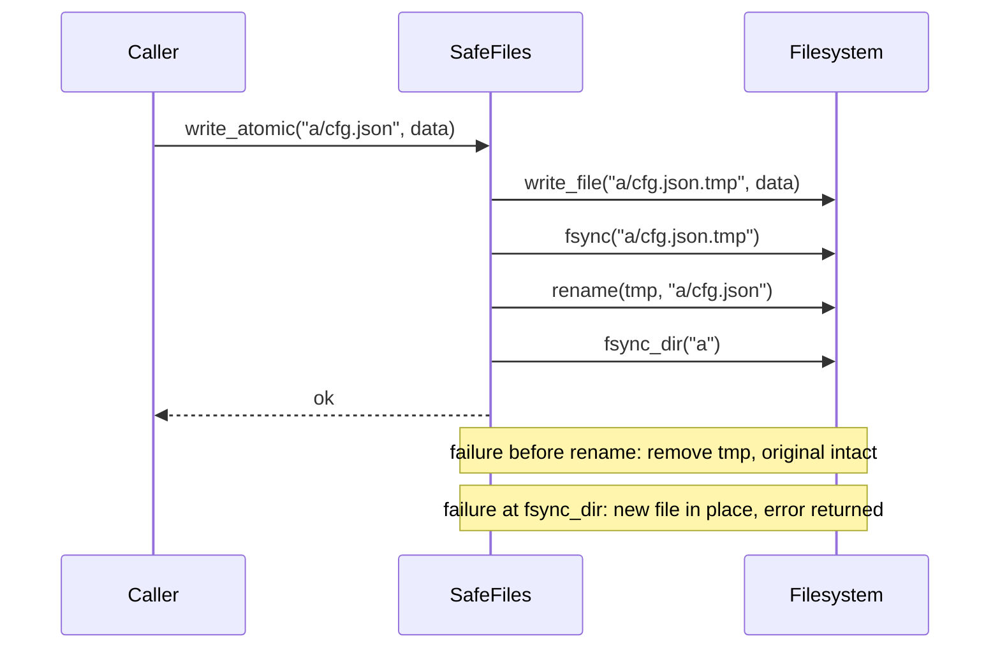

## In one minute
- A facade gives callers one small, task-shaped interface over a subsystem with many parts. `git commit` sits over the object store, the index and refs; `requests.get` sits over connection pools, TLS, redirects and decoding; `os.WriteFile` sits over open, write and close.
- Callers state the task ("save this file", "place this order"); the facade owns the how: which parts to call, in what order, and how to clean up when a step fails.
- A good facade does not lock the subsystem away. Callers who need more can still use the parts directly, the way git exposes plumbing commands under its porcelain.
- The risk is what a facade hides. A convenient call can hide missing durability (`os.WriteFile` never calls `fsync`), missing timeouts, or ten network round trips. The facade's contract must say what it guarantees and what it does not.
- Agents tend to put orchestration in every handler, copying the same five-step sequence into each endpoint. Review asks for one facade that owns the sequence and its failure handling, kept small enough to stay a facade and not become a god object.

## How it works

### The problem
A desktop sync client stores its settings, its sync cursor and its account tokens in small JSON files. Six code paths write them, each with its own version of:

```python
with open(path, "w") as f:
    f.write(json.dumps(state))
```

Opening with `"w"` truncates the file first. A crash, power loss or full disk before the write completes leaves the file empty or half written, and the client cannot parse its own state on the next start. After every big OS update about 0.3% of users lose their sync cursor and trigger a full resync. The fix is known (write a temporary file, flush it, rename it over the old one), but it is several calls with ordering rules and cleanup, and six call sites each had to get it right.

### The shape
A facade puts the sequence behind one method:

```python
class SafeFiles:
    def __init__(self, fs):
        self.fs = fs

    def write_atomic(self, path, data):
        tmp = path + ".tmp"
        self.fs.write_file(tmp, data)     # new content in a side file
        self.fs.fsync(tmp)                # bytes reach stable storage
        self.fs.rename(tmp, path)         # readers now see old or new, never partial
        self.fs.fsync_dir(dirname(path))  # the rename itself survives a crash
```

The six call sites become `files.write_atomic(path, data)`. The ordering rules, the choice of temp name in the same directory (rename is atomic only within one filesystem) and the cleanup on failure live in one place with one test suite. The Practice builds this facade, including the failure handling the sketch leaves out.

### Facades you already use
- **git porcelain and plumbing.** `git commit` runs what plumbing commands such as `write-tree`, `commit-tree` and `update-ref` do one by one. Scripts that need control call the plumbing; people use the porcelain.
- **`subprocess.run`** wraps `Popen`, `communicate`, `wait` and killing the child on timeout. The Python docs recommend `run()` for every case it can handle, and keep `Popen` for the rest ([subprocess docs](https://docs.python.org/3/library/subprocess.html)). It is the right default because the correct sequence (read both pipes concurrently to avoid deadlock, then reap the process) is easy to get wrong by hand.
- **`requests`** wraps a `Session`, an `HTTPAdapter` and urllib3's pool manager. Go's `http.Get` wraps `http.DefaultClient`, its `Transport` and connection pool.
- **Service layers.** In the design lessons, `BookingService` and `ExpenseService` are facades: the API layer calls one method per user action and the service coordinates seats, payments and ledgers. At system scale, an API gateway or backend-for-frontend is a facade over many services (see those lessons in the system design course).

### Facade, adapter, mediator
The Adapter lesson separates the three wrappers by intent: an adapter changes an interface to fit what callers expect, a decorator adds behaviour behind the same interface, and a facade offers a new, simpler interface over several parts. A mediator is easy to confuse with a facade but works in the other direction: the parts of a mediated system know the mediator and talk to each other through it, while the parts behind a facade do not know the facade exists.

### When not to use it
- **Pass-through facades.** A class whose methods mirror the subsystem one to one hides nothing and adds a layer to read; Fowler's *Remove Middle Man* refactoring exists to delete exactly this. Facades earn their place by combining calls.
- **Grab-bag facades.** `PlatformFacade` with 60 methods across billing, search and email is a god object. Split facades by task or by caller.
- **Callers that need the details.** A storage engine should not go through a file-saving convenience; give it the parts.

### Reviewing agent-written code
Asked to "add an export endpoint", an agent will usually inline the whole sequence in the handler (fetch, transform, upload, record, notify), and the next endpoint repeats four of those steps with different error handling. Ask for a facade method that owns the sequence, and check what happens when step three fails: are earlier steps undone or left in a known state, and does the error name the failed step? The opposite failure is a facade that swallows errors to stay "simple", returning `False` with no reason. Simple means fewer calls, not less information.

### The same shape elsewhere
A facade is where a *multi-step consistency* problem gets one owner. Every caller wants the result of several steps, and partial failure in the middle must leave the system in a known state. The same structure shows up as `kubectl apply` over a sequence of API calls, as `terraform apply` over plan, provider calls and state writes, and as a database's `COMMIT`, which hides log writes, flushes and lock release behind one statement. When the steps cross services, the facade becomes a saga orchestrator with compensations (see the Saga lesson).

## Down the stack

### Layer 1: The contract
The facade's contract is stated in terms of the task, not the parts. For `write_atomic(path, data)`: on success, a reader opening `path` sees exactly `data`, and it will still see it after a crash or power loss; at no point can a reader see a partial file. On failure before the rename, the original file is unchanged and the temporary file is removed. If the rename succeeded but the directory flush failed, the new content is in place but its durability is not guaranteed, and the caller is told. The contract also names what is not promised: two concurrent writers to one path both succeed and the last rename wins, so callers that need ordering must serialise writes themselves.

### Layer 2: The mechanism
POSIX `rename(2)` replaces the target atomically: any process that opens the path gets either the old inode or the new one ([rename(2)](https://man7.org/linux/man-pages/man2/rename.2.html)). `fsync(2)` on the file descriptor flushes the file's data and metadata to the device and asks it to empty its volatile write cache; the man page notes that this does not make the directory entry durable, which needs a separate `fsync` on a descriptor for the directory ([fsync(2)](https://man7.org/linux/man-pages/man2/fsync.2.html)). Go's `os.WriteFile` is `OpenFile(name, O_WRONLY|O_CREATE|O_TRUNC, perm)`, `Write` and `Close`, with no `fsync` and no rename, so it is a convenience facade, not a safe-save facade; its own comment warns that a failure mid-operation can leave the file partly written ([Go source](https://go.dev/src/os/file.go)). git does safe saves with lock files: it creates `index.lock` with `O_CREAT|O_EXCL` (which fails if another git process holds the lock), writes the new index there, and renames it over `index` ([git lockfile API](https://git-scm.com/docs/api-lockfile)). The same layering appears in HTTP: `requests.get` creates a `Session`, which routes through an `HTTPAdapter` to urllib3's `PoolManager`, which keeps one connection pool per host.

### Layer 3: The machine
The facade call itself costs nothing measurable: one more stack frame, often inlined. What matters is what it hides. `rename` is a metadata update in the filesystem journal, a few microseconds. Each `fsync` waits for the device: tens of microseconds on an NVMe drive with power-loss protection, 1 to 10 ms on consumer SSDs that must flush their cache, and 5 to 20 ms on spinning disks. Two `fsync` calls per save is invisible for a settings file written once a minute. The same facade called in a loop over 10,000 small records costs 20 to 200 seconds, where batching the records into one file would cost one save.

Other hidden costs follow the same pattern. Go's `http.DefaultClient` has no timeout, so `http.Get` against a server that stops responding blocks forever ([Cloudflare](https://blog.cloudflare.com/the-complete-guide-to-golang-net-http-timeouts/)), and `requests` likewise waits indefinitely unless a `timeout` is passed ([Requests docs](https://requests.readthedocs.io/en/latest/user/quickstart/#timeouts)). On macOS, `fsync` does not force the drive to flush its cache; `fcntl(F_FULLFSYNC)` does ([Apple man page](https://developer.apple.com/library/archive/documentation/System/Conceptual/ManPages_iPhoneOS/man2/fsync.2.html)). Filesystems differ too: after ext4 introduced delayed allocation, applications that renamed a new file over an old one without `fsync` lost data in crashes, and ext4 added the `auto_da_alloc` heuristic to flush data on such renames ([kernel docs](https://www.kernel.org/doc/html/latest/admin-guide/ext4.html)). A facade is the one place to handle these per-platform details, and its documentation is the one place to warn about cost.

One more detail belongs in the facade: what to do when `fsync` itself fails. Linux filesystems may respond to a failed buffered write by dropping the data and marking the pages clean, so a retried `fsync` can succeed without the data ever reaching the disk, a behaviour PostgreSQL's developers found in 2018 ([LWN](https://lwn.net/Articles/752063/)). A safe-save facade therefore treats a failed `fsync` as a failed save: it removes the temporary file and reports the error, and never retries the same file.

### Why it's built this way
1. Many tasks need several low-level calls in a precise order, and getting the order or the cleanup wrong causes rare, expensive failures.
2. Repeating the sequence at every call site multiplies the chances of getting it wrong, so it moves behind one task-shaped method.
3. The parts stay accessible because some callers need control the facade does not offer.
4. Hiding steps also hides their cost and their limits, so the contract states durability, timeouts and concurrency explicitly.
5. A facade that grows to cover every task becomes a god object, so facades are split by task or by caller.

## Diagram


## Worked example
The sync client team replaced the six write paths with `SafeFiles.write_atomic`. Each state file is under 8 KB and is written at most once every 30 seconds, so two `fsync` calls (about 4 ms on a typical laptop SSD) cost under 0.02% of one core's time. Corrupted-state reports went from roughly 900 a month (0.3% of 300,000 active users after a major OS update) to fewer than 5, all of which traced to disks that were already failing. Each avoided full resync had been costing about 2 GB of download per user.

One regression appeared in review. A migration that rewrote 40,000 per-folder metadata files through the facade took 11 minutes on a spinning-disk test machine: 80,000 synchronous flushes. The fix was not to bypass the facade but to add a second task-shaped method, `write_many_atomic`, that writes and flushes all temp files, renames them, and flushes each affected directory once. The migration dropped to 40 seconds. The facade grew because a new task appeared, not because a caller needed the parts.

## In the wild
- **Linux ext4, 2009: zero-length files after a crash.** Users of the new ext4 filesystem reported that after a crash, files that applications had just rewritten came back with 0 bytes. The pattern was truncate-and-rewrite, or write a new file and rename it over the old one, with no `fsync`. Delayed allocation meant the rename could reach the journal before the data blocks did. ext3 had hidden this by accident of its journal ordering. The kernel added heuristics that force allocation on rename-over and on truncate-then-close, which shipped as `auto_da_alloc` ([LWN](https://lwn.net/Articles/322823/), [kernel docs](https://www.kernel.org/doc/html/latest/admin-guide/ext4.html)).
- **PostgreSQL, 2018: a successful `fsync` that did not mean durable.** Craig Ringer reported on the pgsql-hackers list that after a hardware write error the kernel could discard the dirty pages and mark them clean, so a later `fsync` returned success and a read could return something other than what was written. OpenBSD and NetBSD behaved similarly. PostgreSQL's assumption that a successful `fsync` covers all earlier writes turned out to be false, which shows how much a one-call durability facade can hide ([LWN](https://lwn.net/Articles/752063/)).
- **Cloudflare, 2016: Go's package-level HTTP helpers have no timeouts.** In a widely read guide, a Cloudflare engineer pointed out that `http.Get` and its siblings use a client with every timeout off, which is dangerous against the open Internet because a stalled peer holds the call forever. The convenience facade picks defaults that suit examples, not production, and the fix is to build a client with explicit timeouts ([Cloudflare](https://blog.cloudflare.com/the-complete-guide-to-golang-net-http-timeouts/)).

## Trade-offs
| Option | Strengths | Weaknesses | Choose when |
| --- | --- | --- | --- |
| Call the subsystem directly | Full control; no extra layer | Sequence and cleanup repeated; easy to get wrong | One caller, or the caller is itself infrastructure |
| Task-shaped facade | One owner for order, errors and platform quirks | Hides cost; can grow into a god object | Several callers need the same multi-step task |
| Facade plus exposed parts | Easy path and power path both available | Two surfaces to document and support | Libraries and tools with varied users (git, `requests`) |
| Service layer or application service | Keeps handlers thin; testable without HTTP | Becomes a dumping ground without boundaries | Business actions spanning several repositories or clients |
| API gateway or BFF | One endpoint per client task over many services | Network hop; shared bottleneck; ownership disputes | Clients that would otherwise call many services |

## Pitfalls in production
- A convenience facade assumed to be durable (`os.WriteFile`, `Path.write_text`) for state that must survive a crash. Fix: a safe-save facade with temp file, `fsync`, rename and directory `fsync`.
- Facades with no timeout by default, so one slow dependency hangs every caller. Fix: require a timeout or set a sane default, and expose it.
- A facade called in a loop, multiplying hidden I/O or round trips. Fix: document cost per call and add batch methods for bulk tasks.
- Swallowed errors that make failures impossible to diagnose. Fix: return or raise the underlying error, wrapped with the step that failed.
- Partial failure leaving debris (temp files, half-created resources). Fix: cleanup on every failure path, and tests that inject failure at each step.
- A facade that grows to dozens of unrelated methods. Fix: split by task or by caller, and keep each facade's purpose to one sentence.

## Leadership lens
- Ask what the facade guarantees and what it hides: durability, timeouts, retries, cost per call. Those answers belong in its documentation, not in an incident review.
- Facades are a good place to encode hard-won operational knowledge once (safe saves, timeouts, retries) and make the right thing the easy thing for every team.
- Keep the parts reachable. A facade that is the only way in becomes a bottleneck for every team that needs one more option.
- For agents, a facade is a strong instruction: "use `SafeFiles.write_atomic` for any state file" is reviewable and greppable, while "make writes safe" is not.

## Check yourself
1. `os.WriteFile` writes a whole file in one call. Why is it not safe for state that must survive a crash?
   **Answer:** It truncates the existing file and then writes, with no `fsync` and no rename, so a crash in between can leave an empty or partial file, and even a complete write may still be only in the page cache.
2. Why must the temporary file be in the same directory as the target?
   **Answer:** `rename` is atomic only within one filesystem; across filesystems it fails, and a copy-and-delete fallback would expose partial content.
3. What is the difference between a facade and a mediator?
   **Answer:** Parts behind a facade do not know the facade; it calls them. In a mediator, the parts know the mediator and communicate with each other through it.
4. A facade method is fast in development but slow in a batch job. What is the likely cause, and the fix?
   **Answer:** It hides per-call I/O or round trips that add up in a loop. Add a batch method that does the expensive step once per batch rather than once per item.

## Practice
**Task:** Build a `SafeFiles` facade over a low-level filesystem interface with `write_file(path, data)`, `fsync(path)`, `rename(src, dst)`, `fsync_dir(dir)`, `remove(path)` and `read(path)`, each of which may fail. `write_atomic(path, data)` calls `write_file(path + ".tmp", data)`, `fsync(tmp)`, `rename(tmp, path)` and `fsync_dir(dir)` in that order, where `dir` is the part of `path` before the last `/`, or `.` if there is none. If any step before the rename fails, call `remove(tmp)` (ignoring its error) and fail with the original error; if `fsync_dir` fails, do not remove anything and fail with that error. An empty path fails with `empty path` before any filesystem call. `read(path)` passes through to the filesystem. Python raises (`ValueError` for an empty path, the original exception otherwise), TypeScript throws, Go returns errors (`errors.Is` must match the original).

```python starter
class SafeFiles:
    def __init__(self, fs):
        self.fs = fs

    def write_atomic(self, path, data):
        # TODO
        raise NotImplementedError

    def read(self, path):
        # TODO
        raise NotImplementedError
```

```python tests
class InjectedError(Exception):
    pass

class FakeFS:
    def __init__(self, files=None, fail_on=None):
        self.files = dict(files or {})
        self.log = []
        self.fail_on = fail_on
        self.err = InjectedError("injected: " + str(fail_on))

    def _step(self, entry, op):
        self.log.append(entry)
        if op == self.fail_on:
            raise self.err

    def write_file(self, path, data):
        self.files[path] = data[: len(data) // 2]
        self._step("write " + path, "write")
        self.files[path] = data

    def fsync(self, path):
        self._step("fsync " + path, "fsync")

    def rename(self, src, dst):
        self._step("rename " + src + " " + dst, "rename")
        self.files[dst] = self.files.pop(src)

    def fsync_dir(self, d):
        self._step("fsync_dir " + d, "fsync_dir")

    def remove(self, path):
        self._step("remove " + path, "remove")
        self.files.pop(path, None)

    def read(self, path):
        return self.files[path]

def raised(fn):
    try:
        fn()
    except Exception as e:
        return e
    return None

def test_happy_path_order():
    fs = FakeFS({"a/cfg.json": "old"})
    SafeFiles(fs).write_atomic("a/cfg.json", "new")
    assert fs.log == ["write a/cfg.json.tmp", "fsync a/cfg.json.tmp",
                      "rename a/cfg.json.tmp a/cfg.json", "fsync_dir a"]
    assert fs.files == {"a/cfg.json": "new"}

def test_path_without_directory():
    fs = FakeFS()
    SafeFiles(fs).write_atomic("cfg.json", "x")
    assert fs.log[-1] == "fsync_dir ." and fs.files == {"cfg.json": "x"}

def test_nested_directory_uses_last_slash():
    fs = FakeFS()
    SafeFiles(fs).write_atomic("/var/lib/app/state.json", "x")
    assert fs.log[-1] == "fsync_dir /var/lib/app"

def test_failure_before_rename_cleans_up():
    for op in ["write", "fsync", "rename"]:
        fs = FakeFS({"a/cfg.json": "old"}, fail_on=op)
        e = raised(lambda: SafeFiles(fs).write_atomic("a/cfg.json", "new"))
        assert e is fs.err, op
        assert fs.files == {"a/cfg.json": "old"}, op
        assert fs.log[-1] == "remove a/cfg.json.tmp", op

def test_cleanup_error_does_not_hide_original():
    fs = FakeFS({"a/cfg.json": "old"}, fail_on="fsync")
    original = fs.err
    def remove_fails(path):
        fs.log.append("remove " + path)
        raise InjectedError("remove failed")
    fs.remove = remove_fails
    assert raised(lambda: SafeFiles(fs).write_atomic("a/cfg.json", "new")) is original

def test_fsync_dir_failure_keeps_new_file():
    fs = FakeFS({"a/cfg.json": "old"}, fail_on="fsync_dir")
    e = raised(lambda: SafeFiles(fs).write_atomic("a/cfg.json", "new"))
    assert e is fs.err
    assert fs.files == {"a/cfg.json": "new"}
    assert not any(entry.startswith("remove") for entry in fs.log)

def test_empty_path_rejected_without_io():
    fs = FakeFS()
    e = raised(lambda: SafeFiles(fs).write_atomic("", "x"))
    assert isinstance(e, ValueError) and str(e) == "empty path"
    assert fs.log == []

def test_read_passes_through():
    fs = FakeFS()
    files = SafeFiles(fs)
    files.write_atomic("a/b", "hello")
    assert files.read("a/b") == "hello"
```

```python solution
class SafeFiles:
    def __init__(self, fs):
        self.fs = fs

    def write_atomic(self, path, data):
        if path == "":
            raise ValueError("empty path")
        tmp = path + ".tmp"
        i = path.rfind("/")
        d = path[:i] if i >= 0 else "."
        try:
            self.fs.write_file(tmp, data)
            self.fs.fsync(tmp)
            self.fs.rename(tmp, path)
        except Exception:
            try:
                self.fs.remove(tmp)
            except Exception:
                pass
            raise
        self.fs.fsync_dir(d)

    def read(self, path):
        return self.fs.read(path)
```

```typescript starter
export interface FS {
  writeFile(path: string, data: string): void;
  fsync(path: string): void;
  rename(src: string, dst: string): void;
  fsyncDir(dir: string): void;
  remove(path: string): void;
  read(path: string): string;
}

export class SafeFiles {
  constructor(private fs: FS) {}
  writeAtomic(path: string, data: string): void { throw new Error("TODO"); }
  read(path: string): string { throw new Error("TODO"); }
}
```

```typescript tests
class FakeFS implements FS {
  files: Record<string, string>;
  log: string[] = [];
  err: Error;
  constructor(files: Record<string, string> = {}, public failOn: string = "") {
    this.files = { ...files };
    this.err = new Error("injected: " + failOn);
  }
  private step(entry: string, op: string): void {
    this.log.push(entry);
    if (op === this.failOn) throw this.err;
  }
  writeFile(path: string, data: string): void {
    this.files[path] = data.slice(0, Math.floor(data.length / 2));
    this.step("write " + path, "write");
    this.files[path] = data;
  }
  fsync(path: string): void { this.step("fsync " + path, "fsync"); }
  rename(src: string, dst: string): void {
    this.step("rename " + src + " " + dst, "rename");
    this.files[dst] = this.files[src];
    delete this.files[src];
  }
  fsyncDir(dir: string): void { this.step("fsync_dir " + dir, "fsync_dir"); }
  remove(path: string): void {
    this.step("remove " + path, "remove");
    delete this.files[path];
  }
  read(path: string): string { return this.files[path]; }
}

function thrown(fn: () => void): unknown {
  try { fn(); } catch (e) { return e; }
  return undefined;
}

test("happy path order", () => {
  const fs = new FakeFS({ "a/cfg.json": "old" });
  new SafeFiles(fs).writeAtomic("a/cfg.json", "new");
  assertEqual(fs.log, ["write a/cfg.json.tmp", "fsync a/cfg.json.tmp",
    "rename a/cfg.json.tmp a/cfg.json", "fsync_dir a"]);
  assertEqual(fs.files, { "a/cfg.json": "new" });
});

test("path without directory", () => {
  const fs = new FakeFS();
  new SafeFiles(fs).writeAtomic("cfg.json", "x");
  assertEqual(fs.log[fs.log.length - 1], "fsync_dir .");
  assertEqual(fs.files, { "cfg.json": "x" });
});

test("nested directory uses last slash", () => {
  const fs = new FakeFS();
  new SafeFiles(fs).writeAtomic("/var/lib/app/state.json", "x");
  assertEqual(fs.log[fs.log.length - 1], "fsync_dir /var/lib/app");
});

test("failure before rename cleans up", () => {
  for (const op of ["write", "fsync", "rename"]) {
    const fs = new FakeFS({ "a/cfg.json": "old" }, op);
    const e = thrown(() => new SafeFiles(fs).writeAtomic("a/cfg.json", "new"));
    assert(e === fs.err, op + ": original error");
    assertEqual(fs.files, { "a/cfg.json": "old" }, op);
    assertEqual(fs.log[fs.log.length - 1], "remove a/cfg.json.tmp", op);
  }
});

test("cleanup error does not hide original", () => {
  const fs = new FakeFS({ "a/cfg.json": "old" }, "fsync");
  fs.remove = (path: string) => { fs.log.push("remove " + path); throw new Error("remove failed"); };
  const e = thrown(() => new SafeFiles(fs).writeAtomic("a/cfg.json", "new"));
  assert(e === fs.err, "original error surfaces");
});

test("fsync_dir failure keeps new file", () => {
  const fs = new FakeFS({ "a/cfg.json": "old" }, "fsync_dir");
  const e = thrown(() => new SafeFiles(fs).writeAtomic("a/cfg.json", "new"));
  assert(e === fs.err, "original error");
  assertEqual(fs.files, { "a/cfg.json": "new" });
  assert(!fs.log.some((x) => x.startsWith("remove")), "nothing removed");
});

test("empty path rejected without io", () => {
  const fs = new FakeFS();
  const e = thrown(() => new SafeFiles(fs).writeAtomic("", "x"));
  assertEqual((e as Error).message, "empty path");
  assertEqual(fs.log, []);
});

test("read passes through", () => {
  const files = new SafeFiles(new FakeFS());
  files.writeAtomic("a/b", "hello");
  assertEqual(files.read("a/b"), "hello");
});
```

```typescript solution
export interface FS {
  writeFile(path: string, data: string): void;
  fsync(path: string): void;
  rename(src: string, dst: string): void;
  fsyncDir(dir: string): void;
  remove(path: string): void;
  read(path: string): string;
}

export class SafeFiles {
  constructor(private fs: FS) {}

  writeAtomic(path: string, data: string): void {
    if (path === "") throw new Error("empty path");
    const tmp = path + ".tmp";
    const i = path.lastIndexOf("/");
    const dir = i >= 0 ? path.slice(0, i) : ".";
    try {
      this.fs.writeFile(tmp, data);
      this.fs.fsync(tmp);
      this.fs.rename(tmp, path);
    } catch (e) {
      try { this.fs.remove(tmp); } catch { /* keep the original error */ }
      throw e;
    }
    this.fs.fsyncDir(dir);
  }

  read(path: string): string {
    return this.fs.read(path);
  }
}
```

```go starter
package practice

type FS interface {
	WriteFile(path, data string) error
	Fsync(path string) error
	Rename(src, dst string) error
	FsyncDir(dir string) error
	Remove(path string) error
	Read(path string) (string, error)
}

type SafeFiles struct {
	fs FS
}

func NewSafeFiles(fs FS) *SafeFiles { return &SafeFiles{fs: fs} }

func (s *SafeFiles) WriteAtomic(path, data string) error { panic("TODO") }
func (s *SafeFiles) Read(path string) (string, error)    { panic("TODO") }
```

```go tests
package practice

import (
	"errors"
	"reflect"
	"strings"
	"testing"
)

var errInjected = errors.New("injected")

type fakeFS struct {
	files        map[string]string
	log          []string
	failOn       string
	removeFails  bool
}

func newFakeFS(files map[string]string, failOn string) *fakeFS {
	f := &fakeFS{files: map[string]string{}, failOn: failOn}
	for k, v := range files {
		f.files[k] = v
	}
	return f
}

func (f *fakeFS) step(entry, op string) error {
	f.log = append(f.log, entry)
	if op == f.failOn {
		return errInjected
	}
	return nil
}

func (f *fakeFS) WriteFile(path, data string) error {
	f.files[path] = data[:len(data)/2]
	if err := f.step("write "+path, "write"); err != nil {
		return err
	}
	f.files[path] = data
	return nil
}
func (f *fakeFS) Fsync(path string) error { return f.step("fsync "+path, "fsync") }
func (f *fakeFS) Rename(src, dst string) error {
	if err := f.step("rename "+src+" "+dst, "rename"); err != nil {
		return err
	}
	f.files[dst] = f.files[src]
	delete(f.files, src)
	return nil
}
func (f *fakeFS) FsyncDir(dir string) error { return f.step("fsync_dir "+dir, "fsync_dir") }
func (f *fakeFS) Remove(path string) error {
	f.log = append(f.log, "remove "+path)
	if f.removeFails {
		return errors.New("remove failed")
	}
	delete(f.files, path)
	return nil
}
func (f *fakeFS) Read(path string) (string, error) {
	v, ok := f.files[path]
	if !ok {
		return "", errors.New("not found: " + path)
	}
	return v, nil
}

func TestHappyPathOrder(t *testing.T) {
	fs := newFakeFS(map[string]string{"a/cfg.json": "old"}, "")
	if err := NewSafeFiles(fs).WriteAtomic("a/cfg.json", "new"); err != nil {
		t.Fatal(err)
	}
	want := []string{"write a/cfg.json.tmp", "fsync a/cfg.json.tmp",
		"rename a/cfg.json.tmp a/cfg.json", "fsync_dir a"}
	if !reflect.DeepEqual(fs.log, want) {
		t.Fatalf("log %v", fs.log)
	}
	if !reflect.DeepEqual(fs.files, map[string]string{"a/cfg.json": "new"}) {
		t.Fatalf("files %v", fs.files)
	}
}

func TestPathWithoutDirectory(t *testing.T) {
	fs := newFakeFS(nil, "")
	NewSafeFiles(fs).WriteAtomic("cfg.json", "x")
	if fs.log[len(fs.log)-1] != "fsync_dir ." || fs.files["cfg.json"] != "x" {
		t.Fatalf("log %v files %v", fs.log, fs.files)
	}
}

func TestNestedDirectoryUsesLastSlash(t *testing.T) {
	fs := newFakeFS(nil, "")
	NewSafeFiles(fs).WriteAtomic("/var/lib/app/state.json", "x")
	if fs.log[len(fs.log)-1] != "fsync_dir /var/lib/app" {
		t.Fatalf("log %v", fs.log)
	}
}

func TestFailureBeforeRenameCleansUp(t *testing.T) {
	for _, op := range []string{"write", "fsync", "rename"} {
		fs := newFakeFS(map[string]string{"a/cfg.json": "old"}, op)
		err := NewSafeFiles(fs).WriteAtomic("a/cfg.json", "new")
		if !errors.Is(err, errInjected) {
			t.Fatalf("%s: got %v", op, err)
		}
		if !reflect.DeepEqual(fs.files, map[string]string{"a/cfg.json": "old"}) {
			t.Fatalf("%s: files %v", op, fs.files)
		}
		if fs.log[len(fs.log)-1] != "remove a/cfg.json.tmp" {
			t.Fatalf("%s: log %v", op, fs.log)
		}
	}
}

func TestCleanupErrorDoesNotHideOriginal(t *testing.T) {
	fs := newFakeFS(map[string]string{"a/cfg.json": "old"}, "fsync")
	fs.removeFails = true
	if err := NewSafeFiles(fs).WriteAtomic("a/cfg.json", "new"); !errors.Is(err, errInjected) {
		t.Fatalf("got %v", err)
	}
}

func TestFsyncDirFailureKeepsNewFile(t *testing.T) {
	fs := newFakeFS(map[string]string{"a/cfg.json": "old"}, "fsync_dir")
	if err := NewSafeFiles(fs).WriteAtomic("a/cfg.json", "new"); !errors.Is(err, errInjected) {
		t.Fatalf("got %v", err)
	}
	if fs.files["a/cfg.json"] != "new" || len(fs.files) != 1 {
		t.Fatalf("files %v", fs.files)
	}
	for _, e := range fs.log {
		if strings.HasPrefix(e, "remove") {
			t.Fatal("nothing should be removed")
		}
	}
}

func TestEmptyPathRejectedWithoutIO(t *testing.T) {
	fs := newFakeFS(nil, "")
	err := NewSafeFiles(fs).WriteAtomic("", "x")
	if err == nil || err.Error() != "empty path" || len(fs.log) != 0 {
		t.Fatalf("got %v, log %v", err, fs.log)
	}
}

func TestReadPassesThrough(t *testing.T) {
	files := NewSafeFiles(newFakeFS(nil, ""))
	files.WriteAtomic("a/b", "hello")
	if v, err := files.Read("a/b"); err != nil || v != "hello" {
		t.Fatalf("got %q %v", v, err)
	}
}
```

```go solution
package practice

import (
	"errors"
	"strings"
)

type FS interface {
	WriteFile(path, data string) error
	Fsync(path string) error
	Rename(src, dst string) error
	FsyncDir(dir string) error
	Remove(path string) error
	Read(path string) (string, error)
}

type SafeFiles struct {
	fs FS
}

func NewSafeFiles(fs FS) *SafeFiles { return &SafeFiles{fs: fs} }

func (s *SafeFiles) WriteAtomic(path, data string) error {
	if path == "" {
		return errors.New("empty path")
	}
	tmp := path + ".tmp"
	dir := "."
	if i := strings.LastIndex(path, "/"); i >= 0 {
		dir = path[:i]
	}
	err := s.fs.WriteFile(tmp, data)
	if err == nil {
		err = s.fs.Fsync(tmp)
	}
	if err == nil {
		err = s.fs.Rename(tmp, path)
	}
	if err != nil {
		_ = s.fs.Remove(tmp) // best effort; keep the original error
		return err
	}
	return s.fs.FsyncDir(dir)
}

func (s *SafeFiles) Read(path string) (string, error) {
	return s.fs.Read(path)
}
```

## Mock interview
**Prompt:** Your company has 30 services that each call the same four internal systems to onboard a customer: create the account, provision a tenant database, set up billing and send a welcome email. Each service does it slightly differently, and about 1% of onboardings end half done. Design a facade that fixes this.

- Follow-up: Billing setup fails after the tenant database was provisioned. What does the facade do, and what does the caller see?
- Follow-up: One team needs to provision a tenant without billing for internal accounts. Do you add a flag, a second method, or let them call the parts?
- Follow-up: The facade is now on the critical path of every signup. How do you keep it from becoming a bottleneck or a single point of failure?

**A strong answer covers:**
- A task-shaped interface (`onboard(customer)`) that owns the order of steps, idempotency keys per step, and a defined state for every partial failure.
- Compensation or resumable progress for steps that cross services, which turns the facade into a small saga orchestrator with a durable record of which steps completed.
- Errors that name the failed step and are safe to retry, instead of a bare boolean.
- A second task-shaped method for a genuinely different task, while keeping the underlying clients available for teams with unusual needs.
- Operational care: timeouts on every downstream call, metrics per step, and the facade deployed as a library or a horizontally scaled service with no shared mutable state.

## Sources and further study
**Primary**
- [fsync(2), Linux man page](https://man7.org/linux/man-pages/man2/fsync.2.html) and [rename(2)](https://man7.org/linux/man-pages/man2/rename.2.html): the guarantees a safe-save facade is built from.
- [ext4 admin guide (kernel.org)](https://www.kernel.org/doc/html/latest/admin-guide/ext4.html): the `auto_da_alloc` option and the reason it exists.
- [fsync(2) on macOS (Apple)](https://developer.apple.com/library/archive/documentation/System/Conceptual/ManPages_iPhoneOS/man2/fsync.2.html): `F_FULLFSYNC` and why plain `fsync` is weaker there.

**Systems docs**
- [git lockfile API](https://git-scm.com/docs/api-lockfile): how git writes a `.lock` file and renames it into place.
- [subprocess (Python docs)](https://docs.python.org/3/library/subprocess.html): `run()` as the facade over `Popen`.
- [Requests quickstart, timeouts](https://requests.readthedocs.io/en/latest/user/quickstart/#timeouts): a convenience API that tells you to set the timeout it does not set for you.
- [The complete guide to Go net/http timeouts (Cloudflare)](https://blog.cloudflare.com/the-complete-guide-to-golang-net-http-timeouts/): what the package-level helpers leave off.

**Books**
- *Design Patterns* (Gamma, Helm, Johnson, Vlissides, 1st ed.), Ch 4: Structural Patterns, the Facade entry.
- *Head First Design Patterns* (Freeman and Robson, 2nd ed.), Ch 7: Being Adaptive, the Adapter and Facade Patterns.
- *Refactoring* (Fowler, 2nd ed.), Ch 7: Encapsulation, which covers Hide Delegate and Remove Middle Man.

**Other curricula**
- [Facade (refactoring.guru)](https://refactoring.guru/design-patterns/facade): presents the pattern with a structure diagram and applicability list, and stresses that a facade can grow into a god object.
- [Gateway Aggregation pattern (Azure Architecture Center)](https://learn.microsoft.com/en-us/azure/architecture/patterns/gateway-aggregation): the facade idea at service scale, one request fanned out to several back ends.

## Watch
- [Facade Pattern, Design Patterns ep 9 (Christopher Okhravi)](https://www.youtube.com/watch?v=K4FkHVO5iac): the structure and intent of facade, and how it differs from adapter.
- [10 Design Patterns Explained in 10 Minutes (Fireship)](https://www.youtube.com/watch?v=tv-_1er1mWI): a quick JavaScript example of facade alongside the other common patterns.

## Free resources
- [Git Internals: Plumbing and Porcelain (Pro Git)](https://git-scm.com/book/en/v2/Git-Internals-Plumbing-and-Porcelain): a famous facade with its parts deliberately left accessible.
- [rename(2) (Linux man page)](https://man7.org/linux/man-pages/man2/rename.2.html): the atomic replacement guarantee that safe-save facades depend on.
- [fsync(2) (Linux man page)](https://man7.org/linux/man-pages/man2/fsync.2.html): what is flushed, and why the directory needs its own `fsync`.
- [Ensuring data reaches disk (LWN)](https://lwn.net/Articles/457667/): the full sequence of calls a durable write needs, and where applications get it wrong.
- [Files are hard (Dan Luu)](https://danluu.com/file-consistency/): research on how often real applications get crash consistency wrong.
- [os package source (Go)](https://go.dev/src/os/file.go): `WriteFile` in eleven lines, a convenience facade with no `fsync`.
