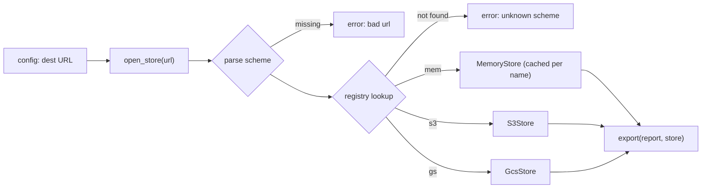

## In one minute
- A factory method is a function or method whose job is to decide *which* concrete type to create, so callers ask for "a storage backend for this URL" and receive something that satisfies an interface without naming the class.
- The Gang of Four form puts the factory method on a base class and lets subclasses override it. The everyday forms are simpler: a constructor function (`NewClient`), an alternative constructor (`datetime.fromtimestamp`), or a registry that maps a key such as `"s3"` or `"postgres"` to a factory.
- Unlike a constructor, a factory can return a subtype, a cached instance or an error, and it can be looked up by name at runtime. That is what makes plugin systems (Go's `database/sql` drivers) possible.
- Do not add one for a single implementation, and in Go prefer returning concrete structs unless callers truly need to be shielded from the type. A string-keyed registry trades compile-time errors for runtime ones.
- Agents reach for `if kind == "a": return A() elif ...` inside business logic. Review asks for the decision in one factory, at the edge of the system, with a clear error for unknown kinds.

## How it works

### The problem
A data export job writes reports to whatever storage a customer configures: local disk in development, S3 for most customers, Google Cloud Storage for a few, an in-memory store in tests. The first version has this in the export function:

```python
def export(report, dest):
    if dest.startswith("s3://"):
        store = S3Store(bucket_from(dest), region=os.environ["AWS_REGION"])
    elif dest.startswith("gs://"):
        store = GcsStore(dest[5:])
    else:
        store = FileStore(dest)
    store.put(report.name, report.render())
```

The export logic now knows every backend, their constructor arguments and the environment variables they need. A second job that also writes to storage copies the same chain, and the copies drift: one supports `gs://`, the other forgot. Tests of `export` cannot use an in-memory store without adding a branch for it.

### Pull the decision into one place
A factory takes the decision out of the business logic:

```python
def open_store(url: str) -> Store:
    scheme, _, rest = url.partition("://")
    factory = STORES.get(scheme.lower())
    if factory is None:
        raise ValueError(f"unknown scheme: {scheme}")
    return factory(rest)

def export(report, store: Store):
    store.put(report.name, report.render())
```

`export` depends only on the `Store` interface and receives a store from its caller. The composition root calls `open_store(config.dest)` once. Adding Azure Blob Storage means writing a class and one registration; nothing that uses stores changes. That is the open/closed principle applied to object creation.

### The classic form: an overridable method
In the Gang of Four version, a base class has a template algorithm that calls an abstract `create_x()` method, and each subclass overrides it:

```python
class ReportExporter:
    def export(self, rows):
        writer = self.create_writer()   # the factory method
        for row in rows:
            writer.write(row)
        return writer.finish()

class CsvExporter(ReportExporter):
    def create_writer(self):
        return CsvWriter(delimiter=",")
```

This is useful inside frameworks, where the framework owns the algorithm and the application supplies one piece of it (Django's class-based views call `get_queryset()`, which you override). Outside frameworks, passing the writer or a writer factory as a parameter does the same job with composition, and avoids a class hierarchy whose only purpose is to choose one object.

### Alternative constructors
Python's `dict.fromkeys`, `datetime.fromtimestamp` and `int.from_bytes` are factory methods in the plainest sense: classmethods that build an instance from a different kind of input. Go's convention is the same idea without classes: `NewReader(r io.Reader) *Reader`, `errors.New`, `http.NewRequest`. They exist because a constructor has one signature and cannot return an error (in Python) or can only be one function (in Go). Named factories give each way of building an object its own name and validation.

### What a factory can do that a constructor cannot
- **Return a different concrete type** depending on input: `document.createElement("video")` returns an `HTMLVideoElement`.
- **Return an existing instance**: Java's `Integer.valueOf` returns cached objects for -128 to 127; `logging.getLogger(name)` returns the same logger for the same name.
- **Fail cleanly**: return `(nil, err)` or raise a specific error instead of half-initialising an object.
- **Be chosen at runtime by name**, from configuration or a URL.

### When not to use it
- **One implementation.** `UserServiceFactory` that always returns `UserService` adds a file and a hop for readers. Call the constructor; add the factory when the second implementation arrives.
- **Returning interfaces in Go by reflex.** Go's guidance is "accept interfaces, return structs": a constructor returning `*Client` lets callers use every method and define the narrow interface they need themselves. Return an interface when the concrete type is genuinely chosen at runtime.
- **Factories of factories.** If configuring the factory needs its own factory, the abstraction is fighting you; pass the dependencies in directly.
- **String keys where an enum would do.** A registry keyed by free-form strings fails at runtime on a typo; if the set is closed and known at compile time, an exhaustive `switch` over an enum fails at compile time instead.

### Reviewing agent-written code
Asked to "support GCS as well as S3", an agent will find the `if dest.startswith("s3://")` chain and add an `elif`, usually in the business function, often in two places if the chain was copied. It may also invent a `StorageFactory` class with one static method, a `StorageFactoryProvider` and an abstract base for both. Both shapes are signs to stop and steer. Point the agent at one factory function at the edge, a registry if backends come from configuration, and constructor injection of the resulting `Store` into the code that uses it. In review, check that unknown kinds produce an error that names the bad value, that the factory is the only place that reads backend-specific environment variables, and that tests pass an in-memory implementation instead of patching the factory.

### The same shape elsewhere
A factory keyed by scheme or name is the *finding things fast* shape in miniature: a lookup table from a key to a handler. The same structure routes HTTP paths to handlers, maps MIME types to decoders, maps Linux filesystem types (`ext4`, `xfs`) to their mount code in the kernel's filesystem registry, and resolves `jdbc:postgresql://` URLs to drivers. Each one has the same failure modes: duplicate registration, a missing entry discovered only at runtime, and initialisation order deciding what is registered.

## Down the stack

### Layer 1: The contract
A factory promises: for a known key and valid input it returns an object that satisfies the interface; for an unknown key or invalid input it fails with an error that names the problem, and never returns a half-built object or a nil interface without an error. Whether it returns a fresh or a shared instance is part of the contract and must be documented, because callers that mutate a shared instance will affect each other. A registry promises that registration happens before first use and that duplicate keys are rejected rather than silently overwritten.

### Layer 2: The mechanism
Go's `database/sql` is the textbook plugin factory. A driver package calls `sql.Register("postgres", &Driver{})` in its `init()` function; `Register` takes a write lock on a package-level `map[string]driver.Driver` and panics on a duplicate name. Importing the driver for side effects (`import _ "github.com/lib/pq"`) runs that `init`. `sql.Open("postgres", dsn)` takes a read lock, looks up the name, and returns an error `sql: unknown driver "postgres" (forgotten import?)` if it is missing. The `image` package does the same with `image.RegisterFormat`, matching magic bytes at the start of a file to pick a decoder. Python packages advertise factories through entry points in their metadata, which tools such as pytest load with `importlib.metadata.entry_points(group=...)`. In the browser, `document.createElement(tag)` looks up the tag in a table of element interfaces and custom elements registered with `customElements.define`.

### Layer 3: The machine
Returning through an interface has a cost in Go: a concrete value stored in an interface usually escapes to the heap, so a factory returning `Store` instead of `*MemoryStore` may add one allocation per call, and the compiler can no longer inline methods called through it. Each call becomes an indirect call through the itab, about 1 to 2 ns when predicted. Go's profile-guided optimisation can devirtualise hot interface call sites when the profile shows one dominant concrete type. The JVM does this speculatively: if class-hierarchy analysis or the profile shows one receiver type at a call site, it inlines the method behind a cheap type guard. In V8, objects created by one factory with fields assigned in the same order share a hidden class, which keeps property access monomorphic; a factory that builds the "same" object in different field orders on different branches creates several shapes and slows every reader.

The other machine-level win is that factories can recycle. Because callers never call the constructor directly, the factory can hand out objects from a free list or a `sync.Pool`, which turns per-request allocation into reuse and cuts GC work. Constructors cannot do that.

### Why it's built this way
1. The code that uses an object rarely needs to know its concrete type, but someone has to choose it.
2. Choosing in every caller duplicates the decision, and the copies drift, so the choice moves into one function.
3. The choice often depends on runtime data (a URL, a config file, a file's magic bytes), so it must be a lookup, not a compile-time `new`.
4. A function can return subtypes, cached instances and errors, which a constructor cannot.
5. Indirection costs allocations, inlining and readability, so a factory is worth adding only when there are real alternatives to choose between.

## Diagram


## Worked example
A company runs 14 batch jobs that write files. Before the refactor each job had its own `if/elif` over destinations, 14 copies in total, and an audit found 5 different sets of supported schemes. Two customers on GCS could not use 3 of the jobs. Adding a new backend meant 14 pull requests across 6 repositories.

The team created a small shared package with a `Store` interface, a registry, and `open_store(url)`. Each backend lives in its own module and registers itself. The jobs take a `Store` as a parameter, and each job's `main` calls `open_store` once. Adding Azure Blob Storage afterwards was one module of about 120 lines and one line in the registry's setup, deployed by a dependency bump. Test suites switched to `mem://` stores; the 14 jobs' tests dropped 230 `mock.patch` calls on cloud clients.

The performance check came out as expected: `open_store` runs once per job, so the lookup and the extra interface hop are invisible next to a 40 ms object-storage round trip. The one regression was in a hot path where a job opened a store per row (2 million rows) and each S3 store built a new HTTP client with its own connection pool. Caching stores by bucket inside the S3 factory, the same trick the memory factory uses per name, brought that job from 50 minutes to 6.

## Trade-offs
| Option | Strengths | Weaknesses | Choose when |
| --- | --- | --- | --- |
| Direct constructor call | Explicit; inlinable; errors at compile time | Caller knows the concrete type | One implementation, or the caller genuinely needs it |
| Factory function with a `switch` | One place to decide; still compile-time checked | Adding a variant edits the function | Small, closed set of variants in one codebase |
| Registry keyed by name | New variants plug in without edits; choice from config | Runtime errors on typos; registration order matters | Plugins, drivers, backends chosen by URL or config |
| GoF overridable factory method | Framework owns the algorithm; subclass supplies one part | Inheritance couples subclass to base | Frameworks with template algorithms |
| Inject the object or a factory parameter | Caller decides; trivial to test | Wiring code in the composition root | Most application code |

## Pitfalls in production
- Business logic branching on concrete types (`isinstance(store, S3Store)`) after the factory, which undoes the abstraction. Fix: add the capability to the interface or handle it inside the backend.
- Silent overwrite on duplicate registration, so whichever module loads last wins. Fix: reject duplicates loudly, as `sql.Register` does with a panic.
- Missing registration discovered in production because the plugin module was never imported. Fix: import registrations explicitly in `main`, and add a startup check that every configured key resolves.
- A factory that returns a shared instance documented as fresh, so two callers mutate the same object. Fix: document the lifetime and test it.
- Expensive clients created per call inside the factory. Fix: cache per key inside the factory, or create once in the composition root and pass it down.
- Error messages that hide the input (`invalid backend`). Fix: name the bad key and list the known ones.

## Leadership lens
- Ask what varies and who adds variants. If other teams or plugins add backends, a registry is worth its runtime-error cost; if one team owns a closed set, a `switch` is safer.
- Make the composition root the only caller of factories in an application. Code that calls factories deep inside business logic is code that is hard to test.
- Treat the factory's key space as an API: document the supported schemes, version them, and fail with helpful errors. Customers and on-call engineers read those messages.
- Use this as a reviewable instruction for agents: "new backend = new module + one registration; do not edit callers". It turns a risky cross-cutting change into an additive one.

## Check yourself
1. Why can a factory return a cached instance when a constructor cannot?
   **Answer:** A constructor always allocates a new object; a factory is an ordinary function that can look up and return an existing one, as `logging.getLogger` and `Integer.valueOf` do.
2. Go's guidance is "accept interfaces, return structs". When should a Go factory return an interface anyway?
   **Answer:** When the concrete type is chosen at runtime from input, such as a URL scheme or driver name, so the caller cannot know it in advance.
3. A registry is keyed by strings from a config file. What failure does that introduce, and how do you contain it?
   **Answer:** A typo or missing plugin is only found when the key is looked up. Validate every configured key at startup and fail fast with an error that names the key.
4. When is an exhaustive `switch` over an enum better than a registry?
   **Answer:** When the set of variants is closed and owned by one team; the compiler then reports every unhandled case, and nothing depends on registration order.

## Practice
**Task:** Build a storage factory chosen by URL. `Registry()` holds factories keyed by scheme. `register(scheme, factory)` stores a factory that takes the part of the URL after `://` and returns a store; schemes are case-insensitive, and registering the same scheme twice is an error `duplicate scheme: <scheme>` (lowercased). `open(url)` splits on the first `://`; if it is missing or the scheme is empty, fail with `bad url: <url>`; if no factory is registered, fail with `unknown scheme: <scheme>` (lowercased); otherwise return what the factory returns, and pass its errors through unchanged. Also implement `MemoryStore` with `put(key, value)` and `get(key)` (returning `None`, `undefined`, or `("", false)` in Go when missing), and `memory_factory()`, which returns a factory that creates one `MemoryStore` per name and returns the same store for the same name, and fails with `empty name` for an empty name. Python raises `ValueError`, TypeScript throws `Error`, Go returns an error.

```python starter
class MemoryStore:
    def __init__(self, name):
        self.name = name

    def put(self, key, value):
        # TODO
        raise NotImplementedError

    def get(self, key):
        # TODO
        raise NotImplementedError

def memory_factory():
    # TODO: return a function(rest) -> MemoryStore
    raise NotImplementedError

class Registry:
    def __init__(self):
        self.factories = {}

    def register(self, scheme, factory):
        # TODO
        raise NotImplementedError

    def open(self, url):
        # TODO
        raise NotImplementedError
```

```python tests
def error_of(fn):
    try:
        fn()
    except ValueError as e:
        return str(e)
    return None

def make():
    r = Registry()
    r.register("mem", memory_factory())
    return r

def test_memory_store_round_trip():
    s = make().open("mem://reports")
    s.put("a.csv", "1,2")
    assert s.get("a.csv") == "1,2" and s.get("missing") is None

def test_same_name_same_store():
    r = make()
    r.open("mem://x").put("k", "v")
    assert r.open("mem://x").get("k") == "v"
    assert r.open("mem://x") is r.open("mem://x")
    assert r.open("mem://y").get("k") is None

def test_scheme_is_case_insensitive():
    r = make()
    assert r.open("MEM://x") is r.open("mem://x")

def test_bad_and_unknown_urls():
    r = make()
    assert error_of(lambda: r.open("reports")) == "bad url: reports"
    assert error_of(lambda: r.open("://x")) == "bad url: ://x"
    assert error_of(lambda: r.open("FTP://host/x")) == "unknown scheme: ftp"

def test_duplicate_registration_rejected():
    r = make()
    assert error_of(lambda: r.register("Mem", memory_factory())) == "duplicate scheme: mem"

def test_factory_errors_pass_through():
    assert error_of(lambda: make().open("mem://")) == "empty name"

class FakeS3:
    def __init__(self, bucket):
        self.bucket, self.data = bucket, {}
    def put(self, key, value):
        self.data[key] = value
    def get(self, key):
        return self.data.get(key)

def test_new_backend_plugs_in():
    r = make()
    r.register("s3", lambda rest: FakeS3(rest.split("/")[0]))
    s = r.open("s3://billing/2026/")
    assert isinstance(s, FakeS3) and s.bucket == "billing"
    a, b = r.open("s3://b"), r.open("s3://b")
    assert a is not b, "this factory returns fresh instances"

def test_only_first_separator_splits():
    r = Registry()
    r.register("echo", lambda rest: rest)
    assert r.open("echo://a://b") == "a://b"
```

```python solution
class MemoryStore:
    def __init__(self, name):
        self.name = name
        self.data = {}

    def put(self, key, value):
        self.data[key] = value

    def get(self, key):
        return self.data.get(key)

def memory_factory():
    stores = {}
    def factory(rest):
        if rest == "":
            raise ValueError("empty name")
        if rest not in stores:
            stores[rest] = MemoryStore(rest)
        return stores[rest]
    return factory

class Registry:
    def __init__(self):
        self.factories = {}

    def register(self, scheme, factory):
        key = scheme.lower()
        if key in self.factories:
            raise ValueError("duplicate scheme: " + key)
        self.factories[key] = factory

    def open(self, url):
        scheme, sep, rest = url.partition("://")
        if not sep or not scheme:
            raise ValueError("bad url: " + url)
        factory = self.factories.get(scheme.lower())
        if factory is None:
            raise ValueError("unknown scheme: " + scheme.lower())
        return factory(rest)
```

```typescript starter
export interface Store {
  put(key: string, value: string): void;
  get(key: string): string | undefined;
}

export type Factory = (rest: string) => unknown;

export class MemoryStore implements Store {
  constructor(public readonly name: string) {}
  put(key: string, value: string): void { throw new Error("TODO"); }
  get(key: string): string | undefined { throw new Error("TODO"); }
}

export function memoryFactory(): Factory {
  throw new Error("TODO");
}

export class Registry {
  register(scheme: string, factory: Factory): void { throw new Error("TODO"); }
  open(url: string): unknown { throw new Error("TODO"); }
}
```

```typescript tests
function errorOf(fn: () => unknown): string | undefined {
  try { fn(); } catch (e) { return (e as Error).message; }
  return undefined;
}

function make(): Registry {
  const r = new Registry();
  r.register("mem", memoryFactory());
  return r;
}

test("memory store round trip", () => {
  const s = make().open("mem://reports") as Store;
  s.put("a.csv", "1,2");
  assertEqual(s.get("a.csv"), "1,2");
  assert(s.get("missing") === undefined, "missing key is undefined");
});

test("same name same store", () => {
  const r = make();
  (r.open("mem://x") as Store).put("k", "v");
  assertEqual((r.open("mem://x") as Store).get("k"), "v");
  assert(r.open("mem://x") === r.open("mem://x"), "same instance");
  assert((r.open("mem://y") as Store).get("k") === undefined, "separate store");
});

test("scheme is case insensitive", () => {
  const r = make();
  assert(r.open("MEM://x") === r.open("mem://x"), "same instance");
});

test("bad and unknown urls", () => {
  const r = make();
  assertEqual(errorOf(() => r.open("reports")), "bad url: reports");
  assertEqual(errorOf(() => r.open("://x")), "bad url: ://x");
  assertEqual(errorOf(() => r.open("FTP://host/x")), "unknown scheme: ftp");
});

test("duplicate registration rejected", () => {
  assertEqual(errorOf(() => make().register("Mem", memoryFactory())), "duplicate scheme: mem");
});

test("factory errors pass through", () => {
  assertEqual(errorOf(() => make().open("mem://")), "empty name");
});

class FakeS3 implements Store {
  data = new Map<string, string>();
  constructor(public bucket: string) {}
  put(key: string, value: string): void { this.data.set(key, value); }
  get(key: string): string | undefined { return this.data.get(key); }
}

test("new backend plugs in", () => {
  const r = make();
  r.register("s3", (rest) => new FakeS3(rest.split("/")[0]));
  const s = r.open("s3://billing/2026/");
  assert(s instanceof FakeS3 && s.bucket === "billing", "FakeS3 for billing");
  assert(r.open("s3://b") !== r.open("s3://b"), "this factory returns fresh instances");
});

test("only first separator splits", () => {
  const r = new Registry();
  r.register("echo", (rest) => rest);
  assertEqual(r.open("echo://a://b"), "a://b");
});
```

```typescript solution
export interface Store {
  put(key: string, value: string): void;
  get(key: string): string | undefined;
}

export type Factory = (rest: string) => unknown;

export class MemoryStore implements Store {
  private data = new Map<string, string>();
  constructor(public readonly name: string) {}
  put(key: string, value: string): void { this.data.set(key, value); }
  get(key: string): string | undefined { return this.data.get(key); }
}

export function memoryFactory(): Factory {
  const stores = new Map<string, MemoryStore>();
  return (rest) => {
    if (rest === "") throw new Error("empty name");
    let s = stores.get(rest);
    if (!s) {
      s = new MemoryStore(rest);
      stores.set(rest, s);
    }
    return s;
  };
}

export class Registry {
  private factories = new Map<string, Factory>();

  register(scheme: string, factory: Factory): void {
    const key = scheme.toLowerCase();
    if (this.factories.has(key)) throw new Error("duplicate scheme: " + key);
    this.factories.set(key, factory);
  }

  open(url: string): unknown {
    const i = url.indexOf("://");
    if (i <= 0) throw new Error("bad url: " + url);
    const scheme = url.slice(0, i).toLowerCase();
    const factory = this.factories.get(scheme);
    if (!factory) throw new Error("unknown scheme: " + scheme);
    return factory(url.slice(i + 3));
  }
}
```

```go starter
package practice

type Store interface {
	Put(key, value string)
	Get(key string) (string, bool)
}

type Factory func(rest string) (Store, error)

type MemoryStore struct {
	Name string
}

func (m *MemoryStore) Put(key, value string)         { panic("TODO") }
func (m *MemoryStore) Get(key string) (string, bool) { panic("TODO") }

func MemoryFactory() Factory {
	panic("TODO")
}

type Registry struct {
	factories map[string]Factory
}

func NewRegistry() *Registry { return &Registry{factories: map[string]Factory{}} }

func (r *Registry) Register(scheme string, f Factory) error { panic("TODO") }
func (r *Registry) Open(url string) (Store, error)          { panic("TODO") }
```

```go tests
package practice

import (
	"strings"
	"testing"
)

func errOf(_ any, err error) string {
	if err == nil {
		return ""
	}
	return err.Error()
}

func makeRegistry(t *testing.T) *Registry {
	r := NewRegistry()
	if err := r.Register("mem", MemoryFactory()); err != nil {
		t.Fatal(err)
	}
	return r
}

func mustOpen(t *testing.T, r *Registry, url string) Store {
	t.Helper()
	s, err := r.Open(url)
	if err != nil {
		t.Fatalf("open %q: %v", url, err)
	}
	return s
}

func TestMemoryStoreRoundTrip(t *testing.T) {
	s := mustOpen(t, makeRegistry(t), "mem://reports")
	s.Put("a.csv", "1,2")
	if v, ok := s.Get("a.csv"); !ok || v != "1,2" {
		t.Fatalf("got %q %v", v, ok)
	}
	if v, ok := s.Get("missing"); ok || v != "" {
		t.Fatalf("missing key: %q %v", v, ok)
	}
}

func TestSameNameSameStore(t *testing.T) {
	r := makeRegistry(t)
	mustOpen(t, r, "mem://x").Put("k", "v")
	if v, _ := mustOpen(t, r, "mem://x").Get("k"); v != "v" {
		t.Fatalf("got %q", v)
	}
	if mustOpen(t, r, "mem://x") != mustOpen(t, r, "mem://x") {
		t.Fatal("expected same instance")
	}
	if _, ok := mustOpen(t, r, "mem://y").Get("k"); ok {
		t.Fatal("y should be a separate store")
	}
}

func TestSchemeIsCaseInsensitive(t *testing.T) {
	r := makeRegistry(t)
	if mustOpen(t, r, "MEM://x") != mustOpen(t, r, "mem://x") {
		t.Fatal("expected same instance")
	}
}

func TestBadAndUnknownURLs(t *testing.T) {
	r := makeRegistry(t)
	cases := map[string]string{
		"reports":      "bad url: reports",
		"://x":         "bad url: ://x",
		"FTP://host/x": "unknown scheme: ftp",
	}
	for url, want := range cases {
		if got := errOf(r.Open(url)); got != want {
			t.Errorf("%q: want %q, got %q", url, want, got)
		}
	}
}

func TestDuplicateRegistrationRejected(t *testing.T) {
	err := makeRegistry(t).Register("Mem", MemoryFactory())
	if err == nil || err.Error() != "duplicate scheme: mem" {
		t.Fatalf("got %v", err)
	}
}

func TestFactoryErrorsPassThrough(t *testing.T) {
	if got := errOf(makeRegistry(t).Open("mem://")); got != "empty name" {
		t.Fatalf("got %q", got)
	}
}

type fakeS3 struct {
	bucket string
	data   map[string]string
}

func (f *fakeS3) Put(k, v string) { f.data[k] = v }
func (f *fakeS3) Get(k string) (string, bool) {
	v, ok := f.data[k]
	return v, ok
}

func TestNewBackendPlugsIn(t *testing.T) {
	r := makeRegistry(t)
	err := r.Register("s3", func(rest string) (Store, error) {
		return &fakeS3{bucket: strings.Split(rest, "/")[0], data: map[string]string{}}, nil
	})
	if err != nil {
		t.Fatal(err)
	}
	s, ok := mustOpen(t, r, "s3://billing/2026/").(*fakeS3)
	if !ok || s.bucket != "billing" {
		t.Fatalf("got %#v", s)
	}
	if mustOpen(t, r, "s3://b") == mustOpen(t, r, "s3://b") {
		t.Fatal("this factory returns fresh instances")
	}
}

type echo struct{ rest string }

func (e *echo) Put(k, v string)              {}
func (e *echo) Get(k string) (string, bool) { return e.rest, true }

func TestOnlyFirstSeparatorSplits(t *testing.T) {
	r := NewRegistry()
	r.Register("echo", func(rest string) (Store, error) { return &echo{rest}, nil })
	if v, _ := mustOpen(t, r, "echo://a://b").Get(""); v != "a://b" {
		t.Fatalf("got %q", v)
	}
}
```

```go solution
package practice

import (
	"errors"
	"strings"
)

type Store interface {
	Put(key, value string)
	Get(key string) (string, bool)
}

type Factory func(rest string) (Store, error)

type MemoryStore struct {
	Name string
	data map[string]string
}

func (m *MemoryStore) Put(key, value string) { m.data[key] = value }
func (m *MemoryStore) Get(key string) (string, bool) {
	v, ok := m.data[key]
	return v, ok
}

func MemoryFactory() Factory {
	stores := map[string]*MemoryStore{}
	return func(rest string) (Store, error) {
		if rest == "" {
			return nil, errors.New("empty name")
		}
		s, ok := stores[rest]
		if !ok {
			s = &MemoryStore{Name: rest, data: map[string]string{}}
			stores[rest] = s
		}
		return s, nil
	}
}

type Registry struct {
	factories map[string]Factory
}

func NewRegistry() *Registry { return &Registry{factories: map[string]Factory{}} }

func (r *Registry) Register(scheme string, f Factory) error {
	key := strings.ToLower(scheme)
	if _, dup := r.factories[key]; dup {
		return errors.New("duplicate scheme: " + key)
	}
	r.factories[key] = f
	return nil
}

func (r *Registry) Open(url string) (Store, error) {
	scheme, rest, found := strings.Cut(url, "://")
	if !found || scheme == "" {
		return nil, errors.New("bad url: " + url)
	}
	scheme = strings.ToLower(scheme)
	f, ok := r.factories[scheme]
	if !ok {
		return nil, errors.New("unknown scheme: " + scheme)
	}
	return f(rest)
}
```

## Mock interview
**Prompt:** You are building the notification service for a marketplace: 25 million messages a day over email, SMS and push, each with two or three possible providers per region (for example two SMS vendors in Europe, one in Indonesia). Providers are chosen from configuration, and ops wants to switch a region's SMS vendor without a deploy. Design how the service creates and selects provider clients.

- Follow-up: A config change names a provider whose module was never deployed. When and how do you find out?
- Follow-up: Provider clients hold connection pools and rate limiters. Fresh instance per message, or shared? How does the factory express that?
- Follow-up: Would you use a registry or a `switch`, and would your answer change if other teams could add providers?

**A strong answer covers:**
- A `Provider` interface per channel and a registry from provider name to factory, with configuration choosing names per region and channel.
- Validation at startup and on every config reload: every named provider must resolve, or the reload is rejected and the old config stays live.
- Factories that cache clients per provider and credentials, so pools and rate limiters are shared, with the lifetime documented in the factory contract.
- Business logic that receives a provider (or a small selector) and never branches on concrete provider types.
- Trade-offs: a `switch` for a small closed set owned by one team; a registry when other teams or plugins add providers, with duplicate-name rejection and clear errors.

## Watch
- [Factory Method Pattern (Christopher Okhravi)](https://www.youtube.com/watch?v=EcFVTgRHJLM): the Gang of Four structure worked through step by step on a whiteboard.
- [10 Design Patterns Explained in 10 Minutes (Fireship)](https://www.youtube.com/watch?v=tv-_1er1mWI): a quick comparison of factory with the other creational patterns in JavaScript.

## Free resources
- [The Factory Method Pattern (Brandon Rhodes, python-patterns.guide)](https://python-patterns.guide/gang-of-four/factory-method/): why Python usually passes callables instead of subclassing, and where the pattern still fits.
- [database/sql source (Go)](https://go.dev/src/database/sql/sql.go): `Register` and `Open`, a production driver registry in a few dozen lines.
- [image.RegisterFormat (Go docs)](https://pkg.go.dev/image#RegisterFormat): a factory chosen by magic bytes rather than by name.
- [Entry points specification (Python Packaging)](https://packaging.python.org/en/latest/specifications/entry-points/): how Python plugins advertise factories for other packages to discover.
- [Go Code Review Comments (Go wiki)](https://go.dev/wiki/CodeReviewComments): the guidance on defining interfaces at the consumer and returning concrete types.
- [Profile-guided optimization (Go docs)](https://go.dev/doc/pgo): how the Go compiler devirtualises hot interface calls that factories introduce.
