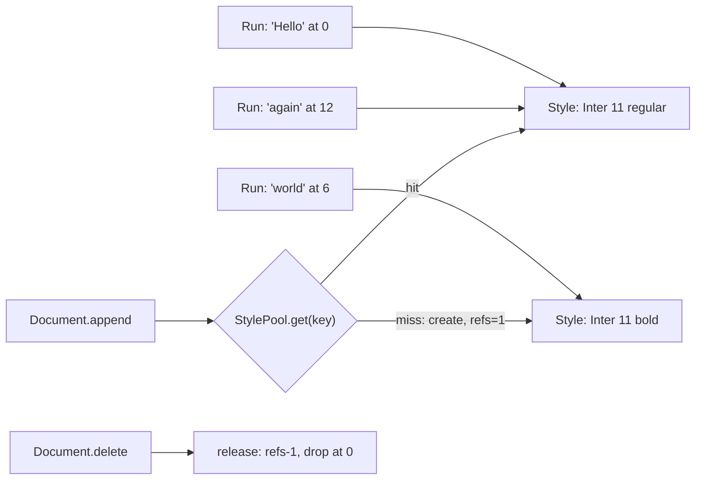

## In one minute
- Flyweight saves memory when a program holds millions of objects that differ in only a few fields: the repeated part (*intrinsic state*) lives in one shared, immutable object, and each instance keeps only what is unique to it (*extrinsic state*) plus a pointer to the shared part.
- A factory or pool hands out the shared objects keyed by their value, so equal values get the same instance. String interning, Java's small `Integer` cache, Go's `unique` package and V8's hidden classes are all flyweights.
- The two rules that make sharing safe: flyweights are immutable, and nothing that varies per instance is stored inside them.
- The pool is the hard part in production. Unbounded pools leak, pools fed from user input can be grown by an attacker, and a shared mutable map needs a lock. Weak references or reference counts bound the lifetime.
- Only reach for it after measuring. A flyweight trades memory for an extra pointer dereference and a hash lookup at creation; for ten thousand objects it is noise, for fifty million it decides whether the process fits in RAM.

## How it works

### The problem
A collaborative document editor keeps text as runs: a stretch of characters plus its formatting (font, size, weight, colour, link target). The first version gave every run its own `Format` object. A large document has 400,000 runs, and profiling shows 380,000 `Format` objects in memory, 160 bytes each in Python with their attribute dictionaries, about 60 MB per open document. Yet the document uses only 23 distinct formats. The server holds 2,000 open documents, so most of its memory is copies of "Inter, 11pt, regular, black".

### Split intrinsic from extrinsic
Flyweight starts by sorting fields. **Intrinsic** state is the same across many instances and does not depend on where the object is used: the format's font, size and weight. **Extrinsic** state differs per use: the run's text and its position in the document. Intrinsic state goes into a shared, immutable flyweight. Extrinsic state stays in the context object, or is passed into the flyweight's methods when they need it.

```python
class StylePool:
    def __init__(self):
        self._styles = {}

    def get(self, font, size, bold):
        key = (font, size, bold)
        style = self._styles.get(key)
        if style is None:
            style = self._styles[key] = Style(font, size, bold)  # frozen
        return style
```

Each run now stores its text and a pointer to one of 23 styles. Equality checks become identity checks (`run.style is other.style`), which also makes "merge adjacent runs with the same format" a pointer comparison.

### The flyweight factory
Callers must never construct flyweights directly, or they will create duplicates that defeat the sharing. A factory (see Factory Method) owns a map from intrinsic key to instance and returns the existing one when it can. That map is the pool, and it is where the engineering lives: when entries are created, who may create them, when they can be removed, and how concurrent callers are kept from creating two copies of the same key.

### Where you already use flyweights
- **String interning.** Python's `sys.intern(s)` returns one canonical string for each value; CPython interns identifiers and attribute names automatically so dictionary lookups can compare pointers first. Java interns string literals in a JVM-wide table, and since JDK 7 that table lives in the main heap rather than the permanent generation ([JDK 7 notes](https://www.oracle.com/java/technologies/javase/jdk7-relnotes.html)).
- **Small value caches.** CPython preallocates integers from -5 to 256 ([C API docs](https://docs.python.org/3/c-api/long.html)), and Java's `Integer.valueOf` always caches -128 to 127 ([Javadoc](https://docs.oracle.com/en/java/javase/21/docs/api/java.base/java/lang/Integer.html)). That is why `a is b` happens to be true for small integers and false for large ones.
- **Hidden classes.** V8 gives objects with the same property layout a shared *map* (hidden class) that describes field names and offsets. Each object stores a pointer to the map, not its own copy of the layout ([V8 docs](https://v8.dev/docs/hidden-classes)).
- **File formats.** In an `.xlsx` file, each cell stores a style index (`s="3"`) into a shared `cellXfs` table, and strings live once in `sharedStrings.xml`, referenced by number.
- **GPU instancing.** A forest of 100,000 trees uploads one mesh and draws it with one instanced draw call; each tree contributes only a transform matrix.

### Flyweight, Singleton, Prototype and caching
A singleton is one instance per type (see Singleton). A flyweight is one instance per distinct *value*, potentially thousands. The Gang of Four list "does not depend on object identity" as a condition for using the pattern (*Design Patterns*, ch. 4), so treat pointer equality as an optimisation that holds only for instances that came from the factory. Prototype copies an object so the copy can diverge (see Prototype); flyweight shares precisely because nothing will diverge. A cache stores results to save time and may evict an entry and recompute it; a flyweight pool stores instances to save memory, and evicting a live entry would break identity, because the next caller would get a different object for the same value. The State lesson's stateless state objects are a small flyweight: one shared instance per state.

### Reviewing agent-written code
Agents model data one object per row, which is right until a profile says otherwise. When asked to "reduce memory", they may add a module-level `dict` cache with no bound, keyed by something that comes from requests, or they share an object that something later mutates. Check in review that the shared type is immutable (`@dataclass(frozen=True)`, `readonly` fields, unexported fields in Go), that the pool has a lifetime story (weak references, reference counts or a fixed key space), and that the key space is not controlled by untrusted input.

### The same shape elsewhere
Flyweight is the *duplicates* problem shape applied to memory: the same value is stored many times, so you store it once and refer to it. Content-addressed storage does the same on disk: Git stores each distinct file content once as a blob named by its hash, so a commit that changes one file in a 10,000-file tree shares the other 9,999 blobs with its parent.

## Down the stack

### Layer 1: The contract
The factory promises that for two equal keys it returns the same instance for as long as either caller holds it, so identity comparison is valid. The flyweight promises it never changes after construction, which is what makes it safe to share across threads without locks. If the pool releases entries, the contract states when: on the last release (reference counting) or some time after the last reference is dropped (weak references and GC). It must never drop an entry that someone still holds, or the next `get` for that key returns a second instance and identity checks silently start failing.

### Layer 2: The mechanism
Go 1.23's `unique` package is a general flyweight factory. `unique.Make[T comparable](v T)` returns a `Handle[T]`, which is a pointer to a canonical copy of `v`; comparing two handles is a pointer comparison, however large `T` is ([Go blog](https://go.dev/blog/unique)). Internally the canonical copies live in a concurrent hash-trie map whose values are held weakly, so once no handle refers to an entry, the garbage collector can reclaim it and a background cleanup removes the map slot. The standard library's `net/netip` uses it to share address details such as IPv6 zone names across addresses ([Go blog](https://go.dev/blog/unique)).

Java has two flyweight systems for strings. `String.intern()` looks up a native hash table, the `StringTable`, whose bucket count is tunable with `-XX:StringTableSize`. G1's string deduplication (`-XX:+UseStringDeduplication`, off by default and documented as requiring G1 in the [JDK 21 `java` man page](https://docs.oracle.com/en/java/javase/21/docs/specs/man/java.html)) does it lazily: during GC, it hashes the backing arrays of young strings and points duplicates at one shared array, without changing string identity. CPython's interned strings sit in a dictionary keyed by the string itself; since 3.12, statically allocated objects such as identifiers and small integers are *immortal*, so their reference counts are never changed, removing refcount writes on hot shared objects ([PEP 683](https://peps.python.org/pep-0683/)).

V8's hidden classes form a transition tree. Adding property `x` then `y` to an empty object moves it from map M0 to M1 to M2, and every object built in that order ends at the same M2. Inline caches at property access sites record "map M2 means `y` is at offset 16", so sharing the map is also what makes property access fast.

### Layer 3: The machine
The savings are pointer arithmetic. On a 64-bit machine a reference costs 8 bytes. A Python object with three attributes and a per-instance `__dict__` costs roughly 150 to 200 bytes; with `__slots__` around 56. Replacing 380,000 private formats with references to 23 shared ones turns about 60 MB into 3 MB of pointers plus a few kilobytes of styles. Go's `unique.Handle` is one pointer, so a struct that held a 40-byte key now holds 8 bytes, and maps keyed by handles hash 8 bytes instead of the full value.

Smaller objects also mean more of the working set fits in cache. A 64-byte cache line holds 8 pointers but less than half of one Python format object. The cost is an extra dependent load: reading `run.style.size` follows a pointer to the shared object. Because a few hot flyweights are touched constantly, they stay in L1 or L2, so that load is usually 1 to 4 ns instead of a 60 to 100 ns trip to DRAM.

Concurrency costs live in the pool, not the flyweights. A pool behind one mutex serialises every `get`; at millions of lookups per second across cores, the lock's cache line bounces between cores. Sharded maps, lock-free tries (as in `unique`), or a read-mostly design (build the pool at startup, then read without locks) remove that contention. Reference counting on shared objects has the same problem in a different place: every increment writes to the shared object's cache line, which is why CPython made its most shared objects immortal.

### Why it's built this way
1. Memory is finite and its cost scales with instance count, so millions of near-identical objects are expensive in RAM, cache and GC time.
2. Most of each object is repeated, so storing the repeated part once and referring to it shrinks the footprint to a pointer per instance.
3. Sharing is only safe if nobody can change the shared part, so flyweights are immutable and per-use data stays outside.
4. Callers must find the existing instance instead of making a new one, so creation goes through a factory keyed by value.
5. The pool would otherwise grow forever, so it needs weak references, reference counts or a closed key space.

## Diagram


## Worked example
A spreadsheet service holds open workbooks in memory for real-time collaboration. A typical large workbook has 5 million non-empty cells. The first implementation gave each cell a `CellFormat` with font, size, colours, number format and borders, about 220 bytes per format in the service's Go structs (strings included), or 1.1 GB per workbook. Profiling showed 412 distinct formats.

The team interned formats with `unique.Make[CellFormat]` and stored a `unique.Handle[CellFormat]` per cell. Per-cell format memory fell from 220 bytes to 8, so 5 million cells use 40 MB plus about 90 KB for the 412 canonical formats. Copy-and-paste of a 100,000-cell range no longer allocated 100,000 formats, and "are these two cells formatted the same?" became a pointer comparison, which made the autofit and conditional-format passes about 3 times faster.

Two things needed care. Edits create a new format and swap the handle, never modifying a shared one. And imports from untrusted files could contain millions of distinct formats; the import path caps distinct formats per workbook at 64,000, the same order of limit spreadsheet applications apply, and rejects files beyond it.

## In the wild
- **CPython 3.12, 2023: immortal objects stop copy-on-write churn.** Servers such as Instagram's load a Python application, then fork workers that share memory pages copy-on-write. Because even reading an object changed its reference count, shared pages were copied anyway. PEP 683 made shared objects (static types, identifiers, small ints) immortal, so their refcounts are never written ([PEP 683](https://peps.python.org/pep-0683/)). It shipped in Python 3.12 and is a flyweight lifetime decision: shared objects never die.
- **Java 7, 2011: the intern table moves out of PermGen.** `String.intern()` stored strings in the fixed-size permanent generation. JDK 7 moved interned strings into the main heap, where they are garbage collected like other objects. Oracle warned that applications making heavy use of `intern()` would see larger heap differences ([JDK 7 notes](https://www.oracle.com/java/technologies/javase/jdk7-relnotes.html)).
- **Go 1.23, 2024: `unique` and `net/netip`.** `netip.Addr` stays a small comparable value by interning its rarely-varying detail (such as the IPv6 zone) with `unique.Make`; handles compare as pointers and canonical copies are reclaimed once unreferenced, which required adding weak-pointer support to the runtime ([Go blog](https://go.dev/blog/unique)).

## Trade-offs
| Option | Strengths | Weaknesses | Choose when |
| --- | --- | --- | --- |
| One object per instance | Simple; each object can change freely | Memory scales with count times size | Thousands of objects, or values rarely repeat |
| Flyweight with an unbounded pool | Smallest footprint; identity equality | Pool grows forever; leaks with open key spaces | Closed key space (glyphs, enum-like styles) |
| Flyweight with refcounts or weak refs | Bounded memory; entries freed when unused | Refcount writes contend; weak refs need GC support | Open key spaces, long-running processes |
| Integer IDs into a table | 4 bytes per reference; serialises well | Lookup step on every access; manual lifetime | File formats, columnar storage, GPU buffers |
| Compression or dictionary encoding | Works on bulk data without object identity | Decode cost on read | Analytics columns, logs, network payloads |

## Pitfalls in production
- Mutating a shared flyweight, so one document's edit changes every document's text colour. Fix: make the type immutable and create a new flyweight for every change.
- An unbounded intern table keyed by request data, which an attacker grows with unique values until the process runs out of memory. Fix: bound the key space, use weak references, or intern only values from a trusted set.
- Identity checks that work in tests and fail in production, such as Python's `x is 256` versus `x is 257`. Fix: compare with `==` unless the pool guarantees identity for that type.
- A per-key race where two threads miss the pool at once and create two instances. Fix: lock per shard around the miss path, or use a concurrent map with an atomic load-or-store.
- Extrinsic state accidentally stored in the flyweight, such as a cached position, which makes the "shared" object wrong for every other user. Fix: keep per-use fields in the context and pass them in.

## Leadership lens
- Ask for the heap profile before approving a flyweight. The pattern is a memory optimisation with costs in clarity and lifetime management, and it needs a number to justify it.
- Ask who controls the key space. A pool keyed by a fixed set of glyphs is safe; one keyed by user input is a denial-of-service vector until it is bounded.
- Make immutability enforceable rather than conventional: frozen dataclasses, readonly types and unexported fields mean reviewers do not have to catch every mutation.
- Budget memory per tenant or per document. Flyweights shrink the common case; limits protect against the pathological file that defeats sharing.

## Check yourself
1. A map tile renderer draws 2 million building icons, each with a position and one of 40 icon bitmaps. What is intrinsic and what is extrinsic?
   **Answer:** The bitmap (and its size and anchor point) is intrinsic and shared through 40 flyweights; each building's position and rotation is extrinsic and passed in when drawing.
2. Why must a flyweight pool never evict an entry while it is still referenced, when an ordinary cache may evict anything?
   **Answer:** A cache only saves recomputation, so a miss is slower but correct. Evicting a live flyweight lets the next `get` create a second instance for the same value, which breaks identity comparisons that callers rely on.
3. Go's `unique.Handle` comparison is a pointer comparison. What does that buy you over comparing the values?
   **Answer:** Constant-time equality and hashing regardless of the value's size, plus 8-byte storage per reference instead of a full copy.
4. Why did CPython make small integers and interned strings immortal?
   **Answer:** These objects are shared by everything, so every reference count update wrote to the same cache lines; immortality skips those writes and makes the objects safe to share without refcount traffic.

## Practice
**Task:** Build a reference-counted style pool and a document that uses it. `StylePool.get(font, size, bold)` returns the shared `Style` for that key (fields `font`, `size`, `bold`), creating it on the first request, and adds one reference; a `size` below 1 fails with `bad size: <size>`. `release(style)` removes one reference and drops the style from the pool when its count reaches zero; releasing a style that is not the live pooled instance (never handed out, or already dropped) fails with `unknown style`. `live()` returns the number of styles in the pool and `refs(font, size, bold)` the reference count (0 if absent). `Document(pool)` keeps runs of text. `append(text, font, size, bold)` ignores empty text; otherwise it gets the style, and if the last run has the very same style object it appends the text to that run and releases the extra reference, so each run holds exactly one. `runs()` returns `"text|font|size|b"` strings, with `b` for bold and `-` otherwise. `delete(index)` removes a run and releases its style (runs are not re-merged), failing with `bad index: <index>` when out of range. Python raises `ValueError`, TypeScript throws `Error`, Go returns an error.

```python starter
class Style:
    def __init__(self, font, size, bold):
        self.font, self.size, self.bold = font, size, bold


class StylePool:
    def get(self, font, size, bold):
        # TODO
        raise NotImplementedError

    def release(self, style):
        # TODO
        raise NotImplementedError

    def live(self):
        # TODO
        raise NotImplementedError

    def refs(self, font, size, bold):
        # TODO
        raise NotImplementedError


class Document:
    def __init__(self, pool):
        self.pool = pool

    def append(self, text, font, size, bold):
        # TODO
        raise NotImplementedError

    def runs(self):
        # TODO
        raise NotImplementedError

    def delete(self, index):
        # TODO
        raise NotImplementedError
```

```python tests
def error_of(fn):
    try:
        fn()
    except ValueError as e:
        return str(e)
    return None

def test_equal_keys_share_one_instance():
    p = StylePool()
    a = p.get("Inter", 11, False)
    b = p.get("Inter", 11, False)
    c = p.get("Inter", 11, True)
    assert a is b and a is not c
    assert a.font == "Inter" and a.size == 11 and a.bold is False
    assert p.live() == 2 and p.refs("Inter", 11, False) == 2 and p.refs("Mono", 9, False) == 0

def test_release_to_zero_drops_style():
    p = StylePool()
    a = p.get("Inter", 11, False)
    p.get("Inter", 11, False)
    p.release(a)
    assert p.live() == 1 and p.refs("Inter", 11, False) == 1
    p.release(a)
    assert p.live() == 0
    assert p.get("Inter", 11, False) is not a, "a dropped style is recreated"

def test_release_errors_and_bad_size():
    p = StylePool()
    a = p.get("Inter", 11, False)
    p.release(a)
    assert error_of(lambda: p.release(a)) == "unknown style"
    p.get("Inter", 11, False)
    assert error_of(lambda: p.release(a)) == "unknown style", "stale instance is not the live one"
    assert error_of(lambda: p.get("Inter", 0, False)) == "bad size: 0"

def test_adjacent_runs_with_same_style_merge():
    p = StylePool()
    d = Document(p)
    d.append("Hel", "Inter", 11, False)
    d.append("lo", "Inter", 11, False)
    d.append("", "Mono", 9, True)
    assert d.runs() == ["Hello|Inter|11|-"]
    assert p.refs("Inter", 11, False) == 1 and p.live() == 1

def test_separate_runs_share_styles():
    p = StylePool()
    d = Document(p)
    d.append("a", "Inter", 11, True)
    d.append("b", "Inter", 11, False)
    d.append("c", "Inter", 11, True)
    assert d.runs() == ["a|Inter|11|b", "b|Inter|11|-", "c|Inter|11|b"]
    assert p.live() == 2 and p.refs("Inter", 11, True) == 2

def test_delete_releases_style():
    p = StylePool()
    d = Document(p)
    d.append("a", "Inter", 11, True)
    d.append("b", "Mono", 9, False)
    d.append("c", "Inter", 11, True)
    d.delete(1)
    assert d.runs() == ["a|Inter|11|b", "c|Inter|11|b"], "no re-merge after delete"
    assert p.live() == 1
    d.delete(0)
    d.delete(0)
    assert d.runs() == [] and p.live() == 0
    assert error_of(lambda: d.delete(0)) == "bad index: 0"

def test_documents_share_one_pool():
    p = StylePool()
    d1, d2 = Document(p), Document(p)
    d1.append("x", "Inter", 11, False)
    d2.append("y", "Inter", 11, False)
    assert p.live() == 1 and p.refs("Inter", 11, False) == 2
    d1.delete(0)
    assert p.refs("Inter", 11, False) == 1 and d2.runs() == ["y|Inter|11|-"]
```

```python solution
class Style:
    __slots__ = ("font", "size", "bold")

    def __init__(self, font, size, bold):
        self.font, self.size, self.bold = font, size, bold


class StylePool:
    def __init__(self):
        self._entries = {}  # key -> [style, refs]

    def get(self, font, size, bold):
        if size < 1:
            raise ValueError("bad size: " + str(size))
        key = (font, size, bold)
        entry = self._entries.get(key)
        if entry is None:
            entry = self._entries[key] = [Style(font, size, bold), 0]
        entry[1] += 1
        return entry[0]

    def release(self, style):
        key = (style.font, style.size, style.bold)
        entry = self._entries.get(key)
        if entry is None or entry[0] is not style:
            raise ValueError("unknown style")
        entry[1] -= 1
        if entry[1] == 0:
            del self._entries[key]

    def live(self):
        return len(self._entries)

    def refs(self, font, size, bold):
        entry = self._entries.get((font, size, bold))
        return entry[1] if entry else 0


class Document:
    def __init__(self, pool):
        self.pool = pool
        self._runs = []  # [text, style]

    def append(self, text, font, size, bold):
        if text == "":
            return
        style = self.pool.get(font, size, bold)
        if self._runs and self._runs[-1][1] is style:
            self._runs[-1][0] += text
            self.pool.release(style)
        else:
            self._runs.append([text, style])

    def runs(self):
        out = []
        for text, s in self._runs:
            out.append(text + "|" + s.font + "|" + str(s.size) + "|" + ("b" if s.bold else "-"))
        return out

    def delete(self, index):
        if index < 0 or index >= len(self._runs):
            raise ValueError("bad index: " + str(index))
        _, style = self._runs.pop(index)
        self.pool.release(style)
```

```typescript starter
export class Style {
  constructor(readonly font: string, readonly size: number, readonly bold: boolean) {}
}

export class StylePool {
  get(font: string, size: number, bold: boolean): Style { throw new Error("TODO"); }
  release(style: Style): void { throw new Error("TODO"); }
  live(): number { throw new Error("TODO"); }
  refs(font: string, size: number, bold: boolean): number { throw new Error("TODO"); }
}

export class Document {
  constructor(readonly pool: StylePool) {}
  append(text: string, font: string, size: number, bold: boolean): void { throw new Error("TODO"); }
  runs(): string[] { throw new Error("TODO"); }
  delete(index: number): void { throw new Error("TODO"); }
}
```

```typescript tests
function errorOf(fn: () => unknown): string | undefined {
  try { fn(); } catch (e) { return (e as Error).message; }
  return undefined;
}

test("equal keys share one instance", () => {
  const p = new StylePool();
  const a = p.get("Inter", 11, false);
  const b = p.get("Inter", 11, false);
  const c = p.get("Inter", 11, true);
  assert(a === b && a !== c, "identity");
  assert(a.font === "Inter" && a.size === 11 && a.bold === false, "fields");
  assertEqual([p.live(), p.refs("Inter", 11, false), p.refs("Mono", 9, false)], [2, 2, 0]);
});

test("release to zero drops style", () => {
  const p = new StylePool();
  const a = p.get("Inter", 11, false);
  p.get("Inter", 11, false);
  p.release(a);
  assertEqual([p.live(), p.refs("Inter", 11, false)], [1, 1]);
  p.release(a);
  assertEqual(p.live(), 0);
  assert(p.get("Inter", 11, false) !== a, "a dropped style is recreated");
});

test("release errors and bad size", () => {
  const p = new StylePool();
  const a = p.get("Inter", 11, false);
  p.release(a);
  assertEqual(errorOf(() => p.release(a)), "unknown style");
  p.get("Inter", 11, false);
  assertEqual(errorOf(() => p.release(a)), "unknown style", "stale instance");
  assertEqual(errorOf(() => p.get("Inter", 0, false)), "bad size: 0");
});

test("adjacent runs with same style merge", () => {
  const p = new StylePool();
  const d = new Document(p);
  d.append("Hel", "Inter", 11, false);
  d.append("lo", "Inter", 11, false);
  d.append("", "Mono", 9, true);
  assertEqual(d.runs(), ["Hello|Inter|11|-"]);
  assertEqual([p.refs("Inter", 11, false), p.live()], [1, 1]);
});

test("separate runs share styles", () => {
  const p = new StylePool();
  const d = new Document(p);
  d.append("a", "Inter", 11, true);
  d.append("b", "Inter", 11, false);
  d.append("c", "Inter", 11, true);
  assertEqual(d.runs(), ["a|Inter|11|b", "b|Inter|11|-", "c|Inter|11|b"]);
  assertEqual([p.live(), p.refs("Inter", 11, true)], [2, 2]);
});

test("delete releases style", () => {
  const p = new StylePool();
  const d = new Document(p);
  d.append("a", "Inter", 11, true);
  d.append("b", "Mono", 9, false);
  d.append("c", "Inter", 11, true);
  d.delete(1);
  assertEqual(d.runs(), ["a|Inter|11|b", "c|Inter|11|b"], "no re-merge after delete");
  assertEqual(p.live(), 1);
  d.delete(0);
  d.delete(0);
  assertEqual([d.runs(), p.live()], [[], 0]);
  assertEqual(errorOf(() => d.delete(0)), "bad index: 0");
});

test("documents share one pool", () => {
  const p = new StylePool();
  const d1 = new Document(p);
  const d2 = new Document(p);
  d1.append("x", "Inter", 11, false);
  d2.append("y", "Inter", 11, false);
  assertEqual([p.live(), p.refs("Inter", 11, false)], [1, 2]);
  d1.delete(0);
  assertEqual(p.refs("Inter", 11, false), 1);
  assertEqual(d2.runs(), ["y|Inter|11|-"]);
});
```

```typescript solution
export class Style {
  constructor(readonly font: string, readonly size: number, readonly bold: boolean) {}
}

function keyOf(font: string, size: number, bold: boolean): string {
  return JSON.stringify([font, size, bold]);
}

export class StylePool {
  private entries = new Map<string, { style: Style; refs: number }>();

  get(font: string, size: number, bold: boolean): Style {
    if (size < 1) throw new Error("bad size: " + size);
    const key = keyOf(font, size, bold);
    let e = this.entries.get(key);
    if (!e) {
      e = { style: new Style(font, size, bold), refs: 0 };
      this.entries.set(key, e);
    }
    e.refs++;
    return e.style;
  }

  release(style: Style): void {
    const key = keyOf(style.font, style.size, style.bold);
    const e = this.entries.get(key);
    if (!e || e.style !== style) throw new Error("unknown style");
    e.refs--;
    if (e.refs === 0) this.entries.delete(key);
  }

  live(): number { return this.entries.size; }

  refs(font: string, size: number, bold: boolean): number {
    const e = this.entries.get(keyOf(font, size, bold));
    return e ? e.refs : 0;
  }
}

export class Document {
  private items: { text: string; style: Style }[] = [];
  constructor(readonly pool: StylePool) {}

  append(text: string, font: string, size: number, bold: boolean): void {
    if (text === "") return;
    const style = this.pool.get(font, size, bold);
    const last = this.items[this.items.length - 1];
    if (last && last.style === style) {
      last.text += text;
      this.pool.release(style);
    } else {
      this.items.push({ text, style });
    }
  }

  runs(): string[] {
    return this.items.map((r) => [r.text, r.style.font, r.style.size, r.style.bold ? "b" : "-"].join("|"));
  }

  delete(index: number): void {
    if (index < 0 || index >= this.items.length) throw new Error("bad index: " + index);
    const [r] = this.items.splice(index, 1);
    this.pool.release(r.style);
  }
}
```

```go starter
package practice

type Style struct {
	Font string
	Size int
	Bold bool
}

type StylePool struct{}

func NewStylePool() *StylePool { return &StylePool{} }

func (p *StylePool) Get(font string, size int, bold bool) (*Style, error) { panic("TODO") }
func (p *StylePool) Release(s *Style) error                               { panic("TODO") }
func (p *StylePool) Live() int                                            { panic("TODO") }
func (p *StylePool) Refs(font string, size int, bold bool) int            { panic("TODO") }

type Document struct {
	pool *StylePool
}

func NewDocument(p *StylePool) *Document { return &Document{pool: p} }

func (d *Document) Append(text, font string, size int, bold bool) error { panic("TODO") }
func (d *Document) Runs() []string                                    { panic("TODO") }
func (d *Document) Delete(index int) error                            { panic("TODO") }
```

```go tests
package practice

import (
	"reflect"
	"testing"
)

func mustGet(t *testing.T, p *StylePool, font string, size int, bold bool) *Style {
	t.Helper()
	s, err := p.Get(font, size, bold)
	if err != nil {
		t.Fatal(err)
	}
	return s
}

func errText(err error) string {
	if err == nil {
		return ""
	}
	return err.Error()
}

func sameRuns(t *testing.T, got, want []string) {
	t.Helper()
	if len(got) == 0 && len(want) == 0 {
		return
	}
	if !reflect.DeepEqual(got, want) {
		t.Fatalf("want %q, got %q", want, got)
	}
}

func TestEqualKeysShareOneInstance(t *testing.T) {
	p := NewStylePool()
	a := mustGet(t, p, "Inter", 11, false)
	b := mustGet(t, p, "Inter", 11, false)
	c := mustGet(t, p, "Inter", 11, true)
	if a != b || a == c {
		t.Fatal("identity")
	}
	if *a != (Style{"Inter", 11, false}) {
		t.Fatalf("fields %+v", *a)
	}
	if p.Live() != 2 || p.Refs("Inter", 11, false) != 2 || p.Refs("Mono", 9, false) != 0 {
		t.Fatal("counts")
	}
}

func TestReleaseToZeroDropsStyle(t *testing.T) {
	p := NewStylePool()
	a := mustGet(t, p, "Inter", 11, false)
	mustGet(t, p, "Inter", 11, false)
	p.Release(a)
	if p.Live() != 1 || p.Refs("Inter", 11, false) != 1 {
		t.Fatal("after one release")
	}
	p.Release(a)
	if p.Live() != 0 {
		t.Fatal("should be dropped")
	}
	if mustGet(t, p, "Inter", 11, false) == a {
		t.Fatal("a dropped style is recreated")
	}
}

func TestReleaseErrorsAndBadSize(t *testing.T) {
	p := NewStylePool()
	a := mustGet(t, p, "Inter", 11, false)
	p.Release(a)
	if got := errText(p.Release(a)); got != "unknown style" {
		t.Fatalf("got %q", got)
	}
	mustGet(t, p, "Inter", 11, false)
	if got := errText(p.Release(a)); got != "unknown style" {
		t.Fatalf("stale instance: got %q", got)
	}
	if _, err := p.Get("Inter", 0, false); errText(err) != "bad size: 0" {
		t.Fatalf("got %v", err)
	}
}

func TestAdjacentRunsWithSameStyleMerge(t *testing.T) {
	p := NewStylePool()
	d := NewDocument(p)
	d.Append("Hel", "Inter", 11, false)
	d.Append("lo", "Inter", 11, false)
	d.Append("", "Mono", 9, true)
	sameRuns(t, d.Runs(), []string{"Hello|Inter|11|-"})
	if p.Refs("Inter", 11, false) != 1 || p.Live() != 1 {
		t.Fatal("one ref per run")
	}
}

func TestSeparateRunsShareStyles(t *testing.T) {
	p := NewStylePool()
	d := NewDocument(p)
	d.Append("a", "Inter", 11, true)
	d.Append("b", "Inter", 11, false)
	d.Append("c", "Inter", 11, true)
	sameRuns(t, d.Runs(), []string{"a|Inter|11|b", "b|Inter|11|-", "c|Inter|11|b"})
	if p.Live() != 2 || p.Refs("Inter", 11, true) != 2 {
		t.Fatal("counts")
	}
}

func TestDeleteReleasesStyle(t *testing.T) {
	p := NewStylePool()
	d := NewDocument(p)
	d.Append("a", "Inter", 11, true)
	d.Append("b", "Mono", 9, false)
	d.Append("c", "Inter", 11, true)
	if err := d.Delete(1); err != nil {
		t.Fatal(err)
	}
	sameRuns(t, d.Runs(), []string{"a|Inter|11|b", "c|Inter|11|b"})
	if p.Live() != 1 {
		t.Fatal("Mono should be dropped")
	}
	d.Delete(0)
	d.Delete(0)
	sameRuns(t, d.Runs(), nil)
	if p.Live() != 0 {
		t.Fatal("pool should be empty")
	}
	if got := errText(d.Delete(0)); got != "bad index: 0" {
		t.Fatalf("got %q", got)
	}
}

func TestDocumentsShareOnePool(t *testing.T) {
	p := NewStylePool()
	d1, d2 := NewDocument(p), NewDocument(p)
	d1.Append("x", "Inter", 11, false)
	d2.Append("y", "Inter", 11, false)
	if p.Live() != 1 || p.Refs("Inter", 11, false) != 2 {
		t.Fatal("shared")
	}
	d1.Delete(0)
	if p.Refs("Inter", 11, false) != 1 {
		t.Fatal("released")
	}
	sameRuns(t, d2.Runs(), []string{"y|Inter|11|-"})
}
```

```go solution
package practice

import (
	"errors"
	"strconv"
)

type Style struct {
	Font string
	Size int
	Bold bool
}

type entry struct {
	style *Style
	refs  int
}

type StylePool struct {
	entries map[Style]*entry
}

func NewStylePool() *StylePool { return &StylePool{entries: map[Style]*entry{}} }

func (p *StylePool) Get(font string, size int, bold bool) (*Style, error) {
	if size < 1 {
		return nil, errors.New("bad size: " + strconv.Itoa(size))
	}
	key := Style{font, size, bold}
	e, ok := p.entries[key]
	if !ok {
		s := key
		e = &entry{style: &s}
		p.entries[key] = e
	}
	e.refs++
	return e.style, nil
}

func (p *StylePool) Release(s *Style) error {
	e, ok := p.entries[*s]
	if !ok || e.style != s {
		return errors.New("unknown style")
	}
	e.refs--
	if e.refs == 0 {
		delete(p.entries, *s)
	}
	return nil
}

func (p *StylePool) Live() int { return len(p.entries) }

func (p *StylePool) Refs(font string, size int, bold bool) int {
	if e, ok := p.entries[Style{font, size, bold}]; ok {
		return e.refs
	}
	return 0
}

type run struct {
	text  string
	style *Style
}

type Document struct {
	pool *StylePool
	runs []run
}

func NewDocument(p *StylePool) *Document { return &Document{pool: p} }

func (d *Document) Append(text, font string, size int, bold bool) error {
	if text == "" {
		return nil
	}
	s, err := d.pool.Get(font, size, bold)
	if err != nil {
		return err
	}
	if n := len(d.runs); n > 0 && d.runs[n-1].style == s {
		d.runs[n-1].text += text
		return d.pool.Release(s)
	}
	d.runs = append(d.runs, run{text, s})
	return nil
}

func (d *Document) Runs() []string {
	out := make([]string, 0, len(d.runs))
	for _, r := range d.runs {
		b := "-"
		if r.style.Bold {
			b = "b"
		}
		out = append(out, r.text+"|"+r.style.Font+"|"+strconv.Itoa(r.style.Size)+"|"+b)
	}
	return out
}

func (d *Document) Delete(index int) error {
	if index < 0 || index >= len(d.runs) {
		return errors.New("bad index: " + strconv.Itoa(index))
	}
	s := d.runs[index].style
	d.runs = append(d.runs[:index], d.runs[index+1:]...)
	return d.pool.Release(s)
}
```

## Mock interview
**Prompt:** You are building the in-memory model for a browser-based map editor. A city dataset has 8 million features (buildings, trees, lamp posts), each with a geometry, a type and a style, and the tab is crashing at 4 GB. There are about 300 feature types and 1,200 distinct styles. Redesign the model to fit in under 1 GB.

- Follow-up: Users can edit a single building's colour. How does that work if styles are shared?
- Follow-up: Imported files come from customers and may contain millions of unique styles. What protects the editor?
- Follow-up: Rendering runs in a Web Worker while edits happen on the main thread. Where does sharing break, and what do you do about it?

**A strong answer covers:**
- A heap profile first, then a split: type and style are intrinsic and interned; geometry, ID and per-feature overrides are extrinsic.
- Compact references (a 16-bit or 32-bit style index into a table, or columnar typed arrays) rather than an object per feature, with the arithmetic: 8 million features times a few bytes instead of hundreds.
- Copy-on-write edits: changing one feature's colour interns a new style and swaps that feature's index; shared styles are never mutated.
- A bound on distinct styles per document and a fallback (reject or degrade) for hostile imports, plus release of unused styles.
- Awareness that workers do not share objects: send the style table once (or in a `SharedArrayBuffer`) and pass indices, so the flyweight survives the thread boundary.

## Sources and further study
**Primary**
- [PEP 683: Immortal Objects](https://peps.python.org/pep-0683/): why shared objects stop changing their refcounts, and the cost-benefit argument.
- [Python C API: integer objects](https://docs.python.org/3/c-api/long.html): the documented small-integer cache range.
- [Java SE 21: Integer.valueOf](https://docs.oracle.com/en/java/javase/21/docs/api/java.base/java/lang/Integer.html): the guaranteed cache range of -128 to 127.

**Systems docs**
- [JDK 7 release notes](https://www.oracle.com/java/technologies/javase/jdk7-relnotes.html): interned strings moved from the permanent generation to the main heap.
- [JDK 21 java command reference](https://docs.oracle.com/en/java/javase/21/docs/specs/man/java.html): the string deduplication flag and its G1 requirement.
- [JEP 192: String Deduplication in G1](https://openjdk.org/jeps/192): the motivation, with roughly a quarter of live heap in strings and about half of those duplicates in the applications studied.
- [Go blog: new unique package](https://go.dev/blog/unique): handles, weak pointers and the `net/netip` example.

**Books**
- *Design Patterns: Elements of Reusable Object-Oriented Software*, Gamma, Helm, Johnson and Vlissides: chapter 2 (the document editor case study, which motivates flyweight with characters) and chapter 4 (Structural Patterns), the Flyweight entry.
- *Head First Design Patterns*, Freeman and Robson: appendix "Leftover Patterns", the short Flyweight entry.

**Other curricula**
- [SourceMaking: Flyweight](https://sourcemaking.com/design_patterns/flyweight): frames the pattern as sharing for fine-grained objects and splits state into intrinsic and extrinsic.
- [Java Design Patterns: Flyweight](https://java-design-patterns.com/patterns/flyweight/): a Java example with real-world uses listed.

## Watch
- [Flyweight Design Pattern (Derek Banas)](https://www.youtube.com/watch?v=0vV-R2926ss): builds a flyweight factory in Java and measures the difference in object count and speed.
- [Flyweight Pattern, Design Patterns in C# (SingletonSean)](https://www.youtube.com/watch?v=RDV0ioVTF4g): intrinsic versus extrinsic state with a worked .NET example.

## Free resources
- [The Flyweight Pattern (Brandon Rhodes, python-patterns.guide)](https://python-patterns.guide/gang-of-four/flyweight/): how Python itself uses flyweights and how to write a factory for them.
- [New unique package (Go blog)](https://go.dev/blog/unique): interning in Go with weak references, and how `net/netip` uses it.
- [unique package (Go docs)](https://pkg.go.dev/unique): the `Make` and `Handle` API and its guarantees.
- [Maps (hidden classes) in V8 (V8 docs)](https://v8.dev/docs/hidden-classes): how V8 shares object layouts across instances.
- [sys.intern (Python docs)](https://docs.python.org/3/library/sys.html#sys.intern): what interning guarantees in CPython and when it helps.
- [Flyweight (Refactoring.Guru)](https://refactoring.guru/design-patterns/flyweight): the structure, intrinsic and extrinsic state, and code in many languages.
