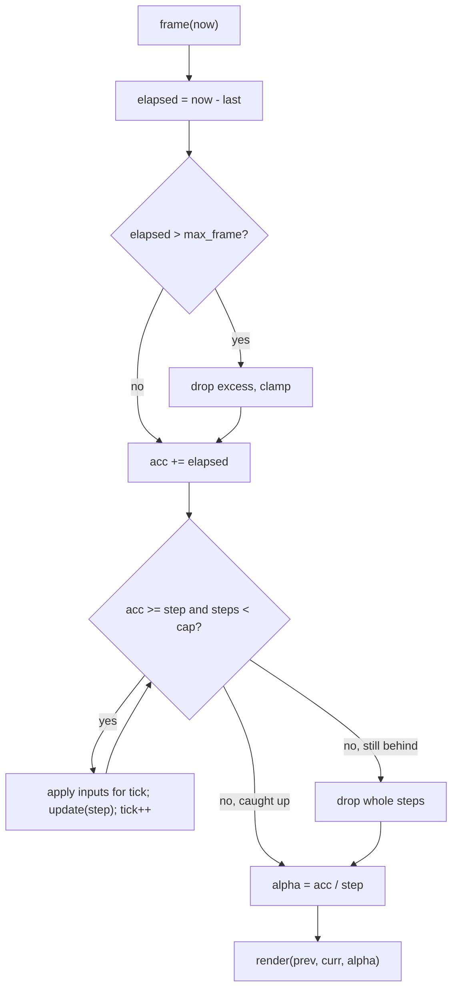

## In one minute
- A game loop is the one loop that owns time in an interactive simulation: each pass reads input, advances the world, and draws a frame, and it never waits for the user the way an event-driven app does.
- The core decision is how simulated time relates to wall-clock time. Tying the update to the CPU speed makes the game run faster on faster machines; passing a variable delta time fixes the speed but makes physics depend on the frame rate.
- The robust form is a fixed timestep with an accumulator: real elapsed time is banked, the world advances in equal steps of, say, 10 ms, and rendering interpolates between the last two states using the leftover fraction.
- A slow machine can fall behind forever (the "spiral of death"), so the loop clamps how much time one frame may add and caps the steps per frame, deliberately dropping time instead of drowning.
- The same shape runs far outside games: control loops in robots, Kubernetes reconcilers, trading simulators and audio callbacks all separate "advance the model by a fixed step" from "observe the model".

## How it works

### The problem
Most applications sleep until something happens: a click, a request, a timer. A game, a physics simulation or a robot controller cannot. The ball keeps moving whether or not the player touches the keyboard, so something must keep advancing the world. That something is a loop, and the interesting part is not the loop itself but how it keeps time.

The first version everyone writes looks like this:

```python
while running:
    handle_input()
    update()        # move every object by a fixed amount
    render()
```

On the developer's laptop it runs at 200 passes per second and feels right. On a gaming PC it runs at 900 and everything moves 4.5 times faster; on an old phone it runs at 30, in slow motion. Only fixed hardware, like old arcade boards, can get away with this.

### Variable timestep
The natural fix is to measure how long the last frame took and scale movement by it:

```python
last = clock()
while running:
    now = clock()
    dt = now - last
    last = now
    update(dt)      # position += velocity * dt
    render()
```

Speed is now right on every machine, and for simple games this is fine. The trouble appears with physics. Integration with a large `dt` is less accurate and can become unstable: a spring that settles at 60 updates per second can explode at 15, and a bullet moving 2 meters per step can jump over a 1-meter wall. Worse, two machines given the same inputs compute different worlds, because they sliced time differently. Replays, networked lockstep games and bug reproduction all need the same inputs to produce the same result.

### Fixed timestep with an accumulator
The standard answer, popularised by Glenn Fiedler's article "Fix Your Timestep!", decouples the two clocks. The simulation always advances by the same `step` (for example 10 ms, 100 updates per second). Rendering happens as often as the display allows. Between them sits an accumulator that holds real time not yet simulated:

```python
acc = 0
while running:
    now = clock()
    acc += min(now - last, MAX_FRAME)   # clamp a huge gap
    last = now
    steps = 0
    while acc >= STEP and steps < MAX_STEPS:
        update(STEP)
        acc -= STEP
        steps += 1
    render(alpha=acc / STEP)            # how far into the next step we are
```

If a frame took 25 ms, the world advances two 10 ms steps and 5 ms stays in the bank for next time. If a frame took 4 ms, no update runs at all and the bank grows. Over a long run the simulation advances exactly as much as the clock did, in identical slices.

### Interpolation
With a 100 Hz simulation and a 144 Hz display, some frames would show the same state twice and motion would stutter. The fix is to keep the previous and current states and render a blend weighted by `alpha = acc / step`: 5 ms into a 10 ms step, each object is drawn halfway between them. This costs up to one step of visual latency. Extrapolating forward from velocity removes the latency but briefly shows objects passing through walls.

### The spiral of death
Suppose one update takes 12 ms of CPU while the step is 10 ms. Each frame banks more time than it can spend, so the next frame needs more updates, which take even longer. The loop never catches up and the game freezes. Two guards stop this. A clamp on elapsed time (often 100 to 250 ms) means a debugger breakpoint or a window drag does not try to simulate the lost seconds. A cap on steps per frame means a persistently slow machine drops simulation time and runs in slow motion rather than locking up. Both deliberately break the "simulated time equals real time" promise, and that is the right call: this is the *overload* problem shape, and shedding work beats queueing it without bound.

### Input and determinism
Input should be sampled once per frame and applied at a specific simulation tick, not mid-update. When inputs are recorded as "at tick 1,204 the player pressed jump", a replay feeds the same inputs at the same ticks and reproduces the game exactly, regardless of the frame rate it is watched at. Real-time strategy games built on deterministic lockstep send only inputs over the network and rely on every client computing the identical world from them; that only works with a fixed step, a seeded random generator, and care with floating point. Multiplayer servers apply the same idea with a server tick rate: shooters commonly run at 30, 64 or 128 ticks per second, and clients interpolate between snapshots exactly as the renderer interpolates between steps.

### In browsers, engines and object designs
In a browser you cannot write `while (true)` without blocking the event loop, so `requestAnimationFrame(callback)` asks the browser to call you before each repaint with a high-resolution timestamp; the accumulator lives inside that callback. Unity exposes the same split as `FixedUpdate` (physics, default 0.02 s) and `Update` (once per rendered frame). In an object design, the loop is the composition root: each entity offers `update(step)` (the Update Method pattern), the renderer only reads state, and no entity calls the clock. Inject the clock into the loop and a test can run ten minutes of game time in milliseconds.

### Reviewing agent-written code
An agent asked to "make the player move" will usually write `player.x += 5` inside a `requestAnimationFrame` callback, tying speed to the monitor, or call `Date.now()` inside entity code. Ask for one loop that owns the clock, a fixed step, interpolation, a clamp, and inputs keyed by tick, and check that a test can drive it with a fake clock.

### The same shape elsewhere
A Kubernetes controller is a game loop without graphics: observe, compare with the desired state, act, repeat. A drone flight controller runs its attitude loop at a fixed 1 kHz or more because the control maths assumes equal time slices, and a trading backtester advances a simulated clock in fixed bars. In every case fixed steps buy stability and reproducibility, and the system needs an explicit policy for falling behind.

## Down the stack

### Layer 1: The contract
A fixed-step loop promises: every call to `update` receives exactly `step`; over any run without clamping, the number of updates equals floor(total elapsed time / step); the leftover is always in [0, step) after a frame, so `alpha` is in [0, 1); inputs scheduled for tick N are applied before update N and never in a different tick; and when clamping or the step cap kicks in, the dropped time is accounted for rather than silently lost. Given the same initial state and the same input schedule, the world after N ticks is the same no matter how the frames were timed.

### Layer 2: The mechanism
The pieces are an accumulator, a tick counter, two copies of renderable state (previous and current), and an input queue keyed by tick. Engines make this concrete: Unity's `Time.fixedDeltaTime` is the step and `Time.maximumDeltaTime` the clamp; physics libraries such as Box2D recommend a fixed step with a fixed number of velocity and position iterations. Large engines often use an entity component system, where `update` is not a virtual call per object but a system function that iterates over a packed array of components, for example all `Position` and `Velocity` pairs. Double buffering the state, either as `prev` and `curr` fields or two whole arrays swapped by pointer each tick, gives the renderer a consistent snapshot without locks.

### Layer 3: The machine
At 60 Hz a frame has a 16.67 ms budget; at 144 Hz, 6.94 ms. The clock read is cheap: `clock_gettime(CLOCK_MONOTONIC)` goes through the vDSO on Linux in roughly 20 to 50 ns, and `performance.now()` is similar in browsers, though browsers coarsen it to resist timing attacks. Sleeping is not cheap or precise: Windows defaults to a timer resolution of about 15.6 ms unless a process calls `timeBeginPeriod(1)`, and Linux adds a default 50 us timer slack, so loops that sleep to pace themselves overshoot and stutter. Most games pace on vsync instead.

The update path is where the runtime cost of the pattern shows up. Calling a virtual `update()` on 10,000 heap-allocated entities costs an indirect call each (a few ns when predicted) but, more importantly, a cache miss each when the objects are scattered, around 80 to 100 ns from DRAM. Packing components into contiguous arrays turns that into sequential reads across 64-byte cache lines that the prefetcher handles well, often a 5 to 10 times speedup. In garbage-collected runtimes, a few allocations per entity per frame add up to megabytes per second, and a 20 ms GC pause is a dropped frame, so loops preallocate and reuse. For lockstep determinism, floating point is the trap: x87 extended precision, fused multiply-add contraction and different `sin` implementations make machines diverge, which is why some RTS engines simulate in fixed-point integers.

### Why it's built this way
1. Displays refresh at fixed rates that vary by device, and CPUs vary in speed, so the simulation cannot be tied to either.
2. Numerical integration and collision detection are only stable and reproducible with equal, small steps, so the simulation runs on a fixed step.
3. Real time does not arrive in neat multiples of the step, so an accumulator banks the remainder, and interpolation hides the mismatch on screen.
4. A machine that cannot keep up would otherwise fall further behind each frame, so the loop clamps and caps, trading accuracy for liveness.
5. Reproducibility makes replays, networking and debugging possible, so input is keyed by tick and the clock is injected rather than read by entities.

## Diagram


## Worked example
A browser racing game simulates at 100 Hz (10 ms step) and renders with `requestAnimationFrame`. On a 60 Hz laptop, frames arrive every 16.7 ms: the loop alternates between one and two updates per frame (averaging 1.67), and alpha cycles through values like 0.67, 0.33 and 0.0. Motion looks smooth because the car is drawn between its last two positions. On a 144 Hz monitor, frames arrive every 6.9 ms, so most frames run zero or one update and interpolation does all the visible work.

Profiling shows an update costs 3 ms on the laptop. On a budget phone it costs 11 ms, longer than the 10 ms step. Without a cap, the phone banks 11 ms of debt per update; after a second the loop is running dozens of updates per frame and the tab freezes. With `max_steps = 5` and `max_frame = 100 ms`, the phone runs five updates per frame, drops the rest, and the race plays at about 80 percent speed. The team then decides the phone needs a cheaper physics mode, a product decision that the cap made visible instead of a hang. Replays record only `(tick, input)` pairs and reproduce the same lap time at any frame rate; the one desync the team hit was an unseeded `Math.random()` call in tyre smoke that also nudged the car.

## Trade-offs
| Option | Strengths | Weaknesses | Choose when |
| --- | --- | --- | --- |
| Update per frame, no timing | Simplest possible | Speed depends on hardware | Fixed hardware, or a prototype |
| Variable timestep (`dt`) | Smooth; easy to write | Physics unstable at large `dt`; not reproducible | Simple games without physics or replays |
| Fixed step, no interpolation | Deterministic; simple | Stutter when display and step rates differ | Turn-based or low-rate simulations, servers |
| Fixed step with accumulator and interpolation | Deterministic and smooth | One step of visual latency; two copies of state | Most real-time games and simulations |
| Fixed step with extrapolation | No added latency | Visual glitches at collisions | Fast-paced games that tolerate small artifacts |

## Pitfalls in production
- Speed tied to refresh rate because movement is applied per `requestAnimationFrame` call. Fix: move by `step` inside a fixed-step loop, never per frame.
- Freezes after a breakpoint, a laptop sleep or a dragged window, because the loop tries to simulate the whole gap. Fix: clamp elapsed time per frame.
- Spiral of death on slow devices. Fix: cap steps per frame, record dropped time as a metric, and reduce simulation cost on those devices.
- Replays and lockstep games that desync after minutes. Fix: key inputs by tick, seed every random generator from the match seed, and avoid floating-point operations whose results differ across platforms.
- Entities reading the system clock or `Date.now()` directly. Fix: pass time in through `update(step)` and inject the clock into the loop so tests can drive it.
- Stutter from pacing with `sleep`. Fix: pace on vsync or the platform's frame callback, and measure with a monotonic clock.

## Leadership lens
- Pick the simulation rate early and write it down; physics tuning, network tick rate and replay format all depend on it, and changing it later invalidates all three.
- Track frame time percentiles and dropped simulation time per device class, not average FPS; a p99 frame of 40 ms is what players notice.
- Decide the overload policy explicitly: slow motion, lower simulation detail or fewer entities. The loop's cap is a product decision wearing a code disguise.
- Ask in design review whether the system needs determinism (replays, lockstep networking, reproducible bug reports). If yes, budget for seeded randomness and floating-point discipline from day one.
- The pattern generalises to any control loop your team runs; reconcilers and simulators deserve the same clamp, cap and injected clock.

## Check yourself
1. A game uses a variable timestep and a player reports falling through the floor only when the game hitches. Why?
   **Answer:** A hitch produces a large `dt`, so the player moves far enough in one update to pass through the floor without any overlap being detected. A fixed small step prevents the jump.
2. Why does a fixed-step loop need interpolation, and what does it cost?
   **Answer:** The display rate rarely matches the step rate, so without blending some frames repeat a state and motion stutters. Interpolating between the previous and current states costs up to one step of visual latency and a second copy of renderable state.
3. What happens without a step cap when an update takes longer than the step, and what does the cap trade away?
   **Answer:** Each frame banks more time than it can simulate, so the loop runs ever more updates per frame and freezes. The cap keeps the game responsive by dropping simulated time, so the game runs slower than real time.
4. Two clients in a lockstep game receive identical inputs but diverge after five minutes. Name two likely causes.
   **Answer:** Unseeded or shared random number generators, and floating-point results that differ by platform or compiler (FMA contraction, different maths libraries). Inputs applied at different ticks is a third.

## Practice
**Task:** Build a fixed-timestep loop with interpolation and an injected clock (times are integer milliseconds passed in by the caller). `World(pos, vel)` holds `prev`, `pos` and `vel`; `update(step)` sets `prev = pos` and then `pos += vel * step`; `render(alpha)` returns `prev + (pos - prev) * alpha`. `FixedStepLoop(world, step, max_frame, max_steps, start)` starts with `tick = 0`, an empty accumulator and `dropped = 0`. `schedule_input(tick, vel)` makes the world's velocity become `vel` immediately before update number `tick` runs (ticks count from 0); a tick lower than the current tick is an error `tick in the past: <tick>`. `frame(now)` computes elapsed time since the previous frame (or start), treats negative elapsed as 0, clamps elapsed to `max_frame` (adding the excess to `dropped`), adds it to the accumulator, runs at most `max_steps` updates while the accumulator holds a whole step, then discards any remaining whole steps into `dropped`, and returns the number of steps run and `alpha = accumulator / step`. Python returns a tuple and raises `ValueError`; TypeScript returns `{ steps, alpha }` and throws `Error`; Go returns `(int, float64)` and an error from `ScheduleInput`.

```python starter
class World:
    def __init__(self, pos=0, vel=0):
        self.prev = pos
        self.pos = pos
        self.vel = vel

    def update(self, step):
        # TODO
        raise NotImplementedError

    def render(self, alpha):
        # TODO
        raise NotImplementedError

class FixedStepLoop:
    def __init__(self, world, step, max_frame, max_steps, start):
        self.world = world
        self.tick = 0
        self.dropped = 0

    def schedule_input(self, tick, vel):
        # TODO
        raise NotImplementedError

    def frame(self, now):
        # TODO: return (steps, alpha)
        raise NotImplementedError
```

```python tests
def error_of(fn):
    try:
        fn()
    except ValueError as e:
        return str(e)
    return None

def test_two_steps_and_interpolation():
    w = World(0, 2)
    loop = FixedStepLoop(w, 10, 250, 5, 0)
    assert loop.frame(25) == (2, 0.5)
    assert (w.prev, w.pos) == (20, 40)
    assert w.render(0.5) == 30 and w.render(0) == 20

def test_accumulator_carries_between_frames():
    loop = FixedStepLoop(World(0, 1), 10, 250, 5, 0)
    assert loop.frame(5) == (0, 0.5)
    assert loop.frame(10) == (1, 0.0)
    assert loop.frame(15) == (0, 0.5)
    assert loop.tick == 1

def test_clamp_and_step_cap_drop_time():
    w = World(0, 1)
    loop = FixedStepLoop(w, 10, 100, 5, 0)
    assert loop.frame(1000) == (5, 0.0)
    assert loop.dropped == 950, "900 clamped plus 50 over the cap"
    assert loop.tick == 5 and w.pos == 50

def test_same_inputs_same_world_regardless_of_frame_timing():
    a, b = World(0, 1), World(0, 1)
    la = FixedStepLoop(a, 10, 250, 5, 0)
    lb = FixedStepLoop(b, 10, 250, 5, 0)
    la.schedule_input(3, 5)
    lb.schedule_input(3, 5)
    for t in range(10, 101, 10):
        la.frame(t)
    for t in (33, 66, 100):
        lb.frame(t)
    assert la.tick == lb.tick == 10
    assert a.pos == b.pos == 380

def test_clock_going_backwards_runs_nothing():
    loop = FixedStepLoop(World(0, 1), 10, 250, 5, 100)
    assert loop.frame(50) == (0, 0.0)
    assert loop.frame(60) == (1, 0.0), "measured from the last frame"

def test_input_in_the_past_rejected():
    loop = FixedStepLoop(World(0, 1), 10, 250, 5, 0)
    loop.frame(30)
    assert error_of(lambda: loop.schedule_input(2, 9)) == "tick in the past: 2"
    loop.schedule_input(3, 9)
    loop.frame(40)
    assert loop.world.vel == 9
```

```python solution
class World:
    def __init__(self, pos=0, vel=0):
        self.prev = pos
        self.pos = pos
        self.vel = vel

    def update(self, step):
        self.prev = self.pos
        self.pos += self.vel * step

    def render(self, alpha):
        return self.prev + (self.pos - self.prev) * alpha

class FixedStepLoop:
    def __init__(self, world, step, max_frame, max_steps, start):
        self.world = world
        self.step = step
        self.max_frame = max_frame
        self.max_steps = max_steps
        self.last = start
        self.acc = 0
        self.tick = 0
        self.dropped = 0
        self.inputs = {}

    def schedule_input(self, tick, vel):
        if tick < self.tick:
            raise ValueError("tick in the past: " + str(tick))
        self.inputs[tick] = vel

    def frame(self, now):
        elapsed = max(0, now - self.last)
        self.last = now
        if elapsed > self.max_frame:
            self.dropped += elapsed - self.max_frame
            elapsed = self.max_frame
        self.acc += elapsed
        steps = 0
        while self.acc >= self.step and steps < self.max_steps:
            if self.tick in self.inputs:
                self.world.vel = self.inputs.pop(self.tick)
            self.world.update(self.step)
            self.tick += 1
            self.acc -= self.step
            steps += 1
        excess = self.acc - self.acc % self.step
        self.dropped += excess
        self.acc -= excess
        return steps, self.acc / self.step
```

```typescript starter
export class World {
  prev: number;
  constructor(public pos = 0, public vel = 0) { this.prev = pos; }
  update(step: number): void { throw new Error("TODO"); }
  render(alpha: number): number { throw new Error("TODO"); }
}

export class FixedStepLoop {
  tick = 0;
  dropped = 0;
  constructor(public world: World, step: number, maxFrame: number, maxSteps: number, start: number) {}
  scheduleInput(tick: number, vel: number): void { throw new Error("TODO"); }
  frame(now: number): { steps: number; alpha: number } { throw new Error("TODO"); }
}
```

```typescript tests
function errorMessage(fn: () => unknown): string | undefined {
  try { fn(); } catch (e) { return (e as Error).message; }
  return undefined;
}

test("two steps and interpolation", () => {
  const w = new World(0, 2);
  const loop = new FixedStepLoop(w, 10, 250, 5, 0);
  assertEqual(loop.frame(25), { steps: 2, alpha: 0.5 });
  assertEqual([w.prev, w.pos], [20, 40]);
  assertEqual(w.render(0.5), 30);
  assertEqual(w.render(0), 20);
});

test("accumulator carries between frames", () => {
  const loop = new FixedStepLoop(new World(0, 1), 10, 250, 5, 0);
  assertEqual(loop.frame(5), { steps: 0, alpha: 0.5 });
  assertEqual(loop.frame(10), { steps: 1, alpha: 0 });
  assertEqual(loop.frame(15), { steps: 0, alpha: 0.5 });
  assertEqual(loop.tick, 1);
});

test("clamp and step cap drop time", () => {
  const w = new World(0, 1);
  const loop = new FixedStepLoop(w, 10, 100, 5, 0);
  assertEqual(loop.frame(1000), { steps: 5, alpha: 0 });
  assertEqual(loop.dropped, 950, "900 clamped plus 50 over the cap");
  assertEqual([loop.tick, w.pos], [5, 50]);
});

test("same inputs same world regardless of frame timing", () => {
  const a = new World(0, 1), b = new World(0, 1);
  const la = new FixedStepLoop(a, 10, 250, 5, 0);
  const lb = new FixedStepLoop(b, 10, 250, 5, 0);
  la.scheduleInput(3, 5);
  lb.scheduleInput(3, 5);
  for (let t = 10; t <= 100; t += 10) la.frame(t);
  for (const t of [33, 66, 100]) lb.frame(t);
  assertEqual([la.tick, lb.tick], [10, 10]);
  assertEqual([a.pos, b.pos], [380, 380]);
});

test("clock going backwards runs nothing", () => {
  const loop = new FixedStepLoop(new World(0, 1), 10, 250, 5, 100);
  assertEqual(loop.frame(50), { steps: 0, alpha: 0 });
  assertEqual(loop.frame(60), { steps: 1, alpha: 0 }, "measured from the last frame");
});

test("input in the past rejected", () => {
  const loop = new FixedStepLoop(new World(0, 1), 10, 250, 5, 0);
  loop.frame(30);
  assertEqual(errorMessage(() => loop.scheduleInput(2, 9)), "tick in the past: 2");
  loop.scheduleInput(3, 9);
  loop.frame(40);
  assertEqual(loop.world.vel, 9);
});
```

```typescript solution
export class World {
  prev: number;
  constructor(public pos = 0, public vel = 0) { this.prev = pos; }

  update(step: number): void {
    this.prev = this.pos;
    this.pos += this.vel * step;
  }

  render(alpha: number): number {
    return this.prev + (this.pos - this.prev) * alpha;
  }
}

export class FixedStepLoop {
  tick = 0;
  dropped = 0;
  private acc = 0;
  private last: number;
  private inputs = new Map<number, number>();

  constructor(public world: World, private step: number, private maxFrame: number,
              private maxSteps: number, start: number) {
    this.last = start;
  }

  scheduleInput(tick: number, vel: number): void {
    if (tick < this.tick) throw new Error("tick in the past: " + tick);
    this.inputs.set(tick, vel);
  }

  frame(now: number): { steps: number; alpha: number } {
    let elapsed = Math.max(0, now - this.last);
    this.last = now;
    if (elapsed > this.maxFrame) {
      this.dropped += elapsed - this.maxFrame;
      elapsed = this.maxFrame;
    }
    this.acc += elapsed;
    let steps = 0;
    while (this.acc >= this.step && steps < this.maxSteps) {
      const v = this.inputs.get(this.tick);
      if (v !== undefined) {
        this.world.vel = v;
        this.inputs.delete(this.tick);
      }
      this.world.update(this.step);
      this.tick++;
      this.acc -= this.step;
      steps++;
    }
    const excess = this.acc - (this.acc % this.step);
    this.dropped += excess;
    this.acc -= excess;
    return { steps, alpha: this.acc / this.step };
  }
}
```

```go starter
package practice

type World struct {
	Prev, Pos, Vel int
}

func NewWorld(pos, vel int) *World { return &World{Prev: pos, Pos: pos, Vel: vel} }

func (w *World) Update(step int)                { panic("TODO") }
func (w *World) Render(alpha float64) float64 { panic("TODO") }

type FixedStepLoop struct {
	World   *World
	Tick    int
	Dropped int
}

func NewFixedStepLoop(w *World, step, maxFrame, maxSteps, start int) *FixedStepLoop {
	return &FixedStepLoop{World: w}
}

func (l *FixedStepLoop) ScheduleInput(tick, vel int) error { panic("TODO") }
func (l *FixedStepLoop) Frame(now int) (int, float64)     { panic("TODO") }
```

```go tests
package practice

import "testing"

func expectFrame(t *testing.T, l *FixedStepLoop, now, steps int, alpha float64) {
	t.Helper()
	s, a := l.Frame(now)
	if s != steps || a != alpha {
		t.Fatalf("frame(%d): want (%d, %v), got (%d, %v)", now, steps, alpha, s, a)
	}
}

func TestTwoStepsAndInterpolation(t *testing.T) {
	w := NewWorld(0, 2)
	l := NewFixedStepLoop(w, 10, 250, 5, 0)
	expectFrame(t, l, 25, 2, 0.5)
	if w.Prev != 20 || w.Pos != 40 {
		t.Fatalf("got prev %d pos %d", w.Prev, w.Pos)
	}
	if w.Render(0.5) != 30 || w.Render(0) != 20 {
		t.Fatal("bad interpolation")
	}
}

func TestAccumulatorCarriesBetweenFrames(t *testing.T) {
	l := NewFixedStepLoop(NewWorld(0, 1), 10, 250, 5, 0)
	expectFrame(t, l, 5, 0, 0.5)
	expectFrame(t, l, 10, 1, 0)
	expectFrame(t, l, 15, 0, 0.5)
	if l.Tick != 1 {
		t.Fatalf("tick %d", l.Tick)
	}
}

func TestClampAndStepCapDropTime(t *testing.T) {
	w := NewWorld(0, 1)
	l := NewFixedStepLoop(w, 10, 100, 5, 0)
	expectFrame(t, l, 1000, 5, 0)
	if l.Dropped != 950 {
		t.Fatalf("dropped %d, want 900 clamped plus 50 over the cap", l.Dropped)
	}
	if l.Tick != 5 || w.Pos != 50 {
		t.Fatalf("tick %d pos %d", l.Tick, w.Pos)
	}
}

func TestSameInputsSameWorldRegardlessOfFrameTiming(t *testing.T) {
	a, b := NewWorld(0, 1), NewWorld(0, 1)
	la := NewFixedStepLoop(a, 10, 250, 5, 0)
	lb := NewFixedStepLoop(b, 10, 250, 5, 0)
	la.ScheduleInput(3, 5)
	lb.ScheduleInput(3, 5)
	for ts := 10; ts <= 100; ts += 10 {
		la.Frame(ts)
	}
	for _, ts := range []int{33, 66, 100} {
		lb.Frame(ts)
	}
	if la.Tick != 10 || lb.Tick != 10 || a.Pos != 380 || b.Pos != 380 {
		t.Fatalf("ticks %d %d pos %d %d", la.Tick, lb.Tick, a.Pos, b.Pos)
	}
}

func TestClockGoingBackwardsRunsNothing(t *testing.T) {
	l := NewFixedStepLoop(NewWorld(0, 1), 10, 250, 5, 100)
	expectFrame(t, l, 50, 0, 0)
	expectFrame(t, l, 60, 1, 0)
}

func TestInputInThePastRejected(t *testing.T) {
	l := NewFixedStepLoop(NewWorld(0, 1), 10, 250, 5, 0)
	l.Frame(30)
	err := l.ScheduleInput(2, 9)
	if err == nil || err.Error() != "tick in the past: 2" {
		t.Fatalf("got %v", err)
	}
	if err := l.ScheduleInput(3, 9); err != nil {
		t.Fatal(err)
	}
	l.Frame(40)
	if l.World.Vel != 9 {
		t.Fatalf("vel %d", l.World.Vel)
	}
}
```

```go solution
package practice

import "fmt"

type World struct {
	Prev, Pos, Vel int
}

func NewWorld(pos, vel int) *World { return &World{Prev: pos, Pos: pos, Vel: vel} }

func (w *World) Update(step int) {
	w.Prev = w.Pos
	w.Pos += w.Vel * step
}

func (w *World) Render(alpha float64) float64 {
	return float64(w.Prev) + float64(w.Pos-w.Prev)*alpha
}

type FixedStepLoop struct {
	World    *World
	Tick     int
	Dropped  int
	step     int
	maxFrame int
	maxSteps int
	last     int
	acc      int
	inputs   map[int]int
}

func NewFixedStepLoop(w *World, step, maxFrame, maxSteps, start int) *FixedStepLoop {
	return &FixedStepLoop{World: w, step: step, maxFrame: maxFrame, maxSteps: maxSteps,
		last: start, inputs: map[int]int{}}
}

func (l *FixedStepLoop) ScheduleInput(tick, vel int) error {
	if tick < l.Tick {
		return fmt.Errorf("tick in the past: %d", tick)
	}
	l.inputs[tick] = vel
	return nil
}

func (l *FixedStepLoop) Frame(now int) (int, float64) {
	elapsed := now - l.last
	if elapsed < 0 {
		elapsed = 0
	}
	l.last = now
	if elapsed > l.maxFrame {
		l.Dropped += elapsed - l.maxFrame
		elapsed = l.maxFrame
	}
	l.acc += elapsed
	steps := 0
	for l.acc >= l.step && steps < l.maxSteps {
		if v, ok := l.inputs[l.Tick]; ok {
			l.World.Vel = v
			delete(l.inputs, l.Tick)
		}
		l.World.Update(l.step)
		l.Tick++
		l.acc -= l.step
		steps++
	}
	excess := l.acc - l.acc%l.step
	l.Dropped += excess
	l.acc -= excess
	return steps, float64(l.acc) / float64(l.step)
}
```

## Mock interview
**Prompt:** You are building the simulation core for a browser-based multiplayer kart racer: up to 8 players, a 60 Hz authoritative server, clients on displays from 60 to 240 Hz and phones that sometimes cannot keep up. Design the loop on client and server, and explain how a recorded race can be replayed exactly.

- Follow-up: A player's phone takes 20 ms per simulation step. What happens on the client, and what do you show the player?
- Follow-up: Replays desync after three minutes on some devices but not others. How do you find the cause?
- Follow-up: Would you interpolate or extrapolate remote players, and what does each cost?

**A strong answer covers:**
- A fixed simulation step shared by client and server (for example 1/60 s), an accumulator, and render interpolation on clients so any display rate looks smooth.
- A clamp on elapsed time and a cap on steps per frame, with dropped time reported as a metric and a degraded mode for slow devices.
- Inputs recorded and sent as `(tick, input)` pairs, a seeded random generator per race, and no entity reading the wall clock, so replays reproduce exactly.
- Awareness of floating-point divergence across platforms, with options: server authority plus snapshots, or fixed-point maths if true lockstep is needed.
- Remote players interpolated between server snapshots with a small buffer (around 100 ms), trading latency for smoothness, and client-side prediction for the local player.

## Watch
- [Overwatch Gameplay Architecture and Netcode (GDC)](https://www.youtube.com/watch?v=W3aieHjyNvw): an entity component system running on a fixed simulation tick, with deterministic prediction and replay of player input.
- [I Shot You First: Networking the Gameplay of Halo: Reach (GDC)](https://www.youtube.com/watch?v=h47zZrqjgLc): how a tick-based simulation is shared between hosts and clients under real network conditions.

## Free resources
- [Fix Your Timestep! (Glenn Fiedler)](https://gafferongames.com/post/fix_your_timestep/): the accumulator and interpolation technique explained from first principles.
- [Game Loop (Game Programming Patterns, Robert Nystrom)](https://gameprogrammingpatterns.com/game-loop.html): the pattern's variants, with clear reasoning about each trade-off.
- [Update Method (Game Programming Patterns)](https://gameprogrammingpatterns.com/update-method.html): how entities plug into the loop, and the pitfalls of mutating the world while iterating it.
- [Data Locality (Game Programming Patterns)](https://gameprogrammingpatterns.com/data-locality.html): why packed component arrays beat scattered objects in the update loop.
- [Deterministic Lockstep (Glenn Fiedler)](https://gafferongames.com/post/deterministic_lockstep/): what a fixed step and tick-keyed input buy for networked games.
- [Anatomy of a video game (MDN)](https://developer.mozilla.org/en-US/docs/Games/Anatomy): building the loop on `requestAnimationFrame` in the browser.
