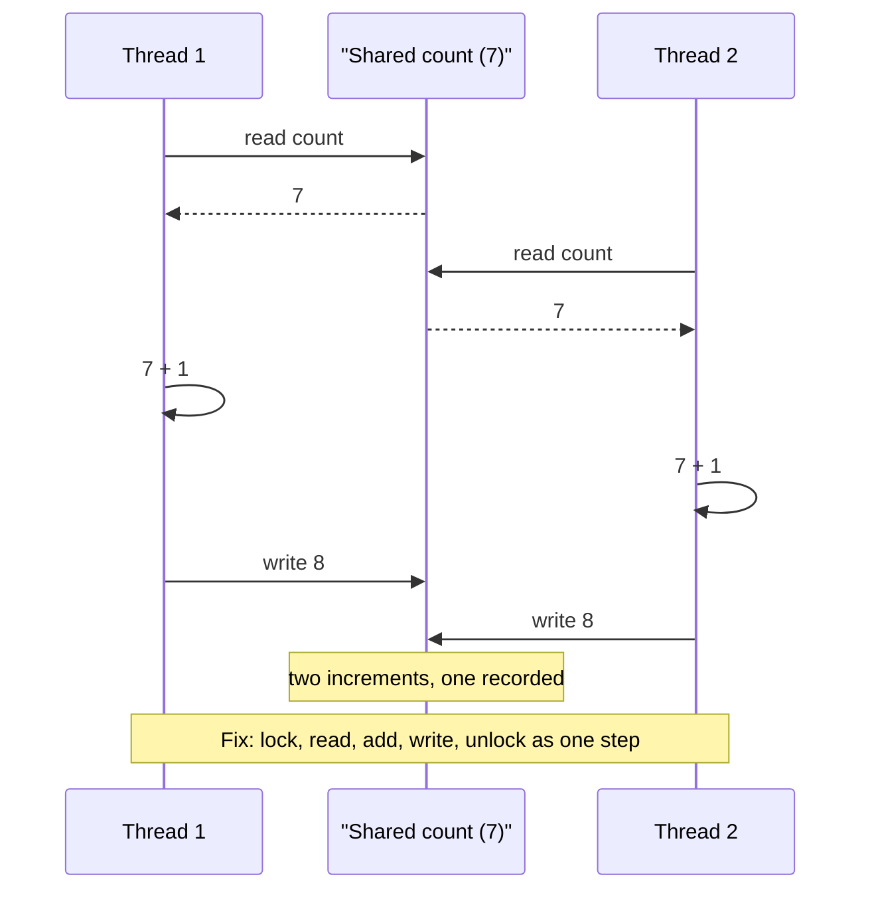

## In one minute
- Every concurrency question in a low-level design interview reduces to one question: which state is shared and mutable, and which invariant must hold across it? Answer that before you mention a lock.
- Almost every bug you will be asked about is one of three shapes: a lost update (read, modify, write), a check-then-act race (look, decide, act on a stale look), or a deadlock (two threads taking the same locks in opposite orders). Name the shape and the fix follows.
- Prefer mechanisms in this order: do not share (confinement, immutable values), share through one owner (a queue or a single writer), make the whole step atomic (one lock, one compare-and-swap, one conditional update), and only then split locks for throughput.
- A lock protects an invariant, not a variable. The critical section is the smallest region that takes the invariant from true to true again, and nothing slow or foreign (I/O, callbacks, other locks taken in an unknown order) belongs inside it.
- You cannot test concurrency by running the code many times. You test it by controlling the interleavings: a deterministic scheduler, a model checker, or a race detector. The practice below builds a tiny interleaving explorer.

## How it works

### Step 1: mark every field
Take the class diagram you already drew and mark each field as one of three things: immutable after construction, confined to one thread, or shared and mutable. Only the third kind needs any concurrency design. In [Design Parking Lot](design-parking-lot.md) the shared mutable state is the free-spot index and the active-ticket map; the `Vehicle` is an immutable value and needs nothing. In [Design LRU Cache](design-lru-cache.md) the surprise is that `get` is a write: it moves a node to the front of the list, so a "read-only" path mutates shared state and a read-write lock does not help.

### Step 2: write the invariant down
An invariant is a sentence that must be true whenever no thread is in the middle of an operation. "A seat belongs to at most one active hold." "The sum of all account balances is constant." "The queue holds at most `capacity` items." "`size` equals the number of nodes in the list." Writing it down tells you two things: which fields must change together (they share a lock), and where the operation begins and ends (the critical section).

### Step 3: recognise the three bug shapes
**Lost update.** `count += 1` is three steps: read `count` into a register, add one, write it back. Two threads both read 7 and both write 8; one increment vanishes. The same shape appears as `SELECT balance` followed by `UPDATE balance = ?` in a database, and as two browser tabs saving the same document.

**Check-then-act.** `if seat.is_free(): seat.hold(user)` is correct with one thread and wrong with two, because the check is stale by the time the act runs. The general name is time-of-check to time-of-use (TOCTOU), and it is also a classic security bug: check a file's permissions, then open it, and an attacker swaps the file in between. The fix is never "check again"; it is to make check and act one atomic step.

**Deadlock.** Thread 1 locks account A then B to transfer A to B; thread 2 locks B then A to transfer B to A. Each holds one lock and waits forever for the other. Deadlock needs four conditions at once: mutual exclusion, hold-and-wait, no preemption, and a circular wait. Break any one and it cannot happen. In application code the cheap one to break is circular wait: give locks a global order (by account id, by memory address, by level in a hierarchy) and always acquire in that order.

Two quieter shapes are worth naming if time allows. **Unsafe publication**: one thread builds an object and stores a reference, another sees the reference before the fields, because nothing ordered the writes. **Liveness failures**: starvation (a writer that never gets a read-write lock because readers keep arriving) and livelock (two threads that keep backing off and retrying in step).

### Step 4: pick the mechanism
Start with the cheapest option that preserves the invariant.

- **Confinement.** Give each thread its own data and merge at the end, as a per-worker counter that a reporter sums. No coordination on the hot path.
- **Immutability with copy-on-write.** Readers get a snapshot reference; a writer builds a new version and swaps one pointer. Great for configuration and routing tables that change rarely and are read constantly.
- **Single owner.** One goroutine, actor or event loop owns the state; others send it messages through a queue. The [Producer Consumer Pattern](producer-consumer.md) is the plumbing, and the state needs no lock because only one thread touches it.
- **One coarse lock.** One mutex around the whole object. Simple, obviously correct, and fast enough far more often than people expect (see the worked example).
- **Atomic instructions.** A compare-and-swap loop for a single word: a counter, a sequence number, a pointer to an immutable snapshot.
- **Optimistic concurrency.** Read a version, compute, write only if the version is unchanged, retry otherwise. Cheap when conflicts are rare, wasteful when they are common.
- **Finer locks.** Lock striping (hash the key to one of N locks) or per-entity locks, with a documented acquisition order. Only after measuring contention on the coarse lock.

### Step 5: wait correctly
When a thread must wait for a condition (queue not empty, seat released), use a condition variable or a channel, never a sleep loop. Recheck the condition in a `while` loop after waking, because wakeups can be spurious and another thread may have consumed the condition first.

### The same shape elsewhere
The three bug shapes are about interleaved steps over shared state, not about threads. Microservices have lost updates across two HTTP calls, and databases name the same shapes as isolation anomalies. Spot them in a class and you can spot them in a distributed system, which is why interviewers ask.

## Down the stack

### Layer 1: The contract
A correct concurrent object is **linearizable**: every method call appears to take effect at one instant between its call and its return, and the resulting history is one that a single thread could have produced. A mutex promises two things, and engineers often remember only the first: mutual exclusion, and visibility. In the Go memory model, the n-th `Unlock` of a mutex is synchronized before the (n+1)-th `Lock` returns, so everything written before the unlock is visible after the next lock. A program with a data race (two unsynchronized accesses to one location, at least one a write) gets no such promise; in C and C++ its behaviour is undefined, and in Go and Java it may observe torn or stale values.

### Layer 2: The mechanism
A mutex is a word in memory plus a wait queue. Go's `sync.Mutex` is a 32-bit `state` holding a locked bit, a woken bit, a starving bit and a waiter count, plus a semaphore. `Lock` first tries one compare-and-swap from 0 to locked; if that fails it spins briefly, then parks the goroutine on the semaphore. If a waiter has waited more than 1 ms, the mutex switches to starvation mode and hands ownership directly to the oldest waiter, trading throughput for fairness. On Linux, pthread mutexes and the JVM's inflated monitors sleep through the `futex` syscall: user space handles the uncontended case alone, and the kernel is involved only when a thread must actually sleep or be woken. A read-write lock adds a reader count and must decide whether waiting writers block new readers; Go's `RWMutex` does, to avoid writer starvation.

The Linux kernel's lockdep records every observed "held A while acquiring B" pair as an edge between lock classes and reports a cycle the first time it appears, even if that run did not hang: the ordering rule from Step 3, enforced by a tool.

### Layer 3: The machine
Cores do not share memory directly; they share 64-byte cache lines (128 bytes on some ARM designs) kept coherent by a protocol in the MESI family. An uncontended lock or atomic on a line already in the local cache costs around 10 to 20 ns. When several cores hammer the same line, each atomic must pull the line exclusively into its own cache, and costs rise to roughly 50 to 200 ns, more across sockets. **False sharing** is the same cost for unrelated variables that happen to share a line: two per-thread counters 8 bytes apart can run several times slower than counters padded 64 bytes apart.

Atomics compile to real instructions: `LOCK CMPXCHG` on x86, `LDXR`/`STXR` pairs or the newer `CAS` instruction on ARMv8. CPUs also reorder memory. Each x86 core has a store buffer, so in the "store buffering" test (thread 1 writes `x` then reads `y`, thread 2 writes `y` then reads `x`) both threads can read 0, an outcome no interleaving of the source code allows. Locks and atomics include fences that forbid this; plain fields do not. A parked thread costs a `futex` syscall and a context switch, a few microseconds, which is why runtimes spin briefly before sleeping.

### Why it's built this way
1. Cores run in parallel and memory is far slower than registers, so each core caches and buffers writes, and the hardware reorders them.
2. Reordering breaks naive reasoning, so languages define a memory model and give you a few primitives (locks, atomics) that restore order at known points.
3. Restoring order costs cache-line transfers and fences, so primitives are designed to be cheap when uncontended and to pay only under contention.
4. Contention cannot be engineered away by a primitive, so the design-level answer is to share less: confinement, immutable snapshots and single owners.
5. Bugs depend on timing that tests rarely reproduce, so the tooling controls or records the schedule (race detectors, lockdep, model checkers) instead of hoping to hit it.

## Diagram



## Worked example

An in-process wallet service moves money between accounts. Version one has no locking and loses updates under load. Version two adds a lock per account:

```python
def transfer(src, dst, amount):
    with src.lock:
        with dst.lock:          # deadlocks when another thread runs transfer(dst, src)
            src.balance -= amount
            dst.balance += amount

def transfer_ordered(src, dst, amount):
    first, second = (src, dst) if src.id < dst.id else (dst, src)
    with first.lock:
        with second.lock:
            if src.balance < amount:
                raise ValueError("insufficient funds")
            src.balance -= amount
            dst.balance += amount
```

The ordered version breaks circular wait, and the balance check sits inside the locks, so it is not a check-then-act race.

Now ask whether per-account locks were needed at all. Suppose the service handles 2,000 transfers per second and the critical section is 2 us of in-memory work. One global lock is busy 2,000 x 2 us = 4 ms per second, 0.4 percent of the time. Queueing delay at that utilisation is negligible, and the deadlock risk disappears because there is only one lock. At 200,000 transfers per second the same lock is busy 40 percent of the time and tail latency starts to climb (an M/M/1 queue at 40 percent utilisation already waits about 0.7 times the service time on average). That is the point to stripe or go per-account, and the arithmetic, not taste, should drive it.

## Trade-offs

| Mechanism | Strengths | Weaknesses | Choose when |
|---|---|---|---|
| Confinement or single owner | No locks on the hot path; easy to reason about | Cross-thread reads need messages; owner can become a bottleneck | State has a natural owner (a game room, a shard) |
| Immutable snapshot, copy-on-write | Readers never block; trivially consistent reads | Each write copies; writers must serialise | Read-heavy data that changes rarely (config, routing) |
| One coarse lock | Obviously correct; no ordering rules | Serialises everything; slow work inside it stalls all callers | Critical section is short and load is moderate |
| Fine-grained or striped locks | Scales with independent keys | Ordering rules, deadlock risk, harder multi-key invariants | Measured contention on a coarse lock |
| Atomics and CAS loops | No blocking; fastest for one word | Only one word at a time; ABA problem; retry storms | Counters, sequence numbers, pointer swaps |
| Optimistic versioning | No locks held while computing | Wasted work and retries under conflict | Conflicts are rare; work spans a user think time |

## Pitfalls in production
- **Lock held across I/O.** A network call inside a critical section turns a 2 us lock into a 50 ms lock and stalls every caller during a slow dependency. Copy what you need under the lock, release, then do the I/O.
- **Callbacks under a lock.** Notifying observers while holding the lock lets foreign code take other locks in unknown order, the classic hidden deadlock. Collect the events, release, then notify.
- **Leaking internal state.** A getter that returns the internal list lets callers iterate it while a writer mutates it. Return a copy or an immutable view. In Go, concurrent map access without a lock can crash the whole process with `fatal error: concurrent map writes`.
- **Double-checked locking done wrong.** Checking a lazily built singleton outside the lock without a memory barrier can hand out a half-built object. Use the language's once primitive (`sync.Once`, a static holder, a module-level value).
- **Sleep-based tests.** `sleep(100ms)` to "let the other thread finish" is flaky on a loaded CI box and hides races on a fast one. Use latches, channels or a deterministic scheduler, and run the race detector (`go test -race`, ThreadSanitizer) in CI.
- **Check-then-act across `await`.** Single-threaded runtimes still interleave at every suspension point. Re-validate after the await or move the decision into one synchronous block.

## Leadership lens
- In design review, ask three questions of any class with shared state: what is the invariant, which lock or owner protects it, and what is the lock order if there is more than one. If nobody can answer in a sentence, the code is not ready.
- Make the default boring: one lock per object, documented. Require a measurement before anyone introduces lock striping or lock-free structures, because they add review and on-call cost for years.
- Budget for tooling, not heroics. Race detectors in CI, lockdep-style ordering checks and a deterministic test scheduler cost days to set up and prevent incidents that take weeks to diagnose.
- AI-generated code often adds locks around single fields and misses the invariant across two fields. Review generated concurrent code for check-then-act across method calls, not for the presence of `synchronized`.

## Check yourself
1. A cache's `get` updates an LRU list. Why does a read-write lock with `get` under the read lock not make it safe?
   **Answer:** `get` mutates the shared list, so concurrent readers would race on it. Either take the write lock for `get` or redesign so reads do not mutate (for example, record access with an approximate clock bit).
2. Two threads run `transfer(a, b)` and `transfer(b, a)` with one lock per account. What breaks, and what is the smallest fix?
   **Answer:** They can deadlock through a circular wait. Always acquire the two locks in a global order, such as by account id.
3. Why is "check the seat is free, then hold it" wrong even if both steps are individually thread-safe?
   **Answer:** Another thread can act between the check and the act, so the decision is based on stale state. The check and the hold must be one atomic operation under one lock or one conditional update.
4. Why can thread 1 read `y == 0` and thread 2 read `x == 0` in the store-buffering test on x86, and why can't the practice explorer below produce that outcome?
   **Answer:** Each core's store buffer delays its write while its own later read goes to memory. The explorer models sequential consistency, where every read sees the latest write in one global order, so it shows only what fences and locks guarantee.

## Practice
**Task:** Build a tiny model checker that explores every interleaving of a few threads. `explore(threads, init)` takes a list of threads, each a list of operations, and a map of shared variables to integers. Operations are `("read", var)` (copy the shared variable into the thread's private register, which starts at 0), `("add", k)` (add `k` to the register), `("write", var)` (store the register into the shared variable), `("lock", name)` and `("unlock", name)`. A `lock` can run only when nobody holds that lock (locks are not reentrant, so a thread that locks twice blocks itself); unlocking a lock the thread does not hold fails with an error. Return the sorted list of distinct final states, each formatted as `"a=1,b=2"` with variables sorted by name; whether any schedule reaches a deadlock (some thread unfinished and no thread able to run); and the number of schedules that completed.

```python starter
def explore(threads, init):
    # TODO: depth-first search over every enabled thread at every step.
    # Return {"outcomes": sorted list of str, "deadlock": bool, "completed": int}.
    raise NotImplementedError
```

```python tests
INC = [("read", "x"), ("add", 1), ("write", "x")]
LOCKED_INC = [("lock", "m")] + INC + [("unlock", "m")]


def test_lost_update_is_possible():
    r = explore([INC, INC], {"x": 0})
    assert r["outcomes"] == ["x=1", "x=2"]
    assert r["deadlock"] is False
    assert r["completed"] == 20, "6 choose 3 schedules"


def test_lock_removes_lost_update():
    r = explore([LOCKED_INC, LOCKED_INC], {"x": 0})
    assert r["outcomes"] == ["x=2"]
    assert r["completed"] == 2


def test_three_threads():
    r = explore([INC, INC, INC], {"x": 0})
    assert r["outcomes"] == ["x=1", "x=2", "x=3"]
    assert r["completed"] == 1680


def test_opposite_lock_order_deadlocks():
    t1 = [("lock", "a"), ("lock", "b"), ("unlock", "b"), ("unlock", "a")]
    t2 = [("lock", "b"), ("lock", "a"), ("unlock", "a"), ("unlock", "b")]
    r = explore([t1, t2], {"x": 0})
    assert r["deadlock"] is True
    assert r["outcomes"] == ["x=0"], "other schedules still finish"
    same = explore([t1, t1], {"x": 0})
    assert same["deadlock"] is False, "same order cannot deadlock"


def test_self_deadlock():
    r = explore([[("lock", "m"), ("lock", "m")]], {"x": 0})
    assert r == {"outcomes": [], "deadlock": True, "completed": 0}


def test_store_buffering_is_sequentially_consistent():
    t1 = [("add", 1), ("write", "x"), ("read", "y"), ("write", "r1")]
    t2 = [("add", 1), ("write", "y"), ("read", "x"), ("write", "r2")]
    r = explore([t1, t2], {"x": 0, "y": 0, "r1": 0, "r2": 0})
    assert r["outcomes"] == ["r1=0,r2=1,x=1,y=1", "r1=1,r2=0,x=1,y=1", "r1=1,r2=1,x=1,y=1"]


def test_unlock_without_holding_fails():
    failed = False
    try:
        explore([[("unlock", "m")]], {"x": 0})
    except ValueError:
        failed = True
    assert failed
```

```python solution
def explore(threads, init):
    n = len(threads)
    outcomes = set()
    stats = {"deadlock": False, "completed": 0}

    def fmt(shared):
        return ",".join(k + "=" + str(shared[k]) for k in sorted(shared))

    def dfs(pcs, regs, shared, owners):
        enabled = []
        done = 0
        for t in range(n):
            if pcs[t] == len(threads[t]):
                done += 1
                continue
            op = threads[t][pcs[t]]
            if op[0] == "lock" and op[1] in owners:
                continue
            enabled.append(t)
        if done == n:
            outcomes.add(fmt(shared))
            stats["completed"] += 1
            return
        if not enabled:
            stats["deadlock"] = True
            return
        for t in enabled:
            kind, arg = threads[t][pcs[t]]
            p, r, s, o = list(pcs), list(regs), dict(shared), dict(owners)
            if kind == "read":
                r[t] = s[arg]
            elif kind == "add":
                r[t] += arg
            elif kind == "write":
                s[arg] = r[t]
            elif kind == "lock":
                o[arg] = t
            elif kind == "unlock":
                if o.get(arg) != t:
                    raise ValueError("thread %d unlocks %s without holding it" % (t, arg))
                del o[arg]
            else:
                raise ValueError("unknown op " + str(kind))
            p[t] += 1
            dfs(p, r, s, o)

    dfs([0] * n, [0] * n, dict(init), {})
    return {"outcomes": sorted(outcomes), "deadlock": stats["deadlock"],
            "completed": stats["completed"]}
```

```typescript starter
export type Op = [string, string | number];

export interface Exploration {
  outcomes: string[];
  deadlock: boolean;
  completed: number;
}

export function explore(threads: Op[][], init: Record<string, number>): Exploration {
  throw new Error("TODO");
}
```

```typescript tests
const INC: Op[] = [["read", "x"], ["add", 1], ["write", "x"]];
const LOCKED_INC: Op[] = [["lock", "m"], ...INC, ["unlock", "m"]];

test("lost update is possible", () => {
  const r = explore([INC, INC], { x: 0 });
  assertEqual(r.outcomes, ["x=1", "x=2"]);
  assertEqual(r.deadlock, false);
  assertEqual(r.completed, 20, "6 choose 3 schedules");
});

test("lock removes lost update", () => {
  const r = explore([LOCKED_INC, LOCKED_INC], { x: 0 });
  assertEqual(r.outcomes, ["x=2"]);
  assertEqual(r.completed, 2);
});

test("three threads", () => {
  const r = explore([INC, INC, INC], { x: 0 });
  assertEqual(r.outcomes, ["x=1", "x=2", "x=3"]);
  assertEqual(r.completed, 1680);
});

test("opposite lock order deadlocks", () => {
  const t1: Op[] = [["lock", "a"], ["lock", "b"], ["unlock", "b"], ["unlock", "a"]];
  const t2: Op[] = [["lock", "b"], ["lock", "a"], ["unlock", "a"], ["unlock", "b"]];
  const r = explore([t1, t2], { x: 0 });
  assertEqual(r.deadlock, true);
  assertEqual(r.outcomes, ["x=0"], "other schedules still finish");
  assertEqual(explore([t1, t1], { x: 0 }).deadlock, false, "same order cannot deadlock");
});

test("self deadlock", () => {
  const r = explore([[["lock", "m"], ["lock", "m"]]], { x: 0 });
  assertEqual(r, { outcomes: [], deadlock: true, completed: 0 });
});

test("store buffering is sequentially consistent", () => {
  const t1: Op[] = [["add", 1], ["write", "x"], ["read", "y"], ["write", "r1"]];
  const t2: Op[] = [["add", 1], ["write", "y"], ["read", "x"], ["write", "r2"]];
  const r = explore([t1, t2], { x: 0, y: 0, r1: 0, r2: 0 });
  assertEqual(r.outcomes, ["r1=0,r2=1,x=1,y=1", "r1=1,r2=0,x=1,y=1", "r1=1,r2=1,x=1,y=1"]);
});

test("unlock without holding fails", () => {
  let failed = false;
  try { explore([[["unlock", "m"]]], { x: 0 }); } catch (e) { failed = true; }
  assert(failed, "should throw");
});
```

```typescript solution
export type Op = [string, string | number];

export interface Exploration {
  outcomes: string[];
  deadlock: boolean;
  completed: number;
}

export function explore(threads: Op[][], init: Record<string, number>): Exploration {
  const n = threads.length;
  const outcomes = new Set<string>();
  let deadlock = false;
  let completed = 0;

  const fmt = (shared: Record<string, number>): string =>
    Object.keys(shared).sort().map((k) => k + "=" + shared[k]).join(",");

  const dfs = (pcs: number[], regs: number[], shared: Record<string, number>,
               owners: Record<string, number>): void => {
    const enabled: number[] = [];
    let done = 0;
    for (let t = 0; t < n; t++) {
      if (pcs[t] === threads[t].length) { done++; continue; }
      const [kind, arg] = threads[t][pcs[t]];
      if (kind === "lock" && String(arg) in owners) continue;
      enabled.push(t);
    }
    if (done === n) { outcomes.add(fmt(shared)); completed++; return; }
    if (enabled.length === 0) { deadlock = true; return; }
    for (const t of enabled) {
      const [kind, arg] = threads[t][pcs[t]];
      const p = pcs.slice(), r = regs.slice();
      const s = { ...shared }, o = { ...owners };
      if (kind === "read") r[t] = s[String(arg)];
      else if (kind === "add") r[t] += Number(arg);
      else if (kind === "write") s[String(arg)] = r[t];
      else if (kind === "lock") o[String(arg)] = t;
      else if (kind === "unlock") {
        if (o[String(arg)] !== t) throw new Error(`thread ${t} unlocks ${arg} without holding it`);
        delete o[String(arg)];
      } else throw new Error("unknown op " + kind);
      p[t]++;
      dfs(p, r, s, o);
    }
  };

  dfs(new Array(n).fill(0), new Array(n).fill(0), { ...init }, {});
  return { outcomes: Array.from(outcomes).sort(), deadlock, completed };
}
```

```go starter
package practice

// Op is one step of a thread: Kind is read, add, write, lock or unlock.
// Arg names the variable or lock; N is the amount for add.
type Op struct {
	Kind string
	Arg  string
	N    int
}

type Exploration struct {
	Outcomes  []string
	Deadlock  bool
	Completed int
}

func Explore(threads [][]Op, init map[string]int) (Exploration, error) {
	panic("TODO")
}
```

```go tests
package practice

import (
	"reflect"
	"testing"
)

var inc = []Op{{"read", "x", 0}, {"add", "", 1}, {"write", "x", 0}}

func lockedInc() []Op {
	ops := []Op{{"lock", "m", 0}}
	ops = append(ops, inc...)
	return append(ops, Op{"unlock", "m", 0})
}

func mustExplore(t *testing.T, threads [][]Op, init map[string]int) Exploration {
	t.Helper()
	r, err := Explore(threads, init)
	if err != nil {
		t.Fatal(err)
	}
	return r
}

func TestLostUpdateIsPossible(t *testing.T) {
	r := mustExplore(t, [][]Op{inc, inc}, map[string]int{"x": 0})
	if !reflect.DeepEqual(r.Outcomes, []string{"x=1", "x=2"}) || r.Deadlock || r.Completed != 20 {
		t.Fatalf("got %+v", r)
	}
}

func TestLockRemovesLostUpdate(t *testing.T) {
	r := mustExplore(t, [][]Op{lockedInc(), lockedInc()}, map[string]int{"x": 0})
	if !reflect.DeepEqual(r.Outcomes, []string{"x=2"}) || r.Completed != 2 {
		t.Fatalf("got %+v", r)
	}
}

func TestThreeThreads(t *testing.T) {
	r := mustExplore(t, [][]Op{inc, inc, inc}, map[string]int{"x": 0})
	if !reflect.DeepEqual(r.Outcomes, []string{"x=1", "x=2", "x=3"}) || r.Completed != 1680 {
		t.Fatalf("got %+v", r)
	}
}

func TestOppositeLockOrderDeadlocks(t *testing.T) {
	t1 := []Op{{"lock", "a", 0}, {"lock", "b", 0}, {"unlock", "b", 0}, {"unlock", "a", 0}}
	t2 := []Op{{"lock", "b", 0}, {"lock", "a", 0}, {"unlock", "a", 0}, {"unlock", "b", 0}}
	r := mustExplore(t, [][]Op{t1, t2}, map[string]int{"x": 0})
	if !r.Deadlock || !reflect.DeepEqual(r.Outcomes, []string{"x=0"}) {
		t.Fatalf("got %+v", r)
	}
	if same := mustExplore(t, [][]Op{t1, t1}, map[string]int{"x": 0}); same.Deadlock {
		t.Fatal("same order cannot deadlock")
	}
}

func TestSelfDeadlock(t *testing.T) {
	r := mustExplore(t, [][]Op{{{"lock", "m", 0}, {"lock", "m", 0}}}, map[string]int{"x": 0})
	if len(r.Outcomes) != 0 || !r.Deadlock || r.Completed != 0 {
		t.Fatalf("got %+v", r)
	}
}

func TestStoreBufferingIsSequentiallyConsistent(t *testing.T) {
	t1 := []Op{{"add", "", 1}, {"write", "x", 0}, {"read", "y", 0}, {"write", "r1", 0}}
	t2 := []Op{{"add", "", 1}, {"write", "y", 0}, {"read", "x", 0}, {"write", "r2", 0}}
	r := mustExplore(t, [][]Op{t1, t2}, map[string]int{"x": 0, "y": 0, "r1": 0, "r2": 0})
	want := []string{"r1=0,r2=1,x=1,y=1", "r1=1,r2=0,x=1,y=1", "r1=1,r2=1,x=1,y=1"}
	if !reflect.DeepEqual(r.Outcomes, want) {
		t.Fatalf("got %v", r.Outcomes)
	}
}

func TestUnlockWithoutHoldingFails(t *testing.T) {
	if _, err := Explore([][]Op{{{"unlock", "m", 0}}}, map[string]int{"x": 0}); err == nil {
		t.Fatal("want error")
	}
}
```

```go solution
package practice

import (
	"fmt"
	"sort"
	"strings"
)

// Op is one step of a thread: Kind is read, add, write, lock or unlock.
// Arg names the variable or lock; N is the amount for add.
type Op struct {
	Kind string
	Arg  string
	N    int
}

type Exploration struct {
	Outcomes  []string
	Deadlock  bool
	Completed int
}

type explorer struct {
	threads   [][]Op
	outcomes  map[string]bool
	deadlock  bool
	completed int
}

func format(shared map[string]int) string {
	keys := make([]string, 0, len(shared))
	for k := range shared {
		keys = append(keys, k)
	}
	sort.Strings(keys)
	parts := make([]string, len(keys))
	for i, k := range keys {
		parts[i] = fmt.Sprintf("%s=%d", k, shared[k])
	}
	return strings.Join(parts, ",")
}

func copyMap(m map[string]int) map[string]int {
	c := make(map[string]int, len(m))
	for k, v := range m {
		c[k] = v
	}
	return c
}

func (e *explorer) dfs(pcs, regs []int, shared, owners map[string]int) error {
	n := len(e.threads)
	var enabled []int
	done := 0
	for t := 0; t < n; t++ {
		if pcs[t] == len(e.threads[t]) {
			done++
			continue
		}
		op := e.threads[t][pcs[t]]
		if _, held := owners[op.Arg]; op.Kind == "lock" && held {
			continue
		}
		enabled = append(enabled, t)
	}
	if done == n {
		e.outcomes[format(shared)] = true
		e.completed++
		return nil
	}
	if len(enabled) == 0 {
		e.deadlock = true
		return nil
	}
	for _, t := range enabled {
		op := e.threads[t][pcs[t]]
		p := append([]int(nil), pcs...)
		r := append([]int(nil), regs...)
		s, o := copyMap(shared), copyMap(owners)
		switch op.Kind {
		case "read":
			r[t] = s[op.Arg]
		case "add":
			r[t] += op.N
		case "write":
			s[op.Arg] = r[t]
		case "lock":
			o[op.Arg] = t
		case "unlock":
			if owner, ok := o[op.Arg]; !ok || owner != t {
				return fmt.Errorf("thread %d unlocks %s without holding it", t, op.Arg)
			}
			delete(o, op.Arg)
		default:
			return fmt.Errorf("unknown op %q", op.Kind)
		}
		p[t]++
		if err := e.dfs(p, r, s, o); err != nil {
			return err
		}
	}
	return nil
}

func Explore(threads [][]Op, init map[string]int) (Exploration, error) {
	e := &explorer{threads: threads, outcomes: map[string]bool{}}
	n := len(threads)
	if err := e.dfs(make([]int, n), make([]int, n), copyMap(init), map[string]int{}); err != nil {
		return Exploration{}, err
	}
	out := make([]string, 0, len(e.outcomes))
	for k := range e.outcomes {
		out = append(out, k)
	}
	sort.Strings(out)
	return Exploration{Outcomes: out, Deadlock: e.deadlock, Completed: e.completed}, nil
}
```

## Mock interview
**Prompt:** You are designing an in-memory inventory service for a flash sale: 32 worker threads handle about 20,000 reserve requests per second across 5,000 SKUs, and each request may reserve up to five different SKUs all-or-nothing. Walk me through the shared state, the invariants and how you make `reserve` correct and fast.

- Follow-up: A multi-SKU order and another order touching the same SKUs in a different order arrive together. How do you guarantee they never deadlock?
- Follow-up: One SKU is the sale item and 80 percent of requests hit it. What happens to your per-SKU locks, and what do you change?
- Follow-up: Would you choose optimistic versioning instead of locks here? When does it lose?

**A strong answer covers:**
- The shared mutable state (stock per SKU, holds) and the invariant (stock never below zero; an order holds all its SKUs or none) before any mechanism.
- Check and decrement as one atomic step, with the multi-SKU case taking per-SKU locks in sorted SKU order so circular wait is impossible.
- Arithmetic on the lock: 20,000 requests at a few microseconds each is a few percent busy for one global lock, so per-SKU locks are justified only by the hot SKU and long critical sections.
- A hot-key plan: a single owner thread with a queue for the sale SKU, or splitting its stock into N sub-buckets that are drained independently.
- Optimistic versioning loses under heavy conflict on the hot SKU (retry storms) and wins for the long tail of cold SKUs.
- A test strategy that controls interleavings (deterministic scheduler, race detector in CI) instead of a load test.

## Watch
- [Concurrency is not Parallelism (Rob Pike)](https://www.youtube.com/watch?v=oV9rvDllKEg): structuring a program as independent communicating parts, the "single owner" approach in depth.
- [GopherCon 2017: Understanding Channels (Kavya Joshi)](https://www.youtube.com/watch?v=KBZlN0izeiY): how a channel's lock, wait queues and direct handoff work underneath.

## Free resources
- [Common Concurrency Problems (OSTEP, chapter 32)](https://pages.cs.wisc.edu/~remzi/OSTEP/threads-bugs.pdf): a study of real atomicity, ordering and deadlock bugs, with the four deadlock conditions explained.
- [Locks (OSTEP, chapter 28)](https://pages.cs.wisc.edu/~remzi/OSTEP/threads-locks.pdf): how locks are built from test-and-set, compare-and-swap and futexes.
- [The Go Memory Model](https://go.dev/ref/mem): the precise happens-before rules for mutexes, channels and atomics.
- [Memory Reordering Caught in the Act (Jeff Preshing)](https://preshing.com/20120515/memory-reordering-caught-in-the-act/): a runnable demonstration of the store-buffering outcome on real x86 hardware.
- [Runtime locking correctness validator (Linux kernel docs)](https://www.kernel.org/doc/html/latest/locking/lockdep-design.html): how lockdep finds lock-order cycles before they hang.
- [Data Race Detector (Go docs)](https://go.dev/doc/articles/race_detector): how to run the race detector and what its reports mean.
