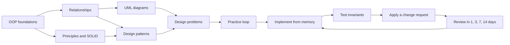

## In one minute
- Low-level design is a skill, not a body of facts: turning a fuzzy requirement into classes, interfaces, state and interactions that are correct, testable and cheap to change. You learn it by producing designs, getting feedback and changing them.
- Learn in layers that depend on each other: OOP fundamentals, then class relationships, then principles, then UML for communication, then patterns, then full design problems.
- Every topic follows one loop: read, implement from memory, test the invariants, then apply a requirement change.
- Spread practice out: reviews 1, 3, 7 and 14 days after learning beat rereading four times in one evening.
- In the AI era the scarce skill is judgement: an assistant writes a plausible class hierarchy in seconds, and your value is knowing whether it is right.

## How it works

### What you are actually learning
High-level design decides which services exist and how data flows between them; low-level design decides what happens inside one: which objects exist, who owns which state, what each interface promises, and how behaviour varies without a pile of `if` statements. Three sub-skills make up the whole:

- **Modelling.** Reading a requirement and seeing the entities, their lifecycles and the rules that must always hold (a seat is never sold twice, a balance never goes negative).
- **Judgement.** Choosing between alternatives, such as composition or inheritance, an enum or a class hierarchy, a pattern or a plain function, and being able to say what each choice costs.
- **Communication.** Explaining a design so a reviewer can follow it in a few minutes: a class diagram, a sequence of calls, and the reasons.

Vocabulary (pattern names, the letters of SOLID) is the easy part; the path below gives each of these three skills something to practise on.

### The learning path through this course
Each stage lists the lessons in this course that cover it.

1. **Foundations: objects and types.** Classes and Objects, Enums, Interfaces, Encapsulation, Abstraction, Inheritance, Polymorphism. Goal: you can explain what an object is in memory, why fields are private, and how a call on an interface finds the right method.
2. **Relationships.** Association, Aggregation, Composition, Dependency, Realization. Goal: for any two classes you can say who creates whom, who owns whom, and what breaks if one is deleted.
3. **Principles.** DRY Principle, KISS Principle, YAGNI Principle, Law of Demeter, Coupling and Cohesion, then the SOLID set: Single Responsibility Principle, Open/Closed Principle, Liskov Substitution Principle, Interface Segregation Principle, Dependency Inversion Principle. Goal: you can name the principle a piece of code violates and propose the smallest fix.
4. **Communication with UML.** Class Diagram, Use Case Diagram, Sequence Diagram, Activity Diagram, State Machine Diagram. Goal: sketch a design in under five minutes using only the notation a reviewer needs.
5. **Patterns.** Creational: Singleton, Factory Method, Abstract Factory, Builder, Prototype. Structural: Adapter, Bridge, Composite, Decorator, Facade, Flyweight, Proxy. Behavioural: Strategy, Observer, State, Command, Template Method, Iterator, Chain of Responsibility, Mediator, Memento, Visitor, Null Object Pattern. Goal: for each one, the problem it solves, the simpler alternative, and when it is overkill.
6. **Design problems.** Start with small, closed worlds (Design Tic Tac Toe, Design Snake and Ladder Game, Design LRU Cache, Design Bloom Filter), move to state machines (Design Vending Machine, Design Elevator System, Design Parking Lot), then time and concurrency (Design Rate Limiter, Design Task Scheduler, Design Logging Framework), and finish with money and contention (Design Splitwise, Design Movie Booking System).

The order is a prerequisite graph, not a strict line. Strategy needs Interfaces and Polymorphism; the Open/Closed Principle needs Strategy-like thinking; Design Vending Machine needs State and the State Machine Diagram. If a lesson feels like magic, walk back along its prerequisites rather than rereading it.

### The practice loop for every topic
Reading gives recognition, which feels like understanding and is not. For each topic:

1. **Read once**, slowly, and close it.
2. **Implement from memory** the smallest version that shows the idea: a Strategy with two strategies, not a framework.
3. **Write tests first for the behaviour, then for the invariants.** "A full parking lot rejects a car" is behaviour; "a spot is never assigned to two vehicles" is an invariant.
4. **Apply a change request.** Add a new vehicle type, a new payment method, a second currency. Count the files you touched; that is the honest measure of your design.
5. **Port it to a second language.** It shows which parts were the idea and which were the language: Go has no inheritance, TypeScript checks shapes rather than names.

### Spacing and retrieval
Two findings from learning research matter here. Retrieving something from memory strengthens it more than re-reading it (the testing effect), and retrieval spread over growing gaps beats the same amount crammed together (the spacing effect). A practical schedule: after first learning a topic, review it 1, 3, 7, 14 and 30 days later. A review is not rereading; it is redoing a five-minute version of step 2 from a blank file, or answering the lesson's Check yourself questions without looking. If you fail a review, restart that topic's schedule from today. The practice task in this lesson builds exactly this scheduler.

### Learning with an AI assistant
Use an assistant as a sparring partner, not an author. Ask it to play an interviewer who keeps changing requirements, to critique your diagram against a named principle, or to generate a design in which you find three problems before reading its own critique. Asking for "the design of a parking lot" and reading the answer only trains recognition. Agents tend to over-produce structure (an interface and a factory for everything), so reviewing generated designs is excellent practice for YAGNI and KISS.

### The same shape elsewhere
Ordering topics by prerequisites is the **ordering** problem shape: a directed acyclic graph that must be walked so every node comes after its dependencies. Build systems order compile steps this way, package managers order installs, schema migration tools order migrations, and a task scheduler orders jobs. Recognising the shape means you reach for a topological sort, cycle detection and a tie-break rule, whatever the domain.

## Down the stack

### Layer 1: The contract
"Knowing LLD" should be testable. A reasonable contract: given a two-paragraph requirement, within 45 minutes you produce a class diagram, the key call sequence, and working code for the core operations with tests for the invariants; when given a change request, you can predict which classes change before touching them, and be right. Each lesson's Practice and Mock interview are small instances of it.

### Layer 2: The mechanism
Experts do not store patterns as definitions; they store **chunks**: "a thing with modes that change behaviour" maps to State, "many listeners, one source" maps to Observer. Chunks form from many worked instances, not from one long chapter. Interleaving helps chunks form: mixing Strategy, State and Command problems in one session forces you to decide which applies, which blocked practice never asks. Each spaced review is a retrieval that strengthens a chunk; a failed review means the chunk never formed and needs a fresh worked example.

### Layer 3: The machine
Every design becomes memory and instructions, and "elegant" designs sometimes cost real performance. In CPython, an ordinary object carries a 16-byte header plus an attribute dict (classes with `__slots__` drop the dict), so a million small objects can cost on the order of 100 MB. A Go struct has no header at all; wrapping it in an interface makes a two-word value (an itab pointer and a data pointer), and storing a non-pointer value in an interface usually forces a heap allocation. V8 gives objects that are constructed the same way a shared hidden class, so field access becomes a fixed offset; adding fields in different orders creates different hidden classes and slows property access. An interface call costs a few nanoseconds and usually blocks inlining, which matters only in hot loops; deep object graphs mean pointer chasing at about 100 ns per cache miss. The pattern lessons each end with these costs.

### Why it's built this way
1. Design skill is judgement under change, so the path ends in design problems with change requests, not in a catalogue.
2. Judgement needs vocabulary, so principles and patterns come before problems.
3. Patterns are combinations of interfaces, polymorphism and composition, so those come first.
4. Memory for skills decays without retrieval, so the loop asks you to rebuild from a blank file on a spaced schedule.
5. Designs run on machines and are maintained by teams, so every lesson ends in runtime cost and leadership concerns.

## Diagram



## Worked example
Priya has five hours a week and an interview loop in eight weeks: 40 hours. The full course (about 60 lessons, 45 minutes per concept and 2 hours per design problem) needs about 60, so she triages.

- Weeks 1 to 2: the 12 foundation and relationship lessons at 40 minutes each, 8 hours.
- Week 3: the five SOLID lessons plus KISS, YAGNI and Coupling and Cohesion, 5.3 hours.
- Week 4: Class Diagram, Sequence Diagram and State Machine Diagram, 2 hours.
- Weeks 5 to 6: the eight patterns that recur most in design problems (Strategy, Observer, State, Factory Method, Builder, Decorator, Command, Singleton) at 50 minutes each, 6.7 hours.
- Weeks 7 to 8: six design problems at 90 minutes each, 9 hours: 45 minutes against a timer, one change request, then comparison with the lesson.

That is 31 hours. The 31 topics with three five-minute reviews each (1, 3 and 7 days) add 7.75 hours, for a total just under 40. The practice scheduler below produces her daily agenda: a typical day in week 3 shows two new topics and four reviews.

## Trade-offs

| Approach | Strengths | Weaknesses | Choose when |
|---|---|---|---|
| Catalogue first | Complete vocabulary | Patterns without problems are soon forgotten | You already design daily and want names |
| Problem first | Motivating; mirrors interviews | Weak fundamentals show as tangled designs | Interviews soon, fundamentals solid |
| Layered path with spaced review | Durable; each layer supports the next | Slower to feel productive | Building the skill for the long term |
| AI-generated designs to critique | Unlimited, varied review material | Easy to slide into passive reading | Practising judgement and code review |

## Pitfalls in production
- **Memorising patterns as templates.** Factory plus Strategy plus Observer forced into every answer. Fix: learn each pattern's simpler alternative and when it is overkill.
- **Designing without tests.** A class diagram can look right and hide a broken invariant. Fix: write at least one test per invariant before calling a design done.
- **One language's idioms as universal.** Deep Java-style inheritance looks wrong in Go. Fix: port each design to a second language.
- **Re-reading instead of retrieving.** Three readings feel productive and leave little behind. Fix: every review starts from a blank file or a blank page.
- **Never applying a change.** A design is only good relative to the changes it absorbs. Fix: every practice session ends with a change request and a count of files touched.

## Leadership lens
- Teams grow LLD skill through design reviews with a written rubric (invariants named, change scenarios considered, simpler alternative stated), not pattern lectures.
- Ask in review: "Which requirement change would hurt this design most, and what would it cost?"
- Pair juniors on change requests to existing code; most real LLD work extends someone else's design.
- Budget review time for structure, not just correctness: generated abstraction is cheap to write and expensive to maintain.

## Check yourself
1. Why does the path put Interfaces and Polymorphism before any design pattern?
   **Answer:** Most patterns are arrangements of interfaces, polymorphic dispatch and composition, so without those a pattern is a shape to copy rather than a mechanism you understand and can adapt.
2. You reread the Observer lesson three times and still cannot write it from scratch. What should you change?
   **Answer:** Switch to retrieval: write the smallest Observer from a blank file, check it against the lesson, and retry a few days later; repeated failure calls for a new worked example, not another reading.
3. Why does interleaving Strategy, State and Command problems help more than ten Strategy problems in a row?
   **Answer:** Mixed practice forces you to decide which pattern applies, which is the skill you need in real design and interviews; blocked practice skips that decision.

## Practice
**Task:** Build the scheduler that plans your LLD study. `StudyPlan(topics, prereqs, per_day, intervals, start)` takes topic names, `(topic, required)` pairs meaning `topic` needs `required` first, the maximum new topics per day, review intervals in days (strictly increasing positive integers), and the start day (an integer, the injected clock). Starting at `start`, each day learns up to `per_day` topics whose prerequisites were all learned on an earlier day, choosing alphabetically. Reject unknown topics, duplicate topics, cycles, `per_day < 1` and bad intervals. `learn_day(topic)` returns the day a topic is learned. A topic is due for review on `anchor + i` for each interval `i`, where the anchor starts as its learn day; `lapse(topic, day)` records a failed review and resets the anchor to `day` (rejecting unknown topics and days before the learn day). `agenda(day)` returns the topics learned that day and the topics due for review, both sorted.

```python starter
class StudyPlan:
    def __init__(self, topics, prereqs, per_day, intervals, start):
        self.topics = list(topics)

    def learn_day(self, topic):
        # TODO: day the topic is learned
        raise NotImplementedError

    def agenda(self, day):
        # TODO: {"learn": [...], "review": [...]}
        raise NotImplementedError

    def lapse(self, topic, day):
        # TODO: restart the topic's review schedule from day
        raise NotImplementedError
```

```python tests
def _raises(fn):
    try:
        fn()
    except ValueError:
        return True
    return False


def test_chain_waits_for_earlier_days():
    p = StudyPlan(["classes", "interfaces", "polymorphism"],
                  [("interfaces", "classes"), ("polymorphism", "interfaces")], 2, [1], 0)
    assert [p.learn_day(t) for t in ["classes", "interfaces", "polymorphism"]] == [0, 1, 2]


def test_per_day_cap_and_alphabetical_choice():
    p = StudyPlan(["c", "b", "a"], [], 2, [1], 5)
    assert (p.learn_day("a"), p.learn_day("b"), p.learn_day("c")) == (5, 5, 6)


def test_diamond_prerequisites():
    p = StudyPlan(["oop", "strategy", "state", "vending"],
                  [("strategy", "oop"), ("state", "oop"), ("vending", "state"), ("vending", "strategy")], 1, [1], 0)
    assert [p.learn_day(t) for t in ["oop", "state", "strategy", "vending"]] == [0, 1, 2, 3]


def test_rejects_bad_input():
    assert _raises(lambda: StudyPlan(["a", "b"], [("a", "b"), ("b", "a")], 1, [1], 0)), "cycle"
    assert _raises(lambda: StudyPlan(["a"], [("a", "x")], 1, [1], 0)), "unknown"
    assert _raises(lambda: StudyPlan(["a", "a"], [], 1, [1], 0)), "duplicate"
    assert _raises(lambda: StudyPlan(["a"], [], 0, [1], 0)), "per_day"
    assert _raises(lambda: StudyPlan(["a"], [], 1, [3, 3], 0)), "intervals"
    assert _raises(lambda: StudyPlan(["a"], [], 1, [0, 2], 0)), "non-positive interval"


def test_agenda_mixes_learning_and_reviews():
    p = StudyPlan(["a", "b", "c"], [("c", "a")], 2, [1, 3], 10)
    assert p.agenda(10) == {"learn": ["a", "b"], "review": []}
    assert p.agenda(11) == {"learn": ["c"], "review": ["a", "b"]}
    assert p.agenda(12) == {"learn": [], "review": ["c"]}
    assert p.agenda(13) == {"learn": [], "review": ["a", "b"]}
    assert p.agenda(14) == {"learn": [], "review": ["c"]}
    assert p.agenda(9) == {"learn": [], "review": []}


def test_lapse_restarts_schedule():
    p = StudyPlan(["a", "b", "c"], [("c", "a")], 2, [1, 3], 10)
    p.lapse("a", 13)
    assert p.agenda(13) == {"learn": [], "review": ["b"]}
    assert p.agenda(14) == {"learn": [], "review": ["a", "c"]}
    assert p.agenda(16) == {"learn": [], "review": ["a"]}
    assert _raises(lambda: p.lapse("c", 10)), "before learn day"
    assert _raises(lambda: p.lapse("zzz", 20)), "unknown topic"
```

```python solution
class StudyPlan:
    def __init__(self, topics, prereqs, per_day, intervals, start):
        if len(set(topics)) != len(topics):
            raise ValueError("duplicate topic")
        if per_day < 1:
            raise ValueError("per_day must be at least 1")
        if not intervals or intervals[0] <= 0:
            raise ValueError("intervals must be positive")
        for i in range(1, len(intervals)):
            if intervals[i] <= intervals[i - 1]:
                raise ValueError("intervals must be strictly increasing")
        needs = {t: set() for t in topics}
        for topic, required in prereqs:
            if topic not in needs or required not in needs:
                raise ValueError("unknown topic in prerequisite")
            needs[topic].add(required)
        self.intervals = list(intervals)
        self.learned = {}
        day = start
        while len(self.learned) < len(topics):
            ready = sorted(t for t in topics if t not in self.learned
                           and all(r in self.learned and self.learned[r] < day for r in needs[t]))
            if not ready:
                # every remaining topic waits on another remaining topic: a cycle
                raise ValueError("prerequisite cycle")
            for t in ready[:per_day]:
                self.learned[t] = day
            day += 1
        self.anchor = dict(self.learned)

    def learn_day(self, topic):
        if topic not in self.learned:
            raise ValueError("unknown topic")
        return self.learned[topic]

    def agenda(self, day):
        learn = sorted(t for t, d in self.learned.items() if d == day)
        review = sorted(t for t, a in self.anchor.items() if (day - a) in self.intervals)
        return {"learn": learn, "review": review}

    def lapse(self, topic, day):
        if topic not in self.learned:
            raise ValueError("unknown topic")
        if day < self.learned[topic]:
            raise ValueError("cannot lapse before the topic is learned")
        self.anchor[topic] = day
```

```typescript starter
export interface Agenda {
  learn: string[];
  review: string[];
}

export class StudyPlan {
  constructor(topics: string[], prereqs: Array<[string, string]>, perDay: number, intervals: number[], start: number) {}

  learnDay(topic: string): number {
    throw new Error("TODO");
  }

  agenda(day: number): Agenda {
    throw new Error("TODO");
  }

  lapse(topic: string, day: number): void {
    throw new Error("TODO");
  }
}
```

```typescript tests
function throwsErr(fn: () => unknown): boolean {
  try {
    fn();
  } catch (e) {
    return true;
  }
  return false;
}

test("chain waits for earlier days", () => {
  const p = new StudyPlan(["classes", "interfaces", "polymorphism"],
    [["interfaces", "classes"], ["polymorphism", "interfaces"]], 2, [1], 0);
  assertEqual(["classes", "interfaces", "polymorphism"].map((t) => p.learnDay(t)), [0, 1, 2], "days");
});

test("per-day cap and alphabetical choice", () => {
  const p = new StudyPlan(["c", "b", "a"], [], 2, [1], 5);
  assertEqual([p.learnDay("a"), p.learnDay("b"), p.learnDay("c")], [5, 5, 6], "days");
});

test("diamond prerequisites", () => {
  const p = new StudyPlan(["oop", "strategy", "state", "vending"],
    [["strategy", "oop"], ["state", "oop"], ["vending", "state"], ["vending", "strategy"]], 1, [1], 0);
  assertEqual(["oop", "state", "strategy", "vending"].map((t) => p.learnDay(t)), [0, 1, 2, 3], "days");
});

test("rejects bad input", () => {
  assert(throwsErr(() => new StudyPlan(["a", "b"], [["a", "b"], ["b", "a"]], 1, [1], 0)), "cycle");
  assert(throwsErr(() => new StudyPlan(["a"], [["a", "x"]], 1, [1], 0)), "unknown");
  assert(throwsErr(() => new StudyPlan(["a", "a"], [], 1, [1], 0)), "duplicate");
  assert(throwsErr(() => new StudyPlan(["a"], [], 0, [1], 0)), "perDay");
  assert(throwsErr(() => new StudyPlan(["a"], [], 1, [3, 3], 0)), "intervals");
  assert(throwsErr(() => new StudyPlan(["a"], [], 1, [0, 2], 0)), "non-positive interval");
});

test("agenda mixes learning and reviews", () => {
  const p = new StudyPlan(["a", "b", "c"], [["c", "a"]], 2, [1, 3], 10);
  assertEqual(p.agenda(10), { learn: ["a", "b"], review: [] }, "day 10");
  assertEqual(p.agenda(11), { learn: ["c"], review: ["a", "b"] }, "day 11");
  assertEqual(p.agenda(12), { learn: [], review: ["c"] }, "day 12");
  assertEqual(p.agenda(13), { learn: [], review: ["a", "b"] }, "day 13");
  assertEqual(p.agenda(14), { learn: [], review: ["c"] }, "day 14");
  assertEqual(p.agenda(9), { learn: [], review: [] }, "day 9");
});

test("lapse restarts schedule", () => {
  const p = new StudyPlan(["a", "b", "c"], [["c", "a"]], 2, [1, 3], 10);
  p.lapse("a", 13);
  assertEqual(p.agenda(13), { learn: [], review: ["b"] }, "day 13");
  assertEqual(p.agenda(14), { learn: [], review: ["a", "c"] }, "day 14");
  assertEqual(p.agenda(16), { learn: [], review: ["a"] }, "day 16");
  assert(throwsErr(() => p.lapse("c", 10)), "before learn day");
  assert(throwsErr(() => p.lapse("zzz", 20)), "unknown topic");
});
```

```typescript solution
export interface Agenda {
  learn: string[];
  review: string[];
}

export class StudyPlan {
  private learned = new Map<string, number>();
  private anchor = new Map<string, number>();
  private intervals: number[];

  constructor(topics: string[], prereqs: Array<[string, string]>, perDay: number, intervals: number[], start: number) {
    if (new Set(topics).size !== topics.length) throw new Error("duplicate topic");
    if (perDay < 1) throw new Error("perDay must be at least 1");
    if (intervals.length === 0 || intervals[0] <= 0) throw new Error("intervals must be positive");
    for (let i = 1; i < intervals.length; i++) {
      if (intervals[i] <= intervals[i - 1]) throw new Error("intervals must be strictly increasing");
    }
    const needs = new Map<string, string[]>();
    for (const t of topics) needs.set(t, []);
    for (const [topic, required] of prereqs) {
      if (!needs.has(topic) || !needs.has(required)) throw new Error("unknown topic in prerequisite");
      needs.get(topic)!.push(required);
    }
    this.intervals = intervals.slice();
    let day = start;
    while (this.learned.size < topics.length) {
      const ready = topics
        .filter((t) => !this.learned.has(t))
        .filter((t) => needs.get(t)!.every((r) => this.learned.has(r) && this.learned.get(r)! < day))
        .sort();
      if (ready.length === 0) throw new Error("prerequisite cycle");
      for (const t of ready.slice(0, perDay)) this.learned.set(t, day);
      day++;
    }
    this.anchor = new Map(this.learned);
  }

  learnDay(topic: string): number {
    const d = this.learned.get(topic);
    if (d === undefined) throw new Error("unknown topic");
    return d;
  }

  agenda(day: number): Agenda {
    const learn: string[] = [];
    const review: string[] = [];
    this.learned.forEach((d, t) => {
      if (d === day) learn.push(t);
    });
    this.anchor.forEach((a, t) => {
      if (this.intervals.indexOf(day - a) >= 0) review.push(t);
    });
    return { learn: learn.sort(), review: review.sort() };
  }

  lapse(topic: string, day: number): void {
    const d = this.learned.get(topic);
    if (d === undefined) throw new Error("unknown topic");
    if (day < d) throw new Error("cannot lapse before the topic is learned");
    this.anchor.set(topic, day);
  }
}
```

```go starter
package practice

type Prereq struct {
	Topic, Requires string
}

type Agenda struct {
	Learn  []string
	Review []string
}

type StudyPlan struct{}

func NewStudyPlan(topics []string, prereqs []Prereq, perDay int, intervals []int, start int) (*StudyPlan, error) {
	panic("TODO")
}

func (p *StudyPlan) LearnDay(topic string) (int, error) { panic("TODO") }

func (p *StudyPlan) Agenda(day int) Agenda { panic("TODO") }

func (p *StudyPlan) Lapse(topic string, day int) error { panic("TODO") }
```

```go tests
package practice

import (
	"reflect"
	"testing"
)

func mustPlan(t *testing.T, topics []string, prereqs []Prereq, perDay int, intervals []int, start int) *StudyPlan {
	t.Helper()
	p, err := NewStudyPlan(topics, prereqs, perDay, intervals, start)
	if err != nil {
		t.Fatal(err)
	}
	return p
}

func days(t *testing.T, p *StudyPlan, topics ...string) []int {
	t.Helper()
	out := []int{}
	for _, topic := range topics {
		d, err := p.LearnDay(topic)
		if err != nil {
			t.Fatal(err)
		}
		out = append(out, d)
	}
	return out
}

func agendaIs(t *testing.T, p *StudyPlan, day int, learn, review []string) {
	t.Helper()
	got := p.Agenda(day)
	if len(got.Learn) != len(learn) || len(got.Review) != len(review) ||
		(len(learn) > 0 && !reflect.DeepEqual(got.Learn, learn)) ||
		(len(review) > 0 && !reflect.DeepEqual(got.Review, review)) {
		t.Errorf("day %d: got %+v, want learn %v review %v", day, got, learn, review)
	}
}

func TestChainWaitsForEarlierDays(t *testing.T) {
	p := mustPlan(t, []string{"classes", "interfaces", "polymorphism"},
		[]Prereq{{"interfaces", "classes"}, {"polymorphism", "interfaces"}}, 2, []int{1}, 0)
	if got := days(t, p, "classes", "interfaces", "polymorphism"); !reflect.DeepEqual(got, []int{0, 1, 2}) {
		t.Errorf("got %v", got)
	}
}

func TestPerDayCapAndAlphabeticalChoice(t *testing.T) {
	p := mustPlan(t, []string{"c", "b", "a"}, nil, 2, []int{1}, 5)
	if got := days(t, p, "a", "b", "c"); !reflect.DeepEqual(got, []int{5, 5, 6}) {
		t.Errorf("got %v", got)
	}
}

func TestDiamondPrerequisites(t *testing.T) {
	p := mustPlan(t, []string{"oop", "strategy", "state", "vending"},
		[]Prereq{{"strategy", "oop"}, {"state", "oop"}, {"vending", "state"}, {"vending", "strategy"}}, 1, []int{1}, 0)
	if got := days(t, p, "oop", "state", "strategy", "vending"); !reflect.DeepEqual(got, []int{0, 1, 2, 3}) {
		t.Errorf("got %v", got)
	}
}

func TestRejectsBadInput(t *testing.T) {
	cases := []struct {
		name      string
		topics    []string
		prereqs   []Prereq
		perDay    int
		intervals []int
	}{
		{"cycle", []string{"a", "b"}, []Prereq{{"a", "b"}, {"b", "a"}}, 1, []int{1}},
		{"unknown", []string{"a"}, []Prereq{{"a", "x"}}, 1, []int{1}},
		{"duplicate", []string{"a", "a"}, nil, 1, []int{1}},
		{"perDay", []string{"a"}, nil, 0, []int{1}},
		{"intervals", []string{"a"}, nil, 1, []int{3, 3}},
		{"non-positive interval", []string{"a"}, nil, 1, []int{0, 2}},
	}
	for _, c := range cases {
		if _, err := NewStudyPlan(c.topics, c.prereqs, c.perDay, c.intervals, 0); err == nil {
			t.Errorf("%s: expected error", c.name)
		}
	}
}

func TestAgendaMixesLearningAndReviews(t *testing.T) {
	p := mustPlan(t, []string{"a", "b", "c"}, []Prereq{{"c", "a"}}, 2, []int{1, 3}, 10)
	agendaIs(t, p, 10, []string{"a", "b"}, nil)
	agendaIs(t, p, 11, []string{"c"}, []string{"a", "b"})
	agendaIs(t, p, 12, nil, []string{"c"})
	agendaIs(t, p, 13, nil, []string{"a", "b"})
	agendaIs(t, p, 14, nil, []string{"c"})
	agendaIs(t, p, 9, nil, nil)
}

func TestLapseRestartsSchedule(t *testing.T) {
	p := mustPlan(t, []string{"a", "b", "c"}, []Prereq{{"c", "a"}}, 2, []int{1, 3}, 10)
	if err := p.Lapse("a", 13); err != nil {
		t.Fatal(err)
	}
	agendaIs(t, p, 13, nil, []string{"b"})
	agendaIs(t, p, 14, nil, []string{"a", "c"})
	agendaIs(t, p, 16, nil, []string{"a"})
	if err := p.Lapse("c", 10); err == nil {
		t.Error("lapse before learn day should fail")
	}
	if err := p.Lapse("zzz", 20); err == nil {
		t.Error("lapse of unknown topic should fail")
	}
}
```

```go solution
package practice

import (
	"errors"
	"sort"
)

type Prereq struct {
	Topic, Requires string
}

type Agenda struct {
	Learn  []string
	Review []string
}

type StudyPlan struct {
	learned   map[string]int
	anchor    map[string]int
	intervals []int
}

func NewStudyPlan(topics []string, prereqs []Prereq, perDay int, intervals []int, start int) (*StudyPlan, error) {
	needs := map[string][]string{}
	for _, t := range topics {
		if _, dup := needs[t]; dup {
			return nil, errors.New("duplicate topic")
		}
		needs[t] = nil
	}
	if perDay < 1 {
		return nil, errors.New("perDay must be at least 1")
	}
	if len(intervals) == 0 || intervals[0] <= 0 {
		return nil, errors.New("intervals must be positive")
	}
	for i := 1; i < len(intervals); i++ {
		if intervals[i] <= intervals[i-1] {
			return nil, errors.New("intervals must be strictly increasing")
		}
	}
	for _, pr := range prereqs {
		_, okT := needs[pr.Topic]
		_, okR := needs[pr.Requires]
		if !okT || !okR {
			return nil, errors.New("unknown topic in prerequisite")
		}
		needs[pr.Topic] = append(needs[pr.Topic], pr.Requires)
	}
	learned := map[string]int{}
	sorted := append([]string(nil), topics...)
	sort.Strings(sorted)
	for day := start; len(learned) < len(topics); day++ {
		ready := []string{}
		for _, t := range sorted {
			if _, done := learned[t]; done {
				continue
			}
			ok := true
			for _, r := range needs[t] {
				if d, done := learned[r]; !done || d >= day {
					ok = false
				}
			}
			if ok {
				ready = append(ready, t)
			}
		}
		if len(ready) == 0 {
			// every remaining topic waits on another remaining topic: a cycle
			return nil, errors.New("prerequisite cycle")
		}
		for i := 0; i < len(ready) && i < perDay; i++ {
			learned[ready[i]] = day
		}
	}
	anchor := map[string]int{}
	for t, d := range learned {
		anchor[t] = d
	}
	return &StudyPlan{learned: learned, anchor: anchor, intervals: append([]int(nil), intervals...)}, nil
}

func (p *StudyPlan) LearnDay(topic string) (int, error) {
	d, ok := p.learned[topic]
	if !ok {
		return 0, errors.New("unknown topic")
	}
	return d, nil
}

func (p *StudyPlan) Agenda(day int) Agenda {
	a := Agenda{Learn: []string{}, Review: []string{}}
	for t, d := range p.learned {
		if d == day {
			a.Learn = append(a.Learn, t)
		}
	}
	for t, anchor := range p.anchor {
		for _, i := range p.intervals {
			if anchor+i == day {
				a.Review = append(a.Review, t)
				break
			}
		}
	}
	sort.Strings(a.Learn)
	sort.Strings(a.Review)
	return a
}

func (p *StudyPlan) Lapse(topic string, day int) error {
	d, ok := p.learned[topic]
	if !ok {
		return errors.New("unknown topic")
	}
	if day < d {
		return errors.New("cannot lapse before the topic is learned")
	}
	p.anchor[topic] = day
	return nil
}
```

## Mock interview
**Prompt:** You are mentoring a mid-level engineer who has read about every design pattern but freezes when asked to design a parking lot in 45 minutes. Lay out an eight-week plan to fix that, and explain how you would know it is working.

- Follow-up: They believe interviewers just want pattern names. How do you change their mind?
- Follow-up: Halfway through, they fail most of their spaced reviews. What do you diagnose and change?
- Follow-up: Would you let them use an AI assistant during practice? Under what rules?

**A strong answer covers:**
- Diagnosing the gap as modelling and judgement, not vocabulary.
- A layered path that revisits fundamentals (interfaces, composition, invariants) before more patterns.
- Tests for invariants and a change request in every practice session.
- Spaced, interleaved retrieval, with failed reviews answered by new worked examples.
- A clear policy for assistants: produce first, then compare and critique.
- A measure of progress: timed mock designs scored with a rubric each week.

## Watch
- [Simple Made Easy (Rich Hickey, Strange Loop 2011)](https://www.youtube.com/watch?v=SxdOUGdseq4): a vocabulary for judging designs that outlasts any pattern catalogue.
- [Low-Level System Design RoadMap (The Code Skool)](https://www.youtube.com/watch?v=W-aJ1Kp_0P8): one practitioner's ordering of OOP, principles and patterns, to compare with the path here.

## Free resources
- [Refactoring.Guru design patterns](https://refactoring.guru/design-patterns): a free, well-illustrated catalogue to use as a reference alongside the pattern lessons.
- [Beck Design Rules (Martin Fowler)](https://martinfowler.com/bliki/BeckDesignRules.html): four rules of simple design to judge your practice designs against.
- [Spaced repetition (Wikipedia)](https://en.wikipedia.org/wiki/Spaced_repetition): background on spacing schedules and the research behind them.
- [Testing effect (Wikipedia)](https://en.wikipedia.org/wiki/Testing_effect): why retrieval practice beats rereading.
- [Code katas (Dave Thomas)](http://codekata.com/): small, repeatable exercises in the deliberate practice style this lesson recommends.
