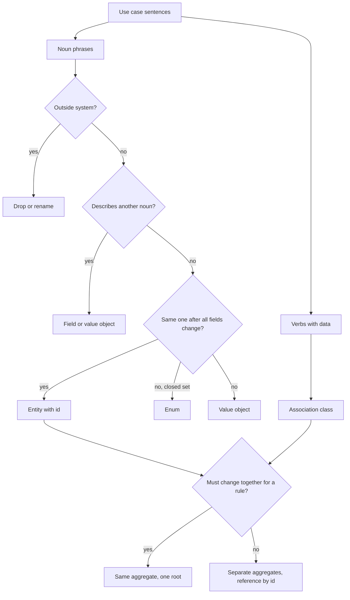

## In one minute
- Requirements arrive as sentences. Nouns are candidates, not classes: most turn out to be attributes, actors outside the system, synonyms or values. Keep a noun as a class only if it holds state that changes or a rule that must hold.
- Sort what survives into **entities** (identity that outlives changes to their data), **value objects** (equal when their data is equal, usually immutable) and **enums** (a closed set of names). Getting identity wrong is the most expensive modelling mistake, because it leaks into storage, APIs and caches.
- Verbs that carry data become classes too. "A member *books* a class" becomes a `Booking` with a time, a status and a price. Many-to-many relationships almost always hide one of these.
- Decide ownership by invariants. Objects that must change together to keep a rule true form one **aggregate** with one root; everything outside refers to that root by id, never to its internals.
- Draw only the relationships a use case needs, with direction and multiplicity. A model with every possible arrow is a database schema, not a design.

## How it works

### Start from use cases, not from the domain
"Design a gym booking system" invites you to list everything a gym contains: rooms, mats, lockers, towels. None of that matters until a use case touches it. Write five to eight use cases first, each as actor, verb and object ("member books a session", "member cancels up to 2 hours before start", "instructor sees the roster", "system promotes the first waitlisted member when a spot frees up"). How to approach OOD Interviews covers this step; this lesson goes deep on the next one, turning those sentences into a model.

### Noun extraction, then the filter
Underline every noun phrase in the use cases. You will get twenty or so. Then run each through five questions, in this order:

1. **Is it outside the system?** "Member" as a person is outside; "member account" with a credit balance is inside. Keep the inside version and name it for what the system stores.
2. **Is it an attribute of something else?** "Start time", "capacity", "email" describe another noun. They become fields, or small value objects when they carry rules (a `TimeSlot` that must end after it starts).
3. **Is it a synonym?** "Class", "session" and "slot" in the same prompt may be one thing, or "class" may be the recurring template (Spin, Tuesdays 7am) while "session" is one occurrence. Ask. That question often decides the design.
4. **Is it an implementation detail?** "Database", "list", "screen" and "notification email" are mechanisms, not domain concepts.
5. **Does it hold changing state or enforce a rule?** If neither, it is probably a value or nothing.

What survives is your candidate class list. Expect six to ten for an interview problem; twenty means you kept attributes.

### Entity, value object or enum
For each survivor, ask: if every field changed, would it still be *the same one*? A member who changes name, email and plan is still the same member, so `Member` is an entity with an id. Two `TimeSlot(07:00, 08:00)` values are interchangeable, so it is a value object compared by its fields. `BookingStatus` (confirmed, waitlisted, cancelled, attended) is a closed set of names, so it is an enum.

The test matters because each kind behaves differently. Entities need a stable id, an equality rule based on that id, and usually a lifecycle (a state machine; see State Machine Diagram). Value objects should be immutable: you replace a `TimeSlot`, you never edit one, which removes a whole class of aliasing bugs. Enums give exhaustiveness checks. Classes and Objects and Enums cover the language mechanics.

Some nouns are entities in one system and values in another. A banknote is a value to a shop (any 10-euro note will do) and an entity to a central bank tracking serial numbers. Model what the use cases need.

### Identity: natural or surrogate
An entity needs an identifier that never changes. Natural keys (an email, an ISBN, a licence plate) look tempting but change in practice: people change emails, plates are reissued. Use a surrogate id generated by the system, and store the natural key as a unique, editable attribute. In the code, equality and hashing for entities use the id only; for values, all fields.

### Verbs that become classes
Now read the verbs. "Member books session" relates two entities, but the booking has its own data: when it was made, its status, its position on a waitlist, the credits it used. That makes it an **association class**: a class that represents the relationship itself. The pattern repeats everywhere: `Enrollment` between student and course, `Loan` between member and copy, `Membership` between user and team, `Assignment` between driver and ride.

A useful rule: every many-to-many relationship in a first draft hides an association class. Members book many sessions; sessions have many members. The `Booking` in the middle turns one many-to-many into two one-to-many relationships, and gives the history a home.

### Relationships, direction and multiplicity
For each pair of classes that a use case connects, decide three things.

1. **Kind.** Composition (the part dies with the whole: a session's bookings), aggregation or plain association (a session refers to an instructor who exists independently), or a dependency used only inside a method (a pricing function). Association, Aggregation and Composition each have a lesson.
2. **Multiplicity.** One session has 0 to 20 confirmed bookings and 0 to n waitlisted ones; one booking has exactly one member.
3. **Direction.** Who needs to navigate to whom? If no use case asks "which bookings does this instructor have?", the instructor does not hold a list. Every bidirectional link is two references to keep consistent; add the second direction only when a use case needs it, and prefer a query over a stored back-reference.

### Aggregates: ownership decided by invariants
The most useful question in modelling is "which objects must change together to keep a rule true?" For the gym: a session never has more confirmed bookings than its capacity, and when a booking is cancelled, the first waitlisted booking is promoted. Both rules involve the session, its bookings and its waitlist, and nothing else. Those three form one aggregate, with `Session` as the root: all changes go through `session.book(member_id, now)` and `session.cancel(booking_id, now)`, which lets the root check the rules in one place.

Three rules follow, from Eric Evans' domain-driven design:

- Outside objects hold references only to the root, by id. A `Member` stores booking ids if it needs them, never a pointer to a `Booking` it could mutate behind the session's back.
- One aggregate is changed per operation. If a rule spans two aggregates (booking consumes a member's credit), either merge them, or accept eventual consistency and coordinate with a domain event and a compensating step.
- Keep aggregates small. A `Gym` aggregate that contains every session forces every booking to lock the whole gym.

### Roles, not subclasses
"An instructor can also be a member" tempts a `Person` base class with `Member` and `Instructor` subclasses. Then one human needs two objects, or multiple inheritance. Model roles as separate entities that refer to an `Account` (or just share a person id): `MemberProfile(account_id, credits)` and `InstructorProfile(account_id, certifications)`. Inheritance is for "is a kind of" that never changes; a role someone can gain or lose is composition. Composing Objects Principle covers why.

### Time and history
If a use case asks "what was the price when this was booked?", the price cannot be a single mutable field on the class. Either copy it into the booking (a snapshot, the usual answer) or model `PriceSchedule` entries with validity ranges. Ask about history early; it changes the model.

### Working with an AI assistant
Ask an assistant to "model a gym booking system" and you get fifteen classes including `GymManager`, `Locker` and `Towel`, every relation bidirectional, and `Person` with three subclasses. Use it to brainstorm nouns, then run the filter yourself, and ask it to justify each aggregate boundary by naming the invariant. If it cannot name one, the boundary is a guess.

### The same shape elsewhere
"Who owns what, and what dies with it" is the same question in many systems. Kubernetes objects carry `metadata.ownerReferences`: deleting a Deployment garbage-collects its ReplicaSets and their Pods, while a Pod that only mounts a ConfigMap is untouched. Relational schemas use `ON DELETE CASCADE` for composition and plain foreign keys for association. Filesystems use directories as owners and symlinks as references. The practice task checks exactly these ownership rules on a model.

## Down the stack

### Layer 1: The contract
A model makes testable promises. Every entity has an id that never changes and defines equality. Every value is immutable and equal by fields. Every invariant is enforced by exactly one aggregate root, so no sequence of public calls on the roots can break it. Every object is reachable from exactly one root through ownership, and references across aggregates go by id to roots only. A violation of any of these is a bug you can write a test for: two owners for one object, a reference to another aggregate's internals, a value with an edit method.

### Layer 2: The mechanism
In memory, ownership is a tree of strong references from the root, and cross-aggregate links are ids resolved through a repository (a map from id to root; see Repository Pattern). ORMs encode the same choices: JPA's `@OneToMany(cascade = CascadeType.ALL, orphanRemoval = true)` means composition, a plain `@ManyToOne` is association, and Hibernate's identity map guarantees one in-memory object per row id inside a session. In SQL, composition is a child table whose foreign key has `ON DELETE CASCADE`, association is a foreign key without it, and an association class is a join table with extra columns (`booking(id, session_id, member_id, status, created_at)`). Event Storming, a workshop technique, finds aggregates by grouping commands and events around the rule that accepts or rejects them, which is the invariant test done on sticky notes.

### Layer 3: The machine
Aggregate boundaries become lock and transaction boundaries. Booking the last spot is one `SELECT ... FOR UPDATE` on the session row, or a version check on it: Postgres row locks live in the tuple header (`xmax`), so locking one session costs nothing for the other 299 sessions that day. Make `Gym` the root and every booking serialises on one row. In memory, an object reference is an 8-byte pointer; an id reference is a hash lookup, about 20 to 100 ns depending on whether it misses cache. That cost is why designs hold pointers inside an aggregate and ids across them. Object overhead is real at scale: a Python object with a `__dict__` costs over 100 bytes, a Java object header is 12 to 16 bytes, a Go struct has none, so one million bookings as small objects is roughly 50 to 200 MB depending on language. Bidirectional pointer graphs also defeat garbage collection in subtle ways: one long-lived reference to a booking keeps its whole session and waitlist alive.

### Why it's built this way
1. Requirements change data in predictable clusters (a booking changes with its session), so models group data by what changes together.
2. Rules must be checked where all the data is visible at once, so each rule gets one owner, the aggregate root.
3. Checking a rule while others change the same data needs a lock or version, and locks are cheap only when narrow, so aggregates are kept small.
4. Pointers across aggregates would let code skip the root and its checks, so cross-aggregate links are ids that must be resolved through a repository.
5. Ids outlive every other field, so identity is a surrogate the system controls rather than a natural key the world can change.

## Diagram


## Worked example
Prompt: a gym chain with 12 studios runs about 300 sessions a day, 20 spots each, with a waitlist. Members buy credit packs; a session costs 1 credit, refunded if cancelled at least 2 hours before start.

Nouns found: gym, studio, class, session, instructor, member, credit pack, credit, booking, waitlist, spot, start time, capacity, roster, reminder email. Filter: *gym* is the system itself (drop); *spot* is a count, not a thing with identity (capacity field); *start time* and *capacity* are attributes; *roster* is a query over bookings; *reminder email* is a mechanism; *credit* is a number. *Class* versus *session*: the interviewer confirms classes recur weekly, so `ClassTemplate` (Spin, Tuesday 07:00, 20 spots) generates `Session`s.

Survivors: `Studio`, `ClassTemplate`, `Session`, `Instructor`, `MemberAccount`, `Booking` (association class), `CreditPack`. Values: `TimeSlot`, `Credits`. Enum: `BookingStatus`.

Aggregates by invariant. "Confirmed bookings never exceed capacity" and "promote the first waitlisted on cancel" both live in `Session` with its bookings. "Credits never go negative" lives in `MemberAccount` with its packs. Booking crosses both: `session.book` must also debit 1 credit. Options: merge (a member-plus-session aggregate is nonsense), or debit first in `MemberAccount`, then book in `Session`, and refund the credit if the session rejects the booking. The team picks the second, with the refund triggered by a `BookingRejected` event. At 300 sessions a day and peak rushes of perhaps 50 bookings a second when popular sessions open, per-session locking is never contended for more than microseconds.

References: `Booking` holds `member_id`, not a `MemberAccount` pointer. `Session` holds `instructor_id` and `template_id`. `Instructor` holds no list of sessions; "my schedule" is a query.

## Trade-offs
| Option | Strengths | Weaknesses | Choose when |
| --- | --- | --- | --- |
| Large aggregate | Every rule checked in one transaction | Contention; big loads; slow writes | Rules truly span the whole cluster and writes are rare |
| Small aggregates plus events | Narrow locks; independent scaling | Cross-aggregate rules become eventual; needs compensation | Rules are mostly local; high write rates |
| Object references everywhere | Easy navigation in code | Callers bypass roots; huge object graphs load at once | Small, single-process models with few rules |
| Id references across aggregates | Enforces boundaries; easy to persist and shard | Lookups through a repository; more code | Any model that will be persisted or shared |
| Subclass per role | Simple when roles never change | One person in two roles breaks it | Kinds are fixed for an object's lifetime |
| Role objects by composition | Roles added and removed at runtime | More objects and ids | People or accounts gain and lose roles |

## Pitfalls in production
- **Natural keys as ids.** Email as the user's primary key, then a user changes email and 14 tables need a cascading update. Fix: surrogate ids; keep the natural key as a unique, editable field.
- **Mutable value objects.** Two bookings share one `TimeSlot` instance; rescheduling one moves both. Fix: make values immutable and replace them.
- **The god aggregate.** `Gym` owns every session, so booking contention scales with the whole chain. Fix: split along invariants; most rules are local to one session or one account.
- **Hidden many-to-many.** A `member.sessions` list with no booking object, then product asks for booking time, status and waitlist position. Fix: model the association class from the start whenever the relationship has a lifecycle.
- **Back-references kept by hand.** `session.bookings` and `member.bookings` drift after a failed update. Fix: one owner holds the list; the other side uses a query by id.
- **Reaching into another aggregate.** Code loads a session, walks to a booking, and edits the member through it. Fix: pass ids and call the other root's method.

## Leadership lens
- In design review, ask for the invariant list next to the class diagram, and ask which root enforces each. Unowned invariants are where production bugs come from.
- The "class versus session" question is a product question, not an engineering one. Get product to answer naming questions early; renaming an entity after launch touches APIs, analytics and support scripts.
- Aggregate size is a scaling decision disguised as a modelling one. A wrong boundary shows up months later as lock contention, so make it explicit in the design document.
- Agents copy whatever model exists. A clean ownership structure in the first module is the template for every module an agent generates after it.

## Check yourself
1. Is a postal address an entity or a value object in an online shop? When would that change?
   **Answer:** Usually a value: two identical addresses are interchangeable and an order snapshots one. It becomes an entity when the system tracks it over time with its own lifecycle, such as a saved address book entry that users edit and that orders reference.
2. Why do many-to-many relationships in a first draft usually hide a class?
   **Answer:** The relationship tends to have its own data and lifecycle (when it started, its status, its terms), and that data belongs to neither side, so it needs its own association class.
3. Booking a session must also debit the member's credits, and they are separate aggregates. What are the options?
   **Answer:** Merge them into one aggregate (rarely sensible), or change one aggregate per operation and coordinate with an event and a compensating step such as refunding the credit if the booking is rejected.
4. Why should code outside an aggregate hold only the root's id?
   **Answer:** A direct pointer to an internal object lets callers change it without the root's checks, which breaks invariants; ids force every change through the root and also make persistence and sharding straightforward.

## Practice
**Task:** Write an aggregate checker for a domain model. `classes` maps a class name to `"entity"` or `"value"`; `links` is a list of `(source, target, kind)` where kind is `"owns"` or `"refs"`. Validation comes first: check class kinds in name order (`unknown class kind: <kind>`), then each link in order, source before target (`unknown class: <name>`), then its kind (`unknown link kind: <kind>`); raise `ValueError` in Python, throw `Error` in TypeScript, return an error in Go. A **root** is an entity with no owner; its aggregate is the root plus every class reachable from it through `owns` links, returned as a map from root to sorted member names. Report these problems as a sorted list with no duplicates: `<X> has <n> owners` (more than one distinct owner); `value <X> has no owner`; `<X> is unreachable from any root` (owned, but in no aggregate, for example in an ownership cycle); `value <X> owns entity <Y>`; `ref <S> -> <T>: target is a value`; and `ref <S> -> <T>: target is not a root` when the target is a non-root entity that shares no aggregate with the source.

```python starter
def check_model(classes, links):
    """Return {"aggregates": {root: [members]}, "problems": [str]}."""
    # TODO
    raise NotImplementedError
```

```python tests
GYM = {"Session": "entity", "Booking": "entity", "Waitlist": "entity",
       "TimeSlot": "value", "Member": "entity", "Credits": "value"}
GYM_LINKS = [
    ("Session", "Booking", "owns"), ("Session", "Waitlist", "owns"),
    ("Session", "TimeSlot", "owns"), ("Member", "Credits", "owns"),
    ("Booking", "Member", "refs"), ("Waitlist", "Booking", "refs"),
]

def raises(fn, msg):
    try:
        fn()
    except ValueError as e:
        assert str(e) == msg, str(e)
        return
    assert False, "expected ValueError: " + msg

def test_clean_model():
    r = check_model(GYM, GYM_LINKS)
    assert r["aggregates"] == {"Member": ["Credits", "Member"],
                               "Session": ["Booking", "Session", "TimeSlot", "Waitlist"]}
    assert r["problems"] == []

def test_ref_into_internals_and_duplicates():
    links = GYM_LINKS + [("Member", "Booking", "refs"), ("Member", "Booking", "refs")]
    assert check_model(GYM, links)["problems"] == ["ref Member -> Booking: target is not a root"]

def test_value_problems():
    classes = dict(GYM, Money="value")
    links = GYM_LINKS + [("Booking", "Credits", "refs")]
    assert check_model(classes, links)["problems"] == [
        "ref Booking -> Credits: target is a value", "value Money has no owner"]

def test_value_owning_entity():
    r = check_model({"Order": "entity", "Line": "value", "Product": "entity"},
                    [("Order", "Line", "owns"), ("Line", "Product", "owns")])
    assert r["aggregates"] == {"Order": ["Line", "Order", "Product"]}
    assert r["problems"] == ["value Line owns entity Product"]

def test_two_owners():
    r = check_model({"Cart": "entity", "Order": "entity", "Item": "value"},
                    [("Cart", "Item", "owns"), ("Order", "Item", "owns"), ("Cart", "Item", "owns")])
    assert r["aggregates"] == {"Cart": ["Cart", "Item"], "Order": ["Item", "Order"]}
    assert r["problems"] == ["Item has 2 owners"]

def test_cycles_and_loose_values():
    r = check_model({"A": "entity", "B": "entity", "C": "value"},
                    [("A", "B", "owns"), ("B", "A", "owns"), ("B", "C", "owns")])
    assert r["aggregates"] == {}
    assert r["problems"] == ["A is unreachable from any root", "B is unreachable from any root",
                             "C is unreachable from any root"]
    r = check_model({"Root": "entity", "Loose": "value", "Leaf": "value"}, [("Loose", "Leaf", "owns")])
    assert r["aggregates"] == {"Root": ["Root"]}
    assert r["problems"] == ["Leaf is unreachable from any root", "value Loose has no owner"]

def test_empty_model():
    assert check_model({}, []) == {"aggregates": {}, "problems": []}

def test_validation():
    raises(lambda: check_model({"B": "thing", "A": "blob"}, []), "unknown class kind: blob")
    raises(lambda: check_model(GYM, [("Session", "Ghost", "owns"), ("Ghost2", "Session", "refs")]),
           "unknown class: Ghost")
    raises(lambda: check_model(GYM, [("Session", "Booking", "has")]), "unknown link kind: has")
```

```python solution
def check_model(classes, links):
    for name in sorted(classes):
        if classes[name] not in ("entity", "value"):
            raise ValueError("unknown class kind: " + classes[name])
    for src, dst, kind in links:
        for name in (src, dst):
            if name not in classes:
                raise ValueError("unknown class: " + name)
        if kind not in ("owns", "refs"):
            raise ValueError("unknown link kind: " + kind)

    owners = {name: set() for name in classes}
    children = {name: [] for name in classes}
    for src, dst, kind in links:
        if kind == "owns":
            owners[dst].add(src)
            children[src].append(dst)

    aggregates = {}
    member_of = {name: set() for name in classes}
    for root in sorted(classes):
        if classes[root] != "entity" or owners[root]:
            continue
        seen = {root}
        stack = [root]
        while stack:
            cur = stack.pop()
            for nxt in children[cur]:
                if nxt not in seen:
                    seen.add(nxt)
                    stack.append(nxt)
        aggregates[root] = sorted(seen)
        for m in seen:
            member_of[m].add(root)

    problems = set()
    for name in classes:
        n = len(owners[name])
        if n > 1:
            problems.add("%s has %d owners" % (name, n))
        if classes[name] == "value" and n == 0:
            problems.add("value %s has no owner" % name)
        if n > 0 and not member_of[name]:
            problems.add("%s is unreachable from any root" % name)
    for src, dst, kind in links:
        if kind == "owns":
            if classes[src] == "value" and classes[dst] == "entity":
                problems.add("value %s owns entity %s" % (src, dst))
        elif classes[dst] == "value":
            problems.add("ref %s -> %s: target is a value" % (src, dst))
        elif dst not in aggregates and not (member_of[src] & member_of[dst]):
            problems.add("ref %s -> %s: target is not a root" % (src, dst))
    return {"aggregates": aggregates, "problems": sorted(problems)}
```

```typescript starter
export type Link = [string, string, string];

export interface Report {
  aggregates: Record<string, string[]>;
  problems: string[];
}

export function checkModel(classes: Record<string, string>, links: Link[]): Report {
  throw new Error("TODO");
}
```

```typescript tests
const GYM: Record<string, string> = {
  Session: "entity", Booking: "entity", Waitlist: "entity",
  TimeSlot: "value", Member: "entity", Credits: "value",
};
const GYM_LINKS: Link[] = [
  ["Session", "Booking", "owns"], ["Session", "Waitlist", "owns"],
  ["Session", "TimeSlot", "owns"], ["Member", "Credits", "owns"],
  ["Booking", "Member", "refs"], ["Waitlist", "Booking", "refs"],
];

function expectThrow(fn: () => unknown, msg: string): void {
  let got = "";
  try {
    fn();
  } catch (e) {
    got = (e as Error).message;
  }
  assertEqual(got, msg, "error message");
}

test("clean model", () => {
  const r = checkModel(GYM, GYM_LINKS);
  assertEqual(r.aggregates, { Member: ["Credits", "Member"], Session: ["Booking", "Session", "TimeSlot", "Waitlist"] });
  assertEqual(r.problems, []);
});

test("ref into internals and duplicates", () => {
  const links: Link[] = [...GYM_LINKS, ["Member", "Booking", "refs"], ["Member", "Booking", "refs"]];
  assertEqual(checkModel(GYM, links).problems, ["ref Member -> Booking: target is not a root"]);
});

test("value problems", () => {
  const classes = { ...GYM, Money: "value" };
  const links: Link[] = [...GYM_LINKS, ["Booking", "Credits", "refs"]];
  assertEqual(checkModel(classes, links).problems, [
    "ref Booking -> Credits: target is a value", "value Money has no owner"]);
});

test("value owning entity", () => {
  const r = checkModel({ Order: "entity", Line: "value", Product: "entity" },
    [["Order", "Line", "owns"], ["Line", "Product", "owns"]]);
  assertEqual(r.aggregates, { Order: ["Line", "Order", "Product"] });
  assertEqual(r.problems, ["value Line owns entity Product"]);
});

test("two owners", () => {
  const r = checkModel({ Cart: "entity", Order: "entity", Item: "value" },
    [["Cart", "Item", "owns"], ["Order", "Item", "owns"], ["Cart", "Item", "owns"]]);
  assertEqual(r.aggregates, { Cart: ["Cart", "Item"], Order: ["Item", "Order"] });
  assertEqual(r.problems, ["Item has 2 owners"]);
});

test("cycles and loose values", () => {
  let r = checkModel({ A: "entity", B: "entity", C: "value" },
    [["A", "B", "owns"], ["B", "A", "owns"], ["B", "C", "owns"]]);
  assertEqual(r.aggregates, {});
  assertEqual(r.problems, ["A is unreachable from any root", "B is unreachable from any root",
    "C is unreachable from any root"]);
  r = checkModel({ Root: "entity", Loose: "value", Leaf: "value" }, [["Loose", "Leaf", "owns"]]);
  assertEqual(r.aggregates, { Root: ["Root"] });
  assertEqual(r.problems, ["Leaf is unreachable from any root", "value Loose has no owner"]);
});

test("empty model", () => {
  assertEqual(checkModel({}, []), { aggregates: {}, problems: [] });
});

test("validation", () => {
  expectThrow(() => checkModel({ B: "thing", A: "blob" }, []), "unknown class kind: blob");
  expectThrow(() => checkModel(GYM, [["Session", "Ghost", "owns"], ["Ghost2", "Session", "refs"]]), "unknown class: Ghost");
  expectThrow(() => checkModel(GYM, [["Session", "Booking", "has"]]), "unknown link kind: has");
});
```

```typescript solution
export type Link = [string, string, string];

export interface Report {
  aggregates: Record<string, string[]>;
  problems: string[];
}

export function checkModel(classes: Record<string, string>, links: Link[]): Report {
  const names = Object.keys(classes).sort();
  for (const name of names) {
    const kind = classes[name];
    if (kind !== "entity" && kind !== "value") throw new Error("unknown class kind: " + kind);
  }
  for (const [src, dst, kind] of links) {
    for (const name of [src, dst]) {
      if (!(name in classes)) throw new Error("unknown class: " + name);
    }
    if (kind !== "owns" && kind !== "refs") throw new Error("unknown link kind: " + kind);
  }

  const owners = new Map<string, Set<string>>();
  const children = new Map<string, string[]>();
  const memberOf = new Map<string, Set<string>>();
  for (const name of names) {
    owners.set(name, new Set());
    children.set(name, []);
    memberOf.set(name, new Set());
  }
  for (const [src, dst, kind] of links) {
    if (kind === "owns") {
      owners.get(dst)!.add(src);
      children.get(src)!.push(dst);
    }
  }

  const aggregates: Record<string, string[]> = {};
  for (const root of names) {
    if (classes[root] !== "entity" || owners.get(root)!.size > 0) continue;
    const seen = new Set<string>([root]);
    const stack = [root];
    while (stack.length > 0) {
      const cur = stack.pop()!;
      for (const next of children.get(cur)!) {
        if (!seen.has(next)) {
          seen.add(next);
          stack.push(next);
        }
      }
    }
    aggregates[root] = [...seen].sort();
    for (const m of seen) memberOf.get(m)!.add(root);
  }

  const problems = new Set<string>();
  for (const name of names) {
    const n = owners.get(name)!.size;
    if (n > 1) problems.add(`${name} has ${n} owners`);
    if (classes[name] === "value" && n === 0) problems.add(`value ${name} has no owner`);
    if (n > 0 && memberOf.get(name)!.size === 0) problems.add(`${name} is unreachable from any root`);
  }
  for (const [src, dst, kind] of links) {
    if (kind === "owns") {
      if (classes[src] === "value" && classes[dst] === "entity") problems.add(`value ${src} owns entity ${dst}`);
    } else if (classes[dst] === "value") {
      problems.add(`ref ${src} -> ${dst}: target is a value`);
    } else if (!(dst in aggregates)) {
      const shared = [...memberOf.get(src)!].some((r) => memberOf.get(dst)!.has(r));
      if (!shared) problems.add(`ref ${src} -> ${dst}: target is not a root`);
    }
  }
  return { aggregates, problems: [...problems].sort() };
}
```

```go starter
package practice

type Link struct {
	Source, Target, Kind string
}

type Report struct {
	Aggregates map[string][]string
	Problems   []string
}

func CheckModel(classes map[string]string, links []Link) (Report, error) {
	panic("TODO")
}
```

```go tests
package practice

import (
	"reflect"
	"testing"
)

var gym = map[string]string{
	"Session": "entity", "Booking": "entity", "Waitlist": "entity",
	"TimeSlot": "value", "Member": "entity", "Credits": "value",
}

func gymLinks(extra ...Link) []Link {
	links := []Link{
		{"Session", "Booking", "owns"}, {"Session", "Waitlist", "owns"},
		{"Session", "TimeSlot", "owns"}, {"Member", "Credits", "owns"},
		{"Booking", "Member", "refs"}, {"Waitlist", "Booking", "refs"},
	}
	return append(links, extra...)
}

func mustCheck(t *testing.T, classes map[string]string, links []Link) Report {
	t.Helper()
	r, err := CheckModel(classes, links)
	if err != nil {
		t.Fatalf("unexpected error: %v", err)
	}
	return r
}

func sameProblems(t *testing.T, got, want []string) {
	t.Helper()
	if len(got) == 0 && len(want) == 0 {
		return
	}
	if !reflect.DeepEqual(got, want) {
		t.Fatalf("problems = %q, want %q", got, want)
	}
}

func TestCleanModel(t *testing.T) {
	r := mustCheck(t, gym, gymLinks())
	want := map[string][]string{"Member": {"Credits", "Member"}, "Session": {"Booking", "Session", "TimeSlot", "Waitlist"}}
	if !reflect.DeepEqual(r.Aggregates, want) {
		t.Fatalf("aggregates = %v", r.Aggregates)
	}
	sameProblems(t, r.Problems, nil)
}

func TestRefIntoInternalsAndDuplicates(t *testing.T) {
	r := mustCheck(t, gym, gymLinks(Link{"Member", "Booking", "refs"}, Link{"Member", "Booking", "refs"}))
	sameProblems(t, r.Problems, []string{"ref Member -> Booking: target is not a root"})
}

func TestValueProblems(t *testing.T) {
	classes := map[string]string{"Money": "value"}
	for k, v := range gym {
		classes[k] = v
	}
	r := mustCheck(t, classes, gymLinks(Link{"Booking", "Credits", "refs"}))
	sameProblems(t, r.Problems, []string{"ref Booking -> Credits: target is a value", "value Money has no owner"})
}

func TestValueOwningEntity(t *testing.T) {
	r := mustCheck(t, map[string]string{"Order": "entity", "Line": "value", "Product": "entity"},
		[]Link{{"Order", "Line", "owns"}, {"Line", "Product", "owns"}})
	if !reflect.DeepEqual(r.Aggregates, map[string][]string{"Order": {"Line", "Order", "Product"}}) {
		t.Fatalf("aggregates = %v", r.Aggregates)
	}
	sameProblems(t, r.Problems, []string{"value Line owns entity Product"})
}

func TestTwoOwners(t *testing.T) {
	r := mustCheck(t, map[string]string{"Cart": "entity", "Order": "entity", "Item": "value"},
		[]Link{{"Cart", "Item", "owns"}, {"Order", "Item", "owns"}, {"Cart", "Item", "owns"}})
	if !reflect.DeepEqual(r.Aggregates, map[string][]string{"Cart": {"Cart", "Item"}, "Order": {"Item", "Order"}}) {
		t.Fatalf("aggregates = %v", r.Aggregates)
	}
	sameProblems(t, r.Problems, []string{"Item has 2 owners"})
}

func TestCyclesAndLooseValues(t *testing.T) {
	r := mustCheck(t, map[string]string{"A": "entity", "B": "entity", "C": "value"},
		[]Link{{"A", "B", "owns"}, {"B", "A", "owns"}, {"B", "C", "owns"}})
	if len(r.Aggregates) != 0 {
		t.Fatalf("aggregates = %v", r.Aggregates)
	}
	sameProblems(t, r.Problems, []string{"A is unreachable from any root", "B is unreachable from any root", "C is unreachable from any root"})
	r = mustCheck(t, map[string]string{"Root": "entity", "Loose": "value", "Leaf": "value"}, []Link{{"Loose", "Leaf", "owns"}})
	if !reflect.DeepEqual(r.Aggregates, map[string][]string{"Root": {"Root"}}) {
		t.Fatalf("aggregates = %v", r.Aggregates)
	}
	sameProblems(t, r.Problems, []string{"Leaf is unreachable from any root", "value Loose has no owner"})
}

func TestEmptyModel(t *testing.T) {
	r := mustCheck(t, map[string]string{}, nil)
	if len(r.Aggregates) != 0 || len(r.Problems) != 0 {
		t.Fatalf("got %v", r)
	}
}

func TestValidation(t *testing.T) {
	cases := []struct {
		classes map[string]string
		links   []Link
		want    string
	}{
		{map[string]string{"B": "thing", "A": "blob"}, nil, "unknown class kind: blob"},
		{gym, []Link{{"Session", "Ghost", "owns"}, {"Ghost2", "Session", "refs"}}, "unknown class: Ghost"},
		{gym, []Link{{"Session", "Booking", "has"}}, "unknown link kind: has"},
	}
	for _, c := range cases {
		_, err := CheckModel(c.classes, c.links)
		if err == nil || err.Error() != c.want {
			t.Fatalf("err = %v, want %q", err, c.want)
		}
	}
}
```

```go solution
package practice

import (
	"fmt"
	"sort"
)

type Link struct {
	Source, Target, Kind string
}

type Report struct {
	Aggregates map[string][]string
	Problems   []string
}

func CheckModel(classes map[string]string, links []Link) (Report, error) {
	names := make([]string, 0, len(classes))
	for name := range classes {
		names = append(names, name)
	}
	sort.Strings(names)
	for _, name := range names {
		if k := classes[name]; k != "entity" && k != "value" {
			return Report{}, fmt.Errorf("unknown class kind: %s", k)
		}
	}
	for _, l := range links {
		for _, name := range []string{l.Source, l.Target} {
			if _, ok := classes[name]; !ok {
				return Report{}, fmt.Errorf("unknown class: %s", name)
			}
		}
		if l.Kind != "owns" && l.Kind != "refs" {
			return Report{}, fmt.Errorf("unknown link kind: %s", l.Kind)
		}
	}

	owners := map[string]map[string]bool{}
	children := map[string][]string{}
	memberOf := map[string]map[string]bool{}
	for _, name := range names {
		owners[name] = map[string]bool{}
		memberOf[name] = map[string]bool{}
	}
	for _, l := range links {
		if l.Kind == "owns" {
			owners[l.Target][l.Source] = true
			children[l.Source] = append(children[l.Source], l.Target)
		}
	}

	aggregates := map[string][]string{}
	for _, root := range names {
		if classes[root] != "entity" || len(owners[root]) > 0 {
			continue
		}
		seen := map[string]bool{root: true}
		stack := []string{root}
		for len(stack) > 0 {
			cur := stack[len(stack)-1]
			stack = stack[:len(stack)-1]
			for _, next := range children[cur] {
				if !seen[next] {
					seen[next] = true
					stack = append(stack, next)
				}
			}
		}
		members := make([]string, 0, len(seen))
		for m := range seen {
			members = append(members, m)
			memberOf[m][root] = true
		}
		sort.Strings(members)
		aggregates[root] = members
	}

	problems := map[string]bool{}
	for _, name := range names {
		n := len(owners[name])
		if n > 1 {
			problems[fmt.Sprintf("%s has %d owners", name, n)] = true
		}
		if classes[name] == "value" && n == 0 {
			problems[fmt.Sprintf("value %s has no owner", name)] = true
		}
		if n > 0 && len(memberOf[name]) == 0 {
			problems[fmt.Sprintf("%s is unreachable from any root", name)] = true
		}
	}
	for _, l := range links {
		src, dst := l.Source, l.Target
		if l.Kind == "owns" {
			if classes[src] == "value" && classes[dst] == "entity" {
				problems[fmt.Sprintf("value %s owns entity %s", src, dst)] = true
			}
			continue
		}
		if classes[dst] == "value" {
			problems[fmt.Sprintf("ref %s -> %s: target is a value", src, dst)] = true
			continue
		}
		if _, isRoot := aggregates[dst]; isRoot {
			continue
		}
		shared := false
		for r := range memberOf[src] {
			if memberOf[dst][r] {
				shared = true
			}
		}
		if !shared {
			problems[fmt.Sprintf("ref %s -> %s: target is not a root", src, dst)] = true
		}
	}
	out := make([]string, 0, len(problems))
	for p := range problems {
		out = append(out, p)
	}
	sort.Strings(out)
	return Report{Aggregates: aggregates, Problems: out}, nil
}
```

## Mock interview
**Prompt:** Model the core of a clinic appointment system: 40 doctors across 3 clinics, patients book 15-minute slots, a doctor can work at more than one clinic, appointments can be rescheduled or cancelled, and a no-show fee applies. Walk me from requirements to classes, relationships and aggregate boundaries.

- Follow-up: A doctor is also a patient at the same clinic. How does your model handle that?
- Follow-up: Two patients try to book the last 9:00 slot with Dr Rao at the same moment. Which object enforces the rule, and what is locked?
- Follow-up: Finance wants to know the fee that applied when each appointment was booked, even after prices change. What changes in the model?

**A strong answer covers:**
- Filtering nouns: "slot" as a value (`TimeSlot`) or a computed availability, "clinic schedule" as a query, "patient" as an account entity with a surrogate id.
- `Appointment` as the association class between patient and doctor, with status, time slot, clinic and a fee snapshot.
- An aggregate per doctor's day (or per doctor schedule) enforcing "no overlapping appointments", referenced by id from patients, so the booking race locks one small root.
- Roles by composition: `DoctorProfile` and `PatientProfile` referencing one person or account, not subclasses.
- Rescheduling as one operation on the schedule root, and cross-aggregate effects (the no-show fee on the patient's account) via an event.

## Watch
- [What is DDD (Eric Evans, DDD Europe 2019)](https://www.youtube.com/watch?v=pMuiVlnGqjk): the author of domain-driven design on models, language and boundaries.
- [DDD Building Blocks (Drawing Boxes)](https://www.youtube.com/watch?v=xFl-QQZJFTA): entities, value objects and aggregates explained with diagrams.

## Free resources
- [DDD Aggregate (Martin Fowler)](https://martinfowler.com/bliki/DDD_Aggregate.html): a short definition of aggregates and why references go through the root.
- [Value Object (Martin Fowler)](https://martinfowler.com/bliki/ValueObject.html): equality by value, immutability and the aliasing bugs it prevents.
- [Effective Aggregate Design, Part I (Vaughn Vernon)](https://www.dddcommunity.org/wp-content/uploads/files/pdf_articles/Vernon_2011_1.pdf): the case for small aggregates, with a worked example of shrinking a large one.
- [Kubernetes garbage collection](https://kubernetes.io/docs/concepts/architecture/garbage-collection/): owner references and cascading deletion, the same ownership model in infrastructure.
- [Class-responsibility-collaboration card (Wikipedia)](https://en.wikipedia.org/wiki/Class-responsibility-collaboration_card): the index-card technique for finding classes and their responsibilities.
