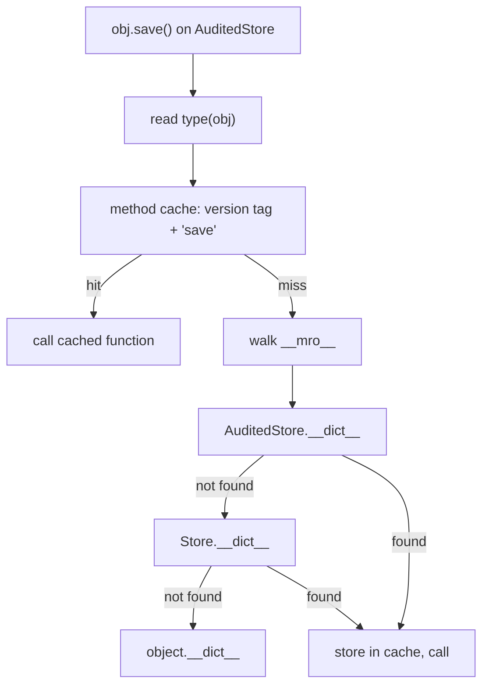

## In one minute
- Inheritance lets a class start from another class's fields and methods and add or replace some. It bundles two things: code reuse and a subtype relationship.
- The reuse is the risky half. A subclass depends on how its parent calls its own methods, so a harmless refactor of the parent can break children it has never seen: the fragile base class problem.
- Inherit when the child is a substitutable kind of the parent and the parent was designed for extension. Otherwise compose: hold the other object and forward to it.
- Single inheritance is cheap at runtime: parent fields come first so offsets never change, and dispatch is a table index or a cached lookup. Multiple inheritance needs a linearisation rule (C3 in Python) or pointer adjustment (C++).
- Agents reach for a `BaseHandler` to share three lines. Ask what the child must not override and who owns the base before accepting it.

## How it works

### Two things in one keyword
`class Savings(Account)` says two things. *Reuse*: `Savings` gets `Account`'s fields and method bodies. *Subtyping*: code that accepts an `Account` now accepts a `Savings`. You can want one without the other, but most languages bundle them. The subtype half is governed by the Liskov Substitution Principle (its own lesson); this lesson focuses on reuse, where most inheritance bugs come from.

### Overriding and open recursion
When a parent calls one of its *own* overridable methods, the call dispatches to the child's version if one exists (Java, C#, Python, JavaScript, C++ `virtual`). This is open recursion; it makes the Template Method pattern work, and it makes the parent's internal call graph part of its contract. Consider a key-value store and a subclass that records every write for compliance:

```python
class Store:
    def __init__(self):
        self._data = {}

    def put(self, key, value):
        self._data[key] = value

    def put_many(self, pairs):
        for k, v in pairs:
            self.put(k, v)        # self-call: dispatches to subclass

class AuditedStore(Store):
    def __init__(self, log):
        super().__init__()
        self.log = log

    def put(self, key, value):
        self.log.append(key)
        super().put(key, value)
```

`AuditedStore` overrides only `put` and still audits `put_many`, because the parent happens to loop over `put`. No signature says so.

### The fragile base class
Months later the storage team speeds up `put_many` with `self._data.update(pairs)`. Every `Store` test passes, and `AuditedStore` silently stops auditing bulk writes. An implementation detail changed and a subclass in another repository broke. That is the fragile base class problem, and the main reason "favour composition over inheritance" became standard advice. A wrapper that holds a `Store` and implements both methods cannot be broken this way.

Built-in types show the same trap. In CPython an overridden `__getitem__` in a `dict` subclass is not called by the built-in `get()`, and the PyPy documentation notes that CPython has no rule at all for when built-in methods call overrides ([PyPy docs](https://doc.pypy.org/en/latest/cpython_differences.html)). The Java library carries older scars: `Properties` extends `Hashtable`, so `put` accepts non-String values, and its Javadoc calls that use strongly discouraged ([Javadoc](https://docs.oracle.com/en/java/javase/21/docs/api/java.base/java/util/Properties.html)).

### Designing a class to be extended
If you do want subclasses, design for them on purpose:
- **Declare the extension points.** Make most methods `final` (Kotlin does this by default, so a class must be marked `open` to be extended ([Kotlin docs](https://kotlinlang.org/docs/inheritance.html))) and expose a few hooks with documented call timing.
- **Document self-use.** If `put_many` calls `put`, say so, and treat changing it as breaking.
- **No overridable calls from constructors.** In Java and C# the override runs before the child's fields are initialised.
- **Keep it shallow.** Five levels means reading five files to know what one method does.

### Multiple inheritance and method order
With two parents that both define `save`, the language needs a rule. C++ makes you qualify the call (`A::save`) and, for a shared grandparent, choose `virtual` inheritance or get two copies. Python computes a *method resolution order* with [C3](https://docs.python.org/3/howto/mro.html): one list in which every class precedes its parents and each declared base order is kept. If no such list exists, Python refuses to create the class. The practice task implements C3.

Go has no inheritance. Embedding promotes a struct's methods to the outer type, but the embedded type's self-calls always reach its own methods. Go keeps reuse and drops open recursion (the receiver of an embedded method is the inner value, never the outer one ([Effective Go](https://go.dev/doc/effective_go))), removing the fragile base class problem by construction.

### Reviewing agent-written code
Asked to remove duplication, agents produce a `BaseHandler` full of `if self.kind == ...` branches, or chains like `AuthedRetryingClient`. Flag overrides that only disable a method, `isinstance` checks in the base, and depth beyond two. Ask for a helper function or a composed collaborator.

### The same shape elsewhere
A fragile base class is the *trust but verify* shape: a consumer relies on behaviour the provider never promised. Configuration inheritance fails the same way, when a base Helm values file or Terraform module changes a default under every environment that extends it. The fix is the same: narrow, documented extension points and tests at the consumer.

## Down the stack

### Layer 1: The contract
A subclass instance is accepted wherever the parent type is, with every inherited member reachable. Overrides are chosen by the receiver's runtime type, including on the parent's self-calls. Nothing guarantees the parent's internal call graph between versions; it is only as stable as its documentation.

### Layer 2: The mechanism
**C++ and Java.** A class's fields follow its parent's, so a parent field has the same offset in every subclass and a child pointer is a valid parent pointer. The method table keeps inherited methods in their parent's slots and appends new ones. Under the Itanium C++ ABI the vtable pointer of the primary base sits at offset 0 ([Itanium ABI](https://itanium-cxx-abi.github.io/cxx-abi/abi.html)). With multiple inheritance the second base lives at a non-zero offset, so converting `Child*` to `Base2*` adds a constant, and calls through `Base2` go via "thunks" that adjust `this` back.

**Python.** At class creation `type` computes `__mro__` with C3 and stores it as a tuple. Attribute lookup walks it, checking each class's `__dict__`, and CPython caches results per (type version tag, name); assigning a class attribute bumps the tag so stale entries miss. Zero-argument `super()` continues the search in `type(self).__mro__` after the current class, which is why `super()` in a mixin can reach a sibling rather than the parent.

**JavaScript.** `class Child extends Parent` links `Child.prototype` to `Parent.prototype`, and `Child` to `Parent` so statics are inherited. A derived constructor must call `super()` before using `this`, because the base constructor allocates the object. V8 caches lookups per call site by hidden class, with "validity cells" that invalidate the cache when anything on the prototype chain changes.

**Go.** An embedded struct is a field stored inline, plus compiler-generated forwarding methods on the outer type. There is no override table because nothing can be overridden.

### Layer 3: The machine
Inherited field access costs nothing extra in C++, Java or Go: one load at a fixed offset regardless of depth. Size is every level's fields plus padding. On 64-bit HotSpot the classic header is 96 bits (12 bytes) and objects round up to 8 bytes. Compact object headers shrink it to 64 bits; they became a product feature in JDK 25 ([JEP 519](https://openjdk.org/jeps/519)) and the default in JDK 27 ([JEP 534](https://openjdk.org/jeps/534)). Either way, five levels adding one `int` each make a 32-byte object (12 + 20 = 32, or 8 + 20 = 28 rounded up). A polymorphic C++ object pays 8 bytes for one vtable pointer. A CPython method-cache miss probes one dictionary per class in the MRO, roughly tens of nanoseconds for a deep hierarchy, and monkey patching classes at runtime keeps invalidating the cache. In V8, call sites that see many hidden classes fall back to generic lookups, often several times slower than a cached load.

### Why it's built this way
1. Code compiled against the parent must work on unseen children, so parent fields go first and keep their offsets.
2. Children must change behaviour, so calls go through a per-class table or lookup, not a direct jump.
3. Self-calls use the same table so hooks work, which exposes the parent's call graph and makes base classes fragile.
4. Multiple parents make "which method wins" ambiguous, so languages forbid it (Java classes, Go), push it to the programmer (C++), or define a total order (C3).

## Diagram


## Worked example
A payments platform runs `AuditedStore` at 40,000 writes per second, 30 percent of them through `put_many` from a reconciliation job. The storage team rewrites `put_many` to call `dict.update` directly, cutting bulk inserts from 1.8 to 0.4 microseconds per pair. Their tests pass.

Audit volume falls 30 percent overnight. Nothing alerts on it, so the gap surfaces 19 days later in a control review: 12,000 writes per second for 19 days, about 20 billion unaudited writes to reconstruct from database change logs.

The fix: `AuditedStore` became a wrapper implementing both methods, plus a compliance-owned contract test asserting that writes through every public method reach the audit log.

## In the wild
- **Java standard library, since 1.0: `Stack` and `Properties`.** `Stack` extends `Vector` and `Properties` extends `Hashtable`, so both inherit methods that break their intent. The `Stack` Javadoc recommends `Deque` implementations instead, and the `Properties` Javadoc says `put` and `putAll` can insert non-String entries, which makes a later `store` fail ([Stack Javadoc](https://docs.oracle.com/en/java/javase/21/docs/api/java.base/java/util/Stack.html), [Properties Javadoc](https://docs.oracle.com/en/java/javase/21/docs/api/java.base/java/util/Properties.html)).
- **CPython and PyPy: subclassing `dict` and `list`.** Overridden methods on built-in subclasses are, as an approximation, never called by other built-in methods of the same object, so an overridden `__getitem__` does not affect `get()`. PyPy documents the rule and where its behaviour differs from CPython's ([PyPy docs](https://doc.pypy.org/en/latest/cpython_differences.html)). The standard library offers `collections.UserDict`, a wrapper, as an easier base ([Python docs](https://docs.python.org/3/library/collections.html)).
- **Kotlin, design decision: closed by default.** Kotlin classes and members are `final` unless marked `open`, so a base class has to opt in to being extended and its extension points are visible in the source ([Kotlin docs](https://kotlinlang.org/docs/inheritance.html)).

## Trade-offs
| Option | Strengths | Weaknesses | Choose when |
| --- | --- | --- | --- |
| Implementation inheritance | Little code, natural for true "kind of" | Fragile base class, hidden behaviour | Parent designed for extension, one owning team |
| Composition and forwarding | Robust to inner changes, swappable | Boilerplate forwarding | Reusing a class you do not own |
| Interface plus shared helper functions | Subtyping without inherited state | Helpers must be called explicitly | Several types share behaviour but no data |
| Mixins (multiple inheritance) | Small reusable behaviour slices | Order-dependent, `super()` surprises | A few well-documented Python or Scala mixins |

## Pitfalls in production
- A subclass relies on a self-call the parent later removes. Fix: compose, or have the parent document and test self-use.
- An overridable method called from a constructor reads child fields that are still null. Fix: no overridable calls during construction; use a factory.
- A subclass overrides a method to throw "not supported", crashing code that holds the parent type. Fix: it is not a subtype; split the interface or compose.
- A shared base class gains a method whose name collides with one in a team's subclass, silently overriding it. Fix: mark overrides explicitly (`@Override`, TypeScript `override` with [`noImplicitOverride`](https://www.typescriptlang.org/tsconfig/noImplicitOverride.html), Python's [`typing.override`](https://docs.python.org/3/library/typing.html)) so tools flag accidental ones.
- Python mixins listed in the wrong order, so `LoggingMixin.save` never runs. Fix: assert the expected `__mro__` in a test.

## Leadership lens
- Treat a base class used by other teams as a public API, self-calls included. Changing it needs the review and release notes of an HTTP endpoint change.
- In design review ask: is the child substitutable, who owns the parent, and which methods are meant to be overridden? If nobody can answer the last, compose.
- Set a depth budget, such as two levels of implementation inheritance in application code, enforced by a lint rule rather than taste.
- Make classes final or sealed by default. Opening a class later is cheap; closing one others extend is a migration.

## Check yourself
1. Why can a performance change to a parent class break a subclass even though no public signature changed?
   **Answer:** The subclass relied on the parent calling an overridable method internally. Self-calls dispatch to the child, so the change removed a call the child depended on.
2. Why does a field inherited through five levels cost no more to read in Java than a field declared on the class itself?
   **Answer:** Parent fields come first and keep a fixed offset in every subclass, so the JIT emits one load at a constant offset.
3. Python refuses to create `class Z(X, Y)` when `X(A, B)` and `Y(B, A)`. Why?
   **Answer:** C3 keeps each declared base order. `X` needs A before B and `Y` needs B before A, so no order satisfies both.
4. Why does Go struct embedding not suffer from the fragile base class problem?
   **Answer:** An embedded type's self-calls always reach its own methods, never the outer type's. The outer type cannot hook into the inner type's internals, so the inner type's refactors cannot break it that way.

## Practice
**Task:** Implement Python's C3 method resolution order and use it to resolve methods. `mro(bases, cls)` takes a map from class name to its ordered list of direct base names (the graph is acyclic) and returns the linearisation of `cls`: `cls` followed by the merge of its bases' linearisations and the list of bases itself. The merge repeatedly takes the first head of a list that does not appear in the tail (any position after the first) of any list, appends it, and removes it from every list. If no head qualifies, fail with `inconsistent hierarchy: <cls>`. A class not in the map fails with `unknown class: <name>`. `lookup(bases, defines, cls, method)` returns the first class in `mro(cls)` whose entry in `defines` (class name to list of method names) contains `method`, or an empty string if none does. Python raises `ValueError`, TypeScript throws `Error`, Go returns an error.

```python starter
def mro(bases, cls):
    # TODO: C3 linearisation
    raise NotImplementedError

def lookup(bases, defines, cls, method):
    # TODO: first class in mro(cls) that defines method, or ""
    raise NotImplementedError
```

```python tests
DIAMOND = {"A": [], "B": ["A"], "C": ["A"], "D": ["B", "C"]}

def test_single_chain():
    bases = {"Base": [], "Mid": ["Base"], "Leaf": ["Mid"]}
    assert mro(bases, "Leaf") == ["Leaf", "Mid", "Base"]

def test_root_class():
    assert mro({"Solo": []}, "Solo") == ["Solo"]

def test_diamond_keeps_shared_base_last():
    assert mro(DIAMOND, "D") == ["D", "B", "C", "A"]

def test_deeper_merge():
    bases = {"O": [], "F": ["O"], "E": ["O"], "Dd": ["O"],
             "Cc": ["Dd", "F"], "Bb": ["Dd", "E"], "Aa": ["Bb", "Cc"]}
    assert mro(bases, "Aa") == ["Aa", "Bb", "Cc", "Dd", "E", "F", "O"]

def test_inconsistent_order():
    bases = {"A": [], "B": [], "X": ["A", "B"], "Y": ["B", "A"], "Z": ["X", "Y"]}
    try:
        mro(bases, "Z")
        assert False, "expected ValueError"
    except ValueError as e:
        assert str(e) == "inconsistent hierarchy: Z"

def test_unknown_class():
    try:
        mro({"A": ["Q"]}, "A")
        assert False, "expected ValueError"
    except ValueError as e:
        assert str(e) == "unknown class: Q"

def test_lookup_prefers_sibling_over_grandparent():
    defines = {"A": ["save", "load"], "B": [], "C": ["save"], "D": []}
    assert lookup(DIAMOND, defines, "D", "save") == "C"
    assert lookup(DIAMOND, defines, "D", "load") == "A"
    assert lookup(DIAMOND, defines, "B", "save") == "A"

def test_lookup_missing_method():
    defines = {"A": ["save"], "B": [], "C": [], "D": []}
    assert lookup(DIAMOND, defines, "D", "close") == ""
```

```python solution
def mro(bases, cls):
    if cls not in bases:
        raise ValueError("unknown class: " + cls)
    seqs = [mro(bases, b) for b in bases[cls]]
    seqs.append(list(bases[cls]))
    seqs = [list(s) for s in seqs if s]
    out = [cls]
    while seqs:
        head = None
        for s in seqs:
            cand = s[0]
            if not any(cand in t[1:] for t in seqs):
                head = cand
                break
        if head is None:
            raise ValueError("inconsistent hierarchy: " + cls)
        out.append(head)
        seqs = [[x for x in s if x != head] for s in seqs]
        seqs = [s for s in seqs if s]
    return out

def lookup(bases, defines, cls, method):
    for c in mro(bases, cls):
        if method in defines.get(c, []):
            return c
    return ""
```

```typescript starter
export type Bases = Record<string, string[]>;

export function mro(bases: Bases, cls: string): string[] {
  throw new Error("TODO");
}

export function lookup(bases: Bases, defines: Record<string, string[]>, cls: string, method: string): string {
  throw new Error("TODO");
}
```

```typescript tests
const DIAMOND: Bases = { A: [], B: ["A"], C: ["A"], D: ["B", "C"] };

function errorOf(fn: () => unknown): string {
  try { fn(); } catch (e) { return (e as Error).message; }
  return "";
}

test("single chain", () => {
  assertEqual(mro({ Base: [], Mid: ["Base"], Leaf: ["Mid"] }, "Leaf"), ["Leaf", "Mid", "Base"]);
});

test("root class", () => {
  assertEqual(mro({ Solo: [] }, "Solo"), ["Solo"]);
});

test("diamond keeps shared base last", () => {
  assertEqual(mro(DIAMOND, "D"), ["D", "B", "C", "A"]);
});

test("deeper merge", () => {
  const bases: Bases = { O: [], F: ["O"], E: ["O"], Dd: ["O"], Cc: ["Dd", "F"], Bb: ["Dd", "E"], Aa: ["Bb", "Cc"] };
  assertEqual(mro(bases, "Aa"), ["Aa", "Bb", "Cc", "Dd", "E", "F", "O"]);
});

test("inconsistent order", () => {
  const bases: Bases = { A: [], B: [], X: ["A", "B"], Y: ["B", "A"], Z: ["X", "Y"] };
  assertEqual(errorOf(() => mro(bases, "Z")), "inconsistent hierarchy: Z");
});

test("unknown class", () => {
  assertEqual(errorOf(() => mro({ A: ["Q"] }, "A")), "unknown class: Q");
});

test("lookup prefers sibling over grandparent", () => {
  const defines = { A: ["save", "load"], B: [], C: ["save"], D: [] };
  assertEqual(lookup(DIAMOND, defines, "D", "save"), "C");
  assertEqual(lookup(DIAMOND, defines, "D", "load"), "A");
  assertEqual(lookup(DIAMOND, defines, "B", "save"), "A");
});

test("lookup missing method", () => {
  const defines = { A: ["save"], B: [], C: [], D: [] };
  assertEqual(lookup(DIAMOND, defines, "D", "close"), "");
});
```

```typescript solution
export type Bases = Record<string, string[]>;

export function mro(bases: Bases, cls: string): string[] {
  const direct = bases[cls];
  if (direct === undefined) throw new Error("unknown class: " + cls);
  let seqs: string[][] = direct.map((b) => mro(bases, b));
  seqs.push([...direct]);
  seqs = seqs.filter((s) => s.length > 0);
  const out = [cls];
  while (seqs.length > 0) {
    let head: string | undefined;
    for (const s of seqs) {
      const cand = s[0];
      if (!seqs.some((t) => t.indexOf(cand, 1) !== -1)) {
        head = cand;
        break;
      }
    }
    if (head === undefined) throw new Error("inconsistent hierarchy: " + cls);
    const h = head;
    out.push(h);
    seqs = seqs.map((s) => s.filter((x) => x !== h)).filter((s) => s.length > 0);
  }
  return out;
}

export function lookup(bases: Bases, defines: Record<string, string[]>, cls: string, method: string): string {
  for (const c of mro(bases, cls)) {
    if ((defines[c] || []).includes(method)) return c;
  }
  return "";
}
```

```go starter
package practice

func MRO(bases map[string][]string, cls string) ([]string, error) {
	panic("TODO")
}

func Lookup(bases map[string][]string, defines map[string][]string, cls, method string) (string, error) {
	panic("TODO")
}
```

```go tests
package practice

import (
	"reflect"
	"testing"
)

var diamond = map[string][]string{"A": {}, "B": {"A"}, "C": {"A"}, "D": {"B", "C"}}

func mustMRO(t *testing.T, bases map[string][]string, cls string, want []string) {
	t.Helper()
	got, err := MRO(bases, cls)
	if err != nil || !reflect.DeepEqual(got, want) {
		t.Fatalf("MRO(%s) = %v, %v; want %v", cls, got, err, want)
	}
}

func TestSingleChain(t *testing.T) {
	mustMRO(t, map[string][]string{"Base": {}, "Mid": {"Base"}, "Leaf": {"Mid"}}, "Leaf", []string{"Leaf", "Mid", "Base"})
}

func TestRootClass(t *testing.T) {
	mustMRO(t, map[string][]string{"Solo": {}}, "Solo", []string{"Solo"})
}

func TestDiamondKeepsSharedBaseLast(t *testing.T) {
	mustMRO(t, diamond, "D", []string{"D", "B", "C", "A"})
}

func TestDeeperMerge(t *testing.T) {
	bases := map[string][]string{"O": {}, "F": {"O"}, "E": {"O"}, "Dd": {"O"},
		"Cc": {"Dd", "F"}, "Bb": {"Dd", "E"}, "Aa": {"Bb", "Cc"}}
	mustMRO(t, bases, "Aa", []string{"Aa", "Bb", "Cc", "Dd", "E", "F", "O"})
}

func TestInconsistentOrder(t *testing.T) {
	bases := map[string][]string{"A": {}, "B": {}, "X": {"A", "B"}, "Y": {"B", "A"}, "Z": {"X", "Y"}}
	_, err := MRO(bases, "Z")
	if err == nil || err.Error() != "inconsistent hierarchy: Z" {
		t.Fatalf("got %v", err)
	}
}

func TestUnknownClass(t *testing.T) {
	_, err := MRO(map[string][]string{"A": {"Q"}}, "A")
	if err == nil || err.Error() != "unknown class: Q" {
		t.Fatalf("got %v", err)
	}
}

func TestLookupPrefersSiblingOverGrandparent(t *testing.T) {
	defines := map[string][]string{"A": {"save", "load"}, "B": {}, "C": {"save"}, "D": {}}
	cases := []struct{ cls, method, want string }{{"D", "save", "C"}, {"D", "load", "A"}, {"B", "save", "A"}}
	for _, c := range cases {
		got, err := Lookup(diamond, defines, c.cls, c.method)
		if err != nil || got != c.want {
			t.Errorf("Lookup(%s, %s) = %q, %v; want %q", c.cls, c.method, got, err, c.want)
		}
	}
}

func TestLookupMissingMethod(t *testing.T) {
	defines := map[string][]string{"A": {"save"}, "B": {}, "C": {}, "D": {}}
	got, err := Lookup(diamond, defines, "D", "close")
	if err != nil || got != "" {
		t.Fatalf("got %q, %v", got, err)
	}
}
```

```go solution
package practice

import (
	"errors"
	"slices"
)

func MRO(bases map[string][]string, cls string) ([]string, error) {
	direct, ok := bases[cls]
	if !ok {
		return nil, errors.New("unknown class: " + cls)
	}
	var seqs [][]string
	for _, b := range direct {
		l, err := MRO(bases, b)
		if err != nil {
			return nil, err
		}
		seqs = append(seqs, l)
	}
	seqs = append(seqs, slices.Clone(direct))
	out := []string{cls}
	for {
		seqs = slices.DeleteFunc(seqs, func(s []string) bool { return len(s) == 0 })
		if len(seqs) == 0 {
			return out, nil
		}
		head, found := "", false
		for _, s := range seqs {
			cand := s[0]
			inTail := slices.ContainsFunc(seqs, func(t []string) bool { return slices.Contains(t[1:], cand) })
			if !inTail {
				head, found = cand, true
				break
			}
		}
		if !found {
			return nil, errors.New("inconsistent hierarchy: " + cls)
		}
		out = append(out, head)
		for i, s := range seqs {
			seqs[i] = slices.DeleteFunc(slices.Clone(s), func(x string) bool { return x == head })
		}
	}
}

func Lookup(bases map[string][]string, defines map[string][]string, cls, method string) (string, error) {
	order, err := MRO(bases, cls)
	if err != nil {
		return "", err
	}
	for _, c := range order {
		if slices.Contains(defines[c], method) {
			return c, nil
		}
	}
	return "", nil
}
```

## Mock interview
**Prompt:** An internal SDK exposes `BaseClient` (auth, retries, metrics), which 60 services subclass, overriding `build_request` and sometimes `send`. The SDK team wants to add request hedging, which changes how `send` is called internally. How do you ship it without breaking the 60 subclasses?

- Follow-up: Subclasses that override `send` to add a header now run twice per logical request. What breaks?
- Follow-up: How do you find which subclasses depend on today's self-call behaviour?
- Follow-up: Would you move the SDK off inheritance entirely, and to what?

**A strong answer covers:**
- The internal call graph of `send` is part of the contract, so hedging breaks any subclass that overrides it.
- An inventory of overrides via code search, and a contract test suite each service runs against the new SDK.
- A migration to composition: pluggable request builders and interceptors instead of overridable methods.
- Hedging behind an opt-in flag, `send` made final in the next major version, and a deprecation window.
- The SDK team owns the extension points and documents when each hook runs.

## Sources and further study
**Primary**
- [Kotlin: inheritance](https://kotlinlang.org/docs/inheritance.html): classes and members are final by default; `open` marks the extension points.
- [Python typing: `override`](https://docs.python.org/3/library/typing.html): a checker error when a decorated method overrides nothing.
- [JEP 519: Compact Object Headers](https://openjdk.org/jeps/519): the object header shrinking from 96 to 64 bits, which changes per-object overhead.

**Systems docs**
- [PyPy: differences from CPython](https://doc.pypy.org/en/latest/cpython_differences.html): when overridden methods on built-in subclasses are and are not called.
- [Java `Properties` Javadoc](https://docs.oracle.com/en/java/javase/21/docs/api/java.base/java/util/Properties.html): a standard-library example of inheriting methods that violate the class's invariants.
- [Java `Stack` Javadoc](https://docs.oracle.com/en/java/javase/21/docs/api/java.base/java/util/Stack.html): the library's own advice to prefer a `Deque` over an inherited `Vector`.

**Books**
- *Refactoring*, Martin Fowler (2nd ed.), chapter 12 "Dealing with Inheritance": Replace Subclass with Delegate and Replace Superclass with Delegate.
- *Design Patterns*, Gamma, Helm, Johnson and Vlissides (1st ed.), chapter 1: class versus interface inheritance, and the advice to favour object composition.
- *Effective Java* (3rd ed.), Joshua Bloch, items 18 and 19: favour composition, and design and document for inheritance or prohibit it.
- *Clean Architecture*, Robert C. Martin, chapter 9 (Liskov Substitution): when inheritance gives a true subtype.

**Other curricula**
- [Refactoring.Guru: Replace Inheritance with Delegation](https://refactoring.guru/replace-inheritance-with-delegation): the step-by-step mechanical version of the composition fix this lesson recommends.
- [refactoring.com: Replace Subclass with Delegate](https://refactoring.com/catalog/replaceSubclassWithDelegate.html): Fowler's catalogue entry for the same move.

## Watch
- [The Flaws of Inheritance (CodeAesthetic)](https://www.youtube.com/watch?v=hxGOiiR9ZKg): a short, concrete case for composition over inherited code.
- [Inheritance Is the Base Class of Evil (Sean Parent, GoingNative 2013)](https://www.youtube.com/watch?v=bIhUE5uUFOA): polymorphic behaviour in C++ without exposing a hierarchy to users.

## Free resources
- [The Python 2.3 Method Resolution Order (Michele Simionato)](https://docs.python.org/3/howto/mro.html): the original C3 explanation, including hierarchies Python rejects.
- [Inheritance and the prototype chain (MDN)](https://developer.mozilla.org/en-US/docs/Web/JavaScript/Inheritance_and_the_prototype_chain): how `extends` links prototypes and lookup walks the chain.
- [Effective Go: Embedding](https://go.dev/doc/effective_go): reuse without subclassing or overriding.
- [Fragile base class (Wikipedia)](https://en.wikipedia.org/wiki/Fragile_base_class): background and the language features that reduce it.
- [Itanium C++ ABI](https://itanium-cxx-abi.github.io/cxx-abi/abi.html): the object layout rules GCC and Clang use for every kind of inheritance.
