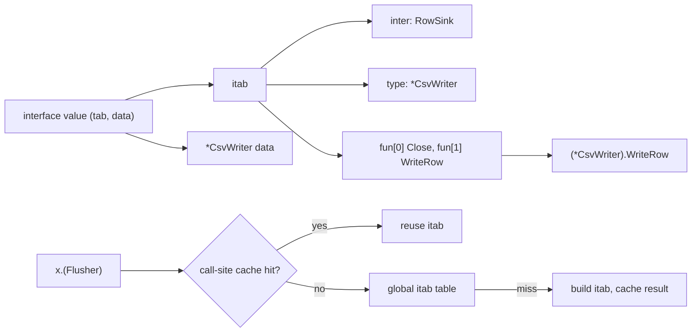

## In one minute
- An interface is a named set of operations a caller may use without knowing which concrete type answers. It separates "what I need" from "who provides it".
- Nominal typing (Java, C#) requires a type to declare what it implements. Structural typing (Go, TypeScript, Python protocols) accepts any type whose methods fit.
- An interface only covers signatures. The behaviour behind them (ordering, errors, side effects, thread safety) is part of the contract too, and only documentation and tests carry it.
- Interfaces cost something at runtime: an indirect call through a method table, lost inlining, and in Go often a heap allocation. Usually noise; in a hot loop, not.
- Agents add interfaces eagerly, one per class, "for testability". Ask who calls it and how many implementations exist. An interface with one implementation and one caller is usually just indirection.

## How it works

### The problem: code that names a concrete type
A billing service exports invoices. The first version writes straight to a CSV file:

```python
class InvoiceExporter:
    def __init__(self, path):
        self.out = CsvFile(path)

    def export(self, invoices):
        for inv in invoices:
            self.out.write_row([inv.id, inv.customer, inv.total_cents])
        self.out.close()
```

Then finance wants the export pushed to a data warehouse, and tests want it in memory. Each needs a change inside `InvoiceExporter`, because it names `CsvFile`. The exporter does not care about files; it needs something to hand rows to and then close.

### Name the need, not the provider
An interface states that need:

```go
type RowSink interface {
    WriteRow(cells []string) error
    Close() error
}

func ExportInvoices(invs []Invoice, out RowSink) error {
    for _, inv := range invs {
        if err := out.WriteRow(inv.Cells()); err != nil {
            return err
        }
    }
    return out.Close()
}
```

`ExportInvoices` now works with a CSV writer, a warehouse loader, a gzip wrapper or a slice in a test. The Dependency Inversion lesson covers why the exporter's package should own `RowSink`, and the Interface Segregation lesson covers how small it should be. This lesson is about the interface itself: what it promises, how languages check it, and what it costs.

### Nominal and structural
In Java a class must say `implements RowSink`. This is nominal typing: the relationship is declared by name. Intent is explicit and tools can find every implementation, but the interface must exist first, and a library type you do not own can only satisfy it through a wrapper.

Go, TypeScript and Python protocols are structural. A Go type satisfies `RowSink` if it has the two methods, whether or not its author ever heard of `RowSink`, which is why `*os.File`, `*bytes.Buffer` and `*gzip.Writer` all fit interfaces declared long after them. The cost is that nothing records intent: a renamed method silently stops satisfying the interface. Go's idiom is a compile-time assertion, `var _ RowSink = (*CsvWriter)(nil)`, which fails the build if the method set drifts. TypeScript is structural even for classes: `implements` checks the class, but any object literal of the right shape is equally acceptable.

### Signatures are not the whole contract
`Close() error` says nothing about whether calling it twice is safe, whether rows are durable when `WriteRow` returns, or whether two goroutines may write at once. Callers will rely on whatever the first implementation did. Write those rules in the doc comment and enforce them with one contract test suite, as the Liskov Substitution lesson describes. The signature is the part the compiler checks, and usually the smaller half of the promise.

### Optional capabilities
Sometimes an implementation can do more than the interface requires. `io.Copy` checks whether the source implements `io.WriterTo` or the destination `io.ReaderFrom`, and if so hands over the whole copy, which lets file-to-socket copies use `sendfile`. An HTTP handler checks whether its `ResponseWriter` is also an `http.Flusher` before streaming. The pattern: require a minimal interface, probe for richer ones at runtime, fall back otherwise.

The trap is wrappers. A logging wrapper that implements only the three required `ResponseWriter` methods hides `Flusher`, and streaming silently becomes buffering. A wrapper must expose the same optional capabilities as what it wraps, or provide `Unwrap` so callers can reach the original, which `http.ResponseController` (Go 1.20) uses. The practice task builds this.

### When not to add one
- **One implementation, one caller, no test need.** The interface doubles the files a reader opens and hides the real type behind "go to definition".
- **Data, not behaviour.** A struct of fields does not need an interface of getters.
- **Producer-side interfaces in Go.** Returning `Store` instead of `*PostgresStore` hides methods and forces an allocation. Return the concrete type; let consumers declare what they use.

### Reviewing agent-written code
Asked to "make this testable", agents generate an `IUserRepository` for every class, mirroring every public method, placed next to the implementation. Asked to "add metrics", they wrap a writer and lose its optional capabilities. Review three things: the interface lives with its consumer and lists only what it calls; a compile-time assertion or test proves each implementation fits; every wrapper forwards optional interfaces or exposes `Unwrap`.

### The same shape elsewhere
An interface is a contract between parties that change independently, like a wire protocol. The POSIX file API (`read`, `write`, `close` on disks, pipes and sockets) and HTTP share its failure modes: implicit behaviour callers rely on (Hyrum's law), optional extensions negotiated at runtime (`Accept-Encoding`), and proxies that strip them.

## Down the stack

### Layer 1: The contract
A caller holding an interface value is promised that every listed method exists. Go and Java check this at compile time for static conversions and at runtime for assertions and casts. TypeScript checks only at compile time. Python checks nothing until a lookup raises `AttributeError`, except that `abc.ABC` refuses to instantiate a class with unimplemented abstract methods. No language checks behaviour.

### Layer 2: The mechanism
**Go.** A non-empty interface value is two words, `(tab, data)`. `tab` points to an itab holding the interface type, the concrete type, a copy of the type's hash (for type switches) and an array of method pointers in the interface's sorted method order. The empty interface `any` stores the type descriptor directly instead. For a static conversion such as `var s RowSink = w`, the compiler emits the itab at build time. A dynamic assertion such as `x.(Flusher)` looks up `(interface, type)` in a global runtime hash table and, on a miss, builds the itab by merging the two sorted method lists, caching negative results too; recent releases put a small cache at each assertion site in front of that table. Because the type word is part of the value, an interface holding a nil `*MyErr` is not `nil`: the typed-nil bug.

**Java (HotSpot).** Each class has a vtable followed by an itable: a list of `(interface, offset)` pairs, then a block of method entries per interface. `invokeinterface` cannot use a fixed slot, because the same interface method sits at different positions in different classes, so the megamorphic stub scans the pairs to find the block. JIT-compiled code avoids the scan with inline caches: a monomorphic site compares the receiver's class and jumps directly, and class hierarchy analysis drops even that check when only one loaded class implements the interface.

**TypeScript.** `tsc` erases interfaces, so `x instanceof RowSink` does not compile and a runtime check must be a hand-written type guard (`typeof x.flush === "function"`). Dispatch is plain property lookup through hidden classes and the prototype chain.

**Python.** `ABCMeta` computes `__abstractmethods__` at class creation; `object.__new__` raises `TypeError` if it is non-empty. `isinstance(x, SomeABC)` consults a per-ABC cache, `register()` calls and `__subclasshook__` (how `collections.abc.Iterable` accepts any class with `__iter__`). `typing.Protocol` is for type checkers; `@runtime_checkable` makes `isinstance` work but only checks that attributes exist, not their signatures.

### Layer 3: The machine
A Go interface call loads `tab`, loads `tab.fun[i]`, and calls indirectly with `data` as the receiver: about 1 to 2 ns when the branch predictor knows the target. The bigger cost is lost inlining, which blocks bounds-check elimination and other loop optimisations. An interface needs a pointer, so a non-pointer struct stored in one usually escapes to the heap (20 to 50 ns plus GC work); zero-sized values and integers 0 to 255 avoid this by pointing into static data. `go build -gcflags=-m` shows the escapes, and profile-guided optimisation can devirtualise a hot site behind a type check. On the JVM a monomorphic inline cache costs one compare against the class pointer in the object header, and the itable scan is a short loop reached only from megamorphic sites. A Python method call costs tens of nanoseconds regardless; a `runtime_checkable` `isinstance` costs microseconds, so probe once, not per item.

### Why it's built this way
1. Callers and implementations change at different times, so they need a written meeting point.
2. A class implementing many interfaces puts each method at a different position, so dispatch needs a table per (type, interface) pair rather than one fixed slot.
3. Building every pair's table up front is wasteful, so Go builds itabs lazily and caches them, and the JVM caches the common case per call site.
4. Signatures are cheap to check mechanically and behaviour is not, so behaviour is left to documentation and tests.

## Diagram


## Worked example
A log shipper handles 2 million records per second per core and writes them to a `Sink` one call per record. The interface call itself costs about 2 ns, 0.4 percent of the core. The Kafka sink behind it takes a lock and updates batch bookkeeping on every call, about 180 ns, which is 36 percent of the core.

The team adds an optional `WriteBatch`. The shipper probes for it once at startup and hands over 500 records at a time, so the lock is taken once per batch and write cost falls to about 15 ns per record (3 percent of the core). The file sink, which lacks `WriteBatch`, keeps working unchanged.

Later a metrics wrapper is added around every sink, implementing only `Write`. Kafka throughput quietly drops back, because the wrapper hides `WriteBatch`, and nobody notices for two weeks until a capacity review compares CPU graphs. The fix is a wrapper that forwards each capability its inner sink has, plus a test asserting `Counting(kafkaSink)` still satisfies `Batcher`.

## Trade-offs
| Option | Strengths | Weaknesses | Choose when |
| --- | --- | --- | --- |
| Concrete type | Fast, inlinable, obvious to read | Callers change when the type changes | One implementation, no test seam needed |
| Nominal interface (`implements`) | Intent explicit, tooling finds implementations | Interface must exist first; foreign types need wrappers | Large Java or C# codebases, published SPIs |
| Structural interface | Defined at the consumer; foreign types fit | Accidental satisfaction; silent drift | Go, TypeScript, Python protocols; small role interfaces |
| Optional capability probe | Fast paths without widening the required interface | Wrappers hide capabilities; runtime checks | Stable minimal interface with known optimisations |

## Pitfalls in production
- Returning a typed nil pointer as an `error`, so `err != nil` is true and callers log an empty error. Fix: return a literal `nil` on success.
- Middleware that hides optional interfaces, turning streaming into buffering. Fix: forward each capability or implement `Unwrap`, and test it.
- Implementations that drift after a method rename in structural languages. Fix: `var _ I = (*T)(nil)` in Go, `implements` in TypeScript.
- Callers relying on unwritten behaviour, such as `Close` being idempotent in one implementation only. Fix: document it and enforce it with a shared contract test.
- Interface values in hot Go loops forcing heap allocations. Fix: concrete types or generics in the hot path; check with `-gcflags=-m`.

## Leadership lens
- Treat a widely implemented interface as a public API: a new required method breaks every implementation, so add an optional interface first.
- In design review, ask for each new interface: who calls it, how many implementations exist or are planned, and where the behavioural contract is written down.
- Put "wrappers forward optional capabilities" on the middleware review checklist; it prevents regressions nobody files tickets for.
- Budget for contract tests; they keep implementations by different teams or agents behaving alike.

## Check yourself
1. Why can a library type you did not write satisfy your Go interface but not your Java interface?
   **Answer:** Go checks method sets structurally, so any type with matching methods fits. Java requires the class to declare `implements`, which you cannot add to a class you do not own, so you need an adapter.
2. A Go function returns `error`, and on success returns a variable of type `*ValidationError` that is nil. Why does `err != nil` evaluate true?
   **Answer:** The interface value holds a non-nil type word (`*ValidationError`) and a nil data word. An interface is nil only when both words are nil.
3. Why does a JVM call site that sees one implementation run almost as fast as a direct call, while one that sees five does not?
   **Answer:** A monomorphic site uses an inline cache: one class compare, then a direct, often inlined, call. A megamorphic site falls back to the itable stub, which scans the interface list and calls indirectly.
4. A wrapper around an HTTP response writer breaks server-sent events. What is the likely cause?
   **Answer:** The wrapper implements only the required methods, so the handler's check for `http.Flusher` fails and output is buffered. Forward `Flush` or implement `Unwrap`.

## Practice
**Task:** Deliver records using a sink's optional capabilities, and write a counting wrapper that does not hide them. Every sink has `write(record)`. A sink may also have `write_batch(records)` and may have `flush()`. `deliver(sink, records, batch_size)` fails with `bad batch size: <n>` if `batch_size < 1`. If the sink can batch, it calls `write_batch` with consecutive chunks of at most `batch_size` records; otherwise it calls `write` once per record. Afterwards, if the sink can flush, it calls `flush` exactly once (even when there were no records). It returns `calls` (the number of `write` or `write_batch` calls) and `flushed`. Any error from the sink stops delivery immediately, propagates unchanged, and skips the flush. `counting(sink)` returns a wrapper with `count()` (records successfully written through it) that has `write_batch` only if the inner sink does and `flush` only if the inner sink does. Python raises `ValueError`, TypeScript throws `Error`, Go returns an error; Python and TypeScript return `{"calls": n, "flushed": b}`, Go returns `Stats{Calls, Flushed}`.

```python starter
def can(obj, name):
    return callable(getattr(obj, name, None))

def deliver(sink, records, batch_size):
    # TODO: validate, batch or write one by one, then flush if supported
    raise NotImplementedError

def counting(sink):
    # TODO: return a wrapper with count() that keeps the inner sink's capabilities
    raise NotImplementedError
```

```python tests
class Plain:
    def __init__(self):
        self.got = []
    def write(self, r):
        self.got.append(r)

class Batching(Plain):
    def __init__(self):
        super().__init__()
        self.batches = []
    def write_batch(self, rs):
        self.batches.append(list(rs))
        self.got.extend(rs)

class Flushing(Plain):
    def __init__(self):
        super().__init__()
        self.flushes = 0
    def flush(self):
        self.flushes += 1

class Full(Batching):
    def __init__(self):
        super().__init__()
        self.flushes = 0
    def flush(self):
        self.flushes += 1

class DiskFull(Exception):
    pass

class FailsOnSecondBatch(Full):
    def write_batch(self, rs):
        if len(self.batches) == 1:
            raise DiskFull("disk full")
        super().write_batch(rs)

def test_plain_sink_gets_one_call_per_record():
    s = Plain()
    assert deliver(s, ["a", "b", "c"], 2) == {"calls": 3, "flushed": False}
    assert s.got == ["a", "b", "c"]

def test_batching_sink_gets_chunks():
    s = Batching()
    assert deliver(s, ["a", "b", "c", "d", "e"], 2) == {"calls": 3, "flushed": False}
    assert s.batches == [["a", "b"], ["c", "d"], ["e"]]

def test_flush_once_even_without_records():
    s = Flushing()
    assert deliver(s, [], 10) == {"calls": 0, "flushed": True}
    assert s.flushes == 1
    f = Full()
    assert deliver(f, ["x"], 5) == {"calls": 1, "flushed": True}
    assert f.batches == [["x"]] and f.flushes == 1

def test_bad_batch_size():
    try:
        deliver(Plain(), ["a"], 0)
        assert False, "expected ValueError"
    except ValueError as e:
        assert str(e) == "bad batch size: 0"

def test_error_stops_delivery_and_skips_flush():
    s = FailsOnSecondBatch()
    try:
        deliver(s, ["a", "b", "c"], 1)
        assert False, "expected DiskFull"
    except DiskFull as e:
        assert str(e) == "disk full"
    assert s.batches == [["a"]] and s.flushes == 0

def test_counting_keeps_exactly_the_inner_capabilities():
    p = counting(Plain())
    assert not hasattr(p, "write_batch") and not hasattr(p, "flush")
    f = counting(Flushing())
    assert can(f, "flush") and not hasattr(f, "write_batch")
    b = counting(Batching())
    assert can(b, "write_batch") and not hasattr(b, "flush")
    full = counting(Full())
    assert can(full, "write_batch") and can(full, "flush")

def test_counting_through_deliver_uses_fast_path():
    inner = Full()
    c = counting(inner)
    assert deliver(c, ["a", "b", "c"], 2) == {"calls": 2, "flushed": True}
    assert c.count() == 3 and inner.batches == [["a", "b"], ["c"]] and inner.flushes == 1
    p = counting(Plain())
    deliver(p, ["x", "y"], 1)
    assert p.count() == 2

def test_counting_ignores_failed_writes():
    c = counting(FailsOnSecondBatch())
    try:
        deliver(c, ["a", "b", "c"], 2)
    except DiskFull:
        pass
    assert c.count() == 2
```

```python solution
def can(obj, name):
    return callable(getattr(obj, name, None))

def deliver(sink, records, batch_size):
    if batch_size < 1:
        raise ValueError("bad batch size: " + str(batch_size))
    calls = 0
    if can(sink, "write_batch"):
        for i in range(0, len(records), batch_size):
            sink.write_batch(list(records[i:i + batch_size]))
            calls += 1
    else:
        for r in records:
            sink.write(r)
            calls += 1
    flushed = False
    if can(sink, "flush"):
        sink.flush()
        flushed = True
    return {"calls": calls, "flushed": flushed}

class _Counting:
    def __init__(self, inner):
        self._inner = inner
        self._n = 0

    def write(self, record):
        self._inner.write(record)
        self._n += 1

    def count(self):
        return self._n

class _BatchPart:
    def write_batch(self, records):
        self._inner.write_batch(records)
        self._n += len(records)

class _FlushPart:
    def flush(self):
        self._inner.flush()

def counting(sink):
    parts = []
    if can(sink, "write_batch"):
        parts.append(_BatchPart)
    if can(sink, "flush"):
        parts.append(_FlushPart)
    cls = type("CountingSink", tuple(parts) + (_Counting,), {})
    return cls(sink)
```

```typescript starter
export interface Sink { write(record: string): void; }
export interface BatchSink extends Sink { writeBatch(records: string[]): void; }
export interface Flusher { flush(): void; }
export interface CountingSink extends Sink { count(): number; }
export interface Stats { calls: number; flushed: boolean; }

export function deliver(sink: Sink, records: string[], batchSize: number): Stats {
  throw new Error("TODO");
}

export function counting(inner: Sink): CountingSink {
  throw new Error("TODO");
}
```

```typescript tests
class Plain implements Sink {
  got: string[] = [];
  write(r: string): void { this.got.push(r); }
}

class Batching extends Plain implements BatchSink {
  batches: string[][] = [];
  writeBatch(rs: string[]): void { this.batches.push([...rs]); this.got.push(...rs); }
}

class Flushing extends Plain implements Flusher {
  flushes = 0;
  flush(): void { this.flushes++; }
}

class Full extends Batching implements Flusher {
  flushes = 0;
  flush(): void { this.flushes++; }
}

class FailsOnSecondBatch extends Full {
  writeBatch(rs: string[]): void {
    if (this.batches.length === 1) throw new Error("disk full");
    super.writeBatch(rs);
  }
}

function hasFn(o: object, name: string): boolean {
  return typeof (o as Record<string, unknown>)[name] === "function";
}

test("plain sink gets one call per record", () => {
  const s = new Plain();
  assertEqual(deliver(s, ["a", "b", "c"], 2), { calls: 3, flushed: false });
  assertEqual(s.got, ["a", "b", "c"]);
});

test("batching sink gets chunks", () => {
  const s = new Batching();
  assertEqual(deliver(s, ["a", "b", "c", "d", "e"], 2), { calls: 3, flushed: false });
  assertEqual(s.batches, [["a", "b"], ["c", "d"], ["e"]]);
});

test("flush once even without records", () => {
  const s = new Flushing();
  assertEqual(deliver(s, [], 10), { calls: 0, flushed: true });
  assertEqual(s.flushes, 1);
  const f = new Full();
  assertEqual(deliver(f, ["x"], 5), { calls: 1, flushed: true });
  assertEqual(f.batches, [["x"]]);
  assertEqual(f.flushes, 1);
});

test("bad batch size", () => {
  let msg = "";
  try { deliver(new Plain(), ["a"], 0); } catch (e) { msg = (e as Error).message; }
  assertEqual(msg, "bad batch size: 0");
});

test("error stops delivery and skips flush", () => {
  const s = new FailsOnSecondBatch();
  let msg = "";
  try { deliver(s, ["a", "b", "c"], 1); } catch (e) { msg = (e as Error).message; }
  assertEqual(msg, "disk full");
  assertEqual(s.batches, [["a"]]);
  assertEqual(s.flushes, 0);
});

test("counting keeps exactly the inner capabilities", () => {
  const p = counting(new Plain());
  assert(!hasFn(p, "writeBatch") && !hasFn(p, "flush"), "plain stays plain");
  const f = counting(new Flushing());
  assert(hasFn(f, "flush") && !hasFn(f, "writeBatch"), "flush only");
  const b = counting(new Batching());
  assert(hasFn(b, "writeBatch") && !hasFn(b, "flush"), "batch only");
  const full = counting(new Full());
  assert(hasFn(full, "writeBatch") && hasFn(full, "flush"), "both");
});

test("counting through deliver uses fast path", () => {
  const inner = new Full();
  const c = counting(inner);
  assertEqual(deliver(c, ["a", "b", "c"], 2), { calls: 2, flushed: true });
  assertEqual(c.count(), 3);
  assertEqual(inner.batches, [["a", "b"], ["c"]]);
  assertEqual(inner.flushes, 1);
  const p = counting(new Plain());
  deliver(p, ["x", "y"], 1);
  assertEqual(p.count(), 2);
});

test("counting ignores failed writes", () => {
  const c = counting(new FailsOnSecondBatch());
  try { deliver(c, ["a", "b", "c"], 2); } catch (e) { /* expected */ }
  assertEqual(c.count(), 2);
});
```

```typescript solution
export interface Sink { write(record: string): void; }
export interface BatchSink extends Sink { writeBatch(records: string[]): void; }
export interface Flusher { flush(): void; }
export interface CountingSink extends Sink { count(): number; }
export interface Stats { calls: number; flushed: boolean; }

function canBatch(s: object): s is BatchSink {
  return typeof (s as Partial<BatchSink>).writeBatch === "function";
}

function canFlush(s: object): s is Flusher {
  return typeof (s as Partial<Flusher>).flush === "function";
}

export function deliver(sink: Sink, records: string[], batchSize: number): Stats {
  if (batchSize < 1) throw new Error("bad batch size: " + batchSize);
  let calls = 0;
  if (canBatch(sink)) {
    for (let i = 0; i < records.length; i += batchSize) {
      sink.writeBatch(records.slice(i, i + batchSize));
      calls++;
    }
  } else {
    for (const r of records) {
      sink.write(r);
      calls++;
    }
  }
  let flushed = false;
  if (canFlush(sink)) {
    sink.flush();
    flushed = true;
  }
  return { calls, flushed };
}

export function counting(inner: Sink): CountingSink {
  let n = 0;
  const w: CountingSink & Partial<BatchSink> & Partial<Flusher> = {
    write(record: string): void { inner.write(record); n++; },
    count(): number { return n; },
  };
  if (canBatch(inner)) {
    w.writeBatch = (records: string[]) => { inner.writeBatch(records); n += records.length; };
  }
  if (canFlush(inner)) {
    w.flush = () => inner.flush();
  }
  return w;
}
```

```go starter
package practice

type Sink interface {
	Write(record string) error
}

type Batcher interface {
	WriteBatch(records []string) error
}

type Flusher interface {
	Flush() error
}

type CountingSink interface {
	Sink
	Count() int
}

type Stats struct {
	Calls   int
	Flushed bool
}

func Deliver(s Sink, records []string, batchSize int) (Stats, error) {
	panic("TODO")
}

func Counting(s Sink) CountingSink {
	panic("TODO")
}
```

```go tests
package practice

import (
	"errors"
	"reflect"
	"testing"
)

type plainSink struct{ got []string }

func (p *plainSink) Write(r string) error { p.got = append(p.got, r); return nil }

type batchSink struct {
	plainSink
	batches [][]string
	failAt  int
}

func (b *batchSink) WriteBatch(rs []string) error {
	if b.failAt > 0 && len(b.batches) == b.failAt {
		return errDiskFull
	}
	b.batches = append(b.batches, append([]string(nil), rs...))
	b.got = append(b.got, rs...)
	return nil
}

type flushSink struct {
	plainSink
	flushes int
}

func (f *flushSink) Flush() error { f.flushes++; return nil }

type fullSink struct {
	batchSink
	flushes int
}

func (f *fullSink) Flush() error { f.flushes++; return nil }

var errDiskFull = errors.New("disk full")

func TestPlainSinkGetsOneCallPerRecord(t *testing.T) {
	s := &plainSink{}
	st, err := Deliver(s, []string{"a", "b", "c"}, 2)
	if err != nil || st != (Stats{Calls: 3}) || !reflect.DeepEqual(s.got, []string{"a", "b", "c"}) {
		t.Fatalf("got %+v %v %v", st, err, s.got)
	}
}

func TestBatchingSinkGetsChunks(t *testing.T) {
	s := &batchSink{}
	st, err := Deliver(s, []string{"a", "b", "c", "d", "e"}, 2)
	want := [][]string{{"a", "b"}, {"c", "d"}, {"e"}}
	if err != nil || st != (Stats{Calls: 3}) || !reflect.DeepEqual(s.batches, want) {
		t.Fatalf("got %+v %v %v", st, err, s.batches)
	}
}

func TestFlushOnceEvenWithoutRecords(t *testing.T) {
	s := &flushSink{}
	st, err := Deliver(s, nil, 10)
	if err != nil || st != (Stats{Calls: 0, Flushed: true}) || s.flushes != 1 {
		t.Fatalf("got %+v %v flushes=%d", st, err, s.flushes)
	}
	f := &fullSink{}
	st, err = Deliver(f, []string{"x"}, 5)
	if err != nil || st != (Stats{Calls: 1, Flushed: true}) || f.flushes != 1 || len(f.batches) != 1 {
		t.Fatalf("got %+v %v", st, err)
	}
}

func TestBadBatchSize(t *testing.T) {
	_, err := Deliver(&plainSink{}, []string{"a"}, 0)
	if err == nil || err.Error() != "bad batch size: 0" {
		t.Fatalf("got %v", err)
	}
}

func TestErrorStopsDeliveryAndSkipsFlush(t *testing.T) {
	s := &fullSink{batchSink: batchSink{failAt: 1}}
	_, err := Deliver(s, []string{"a", "b", "c"}, 1)
	if !errors.Is(err, errDiskFull) {
		t.Fatalf("want disk full, got %v", err)
	}
	if len(s.batches) != 1 || s.flushes != 0 {
		t.Fatalf("batches=%v flushes=%d", s.batches, s.flushes)
	}
}

func caps(s Sink) (bool, bool) {
	_, b := s.(Batcher)
	_, f := s.(Flusher)
	return b, f
}

func TestCountingKeepsExactlyTheInnerCapabilities(t *testing.T) {
	cases := []struct {
		inner Sink
		batch bool
		flush bool
	}{
		{&plainSink{}, false, false},
		{&flushSink{}, false, true},
		{&batchSink{}, true, false},
		{&fullSink{}, true, true},
	}
	for i, c := range cases {
		b, f := caps(Counting(c.inner))
		if b != c.batch || f != c.flush {
			t.Errorf("case %d: batch=%v flush=%v", i, b, f)
		}
	}
}

func TestCountingThroughDeliverUsesFastPath(t *testing.T) {
	inner := &fullSink{}
	c := Counting(inner)
	st, err := Deliver(c, []string{"a", "b", "c"}, 2)
	if err != nil || st != (Stats{Calls: 2, Flushed: true}) || c.Count() != 3 || inner.flushes != 1 {
		t.Fatalf("got %+v %v count=%d", st, err, c.Count())
	}
	p := Counting(&plainSink{})
	Deliver(p, []string{"x", "y"}, 1)
	if p.Count() != 2 {
		t.Fatalf("plain count %d", p.Count())
	}
}

func TestCountingIgnoresFailedWrites(t *testing.T) {
	c := Counting(&fullSink{batchSink: batchSink{failAt: 1}})
	if _, err := Deliver(c, []string{"a", "b", "c"}, 2); !errors.Is(err, errDiskFull) {
		t.Fatalf("got %v", err)
	}
	if c.Count() != 2 {
		t.Fatalf("count %d", c.Count())
	}
}
```

```go solution
package practice

import "fmt"

type Sink interface {
	Write(record string) error
}

type Batcher interface {
	WriteBatch(records []string) error
}

type Flusher interface {
	Flush() error
}

type CountingSink interface {
	Sink
	Count() int
}

type Stats struct {
	Calls   int
	Flushed bool
}

func Deliver(s Sink, records []string, batchSize int) (Stats, error) {
	var st Stats
	if batchSize < 1 {
		return st, fmt.Errorf("bad batch size: %d", batchSize)
	}
	if b, ok := s.(Batcher); ok {
		for i := 0; i < len(records); i += batchSize {
			end := min(i+batchSize, len(records))
			if err := b.WriteBatch(records[i:end]); err != nil {
				return st, err
			}
			st.Calls++
		}
	} else {
		for _, r := range records {
			if err := s.Write(r); err != nil {
				return st, err
			}
			st.Calls++
		}
	}
	if f, ok := s.(Flusher); ok {
		if err := f.Flush(); err != nil {
			return st, err
		}
		st.Flushed = true
	}
	return st, nil
}

type counter struct {
	inner Sink
	n     int
}

func (c *counter) Write(r string) error {
	if err := c.inner.Write(r); err != nil {
		return err
	}
	c.n++
	return nil
}

func (c *counter) Count() int { return c.n }

func (c *counter) writeBatch(rs []string) error {
	if err := c.inner.(Batcher).WriteBatch(rs); err != nil {
		return err
	}
	c.n += len(rs)
	return nil
}

func (c *counter) flush() error { return c.inner.(Flusher).Flush() }

// One wrapper type per capability combination, so type assertions see
// exactly the methods the inner sink has.
type batchCounter struct{ *counter }

func (b batchCounter) WriteBatch(rs []string) error { return b.writeBatch(rs) }

type flushCounter struct{ *counter }

func (f flushCounter) Flush() error { return f.flush() }

type batchFlushCounter struct{ *counter }

func (b batchFlushCounter) WriteBatch(rs []string) error { return b.writeBatch(rs) }
func (b batchFlushCounter) Flush() error                 { return b.flush() }

func Counting(s Sink) CountingSink {
	c := &counter{inner: s}
	_, canBatch := s.(Batcher)
	_, canFlush := s.(Flusher)
	switch {
	case canBatch && canFlush:
		return batchFlushCounter{c}
	case canBatch:
		return batchCounter{c}
	case canFlush:
		return flushCounter{c}
	}
	return c
}
```

## Mock interview
**Prompt:** Twelve services at a media platform call an S3 SDK directly for blobs. The platform wants an on-premises object store for one region and an in-memory store for tests; only some backends support server-side copy and multipart upload. Design the interface the services program against.

- Follow-up: A team wraps the store with a tracing decorator and uploads of 5 GB files start failing. What happened, and how do you prevent it?
- Follow-up: Six months later you need to add a required `Stat(key)` method. How do you roll that out across twelve services and three backends?

**A strong answer covers:**
- A minimal required interface (`Get`, `Put`, `Delete`, `List`) with documented behaviour: overwrite semantics, list order, missing-key errors.
- Optional capabilities (`Copier`, `MultipartUploader`) probed at runtime with a fallback path, so backends without them still work.
- Wrappers that forward every capability or expose `Unwrap`: the tracing decorator hid multipart upload, so 5 GB files fell back to a single `Put` over the size limit.
- Evolving by adding an optional interface first, migrating backends, then making it required.
- One shared contract test suite run against S3 (in an integration job), the on-premises store and the in-memory store.

## Watch
- [Go Proverbs (Rob Pike, Gopherfest 2015)](https://www.youtube.com/watch?v=PAAkCSZUG1c): "the bigger the interface, the weaker the abstraction" and other short rules for interface design.
- [Understanding nil (Francesc Campoy, GopherCon 2016)](https://www.youtube.com/watch?v=ynoY2xz-F8s): how interface values are laid out and why a typed nil is not nil.

## Free resources
- [Go Data Structures: Interfaces (Russ Cox)](https://research.swtch.com/interfaces): the original explanation of itabs, method tables and how Go builds them lazily.
- [Why is my nil error value not equal to nil? (Go FAQ)](https://go.dev/doc/faq#nil_error): the typed-nil trap stated precisely.
- [InterfaceCalls (OpenJDK HotSpot wiki)](https://wiki.openjdk.org/display/HotSpot/InterfaceCalls): how HotSpot dispatches `invokeinterface` through itables and inline caches.
- [PEP 544: Protocols (Python)](https://peps.python.org/pep-0544/): structural subtyping for Python and what `runtime_checkable` does and does not check.
- [net/http ResponseController (Go docs)](https://pkg.go.dev/net/http#ResponseController): how the standard library reaches optional capabilities through wrappers with `Unwrap`.
