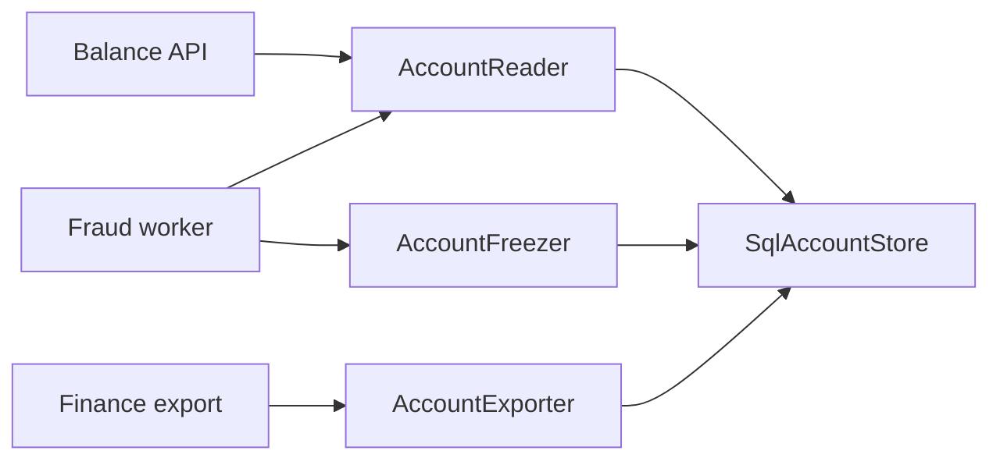

## In one minute
- No client should be forced to depend on methods it does not use. Give each kind of caller a small interface that describes only what it needs.
- A fat interface couples unrelated callers: a change made for one of them forces the others to recompile, retest, update their fakes and redeploy.
- The fix is usually role interfaces: `Reader`, `Writer`, `Lister` instead of one `StorageService` with twenty methods. One concrete class can still implement all of them.
- Overdo it and you get interface explosion: one-method interfaces nobody reuses, names that hide the real type, and readers hopping through five files to find the code.
- In review, agent-written code tends to produce both failure modes: a single "service" interface that grows with every task, or a fresh interface for every class "for testability". Ask who the callers are.

## How it works

### The problem: one interface, many unrelated clients
Picture a payments backend with this interface, written early and extended for two years:

```python
class AccountStore(Protocol):
    def get(self, account_id: str) -> Account: ...
    def save(self, account: Account) -> None: ...
    def list_by_owner(self, owner_id: str) -> list[Account]: ...
    def freeze(self, account_id: str, reason: str) -> None: ...
    def export_csv(self, since: datetime) -> bytes: ...
    def reindex_search(self) -> None: ...
    def audit_trail(self, account_id: str) -> list[AuditEvent]: ...
```

Four parts of the system use it. The balance API calls `get`. The fraud worker calls `get` and `freeze`. The finance export job calls `export_csv`. An admin tool calls `audit_trail` and `reindex_search`. Every one of them takes an `AccountStore`.

Now the finance team needs `export_csv` to stream rows instead of returning bytes. The balance API never touched exports, but its test fake no longer satisfies the interface, and neither does the fraud worker's. A one-line change for one team becomes a pull request touching five test files owned by three teams, and every service rebuilds. That is the cost the principle names: callers coupled to each other through methods they never call.

### The fix: role interfaces
Split the interface by what callers need, not by what the implementation can do:

```python
class AccountReader(Protocol):
    def get(self, account_id: str) -> Account: ...

class AccountFreezer(Protocol):
    def freeze(self, account_id: str, reason: str) -> None: ...

class AccountExporter(Protocol):
    def export_rows(self, since: datetime) -> Iterator[Row]: ...

def handle_balance(reader: AccountReader, account_id: str) -> int: ...
def review_txn(reader: AccountReader, freezer: AccountFreezer, txn: Txn) -> None: ...
```

The Postgres-backed `SqlAccountStore` still implements all of these; the database code is unchanged. What changed is that each function states its real needs in its signature. The fraud worker's fake is ten lines. The export change touches only the export job and the store. The signature also documents risk: a function that takes an `AccountReader` cannot freeze an account, which is least privilege enforced by the type checker.

### Who owns the interface
A useful rule from Go applies everywhere: define the interface where it is consumed, not where it is implemented. The fraud package declares "I need something that can get and freeze accounts"; the storage package exports a concrete type. Each consumer writes down only what it calls, so interfaces stay small by construction. When the producer defines the interface, it lists everything it can do, and you are back to the fat interface.

### Splitting too far
The principle has a failure mode that shows up just as often. A codebase with `AccountGetter`, `AccountGetterByOwner`, `AccountSaver`, `AccountSaverWithAudit` and forty more single-method interfaces, each used by one function, has traded coupling for indirection. Readers cannot tell which concrete type is behind a parameter. Renames ripple through dozens of declarations. Mocks multiply.

Signs you have gone too far:
- An interface has exactly one implementation and one caller, and neither is a test boundary.
- Two interfaces are always requested together. Merge them; they form one role.
- The interface mirrors a single class method for method, with no consumer that uses a subset.

A good middle ground is to split along real seams: read versus write, user-facing versus administrative, hot path versus batch. Those boundaries tend to match teams and deploy units, which is where coupling hurts.

### The same shape elsewhere
The problem shape is fan-out of change: one edit reaches many dependents. GraphQL and sparse fieldsets are interface segregation for APIs. Scoped OAuth tokens are role interfaces for permissions. An AI agent given `run_shell` when it only needed `read_file` has a fat interface too, and the risk is larger than a recompile.

## Down the stack

### Layer 1: The contract
An interface promises a set of method signatures and their behaviour. A client that names an interface is promised it can call those methods on any value it receives, and it is exposed to every change in that set. The testable claim of the principle: the number of clients that must change when one method changes should equal the number of clients that call that method.

### Layer 2: The mechanism
Each language checks the contract differently, which affects how cheap small interfaces are. Go uses structural typing at compile time: any type with the right method set satisfies an interface without declaring it, so splitting an interface costs nothing on the implementation side. An interface value is two words: a pointer to an `itab` (holding the interface type, the concrete type, and an array of function pointers) and a pointer to the data. The runtime builds an `itab` the first time a concrete type is converted to an interface type and caches it in a global hash table, so a narrower interface means a smaller function array, not more work per call.

TypeScript checks shapes at compile time and erases them; at runtime there is only a JavaScript object, and V8 finds methods through the object's hidden class (its "shape") and the prototype chain, with inline caches at each call site. Python's `typing.Protocol` is checked only by tools such as mypy; at runtime, a method call is an attribute lookup through the type's method resolution order, sped up by a per-type cache. Java is nominal (`implements`), and the JIT turns `invokeinterface` calls into inline caches once a call site has seen one or two types.

### Layer 3: The machine
A call through an interface is an indirect call: load the function pointer, jump to it. With a warm branch target predictor it costs about 1 to 3 ns. The real costs are elsewhere. The compiler usually cannot inline through an interface, which blocks follow-on optimisations in hot loops. In Go, storing a non-pointer value in an interface often forces a heap allocation (about 20 to 50 ns plus later garbage collection work), which escape analysis reports with `go build -gcflags=-m`. In V8, a call site that sees more than four object shapes goes megamorphic and falls back to a slower generic lookup. None of this depends on interface size; a fat interface and a thin one dispatch at the same speed. What costs is the number of distinct types flowing through a hot call site.

### Why it's built this way
1. Code is changed more often than it is written.
2. A change to a type reaches everything that names the type, whether or not it uses the changed part.
3. In the 1990s, when Robert Martin described the principle, that meant hours of C++ recompilation; today it means CI time, fake updates and cross-team reviews.
4. Narrow interfaces shrink the set of things each client names, so each change reaches fewer clients.
5. Modern structural typing makes narrow interfaces nearly free to declare, so the remaining cost is cognitive, which is why over-splitting is the failure to watch for now.

## Diagram


## Worked example
A Go service has a `Storage` interface with 14 methods used by 9 packages. Over a quarter, the team records 31 changes to that interface. For each change they count the packages that had to be edited (usually just to update a fake) versus the packages that call the changed method. The average change touched 7.2 packages but only 1.6 actually called the changed method. The difference, about 5.6 packages per change, is pure segregation cost; at roughly 15 minutes of editing and review each, that is about 43 engineer-hours a quarter.

They split `Storage` into four consumer-owned interfaces: `BlobReader` (2 methods), `BlobWriter` (3), `BlobLister` (2) and `Admin` (7, used only by the admin CLI). The concrete `s3Store` is untouched. In the next quarter, changes touched an average of 1.9 packages. Test fakes shrank from about 200 lines to between 10 and 40 each.

They also tried, and reverted, one interface per method. Call sites then asked for three or four interfaces at a time, each constructor took four parameters that were the same object, and the team merged them back into the four roles that matched the four kinds of callers.

## Trade-offs
| Option | Strengths | Weaknesses | Choose when |
| --- | --- | --- | --- |
| One broad interface | Easy to find, one fake | Couples all callers, large fakes | Few callers that all use most methods |
| Role interfaces per kind of caller | Changes stay local, small fakes, clear privilege | More names to learn | Several callers with distinct needs |
| One interface per method | Maximum decoupling | Interface explosion, constructors take many params | Rarely; a genuine single-method role like `io.Reader` |
| No interface, concrete type | Simplest, easy to navigate | Hard to fake, couples to implementation | One implementation, no test seam needed |

## Pitfalls in production
- The "god interface" that every new feature extends. Fix: when adding a method, check which callers need it; if it is only one, put it in a separate role.
- Mocks that implement 20 methods with `panic("not implemented")`. Fix: these are a signal the consumer depends on too much; narrow the parameter type.
- Over-split interfaces that are always passed together. Fix: merge into the role they really represent, or embed them (`ReadWriter`).
- A narrow interface that hides a capability check, such as a reader that can also write through a type assertion. Fix: do not downcast an interface to recover the wide type; that reintroduces the coupling invisibly.

## Leadership lens
- In design review, ask for the list of callers and the methods each one calls. If that table is a dense block, one interface is fine; if it is sparse, split along the clusters.
- Agent-written code needs this question asked explicitly. Agents tend to extend the nearest existing interface to finish a task, and they also produce speculative one-implementation interfaces. Both pass tests; neither shows up as a bug. Make "who consumes this interface?" a standard review comment.
- Treat interface size as an ownership question: a broad interface shared by several teams is a coordination tax on every change. Splitting it is often cheaper than the meetings it causes.
- Apply the same reasoning to tool and permission scopes for agents: the narrowest capability set that does the job.

## Check yourself
1. A test fake for `AccountStore` breaks when a method the code under test never calls changes signature. Which principle is being violated, and what is the fix?
   **Answer:** Interface segregation: the code under test depends on a wider interface than it uses. Change its parameter type to a role interface containing only the methods it calls.
2. Why does it make sense for Go code to define interfaces in the consuming package?
   **Answer:** Because Go satisfies interfaces structurally, the consumer can declare only the methods it calls and the producer needs no changes, which keeps each interface as small as its real use.
3. Does splitting a 12-method interface into three 4-method interfaces make calls faster?
   **Answer:** No. Dispatch cost is an indirect call either way; the benefit is in change propagation, test fakes and readability, not runtime speed.
4. Name two signs that interfaces have been split too far.
   **Answer:** Interfaces with one implementation and one caller that is not a test seam, and pairs of interfaces that are always requested together.

## Practice
**Task:** Build a tiny key-value blob store and two helper functions that depend only on the roles they use. The three roles are a reader with `get(key)` returning the value or nothing, a writer with `put(key, value)`, and a lister with `list(prefix)` returning matching keys in sorted order. Implement `MemoryStore`, which plays all three roles. Implement `PrefixedWriter(dst, prefix)`, a writer that stores every key under `prefix + key` in `dst`. Implement `copy_prefix(src, dst, prefix)`, which copies every key starting with `prefix` from a source that can list and read into any writer, and returns the number of keys copied. Implement `total_size(reader, keys)`, which returns the summed length of the values for the given keys, skipping missing ones. The tests pass fakes that implement only one role, so your helpers must not call anything else.

```python starter
class MemoryStore:
    def __init__(self):
        self.data = {}

    def get(self, key):
        # TODO: return the value or None
        raise NotImplementedError

    def put(self, key, value):
        # TODO
        raise NotImplementedError

    def list(self, prefix):
        # TODO: sorted keys that start with prefix
        raise NotImplementedError


class PrefixedWriter:
    def __init__(self, dst, prefix):
        self.dst = dst
        self.prefix = prefix

    def put(self, key, value):
        # TODO
        raise NotImplementedError


def copy_prefix(src, dst, prefix):
    # TODO: src lists and reads, dst only writes
    raise NotImplementedError


def total_size(reader, keys):
    # TODO: reader only reads
    raise NotImplementedError
```

```python tests
class OnlyReader:
    def __init__(self, data):
        self.data = data
        self.calls = 0

    def get(self, key):
        self.calls += 1
        return self.data.get(key)


class OnlyWriter:
    def __init__(self):
        self.puts = []

    def put(self, key, value):
        self.puts.append((key, value))


def test_memory_store_roundtrip():
    s = MemoryStore()
    s.put("a", "1")
    assert s.get("a") == "1"
    assert s.get("missing") is None


def test_list_is_sorted_and_filtered():
    s = MemoryStore()
    for k in ["img/b", "doc/x", "img/a", "img"]:
        s.put(k, "v")
    assert s.list("img/") == ["img/a", "img/b"]
    assert s.list("") == ["doc/x", "img", "img/a", "img/b"]


def test_copy_into_write_only_fake():
    s = MemoryStore()
    s.put("logs/1", "aa")
    s.put("logs/2", "bbb")
    s.put("tmp/1", "c")
    w = OnlyWriter()
    assert copy_prefix(s, w, "logs/") == 2
    assert w.puts == [("logs/1", "aa"), ("logs/2", "bbb")]


def test_copy_empty_prefix_match():
    s = MemoryStore()
    s.put("a", "1")
    w = OnlyWriter()
    assert copy_prefix(s, w, "zzz") == 0
    assert w.puts == []


def test_prefixed_writer_as_backup_target():
    src = MemoryStore()
    src.put("cfg/db", "pg")
    src.put("cfg/cache", "redis")
    backup = MemoryStore()
    assert copy_prefix(src, PrefixedWriter(backup, "backup/"), "cfg/") == 2
    assert backup.list("backup/") == ["backup/cfg/cache", "backup/cfg/db"]
    assert backup.get("backup/cfg/db") == "pg"


def test_total_size_with_read_only_fake():
    r = OnlyReader({"a": "xx", "b": "yyy"})
    assert total_size(r, ["a", "b", "nope"]) == 5
    assert r.calls == 3
    assert total_size(r, []) == 0
```

```python solution
class MemoryStore:
    def __init__(self):
        self.data = {}

    def get(self, key):
        return self.data.get(key)

    def put(self, key, value):
        self.data[key] = value

    def list(self, prefix):
        return sorted(k for k in self.data if k.startswith(prefix))


class PrefixedWriter:
    def __init__(self, dst, prefix):
        self.dst = dst
        self.prefix = prefix

    def put(self, key, value):
        self.dst.put(self.prefix + key, value)


def copy_prefix(src, dst, prefix):
    n = 0
    for key in src.list(prefix):
        value = src.get(key)
        if value is not None:
            dst.put(key, value)
            n += 1
    return n


def total_size(reader, keys):
    total = 0
    for key in keys:
        value = reader.get(key)
        if value is not None:
            total += len(value)
    return total
```

```typescript starter
export interface Reader { get(key: string): string | undefined; }
export interface Writer { put(key: string, value: string): void; }
export interface Lister { list(prefix: string): string[]; }

export class MemoryStore implements Reader, Writer, Lister {
  private data = new Map<string, string>();
  get(key: string): string | undefined { throw new Error("TODO"); }
  put(key: string, value: string): void { throw new Error("TODO"); }
  list(prefix: string): string[] { throw new Error("TODO"); }
}

export class PrefixedWriter implements Writer {
  constructor(private dst: Writer, private prefix: string) {}
  put(key: string, value: string): void { throw new Error("TODO"); }
}

export function copyPrefix(src: Reader & Lister, dst: Writer, prefix: string): number {
  throw new Error("TODO");
}

export function totalSize(reader: Reader, keys: string[]): number {
  throw new Error("TODO");
}
```

```typescript tests
class OnlyReader implements Reader {
  calls = 0;
  constructor(private data: Record<string, string>) {}
  get(key: string): string | undefined { this.calls++; return this.data[key]; }
}

class OnlyWriter implements Writer {
  puts: [string, string][] = [];
  put(key: string, value: string): void { this.puts.push([key, value]); }
}

test("memory store roundtrip", () => {
  const s = new MemoryStore();
  s.put("a", "1");
  assertEqual(s.get("a"), "1");
  assert(s.get("missing") === undefined, "missing key");
});

test("list is sorted and filtered", () => {
  const s = new MemoryStore();
  for (const k of ["img/b", "doc/x", "img/a", "img"]) s.put(k, "v");
  assertEqual(s.list("img/"), ["img/a", "img/b"]);
  assertEqual(s.list(""), ["doc/x", "img", "img/a", "img/b"]);
});

test("copy into write-only fake", () => {
  const s = new MemoryStore();
  s.put("logs/1", "aa"); s.put("logs/2", "bbb"); s.put("tmp/1", "c");
  const w = new OnlyWriter();
  assertEqual(copyPrefix(s, w, "logs/"), 2);
  assertEqual(w.puts, [["logs/1", "aa"], ["logs/2", "bbb"]]);
});

test("copy with no matches", () => {
  const s = new MemoryStore();
  s.put("a", "1");
  const w = new OnlyWriter();
  assertEqual(copyPrefix(s, w, "zzz"), 0);
  assertEqual(w.puts, []);
});

test("prefixed writer as backup target", () => {
  const src = new MemoryStore();
  src.put("cfg/db", "pg"); src.put("cfg/cache", "redis");
  const backup = new MemoryStore();
  assertEqual(copyPrefix(src, new PrefixedWriter(backup, "backup/"), "cfg/"), 2);
  assertEqual(backup.list("backup/"), ["backup/cfg/cache", "backup/cfg/db"]);
  assertEqual(backup.get("backup/cfg/db"), "pg");
});

test("total size with read-only fake", () => {
  const r = new OnlyReader({ a: "xx", b: "yyy" });
  assertEqual(totalSize(r, ["a", "b", "nope"]), 5);
  assertEqual(r.calls, 3);
  assertEqual(totalSize(r, []), 0);
});
```

```typescript solution
export interface Reader { get(key: string): string | undefined; }
export interface Writer { put(key: string, value: string): void; }
export interface Lister { list(prefix: string): string[]; }

export class MemoryStore implements Reader, Writer, Lister {
  private data = new Map<string, string>();
  get(key: string): string | undefined { return this.data.get(key); }
  put(key: string, value: string): void { this.data.set(key, value); }
  list(prefix: string): string[] {
    return [...this.data.keys()].filter((k) => k.startsWith(prefix)).sort();
  }
}

export class PrefixedWriter implements Writer {
  constructor(private dst: Writer, private prefix: string) {}
  put(key: string, value: string): void { this.dst.put(this.prefix + key, value); }
}

export function copyPrefix(src: Reader & Lister, dst: Writer, prefix: string): number {
  let n = 0;
  for (const key of src.list(prefix)) {
    const value = src.get(key);
    if (value !== undefined) { dst.put(key, value); n++; }
  }
  return n;
}

export function totalSize(reader: Reader, keys: string[]): number {
  let total = 0;
  for (const key of keys) {
    const value = reader.get(key);
    if (value !== undefined) total += value.length;
  }
  return total;
}
```

```go starter
package practice

type Reader interface {
	Get(key string) (string, bool)
}

type Writer interface {
	Put(key, value string)
}

type Lister interface {
	List(prefix string) []string
}

type ListReader interface {
	Lister
	Reader
}

type MemoryStore struct {
	data map[string]string
}

func NewMemoryStore() *MemoryStore {
	return &MemoryStore{data: map[string]string{}}
}

func (s *MemoryStore) Get(key string) (string, bool) { panic("TODO") }
func (s *MemoryStore) Put(key, value string)          { panic("TODO") }
func (s *MemoryStore) List(prefix string) []string   { panic("TODO") }

type PrefixedWriter struct {
	Dst    Writer
	Prefix string
}

func (p PrefixedWriter) Put(key, value string) { panic("TODO") }

func CopyPrefix(src ListReader, dst Writer, prefix string) int {
	panic("TODO")
}

func TotalSize(r Reader, keys []string) int {
	panic("TODO")
}
```

```go tests
package practice

import (
	"reflect"
	"testing"
)

type onlyReader struct {
	data  map[string]string
	calls int
}

func (r *onlyReader) Get(key string) (string, bool) {
	r.calls++
	v, ok := r.data[key]
	return v, ok
}

type onlyWriter struct{ puts [][2]string }

func (w *onlyWriter) Put(key, value string) { w.puts = append(w.puts, [2]string{key, value}) }

func TestRoundtrip(t *testing.T) {
	s := NewMemoryStore()
	s.Put("a", "1")
	if v, ok := s.Get("a"); !ok || v != "1" {
		t.Fatalf("got %q %v", v, ok)
	}
	if _, ok := s.Get("missing"); ok {
		t.Fatal("missing key found")
	}
}

func TestListSortedFiltered(t *testing.T) {
	s := NewMemoryStore()
	for _, k := range []string{"img/b", "doc/x", "img/a", "img"} {
		s.Put(k, "v")
	}
	if got := s.List("img/"); !reflect.DeepEqual(got, []string{"img/a", "img/b"}) {
		t.Fatalf("got %v", got)
	}
	if got := s.List(""); !reflect.DeepEqual(got, []string{"doc/x", "img", "img/a", "img/b"}) {
		t.Fatalf("got %v", got)
	}
}

func TestCopyIntoWriteOnlyFake(t *testing.T) {
	s := NewMemoryStore()
	s.Put("logs/1", "aa")
	s.Put("logs/2", "bbb")
	s.Put("tmp/1", "c")
	w := &onlyWriter{}
	if n := CopyPrefix(s, w, "logs/"); n != 2 {
		t.Fatalf("copied %d", n)
	}
	want := [][2]string{{"logs/1", "aa"}, {"logs/2", "bbb"}}
	if !reflect.DeepEqual(w.puts, want) {
		t.Fatalf("got %v", w.puts)
	}
}

func TestCopyNoMatches(t *testing.T) {
	s := NewMemoryStore()
	s.Put("a", "1")
	w := &onlyWriter{}
	if n := CopyPrefix(s, w, "zzz"); n != 0 || len(w.puts) != 0 {
		t.Fatalf("copied %d", n)
	}
}

func TestPrefixedWriterBackup(t *testing.T) {
	src := NewMemoryStore()
	src.Put("cfg/db", "pg")
	src.Put("cfg/cache", "redis")
	backup := NewMemoryStore()
	if n := CopyPrefix(src, PrefixedWriter{Dst: backup, Prefix: "backup/"}, "cfg/"); n != 2 {
		t.Fatalf("copied %d", n)
	}
	if got := backup.List("backup/"); !reflect.DeepEqual(got, []string{"backup/cfg/cache", "backup/cfg/db"}) {
		t.Fatalf("got %v", got)
	}
	if v, _ := backup.Get("backup/cfg/db"); v != "pg" {
		t.Fatalf("got %q", v)
	}
}

func TestTotalSizeReadOnlyFake(t *testing.T) {
	r := &onlyReader{data: map[string]string{"a": "xx", "b": "yyy"}}
	if n := TotalSize(r, []string{"a", "b", "nope"}); n != 5 {
		t.Fatalf("size %d", n)
	}
	if r.calls != 3 {
		t.Fatalf("calls %d", r.calls)
	}
	if n := TotalSize(r, nil); n != 0 {
		t.Fatalf("empty size %d", n)
	}
}
```

```go solution
package practice

import (
	"sort"
	"strings"
)

type Reader interface {
	Get(key string) (string, bool)
}

type Writer interface {
	Put(key, value string)
}

type Lister interface {
	List(prefix string) []string
}

type ListReader interface {
	Lister
	Reader
}

type MemoryStore struct {
	data map[string]string
}

func NewMemoryStore() *MemoryStore {
	return &MemoryStore{data: map[string]string{}}
}

func (s *MemoryStore) Get(key string) (string, bool) {
	v, ok := s.data[key]
	return v, ok
}

func (s *MemoryStore) Put(key, value string) { s.data[key] = value }

func (s *MemoryStore) List(prefix string) []string {
	keys := []string{}
	for k := range s.data {
		if strings.HasPrefix(k, prefix) {
			keys = append(keys, k)
		}
	}
	sort.Strings(keys)
	return keys
}

type PrefixedWriter struct {
	Dst    Writer
	Prefix string
}

func (p PrefixedWriter) Put(key, value string) { p.Dst.Put(p.Prefix+key, value) }

func CopyPrefix(src ListReader, dst Writer, prefix string) int {
	n := 0
	for _, k := range src.List(prefix) {
		if v, ok := src.Get(k); ok {
			dst.Put(k, v)
			n++
		}
	}
	return n
}

func TotalSize(r Reader, keys []string) int {
	total := 0
	for _, k := range keys {
		if v, ok := r.Get(k); ok {
			total += len(v)
		}
	}
	return total
}
```

## Mock interview
**Prompt:** You inherit a `UserService` interface with 25 methods used by 12 microservice handlers and a 900-line mock that every test imports. Changes to it take two days of review because four teams must approve. How would you restructure it without a big-bang rewrite?

- Follow-up: How do you decide where to split, and how do you avoid ending up with 25 one-method interfaces?
- Follow-up: Some handlers type-assert the narrow interface back to the full service to reach an admin method. What do you do?
- Follow-up: Would you change the concrete implementation at all? What about the generated mock?

**A strong answer covers:**
- Building a caller-to-method usage matrix (from code search or static analysis) and splitting along its clusters.
- Defining role interfaces at the consumers and changing parameter types one handler at a time, with the concrete type unchanged.
- Replacing the shared mock with small per-role fakes, so each test owns its fake.
- Treating downcasts to the wide type as a review blocker and giving those callers an explicit role instead.
- Naming the cost of over-splitting and merging roles that are always requested together.

## Watch
- [Uncle Bob's SOLID Principles Made Easy, in Python (ArjanCodes)](https://www.youtube.com/watch?v=pTB30aXS77U): refactors one small program through all five principles, including interface segregation.
- [Abstraction Can Make Your Code Worse (CodeAesthetic)](https://www.youtube.com/watch?v=rQlMtztiAoA): the cost side of interfaces, and when not to add one.

## Free resources
- [Interface segregation principle (Wikipedia)](https://en.wikipedia.org/wiki/Interface_segregation_principle): definition and the Xerox origin story.
- [Role Interface (Martin Fowler)](https://martinfowler.com/bliki/RoleInterface.html): role interfaces versus header interfaces, in a few paragraphs.
- [Go Code Review Comments: Interfaces](https://go.dev/wiki/CodeReviewComments): why Go interfaces belong in the consuming package.
- [Go Data Structures: Interfaces (Russ Cox)](https://research.swtch.com/interfaces): how Go lays out interface values and itabs.
- [PEP 544: Protocols](https://peps.python.org/pep-0544/): structural interfaces in Python's type system.
